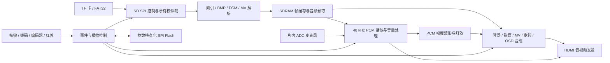

# 系统架构与实现

VinylFPGA 是运行于 HX4S20C（安路 EG4S20BG256）的唱片主题本地多媒体播放系统。TF 卡提供图片、PCM 和 MV 数据，FPGA 完成媒体扫描、存储调度、显示合成、音频输出与实体交互。运行时以板卡和显示/音频设备构成完整系统。

主入口为 [top_tf_hdmi_audio.v](../src/top_tf_hdmi_audio.v)，TD 工程为 [VinylFPGA.al](../prj/VinylFPGA.al)。输出画布为 640×480；像素时钟为 25 MHz，不能仅凭分辨率名称声称严格的 60.000 Hz 输出。

## 数据通路

图中连线表示功能关系，不代表所有连接直接跨域；实际数据交换采用 FIFO、toggle 事件、状态同步或请求/完成握手。

| 部分 | 主要源码 | 作用 |
| --- | --- | --- |
| 媒体与 SD | [SD/](../src/SD/) | FAT32 扫描、索引、BMP 读取、CMD17/CMD18 控制、故障状态 |
| 音频 | [audio/](../src/audio/) | SDRAM 预取、48 kHz 时基、会话重启、seek、音量、淡化与麦克风混音 |
| 帧调度 | [video/](../src/video/) | 背景缓存、MV 请求、帧切换与写入管线 |
| 显示 | [display/](../src/display/) | 播放页面、歌词、参数 OSD、进度、波形、转场 |
| 交互 | [io/](../src/io/) | 消抖、编码器/红外解析、统一事件、参数、灯效与蜂鸣器 |
| 启动 | [boot/](../src/boot/) | Logo 与启动显示层 |

## 调度与同步

音频/背景/封面沿用 CMD17 读取通路，MV 使用受限 CMD18 连续读通路。两者共用实体 SD 接口，通过所有权和缓存准入协调；不能同时任意驱动 SD。音频预取、MV 流水线及错误恢复由独立模块组合完成。

MV 媒体为 320×240、RGB565LE、10 fps 的原始帧序列，不在 FPGA 中解码 MP4。帧请求由播放时间线驱动，显示 bank 在帧边界提交；seek 时使过期请求失效，并在目标稳定后重新取帧。像素域使用三个显示/待显示/写入 bank 的调度，顶层还管理预取缓存，不能把这些不同层次的缓存简单等同于单个 FIFO。

歌词与标题的字形、行表保存在已综合的 ROM 中。KEY6 在五行歌词与当前行专注显示间切换。参数 OSD、播放进度和波形与视频页面合成；PCM 波形来自音频样本/幅度信息，未实现 FFT 频谱分析。

| 时钟域 | 频率 | 主要用途 |
| --- | --- | --- |
| `clk` | 50 MHz | 实体输入、事件与参数控制 |
| `sd_card_clk` | 100 MHz | SD/媒体控制及相关逻辑 |
| `ext_mem_clk` | 125 MHz | SDRAM 数据通路 |
| `ext_mem_clk_sft` | 125 MHz、移相 | SDRAM 硬接口采样时钟 |
| `video_clk` | 25 MHz | 像素合成及音频采样节拍生成 |
| `mic_adc_clk` | 12.5 MHz | `video_clk` 二分频的片内 ADC 采样时钟，约 144 kS/s |
| `hdmi_5x_clk` | 125 MHz | HDMI 串行发送 |

频率来自工程 PLL 配置，时钟名和域关系见 [timing.sdc](../constraints/timing.sdc)。音频节拍由像素域生成；麦克风 ADC 时钟由 `video_clk` 分频并在约束中声明。不能把保留在源码目录中的旧音频 PLL 包装文件误认为当前独立运行的音频时钟域。

## IP 与实现边界

工程保留厂商 PLL、FIFO、SDRAM 硬原语包装，以及加密 HDMI/SDRAM 文件。系统集成、媒体/播放/交互/显示调度的 RTL 可查看；加密核心的内部实现不能据此声称逐行可审阅或全部由项目作者原创。

当前显示适配采用既定媒体尺寸、窗口及固定比例路径。[bilinear_8q8.v](../src/display/bilinear_8q8.v) 是保留的插值模块，未被当前顶层实例化。项目不据此宣称支持任意分辨率 BMP 的自适应双线性缩放。
