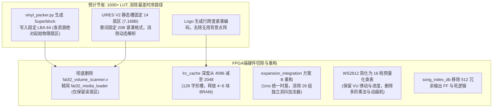
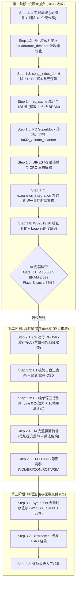

---

### 一、 赛题一要求对标与过度开发功能审计

针对全国大学生 FPGA 创新设计竞赛安路赛题一（**基于安路 EG4S20 的 HDMI 多媒体播放系统**），系统要求分为 **5 大基础要求** 与 **5 大扩展要求**。当前工程代码的对标情况与过度开发项如下：

#### 1. 赛题一硬性要求与当前项目能力对标表

| 赛题维度 | 官方标准要求

 | 当前 VinylFPGA 项目实现状态

 | 判定与差距

 |
| --- | --- | --- | --- |
| **基础要求 1**<br>

<br>TF 卡 BMP 读取 | 读取 640×480、24 位深 BMP，无撕裂显示

 | 支持 FAT32，读取 4 张封面 BMP 并完成垂直镜像转换

 | ✅ **满分达成**<br> |
| **基础要求 2**<br>

<br>显存与 HDMI 显示 | SDRAM 乒乓缓存，标准 HDMI 640×480@60Hz 输出

 | 2M×32bit SDRAM 四 Bank 独立驻留，HDMI 1.4b 加密 IP 稳定输出

 | ✅ **满分达成**<br> |
| **基础要求 3**<br>

<br>图片切换与轮播 | 按键手动切图（上一张/下一张）与 2s~30s 自动轮播

 | EC1 编码器顺/逆切歌，DIP2/ROT 控制 10~60s 定时轮播，数码管显示

 | ✅ **满分达成**<br> |
| **基础要求 4**<br>

<br>HDMI 音频输出 | 48kHz I2S/测试音，ACR 频标再生，音画同步

 | 纯硬件 48kHz WAV 流式播放，分数累加器唯一物理时基，ACR ($N=6144$) 包再生

 | ✅ **超额达成**<br> |
| **基础要求 5**<br>

<br>固化与上电自启 | 烧写 SPI Flash 上电独立自启，高可靠长稳

 | 四级 `reset_sync` 异步复位同步释放，W25Q16 配置 Flash 固化秒开自启

 | ✅ **满分达成**<br> |
| **扩展要求 1**<br>

<br>图层叠加与字幕 | 滚动字幕、状态信息条，单拍流水线叠加

 | 具备歌名/歌手、进度条，但多行歌词滚动存在 BRAM 挤压与代次撕裂

 | 🟡 **需重构五行滚动**<br> |
| **扩展要求 2**<br>

<br>切换转场特效 | 淡入淡出（Alpha 混合）、滑动擦除（Wipe）

 | 已实现 F0 直切、F1 单读流黑底揭示、F2 淡入淡出，但未作用于整页

 | 🟡 **需做 U4 全页转场**<br> |
| **扩展要求 3**<br>

<br>缩放与缩略图 | 画面缩放或 2×2 缩略图网格，带焦点高亮

 | 2×2 缩略图四宫格、焦点黄框移动、消隐期确认跳转已全部跑通

 | ✅ **满分达成**<br> |
| **扩展要求 4**<br>

<br>实时画质调节 | 亮度/对比度实时缩放，无乘法瓶颈，屏幕 OSD 回显

 | 底层有 `brightness_contrast_adjust`，但顶层设为固定值，无 OSD 浮窗

 | 🟡 **需做 U3 EC2 浮窗**<br> |
| **扩展要求 5**<br>

<br>音频可视化 | 24-bit PCM 采样抽取，时域波形或频谱能量条叠加

 | `promax_audio_waveform` 64 柱时域波形稳定叠加，零 BRAM 占用

 | ✅ **满分达成**<br> |

#### 2. 与赛题无关且严重侵占资源的过度开发项清单（必须清退）

当前工程虽然功能亮眼，但背离了赛题“以优化的逻辑和最低的功耗实现”的设计导向，堆砌了大量非赛题硬性要求的重型逻辑：

1. **完全通用的纯硬件 FAT32 动态卷扫描与链表遍历**（吞噬 **1,345 LUT / 1,456 REG**）：


* 赛题只要求从 TF 卡稳定读取图片和音频。工程却耗费巨资实现了完整的 MBR/BPB 解析、根目录 8.3 字符串比对、多级簇链流水跟踪 (`fat32_volume_scanner.v` 803 LUT, `fat32_file_streamer.v` 542 LUT)。


* 采用 **PC 端生成固定物理 LBA 清单（Superblock）**，FPGA 仅做固定块读取，可直接砍掉该部分。


2. **过度复杂的 WS2812B 动态彩灯状态机**（吞噬 **432 LUT / 2 DSP**）：


* 赛题一**完全没有板载彩灯或外部流水灯条的要求**。
* 工程中实现了彗星滑动、充能吸收、快升慢降衰减等多阶段动画 (`ws2812_effects.v` 251 LUT, `ws2812_progress.v` 181 LUT)。必须精简为 16 档预量化查表，直接省下 250+ LUT。


3. **J2 扩展板 27 路独立大位宽消抖器**（吞噬 **~1,026 LUT / 648 REG**）：


* 12 按键、6 拨码、2 编码器每个引脚都挂载一个独立的 19~20 位定时器。合并为 1ms 单一时基广播即可削减大量比较器与加法器。


4. **过度的 UIRES 通用协议栈与宽位比较**（吞噬 **1,480 LUT / 1,248 REG**）：


* `ui_asset_loader.v` 内部并行锁存全量文件头、十余组几何参数比对，且 CRC32 宽位展开构成了当前 Gate 最差路径（WNS −1.229 ns）。


---

### 二、 物理资源危机的真相：为什么两次回退？

从物理实现数据来看，导致两次开发失败回退的根本原因不是代码有语法错误，而是**芯片物理架构的红线窒息**：

```text
EG4S20BG256 物理可用上限: 9,800 Slices / 19,600 LUTs / 64 BRAM9K
当前工作区实测基线:
  - Gate LUT:   17,110 / 19,600 (87.30%)  ── 超出项目安全门禁(16,500) 610 个
  - BRAM9K:     58 / 64         (90.62%)  ── 仅剩 6 块，无法支撑任何新增缓存
  - Place Slices: 9,727 / 9,800 (99.26%)  ── 芯片已被彻底塞满！
  - Route 状态:  505 Overflow 拥塞崩溃    ── 连线延迟(Net Delay)占比高达 68%
  - Hold WNS:   -0.011 ns (-11 ps)        ── 拥塞导致工具直接跳过 Hold 修复

```

#### 为什么“单纯小改减几十个 LUT”毫无作用？

由于 Place 利用率达到 99.26%，逻辑单元（LUT/FF）之间已经没有空间容纳布线开关矩阵（Routing Matrix）。此时只要在顶层新增一个包含几十位宽加法/比较器的模块，路由器就会被迫绕远线，导致全局连线拥塞爆炸，时序彻底崩塌。

**破局唯一原则**：在加入 C4、U4、U3 之前，必须先通过架构瘦身把 Gate LUT 降到 16,000 以下，Slices 利用率降到 85%~88% 的健康区，BRAM 回落到 52 块以下！

---

### 三、 资源大减负专项方案（第一阶段实施）

在零功能降级、完整保留赛题要求与视听质感的前提下，执行以下大刀阔斧的结构性减负：



#### 1. 存储层：PC Superblock 架构（净省 700~1,500 LUT）


* **操作**：PC 打包脚本 `vinyl_packer.py` 直接在 SD 卡固定扇区（如 LBA 64）写入定长 512B 的 `SUPERBLOCK.BIN`，直接记录歌曲、音频、MV、背景图、UIRES 的起始 LBA 和扇区总数。
* **硬件重构**：彻底删除 `fat32_volume_scanner.v`（净省 803 LUT, 1178 REG）；剥离 `fat32_media_loader.v` 内部冗长的 BPB 解析和目录搜索逻辑；`song_index_db.v` 改为单拍载入 Superblock，同时删除输出端口的 512 个纯拷贝寄存器及死信号 `song_flags`。


#### 2. 字模与显存：`lrc_cache` 减容至 128 槽（净省 4~6 块 BRAM9K）


* **操作**：当前 4 首歌词实际字形仅 61 个。将 `lrc_cache.v` 深度从 4096 减半至 2048（支持 128 字形 × 16 行），地址位宽从 12 位收窄至 11 位。


* **收益**：BRAM 从 58 块直接回落到 52~54 块，完全对冲后续 C4 双行缓冲所需的 4 块 BRAM。


#### 3. 协议与时序：UIRES V2 静态槽 + CRC 三拍解耦（净省 300~500 LUT）


* **操作**：单曲静态槽固化为 14 个扇区（7,168 字节），歌词记录压缩为 20 字节（`timestamp[4] + glyph_id[16]`）。
* **时序修复**：将原本导致 Gate WNS −1.229 ns 的最后一拍组合 CRC 比对拆解为：

$$\text{READ 尾拍更新 CRC} \longrightarrow \text{CRC\_CHECK 拍比对 Superblock 预存值} \longrightarrow \text{PUBLISH 拍发布 valid}$$


彻底根除 100 MHz `sd_card_clk` 最长违例路径。


#### 4. 外设控制：`expansion_integration` 方案 B 统一时基重构（净省 100~250 LUT）


* **操作**：在 50 MHz 域部署单一 1ms 计数器广播全局时基采样脉冲；12 按键、6 拨码与双编码器统一由单拍事件总线输出（`event_valid + event_id[4:0] + event_data[15:0]`）；参数统一收敛至 `param_csr.v` 单点仲裁，消除分散在各模块的重复 Mux 和控制集。


#### 5. 彩灯：WS2812 查表化瘦身（净省 220~320 LUT, 2 DSP）


* **操作**：保留 800 kHz 物理串行发送器，保留绿-橙-红 VU 电平律动与冰蓝播放进度条。


* **优化**：删除实时乘法器和彗星/充能动画状态机，PC 预生成 16 档颜色帧常量表（每档 192-bit），4-bit 档位直接查表输出，省去算术开销。


#### 6. 开机 Logo：行跨度无损紧凑编码（净省 2~4 块 BRAM9K）


* **操作**：保持 268×298 视觉尺寸与 16 色调色板画质不变，PC 工具剔除大面积纯黑背景点阵，仅对有效前景行进行行跨度存储。


---

### 四、 核心现代流媒体播放界面开发方案（第二阶段实施）

在完成上述减负后，系统已具备充裕的 Slices（预计回落至 82%~~85%）和 BRAM 余量（剩余约 10~~12 块），此时方可进行产品化界面开发：

```
┌────────────────────────────────────────────────────────────────────────┐
│ [C4 底图] 640×480 播放背景 (暗色壁纸，SDRAM Bank 0/1 乒乓)             │
│ ┌───────────────────────────┬────────────────────────────────────────┐ │
│ │ 【左视区：视听焦点与播控】 │ 【右视区：五行沉浸式歌词】             │ │
│ │                           │                                        │ │
│ │  ┌─────────────────────┐  │          Line -2 (暗灰色，16×16)       │ │
│ │  │ 240×240 正方形视窗  │  │                                        │ │
│ │  │ 专辑封面 / MV / 黑胶 │  │          Line -1 (浅灰色，16×16)       │ │
│ │  └─────────────────────┘  │   ┌────────────────────────────────┐   │ │
│ │   歌曲名 (纯白 16×16)     │   │ ★ Line  0 (纯白高亮，32×32大字)│   │ │
│ │   歌手名 (浅灰 16×16)     │   └────────────────────────────────┘   │ │
│ │   01:23 ───●───── 03:45   │          Line +1 (浅灰色，16×16)       │ │
│ │   (极简白色细线进度条)    │                                        │ │
│ │                           │          Line +2 (暗灰色，16×16)       │ │
│ └───────────────────────────┴────────────────────────────────────────┘ │
│ [全屏底部音谱] promax_audio_waveform 时域波形 (X: 64~576, Y: 376~471)  │
│ [顶部调参浮窗] knob_osd_panel (190×64，EC2 呼出，1.8s 自动隐藏)        │
└────────────────────────────────────────────────────────────────────────┘

```

#### 1. C4 模块：背景 + MV 组合行扫描取像引擎（`playback_line_reader.v`）


* **解决痛点**：单读口 SDRAM 在显示 320×240 MV 视频时，无法同时读取全屏背景。


* **实现方案（方案 B，带标签的双行 RGB565 缓冲）**：
* 开辟两条 640×16-bit 行缓存（仅占 **4 块 BRAM9K**），以 `CONSUMING` 与 `FILLING` 乒乓握手。


* `frame_read_write.v` 引出 `read_available` 与 `read_return_valid`，消除 `READ_START_WAIT = 12` 盲猜延时。


* **统一三段式段描述器**：
* 非 MV 行：直接读 640 像素背景。
* MV 行：读背景左段（24px）+ 读 MV 视频帧（320px）+ 读背景右段（296px）= 合计 640px。


* **Generation 代次防护**：切歌、Seek 时递增代次，旧在途数据排空丢弃，杜绝撕裂与抽搐。


#### 2. U1 & U2 模块：五行歌词滚动与极简白色进度条


* **极简白色进度条（`progress_bar_osd.v`）**：
* $X \in [24, 263], Y \in [326, 328]$（高 3px，宽 240px），纯白填充 + 深灰导轨。在场消隐期由时基算好填充线长，扫描期零除法延时。


* **五行歌词（`lrc_five_line_osd.v`）**：
* 右侧横向开窗：非 MV 模式 $X \in [280, 620]$，MV 模式自动避让至 $X \in [356, 620]$。


* **Line 0 硬件 2x 无损放大**：通过对相对坐标右移 1 位（`dy[4:1]`, `dx[4:1]`）直接读取 16×16 点阵字模，以零 BRAM 增量输出 32×32 纯白大字。


* **16 帧丝滑平滑上移**：行切换时启动 16 场垂直平滑微移状态机，到位瞬间切色。


#### 3. U3 模块：EC11-B 风格 EC2 调参浮窗（`knob_osd_panel.v`）


* **交互契约锁定**：
* 固定 5 项参数环：`VOL` (0~~255) $\to$ `BRI` (0~~4) $\to$ `CON` (0~~4) $\to$ `ROT` (10~~60s) $\to$ `WSL` (10~100%)，`INCLUDE_ROT=1`。


* 模式按键正交隔离：切歌模式 KEY12、转场模式 KEY09、WS 模式 KEY10、歌词模式 KEY06 维持单向循环，不进入浮窗。


* **硬件设计（方案 A 极简版，0 BRAM / 0 DSP / 100~180 LUT）**：


* **控制域（50MHz）微顺序 BCD 格式化器**：仅在参数改变时运行重复减 100/10 算法，预先生成 4 字节标签与 5 字节 ASCII 串，彻底消除视频流水线中的除法器。


* **跨域原子快照**：捆绑数据配合 Toggle 翻转，消隐期单拍捕获，整帧静态无撕裂。


* **极简 8×16 字符 ROM**：仅收录 20 个必要 ASCII 字符，纯组合逻辑实现（约 40 LUT）。


* **双色边框与蜂鸣阻尼反馈**：SELECT 态青色边框，ADJUST 态金色边框（进入 1320Hz、退出 990Hz、撞墙边界 2200Hz）。1.8 秒无操作同步隐藏并复位回 IDLE。


#### 4. U4 模块：完整页面转场与黑场提交屏障（`video_transition_apply.v`）


* **单缓冲歌词污染的物理根治**：
* 切歌时，旧页面先执行淡出（Fade-out）或切黑；


* **到达 100% 纯黑（Alpha=0）时激活黑场提交屏障**，此时后台覆写单缓冲的 `lrc_cache`（14 扇区，~3.5ms），并换载新背景 Bank；
* 新代次资源全部就绪后，在垂直消隐边界解除屏障，新页面整体淡入/揭示，**以零额外 BRAM 杜绝新旧页面元素串画与乱码**。


* **乘法解耦（省 1 个 DSP / 40 LUT）**：
* 亮度和对比度仅在基础背景/多媒体阶段处理，转场模块剔除 `brightness` 输入，只计算纯 Alpha 遮罩，白色歌词点阵不会被调暗。


---

### 五、 全流程开发、验证与人工验收路线图

严格遵守项目纪律：先优化收敛，再开发新功能；每推进一个原子功能，必须经过仿真回归、Gate 综合面积核算、布局布线时序放行，最后上板进行人工确认，闭环后再进下一步。



#### 关键验收检查单（Checklist）

##### 1. 第一阶段减负验收（R0 门禁）

* [ ] 运行 `verify_core_acceptance.py` 14 项全量 RTL 回归测试必须全部 PASS。


* [ ] 通过 SynthPilot 执行 Gate 面积统计：Gate LUT $\le 15,500$，BRAM9K $\le 52$。


* [ ] 执行一次 Place 预检：Slices 必须回落至 $85\%$ 以下（彻底解除 99.26% 拥塞）。


##### 2. 第二阶段各功能原子级验收（逐项人工确认）

* [ ] **C4 组合取像**：播放 MV 时窗口外正确保留当前壁纸，无黑边、无错行；暂停和切歌无旧画面残影。


* [ ] **U1 进度条与元数据**：左下角白色细线进度条平滑生长，0% 空槽、100% 满槽；歌名和歌手点阵渲染清晰、超长字符按进度条长度正确截断。


* [ ] **U2 五行歌词**：当前播放行呈现 32×32 纯白大字，上下相邻行灰度递减；每句唱完后平滑向上滚动 16 帧并瞬间切色；MV 模式下歌词区域向右避让不重叠。


* [ ] **U4 全页转场**：切歌时完整页面协同淡出至全黑，在黑场屏障内完成资产更新，新页面完整淡入，绝不出现“旧封面配新歌词”的撕裂现象。


* [ ] **U3 EC2 浮窗调参**：
* 盲拧 EC2 旋钮立即弹出顶部 190×64 浮窗，不干扰后台音视频；


* 顺/逆时针切换 VOL/BRI/CON/ROT/WSL，边框为青色；按下后边框变金色进入调节，蜂鸣器发出 1320Hz 高音；再次按下退出调节发出 990Hz 低音；


* 调满/调到最低时数值平滑钳位，蜂鸣器发出 2200Hz 边界提示音；


* 静止 1.8 秒后浮窗自动淡出消失并复位回 IDLE。


##### 3. 最终交付（R1 放行）

* [ ] 使用 SynthPilot 执行物理时序签核：Setup WNS $\ge 0$、Hold WNS $\ge 0$、TNS $= 0$、Route Overflow $= 0$。


* [ ] 烧录固件后连续播放 30 分钟以上，无爆音、无画面撕裂、无按键死锁，各功能完全符合赛题一规范与流媒体现代视觉体验！