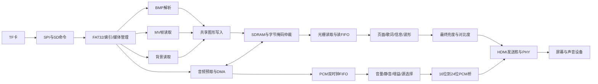

# 项目全景架构与数据流

## 1. 用三句话理解项目

TF 卡保存预先准备好的封面、PCM音频、MV帧和背景等媒体。FPGA用状态机找到并读取这些内容，把突发和不规则的读卡服务变成连续的视频与音频输出。交互、歌词、进度和实体反馈围绕共同的播放状态组织。

把系统分为数据面与控制面会更容易理解。数据面搬运像素和样本；控制面决定播放哪首、读哪个地址、是否暂停、什么时候允许新数据成为可见状态。很多难点发生在二者交界处。

## 2. 工程入口与目录地图

| 入口或目录 | 阅读时的用途 |
|---|---|
| `prj/VinylFPGA.al` | 工具版本、目标器件、顶层、源文件与约束、实现参数 |
| `src/top_tf_hdmi_audio.v` | 顶层模块`top`，看实例连接和跨域关系 |
| `src/SD` | SPI、SD、FAT32、索引、BMP、图形帧缓存通路 |
| `src/audio` | 预取、DMA、PCM FIFO、会话、播控、Seek、时基、HDMI PCM桥 |
| `src/video` | MV、背景、共享图形写入、帧调度 |
| `src/display` | 页面、歌词、进度、字体、波形、转场、画质调节 |
| `src/io` | 同步消抖、事件、命令路由、参数CSR、Flash、电机和灯效 |
| `src/boot` | 固件内启动Logo和启动显示层 |
| `src/IP`、`src/include` | 厂家IP包装、常量和布局定义、部分加密实现 |
| `constraints` | 管脚ADC和时序SDC |
| `sim` | 单元、集成、等价和历史回归证据 |
| `tools` | 媒体准备、验证、构建与发布校验工具 |

顶层使用大量 `include` 引入业务文件。只看 `.al` 文件列表，不能直接断言某模块缺失。反过来，目录存在某个 `.v` 文件，也不能直接断言它正在主链路中工作。应看实例、参数开关与最终综合结果。

## 3. 主数据流



这张图突出逻辑职责，不等同于每根RTL连线：音频、封面、背景与MV的请求还经过不同仲裁层，当前MV主要走CMD18突发通路，音频等走CMD17通路。不要把所有读取简单理解成一个文件流模块输出给所有消费者。

## 4. 控制流

```text
物理输入
  → 两级同步/消抖/编码器判向/红外解码
  → 事件汇聚与命令路由
  → 浏览/播控/Seek/参数意图
  → 相应时钟域状态机
  → 资源就绪与事务完成
  → 帧边界更新显示、实际样本推进时间
```

同一个旋钮在不同页面的含义不同，是业务状态选择了事件用途。EC1浏览时导航、播放时Seek；EC2负责参数菜单与调参。不能把所有动作都归为“按键控制一个变量”。

## 5. 时钟域表

| 名称 | 名义频率 | 周期 | 主要职责 |
|---|---:|---:|---|
| `clk` | 50MHz | 20ns | 输入、事件、参数、Flash、实体反馈 |
| `sd_card_clk` | 100MHz | 10ns | 文件与扇区控制、播放状态、Seek、预取 |
| `ext_mem_clk` | 125MHz | 8ns | SDRAM接口与缓存读写仲裁 |
| `ext_mem_clk_sft` | 125MHz、相移180° | 8ns | SDRAM采样相关的IP时钟窗口 |
| `video_clk` | 25MHz | 40ns | 光栅、页面、歌词、PCM消费与媒体时间 |
| `hdmi_5x_clk` | 125MHz | 8ns | HDMI发送串行化相关逻辑 |

当前是两个主要PLL：`sys_pll`与`video_pll`。保留的`PLL_HDMI_AUDIO.v`文件并不意味着当前音频必须用独立12.288MHz母钟。当前PCM节拍从25MHz域分数累加得到，音频与画面相关逻辑共享该域。

`sd_card_clk=100MHz`是内部控制时钟，不能说成TF卡SPI引脚以100MHz串行传输。SPI分频与字节间握手另见04。

## 6. 存储布局为什么容易讲错

SDRAM有 `2^21` 个32-bit word，即8MiB。以下地址单位均为 **32位word**，不是字节。

| 地址范围（含首尾） | 图形用途 | 字节通道 |
|---|---|---|
| 0—307199 | 封面bank0 | 高24位RGB888 |
| 307200—614399 | 封面bank1 | 高24位RGB888 |
| 614400—921599 | 封面bank2 | 高24位RGB888 |
| 921600—1228799 | 封面bank3 | 高24位RGB888 |
| 1228800—1305599 | MV bank0 | 一个像素占一个word的当前图形路径 |
| 1305600—1382399 | MV bank1 | 同上 |
| 1382400—1459199 | MV bank2 | 同上 |
| 1459200—1766399 | 当前专辑背景 | 高24位RGB888 |
| 1766400—2073599 | 静态艺术背景区域 | 当前修改：艺术一高16位、艺术二低16位 |

**音频与部分封面地址重叠，但字节通道不同。** 音频预取使用word地址0—524287的低8位，每个word存1个音频字节。封面写掩码保护低字节，音频写掩码保护高三个字节，因此可以在同一地址存不同用途数据。

这512KiB音频有效容量实际覆盖2MiB的地址跨度，并非紧密占用512KiB连续32位存储。若把它和封面地址当普通连续字节区相加，会得到错误的“越界”判断。

当前双艺术背景修改则在最后一个区域把两个RGB565像素放在同一word的两个半字中。它与音频低字节区域不重叠。旧稳定版本该区域只有单个可替换艺术图槽，不能把新旧布局的就绪语义混用。

依据：[顶层](<D:/Data_Backup/VinylFPGA_Workspace_Base/VinylFPGA/src/top_tf_hdmi_audio.v:163>)、[音频DMA](<D:/Data_Backup/VinylFPGA_Workspace_Base/VinylFPGA/src/audio/audio_sdram_dma.v:93>)、[背景加载器](<D:/Data_Backup/VinylFPGA_Workspace_Base/VinylFPGA/src/video/background_cache_loader.v:90>)。

## 7. 六个典型动作的完整故事

### 7.1 上电

配置Flash装载FPGA设计。外部复位与PLL锁定共同参与内部复位，各时钟域同步释放。Logo由片内ROM提供，同时媒体链路初始化、扫描文件并准备缓存。满足启动条件后进入主页面。

启动Logo参数中的6秒保持、4秒允许跳过、8秒超时是控制参数，不能当作已经测得的“从上电到可操作”总时间。

### 7.2 浏览并确认一首歌

编码器或方向键产生事件，事件桥把导航动作交给浏览控制。封面就绪与显示焦点必须一致，确认时才把焦点曲目交给播控。播放状态、媒体元数据与新会话随后配合启动。

讲述时同时指出：用户看到的焦点、准备写入的bank、最终显示bank是不同概念。加载完成前不能提前显示未完成内容。

### 7.3 连续播放

音频预取把SD服务波动吸收在SDRAM环中，PCM FIFO接近消费端。每次真正取出有效PCM样本，`wav_sample_consumed`才推进媒体时间。歌词、进度和MV使用这个时间进行选择与调度。

显示本身仍按固定光栅扫描。MV原生10fps，显示器刷新约59.52Hz，这两者不冲突：同一MV帧可以被扫描多次。

### 7.4 暂停

普通暂停保留已缓冲媒体并冻结有效播放位置。HDMI音频接口可继续按节拍发送零样本，避免把接收端需要的供数节奏也一起停掉。应区分媒体时间暂停与物理输出时序停止。

### 7.5 Seek

先以当前或最近目标样本位置累加步进并钳位。旧会话停止产生新请求，等待SD与内存中的在途事务排空，再按新LBA及扇区内偏移开始。时基重装目标样本，歌词重新定位，MV重建对应目标帧。

这是一项跨模块事务，不是简单修改屏幕上的秒数。

### 7.6 调参并保存

EC2或其他合法音量意图汇聚到50MHz域唯一CSR，参数通过握手送往消费者，画面参数在帧边界生效。保存时对五项设置取快照，交给独立W25Q64双记录流程；上电读取有效记录恢复。

保存期间继续调参，新的值可能与已保存快照不同，因此“保存成功”与“当前参数已全部持久化”要分开判断。

## 8. 你应能画出的四张白纸图

1. 数据图：卡→文件/媒体→缓存→音频/视频→HDMI。
2. 控制图：输入→事件→业务→完成/失败→显示。
3. 时间图：PCM节拍、真实消费、毫秒时间、MV100ms目标、屏幕帧边界。
4. 存储图：word地址区间与byte mask，解释低字节PCM与高24位封面共存。

画图时给每根跨域箭头写上方法：两级同步、toggle、握手快照或异步FIFO。不能统一写“同步一下”。

## 9. 最容易被追问的架构取舍

固定曲库和预处理媒体降低了运行时解析与压缩解码负担，代价是内容更新不够通用。优先保障音频减少听感中断，代价是低优先级背景与MV可能等待。多缓存改善连续性，代价是存储与控制复杂度。帧边界提交避免一帧内状态混杂，代价是可见更新要等待合适边界。

这些取舍能解释出来，就是系统工程能力。无需把每一种选择都包装成“最优”，应说明为什么适合当前器件、当前素材与比赛目标。
