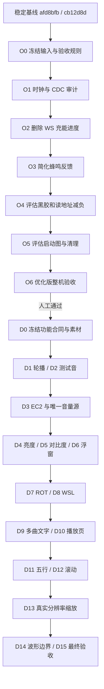

# VinylFPGA 先优化、后开发执行总览 Implementation Plan

> **For agentic workers:** REQUIRED: Use `superpowers:executing-plans` 按本计划逐项执行。适用技能允许的审查可使用审查代理；不得借此绕过逐功能人工验收。本文仅规划，所有任务均未实施。

**Goal:** 从已验收基线出发，先完成删减简化和优化验收，再逐项打通赛题一基础与全部五项扩展，并完成 EC2 浮窗、播放页和五行滚动歌词。

**Architecture:** 保留媒体加载、SDRAM、HDMI、音频和恢复主链；先移除非必要反馈与视觉负担。新功能采用唯一参数源、小型文字资源、固定布局和帧边界提交，避免通用 UI 资源系统及多路背景读流。

**Tech Stack:** Verilog-2005、Icarus Verilog、Python、Anlogic TD 6.2.168116、SynthPilot MCP、EG4S20BG256、640×480 HDMI、48kHz PCM。

## Chunk 1: 执行依据与顺序

### 1. 本轮决定

**新顺序：优化阶段全部收口并由用户验收 → 再开始新增功能。** 这替代原分析报告第9节“先补轮播、优化可选穿插”的执行顺序。原报告保留为事实和证据来源，不覆盖历史结论。

配套文件：

- [01 优化删减与简化实施方案](01_优化删减与简化实施方案.md)：O0～O6，决定删什么、保留什么、如何测量收益。
- [02 赛题功能与产品界面开发方案](02_赛题功能与产品界面开发方案.md)：D0～D15，优化版通过后才进入。
- [原始项目分析](../项目分析_20261009/项目现状_赛题对照_资源优化与分阶段开发方案.md)：现状、赛题原文位置、Git历史与物理实现证据。
- [逐文件阅读索引](../项目分析_20261009/全量文件阅读与证据索引.md)：原484份资料与249份代码/工具/约束/仿真文件的审计范围。

资料中的示例 RTL、删减建议和旧资源估算是分析输入。只有本方案明确选择的任务进入执行范围；用户“全部五项扩展”优先于资料中删除对比度、缩放等建议。

### 2. 基线与风险

| 项目 | 依据 / 执行约束 |
|---|---|
| 当前 HEAD | `afd8bfbb68f927dc2dbfa70df946a7481fb46bee`，生产源码等价已验收 `cb12d8d` |
| 两次回退经验 | 历史 UIRES、动态图层、字库扩展叠加后接近容量边界；禁止整分支恢复或一次合并多个功能 |
| 统一比较配置 | 原生 TD，显式 `area_prior`、seed5、完整 route 与 `fix_hold`、final 时序 |
| 已测 final 资源 | LUT 13,734；Slice 7,541；PLB 2,360/2,450；BRAM9K 42；DSP 15 |
| 已测 final 时序 | setup 121ps；hold 24ps；TNS/违例0；非本轮文档编写新跑结果 |
| 重点风险 | PLB 96.33%、时序余量小；PLL反馈告警、CDC及I/O时序完整性仍需专项核查 |
| MCP差异 | 旧 MCP AUTO 测得 Slice 8,447，不能拿它和原生 area_prior 结果比较删减收益 |
| 原图 | 上轮指定图片路径不存在；视觉规格暂按已提供文字方案冻结，精确对图待可读取图片到位后处理 |

资源数字引用已有审计证据，**不代表优化已完成或板上新功能已验收**。

### 3. 两阶段路线

图中组合节点只表示阶段顺序。斜杠两侧仍分别开发、分别完整构建、分别人工验收；不得合并成一个候选。

优化候选可以经测量判定“收益不足，保持原实现”。这仍属于优化阶段的已关闭决策，不要求为了完成清单而强删。**O6 之前不新增业务功能**，不能以“顺便加面板”替代单项优化验证。

### 4. 赛题闭环映射

| 用户目标 | 保留 / 补齐途径 | 最终可观察证据 |
|---|---|---|
| BMP→SDRAM→HDMI | 保留现有主链；D13增加真实输入尺寸 | 原尺寸与另一尺寸同卡显示，FPGA实际缩放 |
| 手动与自动切图 | 保留手动；D1新增定时自动切图 | 按键切图与定时轮播各自成功 |
| 48kHz音频 | 保留PCM/I2S/HDMI；D2明确测试音演示 | 测试音、真实曲目、采样节拍证据 |
| Flash自启与稳定 | 保留启动/恢复；O6、D15冷启动复验 | 新候选断电自启、插拔恢复和长稳 |
| 扩展：亮度/对比度 | D4、D5 | 旋钮操作真实改变图像，默认恒等 |
| 扩展：歌词 | D9、D11、D12 | 不同曲目歌词对应、五行与滚动正确 |
| 扩展：转场 | 保留现有链，每次布局改动复验 | 手动和自动切图过渡无撕裂 |
| 扩展：缩放 | 保留缩略图；D13补真实尺寸输入 | 不把PC预缩放当FPGA缩放证据 |
| 扩展：音频可视化 | 保留32柱，D14补幅度边界 | 真正消费PCM、静音及极值正确 |
| 产品交互 | D3～D8、D10～D12 | EC2不误Seek；浮窗可读；播放页完整 |

### 5. 每项统一门禁

每阶段执行者填写独立记录，状态依次为 `planned → implementing → auto_pass → routed_pass → awaiting_manual → accepted`。`skipped_after_measurement` 用于优化候选，无收益时必须附比较报告和保留理由。人工不通过记 `rejected`，下一阶段不启动。

- [ ] 锁定上一 accepted 的 commit、bit SHA256、卡镜像 SHA256、TD版本与构建参数。
- [ ] 写本项行为差异和禁止扩大范围的边界；列出实际修改文件。
- [ ] 完成必要参考模型/定向检查；新增检查确实验证新行为或风险，避免只复述实现。
- [ ] 当前生产回归全部通过；生产用例清单与历史参考用例分开记录，不能删除失败用例后宣称等价通过。
- [ ] 同配置完整 `gate → place → route → fix_hold → final`；保留源清单、日志、数据库、指标和最差路径。
- [ ] 检查 setup/hold WNS≥0、TNS=0、违例0、最终路由overflow0、无新增结构性时序错误。
- [ ] 对未覆盖时序/CDC有分类和依据；禁止以扩大false-path掩盖问题。
- [ ] 生成候选bit并核对输入一致性，再供人工SRAM验收；下载动作到执行阶段按当时用户授权办理。
- [ ] 用户填写具体人工结论；验收通过才更新 accepted；保留上一bit和卡，不覆盖唯一可用版本。

**资源管理建议，不是器件硬限制：**优化收口争取 LUT≤13,200、Slice≤7,200；后续目标 LUT≤15,500、Slice≤8,330（85%）、BRAM9K≤52、DSP≤20。这些是规划目标，未经实测不得承诺。Slice≥8,820（90%）时停止叠加功能并回到优化；PLB超过98%或setup/hold明显恶化触发专项分析，即使Slice较低也不能忽略。

当前基线未达到 setup≥0.2ns、hold≥0.05ns 的期望安全余量，不能把这些期望写成既已满足的硬门槛。应保持正时序并改善风险；变更约束后必须在同一约束下重建父版本再做差分。

### 6. 记录和回退合同

未来执行时新增 `doc/实施记录_20261009/`，每项包含：`scope.md`、`manual.md`、`metrics.json`、`build_manifest.json` 和证据链接。大型构建库留在现有 `prj/resource_opt_verified_20261005/<独立轮次>/`，不把整个EDA数据库加入Git。

人工记录至少包含：阶段ID、父accepted、候选commit/bit/卡哈希、板卡/显示器、测试步骤、期望、实测、照片/视频位置、结果、用户确认、未关闭问题。空白人工记录不是验收通过。

推荐阶段分支名 `codex/opt-o2-ws-vu`、`codex/dev-d6-ec2-panel`；通过后打本地 `accepted/<阶段>-<日期>` 标记并保留成果。分支、提交和标记属于未来实施步骤，本轮不创建。提交只加入本项文件，不使用 `git add .` 把原有未跟踪资料一起提交。

拒绝候选时恢复最近accepted的固件/卡；源码保留失败分支，并在干净检查后切回accepted或新建工作树。不得以 `reset --hard` / `clean -fd` 清除用户当前未提交资料，也不删除两次历史扩展分支。

### 7. 工作量与停点

不承诺固定天数。O2/O3属于低耦合删减；O1/O4涉及物理和CDC审查；D9/D12/D13涉及字库、视频流水及加载吞吐，应分配最多调试时间。只有上一阶段实测后，下一阶段预算才可收紧。

本轮交付是三份执行文档。当前代码仍是稳定基线，所有checkbox保留未勾选；下一轮的第一项是 **O0，随后O1和O2**，而不是直接编写EC2或恢复历史U3分支。

### 8. 计划审查

2026-10-09按writing-plans的计划审查要求进行只读审查及复核，总览1个、优化3个、开发6个Chunk全部通过计划完整性复核。已修正音量事件的PLAY上下文门控、BMP方向分阶段开放及不存在的旧父轮次寻址；同时明确文字实际容量、滚动高亮时机和直接父版本比较。

这是文档审查结论，**不表示RTL、布局布线或硬件验收已通过**。本轮仅新增规划文档并在S0摘要附规划更新；未实施任何优化/功能，未运行EDA、下载、Flash或写卡。
