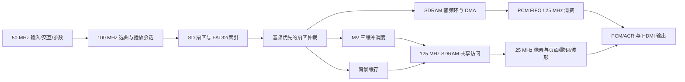

# 源码收尾审查与修复（2026-10-20）

本轮从 `ae68e72` 对应的工作区开始，检查 `src` 的顶层集成、存储/音频、视频/显示和交互/参数持久化。先做只读审查与反例复现，再根据用户“继续详细查看，进行收尾工作”的要求做最小修复。完整读取顶层和各业务链路；自动生成 ROM 按接口、地址范围及重复生成结果检查；厂家加密 IP 只能核对包装、连接和构建结果，不能据此声称已审查加密内部实现。

本轮九项问题已修复，最终候选 r4 的选定回归和完整 TD 构建通过：setup WNS +0.118 ns、hold WNS +0.043 ns，TNS均为0。源码/约束输入哈希、GUI选中产物和固定备份一致。当前状态为“RTL和内部静态时序通过，实板验收待完成”，未执行烧录。

## 1. 源码结构与实际数据流

审查开始时 `src` 共 137 个文件、约 41,152 行，包含生成 ROM、厂家 IP 和历史示例。代码行数不能直接等同于业务 RTL 的复杂度。

| 位置 | 文件数 | 作用与收尾关注点 |
| --- | ---: | --- |
| 根目录 | 13 | `top_tf_hdmi_audio.v` 集成、复位/CDC、RGB→AXIS、HDMI PHY、历史 I2S 示例 |
| `audio` | 17 | SDRAM 预取环、staging/DMA、WAV FIFO、切歌/seek 会话、音量/静音、HDMI PCM |
| `SD` | 24 | SPI/SD 扇区、FAT32 挂载/文件流、索引、封面、共享帧 FIFO 和视频时序 |
| `video` | 9 | 音频/MV/背景扇区仲裁、MV 读取和三缓冲调度、背景缓存、共享写入 |
| `display` | 23 | 页面、歌词窗口/滚动、字体 ROM、进度、波形、亮度/对比度、转场 |
| `io` | 32 | 输入同步/消抖、NEC、事件队列和路由、双编码器、Flash 参数、灯带/电机/蜂鸣器 |
| `boot` | 2 | 开机 Logo ROM 和启动窗口 |
| `IP` | 6 | PLL、异步 FIFO、SDRAM 硬原语包装 |
| `include` | 10 | 布局/事件/几何常量和厂家 SDRAM 文件 |
| HDMI 加密核 | 1 | 官方加密发送核 |



当前生产播放路径使用索引给出的连续扇区地址，音频为 48 kHz、16-bit 单声道 PCM，左右声道复制输出；并非运行时解码任意 WAV 压缩格式。歌词/进度认实际消费样本的时基，MV 调度跟随音频进度。MV 读取完整帧后在帧边界提交，音频储备不足时允许 MV 保持当前画面。

系统时钟为 50 MHz；SD/控制为 100 MHz；SDRAM 用户接口为 125 MHz，另有移相时钟；视频为 25 MHz，HDMI 串行为 125 MHz。主要慢变多位参数使用 `cdc_bundle_latest`，音频位置用消费事件跨域维护影子计数，帧数据依赖异步 FIFO 和稳定握手窗口。

存储地址采用不同字节平面复用：图像写入保留低字节，音频 DMA 使用低字节。顶层继续保留原有帧区、MV 三 bank、音频环、时钟及约束，本轮没有增加缓存容量。

## 2. 已复现并修复的九项问题

| 问题 | 触发条件、影响 | 最小修复与验证 |
| --- | --- | --- |
| HDMI 输入缺少行末 TLAST | 一行恰好 640 个有效像素，计数器旧值使比较迟一拍，实际 TLAST 为 0 次 | 修正旧值比较；检查两行全部 RGB、valid、TLAST 和一次 SOF 的对齐 |
| FAT32 第二簇开始提前读 FAT | 每簇扇区数大于 1，文件跨簇；跨簇任务误清零每簇末扇区号 | 保留挂载时的末扇区号并补复位；扩展至 22 个场景，增加 spc=2/4、碎片跨簇、部分末扇区和 done 同拍 |
| 浏览页歌手文字重复 | 第四曲标题短，歌手偏移超过 255 后截取列号回卷；x=460 重新绘制 x=204 的歌手字 | 比较前检查偏移高位；使用真实四曲 ROM 扫描整条信息行范围 |
| 负满幅波形柱突然变矮 | PCM 高字节绝对值为 128，先写进 7-bit 高度导致截断到 0，再最小钳位为 1 | 先按 8-bit 幅值饱和，再缩窄；同时检查普通柱和峰值柱满高 95 |
| EC2 超时后调整对象跳变 | 在非 VOL 参数选择后超时隐藏，下一次旋转首步改 VOL，第二步改旧参数，面板仍选旧参数 | 隐藏态旋转明确选择 VOL；检查连续两次请求和面板选择一致 |
| EC1 唤醒步被延迟补发 | 首次旋转只唤醒，但下次事件携带绝对计数，旧重放基线把已经吞掉的唤醒步重新发出 | 增加仅供基线同步的 `EV_ENC_BASELINE=8`，两个编码器消费者识别，业务 LED 不计为动作；检查正反向、16-bit 回卷及 EC2 禁用/重启 |
| DIP5 关闭后红外仍能唤醒 | 红外业务已屏蔽，但 `ev_action` 未受 DIP5 门控，仍会清除手动消隐或空闲计时 | 红外有效操作也经过 DIP5；检查手动消隐、自动消隐和本地按键唤醒 |
| 音频预缓冲阶段 PCM/ACR 停流 | WAV 已 active，但 SDRAM 环或解码 FIFO 未就绪，WAV sample_ready 被阻断，mux 却提前选 WAV | 静音条件包括两级缓存就绪；保留 48 kHz 零样本与 ACR，缓存就绪后恢复真实 WAV 数据、样本计数和节拍 |
| BMP 额外头部间隙被当作像素 | RTL 和 packer 均接受 data_offset>=54，但读取器从第54字节立即拼像素，外部带间隙的封面静默错图 | RTL 和 packer 统一要求像素偏移恰好54；54正常加载/重载，55/66/138/500/512/513/1024在头部报错且零像素，含valid间歇 |

FAT32 问题的范围须明确：当前生成镜像为单扇区簇，常规 PCM 播放走连续扇区预取；该缺陷首先影响多扇区簇卡上的 FAT 文件读取，尤其跨簇封面，不能描述为所有当前音频均损坏。

音频预缓冲缺陷已用真实生产 top 连接复现，硬 IP 边界采用 stub。旧实现等待阶段 2 ms 内 `audio_valid=0 / acr_valid=0`；修复后约 96 个零样本和 2 个 ACR，填入真实 PCM 字节后退出静音并继续消费。该测试验证 FPGA 输入到 HDMI 核之前的行为，不模拟 HDMI 接收端的锁定策略。

BMP 偏移问题同样有范围边界：当前两处 PIC1～4 共八个素材都是 offset=54、DIB=40，因此现有四曲不受它影响；直接使用外部 manifest 封面时 packer 原先会接受 offset=66。反例的间隙像素为 E3E2E1，首图及重载八个像素全部错误，但加载器未报错。通用跳过方案的两个物理候选均未满足时序，最终统一采用现有素材的固定54字节格式，在打包入口和硬件校验处显式拒绝扩展偏移，避免静默错图。这是本轮明确收紧的输入契约，外部封面需转换为标准24-bit BMP后打包。

修复文件为 `src/video_rgb_to_axis_640x480.v`、`src/SD/fat32_file_streamer.v`、`src/SD/fat32_media_loader.v`、`src/display/playback_page.v`、`src/display/promax_audio_waveform.v`、`src/io/ec2_param_controller.v`、`src/io/ui_command_router.v`、`src/io/ui_event_bridge.v`、`src/io/ec2_event_replay.v`、`src/include/exp_event_defs.vh`、`src/top_tf_hdmi_audio.v` 和 `tools/vinyl_packer.py`。最终没有修改 `frame_fifo_write.v`。

## 3. 本轮验证入口和证据

原始证据目录：`.codex_tmp/final_closure_20261020/`。最终选用证据已复制到 `prj/resource_opt_verified_20261005/final_closure_20261020_r4/acceptance_evidence/`，下表路径均相对此目录。失败反例和夹具修正前的日志保留在原始目录，最终验收只选择与当前输入哈希匹配的结果。

| 套件 | 当前结果 | 证据 |
| --- | --- | --- |
| 现有定向顶层/仲裁/MV/黑闪 | 10/10 | `focused_r4/results.json` |
| 现有 ModelSim 交叉检查 | 6/6 | `focused_modelsim_r4/results.json`，保留 WLF/VCD |
| 音频缓存与相关存储回归 | 32/32 | `audio_r4/results.json`，FAT 已含 22 场景 |
| 封面/背景/帧 FIFO/S6 | 21/21 | `visual_r4/regression_summary.json` |
| 现有交互与 Flash 持久化 | 5/5 | `ui_r4/results.json` |
| 新增边界用例 | 10/10 | `boundaries_r4/results.json`，含 BMP 偏移拒绝用例 |
| 新增 ModelSim 边界交叉检查 | 10/10 | `modelsim_r4/results.json`，保留 WLF/VCD |
| BMP 偏移/间歇矩阵 | 8/8 | `bmp_offsets_r4/results.json`，54接受，其余7项拒绝 |
| 封面契约/歌词/构建验证器 Python 单测 | 23/23 | `python -m unittest tools.test_cover_contract tools.test_prepare_s3_lyrics tools.test_verify_gui_runs` |
| 四曲歌词重复生成/回读 | 通过，128/70/22/61 行，共 281 行 | `lyrics_r4/results.json` |

独立复核指出了预填测试“只测等待、不测恢复”和 EC2 唤醒未直接覆盖两项缺口；本轮随后补上真实 PCM 填充/恢复、零值、计数上限、两级 ready，以及 router→EC2 replay→controller 的恢复测试。未发现确定的新增 RTL 阻断缺陷。

可重复命令：

```powershell
python tools/verify_final_boundaries.py --output <新的目录>
python tools/verify_final_boundaries.py --simulator modelsim --output <新的目录>
python tools/verify_finish_rtl.py --output <新的目录>
python tools/verify_finish_modelsim.py --output <新的目录>
python tools/run_audio_cache_regression.py --out <新的目录>
python tools/verify_stage4.py --output <新的目录>
python tools/verify_calibrated_lyrics.py --output <新的目录>
```

新增用例、复现入口保留在 `sim/tb_final_*.v`、`sim/tb_fat32_streamer_boundaries.v`、`tools/verify_final_boundaries.py`。ModelSim 使用本机可用的 `D:/modeltech64_10.6e/win64/vsim.exe`，为每个用例保留本地 work/映射、run.do、wave.do、transcript、WLF，并用 wlf2vcd 导出 VCD。控制级 top 的厂家边界为显式 stub；未依赖未保存的厂家仿真库映射。

## 4. 构建与交付状态

第一轮八项修复构建 `prj/resource_opt_verified_20261005/final_closure_20261020_r1/` 已通过，setup WNS +0.106 ns、hold WNS +0.035 ns，TNS 均为0，固件/报告/数据库已固定备份。补齐第九项 BMP 偏移通用支持后，第二轮构建目录为 `prj/resource_opt_verified_20261005/final_closure_20261020_r2/`。

第二轮完整生成 bit，但最终 setup WNS −0.769 ns、TNS −4.344 ns，hold WNS +0.030 ns；验收程序拒绝放行，报告和 routed DB 保存在 r2 的 `failed_physical/`，该 bit 不作为正式交付。最差路径分别是 125 MHz `frame_fifo_write.write_cnt→state` 和 100 MHz `fat32_media_loader.pixel_count→pixel_count.ce`，后者 WNS −0.588 ns。原生最终报告同时分析 slow/fast 两角，不能用前期 gate/place 摘要代替。

第三轮尝试局部谓词寄存，六套外部全输出逐拍对比通过，但物理结果 setup WNS −11.240 ns、TNS −77.453 ns，hold WNS +0.027 ns；最差路径变为 BMP 头部比较。该方案也未放行，报告归档于 `final_closure_20261020_r3/failed_physical/`。高资源占用下，逻辑等价和局部逻辑简化并不保证布线时序改善。

最终候选 `final_closure_20261020_r4/` 恢复第一轮 BMP/帧写入主干，仅收紧 BMP 偏移校验，固定偏移也使文件长度检查变为常数比较。r2/r3的跳过状态和寄存比较改写均未进入最终源码。独立只读复核确认固定偏移比较等价于 `data_offset==54 && file_len>54`、拒绝路径不会输出像素、packer和RTL契约一致。

为减少无效重复，r4 音频表按输入哈希复用25项未变用例、重跑7项受影响用例；视觉表按输入哈希复用15项、重跑6项共享写入用例，全部通过并记录复用来源。顶层/新增边界用例随当前完整源码重新执行。旧候选的通用偏移成功日志和逐拍对比仅作历史实验记录，不计入最终契约验证。

执行原工程 `prj/VinylFPGA.al` 的 TD Run Manager 流程，器件 EG4S20BG256、TD 6.2.168116、seed 3，保留 `area_prior / pack high / opt_timing high / route routability`。源码和约束均有输入哈希快照。综合、布局布线、显式 hold 修复、bitgen、输入一致性与 GUI 选中结果须分别检查。

收到用户指定后，已执行 `curl.exe -sL https://www.synthpilot.dev/llms.txt`，完整获取并阅读当前 5,104 字节用法，副本已归档于 `acceptance_evidence/synthpilot_llms_current.txt`。运行时查询确认 SynthPilot 1.4.0、Anlogic Pro、90 个已注册工具；遵循实际 MCP schema，不假设 Max 工具或 raw Tcl 接口可用。未重复派发已启动的原工程构建。

MCP交叉复核未获得有效结果：较早读取r2时 `td_open_run` 导致托管TD进程退出，崩溃记录已归档；之后显式加载器件进入 `device_ready`，最终 `td_open_project` 被状态守卫拒绝（multi-run要求empty）。未将重启后的空设计报告当作通过证据，也未重试结果不确定的操作。本轮放行依据为原生TD最终slow/fast报告、明确fix_hold记录、当前源码哈希和产物核对；不是MCP复核通过。

最终交付位置：`prj/resource_opt_verified_20261005/final_closure_20261020_r4/`。

| 项目 | 最终结果 |
| --- | --- |
| setup WNS / TNS | +0.118 ns / 0.000 ns |
| hold WNS / TNS | +0.043 ns / 0.000 ns |
| LUT / 寄存器 | 17,772 / 19,600；11,905 / 19,600 |
| Slice | 9,258 / 9,800（94.47%） |
| BRAM9K / BRAM32K / DSP | 64/64；1/16；10/29 |
| 固定固件 | `accepted_artifacts/VinylFPGA_final_closure_20261020.bit`，676,184字节 |
| 固件 SHA256 | `6a1b7c1eedd2fdee740fc6ceab44da6d2c451e5a98ce45a43e2ecd512de0d4f4` |
| 验收清单 | `final_acceptance.json`，含产物哈希、资源、套件与输入记录 |

`accepted_artifacts/` 同时保留 routed DB、原生时序/面积/QoR、综合/实现日志和bitgen参数。`src/`、`constraints/`及`inputs.sha256.json`保存本次构建快照。Python单测23项通过；8组RTL/交叉/偏移表共102项检查通过，存在跨套件重复和明确标记的未变输入复用，不代表102种完全独立场景。

审查前的固定 `audio_reserve_fix` bit 哈希为 `8eb989a497fdde625ccf750deb697e58767f3447bc02854b727ff3ed895cd946`；当时 GUI 副本哈希为 `2ce821a3f126955ce893f46fc013599c11a1c2df5d8791b3af3bf785f4f795d8`。逐字节比较仅第 136/138/139 字节的生成时间不同，其他字节一致，属于文件头差异。新源码须使用本轮新构建结果。

## 5. 收尾边界和最后实板验收

1. 功能冻结，以这九项已复现缺陷为本轮修改范围。顶层仍有历史诊断逻辑与较多业务连接，当前资源较满，后续拆层和历史文件整理应另做维护任务。
2. 旧构建曾使用 LUT 17,783/19,600、slice 9,211/9,800、BRAM9K 64/64。BRAM9K 已满，不应在收尾时继续增加缓存/字体需求；新值以本轮最终报告为准。
3. `constraints/timing.sdc` 已明确 SD MISO、HDMI 等板级 I/O 延迟模型的缺口。内部 setup/hold 通过不能扩大为全部外部接口签核通过；本轮不添加臆造的延迟或新时序豁免。
4. 现有顶层仿真仍有 FIFO 计数位宽和地址缩窄警告。当前固定地址均在 21-bit 范围；这些警告需保留解释，不能据警告本身认定当前地址错误，也不能称为零警告设计。
5. 历史 S7 全表仍存在已记录的 13 项基线失败/过时夹具。本轮独立维护收尾入口，保留历史失败清单，不宣称历史 53 项全部通过，也不删除旧用例制造全绿。
6. 生成 ROM、LYR2、字形和时间戳回读通过，不等于逐句听音时间校准已验收；当前播放仍使用片内歌词 ROM。

最后实板检查应使用同一个固定备份 bit 和对应媒体镜像，记录曲目、操作、时间点和现象：四曲冷启动及完整播放；跨曲循环；反复暂停/恢复、前后 seek、曲首曲尾和切歌；起播封面承接与 MV 恢复；短标题的浏览信息行；EC2 参数隐藏后连续旋转；EC1/EC2 消隐唤醒后下一步；DIP5 关闭后的红外；Flash 保存、断电恢复、恢复默认；电机、唱针与两条灯带门控。

本轮执行范围为源码、仿真、构建和证据整理。实板长播、真实 HDMI 接收端表现、Flash 物理掉电测试仍需现场确认。
