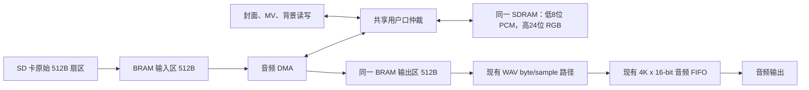

# VinylFPGA 音频卡顿修复与时序收敛执行教程

> 版本：2026-10-16 / 修订 2（以 R5 源码哈希、最终时序和补丁应用核验为依据）  
> 工程：`D:\Data_Backup\VinylFPGA_Workspace_Base\VinylFPGA`  
> 指定基线：`1f9013a26ce40f3d00b88d8cc3c63373ccb30df7`（`fix(视觉): 满幅裁切封面并移除MV黑边`）  
> 本文目的：完整记录基线之后的音频卡顿修复、数据通路、验证证据和下一轮时序收敛步骤，供 GPT-6.1 Sol 直接接手。本文记录事实和执行建议；任何新 RTL 修改都必须重新仿真、综合、布局布线并审核时序。

## 1. 当前结论与验收状态

交付本轮诊断 bit 后，用户两次反馈：开发板长时间播放正常，没有再次观察到卡死。这是当前最重要的板级功能证据，支持保留现有 SDRAM 预取架构。用户尚未提供精确测试时长、实烧文件哈希、曲目/操作覆盖清单和同步串口记录；本文保留“用户报告长播正常”的原始证据强度，不自行补造测试小时数或全功能验收结论。

本轮可复现的 bit 文件为 `prj/resource_opt_verified_20261005/audio_sdram_prefetch_20261016_r5/VFPGA_DIAG_S6.bit`，大小 676,184 字节，SHA-256：

```text
61069F4EE5D8261A4207EECF055E026F73697E91C1BCB85C1ADCFAF8E6DC0323
```

R5 是**诊断构建**，因为该次布局布线的 setup 尚未收敛。报告值为 setup WNS −1.461 ns、TNS −165.057 ns、282 个 setup 违例端点；hold WNS +0.024 ns、TNS 0、0 个 hold 违例端点。用户板上长时间播放通过，证明当前使用场景下功能有效；它不能替代正式时序签核，也不能推导出所有温度、电压、SD 卡、并发负载和板级条件都通过。

当前仓库 `HEAD` 正是指定基线。实现代码及 R5 产物还处于工作区修改/新增状态，并没有包含在 `1f9013a...` 这个 Git commit 中。工作区同时存在来自其他开发内容、TD 生成和历史分析的文件；下游执行者应按本文“功能源文件清单”筛选，不能把整个 `git status` 都当成卡顿修复补丁。更早的 `doc/开发方案/音频SDRAM预取实施计划_20261016.md` 保留了“尚未 route/bitgen”的历史勾选状态；该计划写于 R5 与板测之前，本文是后续权威状态，执行时不要照抄其过期 TODO。

## 2. 已定位的卡顿机理

### 2.1 直接故障链

此前对串口和自动采样数据的分析显示，卡顿窗口内，SD 卡单扇区读取常在命令后等待约 14.2–14.5 ms 才返回数据令牌；正常事务等待明显更短。卡顿窗口持续约 4.5–4.9 秒，单扇区的有效供给速度在该窗口低于音频的持续消耗速度。慢读时请求仍为顺序 LBA，事务没有报告 SD 错误，因此这不像 FAT 碎片、地址跳变或事务失败。

当前音频播放率按 48 kHz、16 bit 单声道计为 96,000 字节/秒。一个 512 字节扇区只覆盖约 5.33 ms 音频。原有音频输出缓冲约 4,096 个 16 bit 样本（8 KiB），覆盖约 85 ms；它适合吸收短时调度抖动，无法吸收数秒的 SD 卡低吞吐窗口。输入端补数低于输出端消耗时，缓冲很快耗尽，进入欠载；播放相关门控还会压住 MV/背景读出，于是用户观察到音画一起停顿，外观像整机卡死。

因此，直接根因是**输入服务延迟/吞吐有数秒级低谷，而实时音频缓冲只覆盖几十毫秒**。SD 卡内部为什么出现该慢读窗口（控制器重试、介质管理或卡本身行为）仅凭主机日志无法判定。共享 SDRAM 的视频/MV 访问是需要仲裁的竞争者和次级风险，但现有证据不支持把它单独称为慢读窗口的直接来源。

### 2.2 修复原则

不改变 WAV 文件格式、不让音频直接依赖每一次 SD 卡读的即时响应，也不把秒级缓存堆进紧张的片上 BRAM。使用现有 SDRAM 每个图像字未使用的低 8 位存 PCM，先从 SD 卡顺序预取并填充 SDRAM 环，再由播放请求从环取扇区，最后继续交给现有 WAV 解码器和输出 FIFO。这样保留 SD 卡低谷时仍可播放的在手音频量。

这是一个**有界吸收方案**，不是提高 SD 卡长期平均吞吐的方案：512 KiB 低字节环在 96 kB/s 下约覆盖 5.46 秒；若 SD 卡持续长时间停止服务，或长期平均供给低于消耗速度，任何有限缓存最终都会耗尽。初始预填有约 5.12 秒音频数据，减少了短时预填错误/并发服务对起播的敏感度。

## 3. 从基线到当前候选的修改清单

已逐项核验 R5 `inputs.sha256.json` 的 135 个文件，全部匹配。再遍历 R5 的 `src/` 与 `constraints/`，与指定 commit 比较（忽略 CRLF/LF 差异），恰好只有以下 8 个 RTL 文件发生变化：4 个新增、4 个修改；`constraints/pin.adc` 与 `constraints/timing.sdc` 均未相对基线修改。当前工作区的这 8 个 RTL 原始字节哈希也全部与 R5 匹配。这个结果比仅看工作区 `git diff` 更完整，因为 4 个新增模块还未被 Git 跟踪。

本轮附带 `音频卡顿修复交接包_20261016/01_baseline_to_R5_rtl.patch`，可将指定 commit 恢复成上述已验证 R5 功能源码；`02_verification.patch` 补入相关仿真源和脚本。两份补丁已在临时基线目录依次通过 `git apply --check`、实际应用和目标文本哈希比较。该检查只证明补丁能准确恢复代码，不代表新候选已经通过仿真或时序。

| 文件 | 修改作用 |
|---|---|
| `src/audio/audio_prefetch_stage.v` | 新增双时钟 BRAM staging。两个 512 字节缓冲区分别用于 SD 输入暂存和 SDRAM 取回/客户端发送；使用同步读，生产综合实例为 `EG_PHY_BRAM32K`。不复位整块 RAM，只在握手完成后发布完整扇区。仿真以 `VINYL_AUDIO_CACHE_SIM` 行为模型替代原语。 |
| `src/audio/audio_sdram_dma.v` | 新增 SDRAM 时钟域 DMA。使用 toggle mailbox 收发扇区请求和确认；写/读按每 32 个 32-bit 地址的短段分批，每段等待控制器、刷新和在途数据空闲后开始；段间让出总线；设置 16 周期排空/让出与 18 bit watchdog；完成一个扇区或超时后返回确认/错误。 |
| `src/audio/audio_prefetch_sdram.v` | 新增 SD 时钟域预取环控制。发出原始扇区请求，检查字节数、字节索引连续性、SD 错误及完成信号；扇区写入 SDRAM 完成确认后才推进写指针。响应 WAV 播放器扇区请求时，从环读一扇区并按 0–511 顺序回送。管理预填、环水位、EOF、取消、错误和会话忙状态。 |
| `src/audio/audio_sdram_arbiter.v` | 新增共享 SDRAM 用户口仲裁。协调图像读写与音频 DMA；音频独占事务期间阻止图像状态机启动新事务；在改写 DQM 后保留写掩码，等待已排队写入排空，再清掩码后允许读；按读 owner 将 SDRAM 返回数据送给正确消费者。 |
| `src/SD/frame_read_write.v` | 增加 `PRESERVE_LOW_BYTE` 参数和 `app_read_busy` 观测；给上层增加外部读忙时，将其纳入写/读起始的忙门控；可选择图像写时屏蔽低字节。默认参数保持未启用时的旧行为。 |
| `src/top_tf_hdmi_audio.v` | 实例化预取环、DMA 和仲裁器；从原始 SD 总线分离 MV/背景和 WAV 两类数据通路；把帧控制器 SDRAM 访问接到共享仲裁器；把 SDRAM 初始化完成和预填就绪同步到相应时钟域；将 cache 会话忙并入播放会话重启排空条件；仅在缓存允许且 WAV 起播缓冲就绪后接受播放样本。 |
| `src/audio/wav_stream_player.v` | 增加 `startup_ready`。仅在已有足够完整样本或短尾已结束后启用样本消费；Seek 首扇区因样本偏移丢弃字节时不会误认为已起播。起播后保持 armed，真正的后续欠载仍能被观测。 |
| `src/SD/song_index_db.v` | 将背景起始 LBA 的合法性判断改成 `P_FIN` 时钟寄存的 `background_base_valid`，在 reset/reload 清零。保留原 magic/layout/CRC/非零/地址范围条件，避免多位比较链持续挂在顶层输出，并缩短背景路径时序。 |
| `sim/tb_background_index.v` | 新增 reload 开始时上一轮 background base 和 art2 标志必须立即失效的检查。 |
| `sim/tb_wav_stream_player_flow.v` | 改为 15 扇区压力流，确定触发高水位暂停，再确认样本顺序、环指针回绕、末尾 drain 和 `stream_active` 行为。 |
| `tools/run_audio_cache_regression.py`、`sim/audio_cache/` | 新增专项回归、SDRAM mask/真实控制器与 staging 检查脚本、testbench 和结果。回归 JSON 记录 12/12 PASS。 |

工作区还能看到 `prj/VinylFPGA.al` 中 MultiSeed 选择字段、`prj/out/back_annotation.adc` 放置结果、`prj/.lock.f`、`doc/stage-S0-summary.md` 等状态变化。它们不是音频功能逻辑。尤其 `.adc` 是随实现产生的位置注解，不能作为功能源补丁；项目锁文件是工具状态；S0 文档的旧段落写着“候选未实施”，现在已过时。交付时应只选必要 RTL、相关验证与有意保留的项目配置，重新核对生成文件，不要无差别提交所有改动。

## 4. 缓存、DMA 和存储仲裁的数据流



### 4.1 容量和地址

- SDRAM 的每个 32-bit 图像字由显示读取 `[31:8]` RGB888；此前低 `[7:0]` 未使用。
- `audio_sdram_dma` 将每个 PCM byte 存成一个 32-bit SDRAM 字，只使能低字节；扇区内地址为 0–511。
- `audio_sdram_dma` 拼接地址 `{2'b00, sector[9:0], word_offset[8:0]}`。因此 10 bit 扇区索引 × 512 个地址/扇区 = 1024 扇区 = 512 KiB 环。11 bit 硬件环指针保留回绕位，实际 SDRAM 扇区地址使用低 10 位。使用的 word 地址为 `0x000000..0x07FFFF`；这是图像与 PCM 共用地址、不同字节平面，并未另占连续 2MiB 专用存储区。
- 音频写 `DM[3:0]=1110`：屏蔽高 24 bit，只更新 PCM 所在低字节。图像写 `DM=0001`：屏蔽低字节，保护已有 PCM，同时更新 RGB。
- 这个 mask 是控制器的 active-high disable 语义；更改掩码后需要保持它覆盖物理控制器内部排队的写数据。不能只看 FPGA 用户口 `App_wr_dm`，要验证真正的 SDRAM `DQM[3:0]`。
- 现有音频输出 FIFO 不扩大。新 staging 只负责一扇区级中转（两块 512B = 1KiB 有效数据），不复制秒级缓存到片上 RAM。

### 4.2 水位和启动时序

`audio_prefetch_sdram` 默认参数是 `PREFILL_SECTORS=960`、`LOW_SECTORS=960`、`HIGH_SECTORS=1008`。每个扇区 512B：启动阈值为 491,520B（480 KiB，约 5.12 秒单声道 48 kHz/16 bit 数据）；最大填充阈值为 516,096B；环总容量为 524,288B。高低水位间 48 扇区提供迟滞，满环前留出 16 扇区余量。

播放会话建立后，预取器顺序读取音频 LBA。每次 SD 返回的 512B 都先进入暂存区；数据长度、索引 0–511 和错误必须通过验证；DMA 完成写环后才 commit 写指针。环达到预填阈值后，播放器才允许发起从环读的客户端请求。首次读回扇区完成、WAV FIFO 的 `startup_ready` 成立且 cache ready 同步到 `video_clk` 后，播放消费者才开始实际接收样本。

播放期间当占用量低于 960 扇区时继续补环，达到 1008 扇区停止补入。结束播放时受歌曲剩余扇区数和 EOF 限制，不等待不存在的数据。Seek/切歌通过现有会话重启路径处理；`storage_busy` 同时覆盖 SD 预取和 SDRAM cache mailbox，避免旧 DMA 尚未排空就复用 BRAM staging。

### 4.3 时钟域与事务边界

- SD 域为约 100 MHz，SDRAM 用户端为约 125 MHz。控制请求采用“payload 保持稳定 + toggle 同步 + 对应 ack toggle 返回”邮件箱；只同步 toggle，不逐位同步地址/扇区数据。
- SDRAM 返回数据以 `Sdr_rd_en` 为有效标记；`audio_read_owner` 在所有音频返回期间保持稳定。音频有效读数据不能进入图像 FIFO/背景抽样通路；图像有效读返回不能进入音频 staging。
- `access_lock` 是已登记状态形成的 ownership；DMA 先等待旧图像事务、控制器忙、refresh 和读返回排空，再发音频突发。它只禁止新的图像 burst 起始，不丢弃正在进行的图像 burst。
- 每 32 个用户口 word 命令完成后 drain，再释放 lock 16 个 `mem_clk` 周期，之后才允许下一段；这 16 拍是固定让出时间，不要求每拍总线空闲，也不能单独证明图像一定获得服务。这里的 32 是用户口分段长度，不是修改物理 SDRAM mode register 的 burst length。watchdog 在等待无进展时计数，进展会清零；18 bit 在 125MHz 下约对应 2.097ms 连续无进展。超时产生 error/ack，不提交未完成扇区。
- DQM 掩码在图像/音频写客户端切换时会被控制器内部流水化，所以 `audio_sdram_arbiter` 保留上次写 mask，并在 16 个真正安静周期后才清为零。空闲的读周期也要求 mask 已恢复，避免把读输出意外屏蔽。
- 模块跨媒体软复位时要保留已发 mailbox 的状态直到旧事务完成/排空；源数据媒体复位通过 `source_ready` 与 SD/cache 生命周期协调。不要因为 UI restart 就单边清零一侧 toggle。

## 5. 已执行验证及其边界

### 5.1 RTL 与控制器验证

`sim/audio_cache/regression/results.json` 中的专项回归为 12/12 PASS，覆盖 DMA、仲裁、预取环、起播、欠载、会话、背景扇区 mux、媒体写、MV 写/调度和帧 FIFO 读节拍。加密安路 SDRAM 控制器 + 独立物理 SDRAM 模型验证了低字节 DQM 隔离：图像更新不破坏 PCM，PCM 更新不破坏 RGB，之后读回的数据保持一致。真实 `EG_PHY_BRAM32K` 模型对 staging 双时钟、512B 读写和同步读延迟测试通过。

Micron MT48LC2M32B2 仿真默认时序在若干 BL4 边界对 application 侧出现 Z 值观察，但物理 SDRAM 数据和 DQM 保留检查通过；该现象已写入 `sim/audio_cache/vendor/README.md`，不能把独立模型的 application 采样差异说成真实板卡失败，也不能据此修改生产 SDRAM 时序。正式发布需要使用匹配 EM638325/实际 PLL 相位的验证条件或板级实测。

### 5.2 当前 R5 TD 实现

设备 `EG4S20BG256`、顶层 `top`、TD `6.2.168116`。R5 以 seed 6、`area_prior` 做单轮隔离实现；route 成功并导出 routed database 与最终报告，硬路由冲突检查通过，check_timing 覆盖率约 99.96%。资源为 LUT 17,836/19,600（91.00%）、寄存器 11,462/19,600、slice 9,543/9,800（97.38%）、BRAM9K 64/64、BRAM32K 1/16、DSP 10/29。相对目标策略没有新增 BRAM9K，没有新增 PLL/DSP，增加一个 BRAM32K staging。

setup 未过：WNS −1.461 ns、TNS −165.057 ns、282 个端点；hold 通过：WNS +0.024 ns、TNS 0、0 个端点。**最终结果以 `final.timing`、`final.qor` 和 `route.status` 为准。** `final_timing.rpt` 生成于 20:54:13，处于本轮显式 `fix_hold` 之前，保留了 hold −0.068ns、3 个违例；`final.timing` 生成于 20:54:25，才是 hold 修复后的报告。文件名前缀有 final 不等于生成阶段最终，必须结合 Tcl 顺序、时间和日志判断。

最差 setup 路径在 `sd_card_clk` 域，终点为 `fat32_file_streamer/cluster_delta_reg[20]_syn_4.ce`，注意是 **CE 使能端**。路径延迟 11.209ns，其中 cell 3.046ns、net 8.163ns（73%），7 级 LUT，路径最大数据扇出 16。`sd_card_clk` 时钟树约 2986/2987 个负载是时钟分配信息，不能误当成这条数据路径扇出。另一条 `song_index_db/byte_idx_reg[6] → e_cov_by_reg[29].ce` 的 slack 为 −1.407ns，net 延迟 9.598ns（87%）。这些证据要求先处理条件/使能链与物理分布，不能仅凭 `cluster_delta` 名字就认定减法器是瓶颈。全部 282 个 setup 违例端点集中在 100MHz `sd_card_clk` 组；默认报告只展示每组前 10 个端点，并不是完整违例列表。

### 5.3 bitgen 文件核验教训

有两个需要分开记录的生成异常：一次 Windows 反斜线路径被 TD 脚本入口解释为 Tcl 转义，日志明确出现“couldn't read file”，但进程仍返回 0；另一次输出 237 字节 `.bit`，日志终止在 PLL setting 信息，没有 bitgen 正常结束及后续 marker。第二次为何在写载荷前终止，现存证据不足以唯一归因，不能把两次异常强行合并，也不能据此断言 TD 不支持绝对输出路径。已成功的调用方式是在 R5 `cwd` 下传脚本 basename、使用相对 bit 输出名，并检查所有结束证据。有效 bit 必须同时满足：

1. 日志有 `BIT-1004 Generate bits file ...`，并有 `RUN-1003 finish command "bitgen ..."`；
2. 后续 `setup_debugger`、`export_bitgen_param`（若当前 flow 使用）正常结束，并有自定义 final marker；
3. 输出包含 Transfer CRC/二进制 payload，大小接近此候选的 676 KB，不能只有约 237B header；
4. 记录完整路径、大小、SHA-256，并确保 hash 对应本轮 source manifest / routed DB。

TD 进程退出码为 0、log 出现“Generate bitstream completely”或者存在 `.bit` 文件，单独都不足以证明脚本已正确完成。不要把 `.bid`、`.bitgen_param.f`、`.rbf`、空头文件或其他 seed 的产物混作本轮 `.bit`。

## 6. 下一轮目标：只做有证据的时序收敛

目标是：保留用户已验证有效的 SDRAM 预取设计，以小改动关闭 R5 的真实 setup 路径，避免通过随机 seed 搜索掩盖结构性问题；最终重新生成一个 source/hash/report 完整对应、setup/hold 全部通过的 bit。当前 R5 是功能回归基线，不是 timing release。

### 6.1 开始前固定输入和构建边界

1. 先确认 checkout 是 commit `1f9013a...`，然后从当前已验证工作区及 R5 `inputs.sha256.json` 还原全部功能 RTL；不要把基线 commit 冒充为包含本方案的代码。
2. 以 R5 目录为只读参考，新建全新隔离目录，例如 `prj/resource_opt_verified_20261005/audio_sdram_prefetch_close_20261016/`。保留项目内部名字 `VinylFPGA`、顶层 `top`、器件/封装和全部原约束；禁止修改/覆盖 `prj/VinylFPGA_Runs`、`prj/.lock.f`、原工程输出目录。唯一的本轮源头应该是该目录里的 `.al`、`src`、`constraints` 和经核验的工具脚本。
3. 固定 TD 6.2.168116、EG4S20BG256、seed 6、`area_prior`、编译器/线程配置，生成包含每个 HDL/SDC/ADC/.al/构建脚本 SHA-256 的输入 manifest。确认 manifest 的 source hash 与本轮综合数据库一致。
4. SynthPilot MCP 使用前按要求读取 `curl -sL https://www.synthpilot.dev/llms.txt`，只调用当前服务器实际提供的 Anlogic 工具；本轮已验证 `td_test_connection` 返回 `Connected OK` 与 Tcl 8.6.15。若 MCP 不能导入指定的 R5 数据库，不要用它隐式打开原工程或触发全流程，使用固定 snapshot 的 vendor flow 并保留脚本/log。

### 6.2 修复顺序：按路径分组，不按 seed 试错

1. 从**当前** `final_timing.rpt` 和 SynthPilot timing path 工具抓取慢速/快速角、每时钟 WNS/TNS、fail endpoints、前 20 条路径、起点/终点、logic/net delay、扇出和约束覆盖率；先区分同一时钟真 setup、CDC、I/O 和未约束路径。
2. 优先处理 `fat32_file_streamer` 的 **validation → CE 条件链**。先完整查看 `current_cluster → cluster_delta.ce` 逐级 LUT/net 路径、源码写使能条件及综合网表。候选 A 是把 cluster 有效性结论在专用 validation 拍寄存，下一拍仅由本地状态译码使能 `cluster_delta`，同时保持 FAT 链入口和错误码一致。候选 B 是在操作数已稳定且下游 valid 隔离成立时无条件预计算 delta，减少复杂 CE；不能无分析就去掉 enable。新增 `ST_CLUSTER_DELTA` 只是一种实现手段，若工具把条件合并回 CE，增加状态也可能无效。以 gate 网表是否真正切断条件链作为继续 place 的依据。只有新的路径终点明确落在 `.d` 数据端且减法主导时，再考虑拆分算术；不预先堆加 32bit pipeline 寄存器。
3. 为新状态增加针对 FAT32 的定向 testbench：首 cluster、连续 cluster、扇区/簇边界、FAT 链读取/下一 cluster、EOChain、坏 cluster 范围、自环、最长访问保护、EOF；证明只多一个 cluster-transition cycle，LBA/数据和错误码一致。与此同时保留 12 个 SDRAM 音频回归，不要为了试 timing 改 cache 水位/掩码/突发设置。
4. 重新跑仿真和必要的控制器/掩码检查后，先跑一次综合和优化阶段；记录 gate WNS/TNS、面积和新 top paths。检查新状态是否将减法推迟、是否新引入大扇出 enable/mux，以及 slice 余量。
5. 只有综合检查符合预期，再用单个确定 seed 6、`area_prior` 跑一遍 place/route/final STA。不要跑 seed 1..N 扫描，也不要同时改变 seed、约束、缓存参数和 RTL。若 post-route 仍失败，按新的前 10 路径分类，再选择一个有定量理由的 RTL 修改；禁止把一次失败改成随机试 seed。
6. 如关键失败实际来自其他真实 path group（例如 `song_index_db/e_cov_by` 或 background retry 控制），先验证是否同一根因。一次只改一个逻辑功能域，保存路径报告和 before/after 数据，避免多个优化相互遮蔽。

路径优化原则：寄存器切分要保持 `enable`、reset、LBA/byte 对齐、pipeline valid 和 error 传播语义；不要只把 32-bit 运算移到另一拍却忘记状态/事务数据同拍更新。若 placement congestion 是主导因素，先看局部布线、slice 余量和资源密度；slice 已达 97.38%，不要无预算地堆大型寄存器阵列。当前 BRAM9K 已占满，因此不能把 512KiB 音频环搬进 9K BRAM。

### 6.3 严格 timing release 门槛

以下条件全部满足才生成“可交付 timing-closed bit”：

- place/route 完成，flow status 无错误/硬路由冲突，最终 route DB 来自当前 snapshot；
- 慢速与快速角检查通过，所有真实 setup 和 hold 路径 WNS ≥ 0、TNS = 0、违例端点数 = 0；
- timing coverage 接近 100%，剩余未分析路径逐类解释；时钟域例外、false path、multicycle 只能基于真实同步/协议依据，不允许为清零 endpoint 临时增加；
- 复查最差路径和 top N paths，确保 WNS 刚好为零以外有足够裕量，并复核外部 SDRAM/SD/SPI/HDMI 时钟和 input/output delay 约束覆盖；
- 资源仍在器件容量内，尤其 slices 和 BRAM9K；
- bitgen 结束标记、参数文件、有效 payload、大小、hash 和 input manifest 一致。

如果任何 setup/hold 指标为负数，即使 route 和 bitgen 能完成，也只能命名为诊断文件，不能叫“完美版”或“时序通过版”。一个 build 一次成功不能由当前证据保证；能避免反复试 seed 的方法是先做路径分类与定向 RTL 修复，再用一次确定配置实现，然后仅在报告指向新问题时追加下一轮。

## 7. GPT-6.1 Sol 接手执行指令

下列内容可直接作为给 GPT-6.1 Sol 的任务提示：

> 请以 `1f9013a26ce40f3d00b88d8cc3c63373ccb30df7` 为历史基线，详细读取 `doc/开发方案/音频卡顿修复与时序收敛执行教程_20261016.md`、当前 RTL、R5 input hash manifest 和 TD 报告。用户已在开发板验证 `VFPGA_DIAG_S6.bit` 长时间播放没有卡死，因此把当前 R5 功能作为必须保留的 golden behavior。目标是在不改动音频预取架构行为的前提下完成 timing closure，并生成 setup/hold WNS≥0、TNS=0、端点违例=0、bitgen 收尾完整且 hash 可追溯的 release `.bit`。
>
> 先使用随附补丁在指定 commit 的隔离目录恢复 R5 源码并核对规范化文本哈希；不要覆盖原工程及 `prj/VinylFPGA_Runs`。阅读 R5 **hold 修复后的 `final.timing`**，以 `fat32_file_streamer/current_cluster → cluster_delta.ce` 的 validation/使能条件链为第一候选，同时分析 `song_index_db/byte_idx → e_cov_by.ce` 等失败组。终点 `.ce` 不是减法器 `.d`；优先寄存有效性判断或简化本地 CE，给出 cycle/状态影响并增加有针对性的等价行为验证。综合后确认该条件链已实际切断，再用一轮确定性 seed 6/`area_prior` 做 route。严禁 seed 盲扫、伪造 false path/multicycle、为了清零报告放宽真实时序约束，或一次混改缓存阈值、DQM、FSM 和 seed。
>
> SynthPilot 使用前读取 `https://www.synthpilot.dev/llms.txt`，确认当前提供的 Anlogic 工具及参数；实际运行需使用隔离 snapshot。bitgen 后检查完整日志 marker 和有效 `.bit` payload，不能接受 237 字节 header-only 文件。输出每阶段命令、报告、前后 WNS/TNS/端点/资源变化、最终 bit SHA-256 和板级验收清单。如果一次 route 没达到所有门槛，按新 report 指向的真实逻辑问题做最小下一轮，不要通过换 seed 掩盖。不要替用户下载/烧录开发板；最终由用户人工烧录并验收。

## 8. 当前证据文件索引

- 基线：Git commit `1f9013a26ce40f3d00b88d8cc3c63373ccb30df7`。
- 已验证 bit：`prj/resource_opt_verified_20261005/audio_sdram_prefetch_20261016_r5/VFPGA_DIAG_S6.bit`。
- 烧录验收说明：`prj/resource_opt_verified_20261005/audio_sdram_prefetch_20261016_r5/手工烧录验收说明_R5诊断版.md`。
- R5 物理实现/时序：`route.status`、`route.qor`、`final.qor`、`final_timing.rpt`、`final.area`、`inputs.sha256.json`、`native_build.log`，均在 R5 目录。
- 专项仿真汇总：`sim/audio_cache/regression/results.json`；专项驱动：`tools/run_audio_cache_regression.py`。
- 控制器和 BRAM 模型限制：`sim/audio_cache/vendor/README.md`。
- 根因依据：`doc/资源/卡顿根因分析报告_20261016.md` 与相邻串口采集/分析记录。
- SynthPilot：本轮先读取 `https://www.synthpilot.dev/llms.txt`，再调用 Anlogic `td_test_connection`；结果为 `Connected OK / TD Tcl 8.6.15`。

修订 2 再次通过 `curl.exe -sL` 读取官方说明，并调用 `td_connection_info`：受管 TD 6.2.168116 正在运行，但会话状态为 `gate_optimized`、`sdc_reload_required=true`，不是 R5 routed 会话。因此本文没有用该受管会话的 timing query 冒充 R5 最终结果；本轮数字均来自已核对的 R5 文件。后续 MCP 查询必须先明确其加载的是哪个工程/DB、约束是否需要重读，连接成功本身不能证明设计身份和分析阶段。

## 9. 可执行交接包：准确恢复已上板版本

### 9.1 文件与使用顺序

同级目录 [音频卡顿修复交接包_20261016](音频卡顿修复交接包_20261016/README.md) 中包含：

| 文件 | 用途 |
|---|---|
| `01_baseline_to_R5_rtl.patch` | 恢复 R5 的全部 8 个功能 RTL 差异，合计 +669/-31 行。只恢复已验证架构，未包含未来 CE 优化。 |
| `02_verification.patch` | 恢复 11 个验证源/脚本/说明文件；不含编译结果 `.vvp`、波形或历史日志。 |
| `R5_source/src/…` | 上述 8 个 RTL 的 R5 原始字节副本。供 diff 和哈希核验；不要将副本目录加入 TD 源列表重复编译。 |
| `R5_project_template.al` | R5 隔离工程的项目模板。使用时必须重定向其中的 R5 绝对路径。 |
| `manifest.json` | 基线、patch hash、19 个文件的 raw/LF hash、135 个 R5 输入的校验结论、bit/DB/报告哈希。 |
| `RTL差异与哈希表.md` | 每个 RTL 的新增/修改状态、增删行数及完整 SHA-256。 |

如果向另一个对话上传材料，应提供本教程和整个交接目录，或同目录的 `音频卡顿修复_教程与交接包_20261016_v2.zip`；只提供 Markdown 而缺少补丁/模板，不能视为完整的可恢复工程交接。原基线仓库、TD/IP 和完整 R5 报告仍需在执行环境可访问，本包没有打包整个工具链和媒体文件。

补丁使用 LF 文本生成。Windows 下不能仅以 raw hash 判断 CRLF/LF 文件是否相同：`target_sha256_raw` 是 R5 原始文件，`target_sha256_lf` 是统一换行后的文本。**等价源代码比较可使用 LF hash；对 bit、DB 和最终发布输入必须使用原始字节 hash。**

### 9.2 在干净基线上应用补丁

以下为供下一位执行者运行的命令。本轮文档修订未创建新开发工作树，也未运行这些 FPGA 构建命令。路径和 branch 已存在时应先检查归属，不能自动删除或 reset。

```powershell
$repoRoot = 'D:/Data_Backup/VinylFPGA_Workspace_Base/VinylFPGA'
$baseCommit = '1f9013a26ce40f3d00b88d8cc3c63373ccb30df7'
$handoff = Join-Path $repoRoot 'doc/开发方案/音频卡顿修复交接包_20261016'
$candidateRoot = 'D:/Data_Backup/VinylFPGA_Workspace_Base/VinylFPGA_audio_close_v2'
if (Test-Path -LiteralPath $candidateRoot) { throw '目标已存在，请检查并选择新的隔离目录' }
git -C $repoRoot -c core.autocrlf=false worktree add -b codex/audio-prefetch-timing-v2 $candidateRoot $baseCommit
if ($LASTEXITCODE -ne 0) { throw '工作树建立失败' }
foreach ($name in @('01_baseline_to_R5_rtl.patch','02_verification.patch')) {
    $patchPath = Join-Path $handoff $name
    git -C $candidateRoot -c core.autocrlf=false apply --check $patchPath
    if ($LASTEXITCODE -ne 0) { throw "补丁检查失败：$name" }
    git -C $candidateRoot -c core.autocrlf=false apply $patchPath
    if ($LASTEXITCODE -ne 0) { throw "补丁应用失败：$name" }
}
git -C $candidateRoot status --short
```

这些命令不把当前原工程未提交的其他修改带入新候选。不要在原来的脏工作区上重复 apply 本补丁；那里已经有同一修改。

应用后先核对 19 个目标文本。将下面内容保存为临时 `check_handoff.py`，用 `python check_handoff.py <manifest.json> <candidateRoot>` 运行；必须先通过，再开始时序优化。

```python
from pathlib import Path
import hashlib, json, sys
manifest = json.loads(Path(sys.argv[1]).read_text(encoding='utf-8'))
root = Path(sys.argv[2]).resolve()
bad = []
for entry in manifest['files']:
    path = root / entry['path']
    if not path.is_file():
        bad.append(entry['path'] + ': missing')
        continue
    normalized = path.read_bytes().decode('utf-8').replace('\r\n', '\n').encode('utf-8')
    if hashlib.sha256(normalized).hexdigest() != entry['target_sha256_lf']:
        bad.append(entry['path'] + ': differs')
if bad:
    raise SystemExit('\n'.join(bad))
print('HANDOFF_SOURCE_MATCH: 19 files')
```

从此时开始，新候选因 CE 修复而改变的文件应单列 before/after hash。不能在修改后仍要求它等于 R5，也不能继续沿用 R5 的仿真/时序结论。

### 9.3 哪些内容本来就在基线中

`1f9013a...` 已包含此前的音频 FIFO 补数余量、SDRAM 忙/刷新期间暂停新写、浏览/播放就绪条件分离、视觉素材脚本等已有功能。本次补丁没有修改 `fat32_file_streamer.v`；它是**下一轮**依据 CE 报告准备优化的候选文件。`wav_stream_player` 的 4096×16bit FIFO 容量及高水位余量是继承行为，本轮为它新增的是 `startup_ready`，不能把旧 FIFO 优化重复记成本次贡献。

基线 commit 自身新增的是视觉素材构建脚本，并不包含本轮 SDRAM 预取环。代码恢复应以完整基线树 + 两份补丁进行，不能只取该 commit 的单次 diff，也不能重新生成/写入 SD 卡镜像来代替 FPGA 修复。

## 10. 模块接口和必须保留的功能不变量

### 10.1 顶层接线的完整检查表

| 连接 | 正确关系 | 接错后的可见风险 |
|---|---|---|
| SD 原始返回 | `media_raw_byte/index/error` 同时供预取生产者与获得 grant 的 MV/背景使用 | 将 cache 返回误接为 MV 原始流，可能错位或花屏 |
| WAV 客户端 | `wav_sec_req/busy/valid/byte/index/done/error` 接 cache client 端 | 若还直连 SD，会绕开大环或产生两方驱动 |
| SD audio 请求 | sector mux 的 audio 端接 `prefetch_sd_req/lba` | 若接回 `wav_sec_req/lba`，预取环不能按自身顺序补数 |
| SD 优先级 | `allow_video/background = !audio_play_enable_gated || (!mv_audio_low_sync[1] && !cache_prefetch_low)` | 只盯输出小 FIFO，不盯大环亏空，慢窗前可能没有足够储备 |
| 图像访问 | frame controller 的 read/write 均经 arbiter，外部 busy 接 `graphics_mem_stall` | 在顶层简单丢弃图像命令会造成原状态机地址/FIFO 指针已推进而数据未写 |
| 图像读返回 | `graphics_read_valid = Sdr_rd_en && !audio_read_owner` | 音频返回混入图像读 FIFO |
| 音频读返回 | DMA 仅在音频 owner 且有效返回时收低 8bit | 旧图像回包被错当成 PCM |
| 播放起步 | WAV `sample_ready` 叠加 cache ready 与本地 startup ready | 提前推进播放计数，消耗未就绪的数据 |
| 会话排空 | `storage_busy = prefetch_sd_busy || cache_session_busy` | 切歌/Seek 在旧 mailbox 未完成时复用 staging |
| 初始化 | SD 侧先同步 `Sdr_init_done`，并以 `source_ready` 参与生命周期 | SDRAM 尚未就绪就发布预取 DMA |

### 10.2 指针与提交

`occupied = write_pointer - read_pointer` 使用 11bit 模运算。物理 slot 是指针低 10bit；两个指针都只能按成功完成的扇区推进。写指针在 DMA 写 ack 成功后增加；读指针在该扇区已经完整拷到消费 staging、DMA read ack 成功后增加，而不是等最后一个字节发给 WAV 后才增加。此时 slot 能安全复用，因为消费副本已位于独立的 512B staging 区。

剩余客户端扇区数在发送 `C_DONE` 后递减。环内占用不包含已搬入 staging/WAV FIFO 的音频，因此不能把 occupied 当作全部缓存字节数，也不能用它直接推断播放时间轴。扇区、byte、16bit sample 和 playback sample counter 分属不同单位；Seek 的首扇区跳过逻辑继续由现有 WAV 路径处理。

当前会话取消采用 disable/状态排空与 toggle 握手，没有新加显式 epoch 计数器。不要把“旧会话不提交”描述成已经实现了一套额外 epoch RAM/队列。重新开始必须等待 producer/consumer idle、读写 ack 与 request toggle 一致；source reset 和普通暂停/取消对在途 SD 事务的处理也不能混为一谈。

### 10.3 错误传播

| 错误 | 当前 cache 对客户端的行为 |
|---|---|
| 原始 SD 返回非零 error | 记录该错误，拒绝发布损坏扇区，通过 client error 回复 |
| 512B 长度/索引不完整 | 无 SD 错误码时使用 `E1`，不推进环写指针 |
| DMA 写入异常 | cache 使用 `E2`；DMA 内部写 watchdog 错误为 `01` |
| DMA 读取异常 | cache 使用 `E3`；DMA 内部读 watchdog 错误为 `02` |
| EOF 后仍申请扇区 | 返回有界 `E4`，不读未初始化 slot |

fault 在当前会话锁存，重新建立会话后清理。错误码与现有媒体 supervisor/界面的呈现是否完全覆盖，需要与顶层错误传播一起检查；本次用户“长播正常”的反馈不等于已经注入了这些错误。

## 11. 时序优化的具体执行设计

### 11.1 先把 CE 与 D 路径分开看

R5 `current_cluster → cluster_delta.ce` 的中间网表名称包含 `fs_error`、`fat_range_q`、状态 mux 等。它反映的是综合后的组合条件共享，不应逐个把网表临时名当成源码独立模块。第一目标是减少“多个合法性比较 → 合并错误/状态条件 → 多 bit 寄存器 CE”的组合跨度和物理往返。

建议按以下次序准备**一个**最小变更候选：

1. 列出 `cluster_delta` 所有赋值位置、取值来源、写条件和下游消费状态。确认任务 `advance_to_next_cluster` 展开后有几条写路径，不能只改 `ST_VALIDATE` 一处。
2. 将 accepted cluster 的范围检查结果保存在 1bit 本地寄存器，或将验证转移到独立控制拍，使下一拍 CE 仅依赖本地 FSM 状态。确保操作数和验证结果属于同一 cluster，reset/file_start/错误分支不会沿用旧结果。
3. 为初始 cluster 与 FAT 链后续 cluster 选择相同、可解释的管线边界。若通过共享状态统一两条路径，比较综合后 mux/CE 是否真的缩短，而不是增加一个状态却保留原全局判断。
4. 只有当下游不读取未被 valid 授权的 delta 时，才评估提前或无条件计算 delta。对无效 cluster 的算术临时结果可以存在，但不能据此发 SD 请求或覆盖合法 LBA；这需要测试证明。
5. gate 后检查 CE 路径是否减少逻辑级数，原先从 cluster 数据到 CE 的依赖是否消失/被寄存隔开，D 数据路径是否仍满足 10ns。若 CE 仍长，暂停 place/route，回到该边界调整；这比重复完整物理实现更便宜。

**候选并非已完成代码。** 不在教程中给出脱离完整 RTL 的“替换某几行即可保证收敛”片段。该模块现有减法、shift、加法已经分拍；再增加算术 pipeline 是否有效，要看实际 D/CE 报告。

### 11.2 第二类：索引字节分发 CE

`byte_idx[6] → e_cov_by[29].ce` 的 net 占比为 87%。先检查 `song_index_db` 中 byte index、entry index、field offset 和 phase 的解码如何合并、是否出现跨全模块共享的字段写使能。候选是分层的本地 field/entry decode，或在协议允许时寄存本地 one-hot write enable；若增加一拍，要同时延迟 `in_byte` 和 valid/index，保持 512B 流内每个字段与输入字节严格对齐。

输入流不能停顿时，不允许只寄存 CE、不延迟数据。也不要把全文件改成巨大的 one-hot 译码阵列；当前 slice 仅余 257 个，局部寄存器复制和译码面积需要 gate 报告核算。索引解析先用现有 `tb_song_index_db`、`tb_background_index` 对比，再检查 CRC、magic、边界、art2 和 reload 输出时机。

### 11.3 建立路径组表

每轮只保留一张表：clock、start/end（含 CE/D）、WNS、TNS、端点数、cell/net、逻辑级数、真正的数据扇出、源码条件、所选变更、变更后报告。默认 top10 trace 不能覆盖 282 个端点，要追加足够端点报告后按同源条件归组。综合报告的时延是估计值，判断“结构是否切断”比只比较 gate WNS 更可靠；最终正负仍由 post-route STA 决定。

不要将时钟 fanout 当成数据 fanout，也不要对时钟树私自复制寄存器、插 LUT 或改时钟。固定 seed 6 是控制实验变量，**不是已证明最优的 seed**；当前 seed 6 本身就没有通过 setup。下一轮的性能改进必须来自有证据的 RTL/约束纠错/布局优化。

## 12. 验证计划：复用已有覆盖，补齐优化影响

以下是下游候选的执行清单，本次文档修订没有重新运行 RTL 回归。历史 PASS 的来源仍是 R5 前后保存的日志。

| 层次 | 已有证据/工具 | 新候选必须检查 |
|---|---|---|
| cache 数据顺序 | `tb_audio_prefetch_sdram` | 1030 个扇区穿过 1024-slot 地址回绕，RGB 高字节保留；这证明一次物理 slot 回绕，不能声称覆盖所有 2048 指针回绕组合 |
| producer/consumer 并发 | 同一 bench | staging A 口原始写优先时，消费发送 valid/index/data 延迟一致，无重复/丢字节 |
| EOF/短曲 | 同一 bench | 小于预填阈值仍能启动；最后一扇区和 EOF 后请求正确 |
| cancel/reset | 同一 bench | SD 正在传输、写 DMA 正在运行、读 DMA 正在运行时取消；source reset 销毁 raw_done 的场景 |
| DMA/仲裁 | 对应 DMA/arbiter bench | owner、DQM、写尾、refresh、busy、超时；如改这些模块须重新跑真实控制器模型 |
| 起播/Seek | `tb_wav_startup_ready` 与 WAV benches | 首扇区跳过最多 255 个 sample 后的就绪；计数和真实播放消费一致 |
| FAT 时序候选 | `tb_fat32_file_streamer` | cluster 转换新增拍数、请求 LBA 序列、字节输出、错误码和终止边界一致；必要时增加专门的控制状态场景 |
| 索引时序候选 | `tb_song_index_db`、`tb_background_index` | field 写入与数据延迟对齐、CRC、背景基址非法和重新加载 |
| 全功能相关 | 原 12 项回归、WAV flow bench | 媒体/MV/背景不因时序修改退化 |

在隔离候选根目录运行专项回归：

```powershell
python tools/run_audio_cache_regression.py
if ($LASTEXITCODE -ne 0) { throw 'audio cache regression failed' }
```

该 runner 当前不包含 `tb_wav_stream_player_flow`、`tb_background_index`、`tb_song_index_db` 或 `tb_fat32_file_streamer`，不能把 12/12 当成覆盖了它们。可用下例单独执行（仍需遵循 bench 原有素材路径/初始化要求）：

```powershell
iverilog -g2012 -s tb_fat32_file_streamer -o sim/fat32_candidate.vvp src/SD/fat32_file_streamer.v sim/tb_fat32_file_streamer.v
if ($LASTEXITCODE -ne 0) { throw 'FAT compile failed' }
vvp sim/fat32_candidate.vvp
if ($LASTEXITCODE -ne 0) { throw 'FAT simulation failed' }
```

对其他 bench 使用对应 module 和 RTL 文件，保存 stdout/stderr、退出码及明确 PASS 标记；使用全局仿真超时。真实控制器补充检查入口是 `sim/audio_cache/vendor/run_vendor_mask.ps1`，其默认输出位于系统临时目录，模型下载有固定 SHA-256 校验。只有修改了控制器接口、DQM、BRAM 配置、时钟或仲裁时才需要再次扩大该类验证；纯 FAT 控制拍修改不要求反复运行不相关模型。

## 13. 可执行构建步骤：分阶段检查、保存 DB 后继续

### 13.1 先准备本轮唯一快照

在隔离候选源码完成修改和仿真后，新建 `prj/resource_opt_verified_20261005/audio_sdram_prefetch_close_v2/`，复制候选 `src/`、`constraints/` 到其内部。用交接包 `R5_project_template.al` 做模板，将 XML 根元素 `Path` 原值（R5 目录）整体替换成本轮快照的正斜线绝对路径，保存为 `VinylFPGA.al`。不要把原工程相对路径直接搬入更深目录；那可能仍指向其他源码。

可用 Python `xml.etree.ElementTree.fromstring` 读取模板根的 `Path`，在原文本上替换，以免无意改写 TD 配置格式。替换后逐个核验 `.//File` 的 `Path`：能解析为现存文件，且所有解析后的绝对路径均在本轮快照内。项目 `Name=VinylFPGA`、顶层 `top`、device/package 和 pin/SDC 保持可追溯。前期某次改项目命名的尝试出现 TD assertion；相关性不等于已证实根因，直接沿用已成功模板能减少入口变量。

现有 R5 `inputs.sha256.json` 只覆盖 133 个 `src/` 文件和 2 个约束文件，未覆盖 `.al`、Tcl、TD executable 或脚本。新轮 manifest 应补上这些输入，再记录 Python/Icarus/ModelSim/TD 版本和 seed/map_mode。输入冻结后若又改 RTL，该 DB 与输入 hash 即失效，必须新建版本；不要把新源配旧 gate.db。

新增 RTL 通过顶层 `include` 进入当前分析列表，不要再把同一文件独立加入工程形成重复 module。生产配置不得定义 `VINYL_AUDIO_CACHE_SIM`，否则会综合行为 RAM 模型而非目标原语。

### 13.2 gate.tcl：先核实结构

以下 Tcl 在本轮快照为 cwd 时运行。命令顺序来自已成功的 R5 native flow；脚本名称与 marker 是教程建议，下一位应保存成文件后使用。

```tcl
import_device eagle_s20.db -package EG4S20BG256
open_project ./VinylFPGA.al -single_run
elaborate -top top
read_adc ./constraints/pin.adc
read_sdc ./constraints/timing.sdc
optimize_rtl
export_db ./rtl.db
set_param gate map_mode area_prior
optimize_gate
legalize_phy_inst
read_sdc ./constraints/timing.sdc
update_timing
report_area -file ./gate.area
report_timing_summary -file ./gate.timing
flow_status -file ./gate.status
export_db ./gate.db
puts AUDIO_GATE_COMPLETE
exit
```

通过条件：无编译/primitive/重复定义错误；使用生产 BRAM32K 原语；资源不超限；原 CE 条件链已按设计切断，没有新组合环；检查新增 register 和 LUT 增量。**gate WNS 单独为负不必然判最终失败，gate 为正也不能宣布最终收敛。** 若结构没有改善，在 gate 阶段调整，无需继续 expensive route。

### 13.3 place.tcl：估计物理风险

```tcl
import_device eagle_s20.db -package EG4S20BG256
import_db ./gate.db
set_param place seed 6
place
update_timing -mode manhattan
report_area -file ./place.area
report_timing_summary -file ./place.timing
flow_status -file ./place.status
export_db ./place.db
puts AUDIO_PLACE_COMPLETE
exit
```

检查 CE 路径、主要数据路径、资源和拥塞。Manhattan 报告不是最终 routed timing；只在出现明确资源超限、hard failure、原 CE 链未被切断或新的严重结构问题时停止。不要因小幅负裕量就改 seed。若检查允许，直接加载同一个 `place.db` 继续 route，不重新跑 RTL/gate/place。

### 13.4 route.tcl：在 hold 修复后统一生成最终证据

```tcl
import_device eagle_s20.db -package EG4S20BG256
import_db ./place.db
route
fix_hold
update_timing -mode final
report_area -io_info -file ./final.area
report_qor -step route -file ./final.qor
report_timing_summary -file ./final.timing
report_timing_exception -file ./final.exceptions
check_timing -verbose -file ./final.constraints
flow_status -file ./route.status
export_db ./routed.db
puts AUDIO_ROUTE_COMPLETE
exit
```

显式 `fix_hold` 是 R5 已使用的流程步骤，高 slice 占用时不能只假设 route 内部会自动修复所有 hold。它可能更改布线、资源和 setup，所以所有最终报告与 routed.db 都应在该步骤之后产生。保留原始 route 报告作过程证据，发布时不要混用 pre-fix 与 post-fix 的指标。

现有 `tools/build_verified_round.py` 的 `--gate` 参数表示**导入已有 gate.db 后继续 place/route**，不是“只做 gate”；该脚本也没有 gate-only/end-step 开关，而且退出码只额外检查 setup/hold WNS，不能完整检查 TNS、端点数、约束和所有角。可复用它的调用/流程实现，但不能仅以该脚本返回 0 作为 release 结论。

### 13.5 稳定调用 TD CLI

将下面 Python 保存为候选的 `run_td_phase.py`；它从脚本所在目录运行，避免 PowerShell/Tcl 路径转义差异。调用参数为 Tcl 文件路径与该阶段 marker。

```python
from pathlib import Path
import re, subprocess, sys
td = Path('D:/Anlogic/TD_6.2.1_Engineer_6.2.168.116/bin/td_commands_prompt.exe')
script = Path(sys.argv[1]).resolve(strict=True)
marker = sys.argv[2]
log = script.with_suffix('.log')
if log.exists():
    raise SystemExit('日志已存在，请使用新的阶段/快照，避免覆盖证据')
with log.open('wb') as output:
    result = subprocess.run([td.as_posix(), script.name], cwd=script.parent,
                            stdout=output, stderr=subprocess.STDOUT, timeout=900)
text = log.read_text(encoding='gbk', errors='replace')
bad = re.search(r"couldn't read file|Assert failed|\b(?:ERROR|FATAL)\b", text, re.I)
if result.returncode or marker not in text or bad:
    raise SystemExit('TD 阶段失败/未闭环，请读取 ' + str(log))
print(marker, log)
```

例如：`python run_td_phase.py <快照>/gate.tcl AUDIO_GATE_COMPLETE`。阶段结束后人工/程序分析报告，再运行下一阶段；不要把四段无条件串起来。900s 是本工程工具等待上限示例，不是性能或 signoff 标准。中断/超时应保留 PID、日志和最后完成 marker，只管理本轮启动的进程。

### 13.6 通过发布检查后才执行 bitgen.tcl

```tcl
import_device eagle_s20.db -package EG4S20BG256
open_project ./VinylFPGA.al -single_run
import_db ./routed.db
commit_param -step bitgen
bitgen -bit ./VFPGA_AUDIO_PREFETCH_CLOSED_S6.bit
setup_debugger
export_bitgen_param -file ./VFPGA_AUDIO_PREFETCH_CLOSED_S6.bitgen_param.f
puts AUDIO_BITGEN_COMPLETE
exit
```

本阶段只消费已通过检查的 routed.db，不重新跑布局。bit 大小因逻辑/配置改变可以变化；676,184B 是 R5 的识别信息，不是今后必须等于的格式规范。有效载荷、CRC/TD 完成标记、时间与 hash 必须相互一致，不能只用“文件大于某个阈值”判有效。

## 14. 约束、CDC 与正式放行结论的边界

### 14.1 99.96% coverage 不等于所有接口已约束

R5 `final.constraints` 有 no input delay 33、no output delay 38；机械按键、异步复位、串口/数码管与 SD/HDMI 接口的约束语义不同，必须逐端口分类。其中“PLL/buffer clock constraints(2)”是两个 PLL 实例的检查分组数量，展开后每个实例均为 0 个缺失 clock pin、0 个频率不匹配，不能把括号 2 误读为两条 PLL 违例。dummy node 列表也要结合原语未使用输入和综合网表逐项解释，不能仅按 HIGH 标签推断真实硬件故障。

SD MISO 的输入窗口需要卡/总线模式、SD 实际时钟、板延迟和采样相位；HDMI/外部 SDRAM 则需要对应物理输出/输入模型与 IP 边界。SD 控制逻辑 100MHz 不等于 SD 引脚 SCLK 100MHz。外部 timing 参数尚未具备时，记录缺口与现有约束边界，不能虚构 0ns input/output delay 得到绿色报告。允许的结论是“现有约束下内部 STA 通过”，完整外部接口签核还须补齐数据和检查。

### 14.2 审计继承的例外，而不先改宽松度

基线 SDC 继承了 clock groups、reset/synchronizer false paths、HDMI max_delay 和 SDRAM shifted-clock 例外。本次 R5 功能补丁没有改它们。下一轮应核对 selector 实际命中对象、同步器/FIFO/mailbox 结构、例外数量和理由。不能仅因为经过不同 PLL/clock tree 就笼统认定相位无关；同一 PLL 输出的真实关系、CDC 方案和 TD 时钟模型需要具体核对。

对新增 toggle mailbox，2FF 保护的是 toggle；sector payload 依靠请求前稳定、在 ack 前不改的协议，必须确认跨域路径和摆放不会让 payload 在接收端采样时仍不稳定。双时钟 BRAM 是数据跨域存储，不代表任何任意跨域总线都有保障。已有 broad false path/clock group 可能让错误总线不出现在 STA 中，功能协议验证不能省略。

### 14.3 一次放行只使用同一份最终数据库

| 检查 | 放行条件 |
|---|---|
| 身份 | source、约束、`.al`、Tcl、工具版本、gate/place/route DB 和 bit 可由 hash 对应 |
| 内部时序 | 所有实际分析角 setup/hold WNS≥0、TNS=0、违例端点=0；对 period/recovery/removal 等已报告检查亦无未解释失败 |
| 物理实现 | route/hold 修复结束，无硬路由冲突、无资源超限；最终报告生成在 fix_hold 之后 |
| 约束 | 无未解释的内部无时钟/组合环/无效例外；缺失 I/O delay 逐项注明处理或输入数据缺口 |
| 功能 | 相关 RTL/变更定向用例通过；保留用户已验证的音频、MV、背景与控制行为 |
| bitgen | 正常结束、收尾 marker、对应参数文件及配置载荷、hash 和 routed.db 绑定 |
| 板测 | 用户下载 hash/文件名可追溯，长播与必需操作回归通过 |

setup 达到 0 是最低数值门槛；若资源允许，可争取额外 setup 裕量减少脆弱性，但目标裕量不能替代真实 PVT/接口模型，也不应擅自把 hold 阈值或默认 uncertainty 改小。若新候选内部时序通过而接口参数仍缺失，manifest 必须将 `internal_sta_pass=true` 与 `external_io_signoff_complete=false` 分别记录，不使用笼统 `all_signoff=true`。

## 15. 板级验收和有限缓存预算

在 96,000B/s 下，0 输入、预填 960 扇区的理论连续音频量为 5.12s；输出 FIFO 和 staging 另有数据时会略增，但不要把它们重复算入环容量。若慢窗仍能以 `Rslow` 供给，则亏损为 `(96000-Rslow)×Tslow`，所需环储备按亏损而非总播放量计算；恢复期至少需要 `亏损/(Rfast-96000)`，前提是恢复期给音频的净供给大于消耗。

例如取 4.9s、慢供给 40,000B/s，亏损约 274,400B，小于 491,520B 预填储备；若完全无输入持续 4.9s，则亏损 470,400B，剩余约 21,120B。这里的 40kB/s 是预算示例，原始日志不同统计口径有差异，应统一单位后使用。视频/背景占用 SD 服务会改变音频净供给，不能直接拿卡的峰值吞吐代入恢复公式。

用户长时间播放通过后，不需要每次文字修订重复烧录。下一版 timing-closed bit 生成后，集中做一轮硬件回归：连续长播、暂停/继续、首尾 Seek/切歌、短曲/EOF、MV/背景并发以及按项目预期的错误恢复。测试前记录 bit hash、卡型号/镜像标识、曲目和模式、起止时间；测试中记录异常时刻和串口 underrun/sector 指标，区分启动预填等待、慢读欠载、播放器状态停止和真正无法恢复。

本次用户反馈没有覆盖的项标记为“待验证”，不要回填成 PASS。若新版本时序通过但音频/图像行为退化，立即对照保留的 R5 bit 与源补丁定位该候选改动，不能借“时序更好”接受功能回归。

## 16. 最终交接任务与停止条件

推荐执行顺序：**恢复并核对 R5 源 → 看 post-fix 最终路径 → 准备一个 CE 条件链候选 → 做变更定向验证与既有回归 → gate 检查结构 → 同一个 seed 做 place/route → post-fix 最终 STA/约束审查 → bitgen 与 hash → 用户板测。** 这能减少无依据的完整构建；不承诺未经验证的 RTL 修改在任意布线条件下一次必过。

另有一个需保留的异常路径审查项：DMA watchdog 超时后释放 owner/lock，不自动等同于物理控制器已排空。如果未来要增强“控制器极端超时后也不串数据”的保证，应定向注入延迟返回，确认旧音频返回不会在 owner 释放后流入图像 FIFO；必要时增加故障隔离/排空或协调 reset。当前长播与模型正常延迟测试没有证明该异常恢复保证，不宜在纯时序收敛批次顺便大改错误恢复架构。

若 gate 显示原条件链未切断，停止在综合层修改候选；若 route 仍负裕量，保留完整报告并按新失败组做下一项最小改动。若缺少外部接口 timing 参数，明确内部通过与外部待签核范围。完成任务的证据是可追溯的功能、数据库、最终指标与 bit 文件，不是构建次数、seed 数字或文档中的“完美”措辞。

本轮新增交接材料的核验结果：R5 135 项输入 hash 全匹配；完整 `src/constraints` 对基线的差异恰为 8 个 RTL，核心补丁覆盖全部；当前 8 个 RTL 与 R5 原始字节一致；两份补丁在临时基线依次应用成功，19 个目标文件的 LF hash 全匹配。未修改生产 RTL、SDC/ADC、原工程 run 或已验收 bit，也未重新运行 FPGA 综合、布局布线或板级测试。

