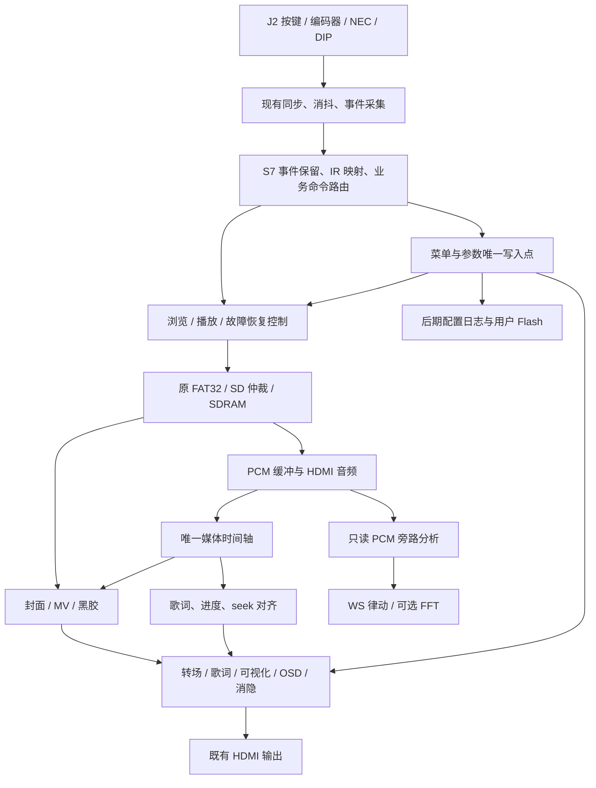

# VinylFPGA S7 优化迭代与功能拓展：分阶段开发方案

> 日期：2026-10-06（北京时间）  
> 工程：`D:\Data_Backup\VinylFPGA_Workspace_Base\VinylFPGA`  
> 核查代码：Git `e8f7d1a`，顶层 `top`，器件 `EG4S20BG256`，工程入口 `prj/VinylFPGA.al`。  
> 文档性质：后续开发与验收方案。本次仅进行资料、代码、约束和已有构建证据核查，没有实现以下新功能，没有重新综合、下载或进行板上测试。  
> 状态口径：**S0–S5 沿用已通过基线；S6 已实现、仿真/构建交付，板上验收尚缺记录。S7 是从此处继续扩展，不是重做主链路。**

## 0. 结论与执行顺序

本轮确定的路线是：**先收口 S6，建立故障与资源可观测性，再补全交互和反馈，随后增强播放、歌词和视觉，最后接入用户 Flash 与整机发布。**

不建议把原报告 S7-A～D 四项直接作为四次大合并。它们分别混合了跨时钟控制、共享存储、像素流水线和非易失写入，发生问题后难以定位。本方案细分为 S7-00～S7-10，每阶段再按可独立验证的子步骤执行。

| 顺序 | 阶段 | 用户可见结果 | 优先级 / 发布归属 |
|---|---|---|---|
| 0 | S7-00 基线收口 | MV、黑胶和原浏览/音频在实机上构成可靠起点 | 必须；不重开 S0–S5 验收 |
| 1 | S7-01 资源、时序与诊断基础 | 出问题能看到原因、计数和所用版本 | 必须 |
| 2 | S7-02 媒体异常恢复 | 坏文件、读超时、拔卡不会锁死，重插可恢复 | 必须 |
| 3 | S7-03 统一业务输入、红外和消隐 | 本地与遥控操作一致，DIP 真正控制对应功能 | 必须 |
| 4 | S7-04 EC2 菜单与统一参数 | 右旋钮调音量、亮度、对比度及设置 | 必须 |
| 5 | S7-05 外设反馈与 WS2812 | 数码管/LED 显示状态，八灯支持律动和进度 | 必须；形成日用交互版 R1 |
| 6 | S7-06 播放结束、重播和进度跳转 | 自动下一首、单曲循环、返回浏览、±5 秒跳转 | 必须 |
| 7 | S7-07 多曲歌词与歌词动效 | 每首歌有自己的三行歌词，支持模式切换 | 必须；精确逐字为增强项 |
| 8 | S7-08 视觉效果与真实频谱 | 转场、图层顺序统一；资源允许时增加 FFT | 转场必须；FFT 条件增强；形成展示版 R2 |
| 9 | S7-09 用户 Flash 与配置持久化 | 参数掉电恢复，外部 Logo 可更新 | 参数保存为完整产品目标；外部 Logo 为条件增强 |
| 10 | S7-10 演示、长稳与发布 | 自动演示、24 小时稳定性、可复现交付 | 必须；完整产品版 R3 |

优先级含义：条件增强没有达到资源或硬件准入条件时，明确列为未交付，不阻断较早版本的发布。**R1、R2 都是有边界的阶段版本；不得把未做的 FFT、精确逐字或持久化宣传为已完成。**

### 0.1 路线比较及取舍

| 路线 | 优点 | 主要代价 | 本方案选择 |
|---|---|---|---|
| 先稳定与交互，再媒体增强 | 每一步可回退；尽早得到可操作的整机；便于隔离故障 | FFT 等展示项稍后出现 | **采用** |
| 先 FFT、逐字歌词、复杂动画 | 演示效果增加快 | 当前面积和时序余量小，新增问题容易混到主链路中 | 不作为主顺序 |
| 先 Flash、全量存储体系重构 | 未来扩展空间较大 | 新引脚、新存储协议和掉电事务同时进入，收益较晚 | 拆到 S7-09 |

## 1. 核查依据与真实起点

### 1.1 依据、优先级与本次核查范围

用户本次要求是“分析现状，制定后续分阶段开发方案并输出 Markdown”。附带文档中的“冻结”“必须”“下一步烧录”等文字属于历史规划或工程记录，不自动构成本次修改代码、写卡或烧录授权。

本报告使用以下本地证据编号。相对路径均以工程根目录为基准；`../资源/` 位于工作区根目录。

| 编号 | 依据 | 用途与限制 |
|---|---|---|
| E1 | `doc/开发资料/J2扩展板引脚按键映射标定.md` | 物理按键、DIP、红外帧、J2 引脚标定；标定工程不等于主工程当前功能 |
| E2 | `doc/开发资料/开发方案.md` | 产品目标、Q 指标、外围设备设想；内部存在映射及保存策略冲突 |
| E3 | `doc/开发资料/VinylFPGA_主链路开发报告_代码与规划交叉核对_20261005.md` 顶部及 0.7、S7 节 | 主链路阶段记录；使用 2026-10-06 更新，不把较早历史正文当成现状 |
| E4 | `doc/开发资料/S6_视频播放与黑胶_交付说明_20261006.md` | S6 格式、仲裁、资源及板验缺口 |
| E5 | `src/top_tf_hdmi_audio.v`、`constraints/pin.adc`、`constraints/timing.sdc` | 当前端口、实例、时钟与电气配置 |
| E6 | `src/io/{expansion_integration,ui_event_bus,ui_event_bridge,quadrature_decoder,param_menu_controller}.v` | 事件语义、在场声明、反馈输出及旧菜单 |
| E7 | `src/audio/{play_ctrl,timebase_48k,wav_stream_player}.v`、`src/video/*.v` | 播控、样本时基、FIFO、视频调度 |
| E8 | `src/display/{lrc_osd,lrc_lines_rom,promax_audio_waveform}.v`、`tools/gen_lrc_assets.py` | 静态歌词资产与时域波形现状 |
| E9 | `prj/resource_opt_verified_20261005/S6_mv_v5/` 的 `inputs.sha256.json`、`final.qor`、`final.area`、bit | 本次实际复核的构建快照 |
| E10 | `../资源/Expansion_Board_Test/src/ws2812_driver.v` 及其仿真台 | 可复用驱动候选；尚未接入主工程业务 |
| E11 | `doc/开发资料/第1课_从官方例程到完赛工程_架构认知与FPGA思维框架.md` | 分层、数据流、验证方法参考；官方例程时钟不能替代当前约束 |

本次实际重新计算了 E9 清单内 **100 个源码/约束文件的 SHA256，全部与当前文件一致**；当前 bit 的 SHA256 为：

```text
23677f1e1f80749fef277ad6658ff1e5f9d1a7626a176365a600ee80e048a618
```

这证明当前源码与该构建快照相符，不等于重新完成构建，也不等于 S6 板验。另一个同为 2026-10-06 的《方案执行详情代码交叉核对分析》仍描述旧 `a165f9a` 与 S6 回退状态，**已被当前代码及 E3/E4 的后续记录取代**。

### 1.2 当前能力与差距

| 子系统 | 当前已具备 | S7 实际要补的内容 |
|---|---|---|
| 基础链路 | FAT32/SD、四封面 bank、HDMI 视频音频、2×2 浏览、基本转场与参数调节 | 错误闭环、交互一致性、观测和长稳 |
| J2 输入 | 12 键、两编码器、6 DIP、NEC 原始解码及事件上报 | 完整业务命令、同时事件保留、IR 重复策略、DIP 业务使能 |
| J2 输出 | LED 镜像 KEY01～04；WS 数据恒 0；EXT1 输出反馈音，EXT2～6 为 0 | 状态灯、真正清灯/律动/进度；EXT1 用途保留 |
| 在场约定 | DIP1 上拨声明可用，L3 弱下拉；接入后有稳定等待 | 文档统一、屏蔽与重接入行为验收；不宣称专用插拔传感器 |
| 菜单 | 母板 `key1+key2` 组合进入亮度/对比度菜单 | EC2 菜单、参数单一写入点、菜单输入所有权、设置页 |
| 音频 | 48 kHz、16 位、小端、单声道 PCM；音量、暂停、切歌；8 KiB 环形缓冲 | 结束策略、静音、重播、seek、故障重缓冲 |
| 歌词 | 固化在 RTL ROM 的单份行表/字库，按播放时间单行叠加 | 按曲目加载、三行、模式切换、准确区分行级和逐字时间 |
| 视频 | 320×240 RGB565LE、10 fps、三帧 bank、KEY08 切 MV/黑胶 | 板验收口、异常计数、与 seek/EOF 联动 |
| 可视化 | `promax_audio_waveform` 的时域幅度柱和峰值 | 真实 FFT 必须新增计算与频段定义，现有柱状图不能称为频谱 |
| 数码管/母板 | **6 位**位选；key1=B2、key2=C1、key3=B1、rst_n=A2；蜂鸣器已接 H11 | 显示业务信息、SW 控制；新增板载 LED 需原理图核脚 |
| 开机与 Flash | 片内 Logo、已有配置 Flash 固化流程 | 用户 W25Q64 总线/分区/配置日志尚未实现；不必为离卡 Logo 重做启动 |

### 1.3 必须纠正的旧规划冲突

| 冲突 | 本报告决定 |
|---|---|
| 原方案 KEY1/2=音量，KEY5=确认 | 以标定为准：KEY01 左、KEY02 中、KEY03 右、KEY04 上、KEY05 下 |
| 原方案 KEY8=特效、KEY9=视觉模式 | 沿用当前 KEY08=MV/黑胶；KEY09 扩展为转场效果 |
| 原方案 DIP1=WS、DIP2=IR、低有效 | 实板上拨=1；WS=DIP6、IR=DIP5、LED=DIP3、消隐=DIP4 |
| 标定 DIP1=拓展2，所有输入上拉 | 当前 DIP1 已作在场声明，L3 为 PULLDOWN。保留这一已验收变化，不照抄旧约束 |
| 扩展板 LED 高电平亮 | 当前端口 `exp_led_n`，**低电平亮** |
| 标定 EXT1～6 恒 0 | 主工程 EXT1 已接 `board_buzzer_n`；不能未经迁移就另作外设输出 |
| 标定有 `PING/STATUS?/WS` 串口命令 | 主工程只有 `uart_tx`，没有 UART RX 命令入口；本轮不假设这些查询可用 |
| 8 位数码管、独立母板 KEY4 端口 | 当前仅 6 位，且实物 KEY4=C1 对应代码 `key2`；不重复声明同一焊球 |
| 母板只做系统控制、取消业务兜底 | 当前保留已验收母板并联操作；S7 保留兼容，产品版移除另立迁移任务 |
| MV 12 fps、每帧 83.3 ms | 当前冻结 10 fps，正常供数时同步验收采用 **100 ms/帧** |
| 完整五层 Alpha、三行歌词、FFT 已描述 | 这些是目标；当前链路包含局部覆盖和固化单行，不宣称已经具备 |
| 一处“不做掉电保存”，另一处“30 秒固化” | S7-04 参数只驻留 RAM；S7-09 再增加受版本管理的持久化 |
| 单声道 PCM 中加入 L−R 人声消除 | 缺少独立左右声道，不能实现该意义的消除；不列入本轮必做 |

## 2. J2 物理接口与业务契约

### 2.1 J2 全部引脚归属

下表合并 E1 标定与 E5 当前约束。36 根信号全部有归属；其余 4 脚为电源/地。GPIOB 的编号不能直接当作 J2 物理脚号。

| J2 脚 | GPIOB | FPGA 脚 | 当前端口 | 物理用途 / S7 归属 |
|---|---|---|---|---|
| 1 / 2 / 3 | 0 / 1 / 2 | P4 / N4 / N3 | `exp_enc1_a/b/sw_n` | EC1 左播控，SW 低有效 |
| 4 / 5 / 6 | 3 / 4 / 5 | M5 / M3 / M4 | `exp_enc2_a/b/sw_n` | EC2 右调参，SW 低有效 |
| 7 | 6 | L3 | `exp_dip_n[0]` | DIP1，现用在场声明；唯一输入弱下拉例外 |
| 8 | 7 | J3 | `exp_dip_n[1]` | DIP2，拓展1；本轮预留，不触发播放 |
| 9 | 8 | J4 | `exp_dip_n[2]` | DIP3，J2 状态 LED 使能 |
| 10 | 9 | H4 | `exp_dip_n[3]` | DIP4，自动消隐功能使能 |
| 11 / 12 | — | — | — | +5 V / GND |
| 13 | 10 | N1 | `exp_key_n[0]` | KEY01 左 |
| 14 | 11 | M2 | `exp_key_n[1]` | KEY02 中间确认 |
| 15 | 12 | M1 | `exp_key_n[2]` | KEY03 右 |
| 16 | 13 | L1 | `exp_key_n[3]` | KEY04 上 |
| 17 | 14 | H2 | `exp_key_n[4]` | KEY05 下 |
| 18 | 15 | H1 | `exp_key_n[5]` | KEY06 歌词动效 |
| 19 | 16 | G1 | `exp_key_n[6]` | KEY07 切歌模式；保留现有视图/返回 |
| 20 | 17 | G3 | `exp_key_n[7]` | KEY08 播控方式；现用视觉切换 |
| 21 | 18 | L4 | `exp_key_n[8]` | KEY09 切歌动效 |
| 22 | 19 | L5 | `exp_key_n[9]` | KEY10 WS 灯效 |
| 23 | 20 | K6 | `exp_ir_rx` | NEC 接收信号；不是 DIP5 |
| 24 / 25 / 26 / 27 | 21 / 22 / 23 / 24 | H3 / H5 / F3 / E2 | `exp_led_n[0..3]` | LED1～4，低有效；物理灯位需逐灯补验 |
| 28 | 25 | J11 | `exp_ws2812_data` | WS2812 八灯串行数据；不是 DIP6 |
| 29 / 30 | — | — | — | +3.3 V / GND |
| 31 | 26 | J12 | `exp_key_n[10]` | KEY11 拓展1：本方案分配静音 |
| 32 | 27 | K11 | `exp_key_n[11]` | KEY12 拓展2：本方案分配歌曲结束策略 |
| 33 | 28 | K14 | `exp_dip_n[4]` | DIP5 红外业务使能 |
| 34 | 29 | L12 | `exp_dip_n[5]` | DIP6 WS 总使能 |
| 35 | 30 | M12 | `exp_ext_o[0]` | EXT1 已输出蜂鸣反馈波形，本轮保留 |
| 36 / 37 / 38 / 39 / 40 | 31 / 32 / 33 / 34 / 35 | M11 / N12 / P14 / P12 / R12 | `exp_ext_o[1..5]` | 预留，维持已知输出状态；未分配 OLED/I2S |

J2 接口继续使用现有 LVCMOS33；输出驱动沿用已验证约束。A/B 为正交状态信号，不宜用“按下高/低有效”描述。KEY 与编码器按压低有效；DIP 是消抖后的原始位置，高=上拨开启，不因名字带 `_n` 再取反。

板载 UART TX=D12、候选 RX=F12，系统时钟 R7、复位 A2，均不占 J2。本轮诊断先用现有 TX；增加 RX 须另加端口、约束和协议验收。

### 2.2 冻结的交互表

保留当前“封面浏览 → 2×2 缩略图选曲 → 播放”的操作步骤；不把它静默改成旧方案的单次确认即播放。BOOT/BROWSE/PLAY 是业务状态，OSD 是叠加子状态。

| 输入 | BROWSE：封面/缩略图 | PLAY：菜单关闭 | 菜单打开时 | 落地阶段 |
|---|---|---|---|---|
| EC1 左/右转 | 上一/下一选择 | 上一/下一曲 | 忽略，避免误切曲 | 已有；S7-03 统一路由 |
| EC1 按压 | 沿用当前确认流程 | 暂停/恢复 | 忽略；菜单用 EC2/KEY02 | 同上 |
| KEY01 / KEY03 | 上一/下一选择 | 新增上一/下一曲，与 EC1 等价 | 返回上一级 / 进入选项 | S7-03、04 |
| KEY04 / KEY05 | 沿用上一/下一选择 | 音量 + / − | 菜单项移动或值 + / − | 已有；S7-04 仲裁 |
| KEY02 | 沿用确认 | 暂停/恢复 | 确认/进入编辑/完成编辑 | 已有；S7-04 |
| EC2 转动 | 唤醒菜单并选择；首格只唤醒 | 同左 | 非编辑时选项移动，编辑时改值 | S7-04 |
| EC2 按压 | 打开菜单 | 打开菜单 | 进入/结束编辑；根菜单“退出”关闭 | S7-04 |
| KEY06 | 无业务动作，可提示“播放时可用” | 静态三行 → 滚动淡入 → 时间高亮循环 | 忽略 | S7-07 |
| KEY07 | 保留 2×2 视图切换 | 保留退出播放返回浏览 | 关闭菜单；该次不退出播放 | 已有；S7-04 |
| KEY08 | 不改变选曲 | MV/黑胶切换；无 MV 时提示并保持黑胶 | 忽略 | S6 已有 |
| KEY09 | 切换转场风格 | 设置下次切曲转场风格 | 忽略 | S7-08A |
| KEY10 | 切换 WS 模式；进度模式无播放时熄灭 | 律动/进度两模式 | 忽略 | S7-05 |
| KEY11 | 静音开关，作用于后续播放 | 静音/恢复此前音量 | 允许全局静音 | S7-04 |
| KEY12 | 设置歌曲结束策略 | 顺序下一首 → 单曲循环 → 返回浏览 | 忽略 | S7-06 |

BOOT 沿用 500 ms 启动保护窗；窗后有效按下、编码器步进/按压及允许的红外新帧可跳过。DIP 初始化、IR repeat、单纯松开均不作为新增跳过源。修订跳过源时须保留现有 Boot 回归。

本轮**不把 KEY02 加成长按返回**，避免把当前按下即确认改成松开判短按，引入双触发。KEY07 已有返回入口；旧方案“KEY5 长按 1.2 秒”不再采用。将来确需长按时，必须独立规定短/长互斥及按下、松开的消费规则。

事件消费优先级固定为：系统确认框 → 消隐唤醒 → 菜单 → 当前浏览/播放业务。每个普通动作只由一层消费；静音和显式红外音量命令为菜单内允许的全局例外。菜单打开时红外上一/下一曲、播放暂停、重播和seek均不穿透菜单；方向键与OK按菜单表执行，重启键只打开系统确认框。

### 2.3 DIP 与断开行为

| DIP | S7 冻结语义 | 生效方式 |
|---|---|---|
| DIP1 | J2 输入可用声明；正常操作须上拨 | 沿用当前稳定等待；关闭后禁止 J2 业务，取消未完成按压/连发，不合成确认事件 |
| DIP2 | 预留 | 记录状态，不启动业务；与 KEY11 不自动绑定 |
| DIP3 | J2 LED 总使能 | 消抖后运行时生效；关闭输出 `4'hF` |
| DIP4 | 自动消隐功能使能 | 开启后 60 秒无人操作自动黑画面；关闭自动功能并唤醒；不停止 HDMI 同步或音频 |
| DIP5 | 红外业务使能 | 关闭后新帧、重复帧、Boot 跳过与红外反馈都无业务效果；调试可计数 |
| DIP6 | WS 总使能 | 关闭需先发一帧全黑并完成锁存，再保持低；重新开启按当前模式刷新 |

这些是 FPGA 逻辑使能，并非物理断电。默认采用**运行时消抖读取**，取代旧方案“上电只读”。自动消隐期间第一个有效操作只唤醒、不兼做切曲/调参；遥控息屏键可独立切换手动消隐，即使 DIP4 自动消隐关闭也可使用。

DIP1 只是现有板上拉与 FPGA 弱下拉配合的使用约定：板在但 DIP1 下拨也会被判作不可用，不能称为专用 presence 引脚。不可用时 J2 LED 熄灭、WS 发送全黑、清理输入队列，播放可继续，母板原有功能保留。软件模拟断开和实物断开分开验收；不假定排线具备带电插拔电气保护。

### 2.4 红外 15 键业务映射

E1 已标定的完整帧作为匹配依据；主工程事件中 `full_frame={ev_aux,ev_arg}`。本遥控器区分键的字节是 `full_frame[31:24]`，其 `CMD` 恒为 FF。移植解码器如改变字节序，先用整帧测试向量确认，不能仅凭 NEC 常见布局猜测。

| 键 | 完整帧 | 业务命令 | 重复帧 |
|---|---|---|---|
| 上一首 | BA45FF00 | PREV；浏览选择、播放切曲 | 忽略 |
| 下一首 | B946FF00 | NEXT | 忽略 |
| 播放/暂停 | B847FF00 | 浏览确认 / 播放暂停 | 忽略 |
| 音量+ | BB44FF00 | VOL_UP，不受方向键菜单语义影响 | 允许节流连发 |
| 音量− | BF40FF00 | VOL_DOWN | 允许节流连发 |
| 息屏 | BC43FF00 | 手动消隐切换 | 忽略 |
| 进度+ | F807FF00 | SEEK +5 秒，仅 PLAY；S7-06 前提示不支持 | 允许节流连发 |
| 进度− | EA15FF00 | SEEK −5 秒，同上 | 允许节流连发 |
| 重播 | F609FF00 | 本曲从零重播；S7-06 实现 | 忽略 |
| 重启 | E916FF00 | 弹出重启确认；3 秒内 OK 才软重启 | 忽略 |
| 上 | E718FF00 | 等价 KEY04 | 首版忽略 |
| 下 | AD52FF00 | 等价 KEY05 | 首版忽略 |
| 左 | F708FF00 | 等价 KEY01 | 忽略 |
| 右 | A55AFF00 | 等价 KEY03 | 忽略 |
| OK | E31CFF00 | 等价 KEY02；有系统确认框时只确认该框 | 忽略 |

先验证两组反码、完整帧白名单，再生成命令。新帧建立最近有效键；仅音量与 seek 可接受约 110 ms 的 repeat，首版统一限速为不快于每 150 ms 一次，距最近合法帧/重复帧超过 250 ms 则结束连发。关闭 DIP5、退出 J2 可用状态、复位时清除最近键。没有先导新帧的 repeat 不执行；本遥控无数字键，本轮不承诺数字选曲。

## 3. 系统架构、资源与接口边界

### 3.1 复用的架构与新增职责



新模块名称为建议交付名，不表示现已存在。每个模块应保留独立输入输出、时钟域和错误出口。

| 模块/接口 | 职责 | 边界 |
|---|---|---|
| `ui_command_router` | 原始事件转业务命令、菜单所有权、重复帧、唤醒吞首键 | 不直接访问媒体地址，不另做机械消抖 |
| `param_csr` + `menu_system` | 参数范围、默认值、更新通知、菜单状态 | 一个参数只能有一个权威写入点，旧母板菜单变成命令源 |
| `media_supervisor` | 超时、重试、重挂载、代次标识、降级 | 不以全局复位作为所有媒体错误的常规恢复 |
| `transport_ctrl` | EOF 策略、重播、seek 请求/完成、媒体时间提交 | 所有媒体消费者在同一次 seek 提交切换代次 |
| `pcm_metrics` | 从有效 PCM 样本提取包络/峰值 | 不反压、不改变音频 ready/valid 或样本顺序 |
| `status_panel`、`ws2812_effects` | 状态显示、灯色帧、反馈声音 | 不直接发 SD 请求，不阻塞播控 |
| `lyric_loader`/`lyric_renderer` | 有界资产装载、三行缓存、时间比较 | 装载失败只关闭歌词，不拖死音频 |
| `config_journal` | 双槽/日志事务、CRC、版本、恢复 | 用户 Flash 独立分区，不能写 FPGA 配置 Flash |

### 3.2 时钟、CDC 与图层规则

当前以 E5 实例及约束为准：板级 `clk` 50 MHz；`sd_card_clk` 100 MHz；`ext_mem_clk` 100 MHz 及相移输出；`video_clk` 25 MHz；`hdmi_5x_clk` 125 MHz。**当前仅使用两个 PLL，音频逻辑复用 video_clk；不能照搬教学文档早期 12.288 MHz 音频域。** `play_ctrl` 实际实例在 SD 域，源文件顶部旧的 50 MHz 注释不代表真实接线。

- 原始 IO 在 50 MHz 域同步消抖。控制事件可用握手 mailbox 或已证明速率边界的 toggle；同类事件在目的端来不及采到时不得连续翻两次而丢失。
- 参数值、时间戳、song_id、LBA 和 bank 是多位数据；跨域使用保持数据+请求/应答，或异步 FIFO。不能把“每位两级同步”视为原子传输证明。
- 显示配置在帧边界锁存；亮度、坐标、字符、透明度的流水延迟与 DE/HS/VS 对齐。每新增一级给出延迟表和像素边界测试。
- 继续使用唯一 48 kHz 节拍。暂停冻结媒体时间；故障重缓冲时 HDMI 可继续发静音，但媒体时间只随真正消费的媒体样本推进，避免恢复后歌词/MV领先实际声音。此项是 S7-02 的新增闭环，不声称基线已具备。
- 目标合成顺序：背景/封面或 MV/黑胶 → 转场 → 歌词 → 波形/频谱 → 菜单/Toast/故障提示；BOOT 时选择启动页；消隐最后选择纯黑 RGB，时序和 HDMI 音频继续运行。局部图层用覆盖/简单 Alpha 即可，不一次建立全屏通用混合器。

### 3.3 已用资源与新增预算

E9 的实际路由结果如下；WNS 单位为 ps。

| 指标 | S6_mv_v5 | 剩余/含义 |
|---|---:|---|
| LUT | 15102 / 19600，77.05% | 4498 个；不能等同为可任意布通的空间 |
| REG | 9691 / 19600，49.44% | 9909 个 |
| Slices | 8175，83.42% | 布局空间已经偏紧 |
| BRAM9K | 46 / 64 | 18 块 |
| DSP | 16 / 29 | 13 个 |
| Setup WNS / Hold WNS | +100 / +3 | TNS 均 0，违例端点均 0；裕量很小 |
| IO / PLL | 71 / 188；2 / 4 | 逻辑 IO 余量不等于板上引脚都可任意使用 |

以下是**规划分配上限与决策阈值，不是综合结果或器件规范**：

| 功能组 | 新增 BRAM9K 预算 | 新增 DSP 预算 | 资源策略 |
|---|---:|---:|---|
| 控制、容错、菜单、LED/WS | 0～1 | 0 | 优先状态机、共享计数器、小型寄存器队列 |
| 多曲歌词工作缓存 | 最多 4 | 0 | 字库/歌词大资产留 SD/SDRAM，按需缓存 |
| 256 点迭代 FFT | 最多 4 | 最多 4 | 复用蝶形，不用每级并行乘法阵列 |
| Flash 事务缓存 | 最多 1 | 0 | 小页缓存；不新建全屏 Logo BRAM |
| 预留 | 至少 8 | 至少 9 | 按以上上限分配后的余量；实际以路由报告重算 |

每阶段先报告 LUT/Slices 增量。目标 Slices ≤88%；88%～90% 先做减负评估；超过 90% 暂停再加重型功能，先减小功能配置或优化。任何配置最终必须 Setup/Hold 非负、TNS=0、违例端点=0。+3 ps 不能称“裕量充分”；不通过放宽周期或新增无依据 false path 获得表面通过。

SDRAM 继续采用 **32 位字地址**：四封面 `[0,1228800)`，三 MV bank `[1228800,1459200)`，当前 21 位地址范围上限 `2097152`。剩余地址窗口为 637952 个字，约 2.43 MiB；这是地址规划余量，不替代对控制器容量/映射的核实。新增歌词/Logo 区必须列地址表，禁止覆盖正在显示的 bank。

### 3.4 带宽与延迟预算

- MV：`320×240×2×10 = 1,536,000 B/s`；PCM：`48000×2 = 96,000 B/s`；最低媒体载荷合计 **1,632,000 B/s**，未计协议和额外资产开销。
- E4 的约 2.719 MB/s 来自理想卡仿真，不是实卡结果。S7-00 建议实卡有效吞吐达到载荷的 1.25 倍，即约 2.04 MB/s；不足时先降低媒体负载或解决访问开销，不直接宣布能支持 12 fps。
- 音频 FIFO 容量 4096 样本，理论全满覆盖约 85.3 ms；现有高水位为 2048 样本，约 42.7 ms；低水位 1024 样本，约 21.3 ms。**不能把 85.3 ms 当成正常运行保证可抗的最长停顿。**
- 实卡测量应同时记录平均带宽、最大扇区等待、音频最低水位、underrun 和视频 missed-deadline。每个扇区事务完成前不可抢占，音频低水位只限制下一视频事务。
- 灯效 30 Hz、UI 状态 10～30 Hz 足够；低频统计用一致性快照跨域。串口状态最多 2 Hz，错误/状态变化即时排队；队列溢出可计数，不得反压媒体链路。

## 4. 分阶段开发与验收

所有阶段统一执行“需求/时序样例 → 独立仿真 → 集成回归 → 原生 TD 构建 → SRAM 板验 → 保存证据”。以下验收项均为**将来执行的通过标准**；本报告不预填通过。

### S7-00：S6 板验收口与基线冻结

**入口**：S0–S5 已通过；当前源码与 S6_mv_v5 一致。  
**目标**：把 S6 从可下载版本收口成后续优化的板上基线。

开发/准备：冻结源码清单、bit 哈希、工具版本、SD 测试镜像、INDEX.json、MV/PCM 内容哈希；使用四曲资源覆盖“有 MV、无 MV、旧 v1 索引、异常描述”。不重新开发 MV。

验收：

1. 有 MV 曲目方向、RGB565 颜色、窗口正确；目标 10 fps；无 MV 自动黑胶。
2. 暂停、恢复、KEY08 来回切换各 50 次；帧边界生效、音频连续；最后完整帧保持。
3. EC1、方向键、KEY07、母板兼容路径往返浏览与播放至少 100 次，不串 bank。
4. 正常卡连续播放至少 10 分钟；采用带声音脉冲/画面标记的素材，正常供数时音画差 ≤100 ms，无累积漂移。仅凭肉眼“差不多同步”不作为量化证据。
5. 保存实卡吞吐与停顿测量；无仪器或遥测时如实留缺口，在 S7-01 增加观测后补测。

交付：`S7_00_baseline/` 快照、`board_acceptance.md`、测试资源清单。S6 不通过时修复该问题；硬件回退点为已验收 `S0_S5_fix_20261006_v4`，S6 失败不抹除 S0–S5 已完成状态。

### S7-01：资源、时序、诊断与边界审计

**入口**：S7-00 正常功能板验通过。  
**目标**：后续每次迭代能够解释“哪里错、何时错、是否影响音频”。

开发步骤：

1. S7-01A 先做零行为变化的构建清单与模块资源排名，复核 CDC、现有宽泛例外及外部 IO 时序适用性；不因旧报告通过而宣称所有板外时序已覆盖。
2. S7-01B 增加饱和计数和 sticky 状态：音频 underrun、视频逾期/失败、SD 超时/重试、事件溢出、最近错误、最大等待、最低 FIFO 水位、运行版本。
3. 计数跨域使用请求快照；串口新增 `STAT`/`ERR` 只发 TX，继续兼容现有事件行。`VERIFY ... PRES` 仍是索引存在标记，J2 状态另用 `EXPHUB`/独立字段。
4. 仅针对实际关键路径做单项优化。S6 已将 FAT 地址运算流水化，不重复把该工作列为未做。优化前后比较有序事务、像素/样本结果与必要的允许延迟。

验收：已知数量故障注入与计数相符；计数溢出饱和而非归零；关闭/开启日志音频序列相同；同一素材运行 30 分钟可导出状态；原回归和新快照时序通过。给出“新增 LUT/REG/BRAM/DSP、最差路径、遗留约束告警”表。

交付：诊断格式说明、CDC/时序审计表、资源对照、快照和板验记录。新增遥测关掉后仍可回退到 S7-00 功能。

### S7-02：媒体故障恢复与错误反馈

**入口**：S7-01 可观察错误。  
**目标**：文件与存储失败是有界事务，不把系统永久卡在 busy。

开发步骤：

1. 新增 `media_supervisor`；为 SD 初始化、命令应答、数据 token、整扇区完成、文件装载分别定义参数化期限。初始板验配置：挂载总期限 5 秒、扇区事务 250 ms、单任务最多 3 次重试、挂载失败 30 秒后再试；具体底层阈值结合现有协议状态和实卡分布细化，所有等待路径必须可超时。
2. 单个媒体错误先淡出/静音、禁止新取数；对在途请求保留所有权，完成或超时取消后增加 `media_epoch`，拒收旧代次数据，再清理 FIFO/调度状态。不能在新任务已启动后把旧完成脉冲当成新完成。
3. FIFO 不足进入 REBUFFER，HDMI 继续静音包；媒体消费时间冻结，达到恢复水位后淡入。MV 保持最后完整帧，必要时降级黑胶。
4. 未插卡、空库、坏索引、缺封面/音频、非法 MV 描述分别处理；一轮失败曲目最多遍历实际曲目数，避免坏库无限“下一首”。零曲目不得确认进入 PLAY。
5. 没有专用卡检测输入时，以协议超时/错误判卡状态；不声称能立即探测物理拔出。重插后 30 秒重试窗口内重新挂载；新卡索引必须重新验证，旧 LBA 不沿用。

错误呈现约定：Err-01 挂载失败，02 空库，03 索引/版本/CRC，04 关键文件缺失，05 读超时，06 MV 描述/数据错误，07 歌词错误，08 配置 Flash 错误，09 输入队列溢出。错误码表集中管理；MV/歌词/配置错误允许局部降级。

本阶段先通过UART及最小屏幕状态提示呈现错误；数码管优先级与LED告警在S7-05接入，不依赖尚未开发的完整菜单或状态面板。

验收：每种错误注入至少 10 次；持续超时在规定重试上限内退出；重插恢复至少 10 次；快速切曲时延迟旧应答不得污染新曲；PCM 停顿后样本无跳序且时间轴一致；MV 只发布完整帧。正常卡 1 小时无新 underrun、无异常忙锁。错误时持续 HDMI 同步，母板复位仍可用。

交付：状态图、超时参数表、错误码表、故障仿真及实卡记录。回退保留新增诊断，单独旁路自动重试；失败不同时修改显示/存储/时钟三条主链。

### S7-03：统一事件、完整红外和 DIP 控制

**入口**：S7-02 已有可控恢复；执行第 2 节交互契约。  
**目标**：同一个动作只生成一次业务命令，不因多路输入同时到达而丢失关键事件。

开发步骤：

1. 当前 `ui_event_bus` 只为 DIP 保存 pending，其他输入同拍按优先级选一个。先补各类事件待处理机制，再输出队列；不能只在现有仲裁器后加 FIFO 就声称保留了仲裁前已丢的事件。
2. 首版支持最多 32 条待处理业务事件；KEY down/up 保序，EC 步进可用有符号累加，DIP 合并为最终电平。饱和/溢出可见，不能伪造确认/暂停/系统动作。用多源同拍与连续突发覆盖。
3. 物理事件包沿用 `valid + code[3:0] + arg[15:0] + aux[15:0]`；内部业务命令另定义枚举、来源和应答，不破坏原 UART 原始事件语义。
4. 按第 2.4 节接 IR 白名单、repeat 策略、重启确认；按第 2.3 节接运行时 DIP、息屏与唤醒。KEY01/03 在 PLAY 正式接上一/下一曲。
5. 保留现有 1 ms A/B 稳定采样+四相位解码作为起点，测试 5/20/50 个完整步进每秒及接触反跳、逆转、非法二位跳变。未出现边界失效前不直接删除滤波；如需更高速，再独立优化。

本阶段冻结并输出DIP3/6的有效使能状态；LED/WS最终执行器在S7-05接入。此前WS沿用静态低，不能把此时的空载使能测试当成“已点亮后清灯”验收。

验收：12 键及两旋钮按压各 100 次无双触发；两旋钮正反各 100 格计数正确；全部 15 个红外向量与真实遥控逐一通过；无先导 repeat、反码错、未知帧不执行；音量长按稳定限速；DIP5 关时不响、不跳 Boot、不执行业务。DIP1 关闭/恢复 20 次无虚假确认；消隐期间音频和 HDMI 锁定不变，首键只唤醒。

交付：机器可读按键/红外映射、事件压力测试、端口与约束差异表。保留旧映射旁路配置作为诊断版本；不继续把主工程写成支持标定工程串口 RX 命令。

### S7-04：EC2 菜单、参数统一与静音

**入口**：S7-03 业务路由稳定。  
**目标**：右旋钮可以完成日常参数设置，菜单不抢播控、不产生多写入者。

开发步骤：

1. 新增 `param_csr`，集中音量、mute、亮度、对比度、转场、WS、歌词、结束策略、自动轮播、显示项。未实现的选项置灰并显示原因，不提供“可调但无作用”的值。
2. 一级：音量、亮度、对比度、转场、设置、退出；二级：自动轮播、结束策略、歌词模式、WS 模式、数码管项、恢复默认、版本。人声消除不进入可用菜单。
3. 音量首版保留现有默认 200、步进 16、范围 32～255；mute 为独立位，取消静音恢复原值。音量下限是否扩展到 0 留作独立音频变更。亮度/对比度首版复用当前 5 档 LUT 和默认值。
4. EC2 唤醒首格不改值；3 秒无操作开始 0.5 秒淡出，淡出中操作重新唤醒；KEY07 只退出菜单。参数更新帧边界提交；恢复默认需确认且本阶段只恢复 RAM 值。
5. 旧母板组合菜单改成等价参数命令，保留原入口但不再独立持有亮度/对比度副本。退出菜单不得回放被截获的浏览按键。
6. 静音和普通音量变化使用现有淡变通路；UI 时钟继续运行，不能因媒体暂停导致菜单超时、按键或显示冻结。

验收：每个参数上下边界来回 100 次无溢出；播放、暂停、浏览均可调；菜单打开时 EC1 不切曲；3 秒+0.5 秒行为在 ±1 视频帧范围内；连续开关菜单 100 次无漏层、错位、音频序列改变。KEY11 静音 50 次并正确恢复音量。断电后恢复默认是本阶段预期行为。

交付：参数字典（单位/范围/默认值/持久化资格）、菜单状态图、参考图、仿真/板验。回退只撤新菜单与 CSR 适配，不更换亮度算法和 HDMI 输出。

### S7-05：状态反馈、数码管和 WS2812

**入口**：S7-04 参数与状态来源统一。  
**目标**：完成所有已接线反馈器件的有意义输出，形成 R1 日用交互版。

开发步骤：

1. S7-05A：J2 LED1=有效 IR 脉冲、LED2=已接受操作脉冲、LED3=心跳、LED4=告警。脉冲延长约 80 ms；DIP3=0 全灭。先逐灯核物理位置，标定文档对此明确未逐个实测。
2. 数码管继续 **6 位**：错误码 > 参数临时值 2 秒 > 用户选择（曲号/时间/诊断）；KEY3/B1 切显示项，SW1 控显示使能。按 MM:SS 显示时间，超过 99:59 固定显示 99:59，不产生乱码。
3. SW2 预留控制新增母板 LED；先用原理图核对 E2 中候选 A4/A3/C10/B12 的网络、极性、复用，再新增端口。未核对前不驱动这些脚；母板 LED 暂不可用不影响已接 J2 LED 交付。
4. SW3 控详细 UART 日志，版本/严重错误保留；SW4 演示在 S7-10 接入。SW5 保持物理蜂鸣通路；SW6 按硬件要求选数码管。蜂鸣反馈只来自已接受动作，IR 禁用/无效帧不鸣叫；EXT1 保持同源，不重复占用。
5. S7-05B：迁入 E10 `ws2812_driver`，增加完整 8 灯颜色帧的提交/忙握手。律动从 PCM 旁路做饱和绝对值和快升慢降包络；处理 −32768。进度由播放样本数/总样本数给出，8 灯单调填充，分母为 0 时全灭。当前INDEX已有条目偏移20的`audio_bytes`；本阶段把该字段可靠引出，校验非零偶数字节，以`audio_bytes/2`为总样本数，不等待S7-06才定义长度。
6. KEY10 切换模式；默认每色通道最大值 76（不高于 255 的 30%）。实际电流另测，亮度比例不当作功耗保证。暂停律动衰减至灭，进度冻结；mute 时律动灭、进度照常。
7. DIP6 关闭、J2 不可用或重新初始化时安排全黑数据帧；驱动 busy 时保留清灯请求。不能仅拉低 data 就认为已经清除了灯珠锁存颜色。

E10 当前时序参数（50 MHz）为每 bit 63 拍、0 高 18 拍、1 高 35 拍、reset 3000 拍，即约 1.26 μs、0.36 μs、0.70 μs、60 μs。这只是已有驱动的基线；集成前按实装灯珠版本确认允许范围并实测波形，不能把通用 WS2812 名称当成统一版本保证。

母板SW1～4还需补做“物理拨向→原始电平→逻辑使能”的逐位记录：现有注释与旧方案有低有效/上拨为1的口径差异，不直接套用J2的实测结论。下文“SW开启/关闭”指归一化后的逻辑状态，实际拨向以该记录为准。

验收：RGB 三基色顺序与 GRB 编码、灯1～8顺序正确；全黑/满亮受 76 钳位；DIP6 关闭后 100 ms 内实测熄灭；忙时切模式不出半帧颜色；输入并发与连续灯效运行 1 小时，underrun 不增加。数码管各显示项、使能与优先级逐项正确，峰值负载下测 5V 电流并记录供电条件。

交付：LED 灯位图、WS 波形、功耗数据、R1 操作表和可回退 bit。母板 LED 如未准入，R1 清单明确标未接入；其余反馈不随之延期。

### S7-06：歌曲结束策略、重播与 seek

**入口**：故障恢复、命令路由、参数、媒体时间已收敛。  
**目标**：使遥控进度键与 KEY12 成为真实可用功能，而非只改 UI 时间。

开发步骤：

1. S7-06A 接 `stream_end`/缓冲排空为单次 EOF 事件；KEY12 循环设置顺序下一首、单曲循环、返回浏览，默认返回浏览。顺序模式在最后一首回第一首；无可播放曲目直接浏览告警。暂停不触发 EOF，读取完成不等于播放完成。
2. 重播本曲：淡出 → 停止新请求 → 旧事务排空/取消 → 音频与 MV/歌词代次切换 → 媒体时间归零 → 预缓冲 → 淡入。不能只将 `time_ms` 清零而仍播放原 FIFO。
3. S7-06B 增加 ±5 秒 seek。`target_sample` 钳位在 `[0,total_samples-1]`，目标以曲目元数据为准；PCM 每样本 2 字节，扇区内偏移必须跳过，不可仅四舍五入成 LBA。
4. 连续文件可直接定位；若音频允许碎片，必须用 FAT 文件偏移定位/受检验的片段表，不能无条件用 `start_lba + offset/512`。首版可限定已验证连续 PCM，打包工具必须明确拒绝不支持的布局。
5. seek 请求使用 request/ack、目标位置、曲目代次；忙时只保留最新目标。暂停中 seek 保持暂停。MV 目标帧取 `floor(target_ms/100)` 并钳位，废弃旧帧完成；歌词重定位与进度同一次提交。
6. 复用S7-05已引出的`audio_bytes/2`真实样本长度，区分尾部补零和有效媒体长度，EOF以最后有效样本被消费为准。现有字段足够表达该长度，不为seek无谓升级索引版本；零长度、奇数字节PCM在资源工具和RTL入口均拒绝。

验收：三种结束策略每种 20 次；最后一首/单首/零首/文件尾不足一扇区；±5 秒连续往返 100 次；首尾钳位、暂停 seek、切曲与 seek 同拍、旧应答延迟。仿真比较实际输出样本起点，误差 ≤1 样本；实机正常供数恢复后 MV 时间差 ≤100 ms，歌词差 ≤100 ms。若目标媒体定位失败，在规定超时后返回可操作错误状态。

交付：transport 状态图、seek 接口与媒体长度格式、样本级参考结果、板验录像。seek 不通过可旁路，其余 EOF 策略作为独立已验收子版本保留。

### S7-07：多曲歌词资产、三行显示与模式切换

**入口**：S7-06 媒体时间和重定位接口稳定。  
**目标**：首先解决“每首歌都显示同一份固化歌词”，再做动画。

开发步骤：

1. S7-07A 扩展 PC 资源工具：每曲歌词生成有界二进制行表、字形子集与可选逐字时间；记录版本、长度、song_id、CRC。首版约束：每曲最多 256 行、每行 16 字形、共享子集最多 256 字形；超限明确报错，不静默截断。
2. INDEX v2 条目尾部已被 MV 占用；**禁止再挪用偏移56～63**。新增歌词描述采用新的版本/旁文件格式，工具与 RTL 同步升级，v1/v2 无歌词描述时显示“无歌词”。本阶段优先独立歌词目录表，避免破坏已验收 MV 条目。
3. 数据在切曲预缓冲期装载；接既有 SD 仲裁并让音频优先。三行和必要字形缓存在本地；大资产只占经审核的 SDRAM 新区域。运行期像素输出不直接等待 SD 字节。
4. S7-07B 显示上一行、当前行、下一行；KEY06 切静态三行、滚动淡入、时间高亮。16 帧完成滚动，暂停冻结歌词媒体动画，菜单仍可响应。布局固定在 MV 窗口外并检查与底部波形/OSD遮挡。
5. 普通 LRC 只有行时间：可做行高亮，或明确标作估算的行内渐变。**精确逐字必须有逐字时间戳输入**；数据缺失时降级行级，不把均分每字时间包装为准确卡拉 OK。
6. CRC 错、超长、非法字形、缺文件只关闭歌词图层，保留音视频；seek 后按新时间查找，旧行缓存不得混用。

验收：至少 4 首不同歌词与曲目匹配；缺歌词/重复时间/中文/空行/首尾/最大长度/CRC 负例；滚动16帧、切模式无残字；暂停与 seek 对齐。行切换相对资产时间 ≤100 ms；精确逐字仅对有逐字标注的验收素材评估同一指标。资源工具给出预览图和 BRAM/SDRAM 占用。

交付：歌词格式、转换器和校验器、三行参考图、字幕时间测试。若逐字资源或预算未满足，交付三行与行级动效并在清单标注精确逐字未交付。

### S7-08：转场、界面层次与可选 FFT

**入口**：R1 交互稳定，S7-07 图层与缓存已确定。  
**目标**：先做低资源的视觉完整性，再评估真实频谱。

**S7-08A 必做：** KEY09 循环淡入淡出、百叶窗、推幕；默认淡入淡出，时长 0.6 秒（约36个显示帧，依据实际帧周期计数），参数化。利用现有封面 bank，不新建全屏 BRAM。转场中快速选曲合并为最新目标，在明确帧边界重新开始；源/目标 bank 保持完整，不能读写同一显示 bank。菜单永远在视觉层之上；BOOT、故障提示、消隐优先级写入统一合成模块。维持 640×480 与当前 2×2 布局，不同时引入 240×240 中央封面重排。

当前`video_transition_apply`采用单读流，推幕是新画面从黑底揭示，不是新旧两帧同时移动。首版百叶窗/推幕同样采用单读流遮罩，淡出旧画面后在帧边界换bank再显露新画面；这种设计中的有意黑场不计作异常闪黑。双画面交叉淡化或平移另需双源带宽与仲裁验证，不能仅因已有多个bank便假定同拍可读两幅像素。

验收：每种转场至少 100 次；快速切曲、暂停、OSD 同时发生无半帧；恒定色块/边界图验证像素与控制延迟；播放期间视觉变化不增加音频 underrun。当前画面与新参考图逐项比较。

**S7-08B 条件增强：** 新增256点定点实数 FFT，优先迭代复用结构；采样仍48kHz，频率分辨率187.5Hz。先定义窗函数、缩放、溢出饱和、幅度标度，再做32个显示频段；低频分辨率不足的区域不得虚构为32个独立低频带。32段需有明确 bin 分组表，可采用低频逐 bin、高频分组合并的显示方案，并如实说明近似对数性质。

FFT 从 PCM 旁路取样，分析排队溢出允许丢分析帧并计数，不能反压音频。输出30Hz柱高+峰值保持；与原波形互斥显示，菜单选择。BRAM/DSP超过第3节预算或布局不能通过时，保留原波形，FFT停留独立实验版本。

FFT 验收：零输入、直流、单音bin对齐、双音、满幅、−32768、噪声，RTL结果与固定点参考模型一致；bin对齐单音主峰应在目标bin，频段映射正确；开启/关闭音频样本输出一致；正常卡1小时无额外欠载。未通过时不得将“32柱波形”改名为 FFT 频谱。

交付：R2 功能清单、效果参考图；如启用FFT，另交数值格式、bin表、软件模型和资源对照。双线性全面升级、透明全屏五层混合不属于本轮默认范围。

### S7-09：W25Q64 用户数据与持久化

**入口**：参数字典稳定；先完成用户 Flash 的实物/原理图/引脚准入。  
**目标**：把运行时参数安全保存到用户 Flash，不触碰 FPGA 配置镜像。

**S7-09A 硬件准入与只读驱动：** 核对用户 W25Q64 型号、电压、CS/SCK/MOSI/MISO或IO0～3对应网络、复用和上电模式；这些脚未在当前主工程锁定，本报告不猜针脚。先从普通SPI读JEDEC ID和只读数据开始；确认后再决定是否有必要用Quad。器件页/扇区大小和擦写时间按实装型号资料确定，并体现在驱动参数及测试中。

**S7-09B 参数日志：** 保存版本、序号、长度、参数载荷、CRC、最后提交标志；至少两处独立擦除单元，先写新记录并读回校验，再提交，旧记录仍保留。30秒无修改后合并保存，相同值不重复写；播放进度每60秒最多记一次或在正常退出时保存。不得按48kHz节拍写Flash。所有擦写busy有超时，错误后退到RAM参数。

恢复规则：两份都有效取最新已提交记录；新记录半写取旧记录；都无效用默认参数并告警。保存曲目稳定标识及资源版本/指纹，开机在浏览态恢复选择，默认不自动出声；曲库不匹配只恢复通用参数，不套用旧LBA。恢复默认是一次新的默认配置提交，不擦整个Flash，也不复用母板B2现有业务键作立即擦除。

进度保存的消费者明确为“用户确认进入PLAY后的首次续播”：当用户仍选择已保存曲目且资源指纹匹配时，利用S7-06定位到已提交的样本位置，完成预缓冲后出声；用户选择其他曲目或按“重播”则从零开始。已完成曲目、越界位置、失配资源均从零开始并清除待续播标记。断电可能丢失最近一个保存周期的进度，菜单/文档明确该语义；掉电验收增加“静默启动→确认续播→取消/重播”用例。

分区由工具清单管理：配置日志A/B、可选Logo资产区、保留区，按实际擦除单元对齐且不可重叠。用户W25Q64与MSPI配置W25Q16分属不同总线/用途；配置数据驱动完全不生成面向MSPI的写命令。

**S7-09C 可选外部Logo：** 现有片内Logo已经支持无TF启动，继续作为立即显示与故障回退。外部Logo的收益是可更新素材，采用带版本/尺寸/CRC的资源块；读失败、超时或CRC错回片内Logo，不等待无期限。首版不加 `/boot` 长动画流；如需Splash，另复用MV读通路并测量对挂载的影响。

验收：仿真在擦除、页写、校验、提交各事务边界注入掉电；每点重启结果只能是旧配置或完整新配置。板上至少20轮不同阶段中断供电恢复测试，记录固件仍正常加载、配置合法；不得用这些样本数声称证明所有掉电条件。配置版本错/CRC错/Flash缺失可回默认；保存时音视频连续。外部Logo离卡可读且读失败不延长既定启动超时。

交付：原理图网络到端口到约束的核脚表、芯片身份、分区清单、事务日志、断电记录。若用户Flash无法准入，发布R2时明确“参数不掉电保存”；R3完整持久化验收保持未完成，不伪装用配置Flash临时替代。

### S7-10：演示、长稳、指标与最终发布

**入口**：所有拟纳入发布的功能已有独立构建和板验；条件项逐一标明是否启用。  
**目标**：把功能集合收口成可复现、可演示的版本。

开发步骤：

1. SW4开启演示，`demo_fsm` 通过统一业务命令驱动选曲、播放、暂停、视觉切换、菜单和灯效，不能绕过业务层直接改寄存器。只演示实际已实现项；J2有效人工操作或SW4关闭立即退出。再次自动进入须SW4逻辑状态重新关闭再开启，防止抢回控制。
2. 浏览自动轮播为独立参数，默认关；开启后30秒无操作轮播下一封面；人工动作和菜单打开重置计时，播放态不偷偷切曲。
3. 全功能资源/时序、CDC、约束和媒体地址表复核；每个发布配置单独构建，不能用关闭FFT版本的时序为开启FFT版本背书。
4. 先做1小时功能压力，再24小时正常媒体长稳；72小时作为追加耐久记录。故障注入独立测试并标注预期错误，不能把正常运行欠载解释成“已测试故障”。
5. 最终SRAM镜像通过后再用既有配置Flash流程固化，断电冷启动验证，保存可回退镜像与恢复方法。

验收：正常卡24小时无死锁、花屏、撕裂和新增音频欠载；切曲累计≥1000次；反复浏览/播放/暂停/菜单/IR/WS并发；计划范围内无事件溢出。计数器长期回绕仿真单独覆盖，尤其32位48kHz样本计数约24.86小时回绕，24小时实测不能覆盖该边界。

冷启动至少20次，分别记录电源稳定、配置完成、首帧、可操作浏览的时间。原目标“上电Logo≤0.5秒、浏览≤2秒”作为测量目标，不作为已实现结论；固定测试卡/显示器后记录最大值，未达标注明配置加载、HDMI锁定或SD预加载所占时间。正常供数音画误差≤100ms；转场0.6秒±1帧。电流、温度须给测点、仪器和负载条件，不填推测值。

交付：完整源码清单/哈希、工程与约束、资源工具与测试镜像哈希、版本功能表、回归日志、QoR、bit哈希、下载/固化说明、冷启动与长稳记录、演示操作卡。板验失败时回到引入问题的子阶段修复，不只靠修改演示脚本绕开。

## 5. 依赖、里程碑与原 S7-A～D 对照

```text
S7-00 → S7-01 → S7-02 → S7-03 → S7-04 → S7-05（R1）
                                              ↓
                       S7-06 → S7-07 → S7-08A（R2）
                                            └→ S7-08B FFT（条件增强）
                       R2 → S7-09 → S7-10（R3）
```

线性顺序是默认集成顺序。FFT、用户Flash核脚可以做独立预研，但未经前序接口冻结和本阶段放行，不混入正在验收的镜像。每阶段结束即整理快照；日历工期随实卡表现、资源收敛和可用调试时间更新，不把估计天数作为验收条件。

| 原主链路报告分组 | 本方案细化 | 原因 |
|---|---|---|
| S7-A 错误码、拔卡重试、母板外设 | S7-01、02、05A | 先可观测和恢复，再显示反馈 |
| S7-B WS 与完整红外 | S7-03、05B、06 | 红外基础控制先接；seek依赖媒体定位，单独完成 |
| S7-C Logo、持久化、完整OSD | S7-04、07、09 | 菜单先驻留RAM；媒体资产和Flash写入分别验收 |
| S7-D 长稳、演示、资源时序 | 每阶段资源检查＋S7-10 | 资源不能只在最终阶段检查 |

## 6. 验收矩阵与发布门槛

### 6.1 需求追踪

| 需求/物理入口 | 当前状态 | 完成阶段 | 必须保留的证据 |
|---|---|---|---|
| J2正确引脚、方向与极性 | 已接；新旧文档有差异 | 00、03、05 | 逐键/逐DIP/逐灯表、ADC差异 |
| EC2完整调参 | 原始事件可见、业务未完成 | 04 | 菜单状态图、参数边界和板验 |
| IR15键与repeat | 原始解码可见 | 03基础、06进度/重播 | 15帧向量、非法帧/重复帧记录 |
| DIP3/4/5/6功能控制 | 未形成完整业务闭环 | 03、05 | 启停、首键唤醒、全黑清灯 |
| KEY06歌词动效 | 未接完整业务 | 07 | 每曲资产、时间及图层验证 |
| KEY07既有浏览/返回 | 已有 | 全阶段保留 | 浏览/播放来回回归 |
| KEY08 MV/黑胶 | S6已实现 | 00收口 | 实卡10fps与暂停切换 |
| KEY09切歌动效 | 新拓展 | 08A | 三种效果、连续切曲 |
| KEY10 WS模式 | 新拓展 | 05B | GRB/时序/功耗/模式 |
| KEY11静音、KEY12结束策略 | 本方案新增分配 | 04、06 | 音量恢复、EOF单次处理 |
| 6位数码管、蜂鸣器、EXT1 | 驱动已在，业务需整理 | 05A | 优先级、静默使能、不抢引脚 |
| 板载LED | 顶层未接 | 05A核脚后 | 原理图网络和实测极性 |
| 真实FFT | 没有 | 08B条件增强 | 固定点参考与频段证据 |
| 用户参数保存 | 没有 | 09 | 芯片/分区/掉电事务证据 |
| 自动演示与长稳 | 未形成最终交付 | 10 | 压力序列、24h日志、冷启动 |

### 6.2 每阶段的共同放行条件

1. 新功能定向仿真通过，并覆盖复位、边界、并发与失败。控制器测试包含业务结果，不能只验证“寄存器按实现写了一遍”。
2. 与变更相关的原回归通过；共享存储/播控/图层变更需跑音视频并发与浏览回归；仅文档变更不要求重跑硬件构建。
3. 当前配置综合、布局布线通过；Setup/Hold均非负，TNS=0，违例端点=0；无新增未解释黑盒、锁存、时钟缺失或无效约束。遗留告警单独列出适用边界。
4. bit必须来自同一通过路由库；源码、约束、IP、资源生成输入、工具版本、seed、映射模式都有清单，文件哈希匹配。
5. SRAM板验按阶段清单记录“通过/失败/未执行”；仿真、构建、板验、Flash冷启动是四种不同状态。
6. 上一已通过bit与源码快照仍可用。新阶段失败只撤本阶段，不能覆盖此前证据或原地改写已放行快照。

### 6.3 复用的验证与构建入口

以下命令来自当前项目已有脚本，是后续执行模板；**本次报告编写未执行这些回归/构建命令**。在工程根目录运行，对新增子阶段补充对应定向测试。

```powershell
python tools/verify_s0_s5_fixes.py
python tools/verify_s6.py
python tools/verify_resource_opt.py
python tools/test_vinyl_packer.py
python tools/test_s6_assets.py
```

每次使用全新快照名，以下仅以 S7-03 首次候选为例：

```powershell
python tools/resource_opt_round.py S7_03_ui_v1
python tools/build_verified_round.py S7_03_ui_v1 --seed 5 --map-mode area_prior
python tools/release_verified_round.py S7_03_ui_v1
```

最后一条只作bitgen交付；SRAM下载与配置Flash固化分别记录，不能把生成bit等同于已经烧录。是否重跑某组测试按改动依赖确定，避免无关重复测试代替关键边界验证。

每个快照建议追加：`stage_summary.md`、`board_acceptance.md`、`known_issues.md`、`resource_delta.md`、`assets_manifest.json`；沿用现有 `inputs.sha256.json`、`final.qor`、`final.area`、`final.timing`、bit及哈希。

## 7. 明确延后项与风险处理

| 项目 | 本轮决定 | 后续准入条件 |
|---|---|---|
| 人声消除 | 不做；单声道数据不具备L/R差分信息 | 立体声资产、双声道缓冲、带宽/效果边界另立设计 |
| MV升12fps/更高分辨率 | 保持10fps/320×240 | 实卡带宽、最差延迟和音频低水位均有余量 |
| 任意多曲库/目录浏览 | 保持现有最多4曲，S7只完善资源格式 | 扩大索引、分页UI、封面缓存替换策略另做 |
| 8位数码管 | 本轮按6位交付 | 两个新增位选及复用关系有硬件证据后再扩 |
| EXT OLED/I2S等 | 不连接新外设；EXT1保留反馈音 | 确定具体模块、电压、方向、引脚及协议预算 |
| 拆除母板业务兼容 | 本轮保留 | 独立迁移版本与完整J2断开行为验收 |
| 全屏五层任意Alpha混合 | 采用局部覆盖/有限混合 | 资源/流水预算通过后再泛化 |
| `/boot`长Splash、Flash外部Logo | 外部Logo仅作为可选可更新资产 | 用户Flash准入且启动时限可证明；片内Logo始终可回退 |

风险处置顺序：先修实际功能错误，再缩小新增模块，再做局部流水/资源共享，最后才尝试种子优化。不能把偶然一个seed通过当成结构裕量充分，也不能用停音频、停HDMI或丢掉用户命令来换表面流畅。

新功能开发前应保存关键输入/输出时序与预期样本序列；有跨域/缓存/定点算法时先形成可执行参考模型或波形基线，再写RTL和测试平台。本文处于需求与阶段计划层，未把所有模块假定为已经可直接综合；尤其Flash硬件未知项有明确准入条件，不应编造确定性接线。

## 8. 下一次开发的具体起点

下一次执行从 **S7-00** 开始：使用已核对的 `S6_mv_v5` 与重新打包的四曲测试资源完成MV/黑胶实卡验收并保存结果。若已有本报告尚未取得的 S6 板验记录，将记录绑定到该bit/资源哈希后直接进入 S7-01，不重复做已完成工作。

之后每次只推进一个表中子阶段，使用固定交接字段：

| 字段 | 本报告的交接内容 |
|---|---|
| `current_stage` | S7需求分解完成；执行起点为S7-00 |
| `goal` | 保留已验收主链路，按可回退阶段形成R1/R2/R3 |
| `confirmed_constraints` | EG4S20BG256；现有两PLL时钟体系；6位数码管；4曲；48kHz单声道PCM；10fps MV；J2实测映射及DIP1在场约定 |
| `artifacts` | 本开发方案；引用的当前代码、约束、100文件快照哈希与已有QoR证据 |
| `decision` | 后续阶段、功能入口、依赖、验收和降级边界按本文执行；新功能尚未实现 |
| `blocking_reason` | 不阻塞方案交付；S6板验缺记录影响后续硬件基线放行，Flash未核脚只影响S7-09 |
| `next_action` | 收口S6板验→诊断与资源审计→故障恢复；随后依表逐阶段开发 |

文档后续更新需区分“计划”“已实现”“仿真通过”“构建通过”“板验通过”，不得再在同一章节把旧历史状态和当前交付状态混写。
