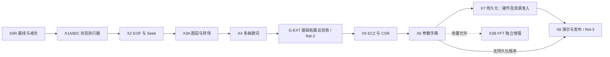

# VinylFPGA 最终执行方案：代码与资料综合核对版

> 日期：2026-10-07（北京时间）  
> 工程：`D:\Data_Backup\VinylFPGA_Workspace_Base\VinylFPGA`  
> 器件：安路 `EG4S20BG256`  
> 顶层：`src/top_tf_hdmi_audio.v`，模块名 `top`  
> Git 基线：`a357339`（S7-03b：KEY07/KEY11 交互修复）  
> 目的：把拓展功能开发资料、源码、Git 历史和已有构建证据合并为一份可直接派工、可回滚、可验收的执行基线。  
> 本次执行范围：文档审阅、源码/约束/Git/快照核查、11 项定向 RTL 仿真；未修改业务 RTL，未重新综合、下载或做板验。资料中的“立即开发/烧录/用户已要求”等语句仅作历史资料，不视为本次操作授权。报告中的取舍是本次建议，历史标称“冻结/完美/已验收”不自动成为事实。

## 1. 结论先行

项目已经完成从官方 BMP 例程到“SD/FAT32、四 bank 帧缓存、PCM 播放、歌词、MV/黑胶、统一输入事件、故障恢复、诊断串口”的主链路演进。当前代码可继续开发，但尚未达到最终产品交付状态。

本次选定的后续开发基线如下；其他历史通过快照仍作为回滚资产保留：

- Git HEAD：`a357339`。
- 构建快照：`prj/resource_opt_verified_20261005/S7_03b_key07_key11_20261006_s7/`。
- Bitstream：`VinylFPGA_optimized.bit`，SHA256：`23fd3bb166f7627ad9fd43759081ca6202644380400208658eee661bb542cac6`。
- 资源：Slices `8412/9800 = 85.84%`，BRAM9K `40/64`，DSP `15/29`。
- 时序：全局 Setup WNS `+114 ps`、Setup TNS `0`、全局 Hold WNS `+3 ps`、Hold TNS `0`；其中 `sd_card_clk` 域自身为 Setup `+114 ps`、Hold `+120 ps`；`video_clk` 和 `ext_mem_clk` 各有 Hold `+3 ps`，并非 SD 域 Hold 只有 +3 ps。
- 构建器件：`EG4S20BG256`，STA coverage `99.95%`。

必须纠正三个判断：

1. S0–S5 有历史验收声明与提交记录；S6、S7-03b 有 RTL/仿真/构建及集成快照下载证据，但缺完整量化板验。不能把所有阶段一概写成“未验收”，也不能把后续功能写成“最终验收完成”。
2. 当前 `prj/final_timing.rpt`、`prj/route.qor` 等根目录文件记录了不同于所选快照的临时构建；其中可见 `9301 slices / 94.91%`、Hold WNS `-20 ps`，属于未通过结果，不能覆盖上面的发布基线。
3. 后续开发的第一道门不是 EC2 菜单，而是 X0R：板级基线补证、引脚/外设复核、构建快照恢复和资源减负。未通过 X0R，不进入新增业务 RTL。

最终路线固定为：

`X0R 基线与减负 → X1 状态反馈执行器 → X2 播放结束策略与 Seek → X3A 转场与图层收口 → X4 多曲歌词 → X5 EC11-B 风格 EC2 浮窗调参 → X6 参数统一 → X7 W25Q64 持久化（条件准入，可跳过） → X8 演示、长稳与发布`

传统二级菜单、9 项大菜单、把 KEY11 改回静音、推翻当前 KEY07/KEY11 语义、真实 FFT 作为主线交付，均不纳入基线。完整产品目标受资源闭合与硬件准入约束；§6.2 给出累计预算和可发布裁剪版本，不把“≤84%”误当成全功能装得下的保证。

## 2. 资料综合与权威等级

### 2.1 资料的职责和最终取舍

| 文档 | 主要目标和模块 | 技术难点/依赖 | 最终处理 |
|---|---|---|---|
| `J2扩展板引脚按键映射标定.md` | 物理脚位、KEY/DIP/EC/IR、LED/WS/EXT、串口 | 排线方向、极性、灯位和 WS 串联方向必须实测 | 物理事实最高优先级。关键组已与 `pin.adc`/快照 IO 表交叉核对；全量电气/丝印确认交 X0R。AI 上下文的 EC/LED/WS/EXT 旧脚位不得执行。 |
| `VinylFPGA_后续开发报告_进度盘点与阶段重排_20261007.md` | 逐文件代码核查、S7-01~03b 状态、R1~R6 重排 | 区分“代码存在”和“板验通过”；识别执行器为空、EC2 被桥接丢弃、Seek/多曲歌词缺失 | 作为当前代码状态和缺口的主要依据。 |
| `VinylFPGA_拓展功能优先_阶段重排与后续开发报告_20261007.md` | 先基础拓展、后统一调参 | R1~R4 的依赖、KEY04/05 双占、KEY11 静音冲突、资源红线 | 保留“基础拓展先行”的顺序；其 KEY12 长按静音提案被 X5 的 OSD Mute 取代。 |
| `VinylFPGA_后续开发方案_冻结基准_v1.0-F_20261007.md` | 综合七份方案并冻结交互、资源、X0~X8 | 40 条冲突裁决；明确 88%/90% 资源门禁、OSD 三态和 5 项参数环 | 作为产品语义和跨文档裁决基线，但其中明确写明未直接访问源码，代码事实以本报告核对结果为准。 |
| `VinylFPGA_完美版开发方案_EC11B风格OSD旋钮_20261007.md` | EC11-B 浮窗 OSD、单写入点、X0~X8 发布路线 | 资源预算远超余量；传统菜单与 KEY11/KEY12 冲突 | 保留浮窗、单 CSR、资源硬门禁；删除 9 项大环和推幕硬依赖。 |
| `VinylFPGA_S7-R6_EC2旋钮OSD调参_设计与实施方案_20261007.md` | EC2 事件引出、`param_knob_fsm`、`param_csr`、OSD 像素层 | `ui_event_bridge` 当前只消费 EC1；OSD 字模/alpha/CDC/双计时器；Seek 依赖前置 transport | 作为 X5 的详细实现输入；首版采用 ASCII 标签、组合像素层，中文字模列为增强项。 |
| `EC11-B参数旋钮OSD设计分析与FPGA实现指南.md` | 三态 FSM、双计时器、OSD 几何和交互剧本 | idle 首格、3 秒状态复位与 1.8 秒显示消隐不能混成一个计时器 | 保留三态 `idle/select/adjust`、1.8 s 可见窗口、3 s 状态复位。 |
| `VinylFPGA_S7_基础拓展功能重排与后续开发报告_20261007.md` | S7-05~S7-10 详细任务与板验清单 | 部分现状描述过期：将 KEY09/KEY12 误称空挂，沿用旧资源值，提出 KEY12 长按静音 | 作为任务拆解参考；与源码和冻结基线冲突的内容不执行。 |
| `开发方案.md` | 早期产品目标、赛题指标、整机架构、传统菜单 | 8 位数码管、DIP 低有效、旧 KEY 顺序等已被物理标定和代码推翻 | 只保留总体产品目标、分层架构和容错原则。 |
| `开发报告参考.md` | 报告结构、结论表、阶段 DoD、资源门禁 | 方案与代码有少量遗留冲突 | 作为排版和验收口径参考；废弃其“W25Q64 前 1 MB 保护 bitstream”共享分区假设及当前工程已具备 `player_config_persistence.v` 的说法。 |
| `第1课_从官方例程到完赛工程_架构认知与FPGA思维框架.md` | 官方例程、时钟域、双缓冲、不可改黑盒边界 | 主要是教学资料，不含当前提交状态 | 用于确定 `sdram`、HDMI、FIFO、视频时序等高风险模块边界。 |
| `VinylFPGA_AI上下文文档_20261007.md` | AI 读取项目的模块、接口、数据格式和已知问题 | 引脚表有错误；部分“已验收”是文档口径 | 用作模块速查；物理脚位和实际状态以源码、约束、构建快照为准。 |

### 2.2 冻结的交互语义

| 输入 | 基线语义 |
|---|---|
| KEY01/02/03 | 上一项/确认/下一项；播放态为上一曲/暂停/下一曲 |
| KEY04/05 | 浏览态沿用上下导航；PLAY 态为音量 +/−；X5 的 ADJUST 态只发音量命令，不同时触发浏览导航 |
| KEY06 | 歌词模式循环，X4 实现 |
| KEY07 | 浏览态和播放态均直达/退出 2×2 缩略图选曲；不改回旧的“两次按键”行为 |
| KEY08 | MV/黑胶视觉流切换 |
| KEY09 | 切歌效果循环：F0 无效果、F1 单读流黑底揭示（界面名称“翻页”，16 帧，约 0.27 s）、F2 淡入淡出；不另造双画面几何推幕 |
| KEY10 | WS2812 模式循环：全灭、音频律动、进度条 |
| KEY11 | 全局返回主界面；播放态停播并回全屏主界面 |
| KEY12 | 播放结束策略循环：E0 播完暂停、E1 单曲循环、E2 自动下一曲；不改成长按静音 |
| EC2 | X5 浮窗调参；浮窗参数为 VOL、MUTE、BRI、CON、SEEK，SEEK 仅 PLAY 可见 |
| DIP1~6 | DIP1 在场声明；DIP2 预留且不与 KEY11 联动；DIP3 LED 总使能；DIP4 自动消隐；DIP5 红外总使能；DIP6 WS 总使能；上拨为 1，不二次取反 |
| 数码管 | 6 位位选；错误码 > 临时参数 > MM:SS；99:59 封顶 |

## 3. 当前开发状况

### 3.1 Git 和工程状态

近期历史明确显示主线已到 S7-03b：

- `d0b0e39`：资源基线和自动化验证。
- `636db9b`、`ead2ee0`、`1c0a962`：S7-03 资源/BRAM/时序优化。
- `7f99785`：统一事件、红外白名单、DIP 运行时控制。
- `b0f2808`、`4642e43`、`6707a1d`：媒体监督、故障恢复、错误反馈。
- `a357339`：KEY07 直达缩略图、KEY11 回主界面。

本地可见分支为 `main`、`backup/pre-linearize-20261004`，远端跟踪引用只有 `origin/main`。`main` 比本地记录的 `origin/main` 领先 1 提交；备份分支与 main 的独有提交数为 1/38，没有可见 EC2 特性分支。本次未 fetch，故不对服务器上未获取的分支作结论。`S704_ec2_menu_20261006` 是构建/源码快照，不能称为 Git 特性分支。

工作树原有 7 个已跟踪构建文件修改及若干未跟踪产物；业务源码/约束的 106 项 SHA256 与所选快照完全一致，快照内部 106 项也自洽。本次重算 bit 哈希与 `bitstream.sha256` 相同。无需倒退主线或删除用户文件；后续复用当前源码，新阶段使用独立快照，失败 GUI 报告只隔离标注。

### 3.2 模块资产

现有 RTL 结构已经具备后续开发所需的主要落点：

- `src/SD/`：FAT32、SD 扇区、四 bank 帧缓存、索引、媒体监督。
- `src/audio/`：PCM 流播放器、播放控制、48 kHz 时基、淡入淡出、音量通路。
- `src/video/`：MV 扇区复用、帧调度、视频流播放器。
- `src/display/`：歌词、OSD、亮度/对比度、波形、转场、黑胶渲染、缩略图。
- `src/io/`：扩展板输入汇聚、事件总线、命令路由、浏览 FSM、红外、蜂鸣反馈、数码管扫描。
- `sim/`：S0~S7 定向 testbench、集成控制、MV/音频/媒体恢复和 KEY07/KEY11 回归。

高风险黑盒边界保持不动：`sdram` 加密核、HDMI 1.4b 加密核、SDRAM/FIFO 跨域核心、视频时序和 HDMI PHY 不作为业务功能修改对象。

### 3.3 阶段状态表

| 阶段 | RTL/仿真/构建状态 | 板级状态 | 结论 |
|---|---|---|---|
| S0~S5 | 主链路和既有回归资产齐全 | 目录有验收记录，但本次不重开 | 作为冻结前置，不重写 |
| S6 MV/黑胶 | `mv_stream_player`、`mv_frame_scheduler`、`vinyl_renderer`、S6 layer 已集成；有定向仿真和构建资产 | 10 fps 实卡、音画差 ≤100 ms 的完整记录缺失 | 代码保留，X0R 补板验 |
| S7-01 诊断 | `health_monitor`、STAT/ERR 已实现，当前计数主要为 underrun、低水位、视频失败、事件溢出 | 依赖串口/板级确认 | 已有 current error 和 VER；补历史最近错误、最大等待和最低水位，并绑定真实构建版本 |
| S7-02 媒体恢复 | `media_supervisor` 三态、扇区超时、SD 复位代次和错误码已实现 | 需板上拔插卡确认 | 保留，不重做；REBUFFER 仍是缺口 |
| S7-03/03b | 事件总线 pending 位图、红外反码/白名单/节流、DIP 运行时控制、KEY07/KEY11 修复已实现；有仿真、构建、SRAM 快照 | KEY07/KEY11 画面和声音仍待用户人工确认 | 作为 X0R 的行为基线 |
| S7-04 / 原 R6 | `param_csr`、EC2 OSD、EC2 桥接、Mute 均不存在；只有母板 KEY1+KEY2 的亮度/对比度副本 | 未开始 | 改为 X5，从零实现，不合并旧菜单草稿 |
| S7-05 | LED 仍是 KEY 镜像，WS2812 恒 0，数码管仍是诊断显示，业务执行器不存在 | 未开始 | X1 |
| S7-06 | `play_ctrl.end_mode` 三态和 KEY12 已提前存在；Seek、`total_samples`、IR F8/EA/F6 真执行不存在 | 未开始 | X2，扩展现有 `play_ctrl`，不另造重复 transport 状态机 |
| S7-07 | 固化单份 LRC ROM、单行/有限行表；KEY06 无业务处理 | 未开始 | X4 |
| S7-08 | `effect_mode` 三态、KEY09 通路、16 帧页面/淡入淡出控制器和像素应用路径已存在；FFT 不存在 | 转场实现需板验收和边界收口 | X3A；FFT 只做条件增强 |
| S7-09 | W25Q64 用户 Flash、A/B 日志、CRC 持久化不存在 | 引脚尚未准入 | X7，先核原理图再写 RTL |
| S7-10 | `demo_fsm` 不存在，`sw4` 只参与现有输入/反馈逻辑 | 未开始 | X8 |

### 3.4 关键源码证据

- `src/io/ui_event_bus.v` 已有 EC2 step/push pending 和仲裁输出；但 `src/io/ui_event_bridge.v` 只把 EC1/按键业务翻译成 toggle，EC2 事件目前没有 OSD 消费者。
- `src/io/expansion_integration.v` 当前为 `assign exp_led_n = ECHO_ENABLE ? key_level[3:0] : 4'hF;`，`assign exp_ws2812_data = 1'b0;`，说明 LED/WS 仍是回显/空输出。
- `src/io/ui_command_router.v` 已输出 `led_enable`、`ws_enable`，但没有执行器消费；IR F8/EA/F6 仍标注为 S7-06 前不支持。
- `src/audio/play_ctrl.v` 已有 `end_mode`：0=pause、1=repeat、2=next；这就是 X2 的起点。
- `src/top_tf_hdmi_audio.v` 的 `audio_silent` 是启动/状态组合静音，不是用户可切换的 `mute` 参数；因此不能把现有静音线误报为 Mute 功能。
- `src/display/lrc_lines_rom.v`、`lrc_font_rom.v` 和 `lrc_osd.v` 是单份固化歌词路径；不能声称已支持每曲歌词。
- `constraints/pin.adc` 已验证 EC1=`P4/N4/N3`、EC2=`M5/M3/M4`、LED=`H3/H5/F3/E2`、WS=`J11`、EXT=`M12/M11/N12/P14/P12/R12`，而 `R7` 是系统时钟，不能使用 AI 上下文文档中的旧引脚表。

## 4. 最终保留、合并、延后和放弃

优先级：**P0** 为 X0R、X1、X2、X3A、X4、G-EXT、X5、X6、X8（核心产品路线，按依赖顺序实施）；**P1** 为硬件/资源准入后的 X7 持久化；**P2** 为 X3B FFT、中文标签、连续画质调节、外部 Logo 等增强项。P1/P2 不阻塞无持久化核心版本发布。

### 4.1 保留

- S0~S5 主链路、S6 MV/黑胶架构、S7-01/02/03/03b 的现有代码和回归资产。
- 逐源 pending 事件总线、toggle CDC、红外双反码校验、DIP 运行时门控、媒体监督和错误码。
- KEY07=缩略图、KEY11=回主界面、KEY12=结束策略、KEY09=效果模式的当前语义。
- 48 kHz 单一时基、PCM 优先于视频/歌词的带宽原则、四 bank/三帧 SDRAM 资产。

### 4.2 合并

- 将原 S7-05A/B/C 合并为 X1，但保持 LED、WS、数码管三个独立可回滚子阶段。
- 将原 S7-06A/B 合并为 X2；结束策略复用 `play_ctrl`，Seek 增加请求/应答和播放代次保护；原 R5 的整体控制验收归入 G-EXT。
- 将歌词资产、歌词显示和 KEY06 模式合并为 X4；旧单曲 ROM 只作显式诊断资产；正常曲目歌词坏/缺失时关闭歌词，禁止显示另一曲歌词。
- 将转场、图层优先级收口合并为 X3A；可选 FFT 独立为 X3B，不阻塞 X3A 发布。
- 将传统菜单方案、R6、EC11-B 统一为 X5 的 EC11-B 浮窗；所有参数只允许 `param_csr` 单点写入。

### 4.3 延后

- 中文 OSD 字模、连续亮度/对比度调节、平方响度曲线：先做 ASCII 标签和现有 5 档 LUT，列为 X5 增强项。
- 256 点 FFT：只有在核心功能资源和时序通过后单独实验；超预算立即回退时域波形。
- W25Q64 外部 Logo：延后为 X7 之后的独立资产增强，不计入 X7 工时和必交付物；现有片上 Logo 已满足离卡启动画面的基础能力。
- 自动演示、最终配置 Flash 固化、24 h 长稳：统一放 X8；用户参数持久化仍为 X7，二者不是同一颗 Flash。

### 4.4 放弃

- 传统二级菜单和 9 项大参数环：交互负担高、会与现有 KEY/参数写入点冲突、资源不可控。
- 把 KEY11 改回静音或把 KEY12 长按静音作为基线：会回退已验收语义；Mute 放入 X5 浮窗。
- 单声道素材上的人声消除、依赖立体声的 L-R 处理：当前数据格式不支持。
- 直接合并 `S704_ec2_menu` 草稿：该草稿基于旧语义和旧资源状态，不能作为 HEAD 的增量补丁。

## 5. 分阶段最终执行计划

沿用冻结文档编号：X3A=转场/图层、X3B=条件 FFT、X4=歌词，避免再创造相同编号不同含义。先完成短周期的 X3A，再推进 X4；二者共同依赖 X2，X4 使用 X3A 已冻结的图层接口。发布点为 Rel-1（X1）、Rel-2（G-EXT）、Rel-3（X5/X6/X8；完成 X7 时标注“含持久化”）。所有下列文件路径以本报告工程根为基准，“新增”表示计划文件。

X0R 合并原 X0 的板级准入与 GG-R 减负/时序门禁，避免重复建基线；不改变 X1–X8 的产品含义。



**G-EXT 放行条件**：12 键各 100 次、EC1/EC2 正反各 100 格（此时 EC2 仅核事件层）、15 个 IR 向量及非法帧负例、DIP1/3/4/5/6 各 20 次启停；消隐首事件只唤醒，DIP6 关闭 100 ms 内黑帧锁存。X1、X2、X3A、X4 的位流/板验记录齐全；KEY06/07/08/09/10/11/12、IR transport、MV/歌词同步、LED/WS/数码管连续交叉操作 1 h；每种转场至少 100 次、Seek 往返 100 次；稳定播放新增 underrun=0，预期故障注入分段记录；无未解释错误/事件溢出。构建发布负责人出具 `G_EXT_acceptance.md` 并标记 Rel-2，然后 X5 才能迁移参数写入点。该集成验收计入 X4/X5 交接工时。

每个阶段都遵守同一条流水线：需求冻结 → 定向仿真 → 全量回归 → TD 多 seed 构建 → SRAM 下载 → 板级人工验收 → 快照归档。每阶段只允许一个行为变量集，失败时先恢复上一阶段 bit。

### X0R：基线补证、IO 审计和零行为减负

**目标**：把文档引证变成可追溯证据，恢复可复现构建，并为新增功能释放资源。

**任务**

1. 归档 `S7_03b_key07_key11_20261006_s7` 的 `.bit`、`bitstream.sha256`、`final.qor`、`final.timing`、`final.area`、`inputs.sha256.json` 和 SRAM 下载日志。该快照没有 `manifest.json`/`regression_results.md`；在新验收目录生成汇总清单，不虚构已有文件。
2. 对 `constraints/pin.adc`、J2 标定、母板 KEY3、SW1–SW4 拨向/原始电平/逻辑极性、SW5 蜂鸣器、SW6 数码管档位做记录；逐灯确认 LED1–4。当前引脚样本相符不代替全量脚位和外部时序审计。
3. 比对 `.al`、顶层 include 和实际展开网表：本次查得顶层 include 中 22 个 `.v` 未显式列入 `.al`（不是旧文档的 18 个）。include 当前已经参与构建，不是 22 个黑盒；先建立编译清单，再选择保持 include 或单独登记，验证 TD 不重复定义。隔离标注临时失败产物，禁止覆盖/删除用户文件。独立执行零业务行为改变减负，目标 Slices ≤84%（8232）。
4. 另做遥测提交：保留已实现的 `err_code` 恢复清零与 `VER` 字段，更新可追溯构建版本；增加 SD 超时/重试、最大扇区等待、最低 FIFO 水位、MV missed-deadline/等待、历史最近错误。与减负分开验证，不能宣称二者合并后对 UART 逐字节等价。
7. 定性历史 `UR=0005`：分别测启动、切换/重缓冲、稳定播放区间并记录样本消费/FIFO；真实停顿进入 X2-C，计数门控误报则在独立修复快照修正。复核旧 `tb_wav_equiv_long` 失败的参考契约，不因旧报告写“基线问题”而自动豁免。

**交付物**

- `X0R_board_and_build_baseline_20261007.md`。
- 固定 bit/哈希/约束/资源/时序/板验归档目录。
- 减负前后资源差异表和回归结果。

**放行条件**：S6/S7-03b 板验清单无未解释失败；固定 bit 可下载；多 seed 中至少 seed 7 和一个替代 seed 达到 Setup/Hold 非负、TNS=0、违例端点=0；未通过则停止在 X0R。

**预估**：含基线复验、减负首轮及遥测；额外资源迭代须重估。

### X1：状态反馈执行器

#### X1A：LED1~4 业务化

**文件**：新增 `src/io/led_business_driver.v`；修改 `src/io/expansion_integration.v`、`src/io/health_monitor.v`、`src/top_tf_hdmi_audio.v`。

**行为**：LED1 通过反码/白名单校验的有效红外脉冲、LED2 已接受业务动作（不能直接接包含松开/DIP 的 cmd_valid）、LED3 约 1 Hz 心跳、LED4 当前故障（`err_code!=0`，收到恢复 0 后熄灭）；DIP3 关闭时 100 ms 内全灭。先逐灯核对丝印，不假设 LED 物理顺序。

**验证**：LED 单灯仿真、DIP3 门控仿真、板上逐灯照片和 80 ms 脉冲示波记录。

#### X1B：WS2812 音频律动/进度条

**文件**：从 `D:\Data_Backup\VinylFPGA_Workspace_Base\资源\Expansion_Board_Test\src\ws2812_driver.v` 审查移植至 `src/io/ws2812_driver.v`；新增 `src/io/ws2812_effects.v`、`src/audio/pcm_tap.v`；修改 `src/SD/fat32_media_loader.v`、`src/SD/sd_card_bmp.v`、`src/io/ui_event_bridge.v`、`src/top_tf_hdmi_audio.v`。`song_index_db.song_audio0..3[63:32]` 已导出字节数；复用该字段，把所选曲目长度从 loader 经 sd_card_bmp 导到顶层，不重建 INDEX 字段。

**行为**：KEY10 循环全灭/律动/进度（默认全灭）；PCM 只读旁路，饱和绝对值覆盖 `-32768`，快升慢降、不反压音频。选中曲目长度必须非零偶数，`total_samples=audio_bytes>>1`；封面支持 FAT 链，PCM/MV 保持打包工具校验的连续布局。进度冻结于暂停，Mute 时律动灭、进度照常；X5 前 mute 输入固定 0。每通道初始上限 76，按实测供电下调。DIP6 关闭时将清灯请求保持到完整黑帧锁存结束，不能仅把数据线拉低。

**验证**：GRB 顺序、8 灯方向、800 kHz 波形及对应灯珠版本的 reset 锁存时间、5 V 峰值电流、DIP6 关断、暂停衰减、1 小时 underrun 不增加。

#### X1C：6 位数码管业务 mux

**文件**：新增 `src/display/seg_business_mux.v`；修改 `src/top_tf_hdmi_audio.v`。

**行为**：SW1 为显示总使能（按 X0R 实测极性归一化）；KEY3 循环 MM:SS/曲目编号/诊断项，默认 MM:SS，未播放时显示曲目编号。使能后优先级为当前错误码 > 2 s 参数临时值 > 选择项；故障恢复 0 后退出错误页，历史错误仅保留在遥测。MM:SS 在 99:59 饱和，保留 pat_mode 的诊断扫描；SW3 控制新增 debug 输出开关且不能隐藏故障计数。参数临时值端口在 X5 前保持 valid=0。母板 SW2/LED 未准入，明确留作增强，不占用未知引脚。

**交付物**：X1 bit、LED/WS/数码管板验表、资源增量表、回归日志。

**放行条件**：Slices ≤88%；WS 波形实测合格；音频/视频/媒体恢复回归通过。


### X2：播放结束策略、重播和 Seek

**文件**：修改 `src/audio/play_ctrl.v`、`src/audio/wav_stream_player.v`、`src/audio/stream_session.v`、`src/audio/timebase_48k.v`、`src/io/ui_command_router.v`、`src/io/ui_event_bridge.v`、`src/video/mv_frame_scheduler.v`、`src/video/mv_stream_player.v`、`src/display/lrc_osd.v`、`src/top_tf_hdmi_audio.v`，并补 `tools/test_vinyl_packer.py` 连续布局/奇数长度负例；新增最小 `src/audio/seek_controller.v`（不得复制一套独立播放状态机）。

**行为**：

- 保留 E0 暂停、E1 单曲循环、E2 自动下一曲；末曲回首曲。
- F8/EA 为红外 ±5 s，F6 为本曲重播；旋钮 SEEK 为 ±2 s。首版 Seek/重播仅响应新帧，IR repeat 继续仅放行音量，避免长按重启流事务。
- 空音频禁止 Seek；32 bit `target_sample` 用扩位有符号加法后钳位 `[0,total_samples-1]`，不能先无符号相减。LBA=`audio_start_lba+(target_sample>>8)`，扇区内丢弃字节=`{target_sample[7:0],1'b0}`；最后扇区只消费真实有效样本，不能把填充零当音频长度。
- 控制事务：淡出/暂停样本消费 → 停发新请求 → 等在途 SD/MV 完成或超时撤销 → 清旧 FIFO/帧有效标记 → 锁存 song/generation/target → 预缓冲 → 一次提交应答。忙时累计输入步长到最新目标，旧目标不排长队；stop/media_lost/切曲优先于 Seek。现有一位 `start_toggle` 是会话切换信号，必须证明单在途且不会两次翻转别名后才能复用；否则新增足够位宽 generation 并在装载完成应答中校验。
- 在同次 commit 中给 `timebase_48k` 加载 `sample_count=target_sample`、`cur_time_ms=target_sample/48`、`sub_sample=target_sample%48`，后续只由真实 `wav_sample_consumed` 推进。`mv_frame_scheduler` 定位 `min(target_sample/4800,frame_count-1)`，歌词重新查时间戳；暂停中预缓冲可进行但保持暂停且不消费样本。
- X2-C（条件必做）：若 X0R 证明 UR 来自真实可恢复 SD 停顿，则实现 REBUFFER：输出静音样本但保持 HDMI 节拍，停止媒体时间推进；供数恢复至 2048 样本（短文件用剩余有效样本数）后恢复，目标 16 帧淡入。持续超时转既有媒体恢复，不让 REBUFFER 无期限卡住。注入多档停顿验证无旧样本泄漏、时基不偷跑；额外 1–2 人日。

**验证**：Seek 首尾钳位、暂停 Seek、连续往返 100 次、切曲与 Seek 同拍、旧代次应答、仿真起点误差 ≤1 样本、实机音画差 ≤100 ms。

**交付物**：transport/seek 接口说明、IR 向量回归、播放策略板验记录。

**放行条件**：S7-03b 输入回归不退化；Slices ≤88%；100 MHz SD 域无新增负时序。


### X3A：转场与图层收口（X3B FFT 为独立可选项）

**文件**：修改/审阅 `src/display/video_fade_transition.v`、`src/display/video_transition_apply.v`、`src/video/s6_video_layer.v`、`src/display/osd_overlay_24.v`、`src/io/ui_event_bridge.v`、`src/top_tf_hdmi_audio.v`；可选新增 `src/audio/fft_256.v`、`src/display/spectrum_renderer.v`。

**行为**：复用已有 F0/F1/F2，保留 F1 的 16 帧单读流揭示与默认 F0，不再新建翻页算法。检查请求在事务完成前保持，忙时选曲合并到最新目标；只在帧边界换 bank。图层由底到顶为背景/封面 → MV或黑胶 → 波形 → 歌词 → knob → 当前错误/系统确认 → BOOT → 消隐黑屏；记录 RGB/DE/HS/VS/x 的逐级延迟，不新增全屏 SDRAM 双读。此次只收口和补板验。

**FFT 门槛**：单蝶形迭代、PCM 旁路、不反压音频；预算 ≤4 BRAM、≤4 DSP；任一资源/时序超限立即保留现有 32 柱时域波形，FFT 单独归档，不阻塞发布。

**验证**：每种转场 ≥100 次、快速切曲/暂停/OSD 同拍、音频 underrun 不增加；FFT 仅做零输入、直流、单音、双音、满幅和噪声参考向量。

**交付物**：图层/像素延迟表、F0/F1/F2 回归、100 次切换板验记录及阶段 bit；X3B 单独提供参考向量误差和资源增量。


### X4：多曲歌词资产和三行渲染

**文件**：修改 `tools/vinyl_packer.py`、`src/SD/fat32_media_loader.v`、`src/display/lrc_osd.v`、`src/io/ui_event_bridge.v`（引出 KEY06 模式事件）；新增 `tools/gen_lrc_assets_v2.py`、`src/SD/lyric_loader.v`、`src/display/lrc_renderer.v`。

**数据约束**：首版 4 曲、每曲最多 128 行、每行最多 16 字形、每曲最多 64 个 16×16 单色字形；由 `LRCxx.BIN` 保存版本、song_id、行数/字形数、偏移/长度、CRC，时间戳用 u32 毫秒、字形 ID 用 6 bit。时间戳非递减，相同时间戳稳定合并或由工具显式拒绝；超限报错。INDEX v2 的 56–63 字节属于 MV，不挪用。

**存储分配**：一次仅驻留当前曲，行表压为 128×128 bit（32 bit 时间戳 + 16×6 bit 字形，空白字形填充）=16384 bit，字库 64×256=16384 bit，合计 32768 bit，目标各 2 块 BRAM9K；头/缓存少量寄存器另计。必须核实际端口组织和推断结果，不能仅按 bit 相加承诺 4 BRAM。切曲时先隐藏旧歌词再加载新资产，成功才发布缓存代次；不做双份整曲缓存。

**装载落点**：同时修改 `src/SD/fat32_volume_scanner.v` 的 8.3 文件名发现、`fat32_media_loader.v` 的文件流所有权切换、`src/top_tf_hdmi_audio.v` 的接线。在切曲/预缓冲期完成词库装载，播放期间显示只读当前缓存，Seek 不重新读整份歌词。

**行为**：首版只承诺行级时间高亮，不把均分时间声称为精确逐字卡拉 OK；逐字时间资产/渲染延后。上一行/当前行/下一行；KEY06 循环静态三行、16 帧滚动淡入、时间高亮；暂停冻结动画；加载失败只关闭歌词层，不影响音频和视频。

**验证**：4 首不同歌词匹配、缺文件/CRC/空行/中文/最大长度负例、Seek 后定位、切曲无残字、时间误差 ≤100 ms。

**放行条件**：歌词带宽不能降低音频 FIFO 水位；BRAM 增量 ≤4；资源和时序门禁通过。

**交付物**：资产格式说明、生成工具及负例、4 首不同歌词资产、装载/渲染 testbench、切曲/Seek 板验记录和阶段 bit。


### X5：EC11-B 风格 EC2 浮窗调参

**依赖**：X1~X4 交付；尤其 X2 必须提供 `total_samples`、Seek 请求/应答，X4/X3A 必须冻结图层顺序。

**文件**：新增 `src/io/param_knob_fsm.v`、`src/io/param_csr.v`、`src/display/knob_osd_panel.v`、`src/display/knob_font_rom.v`；修改 `src/io/ui_event_bridge.v`、`src/io/expansion_integration.v`、`src/io/buzzer_feedback.v`、`src/io/param_menu_controller.v`、`src/display/brightness_contrast_adjust.v`、`src/audio/play_ctrl.v`、`src/top_tf_hdmi_audio.v`、`prj/VinylFPGA.al`。

**输入链路**：复用 `expansion_io_hub`/`ui_event_bus` 的 EC2 事件，从 `ui_command_router.cmd_*` 后在 `ui_event_bridge` 增加 EC2 同域脉冲，FSM/CSR 同在 50 MHz 域，无需再做 toggle 跨回本域。系统优先级是重启确认 > 消隐首事件只唤醒 > knob > 普通业务；DIP1=0 强制 IDLE，BOOT 不画面板。采用累计计数差重放恢复合并步进；被系统吞掉的 EC2 步进须更新计数锚点而不发业务，防下一事件把旧动作补回来。总线 `aux[1]=1` 为 EC2、`aux[0]=0` 为递增，`EV_ENC_SW.arg[0]=0` 才是按下；不能照抄旧文档 pressed=1。

**FSM**：`idle/select/adjust` 三态；idle 的首个旋转或按压只显示 VOL、idx=0，不推进。OSD 可见 1800 ms，状态 3000 ms 复位；1.8–3 s 间继续原 idx/态，3 s 后从 VOL 重新开始。使用事件清零、3000 ms 饱和的 12 bit elapsed 计数，事件优先于递增，避免 deadline 绝对大小比较回绕错误。离开 PLAY 时 SEEK 被移除，idx 钳位至 CON，ADJUST 退 SELECT；PLAY 暂停仍保留 SEEK。

**参数环**：VOL、MUTE、BRI、CON、SEEK；SEEK 仅 PLAY 可见。VOL 范围 32~255、步长 16；BRI/CON 先复用现有 5 档 LUT；SEEK 旋钮 ±2 s；MUTE 旋转切换，按压进/出 adjust。ADJUST 态拦截切曲/暂停/IR Seek/重播，放行 IR/KEY 音量±写同一 CSR，KEY07/KEY11 始终有效且关闭 knob；SELECT 态保留正常浏览操作。Mute 不改 volume 存值，不停 HDMI sample_valid，不影响蜂鸣；未主动改 volume 时解除 Mute 恢复原音量。母板 KEY3 保持显示项切换。

**像素层**：190×64，坐标 `(225,58)`；首版用 ASCII 标签 `VOL/BRI/CON/SEEK/MUTE`、组合几何判定、4 档 alpha，不引入全屏行缓冲；中文标签和 BRAM 字模作为增强项。`osd_visible=0` 时输出逐比特等同输入。

**单写入点**：volume/mute/bri/con/effect/ws/lyric/end_mode 的权威寄存器在 50 MHz `param_csr`；播放位置是 `timebase_48k` 的运行状态，不迁成第二份 CSR 时基。`param_menu_controller` 保留 100 MHz 运行和原组合键消抖，只把更改转成可靠握手命令并读回 CSR 快照；不无故搬时钟/缩短消抖。目标域快照寄存器允许存在，“单写入点”指只有一个权威修改入口，不以全库同名寄存器计数替代审计。

**蜂鸣与 CDC**：SELECT→ADJUST 青变金并发 1320 Hz/50 ms，返回发 990 Hz/50 ms；抑制原 EC2 按压反馈声，避免双响。参数命令 `valid/ready + id[3:0]/op/value[31:0]`，Seek 保持32位，不能沿用 R6 的16位目标样本。多源命令分别保持至确认，不能靠优先 mux 静默丢命令。多位跨域采用源保持数据至 ACK 的邮箱，目标捕获后帧边界锁存画质/OSD，ACK 后才覆盖源邮箱；busy 期间合并待显示的最新状态。位宽拓宽/除法仅在控制域以串行或查表实现，像素域不做宽除法。

**实施提交顺序**：X5-1 EC2 解码和门控定向测试 → X5-2 新建 CSR，逐项在同一迁移提交中切消费者/删旧权威寄存器并回归 → X5-3 静态面板与快照 → X5-4 FSM/SEEK/蜂鸣/数码管联动 → X5-5 集成与板验。不允许新旧写入口同时有效；每一步独立快照可回退。

**验证**：EC2 快速正反转、按压消抖、盲拧不误触发选曲、OSD 1.8 s/3 s 双计时器、边界 100 次无溢出、CDC 快照、Mute 恢复原音量、消隐与错误层优先级、旁路逐比特等价。

**资源门禁**：X5 开工前必须有 X0R 减负结果；若综合后超过 88%，先删中文字模/alpha 档/非必要提示；超过 90% 立即停止，回退到上一阶段。


### X6：参数字典和系统级手感收敛

**文件**：新增 `src/include/param_dict.vh`；整理 `play_ctrl.v`、`ui_command_router.v`、`video_fade_transition.v`、WS/歌词/OSD/蜂鸣相关常量。

**任务**：统一步长、超时、消隐、淡入淡出、IR repeat、WS 亮度、歌词滚动和蜂鸣音型；静态检查保证每个用户参数只有一个定义源；输出参数字典和全量回归结果。


### X7：W25Q64 参数持久化

**前置**：对照 `D:\Data_Backup\VinylFPGA_Workspace_Base\资源\原理图\2_FPGA.pdf` 和实际原理图核用户 Flash 引脚；不得把 MSPI 配置 Flash 当作用户 SPI；不得在引脚未核准前写 RTL。

**文件**：新增 `src/config/w25q64_user_spi.v`、`src/config/config_journal.v`、必要的 `src/config/config_crc.v`；修改 `param_csr.v`、顶层和约束。

**行为**：A/B 槽位放在不同擦除扇区；版本、长度、CRC、序号和最后写入的提交标记。先写非活动槽并回读验证再发布，禁止先擦唯一有效槽；地址白名单只指向核准的用户 Flash。保存 volume/mute/bri/con/effect/ws/lyric/end_mode，首版不保存播放位置和自动续播；静默 30 s 且参数 dirty 才保存，未变值不写；写失败保留旧槽，上电无效时回默认。数码管可显示 `SAuEd` 或错误码。

**交付物**：经核准的引脚表、Flash 地址白名单/记录格式、RTL 与断电恢复测试、含持久化版本 bit。

**验证**：20 次冷启动恢复、写入中断电、坏 CRC、旧版本、擦除失败、默认回退；写入不能阻塞音频和 HDMI。


### X8：自动演示、24 h 长稳和发布

**文件**：新增 `src/io/demo_fsm.v`；修改 `top_tf_hdmi_audio.v`、参数字典、构建/发布脚本和操作手册。

**行为**：SW4 使能自动演示，30 s 无有效操作后轮播封面/MV/黑胶/歌词/WS；人工有效事件立即停止演示并优先执行，退出 SW4 停发命令。演示复用统一命令接口，不直接改 CSR 或播放 FSM；发布 bit 固化前完成 1 h 回归、24 h 压力、20 次冷启动和多显示器验证。

**交付物**：发布清单、源码/工具版本及哈希、最终配置 Flash 烧录与冷启动记录、24 h 日志、操作手册和已知限制。

**放行条件**：Setup/Hold 全部非负、TNS=0、未约束路径为 0 或有书面解释；24 h 无死锁/花屏/爆音；发布目录包含源码、约束、bit、哈希、资源镜像、操作手册、验收记录。


## 6. 关键技术方案和风险控制

### 6.1 时钟和 CDC

- `clk` 50 MHz：输入汇聚、事件总线、参数 FSM、配置控制。
- `sd_card_clk` 100 MHz：FAT32、媒体装载、播放控制、SD 监督。
- `video_clk` 25 MHz：视频时序、像素 OSD、MV/黑胶显示。
- `ext_mem_clk/ext_mem_clk_sft` 125 MHz：SDRAM 物理控制。
- `hdmi_5x_clk` 125 MHz：TMDS 串行化。
- 单比特事件用 toggle + 2/3 FF + 边沿检测；多比特参数用源保持至 ACK 的邮箱快照配合 toggle；不把旋钮计数总线直接跨域。

### 6.2 资源和时序门禁

| 门槛 | 处理 |
|---|---|
| Slices ≤84% | 正常开发区；X0R 的减负目标 |
| 84%~88% | 允许小步增量，必须有阶段差异表 |
| >88%（8624） | 停止新增功能，先减负 |
| >90%（8820） | 阶段冻结并回退候选功能；FFT、中文字模、复杂 alpha 首先裁剪 |
| Setup/Hold 任一为负 | 不得下载和合并；禁止用 false path 或放宽时钟掩盖 |
| 全局 Hold 最小裕量仅 +3 ps（`sd_card_clk` 域自身快照为 +120 ps） | 新增高位加法/比较必须拆拍或移出关键路径；每次都做 seed 扫描；任何跨域路径按最终 `final.timing` 判定 |

**累计预算必须闭合。** 当前 8412 slices 到 88% 上限仅余 212；即使 X0R 达到 8232（84%），也仅余 392。历史方案的 1250–2500 slices 增量不能直接叠加。以下是为最小实现设置的首轮规划额度，尚无综合证据；开工前按小样实测改写，不能当作保证：

| 阶段 | 暂估净增 slices | 从 8232 起累计（未计进一步减负） | BRAM/DSP 约束 |
|---|---:|---:|---|
| X1 | 80–160 | 8312–8392 | 优先寄存器小缓存，不加音频 FIFO |
| X2 | 120–220 | 8432–8612 | 复用既有 FIFO/时基，控制除法多周期化 |
| X3A | 10–50 | 8442–8662 | 无额外整屏缓存 |
| X4 | 120–250 | 8562–8912 | 当前曲歌词目标 ≤4 BRAM9K |
| X5 | 200–400 | 8762–9312 | ASCII 面板；不新增 DSP 为目标 |
| X6 | 0–30 | 8762–9342 | 常量归并以实测净值为准 |
| X7 | 100–220 | 8862–9562 | 串行 SPI/CRC，不增加全记录双缓存 |
| X8 | 20–60 | 8882–9622 | 小型演示 FSM，复用命令口 |

主线净增暂估 **650–1390 slices**，若保留全部功能，基线需约降到 **7974–7234 slices（81.37%–73.82%）** 才能守住 88%，此减负幅度目前未被证明可达。因此 28–41.5 人日是准入通过后的开发估算，资源攻坚追加轮次单独重估；不得承诺按此工期交付所有增强项。

每阶段先满足 `当前实测 slices + 下一阶段预算上限 ≤8624`，再开工；不满足先开零行为减负快照。BRAM/DSP 同时查总量与端口映射，不能仅看 slice 百分比。X3B 的 ≤4 BRAM/≤4 DSP 是上限，绝非已经预留；原始余量为 24 BRAM/14 DSP。

**裁剪顺序与版本边界**：FFT → 中文标签/复杂透明效果 → 歌词动画（保留静态三行/时间高亮）→ 运行时 SD 歌词装载改为 4 首各自预生成、按 song_id 选择的受限资产 → 无准入证据的 X7 持久化。每步须重测，四曲片上资产也可能增加 BRAM，不能未经综合就认定更省。最后仍超预算，停止于上个可验证版本，不牺牲音频、时基、故障恢复或假报功能完成。

- **Rel-1 外设版**：X0R+X1，通过音视频基线与外设板验，可独立演示。
- **Rel-2 基础拓展版**：X2+X3A+X4 及 G-EXT；歌词若采用裁剪资产须明示容量/不可运行时换词。
- **Rel-3 核心产品版**：Rel-2+X5+X6+X8；包含五项参数环、单 CSR、多曲歌词、Seek、三种既有转场和状态反馈。X7 获准后追加“含持久化”，FFT/中文标签/外部 Logo 不属于核心放行要求。若 X5 仍不能装下，Rel-2 只算阶段交付，不能称核心产品版完成。

**带宽门槛**：现有 48 kHz/16 bit/单声道 PCM 为 96 kB/s，320×240 RGB565/10 fps MV 为 1.536 MB/s，合计有效载荷 1.632 MB/s；板验持续有效吞吐目标至少 2.04 MB/s（25% 余量，非已测性能）。4096 样本 FIFO 满容量仅 85.3 ms，高/低水位 2048/1024 对应 42.7/21.3 ms。X0R 同时记录最坏扇区等待，不能用平均带宽推断无欠载；歌词切曲预加载和 WS 旁路不得抢占 PCM。

### 6.3 主要风险和应对

| 风险 | 应对 |
|---|---|
| 现有 S6/S7-03b 板验缺失 | X0R 用固定 bit 完成录像、音画差、按键和拔卡记录 |
| 根目录临时构建误导状态 | 只认带输入哈希、QoR、timing、bit SHA256 的阶段快照 |
| EC2 事件被桥接丢弃 | X5 第一个提交只做 router 后 EC2 同域脉冲引出和 testbench，不同时写 OSD |
| 多源写参数 | `param_csr` 单写入点；全库 grep 检查每个参数的 always 块 |
| WS 抢占音频 | PCM 只读旁路，WS 发射不占 SD、不反压音频；MV/歌词取数遵守音频优先；稳定播放新增功能不得增加欠载 |
| Seek 旧代次污染 | 单在途+旧事务排空后才切代次，必要时扩展 generation；不能把1 bit toggle当无限期请求ID |
| 歌词装载失败拖死播放 | 歌词通道低优先级，失败只关闭歌词层 |
| 引脚/开关误判 | 物理标定、约束、原理图和板上示波/照片三方闭合 |
| 计时器回绕 | X5 使用 3000 ms 饱和 elapsed 计时；X8 单独做 24.86 h 样本计数回绕仿真 |

## 7. 验证和测试要求

### 7.1 软件与 RTL

- 每个新增模块先有定向 testbench，再接入顶层。
- 保留现有 `sim/tb_s7_top.v`、`tb_s7_browse_semantics.v`、`tb_s7_play_policy.v`、`tb_media_supervisor.v`、`tb_s6_video_layer.v` 等回归。
- X1 新增 LED/WS/数码管仿真；X2 新增 Seek/EOF/代次仿真；X4 新增歌词格式和时间轴负例；X5 新增 FSM/CSR/OSD/CDC/逐比特旁路仿真。
- PC 工具必须有坏 CRC、超长行、索引越界、奇数字节数、缺资源等负例，工具报错而不是静默生成坏卡。

### 7.2 TD 构建

每阶段至少保存：`inputs.sha256.json`、`gate.qor`、`place.qor`、`route.qor`、`final.qor`、`final.timing`、`final.area`、约束报告、bit SHA256 和下载日志。以 `--map-mode area_prior` 运行至少 seed 7 和 5；新阶段要求 seed 7 加至少一个替代 seed 通过，失败时再测 1/2/3 并记录完整分布。某候选负时序只淘汰该候选；若通过数不足或资源超限，整个阶段不放行。最终发布仅使用选中且全部检查通过的 routed.db。

### 7.3 板级验收

板验不能由仿真或“bit 生成成功”替代。每阶段必须记录：

- 目标器件识别、SRAM 下载、复位/冷启动。
- HDMI 首图、缩略图、MV/黑胶、歌词、OSD 是否黑屏/花屏/撕裂。
- 音频连续性、暂停/恢复、Seek、切曲、拔卡/重插。
- KEY01~12、EC1/EC2、DIP1~6、IR、LED、WS、数码管、蜂鸣器的逐项结果。
- 运行时 UART `STAT/ERR`、underrun、低水位、视频失败、事件溢出和最近错误。
- 失败项的复现条件、回滚 bit 和下一步动作。

### 7.4 后续阶段的可复现命令

以下是未来实施命令，本次仅执行了附录的 11 项定向仿真。工作目录为工程根，先将本机 `D:\iverilog\bin` 加入当前会话 PATH。现有 verify 脚本会写入各自 `sim/` 结果目录，运行前归档该目录的旧日志；不能把旧日志当新阶段结果。

```powershell
python tools/verify_s7_acceptance.py
python tools/verify_s0_s5_fixes.py
python tools/verify_s6.py
python tools/test_vinyl_packer.py
# 每个 seed 使用全新快照名，以下以 X1A 首轮为例
python tools/resource_opt_round.py X1A_r1_20261007_s7
python tools/build_verified_round.py X1A_r1_20261007_s7 --seed 7 --map-mode area_prior
python tools/resource_opt_round.py X1A_r1_20261007_s5
python tools/build_verified_round.py X1A_r1_20261007_s5 --seed 5 --map-mode area_prior
# 只有回归、资源、全部 timing/constraints 审查放行后，才执行选中候选的下载
python tools/release_verified_round.py X1A_r1_20261007_s7 --program-sram
```

每条命令检查退出码，失败不继续；具体快照名按实际日期/轮次替换。`build_verified_round.py` 拒绝已有 `native_build.log` 的目录，`release_verified_round.py` 拒绝覆盖已有 bit 并检查工作树输入哈希；不得直接对历史基线重跑 release。构建脚本自动检查 WNS，不代替人工审查 TNS、违例端点和 IO/时钟约束。历史脚本采用不同 PASS 标志，全量回归须逐项看结果，不能只看最后一行。本报告不触发综合或下载。

---


- [ ] X0R：板级/构建负责人完成基线补证、UR 定性和下一阶段资源准入。
- [ ] X1A / X1B / X1C：分别完成 LED、WS、数码管，三个独立提交和验收包。
- [ ] X2：音频/媒体负责人提交长度接口、Seek 事务/时基对齐；按 UR 结论增列 X2-C。
- [ ] X3A：显示负责人冻结层级/像素延迟并完成转场板验。
- [ ] X4 / G-EXT：PC/SD/显示负责人交付四曲资产和总体验收表。
- [ ] X5-1~5：按 §5 的五个提交顺序交付输入、CSR、面板、联动、板验。
- [ ] X6：系统负责人冻结参数字典、参数单写入审计和板上调参记录。
- [ ] X7：硬件/配置负责人先完成引脚/资源准入，再交付断电恢复记录；不准入则发布无持久化版本。
- [ ] X8：发布负责人完成演示、长稳、冷启动、固化和发布清单。

## 9. 立即执行顺序

1. 保留当前工作目录及用户改动；其源码/约束已经匹配 `a357339` 对应快照。下一阶段采用现有脚本创建独立快照，Git 只定点提交该阶段文件，不执行 reset/clean 或笼统 `git add .`。
2. 固定并校验 `S7_03b_key07_key11_20261006_s7` bit、SHA256、QoR 和下载日志。
3. 完成 X0R 的 S6/S7-03b 板级清单、J2/母板开关照片和 IO 约束审计。
4. 对 X0R 减负前后做一次可复现多 seed 构建，目标 Slices ≤84%，否则停止规划新增功能。
5. 先交付 X1A LED，再交付 X1B WS，最后交付 X1C 数码管；三个子阶段分别生成 bit 和板验记录。
6. 在 X2 先做 EOF/结束策略回归，再接 Seek；不把“已识别 IR 码”写成“Seek 已实现”。
7. X3A 先冻结图层和转场。
8. X4 完成 PC 侧歌词资产和负例，再接 SD 装载和显示，并通过 G-EXT；旧单曲 ROM 只保留为诊断。FFT 在核心功能资源闭合后才启动独立增强。
9. X5 从 router 后 EC2 同域脉冲引出开始，先验证输入链路，再做 CSR，再做 OSD；禁止一次提交全部合入。
10. X6 参数字典完成后才进入 X7 Flash；X8 通过 24 h 长稳和冷启动后才生成正式发布包。

后续任何文档或提交都必须同时写清：`计划 / RTL 已实现 / 仿真通过 / 构建通过 / SRAM 下载通过 / 板级人工验收通过`，不得用其中一项替代另一项。

## 10. 本次核验证据与边界

### 10.1 已完成的核查

核验附件位于同目录 `最终执行方案核验附件_20261007/`：

| 附件 | 内容和结论 |
|---|---|
| `document_manifest.json` | 原目录全部 12 份 Markdown + 指定格式参考，共 13 份资料的路径、字节数、行数和完整 SHA256；不将本报告计为输入 |
| `input_hash_audit.json` | 106 个源码/约束输入逐项比较当前工作区、所选快照、原 manifest；差异 0 |
| `evidence_index.json` | bit 完整哈希及 QoR/时序/约束/历史日志的来源路径和哈希 |
| `git_snapshot.txt` | HEAD、20 条近期提交、可见分支、分叉计数和工作树状态；没有 fetch |
| `include_not_explicit_in_al.json` | 22 个由顶层 include 纳入而未显式登记 .al 的文件，不等于缺失模块 |
| `directed_sim/results.json` 与 11 个 `.log` | 本次 11 项定向仿真，11 PASS / 0 FAIL；保留编译警告，不覆写原 sim 日志 |

本机可用工具：`D:\iverilog\bin\iverilog.exe` / `vvp.exe`、`D:\Anaconda\python.exe`；另检测到 `D:\altera\14.1\modelsim_ase\win32aloem\vsim.exe`，本次没有运行 ModelSim。旧文档“未安装/无法仿真”的判断不再适用。

### 10.2 定向仿真范围

| Testbench | 本次结果 | 覆盖 |
|---|---|---|
| `tb_s7_browse_semantics` | PASS | KEY07/KEY11 浏览及播放退出语义 |
| `tb_s7_play_policy` | PASS | E0/E1/E2 和重播 |
| `tb_s7_switch` | PASS | 三种转场、303 次快速切换、16 帧过程 |
| `tb_s7_ir_encoder` | PASS | IR 向量/非法帧/节流、编码器事件 |
| `tb_s7_top` | PASS | 顶层控制、EOF、CRC 重挂载、故障静音/恢复 |
| `tb_media_supervisor` | PASS | 媒体监督状态及超时 |
| `tb_health_monitor` | PASS | 诊断统计/错误状态 |
| `tb_s6_video_layer` | PASS | MV/黑胶选择、层旁路 |
| `tb_mv_frame_scheduler` | PASS | 600 s 模拟时基帧调度 |
| `tb_wav_stream_player_flow` | PASS | 多扇区样本流 |
| `tb_io_startup_dip` | PASS | 上电/拨码事件 |

编译参数与 `tools/verify_s7_acceptance.py` 相同：`-g2005 -I. -Isrc -Isrc/include -Isrc/SD`，`-y` 指向 src 及除 IP 外各子目录，指定 testbench 顶层后用 vvp 执行；仅 `tb_s7_top` 加 `-i` 与顶层源码，用受控边界替代/忽略 vendor primitive。结果支持控制契约，不证明加密 SDRAM/HDMI 的物理数据通路。顶层日志含既有 FIFO 位宽/地址裁剪/buzzer 位宽警告，X0R 必须逐项确认范围与截断意图；本次没有宣称零警告或全量回归通过。

### 10.3 历史构建证据的限制

所选快照的 `final.constraints`：no clock=0、invalid constraint=0、combinational loops=0、no path constraints=0；同时有 dummy node 检查项 3、PLL/clock buffer 检查项 2、no input delay=35、no output delay=36。后四类必须在 X0R 逐项解释或修正；STA coverage=99.95% 不等价于板外接口全约束。

历史下载日志先出现过 `device not found`，后识别 `EG4S20BG256` 并记录成功下载及 `VERIFIED_SRAM_DOWNLOAD_COMPLETE`；这证明当时该快照下载完成，不证明本次板上画面或声音通过。根目录另一构建的 9301 slices、Hold WNS −20 ps / TNS −47 ps / 4 个违例端点仍属于失败证据。

本次没有修改业务 RTL、约束或历史方案，没有运行新的 TD 综合/布局布线、SRAM/Flash 下载和人工板验；原有 7 个已跟踪构建文件改动保留。下一步工作是领取 X0R 任务卡，不能把本报告生成视为 X0R 已放行。
