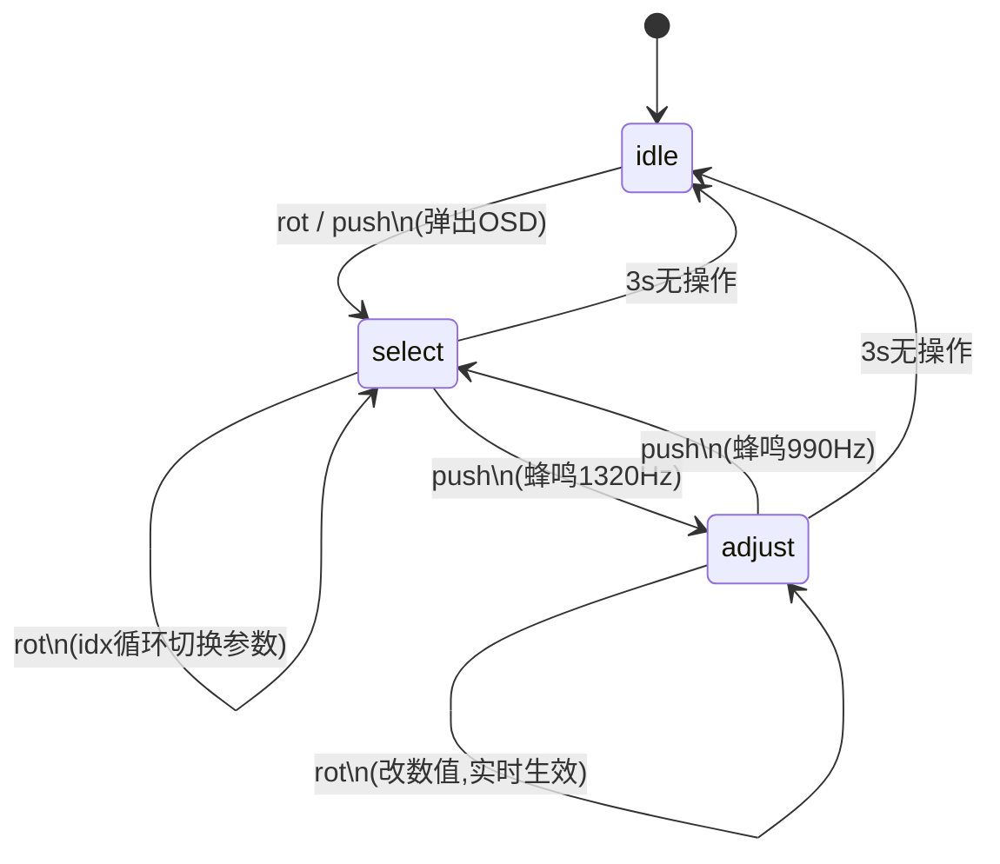

# EC11-B 参数旋钮 OSD 调参功能 —— 设计分析与 FPGA 实现指南

> 分析对象：`js/13_param_knob.js`（状态机）+ `js/07_input_arbiter.js`（仲裁）+ `js/01_config.js`（参数表）+ `js/19_layer4_ui.js`（OSD 绘制）+ `js/20_compositor.js`（亮度落地）
> 目标：把这套"旋钮调参"交互从 HTML 仿真逐条翻译成 FPGA 可实现的模块化设计。

---

## 1. 用户体验剧本（先把效果讲死）

整机播放中，手拧 EC11-B，发生的事按时间排：

| 时刻 | 动作 | 屏幕反馈 | 状态机 |
|---|---|---|---|
| t0 | 旋钮 B 滚 1 格 | 顶部中心弹出小 OSD，显示"音量 70"，青色边框 | idle → select |
| t0+ | 再滚 1 格 | OSD 内容切到"亮度 80"（同位置，不弹窗堆叠） | select，idx+1 |
| t0+ | 继续滚 | 音量 → 亮度 → 进度（仅播放中出现）→ 音量…循环 | select |
| t1 | 按下 | 蜂鸣一声（1320Hz/50ms），边框变金色，标签加"· 调节中" | select → adjust |
| t1+ | 旋转 | OSD 数值变化，进度条填充伸缩，数值立即生效 | adjust |
| t1+ | 再按一下 | 蜂鸣 990Hz，边框回青色，退回选择态 | adjust → select |
| t2 | 停手 | 最后一次操作后 1.8s，OSD 淡出消失 | 仍停在 select/adjust |
| t2+ | 3s 整无操作 | 无视觉变化，状态机默默复位回 idle；再拧重新从"音量"开始 | → idle |

一句话概括：**旋转先"选哪个参数"，按下才"调这个参数"；OSD 只显示正在动的那一个参数，1.8s 自动藏；状态机 3s 才完全复位。**

---

## 2. 系统全景：五层链路

```
EC11-B 物理件 (A相/B相/按下)
   │  ① 解码层：去抖 + 正交解码 → rot_pulse(±1) / push_pulse
   ▼
② 仲裁层 (input_arbiter)
   │  电源门禁之后，ENC_B 事件【全局最高优先级】拦截
   │  → 不进菜单、不进播放 FSM，任何界面拧 B 都能调
   ▼
③ 参数旋钮 FSM (paramKnob)
   │  idle / select / adjust 三态；维护 idx、lastAct
   │  输出：params.{volume|brightness|seek} 新值、osd 显示请求
   ▼
④ 参数执行层
   │  volume → 音频通路增益；brightness → 显示通路亮度；seek → 播放位置
   ▼
⑤ OSD 叠加层 (L4 UI)
      每帧读 FSM.current()，命中窗口就在视频上画 190×64 小面板
```

FPGA 实现时，这五层一一对应为五个模块，事件用脉冲，不用 JS 的函数调用。

---

## 3. 核心：三态状态机（设计精髓）

### 3.1 状态定义

| 状态 | 含义 | OSD 边框色 | 用户心智 |
|---|---|---|---|
| `idle` | 无操作，不显示 | 不画 | "旋钮没人动" |
| `select` | 旋转=在参数间切换 | 青 `#00CED1` | "我在选调哪个" |
| `adjust` | 旋转=改变当前参数值 | 金 `#FFD700` | "我在调这个值" |

### 3.2 转移表（FPGA 真值表直接照抄）

| 当前态 | 输入事件 | 下一态 | 动作 |
|---|---|---|---|
| idle | `rot(±1)` | select | idx 按方向推进 1 格（循环），刷 OSD |
| idle | `push` | select | 不动 idx，刷 OSD（按下也能直接唤出 OSD） |
| select | `rot(±1)` | select | idx = (idx ±1 + N) % N，刷 OSD |
| select | `push` | adjust | 蜂鸣高音 1320Hz，刷 OSD |
| adjust | `rot(±1)` | adjust | 当前参数值 += dir×step，clamp，落地执行，刷 OSD |
| adjust | `push` | select | 蜂鸣低音 990Hz，刷 OSD |
| 任意非 idle | 空闲计时 ≥ 3000ms | idle | 无动作（OSD 早已在 1.8s 藏掉） |

### 3.3 Mermaid 状态图



### 3.4 两个必须注意的细节

1. **idle 态下旋转 = 直接进入 select 并切一格**（不是先停在原参数）。即"滚一下→弹出 OSD→直接切到下一个参数"，这正是你要的"旋钮 B 滚一下 → 弹出参数 OSD"。
2. **idx 越界保护**：播放中切到浏览/停止态后，"进度"项消失，N 从 3 变 2，代码里用 `min(idx, N-1)` 钳位，防止索引悬空。FPGA 里每次进 select 都要重算有效参数表长度。

---

## 4. 参数项表与动态过滤

冻结在配置里的旋钮项（`PARAM_KNOB_ITEMS`）：

| idx | id | 标签 | min | max | step/格 | 备注 |
|---|---|---|---|---|---|---|
| 0 | volume | 音量 | 0 | 100 | 2 | 任何状态可用 |
| 1 | brightness | 亮度 | 0 | 100 | 2 | 任何状态可用 |
| 2 | seek | 进度 | 0 | 100 | 1（格） | `playOnly:true`，**仅 PLAY 态出现** |

**动态列表逻辑**：
```
items = [volume, brightness] + (topState == PLAY ? [seek] : [])
```
- 播放中：N=3，旋转顺序 音量→亮度→进度→音量
- 非播放（浏览/菜单）：N=2，旋转顺序 音量→亮度→音量，进度项自动隐藏
- FPGA 里：用一个 1-bit `in_play` 信号 mux 出 `N`，idx 取模用动态 N。

**进度项的特殊执行**：每格 = ±2 秒 = ±96000 采样点（48kHz）。旋转 seek 不是改寄存器，而是直接把播放时基跳到新位置（正在播就从新位置重启解码，暂停中就只改时基）。

---

## 5. 双计时器解耦（最容易抄错的地方）

代码里有**两个独立计时器**，必须分开建：

| 计时器 | 时长 | 作用 | 何时重载 |
|---|---|---|---|
| **OSD 窗口** | `OSD_FADE_MS = 1800ms` | OSD 面板"可见截止时刻" | 每次 rotate / push / 调值后，`deadline = now + 1800` |
| **状态空闲** | `PARAM_IDLE_MS = 3000ms` | FSM 从 select/adjust 回 idle | 每次 rotate / push，`lastAct = now` |

**关键时序关系**（这是设计精髓，别合并成一个）：

```
操作 ──●────●─────────────●──────────► 时间
       t0   t1            t2
       │    │             │
       ├─ OSD 可见窗口 1.8s ──┤     (t0+1.8s 后 OSD 消失)
       ├──── 状态机活跃 3s ────────┤ (t0+3.0s 后回 idle)
                                  ↑
              1.8s~3.0s 之间：OSD 已藏，但再拧旋钮
              会【接着上次的 idx】继续调，且 OSD 立即重新弹出
```

- **1.8s**：纯视觉，管"面板几点消失"。
- **3.0s**：纯逻辑，管"状态几点复位"。
- 中间 1.2s 的"盲区"是故意留的：用户手离开片刻又拧，不会丢失上下文（不用重新从音量开始）；但放久了（>3s）再碰，完全回到初始态。

FPGA 实现：
- 两个自由运行的毫秒计数器 `ms_tick`（1ms tick 由系统时钟分频）。
- `osd_deadline_reg`：事件到来时装载 `ms_tick + 1800`；比较器 `osd_visible = (ms_tick < osd_deadline_reg) && (fsm != idle)`。
- `idle_timer_reg`：事件到来时装载 3000；递减到 0 且 fsm≠idle → 同步复位 fsm 到 idle。

---

## 6. 输入仲裁：EC11-B 的全局最高优先级

仲裁层路由顺序（源码 `07_input_arbiter.js`）：

```
POWER 门禁 → 拨码开关 → 【ENC_B_ROT / ENC_B_PUSH 抢先】→ 板载3键 → BOOT跳过度 → MENU键 → 菜单拦截 → 按顶层状态分发
```

**设计含义**：只要机器开机（powered=1），拧 B 旋钮**永远直达参数 FSM**——即使菜单开着、即使在浏览界面，B 钮也不会被菜单/播放状态截胡。这就是"旋钮即调参"的确定性，不用担心界面状态。

FPGA 映射：编码器解码模块的输出脉冲**不经过主状态机总线**，直连 knob FSM；knob FSM 输出的参数写请求再单向落到参数寄存器堆。是一条独立旁路上的闭环。

---

## 7. OSD 视觉规格（照抄坐标即可）

屏幕逻辑分辨率 640×480。OSD 是 L4 最顶层叠加，半透明黑底浮在视频上。

### 7.1 面板几何（固定位置，不随内容移动）

```
        x=225 (即(640-190)/2)
        │
   y=58 ┌──────────────────────┐ h=64
        │ 音量·调节中      70  │   ← 第1行：左标签(灰) / 右数值(金,粗等宽)
        │ ▓▓▓▓▓░░░░░░░░░░░░░ │   ← 第2行：进度条 8px 高
        │   旋钮B 调节·按下返回选择 │   ← 第3行：底部提示(暗灰,10px)
        └──────────────────────┘
                    w=190
```

| 元素 | 规格 |
|---|---|
| 面板位置 | x=225, y=58, 宽190, 高64 |
| 面板底色 | 黑 78% 透明 `rgba(0,0,0,0.78)` |
| 边框 | 1.5px 描边；**select=青 `#00CED1`，adjust=金 `#FFD700`** |
| 第1行左 | 12px 灰字 `#A0A0B0`：标签名，adjust 态追加" · 调节中" |
| 第1行右 | 16px 粗等宽金字 `#FFD700`：当前数值（进度项显示 mm:ss） |
| 第2行 | 进度条：底槽 `#262640` 高 8px；填充 `#FFD700`，宽度 = (190-24)×ratio |
| 第3行 | 10px 暗灰 `#606070`：操作提示（"选择参数·按下进入调节" / "调节中·按下返回选择"） |

### 7.2 ratio（填充比例）算法

- volume / brightness：`ratio = value / 100`（本来就是 0~100）
- seek：`ratio = 当前采样 / 总采样`（进度条直接反映整首歌位置）

### 7.3 FPGA 里怎么画 OSD

这是最关键的落地问题。标准做法是**视频后处理叠加（OSD overlay）**：

1. 视频扫描线 `(h_cnt, v_cnt)` 输出前，先判断是否落在面板矩形 `[225,415]×[58,122]` 内。
2. 落在内部：按子区域（边框线 / 标签字符 / 数值字符 / 进度条底 / 进度条填充 / 提示字符）选择像素色，覆盖底层视频像素。
3. 字符：用内置小字号字模 ROM（12×24 / 16×32 点阵），把"音量/亮度/进度"标签、数值数字、提示串预存。数字 0~9 + mm:ss 冒号是必做字符集。
4. 边框色由 `fsm_mode` 信号二选一 mux 青/金。
5. "1.8s 淡出"：HTML 版其实是**直接消失**（无 alpha 渐变）。要更细腻，可在截止前 200ms 对 OSD 层做乘 0→0.78 的渐变（FPGA 里就是 OSD 像素与黑底按系数混合），不做也完全可用。

---

## 8. 参数落地执行（每个值改了之后接到哪）

| 参数 | 值变化后 FPGA 里驱动什么 |
|---|---|
| **volume** | 音频通路：PCM 采样 × (volume/100)，通常平方曲线更线性：`gain = (volume/100)²`。直接接 I2S/音频 DAC 前的乘法器。 |
| **brightness** | 显示通路：演示版用黑蒙版 `alpha = (100-bri)/100 × 0.55` 压暗。正式 FPGA 做法：RGB 输出 × (bri/100)，或送显示器的 gamma/亮度寄存器。 |
| **seek** | 播放时基：把音频/视频样本计数器跳到 `cur ± 96000`（钳在 [0, total]）。播放中要触发解码流从新地址重启读取；暂停态只改计数器。 |
| **蜂鸣反馈** | push 事件：进 adjust 出 1320Hz/50ms，退 adjust 出 990Hz/50ms。FPGA 用蜂鸣器 PWM 模块给个 50ms 门控即可。 |

---

## 9. FPGA 模块化拆分建议（Verilog 架构）

```
                        ┌─────────────────────────────────────┐
  EC11 A相 ──┐          │  ec11_decode (A/B相)                │
  EC11 B相 ──┼──►       │   · 双沿采样 + 格雷码方向判定       │── rot_pulse(+/-)
  EC11 按下 ─┘          │   · 20ms 去抖                       │── push_pulse
                        └──────────────┬──────────────────────┘
                                       ▼
                        ┌─────────────────────────────────────┐
                        │  param_knob_fsm                     │
                        │   · 3 状态寄存器                     │
                        │   · idx 寄存器 + 动态 N 取模        │
                        │   · osd_deadline(1800ms) / idle_timer(3000ms)
                        │   · in_play 信号 mux 参数表         │
                        └──┬─────────┬──────────┬─────────────┘
                           │         │          │
              参数写请求   │         │          │ OSD 状态
                           ▼         ▼          ▼
                   ┌──────────┐ ┌──────────┐ ┌──────────────────┐
                   │ param_reg│ │ beep_gate│ │ osd_overlay      │
                   │ volume   │ │ 1320/990 │ │ 面板几何+字模ROM  │
                   │ bright.  │ │          │ │ +边框色mux        │
                   │ seek_pos │ │          │ │ +进度条填充宽     │
                   └────┬─────┘ └──────────┘ └────────┬─────────┘
                        │                              │
                        ▼                              ▼
              音频增益乘法器 / 显示亮度缩放      视频输出前叠加
```

### 9.1 ec11_decode 模块要点

- 时钟域：用系统时钟（如 50/100MHz）同步链打两拍采 A、B，**避免亚稳态**。
- 方向判定：对 A、B 四个跳变沿做格雷码查表。标准真值（按 detent）：
  - A 升沿时 B=0 → 顺时针（+1）；B=1 → 逆时针（-1）
  - B 升沿时 B=… 组合成完整四倍频状态机，每走完一个 detent 输出**一个** `rot_pulse`。
- 去抖：A/B 线上检测到跳变后，要求新电平稳定 ~5~20ms 才认（源码 `DEBOUNCE_MS=20`）。
- 按下：独立 20ms 去抖，出一个单周期 `push_pulse`（注意是单击，不是按住）。

### 9.2 param_knob_fsm 接口信号（建议）

| 信号 | 方向 | 宽度 | 含义 |
|---|---|---|---|
| clk / rst_n | in | 1 | 系统时钟/复位 |
| ms_tick | in | 1 | 1ms 脉冲（全局分频出来） |
| rot_pulse | in | 1 | 解码来的旋转脉冲 |
| rot_dir | in | 1 | 1=+1格, 0=-1格 |
| push_pulse | in | 1 | 按下脉冲 |
| in_play | in | 1 | 是否 PLAY 态（决定是否含 seek 项） |
| param_wr | out | 1 | 参数写有效 |
| param_id | out | 2 | 0=volume 1=bri 2=seek |
| param_val | out | 8 | 新值 0~100 |
| osd_visible | out | 1 | OSD 叠加层开门 |
| osd_mode | out | 1 | 0=select(青) 1=adjust(金) |
| osd_param_idx | out | 2 | 当前 OSD 显示哪个参数 |
| osd_ratio | out | 7 | 进度条填充比例 0~100 |
| beep_req | out | 2 | 0=无 1=1320Hz 2=990Hz |

### 9.3 可直接落地的 FSM 行为伪码（Verilog 风格）

```verilog
// 事件处理（rot_pulse / push_pulse 触发）
always @(posedge clk) begin
  if (rot_pulse) begin
    lastAct <= 0; osdTimer <= 0;
    if (mode == ADJUST) begin
      // 调当前参数值
      val <= clamp(val + (rot_dir? step : -step), min, max);
    end else begin
      mode <= SELECT;
      idx  <= mod(idx + (rot_dir? 1 : -1), N); // N=in_play?3:2
    end
    osdDeadline <= 1800; // 重载 OSD 窗口
  end
  if (push_pulse) begin
    lastAct <= 0; osdTimer <= 0;
    mode <= (mode==ADJUST)? SELECT : ADJUST;
    beep <= (mode==SELECT)? BEEP_HI : BEEP_LO; // 注意是切换后的目标态
    osdDeadline <= 1800;
  end
end

// 1ms 计时
always @(posedge ms_tick) begin
  if (lastAct < 3000) lastAct <= lastAct + 1;
  if (lastAct == 3000 && mode != IDLE) mode <= IDLE;  // 3s 回 idle
  if (osdDeadline > 0) osdDeadline <= osdDeadline - 1;
end

assign osd_visible = (mode != IDLE) && (osdDeadline > 0);
```

---

## 10. 参数速查表（冻结值）

| 参数 | 值 | 含义 |
|---|---|---|
| `DEBOUNCE_MS` | 20 | 编码器/按键去抖 |
| `PARAM_IDLE_MS` | 3000 | 3s 无操作 FSM 回 idle |
| `OSD_FADE_MS` | 1800 | OSD 可见窗口 1.8s |
| volume 步长 | 2/格 | 0~100 |
| brightness 步长 | 2/格 | 0~100 |
| seek 步长 | ±2s/格 = ±96000 样本 | 48kHz 采样率 |
| 默认值 | volume=70, brightness=80 | 上电初值 |
| 进 adjust 蜂鸣 | 1320Hz / 50ms | |
| 退 adjust 蜂鸣 | 990Hz / 50ms | |
| OSD 面板 | 190×64 @ (225,58) | 640×480 逻辑坐标 |

---

## 11. 设计思路总结（一句话版）

1. **一个旋钮两种语义**：旋转的含义由"当前在哪个态"决定——选参数 vs 调值，用一个按下动作切换，省按键。
2. **OSD 与状态机解耦**：1.8s 管视觉隐藏，3s 管逻辑复位，中间留 1.2s 上下文记忆窗，操作手感"跟手又不啰嗦"。
3. **只显示正在动的那个参数**：不做完整菜单，一个小浮窗随旋钮内容切换，视觉负担最小。
4. **颜色即状态**：青色=选择中、金色=调节中，不看文字也知道拧下去是切参数还是改数值。
5. **全局旁路优先级**：B 旋钮事件不进主状态机，任何界面下都能盲拧调音量/亮度，符合"播放器常用操作零菜单化"的设计目标。
6. **参数表数据驱动**：音量/亮度/进度做成表（id/min/max/step/playOnly），FPGA 里就是 ROM + mux，以后加参数（如低音、高音）只需扩表。
