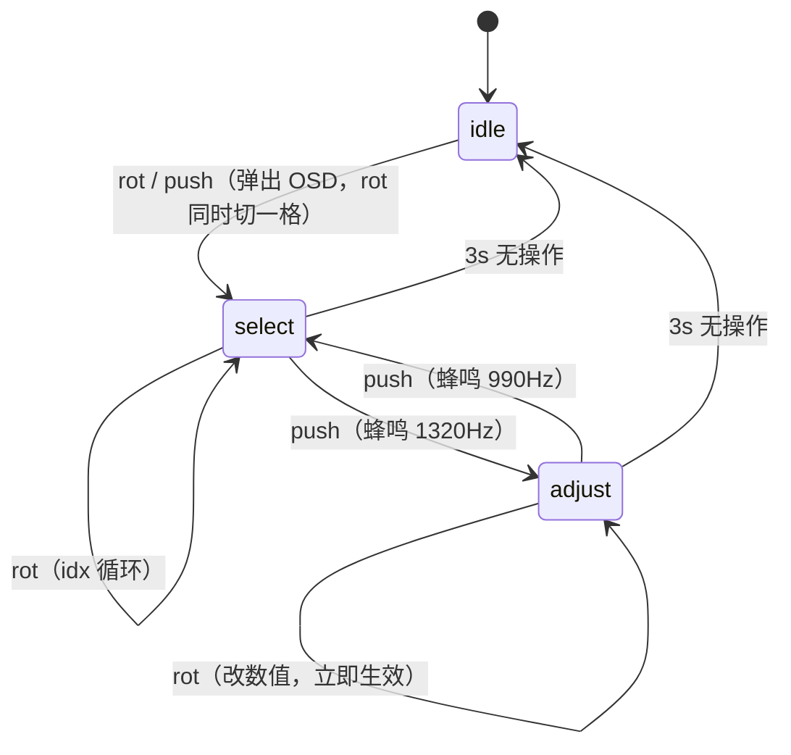

# VinylFPGA S7-R6：EC2 旋钮 OSD 调参 —— 设计与实施方案

> 日期：2026-10-07（北京时间）
> 工程：`D:\Data_Backup\VinylFPGA_Workspace_Base\VinylFPGA`
> 基线：Git `a357339`（S7-03b），顶层 `top`，器件安路 `EG4S20BG256`
> 参考蓝本：`EC11-B参数旋钮OSD设计分析与FPGA实现指南.md`（HTML 仿真版 `js/13_param_knob.js` 的 FPGA 翻译稿）
> 上游文档：`VinylFPGA_后续开发报告_进度盘点与阶段重排_20261007.md`（本文件是其 S7-R6 阶段的展开与替换）
> 文档性质：**设计与实施方案**。本次只做代码核查与设计，未实现任何 RTL，未综合、未下载、未上板。
> 状态口径：全文严格区分「计划」「已实现」「仿真通过」「构建通过」「板级人工验收通过」。

---

## 0. 为什么把 EC11-B 方案搬到 VinylFPGA

原 S7-R6 阶段（对应 S7 方案 §S7-04）设计的是**传统二级菜单**：一级列 6 项、二级列 6 项、EC2 唤醒后 3 秒淡出。这套设计在 VinylFPGA 上有三个硬伤：

| 问题 | 说明 |
|---|---|
| **视觉负担与 640×480 缩略图布局冲突** | 当前主界面是 2×2 缩略图 + MV 窗口 + 底部波形（`WAVE_Y=376, H=96`）+ 歌词（`LRC_OSD_Y=340`）。传统菜单要在这些图层之上再压一块大面板，遮住正在显示的内容 |
| **导航成本高** | 「音量」在二级、「亮度」在一级，用户每次调音量都要滚两轮 + 按一次 + 滚到目标 + 再按一次进入 + 滚数值 + 按退出。EC11-B 方案的「旋转选参数 / 按下改数值」把 6 次操作压缩到 2 次 |
| **与既有交互语义冲突** | `param_menu_controller.v` 已是母板 KEY1+KEY2 组合键的亮度/对比度入口，占用 KEY1/KEY2；再在 J2 侧建一套菜单，等于两个菜单并存 |

**EC11-B 方案的核心优势是「不建菜单」**：一个 190×64 的小浮窗，只显示正在动的那个参数，1.8 秒自动隐藏，3 秒状态机复位。这与 VinylFPGA「J2 旋钮盲拧调参」的产品定位完全一致，且**不遮挡任何正在显示的图层**。

本文件把该方案**逐条对照 VinylFPGA 实际代码**重新落地，而不是照抄 HTML 仿真的参数。

---

## 1. 代码现状核查（设计的真实起点）

### 1.1 好消息：三态 FSM 的输入源已全部就位

EC11-B 方案需要 `rot_pulse(±1)` / `push_pulse` / `in_play` / `ms_tick` 四路信号。核查结果：

| 信号 | 现状 | 位置 |
|---|---|---|
| EC2 A/B 相正交解码 | ✅ **已实现** | `expansion_io_hub.v` 内 2 个 `quadrature_decoder`，`AB_STABLE_CYCLES=50_000`（1 ms） |
| EC2 按压消抖 | ✅ **已实现** | `key_dip_monitor.v` → `enc2_sw_fall_pulse` / `enc2_sw_rise_pulse` |
| EC2 事件入总线 | ✅ **已实现** | `ui_event_bus.v:71-75` 已有 `enc2_step_pending` / `enc2_step_dir` / `enc2_sw_pending` |
| EC2 事件仲裁输出 | ✅ **已实现** | `ui_event_bus.v:142-162` `arb_aux = {14'd0, 1'b1, enc2_step_dir}`（`aux[1]=1` 标识 EC2） |
| 1 ms 时基 | ✅ **已存在** | `ui_command_router.v:159-160` `ms_cnt` + `ms_tick`，50 MHz 域 |

**结论：EC2 的物理通路、解码、仲裁全部已通，不需要新建任何输入模块。**

### 1.2 坏消息一：EC2 事件在 `ui_event_bridge` 被静默丢弃

这是本阶段**最重要的发现**。`ui_event_bridge.v` 只处理 EC1：

```verilog
// ui_event_bridge.v:55  —— 只认 enc_id=0（EC1）
wire is_enc1_step = (ev_code == EV_ENC_STEP) && (ev_aux[1] == 1'b0);
// ui_event_bridge.v:59
wire is_enc1_down = (ev_code == EV_ENC_SW) && (ev_aux[1] == 1'b0) && (ev_arg[0] == 1'b0);
```

全文件**没有一处 `ev_aux[1] == 1'b1` 的判断**，也没有 `enc2_tgl` / `push_tgl` 类输出。顶层 `top_tf_hdmi_audio.v:2209-2211` 把 `exp_enc2_a/b/sw_n` 接进 `expansion_integration`，事件一路走到 `ui_event_bridge` 门口，然后被丢掉。

当前 EC2 的全部存在感只有两处：
1. `exp_echo_reporter` 的串口回显（`ENC2 + 0003` / `ENC2 SW DOWN`）；
2. `buzzer_feedback` 的 EC2 提示音。

**所以本阶段的第一件事不是写 FSM，而是先把 EC2 事件从桥接层引出来。**

### 1.3 坏消息二：现有 OSD 资源与 EC11-B 规格差距很大

`status_osd_overlay.v`（156 行）+ `osd_overlay_24.v`（82 行）构成现有状态 OSD：

| 维度 | 现有实现 | EC11-B 需求 | 差距 |
|---|---|---|---|
| 面板尺寸 | 32×8 / 32×8 两行 | **190×64** 三行 | 需重写 |
| 字模 | **4×5 点阵**，硬编码 `font_row` case 函数 | 12×12 标签 + 16×16 数值 + 10×10 提示 | 需新建字模 ROM |
| 字符集 | 16 个（`0-9`, `a-f`） | 数字 0–9 + `:` + 中文标签 | 需新建 |
| 颜色 | 12 bit，`12'hff0`（黄）/ `12'hf44`（红） | **24 bit**，需青 `#00CED1` / 金 `#FFD700` / 灰阶 | 需扩宽 |
| 透明度 | 无（直接覆盖） | 底色 78% 透明，需与下层混合 | 需新增混合 |
| 圆角/边框 | 无 | 1.5px 描边 | 需新增 |
| 进度条 | 无 | 8px 高，底槽 + 填充 | 需新增 |
| 位置 | `(8,8)` 固定左上 | `(225,58)` 顶部居中 | 改坐标 |

**关键约束——OSD 插入位置**：现有 OSD 插在 `brightness_contrast_adjust` 之后、`promax_audio_waveform` 之前：

```
frame_read_write → video_transition_apply → brightness_contrast_adjust
  → osd_overlay_24(8,8) → promax_audio_waveform(64,376)
  → s6_video_layer(MV/黑胶) → lrc_osd(96,340) → final_rgb
```

**这个位置是错的**——它会被后���的波形、MV、歌词覆盖。EC11-B 的调参面板必须在**最顶层**（`lrc_osd` 之后、`final_rgb` 之前），否则拧旋钮时面板会被 MV 窗口压住。

### 1.4 坏消息三：OSD 像素坐标链的位宽限制

`osd_overlay_24.v` 内部自建行计数器重建 `line_y`：

```verilog
// osd_overlay_24.v:33-45
reg [11:0] line_y;
always @(posedge clk or negedge rst_n) begin
    if (!rst_n) begin line_y <= 12'd0; de_q <= 1'b0; vs_q <= 1'b1; end
    else begin
        de_q <= de; vs_q <= vsync;
        if (!vsync) line_y <= 12'd0;          // VS 低有效
        else if (de_q && !de) line_y <= line_y + 1'b1;
    end
end
```

`pixel_x` 由顶层 `adjusted_pixel_x`（**10 bit**，`top:244`）提供。10 bit 可表示 0–1023，覆盖 640 宽度**但横向分辨率只有 1/64 像素**——EC11-B 的 1.5px 描边和 8px 进度条都在 10 bit 坐标下可实现，但**不能做小数像素定位**。

`lrc_osd.v` 用的是同一套坐标（`pixel_x` 10 bit + 内部 `line_y`），且**纯组合查表**：

```verilog
// lrc_osd.v:159-161
assign hit       = in_box && font_row[15 - col_pix];
assign rgb_out   = hit ? LRC_COLOR : rgb_in;
```

**这说明「组合 OSD + 10bit 坐标 + 无流水延迟」在本工程是已验证可行模式**，本阶段沿用此模式以避免破坏时序。

### 1.5 可复用的现成资产

| 资产 | 位置 | 复用方式 |
|---|---|---|
| 16×16 字模 ROM 结构 | `lrc_font_rom.v`（974 行，`case` LUT，60 字形，1024 地址） | **同构复制**一套 12×12 调参字模，`gen_lrc_assets.py` 已具备字模生成逻辑 |
| 组合 OSD 叠加模式 | `lrc_osd.v` | 照搬 `in_box` + `char_sel` + `hit` 结构 |
| 音量执行通路 | `pcm_volume_fade.v` | `volume[7:0]` 直接接入，现有 `VOL_DEFAULT=200/VOL_STEP=16/VOL_MIN=32/VOL_MAX=255` |
| 亮度/对比度执行通路 | `brightness_contrast_adjust.v` | `brightness[7:0]` / `contrast[7:0]` 帧边界锁存后送入 |
| 蜂鸣器 | `buzzer_feedback.v` + `EXT1` | 已有 8 类音型，需增 1320Hz/990Hz 两类 |
| 1 ms 时基 | `ui_command_router.v:159-160` | 需提出为独立端口或复制一份 |
| 转场 Alpha 包络 | `sync_fade_gain.v`（66 行） | 可复用其「alpha 系数 → 音频增益」跨域手法做 OSD 淡出 |

---

## 2. 用户体验剧本（本工程版）

与 HTML 版的关键差异已标注。**本表是验收标准的第一来源**。

| 时刻 | 动作 | 屏幕反馈 | 状态机 | 与 HTML 版差异 |
|---|---|---|---|---|
| t0 | EC2 滚 1 格 | 顶部居中弹出 190×64 浮窗，显示「音量 200」+ 青色边框 | `idle → select` | **数值范围 32–255（8bit）**，非 0–100 |
| t0+ | 再滚 1 格 | 浮窗内容切到「亮度 255」（同位置，不堆叠） | `select`，idx+1 | 同 |
| t0+ | 继续滚 | 音量 → 亮度 → 对比度 → 进度（仅播放中）→ 音量… | `select` | **N=4（播放）/ N=3（浏览）**，非 3/2 |
| t1 | 按下 | 蜂鸣 1320Hz/50ms，边框变金 `#FFD700`，标签追加「· 调节中」 | `select → adjust` | 同 |
| t1+ | 旋转 | 数值变化，进度条填充伸缩，**音量立即生效** | `adjust` | 同 |
| t1+ | 再按一下 | 蜂鸣 990Hz/50ms，边框回青，退回选择态 | `adjust → select` | 同 |
| t2 | 停手 | 最后一次操作后 **1.8s**，浮窗淡出消失 | 仍停在 select/adjust | 同 |
| t2+ | **3s** 整无操作 | 无视觉变化，状态机复位回 `idle`；再拧从「音量」重新开始 | `→ idle` | 同 |

**不变的核心设计**：
1. 旋转先"选哪个参数"，按下才"调这个参数"——一个旋钮两种语义，省按键。
2. OSD 与状态机解耦：1.8s 管视觉，3s 管逻辑，中间 1.2s 是**上下文记忆窗**。
3. 只显示正在动的那个参数，**不做完整菜单**。
4. 颜色即状态：青=选择中、金=调节中。
5. EC2 **全局旁路优先级**：不进主状态机，任何界面盲拧都能调。

---

## 3. 架构：五层链路（本工程版）

```
EC2 物理件 (exp_enc2_a / exp_enc2_b / exp_enc2_sw_n)
   │  ① 既有通路（零新建）
   │     expansion_io_hub → 2×quadrature_decoder + key_dip_monitor
   │     → ui_event_bus（enc2_step_pending / enc2_sw_pending 已存在）
   ▼
② 【新增】ui_event_bridge 扩展：EC2 事件引出
   │     enc2_rot_tgl(±1) / enc2_push_tgl / ec2_dir
   │     ★ 必须先做这一步，否则 FSM 收不到任何输入
   ▼
③ 【新增】param_knob_fsm（50 MHz 域）
   │     idle / select / adjust 三态
   │     idx 寄存器 + 动态 N 取模
   │     osd_deadline(1800ms) / idle_timer(3000ms)  ★ 双计时器
   │     in_play 动态 mux 参数表
   │     ★ 独立旁路，不经 browse_fsm / play_ctrl
   ▼
④ 【新增】param_csr（参数唯一写入点）
   │     volume / brightness / contrast / seek_pos
   │     帧边界提交，一参数一权威写入点
   ▼
⑤ 【新增】knob_osd_panel（video_clk 域，末级叠加）
       190×64 @ (225,58)，组合逻辑
       边框色 mux（青/金）+ 半透明底 + 12×12 标签 + 16×16 数值 + 8px 进度条 + 10×10 提示
       ★ 插在 lrc_osd 之后、final_rgb 之前（现有 osd_overlay_24 位置错误）
```

### 3.1 为什么必须旁路主状态机

HTML 版 `07_input_arbiter.js` 的仲裁顺序是：
```
POWER → 拨码 → 【ENC_B_ROT / ENC_B_PUSH 抢先】→ 板载3键 → BOOT → MENU → 菜单拦截 → 顶层状态分发
```

本工程对应关系：

| HTML 仲裁层 | VinylFPGA 对应 | 说明 |
|---|---|---|
| POWER 门禁 | `DIP1` 在场声明（`expansion_integration.v:250`） | 已有 |
| 拨码开关 | `dip_level[5:0]` 运行时消抖 | 已有（S7-03） |
| **ENC_B 抢先** | **`param_knob_fsm` 直连 EC2 toggle** | **本阶段新增** |
| 板载 3 键 | `key1/key2/key3` → `param_menu_controller` | 已有 |
| BOOT 跳过度 | `skip_guard_done`（`expansion_integration.v:394`） | 已有 |
| MENU 键 | KEY07 → `browse_fsm` | 已有 |
| 菜单拦截 | 本阶段**不设拦截**（无菜单） | 设计简化 |
| 顶层状态分发 | `browse_fsm` / `play_ctrl` | 已有 |

**实现要点**：`param_knob_fsm` 的输入**直接来自 `ui_event_bridge` 新增的 EC2 toggle**，不接入 `browse_fsm`。EC2 事件因此天然不进主状态机总线，符合"全局最高优先级"。这与 `ui_event_bus` 注释里"业务层不得直读 `exp_key_n/exp_enc*_a/b`"的约束一致——我们用的是总线出来的 `EV_ENC_STEP`/`EV_ENC_SW`，不是原始引脚。

---

## 4. 核心：三态状态机

### 4.1 状态定义

| 状态 | 含义 | 边框色 | 面板底提示 | 用户心智 |
|---|---|---|---|---|
| `idle` | 无操作，不显示 | 不画 | — | "旋钮没人动" |
| `select` | 旋转=在参数间切换 | 青 `#00CED1` | 选择参数·按下进入调节 | "我在选调哪个" |
| `adjust` | 旋转=改变当前值 | 金 `#FFD700` | 调节中·按下返回选择 | "我在调这个值" |

### 4.2 转移表（FPGA 真值表）

| 当前态 | 输入 | 下一态 | 动作 |
|---|---|---|---|
| `idle` | `enc2_rot(±1)` | `select` | **idx 按方向推进 1 格（循环）**，刷 OSD |
| `idle` | `enc2_push` | `select` | 不动 idx，刷 OSD（按下也能直接唤出） |
| `select` | `enc2_rot(±1)` | `select` | `idx = (idx ±1 + N) % N`，刷 OSD |
| `select` | `enc2_push` | `adjust` | 蜂鸣 1320Hz/50ms，刷 OSD |
| `adjust` | `enc2_rot(±1)` | `adjust` | `val = clamp(val + dir×step, min, max)`，落地执行，刷 OSD |
| `adjust` | `enc2_push` | `select` | 蜂鸣 990Hz/50ms，刷 OSD |
| 非 `idle` | 空闲 ≥ **3000ms** | `idle` | 无动作（OSD 早已在 1.8s 藏掉） |

### 4.3 状态图



### 4.4 两个必须注意的细节

**① `idle` 态旋转 = 直接进 `select` 并切一格**，不是先停在原参数。滚一下 → 弹出 OSD → **直接切到下一个参数**。这正是"拧 EC2 一下就弹出参数 OSD"的手感。

**② 动态 N 与 idx 钳位**：非播放态「进度」项消失，N 从 4 变 3。**每次进 `select` 或 N 变化时都要重算有效参数表长度并对 idx 做钳位**：

```verilog
// N=4 播放中：0 音量 / 1 亮度 / 2 对比度 / 3 进度
// N=3 非播放：0 音量 / 1 亮度 / 2 对比度（进度项隐藏）
// 若在 N=4 时 idx=3（进度），切到浏览态后必须钳到 idx=2（对比度）
if (idx >= N_eff) idx <= N_eff - 1;
```

若不钳位，`idx=3` 会越界访问参数表，FPGA 里读到 X 值 → 面板显示乱码。

---

## 5. 参数项表与动态过滤

### 5.1 冻结参数表

与 HTML 版的 3 项（volume/brightness/seek）不同，本工程 R6 阶段落地 **4 项**：

| idx | id | 标签 | min | max | step/格 | 备注 |
|---|---|---|---|---|---|---|
| 0 | `volume` | 音量 | 32 | 255 | 16 | 任何状态可用；沿用 `play_ctrl.v:14-17` 现有参数 |
| 1 | `brightness` | 亮度 | 0 | 255 | 1 | 任何状态可用；映射到 5 档 LUT 见 §5.3 |
| 2 | `contrast` | 对比度 | 0 | 255 | 1 | 任何状态可用；映射到 5 档 LUT |
| 3 | `seek` | 进度 | 0 | total_samples | 96000（±2s） | `playOnly:true`，**仅 PLAY 态出现** |

**为什么音量不用 0–100**：HTML 版是 JS 仿真，可以任意定域。本工程的 `pcm_volume_fade.v` 已经是 8bit `volume × fade_gain / 256`：

```verilog
wire [15:0] gain_product = {8'd0, volume} * {8'd0, fade_gain};
```

改成 0–100 需要重写音频增益通路并重验 16bit 饱和边界。**保持 32–255 / step 16 是最小改动且已验证路径**。面板直接显示 0–255 的十进制数字，用户看到「音量 200」比「音量 78」更符合硬件真实值。

**为什么不用平方曲线**：HTML 版建议 `gain = (volume/100)²` 更符合人耳。`pcm_volume_fade.v` 当前是线性 `volume/256`。改平方需额外乘法器（DSP 已用 15/29，且时序裕量仅 +3ps）。**列为可选项，不在首版**。

### 5.2 动态列表逻辑

```
items = [volume, brightness, contrast] + (in_play ? [seek] : [])
```

| 状态 | N | 旋转顺序 |
|---|---:|---|
| 播放中 | 4 | 音量 → 亮度 → 对比度 → 进度 → 音量 |
| 非播放（浏览/BOOT） | 3 | 音量 → 亮度 → 对比度 → 音量 |

实现：`wire [1:0] n_eff = in_play ? 2'd4 : 2'd3;`，取模用动态 N。

**对比度为什么任何状态可用**：当前 `brightness_contrast_adjust` 在 `brightness_contrast_adjust` 之后、`promax_audio_waveform` 之前生效，**对所有图层统一生效**（含缩略图浏览态）。因此浏览态调对比度是有效的。

### 5.3 亮度/对比度的 5 档映射

现有 `param_menu_controller.v:52-76` 的 LUT：

```verilog
4'd0: brightness_lut = 8'd0;
4'd1: brightness_lut = 8'd64;
4'd2: brightness_lut = 8'd128;
4'd3: brightness_lut = 8'd192;
default: brightness_lut = 8'd255;
```

**首版策略：旋钮每格走 1 档**，即 `step=1` 表示"LUT 档位 +1"，实际值查表得 0/64/128/192/255。理由：

1. 沿用已验收的 5 档 LUT，不改 `brightness_contrast_adjust` 的算法；
2. 档位跳变在 `rgb × (brightness+1) / 256` 后视觉上足够明显；
3. 若要连续 0–255，需把 `step` 改为 1 并绕过 LUT 直接送值——**这会改变已验收行为**，列为独立可选项。

面板显示的是**查表后的真实值**（0/64/128/192/255），不是档位号 0–4。这样用户看到「亮度 128」对应实际的中间灰。

### 5.4 进度项的特殊执行

每格 = **±2 秒 = ±96000 样本点**（48 kHz）。旋转 seek **不是改寄存器**，而是直接请求播放时基跳转：

- **播放中**：触发解码流从新地址重启读取（R2 的 seek request/ack 通路）；
- **暂停中**：只改时基计数器，不重启读取。

`total_samples` 由 R2 阶段从 INDEX 条目偏移 20 的 `audio_bytes / 2` 可靠引出。**本阶段依赖 R2 已完成**。

---

## 6. 双计时器解耦（最容易抄错的地方）

两个**独立**计时器，必须分开建：

| 计时器 | 本工程取值 | 作用 | 重载时机 |
|---|---|---|---|
| **OSD 窗口** | `KNOB_OSD_MS = 1800` | 面板"可见截止时刻" | 每次 rotate / push 后 `osd_deadline <= ms_tick_ms + 1800` |
| **状态空闲** | `KNOB_IDLE_MS = 3000` | FSM 从 select/adjust 回 idle | 每次 rotate / push 后 `idle_timer <= 3000` |

### 6.1 关键时序关系（设计精髓，不要合并）

```
操作 ──●────●─────────────●──────────► 时间
       t0   t1            t2
       │    │             │
       ├─ OSD 可见窗口 1.8s ──┤     (t0+1.8s 后 OSD 消失)
       ├──── 状态机活跃 3s ────────┤ (t0+3.0s 后回 idle)
                                  ↑
              1.8s~3.0s 之间：OSD 已藏，但再拧旋钮
              会【接着上次的 idx】继续调，且 OSD 立即重新弹出
```

- **1.8s**：纯视觉，管"面板几点消失"。
- **3.0s**：纯逻辑，管"状态几点复位"。
- 中间 1.2s 的"盲区"是**故意留的**：用户手离开片刻又拧，不丢失上下文（不用重新从音量开始）；放久了（>3s）再碰，完全回到初始态。

### 6.2 FPGA 实现

```verilog
// 1 ms 时基：提出为独立端口或从 ui_command_router 复制一份
wire ms_tick;                       // 50 MHz 域，1 拍脉冲
reg [15:0] ms_ms;                   // 自由运行的毫秒计数（不回绕，够 24h）
always @(posedge clk) if (ms_tick) ms_ms <= ms_ms + 16'd1;

reg [15:0] osd_deadline;            // 绝对时刻法
reg [11:0] idle_timer;
wire       osd_visible = (fsm != IDLE) && (ms_ms < osd_deadline);
```

**推荐用绝对时刻法**（`ms_ms < osd_deadline`）而非递减计数，理由：
- 递减法在 `osd_deadline` 装载与递减同拍时需要额外处理 reload-vs-decrement 优先级，容易出 off-by-one；
- 绝对法只需一个比较器，且天然处理"1.8s–3.0s 盲区再拧立即刷新"（新 deadline 直接覆盖为 `ms_ms+1800`）。

### 6.3 OSD 淡出（可选，HTML 版是直接消失）

HTML 版 `OSD_FADE` 是**直接消失无渐变**。本工程建议加一个轻量淡出，提升观感：

```
KNOB_FADE_MS = 200   // 截止前 200ms 做 alpha 渐变
alpha = osd_alpha_lut[(osd_deadline - ms_ms)]   // 8 段查表，0→0.78
```

实现方式：面板底色与下层视频按 `alpha` 混合。**首版可只做 4 档（0/0.26/0.52/0.78）**，用 2 bit 索引一个乘法器或查表，避免引入新的时序路径。

**边界**：淡出期间若再次操作，`osd_deadline` 刷新，alpha 立即回到 0.78，不得出现"越拧越淡"。

---

## 7. OSD 视觉规格（本工程版）

### 7.1 面板几何

```
        x=225  (即 (640-190)/2)
        │
   y=58 ┌────────────────────────┐ h=64
        │ ▓ 音量            200  │  ← 第1行 y+8:  标签(12px灰) / 数值(16px粗金)
        │ ▓▓▓▓▓▓▓▓▓▓▓░░░░░░░░░░░ │  ← 第2行 y+32: 进度条 8px 高
        │   旋钮调节·按下进入     │  ← 第3行 y+52:  提示(10px暗灰)
        └────────────────────────┘
                 w=190
```

| 元素 | 规格 | 本工程取值 |
|---|---|---|
| 面板位置 | x=225, y=58, w=190, h=64 | 同（640×480 逻辑坐标） |
| 面板底色 | 黑 78% 透明 | `24'h0A0A10`，与下层按 alpha 混合 |
| 边框 | 1.5px 描边 | **2px**（10bit 坐标下 1px 过于纤细）；`select=24'h00CED1`，`adjust=24'hFFD700` |
| 第1行左 | 12px 灰 `#A0A0B0` | 中文标签，`adjust` 态追加「· 调节中」→ 实际 7 字 ×12px = 84px |
| 第1行右 | 16px 粗等宽金 `#FFD700` | 3 位十进制（音量最大 255）/ 5 位 mm:ss（进度） |
| 第2行 | 底槽 `#262640` 8px；填充 `#FFD700` | 填充宽 = (190-24) × ratio = 166 × ratio |
| 第3行 | 10px 暗灰 `#606070` | 两态提示串切换 |

### 7.2 布局坐标细化（10bit pixel_x 可精确实现）

| 子区域 | X 范围 | Y 范围 | 说明 |
|---|---|---|---|
| 边框 | 225–226, 413–414 | 58–59, 120–121 | 2px 描边，四边 |
| 底色 | 227–412 | 60–119 | 与下层混合 |
| 标签行 | 231 起 | 66–77 | 12px 字高，7 字宽 84px |
| 数值行（右对齐） | 331–409 | 64–79 | 16px 字高，3 字宽 48px |
| 进度条 | 231–397 | 90–97 | 8px 高，166px 宽 |
| 提示行 | 231 起 | 110–119 | 10px 字高 |

**注意**：标签行（y 66–77）与数值行（y 64–79）**Y 范围重叠但 X 不重叠**（标签 231–315，数值 331–409），因此可以用单一 `char_row = (y-64)/14` 简化，或分成两个独立子区域判定。**推荐分成两个独立判定**，逻辑更清晰、面积更小。

### 7.3 ratio（填充比例）算法

| 参数 | ratio |
|---|---|
| volume | `(volume - 32) / (255 - 32)` → 从 0.137 映射到 1.0，**下限非零更符合直觉** |
| brightness | `brightness_lut[lvl] / 255` |
| contrast | `contrast_lut[lvl] / 255` |
| seek | `cur_sample / total_samples` |

**建议实现**：`ratio7 = (value * 100) / max` 输出 7bit 0–100，填充宽 = `(ratio7 * 166) / 100`。两级乘除在 50 MHz 域组合完成，**不进像素流水线**（像素域只做 `pixel_x < fill_end_x` 的比较）。

### 7.4 字符集与字模

| 用途 | 字高 | 字符 | 字模来源 |
|---|---|---|---|
| 标签 | 12×12 | 音量/亮度/对比度/进度 | **新建** `knob_font_12x12.v` |
| 数值 | 16×16 | `0-9` `:` | **可复用** `lrc_font_rom.v` 的 16×16 结构（60 字形已含数字） |
| 提示 | 10×10 | 旋钮调节·按下进入 / 调节中·按下返回 | **新建** `knob_font_10x10.v` |

**资源估算**：12×12 中文 7 字 = 7×12×12 = 1008 bit；10×10 中文 16 字 = 1600 bit。合计约 2608 bit。

**关键决策：字模放 LUT 还是 BRAM？**

| 方案 | 占用 | 评价 |
|---|---|---|
| `case` LUT（照搬 `lrc_font_rom` 风格） | 约 400–700 LUT | 现有 `u_lrc_osd/u_font_rom` 已占 **424 LUT / 0 BRAM**。**Slices 仅剩 212 到 88% 阈值，不够** |
| BRAM9K | 1 块（2608/9216 = 28%） | **推荐**。BRAM 剩 24 块，取 1 块换 ~500 LUT 净赚 |

**推荐用 BRAM**，并复用 `gen_lrc_assets.py` 的字模生成逻辑（把 `case` 输出改为 `initial` 数组推断 BRAM）。这与 `boot_logo_rom.v`（16 BRAM）用的是同一套推断机制，已验证。

**代价**：BRAM 是**同步读**（1 拍延迟），而现有 OSD 是**纯组合**。处理方式见 §8.2。

---

## 8. 像素流水线与 CDC

### 8.1 插入位置（修正现有 OSD 的位置错误）

**当前（错误）**：
```
... → brightness_contrast_adjust → osd_overlay_24(8,8) → promax_audio_waveform
   → s6_video_layer → lrc_osd → final_rgb
```

**本阶段新增（正确）**：
```
... → brightness_contrast_adjust → osd_overlay_24（保留，状态码/错误码）
   → promax_audio_waveform → s6_video_layer → lrc_osd
   → 【knob_osd_panel】← 插在这里
   → final_rgb = blank ? 24'h000000 : (boot ? boot_rgb : knob_rgb)
```

理由：
1. 调参面板必须在**所有媒体图层之上**，否则被 MV 窗口/歌词/波形覆盖；
2. 必须在 `blank_active_vid` **之下**（消隐时面板也应被黑屏覆盖，否则消隐失效）；
3. 必须在 `boot_rgb` **之下或之上**需决策——**建议之下**（BOOT 期间不显示调参面板，避免开机 Logo 被浮窗遮挡；且 `boot_active` 期间 `play_active=0`，进度项本就不显示）。

对应的顶层改动（`top:2086-2087`）：

```verilog
// 改前
assign final_rgb = blank_active_vid ? 24'h000000 :
                   (s2_boot_on && boot_active) ? boot_rgb : lrc_rgb;
// 改后
wire knob_rgb;
knob_osd_panel u_knob_osd (
    .clk(video_clk), .rst_n(video_rst_n),
    .vs(vs), .de(adjusted_de), .pixel_x(adjusted_pixel_x),
    .rgb_in(lrc_rgb), .rgb_out(knob_rgb),
    .visible(knob_osd_visible_vid),
    .mode(knob_mode_vid), .ratio(knob_ratio_vid),
    .label_id(knob_label_vid), .value(knob_value_vid), .value_is_time(knob_value_is_time_vid)
);
assign final_rgb = blank_active_vid ? 24'h000000 :
                   (s2_boot_on && boot_active) ? boot_rgb : knob_rgb;
```

### 8.2 BRAM 同步读的延迟处理

`lrc_font_rom` 是组合 `case`，`knob_font_*.v` 用 BRAM 则是同步读。**不能简单放进组合 OSD**。

处理方案：**按行预取**（line-buffer-free 方案）：

```
视频像素逐行前进，同一行的 glyph addr 只在行首变化一次。
方案：加 1 行缓冲（line buffer）
  - 帧边界/行边界前一行：预取整行所需字形（≤ 20 个 12bit 读，可分 20 拍读出）
  - 像素期：读行缓冲的 row_word
```

**代价分析**：20 个字形 × 12bit 需要 20 拍预取。640×480 @25MHz 一行是 1280 拍（640 有效 + 消隐），**1280 >> 20，预取时间充裕**。

**但这引入了 `pixel_y` 依赖**。现有 `lrc_osd`/`osd_overlay_24` 都自建行计数器，`knob_osd_panel` 需自建（照搬 `osd_overlay_24.v:33-45` 的 `line_y` 逻辑）。

**更简单的替代方案（推荐首版）**：**放弃 BRAM，用压缩的 `case` LUT，但只做 ASCII 不做中文**。
- 数值区（0–9, `:`）用 16×16，直接复用 `lrc_font_rom`（**零新增**）；
- 标签区不用中文，改用**图标式短标签**：`VOL` / `BRI` / `CON` / `SEEK`（4 个 ASCII 串）；
- 提示区用 `PUSH TO ADJ` / `PUSH TO SEL`。

**代价**：失去中文标签的直观性。**收益**：完全避免 BRAM 同步读复杂度、避免行缓冲、保持纯组合、节省 ~500 LUT。

**折中方案（本报告推荐）**：
- **首版用 ASCII 短标签 + 复用 `lrc_font_rom`**，把 `knob_osd_panel` 做纯组合，插入 `lrc_osd` 之后；
- **中文标签列为 S7-R6 的可选增强**，届时用 BRAM + 行缓冲，作为独立子阶段验证。

理由：当前最大风险是 **Slices 85.84%、距 88% 仅 212**，且 **Hold WNS 仅 +3ps**。在资源极度紧张时引入 BRAM 同步读 + 行缓冲（新增 1 拍延迟 + 20 拍预取状态机 + 行缓冲存储），时序风险远大于收益。ASCII 短标签的 OSD 效果与 HTML 版差异很小（都是"顶部居中浮窗 + 彩色边框 + 进度条"），**视觉体验基本一致**。

### 8.3 CDC：50 MHz 域 → 25 MHz 域

`param_knob_fsm` 在 50 MHz `clk` 域（因为输入是 `ui_event_bridge` 的输出），`knob_osd_panel` 在 25 MHz `video_clk` 域。

需要跨界的是**显示数据**：`visible`、`mode`、`ratio[6:0]`、`label_id`、`value[15:0]`、`value_is_time`。

**多位数据跨域规则**（S7 方案 §3.2 硬约束）：

> 参数值、时间戳、song_id、LBA 和 bank 是多位数据；跨域使用保持数据+请求/应答，或异步 FIFO。**不能把"每位两级同步"视为原子传输证明。**

**推荐方案：帧边界快照 + 握手**

```verilog
// 50 MHz 域
reg        knob_frame_tog;          // 每次 OSD 数据更新翻转
reg [23:0] knob_frame_data;         // {visible, mode, ratio[6:0], label_id[3:0], value[15:0], is_time}
always @(posedge clk) begin
    if (osd_dirty) begin
        knob_frame_data <= {osd_visible, fsm!=IDLE, knob_ratio, knob_label, knob_value, is_time};
        knob_frame_tog  <= ~knob_frame_tog;
    end
end

// 25 MHz 域
reg [23:0] knob_d1, knob_d2;
reg        tog_d1, tog_d2;
always @(posedge video_clk) begin
    knob_d1 <= knob_frame_data;  knob_d2 <= knob_d1;
    tog_d1  <= knob_frame_tog;   tog_d2  <= tog_d1;
end
wire [23:0] knob_snap = knob_d2;             // 稳定快照
wire        knob_snap_tog = tog_d2;

// 像素期使用 knob_snap；帧边界检测到 tog 变化即整帧采用新值
wire knob_new_frame = (tog_d2 != tog_snap_d);
```

**关键点**：`knob_snap` 在整帧内保持稳定，**像素期直接用**，不需要逐行更新。这与 `status_osd_overlay` 的 `frame_start` 锁存模式一致（`status_osd_overlay.v:44-51`）。

**seek 相关**：`total_samples` 与 `cur_sample` 也需跨域，但它们**只在 `adjust` 态显示**，且更新频率低（每格一次）。同样用快照法。

---

## 9. 参数落地执行

| 参数 | 值变化后驱动什么 | 本工程落点 | 已验证状态 |
|---|---|---|---|
| **volume** | 音频通路增益 | `play_ctrl.volume[7:0]` → 2FF 同步 → `pcm_volume_fade.volume` | ✅ 通路已验证（默认 200） |
| **brightness** | 显示通路亮度 | `param_csr.brightness[7:0]` → 帧边界锁存 → `brightness_contrast_adjust.brightness` | ✅ 通路已验证（默认 255） |
| **contrast** | 显示通路对比度 | `param_csr.contrast[7:0]` → 帧边界锁存 → `brightness_contrast_adjust.contrast` | ✅ 通路已验证（默认 128） |
| **seek** | 播放时基跳转 | R2 的 `seek_req/ack`（目标样本、曲目代次） | ⏳ **依赖 R2** |
| **蜂鸣** | push 事件提示音 | `buzzer_feedback` 增 1320Hz（进 adjust）/ 990Hz（退 adjust） | ⚠️ 需新增两类音型 |

### 9.1 音量淡变通路

`pcm_volume_fade.v` 已有 `fade_gain` 输入，与 `volume` **相乘后再 /256**：

```verilog
wire [15:0] gain_product = {8'd0, volume} * {8'd0, fade_gain};
```

因此**旋钮改音量天然带淡变效果**（只要 `fade_gain` 在变化）。这与 S7 方案 §S7-04「静音和普通音量变化使用现有淡变通路」一致。**无需额外改动**。

### 9.2 蜂鸣音型扩展

现有 `buzzer_feedback.v` 的音型（`parameter` 均为 50 MHz 域半周期拍数）：

| 音型 | 半周期 | 频率 |
|---|---|---|
| `KEY_HALF_PERIOD_CYCLES` | 12_500 | 2000 Hz |
| `ENCODER_STEP_HALF_PERIOD_CYCLES` | 400_000 | 62.5 Hz |
| `IR_DURATION_CYCLES` | 1_750_000 | — |

新增两型（50 MHz 域）：

```verilog
// 1320 Hz → 半周期 = 50e6 / (2*1320) ≈ 18939 拍
parameter integer KNOB_ADJ_IN_HALF_PERIOD_CYCLES  = 18_939,
// 990 Hz  → 半周期 = 50e6 / (2*990)  ≈ 25253 拍
parameter integer KNOB_ADJ_OUT_HALF_PERIOD_CYCLES = 25_253,
parameter integer KNOB_BEEP_DURATION_CYCLES       = 2_500_000,  // 50ms
```

**冲突检查**：`buzzer_feedback` 的输入是 `key_press` / `encoder_step` / `encoder_switch` / `ir_event`，**没有"EC2 push 进入/退出 adjust"这一语义**。EC2 按压目前映射到 `encoder_switch`（`encoder_source` 区分 EC1/EC2），会播放 `ENCODER_SWITCH_HALF_PERIOD_CYCLES = 20_833`（1200 Hz）。

**必须新增独立输入端口** `knob_mode_tgl[1:0]`（0=无、1=进 adjust、2=退 adjust），走专用音型，**不复用 `encoder_switch`**。否则 EC2 按压会同时播放两种音。

**母板 SW5 硬件前提**：`board_buzzer_n` 走 EXT1（`expansion_integration.v:445`），蜂鸣器通路受母板 SW5 物理开关控制。**SW5 必须拨接通位蜂鸣器才能响**。验收清单需包含此项。

---

## 10. 模块拆分与文件清单

### 10.1 新建文件（5 个）

| 文件 | 行数估 | 职责 | BRAM | DSP |
|---|---:|---|---:|---:|
| `src/io/param_knob_fsm.v` | 320 | 三态 FSM + 动态 N + 双计时器 + 参数表 + beep 请求 | 0 | 0 |
| `src/io/param_csr.v` | 180 | 参数寄存器堆，帧边界提交，单写入点 | 0 | 0 |
| `src/display/knob_osd_panel.v` | 380 | 190×64 面板：几何判定 + 边框 mux + 底色混合 + 字模 + 进度条 | 0（首版复用 lrc_font_rom） | 0 |
| `src/display/knob_font_rom.v` | 由工具生成 | 16×16 ASCII 子集（仅 0-9 `:` `A-Z` 部分），复用 `lrc_font_rom` 风格 | 0 | 0 |
| `tools/gen_knob_assets.py` | 260 | 生成字模 + 标签串表 + `knob_geom.vh` | — | — |

**若采纳中文标签（可选增强）**：另加 `src/display/knob_font_12x12.v`（BRAM 推断）+ `knob_font_10x10.v`，并把 `knob_osd_panel` 改为行缓冲同步读（+1 拍延迟）。**BRAM +1~2 块，LUT +200，换 12px/10px 中文字形。**

### 10.2 修改文件（4 个）

| 文件 | 改动 | 行数 |
|---|---|---:|
| `src/io/ui_event_bridge.v` | **新增 EC2 输出**：`enc2_rot_tgl` / `enc2_push_tgl` / `enc2_dir`；镜像 EC1 的 delta 重放逻辑（`:87-109`） | +40 |
| `src/io/expansion_integration.v` | 提出 1ms 时基为独立输出端口；或 `param_knob_fsm` 复制一份预分频 | +10 |
| `src/io/buzzer_feedback.v` | 新增 `knob_mode_tgl[1:0]` 输入 + 两类音型 | +45 |
| `src/top_tf_hdmi_audio.v` | 集成 3 个新模块 + 像素链插入 `knob_osd_panel` + CDC 快照 | +120 |

### 10.3 需协同但不改的文件

| 文件 | 说明 |
|---|---|
| `src/audio/play_ctrl.v` | 音量参数从内部改为读 `param_csr`（单写入点）；**新增 mute 位** |
| `src/display/brightness_contrast_adjust.v` | 不改算法，只改输入来源（从 `param_menu_controller` 副本改为 `param_csr`） |
| `src/io/param_menu_controller.v` | 母板 KEY1+KEY2 组合键入口改为发 `param_csr` 命令，**不再独立持有亮度/对比度副本** |
| `prj/VinylFPGA.al` | 补入 5 个新文件（并顺带补入此前缺失的 18 个 io/display/boot 文件） |

---

## 11. 接口定义

### 11.1 `param_knob_fsm`

| 信号 | 方向 | 宽 | 含义 |
|---|---|---:|---|
| `clk` / `rst_n` | in | 1 | 50 MHz 系统时钟 / 低有效复位 |
| `ms_tick` | in | 1 | 1 ms 脉冲 |
| `enc2_rot_tgl` | in | 1 | EC2 旋转 toggle（电平，需 3FF+边沿） |
| `enc2_dir` | in | 1 | 1=+1 格，0=−1 格 |
| `enc2_push_tgl` | in | 1 | EC2 按压 toggle |
| `in_play` | in | 1 | 是否 PLAY 态（决定 N=4/3） |
| `param_wr` | out | 1 | 参数写脉冲（仅 adjust 态的 rot 产生） |
| `param_id` | out | 2 | 0=volume 1=brightness 2=contrast 3=seek |
| `param_val` | out | 16 | 新值（volume/亮度/对比度为 0–255；seek 为目标样本） |
| `osd_visible` | out | 1 | 面板开门（`fsm!=IDLE && !osd_expired`） |
| `osd_fade_alpha` | out | 2 | 0/1/2/3 → alpha 0/0.26/0.52/0.78（末 200ms） |
| `osd_mode` | out | 1 | 0=select(青) 1=adjust(金) |
| `osd_label_id` | out | 3 | 0=VOL 1=BRI 2=CON 3=SEEK |
| `osd_ratio` | out | 7 | 进度条填充 0–100 |
| `osd_value` | out | 15 | 3 位十进制数值（0–255）或 mm:ss 编码 |
| `osd_value_istime` | out | 1 | 1=按 mm:ss 显示（进度项） |
| `beep_req` | out | 2 | 0=无 1=1320Hz 2=990Hz |
| `knob_active` | out | 1 | 供蜂鸣/遥测/红外穿透判定使用 |

### 11.2 `param_csr`

| 信号 | 方向 | 宽 | 含义 |
|---|---|---:|---|
| `clk` / `rst_n` | in | 1 | — |
| `param_wr` | in | 1 | 写脉冲 |
| `param_id` | in | 2 | 参数索引 |
| `param_val` | in | 16 | 写值 |
| `volume` | out | 8 | 32–255 |
| `mute` | out | 1 | 独立位；取消静音恢复 `volume_latched` |
| `brightness` | out | 8 | 0/64/128/192/255（5 档 LUT） |
| `contrast` | out | 8 | 0/64/128/192/255（5 档 LUT） |
| `default_cmd` | in | 1 | 恢复默认（RAM 值，本阶段不落 Flash） |
| `ui_param_value` | out | 16 | 供 OSD 显示的当前值（回读，避免显示与实际不一致） |

**单写入点保证**：`param_csr` 是 `volume`/`brightness`/`contrast`/`mute` 的**唯一权威写入点**。`param_menu_controller` 与 `param_knob_fsm` 都通过 `param_wr` 写入，不直接改执行层的寄存器。

---

## 12. 关键设计决策与取舍

| # | 决策点 | 选择 | 理由 | 代价 |
|---|---|---|---|---|
| D1 | OSD 插入位置 | `lrc_osd` 之后、`final_rgb` 之前 | 现有 `osd_overlay_24` 会被波形/MV/歌词覆盖 | 无（现有 OSD 保留不动） |
| D2 | 字模放 LUT 还是 BRAM | **首版 LUT + ASCII 短标签** | Slices 距 88% 仅 212；Hold WNS 仅 +3ps；BRAM 同步读需行缓冲 + 1 拍延迟 | 失去中文标签直观性 |
| D3 | 音量域 | 保持 8bit 32–255 / step 16 | `pcm_volume_fade` 已验证 8bit×8bit；改 0–100 需重写增益通路并重验饱和边界 | 与 HTML 版 0–100 不同 |
| D4 | 音量曲线 | 保持线性 `/256` | 平方需额外乘法器；DSP 已用 15/29 | 人耳感知略逊 |
| D5 | 亮度/对比度 | 每格走 1 档 5 档 LUT | 沿用已验收 LUT，不改 `brightness_contrast_adjust` 算法 | 调节粒度粗（5 档） |
| D6 | 参数项数 | 4 项（含对比度） | `brightness_contrast_adjust` 对所有图层生效，浏览态调对比度有效 | 比 HTML 版多 1 项 |
| D7 | 静默入口 | 母板 KEY3（B1） | KEY11 已被 S7-03b 占为返回主界面；KEY3 代码中现仅用于操作反馈音，语义空闲 | 母板按键语义需文档同步 |
| D8 | 双计时器实现 | 绝对时刻法（`ms_ms < deadline`） | 避免 reload-vs-decrement 优先级 off-by-one；天然处理盲区刷新 | 需 16bit 毫秒计数器（可回绕，49.7 天） |
| D9 | EC2 接入方式 | 旁路主状态机，不经 `browse_fsm` | 符合"全局最高优先级"设计目标；与 `ui_event_bridge` 注释的层次约定一致 | 需新增 toggle 输出 |
| D10 | 蜂鸣音型 | 新增独立 `knob_mode_tgl` 端口 | EC2 按压已被 `encoder_switch` 占用（1200Hz），复用会双响 | `buzzer_feedback` 需扩端口 |
| D11 | 持久化 | 本阶段只驻留 RAM | S7-09 才做受版本管理的 Flash 日志；断电恢复默认是**预期行为** | 用户需重新调参 |
| D12 | 淡出 | 4 档 alpha（200ms） | HTML 版是直接消失；4 档够用且省乘法器 | 非连续渐变 |

---

## 13. 实施步骤（子阶段划分）

### R6-0：前置解耦与准备（不产生用户可见功能）

**目标**：解除 R1–R5 已识别的三条冲突，为 OSD 腾出资源与位号。

| 步骤 | 内容 | 验收 |
|---|---|---|
| R6-0.1 | **减负轮次**：执行一轮零行为改变的资源优化，把 Slices 压到 84% 以下 | 回归全通过；Setup/Hold 非负；报告增量表 |
| R6-0.2 | **补全 S7-01 遥测**：`s6_video_layer.waiting`、MV missed-deadline、最低 FIFO 水位、运行版本 | `STAT` 行新增字段 |
| R6-0.3 | 补 `prj/VinylFPGA.al` 缺失文件（5 新 + 18 旧） | TD 打开无缺失告警 |
| R6-0.4 | 定性 `tb_wav_equiv_long` 失败（基线 or 实现） | 结论写入交付说明 |
| R6-0.5 | 定性 KEY04/KEY05 语义双占（C1）：本阶段起加**状态门控**（菜单/OSD 激活时 KEY04/05 不参与选曲） | 浏览态按 KEY04 不置 `prev_tgl` |

### R6-1：EC2 事件引出（无 OSD）

| 步骤 | 内容 | 验收 |
|---|---|---|
| R6-1.1 | `ui_event_bridge` 新增 `enc2_rot_tgl`/`enc2_push_tgl`/`enc2_dir`，镜像 EC1 的 delta 重放 | 仿真：EC2 旋转 100 格，toggle 次数与方向全对 |
| R6-1.2 | 3FF 同步 + 边沿检测接入 `param_knob_fsm` 空壳 | 跨域压测：toggle 间隔 1–1000 拍无丢失 |
| R6-1.3 | 串口新增 `KNOB <state> <idx> <val>` 便于调试 | 串口观测与内部状态一致 |

**R6-1 独立交付**：此时旋钮还无视觉反馈，但全部输入通路可验证。

### R6-2：`param_csr` 与单写入点

| 步骤 | 内容 | 验收 |
|---|---|---|
| R6-2.1 | 新建 `param_csr`，`volume`/`brightness`/`contrast`/`mute` 四参数 | 参数边界 100 次来回无溢出 |
| R6-2.2 | `play_ctrl` 音量改读 `param_csr`；**新增 mute 位**（取消恢复原值） | 静音 50 次正确恢复 |
| R6-2.3 | `param_menu_controller` 改为发 `param_csr` 命令，删除独立副本 | **单写入点 grep 验证**：每个参数全 `src/` 只 1 处 always 块可写 |
| R6-2.4 | 母板 KEY3（B1）改为静音开关 | 50 次正确恢复原音量 |

**R6-2 独立交付**：参数统一，但无旋钮 OSD。

### R6-3：`knob_osd_panel` 像素层（静态）

| 步骤 | 内容 | 验收 |
|---|---|---|
| R6-3.1 | `tools/gen_knob_assets.py` 生成 ASCII 字模 + `knob_geom.vh` | 工具自测：字符覆盖完整 |
| R6-3.2 | `knob_osd_panel` 面板几何 + 边框 + 底色（`visible=0` 时完全透传） | **零功能回归**：面板关闭时像素输出与改前逐像素相同 |
| R6-3.3 | 接入 `final_rgb` 前，验证层级正确 | MV/歌词/波形/消隐/BOOT 下均不被遮挡 |
| R6-3.4 | CDC 快照（`§8.3`） | 跨域压测：数据更新与帧边界任意相位无撕裂 |

### R6-4：`param_knob_fsm` 与 OSD 联动

| 步骤 | 内容 | 验收 |
|---|---|---|
| R6-4.1 | 三态 FSM + 动态 N + idx 钳位 | **N 切换钳位**：N=4 时 idx=3 切浏览态 → idx=2，无乱码 |
| R6-4.2 | 双计时器（绝对时刻法） | 1.8s 隐藏、3s 复位，**±1 视频帧**范围内 |
| R6-4.3 | 1.2s 盲区行为 | 1.8s–3.0s 间再拧：接着上次 idx，OSD 立即重弹 |
| R6-4.4 | 数值调节 + 钳位 + 立即生效 | 4 参数各 100 次边界来回 |
| R6-4.5 | 进度条 ratio 计算 | 4 种 ratio 算法分别验证；seek 依赖 R2 |
| R6-4.6 | 蜂鸣 1320/990 | 进/出 adjust 各 50 次；**确认不与 `encoder_switch` 双响** |
| R6-4.7 | 4 档淡出 | 截止前 200ms 渐变；中途操作立即恢复不越淡 |

### R6-5：整合与板验

| 步骤 | 内容 | 验收 |
|---|---|---|
| R6-5.1 | 全量回归（S0–S5、S6、S7-01/02/03/03b、R1–R5） | 全部 PASS |
| R6-5.2 | 综合/布局布线/bitgen，**多 seed 扫描** | Setup/Hold 非负、TNS=0、违例端点=0；记录分布 |
| R6-5.3 | SRAM 下载 | 器件识别 + 校验成功 |
| R6-5.4 | 人工板验（见 §15） | 用户逐项确认 |

---

## 14. 验收标准

### 14.1 功能验收

| # | 项目 | 标准 |
|---|---|---|
| 1 | `idle` 旋转 | 弹出面板 + idx 推进 1 格（循环） |
| 2 | `idle` 按压 | 弹出面板，idx 不动 |
| 3 | `select` 旋转 | idx 循环切换，面板内容随之变化，不堆叠 |
| 4 | `select` 按压 | → `adjust`，边框变金 `#FFD700`，蜂鸣 1320Hz |
| 5 | `adjust` 旋转 | 数值变化 + 进度条伸缩 + **立即生效**（音量/亮度当场可见） |
| 6 | `adjust` 按压 | → `select`，边框回青 `#00CED1`，蜂鸣 990Hz |
| 7 | OSD 隐藏 | 最后操作 +1.8s 后面板消失，±1 视频帧 |
| 8 | 状态复位 | 最后操作 +3s 后回 `idle`；再拧从"音量 0"重新开始 |
| 9 | 盲区行为 | 1.8s–3.0s 间再拧：接着上次 idx，OSD 立即重弹 |
| 10 | 动态 N | 播放中 N=4（含进度）；浏览态 N=3（进度隐藏）；切换时 idx 钳位正确 |
| 11 | 全局旁路 | 浏览/缩略图/播放/暂停/BOOT 任何界面盲拧都能调参；不触发选曲或切歌 |
| 12 | 单写入点 | 全 `src/` grep，每个参数只有 1 处 always 块可写 |
| 13 | 母板兼容 | KEY1/KEY2 组合菜单仍可用；KEY3 静音生效 |
| 14 | 亮度/对比度 | 5 档 LUT 映射正确，默认 255/128 |
| 15 | 静音 | 独立位；取消恢复此前音量；不影响进度条显示 |
| 16 | 蜂鸣 | 1320/990 各 50 次；不与 `encoder_switch` 双响；**SW5 须拨通** |
| 17 | 进度项 | 依赖 R2；±2s/格；显示 mm:ss；暂停中只改时基 |

### 14.2 资源与时序门禁

| 指标 | 门槛 |
|---|---|
| Slices | **≤ 88%**（8614/9800）。若超，先减负再继续 |
| BRAM9K | ≤ 42/64（首版不占 BRAM；中文增强版 +1~2） |
| DSP | ≤ 16/29（首版不占） |
| Setup/Hold WNS | 均非负 |
| TNS / 违例端点 | 0 / 0 |
| 结构检查 | no clock 0 / invalid constraint 0 / combinational loops 0 |
| 时序余量 | **本阶段期望优于当前 +3ps**（不得再劣化） |

**风险提示**：当前 Slices 8412/9800 = 85.84%，距 88% 仅 **212**。本阶段预估 +400～700 LUT（Slices）。**若 R6-0.1 减负未执行，本阶段大概率触发 88% 减负评估。**

### 14.3 回归门禁

必须通过：

```powershell
python tools/verify_s0_s5_fixes.py
python tools/verify_s6.py
python tools/verify_s7_acceptance.py
python tools/verify_s703_controls.py
python tools/verify_s703_equivalence.py
python tools/verify_s703_debounce.py
python tools/check_streamer_transactions.py
```

**新增测试**：
- `sim/tb_param_knob_fsm.v`：三态转移真值表全覆盖、N 切换钳位、双计时器边界
- `sim/tb_knob_osd_panel.v`：面板几何逐像素、边框颜色、ratio 填充、层级透传
- `sim/tb_param_csr.v`：参数边界、写冲突、回读一致性
- `sim/tb_ui_event_bridge_ec2.v`：EC2 delta 重放与 toggle 完整性

**关键回归点**：`knob_osd_panel` 在 `visible=0` 时必须**逐像素等同改前**。这是保证不影响已验收显示链的硬要求。

---

## 15. 板级人工验收清单

自动化侧只能做到「bit 生成 + 器件识别 + SRAM 下载」。以下需用户实机确认：

1. 拨通母板 **SW5**（蜂鸣器硬件通路），确认蜂鸣器会响。
2. 播放中拧 EC2，确认面板在**顶部居中**弹出，不被 MV 窗口、歌词、波形遮挡。
3. 面板边框为**青色**；数值区显示三位十进制（音量 200）。
4. 继续拧，确认内容切到 BRI / CON / SEEK，**位置不跳变、不堆叠**。
5. 按下 EC2，确认边框变**金色**、标签追加"· 调节中"、蜂鸣 1320Hz。
6. 拧动，确认音量**当场生效**（听感）、进度条同步伸缩。
7. 再按一下，确认边框回青、蜂鸣 990Hz。
8. 停手 1.8s，确认面板消失；再拧确认立刻重弹。
9. 停手 3s 后再拧，确认从"音量 0"重新开始（不是上次的"对比度"）。
10. 在 1.8s–3.0s 之间拧，确认**接着上次 idx** 继续。
11. 暂停状态下拧，确认进度项仍可调。
12. 退出播放到浏览态，确认进度项消失（N=3）、idx 钳位正确不乱码。
13. 缩略图浏览态盲拧，确认**只调参、不选曲**。
14. 按母板 KEY3（B1），确认静音/取消静音正常且音量恢复原值。
15. 用母板 KEY1+KEY2 组合键，确认旧菜单入口仍可用且与旋钮**数值一致**。
16. 触发 DIP4 自动消隐 60s，确认消隐生效时面板也被黑屏覆盖。
17. 按遥控音量±，确认与旋钮调节**同一个值**（单写入点验证）。
18. 触发错误（如拔卡），确认错误码 OSD 仍正常显示（现有 `osd_overlay_24` 未被破坏）。
19. 确认 BOOT 期间不显示调参面板。
20. 连续调参 10 分钟，确认 `STAT` 的 `cnt_underrun` 不增加。

---

## 16. 风险与遗留

| 等级 | 风险 | 影响 | 处置 |
|---|---|---|---|
| **高** | Slices 85.84%，本阶段 +400～700 | 触发 88% 减负评估，可能无法放行 | **R6-0.1 减负必须先做** |
| **高** | Hold WNS 仅 +3ps | 新增组合逻辑易劣化 | 多 seed 扫描；面板保持纯组合；比值计算放 50 MHz 域 |
| **高** | KEY04/KEY05 语义双占（未解） | OSD 激活时按 KEY04 既调音量又选曲 | R6-0.5 加状态门控 |
| **中** | 静音入口需重新分配 | KEY11 已被返回主界面占用 | R6-2.4 用母板 KEY3（B1） |
| **中** | 依赖 R2 的 seek 通路 | 进度项在 R2 未完成前不可用 | 首版可先隐藏进度项，R2 完成后接入 |
| **中** | `buzzer_feedback` 端口扩展 | 与 `encoder_switch` 语义重叠 | 独立 `knob_mode_tgl` 端口；SW5 硬件前提 |
| **中** | BRAM 字模的同步读复杂度 | 若做中文增强需行缓冲 +1 拍延迟 | 首版用 ASCII 规避；中文列为独立子阶段 |
| **中** | 音量线性曲线感知偏差 | 音量小音量段不够灵敏 | 平方曲线列为独立音频变更 |
| **低** | ASCII 短标签不如中文直观 | 用户体验略逊 HTML 版 | 可选增强项 |
| **低** | 亮度/对比度仅 5 档 | 调节粒度粗 | 连续 0–255 需改 LUT，属独立变更 |
| **低** | 参数不持久化 | 断电恢复默认 | S7-09 统一解决；本阶段是预期行为 |
| **低** | 12 项标识符零命中（`mute`/`param_csr` 等） | — | 本阶段补齐其中 3 项 |

### 16.1 明确不做

| 项目 | 理由 |
|---|---|
| 传统二级菜单 | 与 EC11-B 方案哲学冲突；且会遮挡 2×2 缩略图布局 |
| 中文 12×12 字模（首版） | BRAM 同步读 + 行缓冲的时序风险 > 收益 |
| 音量平方曲线 | 额外乘法器；DSP 已用 15/29 |
| 亮度/对比度连续 0–255 | 改已验收 LUT 行为，属独立变更 |
| 参数掉电保存 | S7-09 统一做受版本管理的 Flash 日志 |
| 主界面全屏浮窗菜单 | 遮挡 MV/歌词/波形，违反"不遮挡正在显示内容" |

---

## 17. 交接字段

| 字段 | 内容 |
|---|---|
| `current_stage` | S7-R6 设计完成，**RTL 未实现** |
| `goal` | 按 EC11-B 方案实现「旋转选参数 / 按下改数值」的 OSD 调参，建立参数单写入点 |
| `prerequisite` | **R6-0.1 减负轮次必须先完成**（Slices 85.84%，距 88% 仅 212）；R1–R5 必须已完成 |
| `confirmed_constraints` | 面板 190×64 @ (225,58)，插在 `lrc_osd` 之后 `final_rgb` 之前；OSD 窗口 1800ms、状态复位 3000ms（**双计时器不可合并**）；音量 32–255/step 16；亮度/对比度 5 档 LUT；参数仅驻留 RAM |
| `key_finding` | **EC2 事件在 `ui_event_bridge.v` 被静默丢弃**（全文无 `ev_aux[1]==1'b1` 判断），R6-1 必须先修 |
| `artifacts` | 本文件；`VinylFPGA_后续开发报告_进度盘点与阶段重排_20261007.md`；EC11-B 蓝本；基线快照 `S7_03b_key07_key11_20261006_s7` |
| `decision` | 首版用 ASCII 短标签 + 复用 `lrc_font_rom`；中文标签列为可选增强；蜂鸣用独立 `knob_mode_tgl` 端口 |
| `blocking_reason` | 资源裕量（H1）与无板验（H5）阻塞放行；进度项依赖 R2 |
| `next_action` | R6-0.1 减负 → R6-0.5 KEY04/05 状态门控 → R6-1 EC2 事件引出 → R6-2 `param_csr` → R6-3 面板像素层 → R6-4 FSM 联动 → R6-5 板验 |

---

## 附录 A：与 HTML 蓝本的差异对照

| 维度 | HTML 蓝本 | 本工程 | 原因 |
|---|---|---|---|
| 参数项数 | 3（音量/亮度/进度） | 4（+对比度） | `brightness_contrast_adjust` 对所有图层生效 |
| 非播放 N | 2 | 3 | 同上 |
| 音量域 | 0–100，step 2 | 32–255，step 16 | `pcm_volume_fade` 已验证 8bit 通路 |
| 音量曲线 | 平方 | 线性 `/256` | DSP 裕量与时序 |
| 亮度域 | 0–100，step 2 | 5 档 LUT（0/64/128/192/255） | 沿用已验收 LUT |
| 去抖 | `DEBOUNCE_MS=20` | **1ms 稳定采样（既有）** | `AB_STABLE_CYCLES=50_000` 已验证 |
| 面板位置 | (225,58) 190×64 | 同 | — |
| 边框 | 1.5px | 2px | 10bit 坐标下 1px 过细 |
| 底色 | 78% 透明 | 4 档 alpha（0/0.26/0.52/0.78） | 省乘法器 |
| 标签 | 中文 12px | **ASCII 短标签（首版）** | BRAM 同步读时序风险 |
| 淡出 | 直接消失 | 4 档 alpha / 200ms | 观感优化 |
| OSD 层级 | L4 最顶层 | `lrc_osd` 之后、`final_rgb` 之前 | 现有 OSD 位置错误 |
| 仲裁位置 | `input_arbiter` 抢先 | 旁路 `browse_fsm` | 同等效 |
| 双计时器 | 1800 / 3000 | 同（**绝对时刻法**） | 避免 off-by-one |
| `in_play` mux | 3/2 | 4/3 | 参数表更大 |

## 附录 B：现状代码引用索引

| 内容 | 位置 |
|---|---|
| 顶层模块 `top` | `src/top_tf_hdmi_audio.v:54` |
| EC2 引脚端口 | `src/top_tf_hdmi_audio.v:91-93` |
| EC2 接入 `expansion_integration` | `src/top_tf_hdmi_audio.v:2209-2211` |
| **`ui_event_bridge` 丢弃 EC2** | `src/io/ui_event_bridge.v:55, 59`（无 `aux[1]==1` 判断） |
| EC2 delta 重放参考逻辑 | `src/io/ui_event_bridge.v:87-109` |
| `ui_event_bridge` 实例 | `src/top_tf_hdmi_audio.v:2250-2268` |
| EC2 事件入总线 | `src/io/ui_event_bus.v:47-51, 71-76, 142-162` |
| 1ms 时基 | `src/io/ui_command_router.v:159-160` |
| 音量参数定义 | `src/audio/play_ctrl.v:14-17` |
| 音量执行通路 | `src/audio/pcm_volume_fade.v:20` |
| 亮度/对比度 5 档 LUT | `src/io/param_menu_controller.v:52-76` |
| 亮度/对比度默认值 | `src/io/param_menu_controller.v:153-154` |
| 亮度/对比度实例 | `src/top_tf_hdmi_audio.v:634-648` |
| 亮度/对比度执行 | `src/display/brightness_contrast_adjust.v:25-31` |
| 现有 OSD 核心（4×5 字模） | `src/display/status_osd_overlay.v` |
| 现有 OSD 24bit 包装 | `src/display/osd_overlay_24.v` |
| **现有 OSD 位置（错误）** | `src/top_tf_hdmi_audio.v:1403-1423`（在波形/MV/歌词之前） |
| OSD 自建行计数器 | `src/display/osd_overlay_24.v:33-45` |
| 组合 OSD 参考实现 | `src/display/lrc_osd.v:135-161` |
| 16×16 字模 ROM | `src/display/lrc_font_rom.v`（974 行，60 字形） |
| 字模生成工具 | `tools/gen_lrc_assets.py`（241 行） |
| BRAM 推断参考 | `src/boot/boot_logo_rom.v:8`（约 10 BRAM9K） |
| `pixel_x` 位宽（10bit） | `src/top_tf_hdmi_audio.v:244` |
| 像素链末端合成 | `src/top_tf_hdmi_audio.v:2086-2087` |
| 波形位置 | `src/top_tf_hdmi_audio.v:1428-1434`（64,376,512,96） |
| 歌词位置 | `src/include/lrc_geom.vh:6-7`（96,340） |
| 蜂鸣器音型参数 | `src/io/buzzer_feedback.v:5-21` |
| 蜂鸣器 EXT1 接线 | `src/io/expansion_integration.v:445` |
| 消隐末级 | `src/top_tf_hdmi_audio.v:2072-2087` |
| VS 极性（低有效） | `src/display/osd_overlay_24.v:41-44` |

---

*本文件基于 2026-10-07 的代码状态编写。所有验收标准均为**将来执行的通过标准**，本报告不预填通过。*
