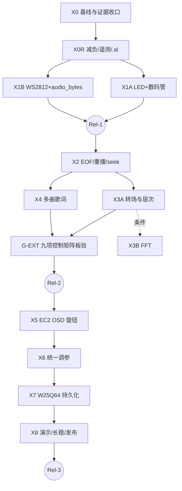

# VinylFPGA 后续开发方案 · 冻结基准文档 v1.0-F

> 日期：2026-10-07（北京时间）
> 性质：**文档层冻结基线**。整合七份 2026-10-07 文档 + 两份物理/产品依据，给出唯一裁决口径、现状、路线图、EC2 旋钮 OSD 实施方案、风险与冻结规则。
> 代码基线（引自文档，**本文作者未直接访问源码**）：Git HEAD `a357339`（S7-03b）；构建快照 `prj/resource_opt_verified_20261005/S7_03b_key07_key11_20261006_s7/`（seed 7，`area_prior`）。
> 器件：安路 `EG4S20BG256`；顶层 `top`（`src/top_tf_hdmi_audio.v`）；工程入口 `prj/VinylFPGA.al`。

---

## 0. 使用说明

### 0.1 输入文档与权威等级

| 代号 | 文档 | 等级 | 说明 |
|---|---|---|---|
| D1 | `J2扩展板引脚按键映射标定.md` | **A 物理实测** | 引脚/极性/按键/DIP/红外的实测依据，物理类冲突一律以它为准 |
| D2 | `VinylFPGA_后续开发报告_进度盘点与阶段重排`（下称"进度盘点"） | B 代码级核查 | 逐文件 grep 核查，缺失标识符/现状以它为主要证据 |
| D3 | `VinylFPGA_AI上下文文档` | B 代码快照（含错误） | 代码片段与架构可信；§6.1 引脚表有错（见 C-20） |
| D4 | `VinylFPGA_拓展功能优先_阶段重排…`（下称"拓展优先"） | B 代码级核查 | X0–X8 体系来源，含验收修复记录引证 |
| D5 | `VinylFPGA_完美版开发方案_EC11B风格OSD旋钮`（下称"完美版"） | C 综合方案 | 综合前三份；X5 设计有内部矛盾，需裁决 |
| D6 | `VinylFPGA_S7-R6_EC2旋钮OSD调参_设计与实施方案`（下称"R6"） | B 专项设计 | OSD 工程细节最深，含 1 处设计缺陷（C-33） |
| D7 | `EC11-B参数旋钮OSD设计分析与FPGA实现指南`（下称"EC11-B"） | B 交互蓝本 | HTML 仿真→FPGA 的翻译稿，自身有 1 处矛盾（C-10） |
| D8 | `VinylFPGA_S7_基础拓展功能重排…`（下称"S7 基础拓展"） | **C 部分过期** | 多处与代码 grep 结果不符（C-05/C-18/C-24） |
| D9 | `产品交互.md` | **C 旧映射** | 键位/DIP/LED/数码管位数均过期，仅作产品意图参考 |

> 用户列出的七份文档 = D2–D8；D1、D9 用于核对物理事实与产品意图。`开发方案.md`、`开发报告参考.md`、`第1课…md` 本次未纳入。

### 0.2 裁决规则（所有文档日期均为 2026-10-07，无法按日期分先后）

按序适用，先匹配者胜：

1. **物理事实**（引脚、极性、物理按键编号）：D1 实测 > 代码引证 > 其他。
2. **代码现状**（某功能是否存在）：带文件:行号的 grep 证据 > 无证据陈述；D2/D4 > D8。
3. **产品语义**（键位含义、用户可见行为）：用户已验收的实现（验收修复记录引证）> 原始方案表格。
4. **专项设计细节**：该子系统最深入的文档胜（OSD → D6，辅以 D7 真值表）。
5. **跨阶段决策**（阶段顺序、静音入口）：D5 > D4 > D2 > D8，除非违反规则 1–3。
6. 仍无法判定 → 标记为**待确认项 T-xx**，写明核验动作与归属阶段，**不臆断**。

### 0.3 状态口径（六档，互不等价）

`P` 计划 ｜ `I` 已实现（RTL 合入）｜ `S` 仿真通过 ｜ `B` 构建通过（Setup/Hold 非负、TNS=0、违例端点=0）｜ `D` SRAM 下载通过 ｜ `H` 板级人工验收通过

> 本文所有"现状"均为**文档引证，未独立核验**；X0 阶段负责把引证变成证据。

---

## 1. 多文档交叉核对结论

### 1.1 结论摘要

1. 七份文档**方向一致**：先完成扩展板基础拓展功能（LED/数码管/WS2812/seek/转场/歌词），后做 EC2 参数调参与整体调参；EC2 采用 EC11-B 式浮窗，不做传统菜单；静音不占 KEY11/KEY12。
2. 存在 **40 条冲突/不一致裁决条目（C-01…C-39，含子项 C-13b）**，其中会导致实现分叉的高危项 8 个：C-06 静音入口、C-07 OSD 参数范围、C-09 FSM 定义、C-11 EC2 接入层、C-20 引脚表错误、C-24 现状误报、C-31 资源预算算术、C-33 计时器回绕缺陷。
3. **资源是第一约束**：Slices 8412/9800 = 85.84%，距 88% 阈值（8624）仅 **212**；逐阶段预估增量之和（1250–2500）远超余量。D2 写"79%–98%"与其自身表格相加不符（C-31）。→ 本基线新增 **X0R 减负阶段**与裁剪线。
4. **没有任何阶段达到板级人工验收**（H5）。→ X0 是 X1 的入口条件。
5. **D3 §6.1 的 EC/LED/WS/EXT 引脚是错的**（R7 实为 `sys_clk`），不得据此改约束（C-20）。

### 1.2 冲突与不一致裁决表

| ID | 主题 | 冲突描述（来源） | **唯一裁决** | 依据 / 验证 |
|---|---|---|---|---|
| C-01 | 阶段编号 | S7-0x（原方案）/ R1–R6（D2）/ X0–X8（D3、D4、D5）三套并存；"R1/R2/R3"既指阶段又指发布版（D4、D5） | **只用 X 体系**；发布版改称 **Rel-1/2/3**。映射见 §3.1 | 规则 5 |
| C-02 | 转场 vs 歌词先后 | D2：歌词(R3)→转场(R4)；D4/D5：转场(X3)→歌词(X4) | **X3A → X4 → X3B(条件)** | D5 `next_action`；二者仅共同依赖 X2 |
| C-03 | KEY09 效果定义 | D4/D5：F0 无/F1 翻页(16帧≈0.27 s)/F2 淡入淡出；D2/D8：无/淡入淡出/**推幕**，0.3 s，默认推幕；原 S7 方案 Q7：0.6 s | **冻结 F0 无 / F1 翻页 / F2 淡入淡出，0.27 s**；**不实现推幕**；禁止静默改回 0.6 s | 规则 3：0.27 s 是用户验收时要求"放慢"后的值（D4 §4 X3A） |
| C-04 | KEY12 结束策略语义 | 代码/D4/D5：E0 播完暂停 / E1 单曲循环 / E2 自动下一曲；D2 C2 与 D8：应为 顺序下一首→单曲→**返回浏览** | **基线 = 代码语义 E0/E1/E2**（E2 末曲回首曲）；"返回浏览"作为 CR 候选（§6.3），不入基线 | 规则 3；默认值待确认 T-03 |
| C-05 | KEY09/KEY12 "空挂" | D8 §3.1 称 KEY09/KEY12 空挂；D2/D4 grep 显示两路已通到 `effect_mode`/`play_ctrl.end_mode` | **骨架已存在**；D8 此处过期 | 规则 2 |
| C-06 | **静音入口** | KEY11（原方案，已被 go_home 占用）/ KEY12 长按（D8 方案 A）/ 母板 KEY3（D2、D6）/ EC2 环形列表 Mute 项（D5）/ 仅 EC2 菜单（D4 建议 a）。且 D2 的 X1A 又把母板 KEY3 用作数码管显示项切换 | **Mute = EC2 环形列表中的 TOGGLE 项**；母板 KEY3 保留给数码管显示项；不引入长按 | 规则 5；消除 KEY3 双用；KEY11/12 语义不动 |
| C-07 | **OSD 参数范围** | D6/D7：4 项（音量/亮度/对比度/进度）；D5：9 项环（含转场/WS/歌词/结束策略/Mute） | **基线 5 项环**：VOL、MUTE、BRI、CON、SEEK（SEEK 仅播放态）；转场/WS/歌词/结束策略**保持 KEY 直循环**，不进浮窗。9 项环为 CR 候选 | D2 §6.1：后四项若进浮窗会重复暴露、环过长；资源余量仅 212 slices |
| C-08 | OSD 位置/尺寸 | D6/D7：190×64 @(225,58) 顶部居中；D5：160×56 @(430,20) 右上 | **190×64 @(225,58)**；几何全部放 `knob_geom.vh`，换位置仅改参数 | D6 有逐像素规格与 10 bit 坐标分析 |
| C-09 | **FSM 定义** | D5：4 态（含 `osd_off`，且 `osd_off` 1.8 s 回 idle；图中 idle 按下→select，表中 idle 旋转→select；`osd_off` 下旋转"改值"）；D6/D7：3 态 + 双计时器 | **3 态（idle/select/adjust）+ 双计时器**；`osd_visible` 是派生信号，不是状态。`osd_off` 作废 | D7 真值表；D5 的 `osd_off` 与"3 s 才复位、1.2 s 盲区保留上下文"矛盾 |
| C-10 | idle 首格行为 | D7 §1/D6 §2 剧本：首次旋转显示"音量"；D7 §3.2/D6 §4.2 真值表：idle 旋转"idx 推进 1 格" | **idle 态首次旋转（任一方向）→ idx←0，显示音量**，不推进；idle 态按压同样显示音量（idx 不动） | 剧本、验收 #8、板验 #9 三处一致；仅 CCW 首格与真值表"推进 1 格"有差异，**T-04**待对照 HTML `js/13_param_knob.js` |
| C-11 | **EC2 接入层** | D6 D9：旁路 `ui_event_bridge`/`browse_fsm`，直连 EC2；D4 §0.1-3：新增按键业务不得在 bridge/browse_fsm 加旁路直通 | **旁路导航 FSM，不旁路系统层**：EC2 事件取自 `ui_command_router` 输出，不进 `browse_fsm`/`play_ctrl`。优先级链：重启确认框 > 消隐唤醒（吞首事件）> knob > 业务 | 两条原则兼顾；**T-05**核验 router 输出是否含 EC2 且受门控 |
| C-12 | KEY04/05 双占 | D2 列为"高风险"，称 bridge 同时置 `prev_tgl` 与 `key_up_tgl`；D4/D5 视为设计内的状态复用 | 代码引证显示**下游已状态门控**：`browse_fsm` 用 `~mode_play`、`play_ctrl` 音量仅在 `play_active` 分支。**不新增拦截**；X0 用测试证明 | **T-11**；adjust 态规则见 C-13b |
| C-13 | seek 步长 | D6/D7：旋钮 ±2 s/格（96000 样本）；D5：±5 s；IR F8/EA：±5 s | **旋钮 ±2 s/格；红外 ±5 s（240000 样本）**，各自为参数 | 来源不同的输入，步长独立 |
| C-13b | adjust 态穿透 | D6：红外音量穿透、其余不穿透；D5：KEY04/05 也不穿透；D4：KEY07 只关菜单 | **adjust 态**：IR/KEY 的 切曲/暂停/seek 不穿透；**音量± 穿透**写同一 `param_csr`；**KEY07/KEY11 始终有效**（knob 为非模态 OSD） | 单写入点保证一致 |
| C-14 | 亮度默认值 | D6：亮度 255、对比度 128（引代码 `param_menu_controller.v:153-154`）；D5：两者 idx2 = 128 | **亮度 255（LUT idx4）、对比度 128（idx2）** | 规则 2；**T-12**核验 |
| C-15 | 蜂鸣音型 | D6：仅进/出 adjust 1320/990 Hz；D5：另有 idle→select 1 kHz、越界短嘀、Mute 1320/990 | **仅 1320 Hz/50 ms（进 adjust）与 990 Hz/50 ms（退 adjust）**；走独立端口 `knob_mode_tgl`；EC2 按压时抑制 `encoder_switch` 1200 Hz 音，防双响 | D6 K5 |
| C-16 | Mute 交互 | D5：选中 Mute 后**按下**直接切换；统一模型是"按下进 adjust、旋转改值" | **与其他项一致**：按下进 adjust，旋转切换 ON/OFF（任一方向），按下返回 | 单一心智模型，避免特例 |
| C-17 | `S704_ec2_menu` 草稿 | D3：全新设计不 rebase；D4：摘取并 rebase 重写；D5：只作参考 | **不合并、不 rebase**；在 HEAD 上重新集成，草稿仅作 `param_csr` 参考。其 88.29%/+107/+11 ps 数据**不作新基线背书** | 草稿基于 03b 之前，缺 KEY07/11 新语义与 M4 Logo 分组 |
| C-18 | 资源基线数字 | D8：BRAM 46/64、DSP 16/29；D2/D4/D5/D3：BRAM 40/64、DSP 15/29 | **BRAM 40/64、DSP 15/29**（M4 Logo 分组后 46→40，`final.qor`） | D8 为 M4 之前的过期值 |
| C-19 | bit SHA256 | D4：64 位十六进制 `23fd3bb1…bb542cac6`；D5：同值少 1 个字符（`…8658ee661…`，仅 63 位） | **以 D4 的 64 位串为候选**，D5 的串无效；X0 对实际 bit 重算后冻结 | 长度检查；**T-10** |
| C-20 | **引脚表错误** | D3 §6.1：EC1=R7/R6/R5、EC2=P7/P6/P5、LED=F3/F4/E4/E5、WS=D5、EXT=C5/C6/B5/B6/A5/A6；D1 实测：EC1=P4/N4/N3、EC2=M5/M3/M4、LED=H3/H5/F3/E2、WS=J11、EXT=M12/M11/N12/P14/P12/R12，且 **R7 = `sys_clk`** | **以 D1 为准**；D3 这四行作废。D2 所谓"三方逐脚一致"仅抽样了 KEY/DIP/IR，未覆盖这四组 | 规则 1；**T-09**：X0 脚本全量比对 `pin.adc` 与 D1 |
| C-21 | 数码管位数 | D9：8 位（与双色 LED 复用）；代码/D2/D4/D8：`seg_sel[5:0]` 6 位 | **6 位冻结**；8 位需硬件证据后另立阶段 | 规则 2 |
| C-22 | DIP/KEY/LED 极性旧映射 | D9：KEY1–5=上下左右中、DIP1=WS 使能且低有效、LED 高电平点亮 | **D1 + 代码**：KEY04=上、KEY05=下、KEY01=左、KEY03=右、KEY02=中；DIP 上拨=1 不取反；LED 低有效；DIP1=J2 在场声明。D9 失效清单见附录 C | 规则 1 |
| C-23 | 母板按键 | D9：KEY1=重启、KEY2=恢复出厂、KEY3=数码管显示项、KEY4=静音；代码只有 `key1/key2/key3`，`param_menu_controller` 用 KEY1+KEY2 组合调亮度/对比度；D2 记录"同一焊球被声明两次" | **基线**：母板 KEY3=数码管显示项（X1A）；不分配 mute；恢复出厂延后到 X7；母板组合键行为不变 | **T-06**：母板 4 键物理—代码对应需标定 |
| C-24 | S7-01/02 内容 | D8：含 SD 超时/最低 FIFO 水位/运行版本/`media_epoch`/REBUFFER；D2 grep：`health_monitor` 仅 4 个饱和计数，`rebuffer`/`media_epoch`/`mute`/`seek` 零命中 | **以 D2 grep 为准**：无 REBUFFER；`stream_session.start_toggle` 充当播放代次。X0R 补遥测；X2 含**条件**最小 REBUFFER | 规则 2 |
| C-25 | "控制项收口"阶段 | D2 有独立 R5；X 体系无 | **并入 G-EXT 门**（九项控制矩阵板验，见 §3.4） | D4 §0 九项表 |
| C-26 | 减负轮次 | D2/D6 要求 R1 前先减负（Slices ≤84%）；X 体系只写"超限再减负" | **新增 X0R**（零行为改变减负 + 遥测补全 + `.al` 补文件） | C-31 算术 |
| C-27 | 模块命名 | LED：`led_status`/`led_business_driver`/`status_panel`；数码管：`seg_content`/`seg_business_mux`；WS：`src/display`/`src/io`；歌词加载器、FFT 路径各不相同；D8 另提 `transport_ctrl` | **命名冻结表见附录 A**；不新建 `transport_ctrl`（改 `play_ctrl`/`stream_session`） | 避免重复造模块 |
| C-28 | X5 工作量 | D5：3–4 人日；D6：8–11 人日（含前置），纯功能 6–8 | **X5 功能 6–8 人日**；前置减负另计在 X0R | D6 按子阶段拆分 |
| C-29 | 母板 LED/SW | D9：SW1=数码管、SW2=LED、SW3=debug、SW4=演示；母板 LED 候选脚 A4/A3/C10/B12 未核 | **SW1/SW3 在 X1A 做；SW2 母板 LED 标"未接入"；SW4 在 X8** | **T-14** 先补极性记录 |
| C-30 | PLL/时钟树描述 | D3：3 PLL（50/100/25 MHz）；D2：两 PLL 体系含 125 MHz 的 `ext_mem_clk`/`hdmi_5x_clk` | **仅描述性差异，不影响本基线任何设计决策**；设计只依赖 `clk`50、`sd_card_clk`100、`video_clk`25 | **T-07** |
| C-31 | **资源预算算术** | D2 §7.3：R1–R6 增量表逐项相加 = **1250–2500**，文中写"+1250–2300"，并称总量"79%–98%"；8412+1250 已是 98.6% | **采用逐项相加**；全量范围在 88% 内不可行 → 资源门禁 + 裁剪线（§3.6） | 算术；所有增量为**预测值**，以每阶段实测为准 |
| C-32 | 88% 阈值 | D2/D3：8624；D6 §14.2 写"8614/9800" | **8624**（0.88×9800）；90% = 8820 | 算术 |
| C-33 | **计时器回绕缺陷** | D6 §6.2：16 bit 自由运行毫秒计数 + `ms_ms < osd_deadline`，称"49.7 天回绕" | **缺陷**：16 bit 毫秒计数约 **65.5 s** 回绕；deadline 溢出时 `<` 比较失败。**改用模运算 elapsed**（§4.4） | 算术；D7 的递减计数法无此问题 |
| C-34 | EC11 定位 vs 脉冲 | D9：每圈 30 定位、15 脉冲；D6/D7 假设"每格"即一次 `rot_pulse` | **基线按"解码器每输出一次 step = 一格"**；实际是 1 定位还是 2 定位一格待实测 | **T-08**：X5-1 转一圈计数 |
| C-35 | IR seek 连发 | D8：seek 若允许 repeat 须扩白名单；D2：`last_ir_kind` 仅 2 位 | **基线：F8/EA 单击一次 ±5 s，不连发**；连发为 CR 候选 | 避免扩展 repeat 判键状态 |
| C-36 | KEY07 在 OSD 激活时 | D4：菜单开时 KEY07 只关菜单；D5：KEY07/11 不拦截 | **不拦截**（无"菜单打开"概念） | C-09 |
| C-37 | OSD 与消隐 | D5：弹出重置消隐计时；D6：消隐时面板被黑屏覆盖 | **两者都做**：EC2 任何事件重置 60 s 计时；消隐中第一个 EC2 事件只唤醒（吞掉）；面板位于 `blank_active_vid` 之下 | 规则 5 |
| C-38 | 状态口径 | D2 写"四个"实列六档；D4/D5 称"五档" | **六档 P/I/S/B/D/H**（§0.3） | — |
| C-39 | 阶段内 REBUFFER | D2 R2 验收含 REBUFFER；D4/D5 X2 未提 | **X2-C 条件项**：若 X0 的 UR=0005 定性为真实 SD 停顿则升为必做 | **T-19** |

### 1.3 重复内容归并

| 重复内容 | 出现位置 | 归并口径 |
|---|---|---|
| 阶段流程"需求→仿真→集成回归→TD 构建→SRAM→证据" | D2、D4、D5、D8 | 统一为 §3.2 **公共放行条件 GG-1…GG-6** |
| 资源红线（88%/90%）、`area_prior`、seed 扫描 | D2、D3、D4、D5、D8 | §3.2 GG-3 / §5 RK-01/02/17 |
| 回归脚本入口 | D2、D6 | 附录 D 一份 |
| seek/重播流程"淡出→停请求→排空→切代次→归零→预缓冲→淡入" | D2、D4、D5、D8 | 仅在 X2 保留一份（§3.3 X2） |
| EC11-B 三态 FSM 与双计时器 | D5、D6、D7、D3 | 仅在 §4 保留一份 |
| 关键代码片段（事件码、IR 白名单、`play_ctrl`） | D3、D2 | 以 D3 §5 为单一来源，本文不重复 |

### 1.4 待确认项（信息缺失，不臆断）

| ID | 待确认内容 | 为什么重要 | 核验动作 | 归属 |
|---|---|---|---|---|
| T-01 | **竞赛提交截止 2026-11-04 18:00 是否仍有效** | 七份文档均未记载日程；影响 §3.6 裁剪线 | 用户确认 | 立即 |
| T-02 | KEY09 的 F1/F2 在当前 HEAD 是否已有真实像素差异（D2 称"风格行为未实现，仅 8 帧淡入淡出"；D4 称已提前实现） | 决定 X3A 是"收口"还是"新建" | 板验 20 轮 + 仿真看 `video_transition_apply` 输出 | X0 |
| T-03 | `end_mode` 复位默认值（D5 称 E2） | 影响冷启动行为 | 读 `play_ctrl.v` 复位分支 | X0 |
| T-04 | idle 首格行为 | 影响 OSD 验收 #1/#8 | 对照 `js/13_param_knob.js` 的 `idx` 初值 | X5-4 前 |
| T-05 | `ui_command_router` 输出是否含 EC2 事件、是否受确认框/消隐吞键门控 | 决定 EC2 接入点 | 读 `ui_command_router.v` | X5-1 |
| T-06 | 母板 4 键物理—代码对应（C1 焊球双声明） | 影响 KEY3 使用 | 母板按键标定 | X0 |
| T-07 | PLL/时钟树真实结构 | 仅文档一致性 | 读 `sys_pll`/`video_pll`/`PLL_HDMI_AUDIO` | X0R |
| T-08 | EC2 一格 = 1 定位还是 2 定位 | 旋钮手感 | 转一圈读 `enc2_count`（15 或 30） | X5-1 |
| T-09 | `pin.adc` 与 D1 的 36 信号是否逐脚一致 | C-20；LED/WS 接线正确性 | 脚本全量 diff | X0 |
| T-10 | 实际 bit 的 SHA256 | C-19 基线哈希 | `sha256sum` 重算并与快照清单比对 | X0 |
| T-11 | KEY04/05 下游状态门控是否完整 | C-12 | 定向仿真/板验 | X0 |
| T-12 | 亮度/对比度代码默认值 | C-14 | 读 `param_menu_controller.v:153-154` | X0 |
| T-13 | `tb_wav_equiv_long` 失败是基线差异还是实现问题 | 回归门禁可信度 | 对比 2026-10-05 基线 `sd_req` 门控 | X0R |
| T-14 | 母板 SW1–SW4 拨向→电平→逻辑极性；母板 LED 引脚 A4/A3/C10/B12 | X1A 的 SW1 使能、SW2 | 逐位记录 + 原理图核网络 | X0 |
| T-15 | WS2812 灯珠型号、时序容差、5 V 峰值电流 | X1B 波形与供电 | 示波器 + 电流表 | X1B |
| T-16 | W25Q64 引脚/电压/复用 | X7 准入 | 原理图 `2_FPGA.pdf` | X7 前 |
| T-17 | `status_osd_overlay`（Err 码）与 knob 面板的层级是否冲突 | 错误提示可见性 | X3A 合成顺序文档 | X3A |
| T-18 | D9 外设清单把 GPIO 扩展接口写成两个"J2(GPIOB)"，是否为 J1/J2 笔误 | 仅文档 | 对照开发板手册 | X0 |
| T-19 | UR=0005（快速按键后 underrun=5）根因：真实 SD 停顿 vs 计数误报 | 所有"1 小时 underrun 不增加"验收的基线 | 复现 + 抓 `STAT` | X0 |

---

## 2. 现状盘点（HEAD `a357339`，引证口径，未独立核验）

### 2.1 资源与时序基线（`S7_03b_key07_key11_20261006_s7`，seed 7，`area_prior`）

| 指标 | 数值 | 阈值/余量 |
|---|---:|---|
| Slices | 8412 / 9800 = **85.84%** | 88% = 8624（余 **212**）；90% = 8820（余 408）；100% 余 1388 |
| BRAM9K / DSP | 40/64（62.5%）/ 15/29（51.7%） | BRAM 余 24，DSP 余 14（非瓶颈） |
| Setup / Hold WNS | **+114 ps / +3 ps** | Hold 贴线；TNS=0，违例端点=0 |
| 结构检查 | no clock 0 / invalid constraint 0 / comb. loop 0 | — |
| 历史波动 | 同源码 GUI 默认流程曾达 9609（98.05%） | **强制 `--map-mode area_prior`**（C-31/RK-17） |

### 2.2 功能清单（状态列：P/I/S/B/D/H，见 §0.3）

#### 已完成

| 功能 | 状态 | 源码文件 / 模块 | 备注 |
|---|---|---|---|
| SD 卡 FAT32 挂载、4 曲索引 | H | `SD/fat32_volume_scanner.v`、`fat32_media_loader.v`（`pixel_end` 加法外提，**不得回退**）、`song_index_db.v` | INDEX 512 B，v1/v2，最多 4 曲 |
| 640×480 HDMI、封面 + 2×2 缩略图选曲 | H | `sd_card_bmp.v`、`thumbnail_controller.v`、`hdmi_1_4b_transmitter_core_wrapper` | 封面区 SDRAM `[0,1228800)` |
| 48 kHz/16 bit/单声道 PCM 播放 | H | `audio/wav_stream_player.v`（8 KB BRAM 环形缓冲，格雷码）、`timebase_48k.v`、`pcm_volume_fade.v`、`stream_session.v` | 唯一时基；暂停冻结 |
| 单行歌词（固化 ROM，9 行/60 字形） | H | `display/lrc_osd.v`、`lrc_lines_rom.v`、`lrc_font_rom.v` | 切曲不换歌词 |
| 上电 Logo + 500 ms 保护窗 | H | `boot/boot_layer.v`、`boot_logo_rom.v`（M4 分组后 BRAM 46→40） | — |
| 浏览/播放控制 | H | `io/browse_fsm.v`、`ui_event_bridge.v`、`audio/play_ctrl.v` | 音量 200/16/32–255 |
| J2 扩展板输入通路（12 键/2 EC/6 DIP/红外） | I S B D（H 缺） | `io/expansion_io_hub.v`、`key_dip_monitor.v`、`debounce_filter.v`、`quadrature_decoder.v`、`encoder_monitor.v`、`ir_nec_decoder.v` | 消抖 8 ms，A/B 稳定 1 ms |
| 统一事件总线（逐源 pending 位图 + 溢出计数） | I S B D | `io/ui_event_bus.v` | 非 FIFO；KEY_UP 无 pending（M6） |
| 业务路由（红外 15 键白名单+双反码、repeat 节流、运行时 DIP、60 s 消隐、3 s 重启确认） | I S B D | `io/ui_command_router.v` | 15 帧向量仿真欠账 |
| 事件→toggle 跨域桥 | I S B D | `io/ui_event_bridge.v` | **EC2 事件在此被丢弃（K1）** |
| KEY07 直达缩略图、KEY11 返回主界面 | I S B D（H 缺） | `io/browse_fsm.v` | S7-03b |
| 媒体故障恢复 | I S B（H 缺） | `SD/media_supervisor.v`（5 s 挂载期限/3 次重试/30 s 冷却）、`media_probe.v`、`sd_sector_adapter.v`（扇区 250 ms 看门狗） | **无 REBUFFER**（C-24） |
| 诊断遥测 | I S B | `io/health_monitor.v`（4 个饱和计数）、`exp_echo_reporter.v` | 缺 SD 超时/最低水位/版本/MV 逾期 |
| 蜂鸣反馈 | I | `io/buzzer_feedback.v`（EXT1 同源） | 无 1320/990 Hz 音型 |

#### 进行中 / 半实现

| 功能 | 状态 | 模块 | 缺口 |
|---|---|---|---|
| MV/黑胶（320×240@10 fps，3 帧 SDRAM bank） | I S B（H 缺） | `video/mv_stream_player.v`、`mv_frame_scheduler.v`、`mv_sector_mux.v`、`s6_video_layer.v`、`display/vinyl_renderer.v` | 实卡 10 fps、音画差 ≤100 ms 无量化证据；无 missed-deadline 计数；`s6_video_layer.waiting` 未引出 |
| KEY12 结束策略三态 + EOF 单次处理 | I S B（H 缺） | `audio/play_ctrl.v`（`end_mode`）、`wav_stream_player.v`（两级 `stream_end`） | 边界仅仿真；无 `total_samples` |
| KEY09 三动效 | **I？**（T-02） | `top` 的 `effect_mode`、`display/video_fade_transition.v`、`video_transition_apply.v` | 实现程度两文档矛盾 |
| DIP3 `led_enable` | 信号 I，执行器 P | `io/ui_command_router.v:186` | `exp_led_n` 仍是 KEY01–04 回显（`expansion_integration.v:442`），DIP3 "关而不灭" |
| DIP6 `ws_enable` | 信号 I，执行器 P | 同上 | `exp_ws2812_data` 恒 0（`:443`） |
| 红外 F8/EA/F6（seek±/重播） | 识别 I，执行 P | `ui_command_router.v:137-138` | 等 X2 |
| `audio_bytes`（INDEX 偏移 20） | 定义 I，导出 P | `include/song_index_defs.vh`、`SD/song_index_db.v` | 无导出端口；WS 进度条与 seek 都依赖 |
| EC2 旋钮 | 物理/解码/仲裁 I，业务 P | `expansion_io_hub.v`、`ui_event_bus.v:142-162`（`aux[1]=1`） | `ui_event_bridge` 无 EC2 分支（K1） |
| 数码管 | 驱动 I，业务 P | `SD/seg_scan.v`（6 位）、`seg_decoder.v`；`top:1184` | 仅显示诊断十六进制；SW6 须拨数码管档 |
| 母板亮度/对比度 | I | `io/param_menu_controller.v`（KEY1+KEY2 组合，各 5 档 LUT） | 是第二写入者候选；X5 改为命令源 |

#### 未开始（全 `src/` grep 零命中）

| 功能 | 现状 | 归属 |
|---|---|---|
| WS2812 驱动与灯效 | 仅标定工程 `资源/Expansion_Board_Test/src/ws2812_driver.v`（159 行）可移植 | X1B |
| J2 LED 语义执行器 | — | X1A |
| 数码管业务内容 | — | X1A |
| seek / `total_samples` / REBUFFER / `media_epoch` | — | X2 |
| 多曲歌词、三行显示、KEY06 路由 | `ev_arg==5` 无处理 | X4 |
| KEY10 路由 | `ev_arg==9` 无处理 | X1B |
| 真实 FFT | 现为 32 柱时域（`display/promax_audio_waveform.v`，零 BRAM） | X3B |
| `param_csr`、mute、EC2 OSD | — | X5 |
| 母板 LED / SW1–SW4 语义 / `demo_fsm` | `sw4` 仅接蜂鸣器 | X1A/X8 |
| W25Q64 用户 Flash | 引脚未准入 | X7 |
| 人声消除 | **不做**（单声道无 L−R） | — |

### 2.3 已确认的提前落地

`end_mode` 三态与 KEY12 通路（`ui_event_bridge.v:127` → `top:994` → `play_ctrl.v`）、`eof_seen` 去抖、存储故障不被误判为播完（`fault_sync` 清 `stream_end_rd`）；这些**不重做，只收口**。

### 2.4 遗留技术债（来自 D2 §8.3，按基线保留）

`prj/VinylFPGA.al` 缺 18 个 io/display/boot 文件（靠 `` `include `` 兜底）；`src/SD/video_define.v` 为 21 字节空壳；`bilinear_8q8.v`、`frame_blend.v` 未例化；`vinyl_packer.py:403` 版本文案硬编码；`S7-03b` 文档称 `param_menu_controller` "裸例化"实为 `u_param_menu_controller`；32 位样本计数 ≈24.86 h 回绕。

---

## 3. 阶段重排路线图

### 3.1 编号映射（唯一采用 X 体系）

| X（本基线） | 原 S7 方案 | D2 | 内容 |
|---|---|---|---|
| X0 | S7-00 尾款 | — | 基线与证据收口（板验+核验） |
| **X0R** | — | R6-0 | 零行为改变减负、遥测补全、`.al` 补文件 |
| X1A / X1B | S7-05 | R1 | LED+数码管 / WS2812+`audio_bytes` |
| X2 | S7-06 | R2 | EOF 收口、重播、seek |
| X3A / X3B | S7-08 | R4A / R4B | 转场与层次 / FFT（条件） |
| X4 | S7-07 | R3 | 多曲歌词、三行、KEY06 |
| **G-EXT** | — | R5 | 九项扩展控制矩阵板验门 |
| X5 | S7-04 | R6 | EC2 OSD 旋钮调参（本文 §4） |
| X6 | — | §6 | 整体统一调参 |
| X7 / X8 | S7-09 / S7-10 | — | Flash 持久化 / 演示·长稳·发布 |
| Rel-1/2/3 | — | — | 日用交互版（X1 后）/ 展示版（G-EXT 后）/ 完整产品版（X8 后） |

### 3.2 公共放行条件（每阶段必须全部满足）

| ID | 条件 |
|---|---|
| GG-1 | 新功能定向仿真通过（复位、边界、并发、失败） |
| GG-2 | 相关原回归通过（附录 D）；共享存储/播控/图层变更加跑音视频并发 + 浏览回归 |
| GG-3 | 原生 TD 构建：Setup/Hold ≥0，TNS=0，违例端点=0；无新增黑盒/锁存/时钟缺失；**`--map-mode area_prior`，多 seed 记录分布**；**不放宽 `timing.sdc`、不加无依据 false path** |
| GG-4 | bit 来自同一通过路由库；源码/约束/IP/工具版本/seed/映射模式清单与哈希匹配 |
| GG-5 | SRAM 板验清单逐项记录"通过/失败/未执行"（H 档）；仿真、构建、板验、Flash 冷启动是四种不同状态 |
| GG-6 | 上一已通过 bit 与源码快照仍可用；失败只撤本阶段。产出：`stage_summary.md`、`board_acceptance.md`、`known_issues.md`、`resource_delta.md`、`assets_manifest.json` |
| GG-R | **资源门**：阶段结束立即报告 LUT/REG/Slices/BRAM/DSP **实测**增量；Slices >88% 先减负评估，>90% 暂停重型功能；**不得用停音频/停 HDMI/丢用户命令换流畅** |

### 3.3 依赖图



### 3.4 各阶段定义

> 工作量为文档估算值（人日，含板验，不是验收条件）。

#### X0 基线与证据收口 —— P0，1–2 人日，**X1 的入口条件**

| 项 | 内容 |
|---|---|
| 目标 | 把"已实现但无成文板验"的 S6、S7-02/03/03b 与验收修复行为钉成证据；消除 T 项 |
| 交付物 | 十步复验记录；S6 实卡 10 分钟录像（绑定 bit 哈希）；15 帧 IR + 同拍多事件仿真台；`pin.adc`↔D1 全量比对脚本与结果；`timing.sdc` IO delay 审计表（J2 全部端口 + WS 数据线单独结论）；LED1–4 逐灯丝印照片表；母板 SW1–SW4 极性表；母板 4 键对应表；UR=0005 定性；T-02/03/09/10/11/12/18 核验结论；重算后的 bit SHA256 |
| 依赖 | 无；需 USB-UART 采集口（现主机只有蓝牙 COM，H5/RK-15） |
| 验收 | 十步全部"通过/失败+复现条件"；仿真台入库（iverilog 入 PATH 或 TD 仿真器等效台）；两张标定表交付。失败先修复，只重测该步，修复计独立子快照 |
| 十步复验 | KEY09 三动效 20 轮；KEY12 三策略各 20 次；拔卡/坏卡换好卡 10 轮；红外 15 键；DIP5 开关；Boot 跳过回归；KEY07/KEY11（S7-03b §10 八项）；DIP3 当前"关而不灭"为**预期**，须向验收人说明 |

#### X0R 减负、遥测补全 —— P0，2–3 人日

| 项 | 内容 |
|---|---|
| 目标 | Slices 压到 **≤84%（≤8232）**，为后续放量腾出至少 ~390 slices 到 88% 线；补遥测；补工程文件 |
| 交付物 | 零行为改变减负快照 + `resource_delta.md`；`health_monitor` 新增字段（SD 超时/重试、最低 FIFO 水位、最大扇区等待、运行版本、MV missed-deadline、`s6_video_layer.waiting`）；`prj/VinylFPGA.al` 补 18 个文件；`tb_wav_equiv_long` 定性（T-13） |
| 候选措施（D2 §7.3） | 局部减负 300–900 FF/200–600 LUT；`u_expansion_integration`（3488 LUT/1663 FF）瘦身 300–800 LUT；`u_song_index_db`（1332 LUT/1354 FF）200–500 LUT |
| 红线 | **不改**：HDMI 1.4b 核/PHY、SD/FAT32 协议链、SDRAM 控制器内部；`exp_echo_reporter` 队列深度（S7-03 验收项）；BRAM 大头（厂商 IP 16 + Logo 16 + 音频 FIFO 8 + 帧读 4 + 缩略图 2）；6 位数码管、≤4 曲、PCM/MV 格式、SDRAM 分区；不放宽 sdc |
| 验收 | 回归全绿；Setup/Hold ≥0；**Hold 不劣于 +3 ps**；遥测新增字段在 `STAT` 可见；音频样本序列与改前逐样本相同 |
| 回退 | 减负为独立 commit/快照，可整体撤销 |

#### X1A LED + 数码管 —— P0，约 2 人日

| 项 | 内容 |
|---|---|
| 目标 | J2 LED1–4 与母板 6 位数码管有业务含义 |
| 模块 | 改 `io/expansion_integration.v:442`（`exp_led_n = led_enable ? led_frame : 4'hF`，保留 `ECHO_ENABLE` 诊断旁路）；新建 `io/led_status.v`；新建 `display/seg_content.v`、`display/time_fmt.v`（ms→MM:SS 串行转换，X5 进度项复用）；改 `top:1182-1189`；`ui_command_router` 新增"操作已接受"单拍输出；`param_temp_valid/value` 端口**预留，X5 前恒 0** |
| 语义 | LED1=有效 IR 帧（延展约 80 ms；反码错/未知帧不亮）；LED2=已接受操作（约 80 ms）；LED3=~1 Hz 心跳；LED4=`health_monitor` sticky 告警；DIP3=0 全灭。数码管优先级：**错误码 `Err-01..09` > 参数临时值 2 s > 用户选择项**（序号/MM:SS/诊断，母板 KEY3 切换，默认 MM:SS，封顶 `99:59`）；SW1 使能（极性经 T-14 记录后接）；`pat_mode` 测试图案保留 |
| 依赖 | X0R；LED 灯位表、SW 极性表 |
| 验收 | 逐灯物理位置对丝印；DIP3 关闭 **100 ms 内全灭**、恢复后语义正确；数码管优先级逐项；`Err-xx` 与串口 `ERR` 一致；`sw1=0` 全灭；SW6 在数码管档；母板既有业务不受影响；Hold 不翻负 |
| 资源 | 与 X1B 合计 +150–300（预测） |
| 未交付声明 | 母板 LED（SW2）未准入 → 清单明确写"未接入"，其余反馈不延期 |

#### X1B WS2812 灯效 + `audio_bytes` 引出 —— P0，3–4 人日

| 项 | 内容 |
|---|---|
| 目标 | 八灯律动/进度条；DIP6 总控；`audio_bytes` 可靠引出 |
| 模块 | 迁入 `ws2812_driver.v` → `src/io/`（50 MHz 域，50 MHz 下 63/18/35/3000 拍，按 T-15 实测复核）；新建 `io/ws2812_effects.v`、`audio/pcm_tap.v`（只读旁路，**不反压、不改 ready/valid 与样本顺序**）；改 `song_index_db.v`/`fat32_media_loader.v` 导出 `audio_bytes`（偏移 20），校验**非零偶数**；`ui_event_bridge` 新增 KEY10→`ws_mode_tgl`（`ev_arg==9`） |
| 语义 | KEY10 循环 灭/律动/进度；律动=PCM 饱和绝对值（处理 −32768）+ 快升慢降；进度=`cur_time_ms/(audio_bytes/2/48)`×8 灯单调填充，分母 0 全灭；每通道上限 **76**（≈30%）；暂停律动衰减至灭、进度冻结；`mute` 输入位预留（X5 前恒 0；mute 时律动灭、进度照常）；DIP6 关闭：**先发一帧全黑并完成锁存**再保持低，忙时保留清灯请求 |
| 验收 | GRB 顺序与灯 1–8 物理方向对丝印；DIP6 关闭 100 ms 内实测熄灭（示波器/慢录留证）；忙时切模式无半帧；输入并发 + 连续灯效 1 h，`cnt_underrun` 不增加（基线取 T-19 结论）；开/关遥测音频样本序列**逐样本相同**；5 V 峰值电流与供电条件记录；`audio_bytes` 与 `INDEX.json` 一致 |
| 出口 | **Rel-1 日用交互版**；R1 操作表（打印版）冻结 |

#### X2 EOF 收口、重播、seek —— P0，约 3 人日（+条件 REBUFFER 1–2）

| 项 | 内容 |
|---|---|
| 目标 | 红外 F8/EA/F6 转为真实功能；KEY12 三策略板验闭环；补唯一真缺口 seek |
| 模块 | `audio/play_ctrl.v`（边界复核，不重写）；`wav_stream_player.v`（`target_sample`/扇区内偏移/`total_samples=audio_bytes/2`）；`stream_session.v`（seek 代次提交，**所有媒体消费者同次切换**）；`video/mv_frame_scheduler.v`（目标帧 `floor(target_ms/100)` 钳位）；`mv_stream_player.v`（在途数据失效）；`lrc_osd.v` 重定位钩子；`ui_command_router.v:137-138`（识别→执行）；`ui_event_bridge.v`（seek/replay toggle）；`vinyl_packer.py`（拒绝非连续布局） |
| 语义 | IR ±5 s（**单击，不连发**，C-35）；`target_sample` 钳位 `[0,total_samples-1]`；PCM 每样本 2 字节，扇区内偏移必须跳过，**禁止无条件 `start_lba+offset/512`**；暂停中 seek 保持暂停；忙时仅保留最新目标；重播走"淡出→停新请求→在途排空/取消→代次切换→时间归零→预缓冲→淡入"，**禁止只清 `time_ms`**；顺序模式末曲回首曲；零曲目拒绝进 PLAY；MV 先结束不改音频策略 |
| X2-C 条件项 | 最小 REBUFFER（耗尽→静音+时间冻结→恢复水位→淡入）：T-19 定性为真实 SD 停顿则升为必做，否则仅记录 |
| 时序约束 | 新增定位运算在 `sd_card_clk` 100 MHz 域，**必须流水化/加法外提**（参照 `pixel_end`） |
| 验收 | ±5 s 往返 100 次；首尾钳位、暂停 seek、切曲与 seek 同拍、旧应答延迟 4 组负例；三策略各 20 次；文件尾不足一扇区；仿真输出样本起点误差 **≤1 样本**；实机 MV/歌词差 **≤100 ms**；seek 失败超时返回 `Err-05` 并联动 LED4 |

#### X3A 转场与图层层次 —— P0，1–1.5 人日

| 项 | 内容 |
|---|---|
| 目标 | KEY09 三效果成品化；统一合成顺序 |
| 模块 | `display/video_transition_apply.v`、`video_fade_transition.v`、`top:588-595` effect 逻辑 |
| 语义 | **F0 无 / F1 翻页 / F2 淡入淡出，0.27 s（`parameter`，冻结）**；F1 方向继承；快速切曲合并为最新目标并在帧边界重启；源/目标 bank 不读写同一显示 bank；维持 640×480 与 2×2 布局；**合成顺序文档**：背景/MV/黑胶 → 转场 → 歌词 → 波形 → **knob 面板** → boot/消隐（T-17：Err 码 OSD 与 knob 面板同层规则在此写定） |
| 验收 | 每效果 ≥100 次；快速切曲/暂停/OSD 同发无半帧；恒定色块/边界图验像素延迟；转场期间不新增 underrun；有意黑场不计异常闪黑 |

#### X4 多曲歌词、三行显示、KEY06 —— P0，4–5 人日（体量最大）

| 项 | 内容 |
|---|---|
| 模块 | 扩展 `tools/gen_lrc_assets.py`/`vinyl_packer.py`（每曲 ≤256 行、每行 ≤16 字形、共享子集 ≤256 字形，超限**报错不截断**）；**旁文件 `LRCxx.BIN` + 根目录表**，**不得占用 INDEX 条目偏移 56–63**（MV 描述符），flags bit2 仅作存在标记；新建 `src/SD/lyric_loader.v`（切曲预缓冲期装载，音频优先仲裁）；重写 `display/lrc_osd.v`（三行缓存、时间比较）；`lrc_font_rom.v` 扩展；`ui_event_bridge` 新增 KEY06→`lrc_mode_tgl`（`ev_arg==5`） |
| 语义 | 三行（上/当/下）；KEY06 循环：静态三行 → 滚动淡入（16 帧）→ 时间高亮；暂停冻结；seek 后按新时间重查，旧缓存不混用；**精确逐字仅对含逐字时间戳的素材验收，缺失则降级行级并如实标注**，不把均分时间包装成卡拉 OK |
| SDRAM 纪律 | 现有分区：四封面 `[0,1228800)`、三 MV bank `[1228800,1459200)`；21 位地址上限 2097152，剩余 637952 字（≈2.43 MiB）。歌词区**须列地址表**，禁止覆盖显示中的 bank |
| 验收 | ≥4 首不同歌词与曲目匹配；负例（缺歌词/重复时间/中文/空行/首尾/最大长度/CRC 错）**只关歌词层，音视频继续**；滚动 16 帧完成、切模式无残字；行切换相对资产时间 ≤100 ms；布局不遮挡波形/OSD；工具输出预览图与 BRAM/SDRAM 占用表 |
| 兼容 | 旧 SD 镜像（无歌词旁文件）显示"无歌词"仍可播放 |

#### G-EXT 九项扩展控制矩阵板验门 —— P0，0.5–1 人日

覆盖：切歌模式（KEY07+DIP2 预留）、播控方式（KEY08）、切歌动效（KEY09）、WS 灯效（KEY10）、返回主界面（KEY11）、WS 总控（DIP6）、红外接收（DIP5）、屏幕消隐（DIP4+遥控息屏）、指示灯（DIP3+LED）。

验收：12 键 + 2 旋钮各 100 次无双触发，旋钮正反各 100 格计数正确；15 个红外向量逐一通过，无先导 repeat/反码错/未知帧不执行；DIP1 关闭/恢复 20 次无虚假确认，DIP3/4/5/6 各 20 次启停正确；DIP6 关闭 100 ms 内熄灭；消隐期间首个有效操作只唤醒，遥控息屏键可独立手动消隐；多源同拍/连续突发下溢出可见且**不伪造确认/暂停/系统动作**。交付 `j2_control_matrix.md`。**出口：Rel-2 展示版。**

> DIP2 与 KEY11 丝印同为"拓展1"但**无联动**，文档写死，防误接（D8 R12）。

#### X5 EC2 OSD 旋钮调参 —— P0，6–8 人日，详见 §4

入口条件：G-EXT 通过；X0R 的 Slices ≤84%；本基线 C-06…C-16 已落实。

#### X6 整体统一调参 —— P0，2–3 人日（用户在场联调）

每项参数列"当前值/来源阶段/候选范围"表，板上 A/B 确认，收敛为文件头 `parameter` 并汇总**参数字典 v1**：音量步进与淡变时长、消隐 60 s、转场 0.27 s、WS 包络常数与亮度上限 76、IR repeat 150/250 ms、SD 重试/冷却、数码管驻留时长。同轮复核资源/时序/CDC/SDRAM 地址表。验收：字典 v1 冻结；每项有改前/改后板测记录；全量回归在同一快照内全绿。

#### X3B 256 点 FFT —— P2 条件增强，约 4 人日

迭代复用蝶形，≤4 BRAM/≤4 DSP；采样 48 kHz、分辨率 187.5 Hz，**低频不得虚构 32 个独立频带**，如实标注近似对数；PCM 旁路取样，分析队列溢出**丢分析帧并计数，不反压音频**；与波形互斥。验收七组（零/直流/单音 bin 对齐/双音/满幅/−32768/噪声）与定点参考模型一致；开关 FFT 音频样本逐样本相同；1 h 无额外欠载。**未通过则保留波形，FFT 停在实验版本，不得把"32 柱波形"改名为频谱。**

#### X7 W25Q64 持久化 —— P1，增量 +200–400 Slices（预测）

**硬件准入前不写 RTL**（型号、电压、CS/SCK/MOSI/MISO、复用、上电模式；T-16）。A/B 双槽版本化日志；配置 Flash W25Q16（MSPI）与用户 Flash 不可混用；入口条件：参数字典 v1 已冻结。

#### X8 演示、长稳、发布 —— P0（发布必需），Rel-3

`demo_fsm`（SW4）、1 h 压力、24 h 长稳（32 位样本计数 24.86 h 回绕须**单独仿真**，实机不能背书）、冷启动 20 次、配置 Flash 固化。

### 3.5 资源预算（预测值，仅用于排序；以 GG-R 实测为准）

| 阶段 | Slices 增量（预测） | BRAM | 风险 |
|---|---:|---:|---|
| X1（A+B） | +150–300 | 0–1 | 低 |
| X2 | +200–400 | 0–1 | 中（100 MHz 域） |
| X3A | +50–150 | 0 | 低 |
| X4 | +400–800 | ≤4 | **高** |
| G-EXT | +50–150 | 0 | 低 |
| X5 | +400–700 | 0（首版） | 中 |
| 合计（不含 X3B/X7） | **+1250–2500** | ≤7 | 全量逼近或超出 90% |
| X3B | +300–600 | ≤4 / DSP ≤4 | 高，条件 |
| X7 | +200–400 | ≤1 | 中 |

> 逐阶段预估之和远超"X0R 后到 88%"的 ~390 slices。**结论**：不能假设全部范围落在 88% 内；必须靠 GG-R 实测逐阶段决策，并按 §3.6 裁剪。

### 3.6 日程与裁剪线（条件章节：依赖 T-01）

文档估算的核心路径（X0→X0R→X1→X2→X3A→X4→G-EXT→X5→X6）合计约 **24–31 人日**，不含构建迭代等待与 X7/X8。**若 2026-11-04 18:00 的竞赛提交节点仍有效**（距今 28 个日历日，七份文档均未记载），单人全量交付不现实，建议**用户在 X0 结束前确认裁剪线**；以下为建议（非冻结项）：

| 裁剪顺序（先砍 → 后砍） | 内容 | 理由 |
|---|---|---|
| 1 | X3B FFT | 已是条件项 |
| 2 | X7 持久化、X8 的 24 h 长稳（降为 1 h + 冷启动） | 非演示必需 |
| 3 | X4 的滚动/高亮动效（保静态三行 + 多曲加载） | 动效占 X4 的 Slices 大头 |
| 4 | X5 的 SEEK 项（依赖 X2）与母板兼容改造 | 5 项环降为 4 项，不影响单写入点 |
| 5 | X2 的 seek（保 EOF 收口 + 重播） | seek 为"最难跨子系统对齐"（D8） |
| 6 | X4 整体退回单曲固化歌词 | 最后手段 |

建议节点：功能冻结日定为提交日前 7 天，最后一周仅做回归、打包与演示脚本。**以上日期与取舍须经用户确认后才写入基线。**

---

## 4. X5：EC11-B 风格 OSD 旋钮调参 —— 详细实施方案

> 本章是 EC2 旋钮的**唯一需求基线**。裁决来源：C-06…C-16、C-33、C-34、C-37。设计细节以 D6 为底稿，D7 真值表为参照，D5 仅取"Mute 入环、EC2 重置消隐计时"两点。

### 4.0 X5 内部设计裁决（补充 §1.2）

| ID | 裁决 | 理由 |
|---|---|---|
| DD-01 | `param_knob_fsm`、`param_csr` 与 `ui_event_bridge` 同在 **`clk` 50 MHz 域**，EC2 事件以**同域单拍脉冲**交付（`knob_rot_pulse`、`knob_dir`、`knob_push_pulse`），**不做 toggle+3FF+delta 重放** | D6 R6-1.2 为 EC2 设计了跨域 toggle，但 FSM 与 bridge 同域，无需 CDC；EC1 的 delta 重放是因其消费者在 `sd_card_clk` 域。省 slices、少一类 CDC 风险 |
| DD-02 | 计时采用**模 2¹⁶ 的 elapsed**，非"绝对 deadline 比较"（见 §4.4） | 修复 C-33 |
| DD-03 | **FSM 只管导航，CSR 管数值**：FSM 发"对第 i 项 STEP±1"命令，clamp/回绕/LUT 全在 `param_csr` | 钳位逻辑单点；`param_menu_controller`、KEY04/05、IR 复用同一命令口 |
| DD-04 | 面板进度条填充在 `clk` 域算好像素宽度（`fill_px`），像素域只做 `pixel_x < fill_end_x` 比较；**除法一律串行多周期**，不进组合路径 | Hold +3 ps，禁止新增长组合路径 |
| DD-05 | 跨域数据"**先稳定数据，再延迟 ≥2 拍翻转 toggle**"，两次提交间隔 ≥1 ms | D6 §8.3 代码在同一拍更新数据与 toggle，存在竞争 |
| DD-06 | **音量写入点迁移**：音量由 `play_ctrl`（`sd_card_clk` 域）搬到 `param_csr`（`clk` 域）；`play_ctrl` 变为不持有音量；新增 `clk→video_clk` 快照（`pcm_volume_fade`） | 单写入点必需；这是 X5 最大的结构改动（RK-24） |
| DD-07 | **首版不画提示行**；adjust 态以**金色边框 + 标签末尾 `*`** 表示（替代"· 调节中"） | 提示串 12 字符×16 px = 192 px 超出 166 px 内宽；10×10 字模需 BRAM 同步读（D6 已否决） |
| DD-08 | Mute 只作用于 PCM 通路（经现有淡变通路，取消恢复原音量）；**不抑制蜂鸣反馈**；HDMI 音频 `sample_valid` 保持，不停流 | 默认；可经 CR 修改 |
| DD-09 | 红外/KEY 音量调节**不弹出**旋钮面板，只更新 CSR；面板可见且当前项是 VOL 时数值随之刷新 | 控制范围，避免新增行为 |

### 4.1 产品定义（冻结）

**参数环（N_eff = 播放中 5 / 非播放 4）**

| idx | 标签 | kind | 默认 | 范围 / 步进 | 可见 | 执行落点 |
|---:|---|---|---|---|---|---|
| 0 | `VOL` | 连续 | 200 | 32–255，±16/格，钳位，线性 `/256`（沿用 `pcm_volume_fade`，不改 0–100、不加平方曲线） | 任何态 | `pcm_volume_fade.volume` |
| 1 | `MUTE` | 开关 | OFF | ON/OFF（adjust 态任一方向旋转即切换） | 任何态 | 静音位 → 淡变通路目标增益 0 |
| 2 | `BRI` | 5 档 | 255（idx4，**T-12**） | LUT 0/64/128/192/255，±1 档 | 任何态 | `brightness_contrast_adjust`（对所有图层生效） |
| 3 | `CON` | 5 档 | 128（idx2，**T-12**） | 同上 | 任何态 | 同上 |
| 4 | `SEEK` | 连续 | — | ±2 s/格 = ±96000 样本，钳位 `[0,total_samples-1]` | **仅 PLAY 且 X2 已交付**（`KNOB_SEEK_EN`） | X2 `seek_req/ack` |

> 不放入浮窗：转场(KEY09)、WS 灯效(KEY10)、歌词模式(KEY06)、结束策略(KEY12)。参数不持久化，掉电恢复默认（X7 才做）。

**交互真值表（唯一）**

| 当前态 | 输入 | 下一态 | 动作 |
|---|---|---|---|
| IDLE | rot（任一方向） | SELECT | `idx←0`（VOL），刷新 OSD，`t_last←now` |
| IDLE | push | SELECT | `idx←0`，刷新 OSD |
| SELECT | rot(±1) | SELECT | `idx←(idx±1) mod N_eff` |
| SELECT | push | ADJUST | 蜂鸣 **1320 Hz/50 ms**，边框变金 |
| ADJUST | rot(±1) | ADJUST | 对第 idx 项发 `STEP±1` 命令，**立即生效** |
| ADJUST | push | SELECT | 蜂鸣 **990 Hz/50 ms**，边框回青 |
| 非 IDLE | `elapsed ≥ 3000 ms` | IDLE | 无动作（面板早已隐藏） |
| 非 IDLE | `N_eff` 变小致 `idx ≥ N_eff` | 若在 ADJUST 且该项消失→SELECT | `idx←N_eff-1`（钳位，防越界乱码） |
| 任意 | `enable=0`（DIP1=0 / J2 不在场） | IDLE | 强制复位 |

**可见性**：`osd_visible = (state≠IDLE) && (elapsed < 1800 ms)`。每次 rot/push 令 `elapsed=0`。1.8–3.0 s 为**上下文记忆窗**：面板已隐，再拧**接着上次 idx/态**并立即重弹；>3 s 才回 IDLE，重新从 VOL 开始。

### 4.2 硬件接线与电气约束

| 项 | 约束 | 来源 |
|---|---|---|
| EC2 引脚 | `exp_enc2_a`=**M5**（J2.4）、`exp_enc2_b`=**M3**（J2.5）、`exp_enc2_sw_n`=**M4**（J2.6） | D1（C-20，**非** D3 的 P7/P6/P5） |
| 电气 | 3.3 V LVCMOS；A/B/SW 板上 4.7 kΩ 上拉；SW 低有效；A/B 空闲高 | D9、D1 |
| 机械 | 每圈 30 定位/15 脉冲：一"格"对应 1 或 2 个定位**待 T-08 实测**；若 2 定位一格属正常，不改解码器 | D9 |
| 数字前端 | 2FF 同步；A/B 稳定 1 ms（`AB_STABLE_CYCLES=50_000`）；SW 消抖 8 ms（`DEBOUNCE_CYCLES=400_000`）；**沿用，不改** | D3 |
| 事件格式 | `EV_ENC_STEP`/`EV_ENC_SW`，`ev_aux[1]=1` 表示 EC2；**总线方向 0=递增 1=递减**（`exp_event_defs.vh`），而 FSM `rot_dir` 约定 1=+1 → **必须取反并仿真覆盖** | D3 §5.1、D6 §11 |
| J2 在场 | DIP1（L3，弱下拉，上拨=可用）为 0 时 EC2 悬空 → `enable=0` | D1、D3 |
| 蜂鸣器 | 母板 `board_buzzer_n`=**H11**（PNP，低电平鸣叫），同源输出到 EXT1；**母板 SW5 必须拨到接通位**；扩展板无蜂鸣器 | D9、D3 |
| 数码管 | 参数临时值显示需 SW6 在数码管档 | D9 |
| 约束文件 | **X5 不新增/不修改任何引脚与时序约束**（零 `pin.adc` 变更） | — |

### 4.3 FPGA 模块划分

```
EC2 物理(M5/M3/M4) → quadrature_decoder/key_dip_monitor → expansion_io_hub
   → ui_event_bus → ui_command_router(确认框>消隐唤醒吞首事件>…)
   →【新】knob 事件出口(单拍脉冲, clk 域)
        ↓
   param_knob_fsm ──STEP 命令──▶ param_csr ◀──命令── KEY04/05·IR音量(PLAY)、param_menu_controller(母板KEY1+KEY2)
        │  osd_*(可见/态/标签/数值/fill_px/fade)         │ volume/mute/bri/con
        │  beep_req ──▶ buzzer_feedback                   ├─▶(clk→video_clk 快照)─▶ pcm_volume_fade / brightness_contrast_adjust
        ▼(clk→video_clk 快照, DD-05)                      └─▶ ui_param_value 回读(显示一致)
   knob_osd_panel(video_clk, 组合) ── 插在 lrc_osd 之后、final_rgb 之前
```

| 文件 | 动作 | 域 | 职责 | BRAM/DSP |
|---|---|---|---|---|
| `src/io/param_knob_fsm.v` | 新建 | `clk` | 三态 FSM、动态 N、elapsed 计时、导航、beep 请求、OSD 数据 | 0/0 |
| `src/io/param_csr.v` | 新建 | `clk`（输出快照到 `sd`/`video`） | 5 参数唯一权威写入点；命令 `SET/STEP±`；钳位；`default_cmd`；回读 | 0/0 |
| `src/display/knob_osd_panel.v` | 新建 | `video_clk` | 190×64 面板：几何判定、边框色 mux、底色混合、字模、进度条；`visible=0` 完全透传 | 0/0 |
| `src/display/knob_font_rom.v` | 工具生成 | `video_clk` | 16×16 子集：`0-9 : * V O L M U T E B R I C N S K F` | 0/0（LUT） |
| `tools/gen_knob_assets.py` | 新建 | — | 生成字模 + `knob_geom.vh` | — |
| `src/io/ui_event_bridge.v` | 改 | `clk` | **补 EC2 分支**（K1：当前全文件无 `ev_aux[1]==1` 判断）；输出同域脉冲；新增 `vol_up_p/vol_dn_p` 供 CSR | — |
| `src/io/buzzer_feedback.v` | 改 | `clk` | 新增 `knob_beep[1:0]`（1=1320 Hz 半周期 18 939 拍、2=990 Hz 半周期 25 253 拍、时长 2 500 000 拍）；EC2 按压且 `knob_enable` 时**抑制** `encoder_switch` 1200 Hz | — |
| `src/audio/play_ctrl.v` | 改 | `sd_card_clk` | **移除音量寄存器与 KEY04/05 音量处理**（DD-06）；选曲/暂停/结束策略逻辑不动 | — |
| `src/io/param_menu_controller.v` | 改 | `clk` | 母板 KEY1+KEY2 组合 → 发 CSR `STEP` 命令；**删除亮度/对比度副本**；入口行为不变 | — |
| `src/top_tf_hdmi_audio.v` | 改 | — | 集成、像素链插入、快照；`final_rgb = blank ? 0 : boot ? boot_rgb : knob_rgb`；时基端口 | — |
| `src/io/ui_command_router.v` | 改 | `clk` | 1 ms 时基提出为端口（`:159-160` 已有 `ms_tick`）；向 knob 提供 `enable` | — |
| `prj/VinylFPGA.al` | 改 | — | 补 5 个新文件 | — |

> 未采用：`menu_system.v`、中文 12×12/10×10 字模（需 BRAM 同步读+行缓冲+1 拍延迟）、`ec2_osd_controller.v` 等 D5 命名（见附录 A）。

**`param_knob_fsm` 接口**

| 信号 | 方向 | 宽 | 含义 |
|---|---|---:|---|
| `clk`/`rst_n` | in | 1 | 50 MHz / 低有效 |
| `ms_tick` | in | 1 | 1 ms 脉冲（`ui_command_router` 提出） |
| `rot_pulse`、`rot_dir`、`push_pulse` | in | 1 | EC2 同域单拍；`rot_dir`=1 表示 +1（由总线方向取反得到） |
| `enable` | in | 1 | `dip1_present && !boot_guard`；0 时强制 IDLE |
| `in_play`、`seek_ready` | in | 1 | 决定 `N_eff` |
| `ui_value`、`ui_fill_px` | in | 16/8 | 来自 CSR 回读（显示与实际一致） |
| `cmd_valid`、`cmd_id[2:0]`、`cmd_dir` | out | — | 对 CSR 的 STEP 命令（0=VOL…4=SEEK） |
| `osd_visible`、`osd_mode`、`osd_label[2:0]`、`osd_fade[1:0]` | out | — | 面板数据 |
| `beep_req[1:0]` | out | 2 | 0 无/1=1320/2=990 |
| `knob_active` | out | 1 | `state≠IDLE`，供穿透与消隐重置判定 |

**`param_csr` 接口**：输入 `cmd_valid/cmd_src[1:0]/cmd_id/cmd_op[1:0](SET,STEP+,STEP−)/cmd_val[15:0]`、`default_cmd`；输出 `volume[7:0]`、`mute`、`brightness[7:0]`、`contrast[7:0]`、`seek_req/seek_target`（接 X2）、`ui_value[15:0]`、`ui_fill_px[7:0]`。**全 `src/` 内每个参数只允许一个 always 块可写**（grep 验证）。

### 4.4 时序与状态机设计要点

1. **编码**：`state[1:0]`（IDLE/SELECT/ADJUST），`idx[2:0]`；全同步复位；无组合环。
2. **计时（DD-02，修复 C-33）**
```verilog
reg [15:0] ms_now;                       // 自由运行，约 65.5 s 回绕，只用于差值
reg [15:0] t_last;                       // 最近一次 rot/push 时刻
always @(posedge clk) if (ms_tick) ms_now <= ms_now + 1'b1;
wire [15:0] elapsed = ms_now - t_last;   // 模 2^16 减法
// 事件：t_last <= ms_now;               （elapsed 立即为 0）
// state!=IDLE 期间：elapsed>=3000 → state<=IDLE（此后 elapsed 不再被使用）
assign osd_visible = (state != IDLE) && (elapsed < 16'd1800);
```
   `elapsed` 在到达 3000 前不会回绕，且 FSM 在 3000 处复位；无 reload-vs-decrement 的 off-by-one。
3. **N 变化与 idx 钳位**：每个周期计算 `N_eff`；`idx >= N_eff` 时 `idx <= N_eff-1`；ADJUST 且当前项消失 → 退 SELECT。
4. **淡出（可选，失败即降级为直接消失）**：`elapsed` 的 1650/1700/1750/1800 ms 四个节点把整层系数 f 从 ¾ 降到 ½、¼、0；混合只用移位加法（¾=½+¼），**像素路径不使用乘法器/DSP**；若 X5-3 构建 Hold 劣化，则降级为 D7 蓝本的"直接消失"。
5. **蜂鸣**：`beep_req` 为单拍；`buzzer_feedback` 内部锁存并计满 50 ms；连发时后到覆盖，不排队。
6. **消隐联动（C-37）**：`knob_active` 或任一 EC2 事件重置 `ui_command_router` 的 60 s 空闲计数；消隐中第一个 EC2 事件被现有"吞首键"逻辑吞掉，**不进入 FSM**；唤醒后参数值保持。
7. **优先级链**：重启确认框 > 消隐唤醒 > knob > 业务；**adjust 态**屏蔽 IR/KEY 的切曲/暂停/seek/重播，**放行**音量±与 KEY07/KEY11。

### 4.5 OSD 显示与参数映射策略

**层级**（修正 K2）：`… → lrc_osd → knob_osd_panel → final_rgb`，`final_rgb = blank_active_vid ? 24'h0 : (boot ? boot_rgb : knob_rgb)`。现有 `status_osd_overlay`/`osd_overlay_24`（(8,8) 的 Err 码）**保留不动**，与 knob 面板的遮挡关系由 X3A 合成顺序文档确认（T-17）。

**面板几何（640×480 逻辑坐标，参数化在 `knob_geom.vh`）**

| 区域 | X | Y | 说明 |
|---|---|---|---|
| 边框 | 225–226、413–414 | 58–59、120–121 | 2 px；select `#00CED1`，adjust `#FFD700` |
| 底色 | 227–412 | 60–119 | `#0A0A10`，约 ¾ 不透明 |
| 标签 | 231 起，16×16 | 64–79 | 如 `VOL`；adjust 态末尾加 `*` |
| 数值（右对齐） | 至 409 止 | 64–79 | 3 位十进制 / `ON`/`OFF` / `mm:ss` |
| 进度条 | 231–397（166 px） | 90–97 | 底槽 `#262640`；填充 `#FFD700`；`MUTE` 项不画 |
| 提示行 | — | — | **首版省略**（DD-07） |

标签与数值同行**不重叠**：最长标签 `SEEK*`=80 px（231–310），最宽数值 `mm:ss`=80 px（≥329 起）。

**参数 → 显示/执行映射**

| 项 | 面板数值 | 填充像素 `fill_px`（满=166） | 提交与落点 |
|---|---|---|---|
| VOL | 十进制 32–255 | `(v*167)>>8`（255→166，32→20，下限非零） | 立即：`clk→video` 快照 → `pcm_volume_fade`（沿用淡变） |
| MUTE | `ON`/`OFF` | 不画 | 立即：目标增益 0；取消恢复锁存音量 |
| BRI | LUT 真值 0/64/128/192/255 | 常量 0/42/83/125/166 | **帧边界锁存** → `brightness_contrast_adjust` |
| CON | 同上 | 同上 | 同上 |
| SEEK | `mm:ss`（`time_fmt`，封顶 99:59） | `cur/total` 经**串行除法**（DD-04），≤10 Hz 刷新 | `seek_req(target_sample, song, generation)` → X2；暂停中只改时基 |

**CDC（DD-05）**：`clk` 域先写 `{visible,mode,label,value,fill_px,fade}` 数据寄存器，**延迟 ≥2 拍**后翻转 `frame_tog`；`video_clk` 域对 `tog` 做 3 级同步，检测到边沿后在**帧起始**一次性锁存快照，整帧使用；提交间隔 ≥1 ms，保证数据在目的域至少稳定 3 个时钟。音量/静音/亮度/对比度快照同理，`sd_card_clk` 域不再需要音量。

**零回归硬要求**：`knob_osd_panel` 在 `visible=0` 时**逐像素等同改前**（仿真帧转储逐像素比对）；面板纯组合，沿用 `lrc_osd.v:135-161` 已验证模式；10 bit `pixel_x`、自建行计数（`osd_overlay_24.v:33-45`）、VS 低有效极性（`:41-44`）。

### 4.6 子阶段（每个独立出 bit、独立回滚）

| 子阶段 | 内容 | 交付物 | 验收 | 估时 |
|---|---|---|---|---:|
| X5-1 | `ui_event_bridge` 补 EC2；同域脉冲；`KNOB <state> <idx> <val>` 串口行；解决 T-05/T-08 | 无视觉的输入通路 | 仿真 EC2 100 格次数/方向全对（含方向取反）；板上转一圈计数；确认 EC2 不再被静默丢弃 | 1 |
| X5-2 | `param_csr`、音量迁移、`mute`、命令源接入、`play_ctrl` 瘦身、快照 CDC | 参数统一（无旋钮 OSD） | 边界 100 次来回无溢出；mute 50 次恢复原值；KEY04/05 与 IR 音量照常；母板 KEY1+KEY2 数值一致；**单写入点 grep** | 2 |
| X5-3 | `knob_osd_panel`、字模工具、层级插入、快照 | 静态面板（调试强制可见） | `visible=0` 逐像素零回归；MV/歌词/波形/消隐/BOOT 下层级正确；跨域任意相位无撕裂 | 2 |
| X5-4 | `param_knob_fsm` 联动、双计时、蜂鸣、淡出、seek 接入（若 X2 已交付） | 完整旋钮 OSD | 见 §4.7 全部项 | 2–3 |
| X5-5 | 全量回归、多 seed、SRAM、板验 | X5 正式版 | GG-1…GG-6、GG-R；§4.7 板验 | 1–2 |

### 4.7 验收标准（K-xx）

| ID | 项目 | 判据 | 方法 |
|---|---|---|---|
| K-01 | idle 旋转/按压 | 弹出面板，显示 VOL，青色边框 | 仿真+板验 |
| K-02 | select 旋转 | idx 循环，内容原位替换不堆叠 | 板验 |
| K-03 | select→adjust | 边框金色，标签 `*`，**1320 Hz/50 ms** | 板验（SW5 拨通） |
| K-04 | adjust 旋转 | 数值与进度条变化，**当场生效**（音量听感/亮度可见） | 板验 |
| K-05 | adjust→select | 边框回青，**990 Hz/50 ms**；与 `encoder_switch` **不双响**，各 50 次 | 板验 |
| K-06 | OSD 隐藏 | 末次操作 +1800 ms，误差 ±1 视频帧 | 仿真计数 |
| K-07 | 状态复位 | +3000 ms 回 IDLE，再拧显示 VOL | 仿真+板验 |
| K-08 | 盲区 | 1.8–3.0 s 内再拧：接着上次 idx/态，面板立即重弹 | 仿真+板验 |
| K-09 | 动态 N | 播放 5 项/浏览 4 项；N=5、idx=4 切浏览 → idx=3，无乱码；ADJUST 中 SEEK 消失→SELECT | 仿真 |
| K-10 | 全局旁路 | 浏览/缩略图/播放/暂停任意界面盲拧只调参，**不触发选曲/切歌** | 板验 |
| K-11 | 单写入点 | 全 `src/` grep：每个参数仅 1 处 always 可写 | 脚本 |
| K-12 | 一致性 | KEY04/05、IR 音量、母板 KEY1+KEY2 与旋钮改的是同一值（显示同步） | 板验 |
| K-13 | Mute | 50 次开关恢复原音量；不影响进度条/WS 进度；蜂鸣不受影响 | 板验 |
| K-14 | adjust 穿透 | IR/KEY 切曲、暂停、seek、重播不触发；音量±与 KEY07/KEY11 有效 | 板验 |
| K-15 | 消隐 | 60 s 消隐时面板被黑屏覆盖；消隐中首个 EC2 事件只唤醒；EC2 操作重置 60 s 计时 | 板验 |
| K-16 | BOOT | BOOT 期间无面板；500 ms 保护窗内 EC2 事件被忽略 | 板验 |
| K-17 | DIP1 | DIP1 关闭 20 次：面板不出现、无虚假事件 | 板验 |
| K-18 | 零回归 | `visible=0` 逐像素等同；X1–X4 验收子集复跑通过 | 仿真+回归 |
| K-19 | SEEK 项 | ±2 s/格；暂停中只改时基；`mm:ss` 正确（依赖 X2） | 板验 |
| K-20 | 资源/时序/连续性 | 增量实测上报；Slices ≤88%；Setup/Hold ≥0；**Hold 不劣于 +3 ps**；调参 10 分钟 `cnt_underrun` 不增加，音频样本序列不变 | GG-3/GG-R |

### 4.8 X5 回退

| 层级 | 回退手段 |
|---|---|
| 面板 | `parameter KNOB_OSD_EN=0`：面板常透传，FSM 保持 IDLE |
| 参数口 | CSR 保留（单写入点已迁移），仅关闭旋钮命令源 |
| 子阶段 | X5-1…X5-5 各自快照；失败只撤本子阶段 |
| 全撤 | 回到 G-EXT 通过的 Rel-2 bit/源码 tag（音量写入点回到 `play_ctrl`） |
