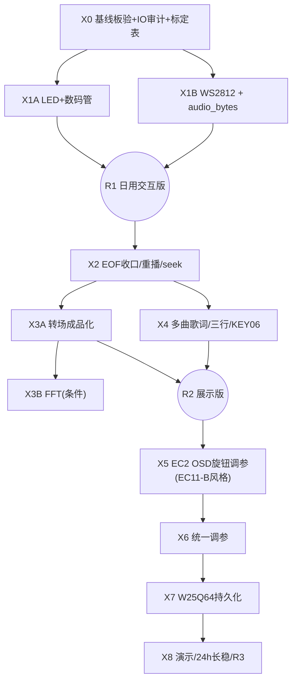

# VinylFPGA 完美版开发方案：拓展功能优先 + EC11-B 风格旋钮 OSD

> 日期：2026-10-07（北京时间）
> 工程：`D:\Data_Backup\VinylFPGA_Workspace_Base\VinylFPGA`
> 核查基线：Git HEAD `a357339`（S7-03b），构建快照 `prj/resource_opt_verified_20261005/S7_03b_key07_key11_20261006_s7/`
> 器件：安路 `EG4S20BG256`，顶层 `top`，工程入口 `prj/VinylFPGA.al`
> 资源基线：Slices 8412/9800 = **85.84%**，BRAM 40/64，DSP 15/29，Setup WNS +114 ps / Hold WNS **+3 ps**，TNS=0，违例 0
> bit SHA256：`23fd3bb166f7627ad9fd43759081ca6202644380400208658ee661bb542cac6`
> 文档性质：综合三份前期报告（S7 重排报告 / 进度盘点报告 / 拓展功能优先报告）的代码级事实，融合《EC11-B 参数旋钮 OSD 设计分析与 FPGA 实现指南》交互哲学后的**唯一权威执行方案**。本文只规划后续，不预填任何"已通过"结论。

---

## 0. 结论先行

1. **执行顺序冻结为 X0 → X1 → X2 → X3 → X4 → X5 → X6 → X7 → X8**。X0–X4 是扩展板九项物理功能收口（灯/数码管/WS/seek/转场/歌词），X5 才是 EC2 菜单。理由：菜单是"参数唯一写入点"整合层，必须等所有参数项已有独立物理按键可触达、有独立语义后再做，否则会出现"菜单里有项但按键没绑"或"按键绑了但菜单没该项"的双向不一致。
2. **X5（EC2 菜单）改造为 EC11-B 风格的浮动 OSD 旋钮调参，不再做传统的一级/二级层级菜单。** 核心交互：旋转 EC2 在环形参数列表里选项（青色边框），按下 EC2 进入该项调节（金色边框），再按退回；3 s 无操作自动收起到 idle，1.8 s OSD 隐藏但拧旋钮仍生效。这比传统菜单更轻量、更符合旋钮的物理直觉。
3. **静音键位决策**：采用 EC11-B 方案里的"Mute 作为参数列表中的一个 toggle 项"，由 EC2 旋转选中 + 按下切换，**不占用任何扩展板按键**。KEY11 保持 go_home，KEY12 保持结束策略，不引入长按判定。
4. **X5 起底草稿**：`prj/S704_ec2_menu_20261006/` 里的 `menu_system.v`/`param_csr.v` 是未合并草稿（+107/+11 ps，88.29% Slices），但它基于 03b 之前基线，**必须 rebase 重写，不能直接合并**。本方案 §5 给出全新的 RTL 模块划分。
5. **最大风险**：Slices 85.84%，距 88% 红线仅 212 个；X1–X4 预估新增 +1250~2300 slices，必须每阶段做资源增量审计，超限先减负再写功能。Hold WNS 仅 +3 ps，100 MHz SD 域任何新增寄存器都可能翻负。

---

## 1. EC11-B OSD 方案分析与我们的改造

### 1.1 EC11-B 原型的核心设计（要保留的）

| 设计点 | 原型做法 | 为什么好 |
|---|---|---|
| 三态 FSM | `idle → select → adjust → 松开回 select → 超时回 idle` | 旋钮天然适合"选项 + 调值"两层语义，按下是确认而非长按 |
| 浮动小窗 | 只显示当前调的那一个参数，不渲染完整菜单树 | 旋钮操作是"手边工具"而非"进入模式"，视觉负担极小 |
| 双计时器 | 1.8 s OSD 隐藏（值仍可调）；3 s 状态复位回 idle | 既不残留 UI，又不会让用户"黑屏不知道拧了有没有用" |
| 颜色语义 | 青色边框=select，金色边框=adjust | 一眼看出当前是在选还是在调，不需要文字说明 |
| 蜂鸣反馈 | 进 adjust 1320 Hz，退 adjust 990 Hz | 听觉确认状态切换，不需要看屏幕 |
| 数据驱动参数表 | `PARAM_TABLE` 数组，每项带最小值/最大值/步长/播放时可见位 | 新增参数只改 ROM，不改 FSM |
| 全局旁路 | 任何界面（浏览/播放/菜单/消隐）拧旋钮都生效 | 旋钮是"手边调整"，不该被界面层级挡住 |
| 关闭显示仍可调节 | OSD 隐藏后旋转仍改值，下次旋转重新弹出 | 符合真实听感：边听歌边调音量，不需要一直看着 OSD |

### 1.2 我们必须改造的点（与原型的差异）

| 差异点 | 原型 | 本项目 | 改造方案 |
|---|---|---|---|
| 参数数量 | 3 项（音量/亮度/进度） | 9 项（见 §5.2 参数表） | 环形列表按使用频率排序，dynamic 可见性过滤 |
| 参数类型 | 连续数值为主 | 连续值 + 3 档离散 toggle 混合 | 参数项抽象出 `kind` 字段：`CONTINUOUS` / `CYCLE3` / `TOGGLE` |
| 进度项 | 播放中才出现 | 我们有 seek ±5 s | 进度项改为"seek 目标"，旋转一格 ±5 s，比连续拖进度条更符合旋钮手感 |
| 亮度/对比度 | 原型有 5 档 LUT | 我们有 5 档 LUT（`brightness_contrast_adjust.v`） | 直接复用，参数项枚举当前档位 |
| OSD 位置 | 190×64 @ (225,58) 居中 | 我们 640×480，2×2 封面 + 中央 320×240 MV + 底部波形 + 三行歌词 | OSD 放在右上角 (430, 20)，160×56，不遮挡 MV/歌词/波形；旋转时弹出，1.8 s 淡出 |
| 蜂鸣器 | 1320/990 Hz 方波 | 我们已有 `buzzer_feedback.v`（`board_buzzer_n`） | 复用现有蜂鸣模块，新增两个频率常量 |
| 消隐联动 | 无 | 我们有 60 s 自动消隐 | OSD 弹出时重置消隐计时器（任何 EC2 操作都算"用户在场"） |
| 静音 | 原型无 | 我们需要 | 作为环形列表里的一个 `TOGGLE` 项，EC2 选中后按下切换 |
| 与 KEY07/11 交互 | 无 | 我们有 KEY07=缩略图、KEY11=go_home | OSD 打开时 KEY07/11 仍可按（它们是导航键），不被菜单层拦截；只有红外切曲/暂停在菜单 adjust 态被拦截（避免边调音量边切曲） |

### 1.3 借鉴但不照搬的地方

- **不做"长按时 EC2 进完整菜单"**：原型没有完整菜单，我们也不做。所有参数都在一个环形列表里，按使用频率排序，最多 9 项，旋转 9 次到底，比翻二级菜单快。
- **不做"OSD 隐藏后值变化不显示"**：原型 1.8 s 隐藏后再旋转会重新弹出。我们保留这个行为，但改成：隐藏后旋转会重新弹出 OSD（显示新值），而不是"默默调了不显示"。
- **保留蜂鸣**：我们的蜂鸣器是物理反馈，比纯视觉更适合"不看屏幕边听边调"。

---

## 2. 当前进度盘点（综合三份报告）

### 2.1 已完成（RTL + 构建通过，部分板验）

| 模块 | 证据 | 板验状态 |
|---|---|---|
| S0–S5 主链路（SD/FAT32、4 封面 bank、HDMI 640×480、PCM 播放、单行歌词、浏览 FSM） | 用户已人工验收 | ✅ |
| S6 MV/黑胶（320×240@10fps、3 帧 SDRAM bank、KEY08 切换） | commit `e8f7d1a` | ⚠️ 构建通过，板上 10fps/暂停/音画同步未实测 |
| S7-01 `health_monitor`（饱和计数 + sticky + STAT/ERR 串口） | `src/io/health_monitor.v` | 构建通过 |
| S7-02 `media_supervisor` + `media_probe`（挂载/扇区超时、重试、错误码、坏卡→好卡自动重挂） | `src/io/media_supervisor.v`、`src/SD/media_probe.v` | 板验记录缺 |
| S7-03 统一事件（逐源 pending 位图 + `ev_overflow`、15 键红外白名单/反码/repeat 节流、运行时 DIP、60s 自动消隐 + 手动息屏 + 唤醒吞首键、重启 3s 确认框） | `ui_event_bus.v`、`ui_command_router.v` | 板验记录缺 |
| S7-03 时序收口（`fat32_media_loader` 的 `pixel_end` 加法外提，+437 ps） | 交付说明 §2.2 | 已固化，不得回退 |
| S7-03b KEY07 直达缩略图 / KEY11 go_home | commit `a357339` | 板验记录缺 |
| **提前实现：KEY09 三动效循环（F0 无/F1 翻页 16 帧 0.27s/F2 淡入淡出）** | `top_tf_hdmi_audio.v:588-595` | 板验待 X3 收口 |
| **提前实现：KEY12 结束策略三态（E0 播完暂停/E1 单曲循环/E2 自动下一曲）+ EOF 单次处理 + 确认后从头重播** | `play_ctrl.v:33-35,110-152` | 板验待 X2 收口 |
| `stream_session` 播放代际管理、WAV Gray 指针复位修正、歌词时间由实际消费样本推进 | 验收修复记录 §3.2/3.3 | 构建通过 |
| 资源优化 M 系（Logo 分组 BRAM 46→40、LUT 16185→15708） | commits `636db9b`/`ead2ee0`/`1c0a962`/`29a4593` | 已固化 |
| 回归脚本 `tools/verify_s7_acceptance.py`（37 项）、`verify_s0_s5_fixes.py`（9 项） | 本地全绿 | iverilog 环境缺，15 帧 IR 向量仿真未补 |

### 2.2 进行中 / 半实现

| 项 | 缺什么 |
|---|---|
| DIP3 `led_enable` | 信号已产出（`ui_command_router.v:186`），但 `exp_led_n` 仍是 KEY01-04 回显镜像，DIP3 关闭不灭灯 |
| DIP6 `ws_enable` | 信号已产出，但 `exp_ws2812_data` 恒 0；一旦接灯效必须先发全黑帧 |
| 红外 F8/EA/F6（seek ±/重播） | 白名单已识别，业务执行等 X2 seek |
| EC2 旋钮 | 物理信号已进 `expansion_io_hub`，事件可上报串口，**无业务消费者** |
| `audio_bytes` 字段 | INDEX 条目偏移 20 已定义（`song_index_defs.vh`），但 `song_index_db.v` 未导出端口；WS 进度条和 seek 都依赖它 |
| 快速按键后 UR=0005 | underrun 计数非零，根因未定（真实 SD 停顿 vs 计数误报） |

### 2.3 未开始

- WS2812 驱动迁入与律动/进度灯效（主工程无 `ws2812_driver`，标定工程有可移植版本）
- 数码管业务内容（当前 `top_tf_hdmi_audio.v:1182-1189` 只显示 `pat_err_cnt` 测试图案）
- ±5 秒 seek、`wav_stream_player` 的 `target_sample` 端口
- 多曲歌词资产（每曲行表、三行显示、KEY06 模式切换）
- EC2 OSD 调参系统（§5 全新设计）
- 真实 FFT（当前 `promax_audio_waveform` 是时域幅度柱）
- W25Q64 用户 Flash 持久化、自动演示、24h 长稳

---

## 3. 引脚与按键映射冲突 / 遗漏风险

### 3.1 12 键 + DIP + 编码器最终绑定（冻结）

| 键 | 丝印 | J2 脚 | 业务 | 阶段 |
|:---:|:---|:---:|:---|:---:|
| KEY01 | 左 | 13/N1 | 浏览选择 / 播放态上一曲 | ✅ |
| KEY02 | 中确定 | 14/M2 | 浏览确认 / 播放暂停 / EOF 后重播 | ✅ |
| KEY03 | 右 | 15/M1 | 浏览选择 / 播放态下一曲 | ✅ |
| KEY04 | 上 | 16/L1 | 播放态音量+ | ✅（X5 菜单打开时需拦截） |
| KEY05 | 下 | 17/H2 | 播放态音量− | ✅（X5 菜单打开时需拦截） |
| KEY06 | 歌词动效 | 18/H1 | 歌词三模式循环（静态/滚动/高亮） | X4 |
| KEY07 | 切歌模式 | 19/G1 | 主界面/播放态直达 2×2 缩略图 | ✅ |
| KEY08 | 播控方式 | 20/G3 | MV/黑胶切换 | ✅ |
| KEY09 | 切歌动效 | 21/L4 | F0/F1/F2 三动效循环（已提前实现，X3 板验） | 🟡 X3 |
| KEY10 | WS 灯效 | 22/L5 | 灭/律动/进度三模式 | X1B |
| KEY11 | 拓展1 | 31/J12 | **返回主界面 go_home**（不是静音） | ✅ |
| KEY12 | 拓展2 | 32/K11 | **结束策略三态循环**（不是长按静音） | 🟡 X2 |
| EC1 | 左播控 | — | 切曲/确认（累计差值重放） | ✅ |
| EC2 | 右调参 | — | **环形参数选择 + 按下进调节（§5 OSD）** | X5 |
| DIP1 | 拓展2 | 7/L3 | J2 在场声明（上拨=可用，弱下拉） | ✅ |
| DIP2 | 拓展1 | 8/J3 | 预留，记录电平不触发业务 | ✅ |
| DIP3 | 指示灯 | 9/J4 | `led_enable` 总使能 | X1A 接入执行器 |
| DIP4 | 屏幕消隐 | 10/H4 | 60s 自动消隐使能 | ✅ |
| DIP5 | 红外接收 | 33/K14 | 红外业务总门控 | ✅ |
| DIP6 | WS 总控 | 34/L12 | `ws_enable` 总使能 | X1B 接入执行器 |

### 3.2 关键决策：静音走 EC2 OSD，不占按键

原 S7 方案把 KEY11 分给静音，但 S7-03b 已按用户要求把 KEY11 改为 go_home。本方案采用 EC11-B 哲学：**静音作为环形参数列表中的一个 `TOGGLE` 项**，EC2 旋转选中"Mute"，按下切换。这样：
- 不占用 KEY12（它是结束策略）
- 不引入长按判定（硬件风险）
- 不需要新增红外键
- 与 EC11-B 原型"参数项都是旋钮调"的哲学一致

### 3.3 风险清单（按返工代价排序）

| # | 风险 | 影响 | 缓解 |
|:---:|---|---|---|
| 1 | Slices 85.84%，距 88% 仅 212 | X1-X4 新功能叠加可能破 90% | 每阶段资源增量审计；超限先减负（S7-04 第二轮的 R2 消抖位宽/R3 删冗余比较已验证功能等价） |
| 2 | Hold WNS +3 ps 贴线 | 100 MHz SD 域新增寄存器可能翻负 | 每阶段硬门禁；新增 sd_card_clk 域逻辑同步做加法外提 |
| 3 | UR=0005 根因未定 | X1B "1h underrun 不增加"验收基线失真 | X0 先定性：真实 SD 停顿则升 X2 前置修复；计数误报则修 `health_monitor` |
| 4 | J2 端口无 IO delay 约束 | WS 800 kHz / LED 排线无板外时序证据 | X0 做 `timing.sdc` IO 约束审计表；X1B WS 波形示波器实测 |
| 5 | LED1-4 物理灯位未逐灯核对 | 状态灯语义错位一格 | X1A 第一步逐灯照丝印拍照 |
| 6 | `S704_ec2_menu` 草稿与 HEAD 分叉 | X5 若直接合并会回退 KEY07/11 新语义与 M4 Logo 优化 | §5 全新设计，草稿只作参考，不 rebase 合并 |
| 7 | 翻页时长 0.27s vs 原方案 0.6s | X3A 规格不一致 | 按用户验收后口径冻结为 0.27s，写入参数字典，禁静默改回 |
| 8 | `audio_bytes` 未引出 | X1B WS 进度条 + X2 seek 都阻塞 | X1B 一并做，`song_index_db.v` 加导出端口 |
| 9 | 母板 SW1-4 极性未逐位实测 | X1A 数码管使能接错 | X0 补"物理拨向→原始电平→逻辑状态"记录 |
| 10 | 32 位 48 kHz 样本计数 24.86h 回绕 | X8 24h 长稳覆盖不到 | 单独仿真回绕，不指望实机跑 25h |

---

## 4. 重排后的分阶段计划（X0–X8）

> 统一流程：需求/时序样例 → 独立仿真 → 集成回归 → TD 原生构建（seed 扫描）→ SRAM 板验 → 快照归档。
> 构建入口：`resource_opt_round.py → build_verified_round.py --seed <n> --map-mode area_prior → release_verified_round.py`。
> 每阶段产出：`stage_summary.md`、`board_acceptance.md`、`known_issues.md`、`resource_delta.md`、`assets_manifest.json`。
> **写入点冻结纪律**：X1–X4 期间禁止新增参数持久副本；所有消费者只读现有权威寄存器。X5 建 `param_csr` 时按"谁已持有该状态就把谁的寄存器搬进 CSR"迁移。

### 4.1 X0：基线与交互收口（板验专项）

- **目标**：把已实现但未留成文板验的 S6、S7-02/03/03b 全部行为钉死成证据，形成 X1–X4 的可信硬件基线。
- **工作**：
  1. 烧录 `S7_03b_key07_key11_20261006_s7` bit，按《S7_验收修复实施记录》§5 十步复验逐项成文（KEY09 三动效 20 轮、KEY12 三策略各 20 次、拔卡/坏卡换好卡 10 轮、红外 15 键逐一、DIP5 开关、Boot 跳过回归）
  2. 补 15 帧 IR 向量 + 同拍多事件定向仿真（解决 iverilog 环境，或用 TD 自带仿真器）
  3. `timing.sdc` IO delay 审计表（J2 全部输入/输出 + WS 数据线单独结论）
  4. LED1-4 逐灯丝印标定、母板 SW1-4 极性逐位记录
  5. UR=0005 定性
- **验收**：十步复验全成文；仿真台入库；两张记录表交付。
- **工作量**：1–2 人日。**优先级：必须，最先。**

### 4.2 X1：状态反馈、数码管、WS2812（R1 日用交互版）

#### X1A：LED1-4 + 数码管业务化

- **涉及模块**：改造 `expansion_integration.v:442`（LED 生成逻辑）、新增 `src/display/status_panel.v`、改造 `top_tf_hdmi_audio.v:1182-1189`（seg 业务 mux）、复用 `buzzer_feedback.v`
- **功能**：
  - LED1=有效 IR 脉冲、LED2=已接受操作脉冲（80 ms 延展）、LED3=~1 Hz 心跳、LED4=`health_monitor` sticky 告警
  - DIP3=0 时 `exp_led_n` 全灭（当前是"关而不灭"）
  - 数码管优先级：错误码（`Err-01..09`）> 参数临时值（调参后显示 2 s，X5 接）> 默认 MM:SS 播放时间（99:59 封顶）
- **验收**：逐灯物理位置照丝印；DIP3 关闭 100 ms 内全灭；数码管优先级逐项；错误码与串口 ERR 一致。
- **工作量**：2 人日。**P0。**

#### X1B：WS2812 灯效 + `audio_bytes` 引出

- **涉及模块**：从 `资源/Expansion_Board_Test/src/ws2812_driver.v` 移植、新增 `src/io/ws2812_effects.v`（律动包络 + 进度映射 + 模式 FSM）、`src/audio/pcm_tap.v`（只读旁路）、改造 `song_index_db.v`/`fat32_media_loader` 引出 `audio_bytes`（偏移 20）并校验非零偶数
- **功能**：
  - KEY10 循环三模式：灭 / 音频律动 / 播放进度条
  - 律动：PCM 旁路饱和绝对值 + 快升慢降包络（处理 −32768）
  - 进度：`cur_time_ms / (audio_bytes/2/48000*1000)` × 8 灯，单调填充
  - DIP6=0 时先发一帧全黑再保持低（不能只拉低 data）
  - 每通道默认最大 76（约 30% 亮度）；暂停律动衰减至灭、进度冻结
- **验收**：GRB 顺序与灯 1-8 物理排列照丝印；DIP6 关闭实测 100 ms 内熄灭（示波器/慢录）；忙时切模式无半帧；1h underrun 不增加（基线取 X0 UR 定性结果）；5V 峰值电流实测。
- **工作量**：3–4 人日（含示波器实测）。**P0。**

### 4.3 X2：EOF 收口、重播与 seek

- **涉及模块**：`play_ctrl.v`（策略边界复核不重写）、`wav_stream_player.v`（加 `target_sample` 端口，扇区内偏移跳过）、`stream_session.v`（seek 代次提交）、`mv_frame_scheduler.v`（目标帧 `floor(target_ms/100)`）、`lrc_osd.v`（seek 重定位钩子）、`ui_command_router.v:137-138`（F8/EA/F6 从"识别"改"执行"）
- **功能**：
  - ±5 s seek（`target_sample` 钳位 `[0, total_samples-1]`）；忙时只保留最新目标；暂停 seek 保持暂停
  - 重播：淡出→停新请求→在途排空/取消→代次切换→时间归零→预缓冲→淡入（禁止只清 `time_ms`）
  - EOF 三策略按 KEY12 现语义（E0 播完暂停/E1 单曲/E2 下一曲）板验闭环；顺序模式最后一首回第一首；零曲目拒绝进 PLAY；MV 先结束不改音频结束策略
- **验收**：±5 s 连续往返 100 次；首尾钳位/暂停 seek/切曲与 seek 同拍/旧应答延迟四组负例；仿真输出样本起点误差 ≤1；实机 MV/歌词差 ≤100 ms；三策略各 20 次。
- **工作量**：3 人日。**P0。**

### 4.4 X3：转场细化、图层固化、可选 FFT

#### X3A：KEY09 三动效成品化

- **涉及模块**：`video_transition_apply.v`、`video_fade_transition.v`、`top_tf_hdmi_audio.v:588-595` 的 effect FSM
- **功能**：整理合成顺序文档（背景/MV/黑胶 → 转场 → 歌词 → 波形/频谱 → 菜单/Toast/故障提示 → 消隐选纯黑）；F1 翻页方向继承；快速切曲合并为最新目标并在帧边界重启；确认源/目标 bank 不读写同一显示 bank；翻页时长参数化（当前 0.27s，冻结）
- **验收**：每效果 ≥100 次；快速切曲/暂停/OSD 同发无半帧；恒定色块/边界图验像素延迟；转场期间不新增 underrun。
- **工作量**：1–1.5 人日。**P0。**

#### X3B：256 点 FFT（条件增强）

- **预算**：≤4 BRAM/≤4 DSP（现余 24/14，准入满足）
- **涉及模块**：新增 `src/audio/fft_256.v`、`src/display/spectrum_renderer.v`
- **验收**：零/直流/单音 bin 对齐/双音/满幅/−32768/噪声七组与固定点参考一致；开关 FFT 音频样本输出一致；1h 无额外 underrun。超预算则保留波形，FFT 停独立实验版本。
- **工作量**：4 人日。**P2，不阻断 R2。**

### 4.5 X4：多曲歌词资产、三行显示、KEY06 模式切换

- **涉及模块**：扩展 `tools/gen_lrc_assets.py`（每曲二进制作表：≤256 行/行 ≤16 字形/共享子集 ≤256 字形，超限报错）、新增旁路歌词目录表格式（**不占 INDEX 条目 56–63**，flags bit2 仅作存在标记）、新增 `src/SD/lyric_loader.v`、重写 `lrc_osd.v`（三行缓存、时间比较、滚动 16 帧）、`ui_event_bridge.v` 加 KEY06 路由
- **功能**：三行显示（上一行/当前行/下一行）；KEY06 循环三模式：静态三行 → 滚动淡入（16 帧）→ 时间高亮；暂停冻结；seek 后歌词同代次重定位
- **验收**：≥4 首不同歌词匹配；缺歌词/重复时间/中文/空行/最大长度/CRC 负例只关歌词层；行切换相对资产时间 ≤100 ms；与底部波形/OSD 无遮挡。
- **工作量**：4–5 人日（含 PC 工具链）。**P0。**

### 4.6 X5：EC2 OSD 旋钮调参系统（本方案重点，见 §5）

### 4.7 X6：整体统一调参

- 音量步进与淡变时长、消隐 60s、转场 0.27s、律动包络常数、IR repeat 150/250ms、SD 重试/冷却、数码管优先级驻留时长
- 每项参数列"当前值/来源阶段/候选范围"表，板上 A/B 确认；收敛为文件头 `parameter`，汇总进参数字典 v1
- 同轮全功能资源/时序/CDC/媒体地址表复核
- **工作量**：2–3 人日 + 用户在场联调。**P0。**

### 4.8 X7：W25Q64 用户 Flash 持久化（S7-09 原样）

### 4.9 X8：自动演示、24h 长稳、发布（S7-10 原样，R3）

---

## 5. X5 详细设计：EC11-B 风格 OSD 旋钮调参

### 5.1 交互状态机

```
                    EC2 旋转（select 态）
           ┌──────────────────────────────────┐
           │                                  │
           ▼                                  │
        ┌──────┐  EC2 按下   ┌─────────┐  EC2 按下  ┌──────┐
        │ idle │──────────▶│ select │──────────▶│adjust│
        └──────┘           └─────────┘           └──────┘
           ▲                    │  ▲                  │
           │                    │  │ 3s 无操作         │
           │ 3s 无操作          │  │                  │ EC2 旋转（改值）
           │                    │  └──────────────────┘
           │                    │
           │                    │ 1.8s OSD 隐藏
           │                    ▼
           │              ┌──────────┐
           └──────────────│ osd_off │（OSD 隐藏，但 EC2 旋转仍改值；
                          └──────────┘  再旋转时重新弹出）
```

**状态定义**：

| 状态 | OSD 可见 | EC2 旋转行为 | EC2 按下行为 | 超时 |
|---|---|---|---|---|
| `idle` | 隐藏 | 进入 select 并选中当前参数项 | 进入 select | — |
| `select` | 青色边框显示当前参数项名+值 | 环形切换到下一个参数项 | 进入 adjust，蜂鸣 1320 Hz | 3s 回 idle |
| `adjust` | 金色边框，参数项名+值高亮 | 改当前参数值（连续值走步进，离散项走下一态） | 退回 select，蜂鸣 990 Hz | 3s 回 idle |
| `osd_off` | 隐藏 | 改当前参数值，OSD 重新弹出（显示新值） | 退回 select，OSD 弹出 | 1.8s 后回 idle |

**蜂鸣反馈**：
- `idle → select`：短嘀（1 kHz，30 ms）
- `select → adjust`：1320 Hz 50 ms
- `adjust → select`：990 Hz 50 ms
- 参数值到达最小值/最大值：短嘀（不连续鸣）
- Mute toggle 切换：1320 Hz（开）/ 990 Hz（关）

### 5.2 参数表（数据驱动 ROM）

| idx | 参数名 | kind | 默认值 | 范围/档位 | 步进 | 播放时可见 | 消费者模块 |
|:---:|---|:---:|:---:|---|:---:|:---:|---|
| 0 | Volume 音量 | CONTINUOUS | 200 | 32–255 | 16 | 是 | `pcm_volume_fade.v` |
| 1 | Mute 静音 | TOGGLE | 0 | 0/1 | — | 是 | `pcm_volume_fade.v` |
| 2 | Brightness 亮度 | CYCLE5 | 2 | 0–4 | 1 | 否 | `brightness_contrast_adjust.v` |
| 3 | Contrast 对比度 | CYCLE5 | 2 | 0–4 | 1 | 否 | `brightness_contrast_adjust.v` |
| 4 | Seek 进度 | CONTINUOUS | 0 | 0–total_samples | ±48000×5（=5s） | 是 | `wav_stream_player.v` |
| 5 | Transition 转场 | CYCLE3 | 1(F1 翻页) | 0(F0无)/1(F1翻页)/2(F2淡入淡出) | 1 | 否 | `video_fade_transition.v` |
| 6 | WS Effect 灯效 | CYCLE3 | 1(律动) | 0(灭)/1(律动)/2(进度) | 1 | 否 | `ws2812_effects.v` |
| 7 | Lyric Mode 歌词 | CYCLE3 | 0(静态) | 0(静态)/1(滚动)/2(高亮) | 1 | 是 | `lrc_osd.v` |
| 8 | End Policy 结束策略 | CYCLE3 | 2(下一曲) | 0(播完暂停)/1(单曲循环)/2(自动下一曲) | 1 | 否 | `play_ctrl.v` |

**环形列表动态过滤**：
- 浏览态（非播放）：只显示 idx 2/3/5/6/8（亮度/对比度/转场/WS/结束策略）
- 播放态：显示全部 9 项
- 过滤实现：旋转时跳过 `visible_mask[param_idx] == 0` 的项
- `visible_mask` 由 `play_active`（来自 `play_ctrl`）实时生成

### 5.3 OSD 渲染规格

| 项 | 值 |
|---|---|
| 位置 | 右上角，x=430, y=20（不遮挡中央 MV 320×240、底部波形、三行歌词） |
| 尺寸 | 160×56 像素 |
| 边框 | select 态青色 `#00FFFF`，adjust 态金色 `#FFD700`，2 px |
| 背景 | 半透明黑 `0x80000000`（ARGB） |
| 文字 | 上行：参数名（8×16 字体，白色）；下行：当前值（8×16 字体，adjust 态金色加粗） |
| 淡出 | 1.8s 后 alpha 从 0x80 渐变到 0，4 帧完成 |
| 弹出 | 从 osd_off/idle 进入时立即全 alpha |
| 刷新 | 只在参数项切换或值变化时重渲染（不需要每帧重画） |
| 与现有 OSD 关系 | 叠加在 `status_osd_overlay` 之上；与错误 Toast、消隐逻辑互斥（消隐时 OSD 不显示） |

### 5.4 RTL 模块划分

```
src/io/
  ec2_osd_controller.v     ← 三态 FSM（idle/select/adjust/osd_off），双计时器
  param_csr.v              ← 9 参数寄存器组，唯一写入点；输出到各消费者
  ec2_param_table.v        ← 参数字典 ROM（idx/kind/默认值/范围/步进/visible）
src/display/
  ec2_osd_renderer.v       ← 160×56 浮动窗像素输出，边框颜色/文字/淡出
```

**模块接口**：

`ec2_osd_controller.v`：
- 输入：`clk`、`rst_n`、`ec2_step_pulse`（旋转脉冲，带方向 +/−）、`ec2_sw_n`（按下，低有效）、`play_active`、`dip_level`（消隐联动）、`param_table_*`
- 输出：`osd_state[1:0]`（idle/select/adjust/osd_off）、`current_param_idx[3:0]`、`param_value_change` 脉冲 + `new_value[7:0]`、`buzzer_freq[1:0]`（0=无/1=1kHz/2=1320Hz/3=990Hz）、`osd_visible`、`osd_border_gold`

`param_csr.v`：
- 输入：`param_write_pulse` + `param_idx[3:0]` + `new_value[7:0]`
- 输出：`volume[7:0]`、`mute`、`brightness[2:0]`、`contrast[2:0]`、`seek_target[31:0]`、`transition_mode[1:0]`、`ws_mode[1:0]`、`lyric_mode[1:0]`、`end_policy[1:0]`
- 所有输出寄存器化，帧边界提交
- **X5 迁移纪律**：把 `play_ctrl.v` 里现有的 `volume_reg`/`end_mode`、`top` 里的 `effect_mode`、`ws2812_effects.v` 里的 `ws_mode` 等现有写点搬进 CSR；删除原寄存器，只读 CSR 输出

### 5.5 与现有模块的集成点

| 现有模块 | X5 改造 |
|---|---|
| `ui_command_router.v` | 新增菜单所有权层：消费优先级 = 系统确认框 → 消隐唤醒 → **EC2 OSD adjust 态** → 业务。OSD adjust 态时红外切曲/暂停/seek 不穿透；KEY04/05 音量±也不穿透（避免与 EC2 旋转改音量冲突） |
| `ui_event_bridge.v` | EC2 旋转脉冲接入 `ec2_osd_controller`；EC2 按下脉冲接入 |
| `buzzer_feedback.v` | 新增 `buzzer_freq` 输入，替代当前固定频率 |
| `status_osd_overlay.v` | 最上层叠加 `ec2_osd_renderer` 输出 |
| `ui_command_router.v` 的消隐计时器 | EC2 任何操作都重置消隐计时器（用户在场） |

### 5.6 验收标准

1. **三态切换**：旋转→select（青色），按下→adjust（金色，蜂鸣 1320），再按→select（蜂鸣 990），3s 无操作回 idle
2. **环形列表**：9 项按表顺序循环；浏览态自动隐藏播放相关项（音量/mute/seek/歌词）；播放时全部可见
3. **连续值**：音量 32–255 步进 16，旋转到边界时不溢出；seek ±5s 一格，连续旋转快进/快退
4. **离散项**：转场/WS/歌词/结束策略按 CYCLE3 循环；亮度/对比度按 CYCLE5 循环
5. **Mute toggle**：选中 Mute 按下，音频静音（音量寄存器保持但输出 0）；再按恢复原值
6. **OSD 行为**：1.8s 无操作隐藏，再旋转重新弹出；3s 无操作回 idle；消隐时 OSD 不显示
7. **不穿透**：adjust 态时红外切曲/暂停/seek 不触发业务；KEY07/11 仍可按
8. **资源**：Slices 增量 ≤300；Setup/Hold 非负（Hold 不能因为新增逻辑翻负）
9. **回归**：X1–X4 所有功能在新 CSR 写入路径下无行为回归（逐项复跑对应验收子集）

**工作量**：3–4 人日 + 回归。**P0。**

---

## 6. 依赖与里程碑



---

## 7. 风险与遗留问题

| # | 风险 | 处置 |
|:---:|---|---|
| 1 | X0 板验暴露新故障，X1–X4 顺延 | X0 单独快照，失败只回滚 X0 修复子步 |
| 2 | UR=0005 未定性 | X0 内定性；真实带宽问题升级为 X2 前置修复 |
| 3 | Hold +3 ps 贴线 | 每阶段硬门禁；不做假路径 |
| 4 | J2 无 IO delay | X0 出审计表；X1B WS 波形示波器实测 |
| 5 | `S704_ec2_menu` 草稿分叉 | §5 全新设计，不 rebase 合并 |
| 6 | 翻页 0.27s vs 原方案 0.6s | 冻结为 0.27s，写入参数字典 |
| 7 | 歌词碎片文件布局 | 首版限定连续资产，工具拒绝不支持布局 |
| 8 | 样本计数 24.86h 回绕 | X8 单独仿真，不指望实机跑 25h |
| 9 | 板载 LED/SW 极性/8 位数码管/W25Q64 核脚 | 未准入即标"未交付"，不伪装完成 |
| 10 | 单声道无 L-R，人声消除不可实现 | 不做；文档改"依赖立体声资产的远期项" |
| 11 | iverilog 环境缺 | X0 修复或改用 TD 仿真器建等效台 |
| 12 | X5 EC2 OSD 新增逻辑可能推 Slices 破 88% | 每阶段资源红线卡控；超限先减负 |

---

## 8. 下一次开发起点

1. **立即执行 X0**：烧录 `S7_03b_key07_key11_20261006_s7` bit（SHA256 `23fd3bb1…`），按十步复验成文；同轮做 IO delay 审计、LED 逐灯与 SW 极性标定、UR=0005 定性。
2. X0 通过后进 X1A（LED+数码管），两周内形成 R1 前半；X1B 与 `audio_bytes` 引出绑定推进。
3. 任何"顺手提前"的新交互需求，先对照 §3.1 键位表判定归属阶段，不跨阶段混装。每阶段独立快照、独立 bit、独立板验，失败只撤本阶段。
4. X5 开工前，本文 §5 是唯一权威设计；`S704_ec2_menu` 草稿只作代码参考，不直接合并。

| 交接字段 | 内容 |
|---|---|
| `current_stage` | S7-01–03b 已交付；执行起点 X0 |
| `goal` | X0–X4 扩展板九项功能收口 → X5 EC11-B 风格 EC2 OSD → X6 调参 → X7/X8 发布 |
| `confirmed_constraints` | EG4S20BG256；两 PLL 时钟；6 位数码管；4 曲；48kHz 单声道；10fps MV；J2 实测映射；KEY11=go_home（静音走 EC2 OSD）；HEAD `a357339` ↔ Slices 85.84%/BRAM 40/DSP 15/+114/+3 ps |
| `blocking_reason` | X0 板验缺记录阻塞 X1 放行 |
| `next_action` | X0 板验+标定表 → X1A → X1B → X2 → X3A → X4 → X3B(条件) → X5 → X6 → X7 → X8 |

---

*报告结束。后续更新须继续区分"计划 / 已实现 / 仿真通过 / 构建通过 / 板验通过"五档状态。X5 开工时，本文件 §5 作为 EC2 OSD 的唯一需求基线。*
