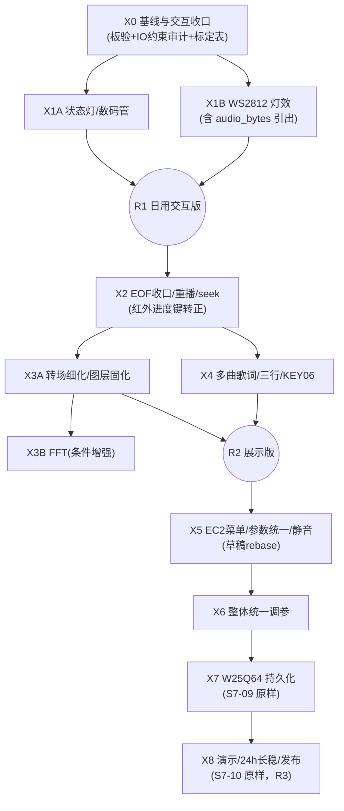

# VinylFPGA 拓展功能优先开发报告：阶段重排、进度盘点与后续计划

> 日期：2026-10-07（北京时间）  
> 工程：`D:\Data_Backup\VinylFPGA_Workspace_Base\VinylFPGA`  
> 核查代码：Git HEAD `a357339`（S7-03b 交互修复），工作树 `src/`、`constraints/` 与提交一致；顶层 `top`（`src/top_tf_hdmi_audio.v`），器件 `EG4S20BG256`，工程入口 `prj/VinylFPGA.al`。  
> 文档性质：进度盘点、代码与规划交叉核对，以及**按用户本次要求重排后的后续开发方案**。本报告只读核查了当前源码、约束、构建快照与既有交付记录，没有修改 RTL、没有重新综合、没有下载或板上测试。  
> 状态口径：S0–S5 已通过基线；S6/S7-01/02/03（含 S7-03b）已实现并通过构建与本地回归；S7-03b 及资源优化终版（`S7_03b_key07_key11_20261006_s7`）的板上复验记录尚未取得。**本报告所有验收项均为将来执行的通过标准，不预填通过。**

## 0. 结论与重排后的执行顺序

用户确定的路线调整：**先集中完成扩展板基础拓展功能（原 S7-05～S7-08），待九项扩展板功能全部落地并板验后，再统一推进 S7-04（EC2 菜单、参数统一与静音）与整体调参。** 本报告按此重排，并把核对中发现的"已在验收修复中提前实现"的条目纳入对应阶段收口，不重复开发。

九项扩展板功能与阶段的对应及现状：

| 功能（扩展板丝印） | 物理入口 | 当前代码状态 | 收口阶段 |
|---|---|---|---|
| 切歌模式 | KEY07 | **已实现**（S3 起 2×2 视图/返回；S7-03b 修复直达缩略图语义） | X0 板验回归 |
| 播控方式 | KEY08 | **已实现**（S6 MV/黑胶切换，`ui_event_bridge.v:53`→`visual_tgl`） | X0 板验回归 |
| 切歌动效 | KEY09 | **部分实现**（验收修复已做 F0 无效果/F1 翻页/F2 淡入淡出循环，`top_tf_hdmi_audio.v:592-593`） | X3（S7-08A 细化+板验） |
| 返回主界面（拓展1） | KEY11 | **已实现**（S7-03b，`browse_fsm.v:23`、`ui_event_bridge.v:125`） | X0 板验回归 |
| 红外接收 | DIP5 + `exp_ir_rx` | **已实现**（15 键白名单/反码/repeat 节流/重启确认，`ui_command_router.v`；进度±/重播键仅识别不执行） | X1（S7-06 补齐执行） |
| 屏幕消隐 | DIP4 + 遥控息屏键 | **已实现**（60 s 自动消隐+手动息屏+唤醒吞首键，`ui_command_router.v:166-177`） | X0/X1 板验 |
| WS 灯效 | KEY10 + WS2812 | **未开始**（KEY10 无消费者；`expansion_integration.v:443` WS 数据恒 0） | X1（S7-05B） |
| WS 总控 | DIP6 | **半实现**（`ws_enable=dip_level[5]` 已冻结输出 `ui_command_router.v:186`，但无执行器消费） | X1（S7-05B 接入全黑清灯） |
| 指示灯 | DIP3 + LED1～4 | **半实现**（`led_enable=dip_level[2]` 已冻结输出，但 `exp_led_n` 当前仍是按键回显镜像，不受 DIP3 控制，`expansion_integration.v:442`） | X0（S7-05A） |

重排后的执行顺序（对照原 S7 方案）：

| 新序 | 阶段 | 原方案编号 | 用户可见结果 | 优先级 / 版本归属 |
|---|---|---|---|---|
| X0 | 基线与交互收口（板验） | S7-00 尾款 + S7-03b/02/03 复验 | 现有全部交互在实机上得到成文验收记录 | 必须 |
| X1 | 状态反馈、数码管、WS2812 | S7-05（拆 A/B） | 指示灯/数码管有业务含义；八灯律动+进度；DIP3/DIP6 真实生效 | 必须；形成日用交互版 R1 |
| X2 | 播放结束收口、重播与 seek | S7-06（EOF 策略部分已提前） | 三种结束策略板验闭环、重播、±5 秒 seek、红外进度键真正执行 | 必须 |
| X3 | 转场细化、图层统一与可选 FFT | S7-08（动效部分已提前） | KEY09 三动效板验；合成层顺序固化；资源允许时做真实 FFT | 转场必须、FFT 条件增强；与 X4 共同形成展示版 R2 |
| X4 | 多曲歌词资产、三行显示与模式切换 | S7-07 | 每首歌自己的三行歌词，KEY06 切模式 | 必须；精确逐字为增强项 |
| X5 | EC2 菜单、参数统一与静音 | S7-04（已有一次未合并的尝试） | 右旋钮完成日常调参；mute 有明确入口；参数单一写入点 | 必须；在扩展功能全部板验后启动 |
| X6 | 整体统一调参 | 原分散于各阶段 | 资源/时序/交互手感/带宽一次系统性收口 | 必须；X5 之后、X7 之前 |
| X7 | W25Q64 用户数据与持久化 | S7-09 | 参数掉电恢复 | 完整产品目标 |
| X8 | 演示、长稳与发布 | S7-10 | 自动演示、24 h 稳定、可复现交付 | 必须；完整产品版 R3 |

### 0.1 重排的合理性核查与必须守住的接口纪律

交叉核对确认此顺序**可行**，理由与代价如下：

1. **可行面**：原方案把 S7-04（`param_csr` 参数唯一写入点）设为 S7-05 的入口，目的是避免状态面板/灯效各读一份参数副本。当前代码中音量（`play_ctrl.v` 内寄存器）、转场模式（`top` 的 `effect_mode`）、结束策略（`play_ctrl` 的 `end_mode`）本来就各自持有、尚无第二副本，X1～X4 直接消费这些既有权威源不产生新的多写入者；S7-04 后做时只需把这些**已存在的写点收敛**进 `param_csr`，属于替换而非重建。
2. **代价与纪律一（写入点冻结）**：X1～X4 期间**禁止新增任何参数持久副本**（例如数码管模块内部再存一份音量显示值、菜单超时逻辑各自实现一份）。所有新增消费者只读现有点。X5 建 `param_csr` 时按"谁已持有该状态，就把谁的寄存器搬进 CSR"的原则迁移，避免届时出现两套真值。
3. **代价与纪律二（菜单入口预留）**：X5 的 EC2 菜单会改变 KEY02/KEY04/KEY05 在菜单打开时的语义（原方案 2.2 交互表）。X1～X4 新增按键业务时，路由必须继续走 `ui_command_router` 的统一消费优先级层（系统确认框→消隐唤醒→业务），**不得在 `ui_event_bridge`/`browse_fsm` 里再加旁路直通**，否则 X5 的"菜单打开时不穿透"仲裁需要逐处返工。
4. **代价与纪律三（静音键位待决）**：原方案把 KEY11 分配为静音，但验收修复阶段用户已明确要求 KEY11=返回主界面并实现。重排后静音（X5）不再自动拥有 KEY11；键位需要用户决策（候选：EC2 按压进菜单后调 mute、红外暂无空闲键、KEY12 已被结束策略占用）。这是重排引入的**唯一需用户裁决的交互缺口**，见第 3.3 节。
5. **顺序微调建议（已采纳进计划）**：X3 与 X4 对调为 X3=转场（S7-08）、X4=歌词（S7-07）更贴合用户列举顺序（"切歌动效"在"WS 灯效"同句、歌词在后），且转场主体已在验收修复中实现、剩余工作是细化，先收口成本低；歌词涉及资产工具链与索引格式扩展，体量最大放其后。两阶段无硬依赖（都只依赖 X2 的稳定媒体时间轴），用户也可按需再调。

## 1. 当前进度盘点

### 1.1 已完成（有代码、有构建、多数有本地回归证据）

| 项 | 证据 |
|---|---|
| S0～S5 主链路（SD/FAT32、四封面 bank、HDMI、PCM 播放、单行歌词、浏览 FSM） | 用户已人工验收（主链路报告顶部 2026-10-06 更新；修复基线 `06ba8e8`） |
| S6 MV/黑胶（320×240、10 fps、三帧 SDRAM 环形区、音频优先仲裁、KEY08 切换） | `e8f7d1a`；`src/video/mv_stream_player.v` 等 4 个文件在树 |
| S7-01 诊断：`health_monitor` 饱和计数、STAT/ERR 串口、事件溢出计数 | `src/io/health_monitor.v`；交付说明 20261006 |
| S7-02 媒体监督：`media_supervisor` 挂载/扇区超时、重试、错误码表、错误 OSD 呈现；验收修复扩展出 `media_probe.v` 空闲探测、坏卡→好卡自动清错重挂（挂载总期限 15 s、单扇区 250 ms、3 s 冷却重试） | `src/io/media_supervisor.v`、`src/SD/media_probe.v`；《S7_验收修复实施记录_20261006》§3.1 |
| S7-03 统一事件：`ui_event_bus` 逐源 pending 位图 + `ev_overflow`；`ui_command_router`（clk 域）15 键红外白名单、双反码校验、音量 repeat 节流（150/250 ms）、重启 3 s 确认框、运行时 DIP1/3/4/5/6 语义、60 s 自动消隐+手动息屏+唤醒吞首键 | `src/io/ui_event_bus.v`、`src/io/ui_command_router.v:31-199`；交付说明第 2～8 节 |
| S7-03 时序收口：`fat32_media_loader` `pixel_end` 加法外提（功能等价，恢复约 437 ps） | 交付说明 §2.2 |
| S7-03b 交互修复：KEY07 主界面/播放态直达缩略图、KEY11 返回主界面 | `a357339`；`src/io/browse_fsm.v:11-25,137` |
| 提前实现（验收修复，按用户口头要求）：KEY09 三动效循环（F0/F1 翻页 16 帧约 0.27 s/F2 淡入淡出）、KEY12 结束策略三态（播完暂停/单曲循环/自动下一曲）+ EOF 单次处理 + 确认后从头重播、主界面/缩略图隐藏音谱、`stream_session` 播放代际管理、WAV Gray 指针复位修正、歌词时间由实际消费样本推进 | 《S7_验收修复实施记录》§1、§3.2、§3.3；`play_ctrl.v:33-35,110-152`、`top_tf_hdmi_audio.v:588-595` |
| 资源优化链（M12/M4 等）：Logo 分组后 BRAM 46→40，LUT 16185→15708 级联降 | commits `636db9b`/`ead2ee0`/`1c0a962`/`29a4593`；`S703_资源优化执行记录` |
| 回归入口：`tools/verify_s7_acceptance.py` 37 项、`tools/verify_s0_s5_fixes.py` 9 项全过（2026-10-06 本地） | 实施记录 §4 |

### 1.2 进行中 / 部分实现

| 项 | 缺什么 |
|---|---|
| S7-02/03/03b 板上复验 | 验收修复记录 §5 给出 10 步复验顺序，明确"未执行 SRAM/JTAG 下载、未实际完成板级测试"；其后 03b 提交与 M 系资源优化的板上状态亦无成文记录 |
| DIP3 指示灯使能 | `led_enable` 已产出但 `exp_led_n` 仍为回显镜像，DIP3 关闭不熄灭（`expansion_integration.v:442`） |
| DIP6 WS 总控 | `ws_enable` 已产出但无执行器；WS 数据恒 0 意味着"熄灭"恰好成立，一旦接入灯效必须补全黑清灯帧 |
| 红外进度±/重播三键 | 白名单已识别（`ui_command_router.v:71-72,137-138`），业务执行等 seek |
| 歌曲结束策略 | EOF/三态/重播骨架已在 RTL，但板验未闭环，且"顺序模式最后一首回第一首、零曲目拒绝、暂停不触发 EOF"等边界仅仿真覆盖 |
| EC2 旋钮 | 物理信号已进 `expansion_io_hub`（`top_tf_hdmi_audio.v:2209-2211`），事件可上报串口，**无任何业务消费者**；菜单在 X5 |

### 1.3 未开始

- WS2812 驱动迁入与律动/进度灯效、8 帧颜色提交/忙握手（主工程无 `ws2812_driver`，仅标定工程有）。
- 数码管业务显示（当前 6 位显示逻辑为诊断图案模式 `pat_mode` + 错误计数十六进制，`top_tf_hdmi_audio.v:1182-1189`；无曲号/MM:SS/参数临时值优先级业务，无 KEY03 显示项切换）。
- ±5 秒 seek、`audio_bytes` 从索引解析器引出（`song_index_defs.vh` 定义偏移 20，`song_index_db.v` 未见导出端口，grep 无命中）。
- 多曲歌词资产（按曲加载、三行、模式切换、PC 端行表/字库子集工具）、KEY06 业务（`ui_event_bridge` 无 ev_arg==5 路由）。
- EC2 菜单 + `param_csr` + 静音 + 亮度/对比度统一写入（快照 `S704_ec2_menu_20261006` 内含 `menu_system.v`/`param_csr.v` 源码并通过构建（+107/+11 ps，88.29%），**但该代码不在当前工作树与任何已合并提交中**，属未合并尝试稿）。
- 真实 FFT（工程内无实现，`promax_audio_waveform` 为时域柱+峰值保持）。
- 母板外设：板载 LED 候选脚（A4/A3/C10/B12）未接、SW1～4 端口已在（`top_tf_hdmi_audio.v:61-64`）但仅 SW 反馈音用途，数码管显示项切换/演示模式等业务未接。
- W25Q64 用户 Flash 通路、参数持久化、自动演示、长稳发布。

### 1.4 当前资源与时序基线（本报告的硬件决策依据）

当前 HEAD 对应最新可追溯构建 `prj/resource_opt_verified_20261005/S7_03b_key07_key11_20261006_s7/`（seed 7，area_prior，`final.qor` 实测）：

| 指标 | 数值 | 剩余 | 含义 |
|---|---:|---:|---|
| Slices | 8412 / 9800 = **85.84%** | 1388 | 较验收修复版 89.32% 已回落（M 系优化见效） |
| BRAM9K | **40 / 64** | 24 | Logo 分组优化后由 46 降至 40，歌词缓存预算显著放宽 |
| DSP | 15 / 29 | 14 | FFT 预算（≤4）可满足，非瓶颈 |
| Setup WNS / Hold WNS | **+114 / +3 ps** | TNS 0、违例 0 | Hold +3 ps 仍属贴线，100 MHz SD 域继续是敏感域 |
| bit | `VinylFPGA_optimized.bit`，SHA256 `23fd3bb166f7627ad9fd43759081ca6202644380400208658eee661bb542cac6` | — | 板上状态未确认 |

对照原 S7 方案第 3.3 节预算表：重排后 X1～X4 的新增上限不变（控制/灯效 0～1 BRAM、歌词缓存 ≤4、FFT ≤4 BRAM/≤4 DSP、预留 ≥8/≥9）；当前实际余量 24 BRAM/14 DSP **高于**方案编制时（当时 18/13），主要瓶颈仍是 Slices 百分比与 100 MHz 域时序，而非存储类资源。

## 2. 代码与规划交叉核对结论

按 S7 方案（20261006）逐条对照当前代码，判定如下：

| # | 规划条目 | 代码事实 | 判定 |
|---|---|---|---|
| 1 | S7-03"首版支持最多 32 条待处理业务事件" | pending 位图实现为逐源结构（12 KEY down + 6 DIP 合并 + EC/IR 各槽），非 32 条通用队列；溢出有 `ev_overflow` 计数 | **口径偏差，可接受**。逐源位图语义等价且更强（保序），文档"32 条"应按"逐源槽位总数"理解，无需重写 |
| 2 | S7-03 验收"全部 15 个红外向量与真实遥控逐一通过" | 定向仿真未补（`iverilog` 不在 PATH，交付说明 §10）；DIP5 门控问题曾被误判为"红外全无反应"，实为门控语义（验收修复记录 R1），用户复测通过 | **部分达成**。需把 15 帧向量仿真补进 X0，板验记录已口头确认但无成文 |
| 3 | S7-03"LED/WS 最终执行器在 S7-05 接入，此前 WS 沿用静态低" | 与代码一致（`expansion_integration.v:440-445`） | 符合 |
| 4 | 方案交互表 KEY11=静音（S7-04 落地） | 用户后续要求 KEY11=返回主界面，已实现并板验语义；方案 2.2 表**已过时** | **冲突，以用户最新要求为准**。静音键位待决（§3.3） |
| 5 | 方案将 KEY09 动效列为 S7-08A、KEY12 结束策略列为 S7-06"未开始" | 两者已在验收修复中实现基本形态 | **超前实现**。X2/X3 改性为"收口+细化"，避免重复开发 |
| 6 | 方案"EOF 以最后有效样本消费为准、区分尾部补零" | `stream_end` 已同步排空后单比特跨域，"成功结束与 SD error 分离"（实施记录 §3.3） | 基本符合；总样本数（`audio_bytes/2`）引出仍缺，X2 补 |
| 7 | 方案"seek 依赖样本级定位，禁止 `start_lba+offset/512` 无条件套用" | 无任何 seek 代码 | 未开始，符合预期 |
| 8 | 方案 S7-04 入口"S7-03 业务路由稳定" | 路由已稳定且有一次未合并菜单稿（`S704_ec2_menu` 快照 +107/+11 ps 构建通过） | 重排后推迟；届时**以该稿为起底草稿**，但必须 rebase 到 03b+M 优化后基线（其不含 KEY07/11 新语义与 M4 Logo 改动） |
| 9 | 方案"亮度/对比度首版复用 5 档 LUT，母板组合键菜单改成等价参数命令" | `param_menu_controller`（母板 key1+key2 组合入口）仍在（`top_tf_hdmi_audio.v:628-639`） | 未动，符合"S7-04 时收敛"的安排 |
| 10 | 方案"数码管 6 位、错误码>参数临时值>用户选择优先级" | 当前 6 位显示为诊断图案/错误计数，无业务优先级树 | 未开始，X1 落地 |
| 11 | 方案"歌词三行、每曲资产；首版 256 行×16 字形、子集 256 字形" | `lrc_osd` 仍单份固化 ROM 单行；`gen_lrc_assets.py` 仍生成单字库 | 未开始，X4 落地 |
| 12 | 方案"INDEX v2 偏移 56～63 已 MV 占用，禁止挪用；歌词用新版本/旁文件" | `song_index_defs.vh` 条目 flags bit2=歌词**仅占位**，无歌词指针字段 | 一致；X4 定歌词目录表格式时**不得**占用条目 56～63，遵旁文件方案 |
| 13 | 方案"EXT1 保持蜂鸣同源、不重复占用" | `exp_ext_o = {5'b00000, board_buzzer_n}`（`expansion_integration.v:445`） | 符合 |
| 14 | 方案"Boot 500 ms 保护窗、DIP 初始化不作跳过源" | 500 ms 窗与 EV_DIP_CHANGE 排除仍在（S2 修复），S7-03 又加 `ir_boot_ok = !ev_is_ir \|\| dip_level[4]` | 符合，回归时保留 |
| 15 | 方案"音量默认 200/步进 16/范围 32～255" | `play_ctrl.v:14-17` 参数一致 | 符合，X5 CSR 迁移时原值继承 |

## 3. J2 引脚与按键映射校验、冲突与遗漏风险（重点）

### 3.1 物理契约校验结果

将《J2扩展板引脚按键映射标定》E1 与主工程 `constraints/pin.adc`、`src/io/expansion_integration.v` 逐脚比对：**40 脚全部有归属、36 信号方向/极性与标定三方一致**（S7 方案 2.1 表已核对，本次抽查 `exp_dip_n[0]=L3 PULLDOWN` 例外项、`exp_ir_rx=K6 PULLUP`、LED 低有效输出，均一致）。判键语义（方向键编号 04/05/01/03/02 不按位置、红外用高 8 位地址、DIP 上拨=1 不取反）在主工程 `ui_command_router`/`ui_event_bridge` 中均已按标定实现，无二次取反残留。

### 3.2 控制项 ↔ 功能位对应关系核对表

| 控制项 | 标定丝印 | S7 方案语义 | 当前代码实际 | 状态 |
|---|---|---|---|---|
| KEY01/03 | 左/右 | PLAY 上一/下一曲 | `ui_event_bridge.v:80-83` 已接 | ✅ |
| KEY02 | 中确认 | 确认/暂停 | 已接（浏览确认、PLAY 暂停、EOF 后从头重播） | ✅ |
| KEY04/05 | 上/下 | 音量±（PLAY）/选择（BROWSE） | `play_ctrl.v:154-157` 音量钳位 32～255 | ✅ |
| KEY06 | 歌词动效 | S7-07 三模式循环 | **无路由**（bridge 不消费 ev_arg==5） | ⛔ X4 |
| KEY07 | 切歌模式 | 2×2 视图/返回；菜单开=关菜单 | 已接；03b 修复直达缩略图 | ✅（X5 需补"菜单打开时该次不退出播放"） |
| KEY08 | 播控方式 | MV/黑胶 | 已接（S6） | ✅ |
| KEY09 | 切歌动效 | S7-08A 三效果 | 已实现 F0/F1/F2 循环（提前） | 🟡 X3 板验收口 |
| KEY10 | WS 灯效 | S7-05B 律动/进度 | **无路由** | ⛔ X1 |
| KEY11 | 拓展1 | 方案=静音；**用户改=返回主界面** | 返回主界面已实现 | ⚠️ 见 3.3 |
| KEY12 | 拓展2 | S7-06 结束策略 | 已实现 E0/E1/E2（提前） | 🟡 X2 板验收口 |
| DIP1 | 拓展2 | 在场声明（上拨可用） | 已实现，L3 弱下拉例外保留 | ✅ |
| DIP2 | 拓展1 | 预留 | 仅记录状态 | ✅ |
| DIP3 | 指示灯 | LED 总使能 | `led_enable` 产出，**执行器未消费** | 🟡 X1 |
| DIP4 | 屏幕消隐 | 自动消隐使能 | 60 s 自动+唤醒吞首键已实现 | ✅（板验待记录） |
| DIP5 | 红外接收 | 红外业务使能 | 门控业务/Boot 跳过/蜂鸣均实现 | ✅（板验已复测） |
| DIP6 | WS 总控 | WS 总使能 | `ws_enable` 产出，**执行器未消费** | 🟡 X1 |
| EC1 | 左播控 | 切曲/确认 | 已接（含累计差值重放） | ✅ |
| EC2 | 右调参 | S7-04 菜单 | 原始事件上报，**无业务** | ⛔ X5 |
| IR 进度±/重播 | — | S7-06 | 识别不执行 | 🟡 X2 |
| IR 重启 | — | 3 s 确认框 | `restart_req`→软复位 640 ns | ✅（板验待记录） |

### 3.3 冲突与遗漏风险清单（按返工代价排序）

1. **静音入口悬空（交互契约冲突，需用户裁决）**：方案 2.2 冻结 KEY11=静音，实际 KEY11 已按用户后续指令改为"返回主界面"并板验。12 键中已无空闲业务键（KEY06/10 已分配歌词/灯效）。候选：a) mute 只进 EC2 菜单（与 X5 绑定，X1～X4 无静音）；b) 红外音量键长按/组合（引入新判定风险，不推荐）；c) 母板 key4（方案原文 C1=实物 key2 焊球，存在重复声明风险，S7 方案 1.3 已禁止）。**建议 a**，并在 X5 验收项中显式包含 mute 50 次与恢复原值。
2. **DIP3 当前"关而不灭"**：LED 回显镜像不受 `led_enable` 门控。用户在 X1 前若把 DIP3 拨下，灯仍会随按键亮——不是 bug（执行器本来就未交付），但**极易被当成验收失败**。X1 第一步就把 `exp_led_n` 生成逻辑改为 `led_enable ? 状态帧 : 4'hF`，并在 X0 板验话术中向验收人说明当前预期。
3. **`S704_ec2_menu` 快照源码与 HEAD 分叉**：该菜单稿基于 03b 之前基线（无 KEY07/11 新语义、无 M4 Logo 分组、无 `stream_session`），X5 直接复用会回退已验收行为。必须把 `param_csr.v`/`menu_system.v` 摘出后在现基线上重新集成、重新走 seed/时序验证（当年该稿 +107/+11 ps 的数据不能背书新基线）。
4. **快速按键后 UR=0005 根因未定**（M4 资源优化实测记录遗留）：underrun 计数在快速操作下非零。X0 板验必须复现并定性：是真实 SD 停顿（应归 X2/带宽）还是计数误报（应修 `health_monitor`）。该项未定性前，X1 灯效"输入并发 1 小时 underrun 不增加"的验收基线不可信。
5. **Hold +3 ps 贴线 + `timing.sdc` 无 IO delay**：约束报告长期提示 5 输入/23 输出端口无 IO delay（含全部 J2 端口）。X1 起新增 LED/WS/数码管输出与灯效 800 kHz 时序敏感，**必须在 X0/X1 之间补一轮 IO 约束审计**（至少给 J2 输出组与 WS 数据线给出时序适用性结论），不能继续把"内部 STA 通过"外推到板外时序。
6. **LED1～4 物理灯位未逐灯标定**（标定文档 §7 明示）：X1 状态灯语义分配（IR 脉冲/操作确认/心跳/告警）落地前，必须先逐灯点亮核对丝印，否则状态灯含义整体错位一格。
7. **母板 SW1～4 逻辑极性口径未逐位实测**（S7 方案 3.4 节提醒）：现有注释与旧文档存在"低有效/上拨=1"口径差。X1 用 SW1 控数码管使能前，补做"物理拨向→原始电平→逻辑状态"逐位记录，不套用 J2 DIP 结论。
8. **板载 LED 候选脚 A4/A3/C10/B12 未核原理图**：X1 只承诺 J2 LED；母板 LED 未准入不进 R1 清单，避免"占脚后复用冲突"。
9. **数码管只有 6 位**：产品文档写 8 位（与双色 LED 复用）。MM:SS 方案（99:59 封顶）已按 6 位收敛，若未来要显示"Err-0x + 两位曲号"以上组合需重排优先级树，不影响本轮。
10. **EXT2～6 与 I2S/OLED**：全部预留恒 0；`timing.sdc`/`pin.adc` 无外设预算。任何"顺手接个外设"需求都按新阶段立项，不并入 X1～X4。

## 4. 重排后的分阶段开发计划

统一执行原方案第 4 节流程：需求/时序样例 → 独立仿真 → 集成回归 → 原生 TD 构建 → SRAM 板验 → 保存证据；每阶段全新快照名 + `stage_summary.md`、`board_acceptance.md`、`known_issues.md`、`resource_delta.md`、`assets_manifest.json`。构建入口沿用 `resource_opt_round.py → build_verified_round.py --seed <n> --map-mode area_prior → release_verified_round.py`（本次报告未执行）。

### X0：基线与交互收口（板验专项）

- **目标**：把"已实现但未留成文板验"的 S6、S7-02/03/03b 与验收修复全部行为钉死成证据，形成 X1～X4 的可信硬件基线。
- **涉及**：无新 RTL（除 IO delay 审计结论落档）；`S7_03b_key07_key11_20261006_s7` bit（SHA256 `23fd3bb1…`）；测试卡 `card_S6.img`/`card_B_broken.img`。
- **接口与依赖**：X0 通过是 X1～X4 全部阶段的入口条件；UR=0005 定性结论直接进 X1/X2 基线。
- **工作内容**：① 按《S7_验收修复实施记录》§5 十步复验逐项执行并成文（含 KEY9 三动效 20 轮、KEY12 三策略各 20 次、拔卡/坏卡换好卡 10 轮、红外 15 键逐一、DIP5 开关、Boot 跳过回归）；② 补 15 帧 IR 向量与同拍多事件的定向仿真（解决 iverilog 环境问题，或按 TD 自带仿真器给出等价台）；③ `timing.sdc` IO delay 审计表（J2 全部输入/输出 + WS 数据线单独结论）；④ LED1～4 逐灯丝印标定、母板 SW1～4 极性逐位记录（X1 的准入件）。
- **验收标准**：十步复验全部"通过/失败+复现条件"成文；仿真台入库；两张记录表交付。任何一步失败先修复并只重测该步，失败修复计入独立子快照。
- **工作量**：中（约 1～2 人日，不含维修窗口）。**优先级：必须，最先。**

### X1：S7-05 状态反馈、数码管和 WS2812（拆 X1A/X1B）

- **目标**：所有已接线反馈器件输出有意义状态，形成日用交互版 R1。
- **X1A（LED+数码管+蜂鸣整理）**
  - 涉及模块：`expansion_integration.v`（LED 生成逻辑改造点 `:442`）、新增 `status_panel` 职责的显示逻辑（建议独立 `src/display/status_panel.v`）、`top_tf_hdmi_audio.v`（seg 驱动替换业务优先级树）、`buzzer_feedback`（保留，接已接受动作语义）。
  - 接口与依赖：X0 的灯位/SW 极性记录表；消费 `led_enable`（DIP3）、`sw1`（数码管使能）、`health_monitor` 错误码、`play_ctrl` 的 `play_active/paused/sel_song`、`timebase_48k` 的 `cur_time_ms`；`ui_command_router` 需新增"操作已接受"单拍输出（现仅 LED2 概念，无信号）。
  - 功能：LED1=有效 IR 脉冲、LED2=已接受操作脉冲（约 80 ms 延展）、LED3=心跳、LED4=告警；DIP3=0 全灭。数码管业务优先级 错误码 > 参数临时值 2 s > 用户选择（曲号/MM:SS/诊断，KEY03 在 BROWSE 切显示项），MM:SS 封顶 99:59；SW1 控使能。EXT1 保持蜂鸣同源不重复占用；无效帧/IR 禁用不鸣叫。
  - 验收：逐灯点亮对应语义；DIP3 关闭 100 ms 内全灭、恢复后模式正确；数码管各显示项与优先级逐项；错误码 Err-xx 与串口 ERR 一致；KEY3/B2/C1 既有母板业务不受显示改动影响；构建 Setup/Hold 非负且 Hold 不因新增扫描逻辑恶化到负。
  - 工作量：中（约 2 人日 + 板验）。**优先级：必须。**
- **X1B（WS2812 灯效）**
  - 涉及模块：迁入 `资源/Expansion_Board_Test/src/ws2812_driver.v`（时序基线：50 MHz 下 63/18/35/3000 拍）+ 新增 `ws2812_effects`（律动包络 + 进度映射 + 模式 FSM）；`expansion_integration.v` 改 `exp_ws2812_data` 接线；PCM 旁路 tap（从 `wav_stream_player` 有效样本引出饱和绝对值，注意 −32768）；**`song_index_db.v`/`fat32_media_loader` 引出 `audio_bytes`（偏移 20）并校验非零偶数**（此项原计划 S7-05B 内嵌，X1B 一并做，X2 seek 直接复用）。
  - 接口与依赖：X1A 的 `led_enable` 同款纪律——`ws_enable`（DIP6）必须由执行器消费：关闭先发一帧全黑并完成锁存再保持低；busy 时保留清灯请求。KEY10（bridge 现无 ev_arg==9 路由，需新增 toggle 输出）切律动/进度；进度分母 `audio_bytes/2`，为 0 全灭；每通道默认上限 76；暂停律动衰减至灭、进度冻结；mute（X5 前暂不存在）预留接口位。
  - 验收：GRB 顺序与灯 1～8 顺序实测正确；全黑/满亮钳位；DIP6 关闭 100 ms 内实测熄灭（用示波器/手机慢录留证）；忙时切模式无半帧；输入并发+连续灯效 1 小时，UR 计数不增加（基线取 X0 的 UR=0005 定性结果）；驱动波形与实装灯珠规格核对允许范围；5 V 峰值电流实测并记录供电条件；`audio_bytes` 引出后与 `INDEX.json` 数值一致。
  - 工作量：大（约 3～4 人日 + 板验，含波形/功耗实测）。**优先级：必须；R1 的收口项。**

### X2：S7-06 播放结束收口、重播与 seek

- **目标**：把已提前实现的 EOF/结束策略/重播骨架板验收口，并补上唯一真正缺失的 seek。
- **涉及模块**：`play_ctrl.v`（策略边界复核，不重写）、`wav_stream_player.v`（目标样本定位：扇区内偏移跳过、样本级起点）、`stream_session.v`（seek 代次提交）、`mv_frame_scheduler`（目标帧 `floor(target_ms/100)` 钳位）、`lrc` 重定位钩子（X2 先按现有单行对齐，X4 换三行）、`ui_command_router.v:137-138`（把 SEEK±/REPLAY 从"识别"改"执行"）、`vinyl_packer.py`（明确拒绝不支持布局）。
- **接口与依赖**：X1B 引出的 `audio_bytes/2` 总样本数；seek 使用 request/ack + 目标位置 + 曲目代次，忙时只保留最新目标；暂停中 seek 保持暂停；歌词/MV/进度在同一次提交切代次。首版限定已验证连续 PCM（现状：索引本就要求物理连续）。
- **功能**：±5 s seek（`target_sample` 钳位 `[0, total_samples-1]`）；重播本曲走"淡出→停新请求→在途排空/取消→代次切换→媒体时间归零→预缓冲→淡入"，禁止只清 `time_ms`；EOF 三种策略按 KEY12 现语义（播完暂停/单曲循环/自动下一曲，顺序模式回绕第一首）板验闭环；零曲目拒绝进入 PLAY；"MV 比音频先结束时不改音频结束策略"回归。
- **验收**：±5 s 连续往返 100 次；首尾钳位、暂停 seek、切曲与 seek 同拍、旧应答延迟四组负例；仿真比较实际输出样本起点误差 ≤1 样本；实机恢复后 MV/歌词差 ≤100 ms；三种结束策略各 20 次；文件尾不足一扇区样本；定位失败在规定超时后返回可操作错误态（联动 X1A 告警灯）。
- **工作量**：大（约 3 人日 + 板验）。**优先级：必须；红外进度/重播键在此转为真实功能。**

### X3：S7-08 转场细化、界面层次与可选 FFT（拆 X3A/X3B）

- **目标**：把提前实现的 KEY09 三动效做成品化收口与层次固化；资源允许再做真实 FFT。
- **X3A（必做）**：`video_transition_apply`/`video_fade_transition` 与 `top_tf_hdmi_audio.v:588-595` 的 effect FSM 整理进统一合成顺序文档（背景/MV/黑胶 → 转场 → 歌词 → 波形/频谱 → 菜单/Toast/故障提示 → 消隐最后选纯黑）；F1 翻页方向继承、快速切曲合并为最新目标并在帧边界重启；确认源/目标 bank 不读写同一显示 bank；维持 640×480 与 2×2 布局；把验收修复中"翻页 16 帧约 0.27 s"的参数化（`FADE_FRAMES` 类 parameter）对齐方案 Q7 口径（0.6 s±1 帧为完整转场目标时长，X3A 需与用户确认最终时长规格——现 0.27 s 是用户验收时点名"放慢"后的值，**不得静默改回**）。
  - 验收：每效果 ≥100 次；快速切曲、暂停、OSD 同发无半帧；恒定色块/边界图验像素延迟表；转场期间不新增 underrun；有意黑场不计异常闪黑。
  - 工作量：小（约 1～1.5 人日）。**优先级：必须。**
- **X3B（条件增强 FFT）**：256 点定点迭代复用 FFT（预算 ≤4 BRAM/≤4 DSP，现余 24/14，**准入条件已满足**，仅需布局通过率验证）；窗函数/缩放/饱和/32 显示频段 bin 分组表先行定义；PCM 旁路取样、分析溢出丢帧计数、不反压音频；输出 30 Hz 柱高+峰值保持，与现波形互斥显示（选择位暂由串口诊断开关或临时按键，正式入口等 X5 菜单——若用户否决临时入口则 X3B 停留独立实验版本）。
  - 验收：零/直流/单音 bin 对齐/双音/满幅/−32768/噪声七组与固定点参考模型一致；开/关 FFT 音频样本输出一致；正常卡 1 小时无额外欠载；未通过不得把 32 柱波形改名为频谱。
  - 工作量：大（约 4 人日，含参考模型）。**优先级：条件增强，不阻断 R2。**

### X4：S7-07 多曲歌词资产、三行显示与模式切换

- **目标**：解决"每首歌同一份固化歌词"，做三行与动效，R2 收口。
- **涉及模块**：`tools/gen_lrc_assets.py` 扩展（每曲二进制作表：≤256 行/行 ≤16 字形/共享子集 ≤256 字形，超限报错）、**新增旁路歌词目录表格式**（不占 INDEX 条目 56～63，flags bit2 仅作存在标记）、`song_index_db`/loader 增加目录表装载、新增 `lyric_loader` + `lrc_osd` 重写（三行缓存、时间比较、滚动 16 帧）、`ui_event_bridge` 新增 KEY06 路由、`ui_command_router` 无变化（KEY06 无红外等价键）。
- **接口与依赖**：X2 的媒体时间与 seek 重定位；X1B 已完成 `audio_bytes` 引出（行时间戳上限校验用）；SD 仲裁让位于音频（装载在切曲预缓冲期）；BRAM 预算 ≤4（现余 24，宽松）。
- **验收**：≥4 首不同歌词与曲目匹配；缺歌词/重复时间/中文/空行/首尾/最大长度/CRC 负例只关歌词层；行切换相对资产时间 ≤100 ms；暂停冻结、seek 对齐；KEY06 循环 静态三行→滚动淡入→时间高亮；与底部波形/OSD 无遮挡；工具输出预览图和 BRAM/SDRAM 占用表。精确逐字仅对有逐字时间戳素材验收，数据缺失降级行级并如实标注。
- **工作量**：大（约 4～5 人日，含 PC 工具链与板验，是全流程中体量最大的单项）。**优先级：必须；R2 前最后的功能大块。**

## 5. X5：EC2 菜单、参数统一与静音 + X6：整体统一调参

扩展板九项功能（§0 表）全部板验通过后启动。

### X5（原 S7-04）

- **涉及模块**：新建 `param_csr.v` + `menu_system.v`（**从 `S704_ec2_menu_20261006` 快照摘取草稿，按当前基线 rebase 重写集成**——该稿 88.29% Slices/+107/+11 ps 的旧数据不作为新基线背书）；改造 `param_menu_controller`（母板组合键入口保留为命令源，不再独立持有亮度/对比度副本）；`ui_command_router` 增加菜单所有权层（消费优先级：系统确认框→消隐唤醒→**菜单**→业务；菜单打开时红外切曲/暂停/重播/seek 不穿透）。
- **功能**：一级 音量/亮度/对比度/转场/设置/退出，二级 自动轮播/结束策略/歌词模式/WS 模式/数码管项/恢复默认；音量继承 200/16/32～255；**mute 独立位**（键位按 §3.3-1 用户裁决结果实现，取消静音恢复原值）；未实现选项置灰显原因；EC2 唤醒首格不改值；3 s 淡出 0.5 s；参数帧边界提交；本阶段仅 RAM，掉电恢复默认是预期行为。
- **验收**：每参数上下边界 100 次；菜单打开 EC1 不切曲；KEY07 只关菜单不退出播放；连续开关菜单 100 次无漏层/错位/音频序列改变；mute 50 次恢复正确；X1～X4 各功能在新菜单写入路径下无行为回归（逐项复跑对应验收子集）。
- **工作量**：大（约 3～4 人日 + 回归）。**优先级：必须；重排后置于全部拓展功能之后。**

### X6：整体统一调参（重排新增的显式阶段）

- **目标**：把分散在各阶段的"具体数值手感"一次收口：音量步进与淡变时长、消隐 60 s/超时 3 s 类交互时限、翻页帧数与速度、律动包络快升慢降常数、IR repeat 节流参数、SD 重试/冷却时间、数码管优先级驻留时长。
- **方法**：每项参数先列"当前值/来源阶段/候选范围"表，由用户在板上逐项 A/B 确认；所有阈值收敛为文件头 `parameter` 并汇总进参数字典文档；同轮做全功能资源/时序/CDC/媒体地址表复核（X6 是发布前第一次允许触碰布局布线的调参窗口，Slices 目标 ≤88%，超 90% 停重型功能）。
- **验收**：参数字典 v1 冻结；每个调整项有改前/改后板测记录；全量回归（`verify_s7_acceptance.py` + `verify_s0_s5_fixes.py` + 各阶段定向台）在同一快照内全绿。
- **工作量**：中（约 2～3 人日 + 用户在场联调）。**优先级：必须；X5 之后、X7 之前。**

## 6. 依赖与里程碑

原方案 S7-09/S7-10 的入口条件（参数字典稳定、硬件准入、逐配置独立构建）在重排后依然成立，X7/X8 内容不变、引用原方案第 4 节 S7-09/S7-10 条款执行。每阶段结束即整理快照；工作量估计为计划分配值，不作为验收条件。

## 7. 后续风险与遗留问题清单

| # | 风险/遗留 | 影响 | 处置 |
|---|---|---|---|
| 1 | X0 板验若暴露新故障，X1～X4 全部顺延 | 全链路 | X0 单独快照，失败只回滚 X0 修复子步 |
| 2 | UR=0005 未定性 | X1B/X3B 的"underrun 不增加"验收基线失真 | X0 第①步内定性；若是真实带宽问题升级为 X2 前置修复 |
| 3 | Hold +3 ps 贴线；扫描/灯效新增寄存器可能翻负 | 每次构建 | 每阶段 Setup/Hold 非负硬门禁；不做假路径 |
| 4 | J2 端口无 IO delay，板外时序无证据 | 排线/外设信号完整性 | X0 出审计表；X1B WS 波形实测是第一个真实检验点 |
| 5 | 静音键位悬空 | X5 契约 | 提交用户裁决（§3.3-1），不擅自定 |
| 6 | 菜单草稿与 HEAD 分叉 | X5 工作量低估 | 按"重新集成"而非"合并"排期 |
| 7 | 翻页时长 0.27 s 与方案 0.6 s 规格差 | X3A 规格 | 按用户验收后口径冻结并写入参数字典，禁静默改回 |
| 8 | 歌词碎片文件布局未验证 | X4 SD 仲裁 | 首版限定连续资产，工具拒绝不支持布局 |
| 9 | 32 位 48 kHz 样本计数约 24.86 h 回绕 | X8 长稳 | 回绕仿真单独覆盖，24 h 实测不能背书 |
| 10 | 板载 LED/SW 极性/8 位数码管/W25Q64 核脚等硬件未知项 | R1 部分/X7 | 维持"未准入即明确标未交付"，不伪装完成 |
| 11 | 单声道无 L−R 信息，人声消除不可实现 | 产品文档旧条目 | 继续不做；文档口径改"依赖立体声资产的远期项" |
| 12 | `iverilog` 环境缺失导致部分定向仿真欠账 | 各阶段仿真门禁 | X0 修复环境或改用 TD 仿真器建立等效台 |

## 8. 下一次开发的具体起点

1. **立即执行 X0**：烧录 `S7_03b_key07_key11_20261006_s7` bit（`23fd3bb1…`），按《S7_验收修复实施记录》§5 十步复验成文；同轮完成 IO delay 审计、LED 逐灯与母板 SW 极性标定表、UR=0005 定性。
2. X0 通过后进入 **X1A**，两周内目标形成 R1 前半（灯+数码管）；X1B 与 `audio_bytes` 引出绑定推进。
3. 期间任何"顺手提前"的新交互需求，一律先对照 §2 表判定归属阶段，不跨阶段混装；每阶段独立快照、独立 bit、独立板验，失败只撤本阶段。

| 字段 | 交接内容 |
|---|---|
| `current_stage` | S7-01～03b 已交付；进度口径按用户重排要求进入"拓展功能优先"路线，执行起点为 X0 |
| `goal` | 先完成扩展板九项基础拓展（X0～X4），再统一做 S7-04 与调参（X5/X6），最终 R3 |
| `confirmed_constraints` | EG4S20BG256；两 PLL 时钟体系；6 位数码管；4 曲；48 kHz 单声道 PCM；10 fps MV；J2 实测映射；KEY11=返回主界面（静音待决）；HEAD `a357339` ↔ Slices 85.84%/BRAM 40/DSP 15/+114/+3 ps |
| `artifacts` | 本报告；引用源码/约束/快照 QoR 与既有交付记录 |
| `decision` | 阶段重排生效：S7-04 后置于全部拓展功能之后；KEY09/12 相关开发改判为收口而非新建 |
| `blocking_reason` | 不阻塞方案交付；X0 板验缺记录阻塞 X1 放行 |
| `next_action` | X0 板验+标定表 → X1A → X1B → X2 → X3 → X4 → X5 → X6 → X7 → X8 |

*报告结束。后续更新须继续区分"计划/已实现/仿真通过/构建通过/板验通过"五档状态。*
