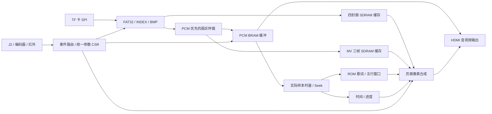

# VinylFPGA 项目现状与后续优化开发完整报告

> 阅读范围：当前稳定HEAD、代码/功能现状、资源与时序、实际验证结果、优化建议和逐阶段人工验收。附录包含完整源码/工具索引、93个提交及53项回归。本文依据同日已执行审查和归档证据整理，本次文档扩展没有重跑综合/实现。

## 阅读导航

- [1. 结论](#1-结论)
- [2. Git 状态与真实开发进度](#2-git-状态与真实开发进度)
- [3. 工程入口与代码组织](#3-工程入口与代码组织)
- [4. 当前功能边界](#4-当前功能边界)
- [5. 本轮构建与资源证据](#5-本轮构建与资源证据)
- [6. 发现的问题及验证](#6-发现的问题及验证)
- [7. SD 素材实际状态](#7-sd-素材实际状态)
- [8. 高效推进的建议](#8-高效推进的建议)
- [9. 后续每阶段交付与人工验收约定](#9-后续每阶段交付与人工验收约定)
- [10. 如何理解本报告的完成程度](#10-如何理解本报告的完成程度)
- [11. 主链路机制、接口契约与修改注意点](#11-主链路机制接口契约与修改注意点)
- [12. 存储、格式和吞吐预算](#12-存储格式和吞吐预算)
- [13. 历史资源优化试验的完整取舍](#13-历史资源优化试验的完整取舍)
- [14. 后续优化候选、收益判断和边界](#14-后续优化候选收益判断和边界)
- [15. 非阻塞构建、固件归属和提交规范](#15-非阻塞构建固件归属和提交规范)
- [16. 人工验收的详细记录与失败定位](#16-人工验收的详细记录与失败定位)
- [17. 未完成项、风险与后续决策](#17-未完成项风险与后续决策)
- [18. 证据入口、复核方法与交接规则](#18-证据入口复核方法与交接规则)
- [附录 A：完整源码与头文件索引](#附录-a完整源码与头文件索引)
- [附录 B：完整 tools 工具索引与使用边界](#附录-b完整-tools-工具索引与使用边界)
- [附录 C：当前 HEAD 的完整 Git 提交记录](#附录-c当前-head-的完整-git-提交记录)
- [附录 D：全部53项默认回归结果](#附录-d全部53项默认回归结果)
- [附录 E：证据链接和只读复核命令](#附录-e证据链接和只读复核命令)


审查日期：2026-10-13（北京时间）。完整报告整理日期：2026-10-13。工作目录：`D:/Data_Backup/VinylFPGA_Workspace_Base/VinylFPGA`。

本轮范围是 Git、工程、关键 RTL、工具、素材与验证证据的审查。没有修改产品 RTL、约束或原工程，没有提交、合并、推送或烧录。新增内容仅为本报告与审查证据。

用户本次要求优先于历史方案：先了解当前稳定版本，等待新的优化/开发需求；以后构建在后台进行，由用户自行烧录、人工验收，验收确认后才提交和进入下一任务。文档中的旧优化门槛、待开发清单、其他对话的授权和提示词均作为历史材料，不自动启动其中的任务。

## 1. 结论

当前版本已具备较完整的播放器主链路：FAT32/INDEX 索引、四封面缓存、浏览与播放、暂停/Seek/重播/结束策略、PCM 音频、MV、五行歌词滚动、波形、EC2 参数浮窗、灯条和媒体恢复。适合作为后续开发基线。

需要区分四件事：代码接入、综合成功、已有固件构建成功、板级人工验收。它们不能互相替代。本次独立综合成功；现有运行目录的布线和 bitgen 有完整成功证据；本轮没有重新全量实现或进行板级验收。用户认为本版稳定是后续工作的基准，但不能由此推定所有素材、格式和边界都已验收。

目前最值得优先关注的是：物理资源余量、失效的生产回归入口、进度条计算问题、SD 内容动态化边界以及四首独立素材的长时播放验证。具体先做哪项，等待用户下一步需求。

## 2. Git 状态与真实开发进度

### 当前工作树

- 分支 `main`，HEAD `0536a67`，日期 2026-10-11，提交信息 `docs: plan runtime song content and player UI`。
- HEAD 可达提交共 93 个；没有标签。初始工作区仅 `prj/.lock.f` 有修改，内容为 TD 进程号变化，本轮保留。
- 本地记录的 `origin/main` 是 `a9e6415`，当前 main 落后一个提交。没有执行 fetch，所以这是本地远端跟踪引用，不能称为实时远端状态。
- `a9e6415` 新增浏览曲目信息行；`codex/player-ui-stage-b` 的 `a618637` 修改进度显示；它们不属于当前 HEAD 的产品功能。
- `backup/pre-reset-0536a67-20261012` 保存了回退前工作；`backup/stage1-dev-20261013` 是 `5131624`，保存阶段一优化工作区。阶段一备份相对当前版本涉及 loader、播放页、字库、歌词、布局、顶层和生成器等，不能因分支名存在就认为已合入或验收。
- 存在多个 worktree，包括旧优化、播放页阶段及外部 `_c2base`。本轮未切分支、移动或清理这些工作树，也未恢复备份分支。

完整 HEAD 历史与分支/工作树记录保存在 [doc/项目分析_20261013/evidence/git_history.txt](D:/Data_Backup/VinylFPGA_Workspace_Base/VinylFPGA/doc/项目分析_20261013/evidence/git_history.txt) 和 [doc/项目分析_20261013/evidence/git_context.txt](D:/Data_Backup/VinylFPGA_Workspace_Base/VinylFPGA/doc/项目分析_20261013/evidence/git_context.txt)。

### 发展阶段

| 日期/提交 | 主要开发内容 | 对当前版本的意义 |
|---|---|---|
| 10-03～10-04 | 原例程、切图/轮播、HDMI 音频、稳定性、Flash 自启、FAT32、四 bank、转场、PCM、波形 | 核心媒体底座已建立 |
| 10-05～10-06 | BRAM 化、J2、启动 Logo、S3 选曲、S4 INDEX、S5 播控/歌词、S6 MV、S7 恢复与统一事件 | 从教程功能转向整机产品链路 |
| 10-07 | X1 灯光/数码管、X2 Seek/结束策略、时序和资源收敛 | 已加入完整交互与状态反馈 |
| 10-09～10-10 | O0 基线、O2/O4 简化、D1～D8 轮播和参数控制、D9～D12 播放页/五行歌词 | 当前用户界面的主体 |
| `bb72d8d` | 移除缩略图交互与相关读仲裁 | 当前应按中央封面浏览操作，旧缩略图教程已过期 |
| `263425f` | BMP 像素消费守卫改用 pixel_count | 保留了有效修复；不能重复套用已回退候选 |
| `ec23958` | 汇总资源工作、代码/素材/大量历史证据 | 是广泛归档提交，不能只从“优化资源”标题推断每项实验都保留 |
| `0536a67` | 动态内容和新 UI 设计/实施计划 | 方案已存在，运行时 TEXT/BG 功能尚未成为当前产品 |
| 10-12～10-13 的其他分支 | 浏览信息行、播放进度微调、动态资源探索/阶段一优化备份 | 待按用户新需求逐项选取，禁止自动合并 |

## 3. 工程入口与代码组织

器件 `EG4S20BG256`，架构数据库 `eagle_s20.db`，TD `6.2.168116`，顶层模块 `top` 位于 `src/top_tf_hdmi_audio.v`。AL 登记了 57 个 HDL 文件和 2 个约束文件，所有登记路径均存在。IncludeDir 是 `../src/include`，顶层又直接 include 大量业务模块；新文件可能通过 include 进入综合，不能仅按 AL 的文件条目判断是否被综合。

源目录共有 122 个文件，其中 121 个 HDL/头文件，共 31,393 行，包含生成字库、初始化数据和加密厂家 IP。审查覆盖完整文件清单、工程入口及主要业务调用链；人工详细阅读集中在顶层、媒体、播放、显示、交互、CDC 和构建/资源工具，不声称逐行人工审完全部 ROM 初始化及加密代码。

| 目录/文件 | 职责与后续修改边界 |
|---|---|
| `src/top_tf_hdmi_audio.v` | 集成时钟复位、媒体生命周期、SDRAM、音视频、UI 和跨域；约 2500 行，改动宜集中到明确接口 |
| `src/SD` | SD SPI、扇区适配、FAT 扫描与簇链、INDEX、BMP 解码、四封面预载、帧 FIFO/SDRAM |
| `src/audio` | PCM 缓冲、音量/淡入淡出、实际样本时基、播放状态、Seek 和停流重启握手 |
| `src/video` | PCM/MV 共用扇区仲裁、RGB565 帧装载、三帧调度、320×240 显示窗 |
| `src/display` | 播放页、歌词窗口/滚动、共享字库、进度/时间、波形、亮度对比度、EC2 浮窗 |
| `src/io` | 同步/消抖、事件汇总、红外路由、编码器增量重放、统一参数 CSR、轮播、LED/WS2812 |
| `src/boot`、`src/IP`、加密 HDL | 启动 Logo 与厂家资源；变更必须保留器件/IP/仿真模型的一致性 |
| `tools` | 45 个顶层文件，包含资源生成、卡镜像处理、历史回归、资源对比和 native 构建/发布 |
| `sim` | 96 个顶层文件及历史/夹具目录；当前统一回归入口仍有失效条目 |

时钟分工：UI 50 MHz、SD/媒体 100 MHz、SDRAM 125 MHz、像素/音频 25 MHz、HDMI 串行 125 MHz。音频、歌词、进度以真实消费 PCM 样本为时间源；暂停不推进，Seek 加载目标样本位置。



## 4. 当前功能边界

| 功能 | 当前实现程度 | 需要区分的限制 |
|---|---|---|
| 启动 Logo | 已集成，默认保持 6 秒、最早 4 秒跳过、超时 8 秒 | 不应由旧上电静态 DIP 电平误触发跳过 |
| 浏览和切图 | 中央封面浏览，EC1/方向键选曲，确认进入播放，KEY7/KEY11 返回 | 缩略图交互已删除；文件名存在不等于旧功能仍接入 |
| 轮播与转场 | DIP2 门控，ROT=OFF/2/3/5/10/20 秒，默认 3 秒；成功切图蜂鸣 | 手动切图与忙事务之间由 cover_navigation 协调 |
| PCM 音频 | 48 kHz、16 位有符号小端、单声道，4096 样本 BRAM 缓冲 | RTL 不解析 WAV 容器、MP3/AAC；PC 应先转换裸 PCM |
| 播放控制 | 暂停/恢复、上下曲、Seek、重播、EOF 策略 | 停流、在途扇区排空、FIFO 复位和元数据稳定由 stream_session 协调 |
| Seek | EC1 每步 ±2 秒，红外 ±5 秒；目标有钳位 | 必须同时验证音频、歌词、MV、数码管；不能只检查声音跳了 |
| MV | 320×240 RGB565LE、10 fps、300 扇区/帧，三帧槽、PCM 优先仲裁 | MV 文件需物理连续；缺帧或读取缓慢采用已有显示/调度策略 |
| 封面和 FAT | 640×480 BMP、四 bank；INDEX/封面使用 FAT 簇链 | 根目录实际只读取首个 512 字节扇区，即 16 个目录槽；注释“首簇”比实现宽泛 |
| INDEX | 单扇区 512 字节，64 字节头/条目，v1/v2、最多四首，CRC 校验 | INDEX 标题字段当前 RTL 不消费；歌词标志不等于运行时从 SD 装载 LRC |
| 播放页 | 左侧媒体/歌名歌手/时间进度，右侧五行歌词，下方波形 | 当前进度宽 240、显示已播放/总时长；320 宽/剩余时间/浏览信息行属于其他阶段 |
| 五行歌词 | 六槽缓存支持五可视行和入场行，帧同步滚动，共享单口字库 | 歌名、歌手、歌词仍编译进 ROM；当前固定 16 像素字符格，不支持运行时可变字宽/自动换行 |
| 多曲静态文字 | 4 曲，最多每曲 128 行，每行/标题/歌手 16 字，8 位 glyph ID | 当前素材 48 行、178 个去重字形；更换文本仍需重新生成 RTL 和 bit |
| EC2 参数 | 单一 CSR：VOL/BRI/CON/ROT/WSL，浮窗和帧快照 | VOL 默认 200、步进 16、钳位 0～255；亮度/对比度各 5 档；灯条 0/25/50/75/100% |
| 灯效/反馈 | KEY10 在全灭/VU 间切换、DIP6 门控；LED/数码管业务状态、蜂鸣反馈 | 已简化为两态；旧彩虹/进度灯效描述不可当当前验收依据 |
| 红外/DIP/恢复 | 白名单与反码、音量 repeat 节流、息屏吞首键、重启确认、挂载/扇区超时恢复 | UART 生产输出静默，不能照旧教程期待串口持续遥测 |
| 真正通用图片缩放 | 当前有固定显示窗及像素取样，保留一些算术参考文件 | 不能据此宣称 D13 通用缩放/缩略图链路完整有效 |
| SD 动态 TEXT/BG | 有设计方案和其他分支探索 | 当前 HEAD 未实现 INDEX v3、TEXT/BG loader、运行时替换歌词、三背景切换 |

封面与 INDEX 支持 FAT 簇链。当前音频按起始 LBA 加扇区偏移读取，MV 也按连续物理 LBA 读取，所以音频和 MV 不具备通用碎片文件播放能力。打包工具默认拒绝碎片音频/MV；`--allow-fragmented-audio` 只绕过工具限制，不会赋予硬件碎片播放能力。

## 5. 本轮构建与资源证据

### 已有 GUI/native 工程运行（读取证据，没有重建）

`prj/VinylFPGA_Runs/syn_1` 于 08:17:53 开始，`phy_1` 于 08:19:31 开始，bit 于 08:21:54 生成。design/RTL/gate/place/route/bitgen 的结束 marker 完整；gate/pr 数据库和 bit 存在；没有阶段 error marker。综合使用 `map_mode area_prior`。

| 指标 | 2026-10-13 早上已有 route final |
|---|---:|
| Slice | 8535 / 9800（87.09%） |
| LUT | 15668 / 19600（79.94%） |
| REG | 10465 / 19600（53.39%） |
| BRAM9K | 47 / 64（73.44%） |
| BRAM32K | 0 / 16 |
| DSP | 10 / 29（34.48%） |
| PLL | 2 / 4 |
| PAD | 75 / 188 |
| Setup WNS / TNS / 违例端点 | +0.188 ns / 0 / 0 |
| Hold WNS / TNS / 违例端点 | +0.011 ns / 0 / 0 |

该 run 的综合和物理产物闭环成立：综合交付允许进入物理阶段；物理阶段按该报告的已约束内部时序允许进入 bitgen，且 bitgen 已完成。此结论不包含新的板级验收、完整外设时序签核，也不把缺失的源码 manifest 当作已具备。

固件：`prj/VinylFPGA_Runs/phy_1/VinylFPGA.bit`，651,740 字节，SHA256 `2b253d0eff316bb16fe335766fbdbca082ffac2b9d80f2decdabfa57e8fb8391`。本轮没有烧录，也没有重生成此固件。

这些运行时间紧随当前源码回退/恢复时间，入口路径也一致，但已有 run 没有完整输入哈希清单，无法严格证明每个综合输入与当前 HEAD 一一绑定。后续每轮采用不可变快照和输入 manifest，解决固件与源码归属问题。

### 本轮 SynthPilot 独立综合（新执行）

按用户指定执行 `curl.exe -sL https://www.synthpilot.dev/llms.txt`，使用实际可用的 Anlogic TD MCP。说明见 [SynthPilot 用法](https://www.synthpilot.dev/llms.txt)。运行时 schema 是工具参数的依据，没有调用其他平台的工具或原始 Tcl 逃逸接口。

完整 src/constraints 复制到临时快照；AL 仅重定位工程根目录。`td_build(end_step=opt_gate)` 成功完成 import/open/elaborate/read_adc/read_sdc/opt_rtl/opt_gate/legalize/SDC 重载，耗时 78,964 ms；没有启动新的 bitgen。

- `td_report_area`：LUT 16688、REG 10398、BRAM9K 47、DSP 10。
- gate timing：Setup +0.210 ns，Hold +0.471 ns，TNS=0。
- `td_report_param` 实测 `map_mode=auto`。AL 多 run 的 `area_prior` 不自动成为这个单 run 诊断流程的 gate 参数。
- gate 的 PLB=0 和部分 Slice 数字属于未完成全设计物理装箱的阶段统计，不能当成“只占 27%”或“PLB 充足”。同样，gate WNS 不能当 route WNS。
- 另尝试在复制工程中 `td_open_run(phy_1, route)` 重开现有数据库，TD 进程在回应结束前退出，工具报告 outcome unknown。未重试、未保存设计，未影响原 run。此次重开结果没有进入任何面积/时序结论。

临时快照：`C:/Users/Renni/AppData/Local/Temp/vinylfpga_audit_20261013_77ac76b0`。主要小型证据已归档到`doc/项目分析_20261013/evidence/`，不复制数据库、bit、vvp 或波形进 Git。

### 资源瓶颈与优化口径

10-11 候选 E 的独立 native 签核曾报告 PLB 2422/2450（98.86%）、Slice 8588、Setup/Hold +0.116/+0.030 ns。这是历史流程/快照，不能把这个 PLB 与2026-10-13 早上 8535 Slice 拼成同一组结果。2026-10-13 的标准 area 文件没有 PLB 指标，本轮也未取得最新 packed PLB；因此当前精确 PLB 余量仍待同口径查询，但历史记录足以提示装箱/布线余量敏感。

本轮 gate 层级热点如下，数字为报告的 `lut/ripple/seq/bram/dsp` 列，子模块包含在父模块里，不重复相加：

| 模块 | lut | ripple | seq | BRAM | DSP |
|---|---:|---:|---:|---:|---:|
| SD/BMP 全链路 | 3785 | 508 | 3238 | 0 | 0 |
| 扩展板/UI 集成 | 1690 | 503 | 923 | 0 | 0 |
| HDMI 厂家核 | 1324 | 209 | 1503 | 16 | 0 |
| 播放页（含共享字库） | 713 | 178 | 83 | 8 | 0 |
| 歌词六槽窗口 | 656 | 35 | 569 | 0 | 0 |
| EC2 浮窗 | 468 | 138 | 80 | 1 | 0 |
| 帧读写/FIFO | 444 | 143 | 358 | 4 | 0 |
| 进度/时间 | 463 | 72 | 333 | 0 | 0 |
| WAV 缓冲/控制 | 373 | 70 | 258 | 8 | 0 |

BRAM 分配约为 HDMI 16、Logo 10、共享歌曲字库 8、WAV 8、帧 FIFO 4、EC2 ASCII 1，共 47。字库和 Logo 不应只因占 BRAM 就降画质；首先避免添加第二套重复存储，优先替换/复用。未使用的 BRAM32K 是否适合替代须按端口、器件映射和实测验证，不能把原始容量看成可随意互换。

已有 native route 最差路径：卷扫描器 `max_cluster` 到文件流读取器 `cluster_delta.ce`，+0.188 ns，7 级、最大扇出 35，数据延迟 9.532 ns，其中网络 67%。新的默认 gate 诊断最差路径则是 `play_active` 到轮播计数器，+0.210 ns、8 级、扇出 41。两者属于不同阶段/参数，不是一个“当前最差路径”。

历史 A、D、F、N1、N2 试验已因时序/PLB/route 代价回退。特别是“减少 LUT/寄存器必然省 PLB”和“place 好看就代表 route 成功”已经被本项目实测推翻。后续优化按同一流程的前后对照评价，至少记录 LUT/REG/Slice/PLB/BRAM/DSP 和最终 Setup/Hold，不追求源码行数变少。

## 6. 发现的问题及验证

### 6.1 进度条计算与宽度不一致（本轮新确认）

`src/display/playback_progress.v` 的分子是 `(elapsed<<8)-(elapsed<<4)-(elapsed<<3)`，等于 `elapsed*232`；布局和上限为 240。

临时定向 bench 输入总样本 480000：

| 位置 | 实际 progress_fill | 240 像素设计预期 |
|---|---:|---:|
| 起点 | 0 | 0 |
| 中点 240000 | 116 | 120 |
| 终点 480000 | 232 | 240 |

终点少 8 像素，约 3.33%。这是 RTL 算术事实，已用仿真复现，不是由旧验收文档推测。临时 bench/log 保存为 [doc/项目分析_20261013/evidence/tb_audit_progress.v](D:/Data_Backup/VinylFPGA_Workspace_Base/VinylFPGA/doc/项目分析_20261013/evidence/tb_audit_progress.v) 和 [doc/项目分析_20261013/evidence/progress_probe.log](D:/Data_Backup/VinylFPGA_Workspace_Base/VinylFPGA/doc/项目分析_20261013/evidence/progress_probe.log)。未修改产品代码；后续若纳入 UI/修复任务，应一次统一宽度参数、计算、输出位宽与边界验收。320 像素方案还需要将 8 位 fill 改成至少 9 位。

### 6.2 默认回归与生产代码不同步

本轮实际执行：

```powershell
python tools/verify_s7_acceptance.py --output C:/Users/Renni/AppData/Local/Temp/vinylfpga_audit_20261013_77ac76b0/sim_audit
```

结果 53 项：40 PASS、13 FAIL，进程退出码 1。与归档 `resource_opt_N2/after/sim/resource_N2_full/results.json` 的失败集合完全一致。没有称本轮回归“全绿”。

| 失败项 | 已确认原因 |
|---|---|
| tb_browse_fsm、tb_s3_browse_integration、tb_s7_browse_semantics | 仍实例化已删除的缩略图/视图接口 |
| tb_thumbnail_view_reader、tb_sdram_rd_arbiter | 依赖已删除的生产模块 |
| tb_s7_top、tb_opt_metadata、tb_visual_feedback_top | 引用已删除的 thumb 内部信号 |
| tb_opt_osd_bypass | 引用旧 contrast_frame 内部信号 |
| tb_s7_play_policy、tb_s5_play | 使用迁移到统一 CSR 前的 volume/volume_update 接口 |
| tb_x1x2_lights、tb_ws_vu_only | 未连接后来新增 brightness_level，默认分支输出黑色，断言失败 |

两项 WS 测试分别在临时副本中仅补 `.brightness_level(3'd4)`，再次运行均 PASS；其中灯效 sweep 验证 298 帧。这是失效测试的原因验证，未改动产品 RTL或仓库 testbench。其他 11 项为编译/展开失败；不能把这些当作验证过对应生产功能，也不能仅删除失败测试而不给仍保留的业务添加有效覆盖。

当前默认 53 项还没有完整覆盖 D3～D12 的新 EC2/参数、轮播档位、五行窗口/滚动、播放页和进度端点，因此进度问题未被默认套件抓到。后续可先整理有效生产测试入口，新增内容以需求行为/数据正确性为标准，历史测试留在明确历史入口。

### 6.3 工具脚本与构建口径

`build_verified_round.py` 使用快照、area_prior、seed 5、显式 fix_hold、final 报告；`release_verified_round.py` 校验哈希/约束/route 后独立 bitgen，只有显式 `--program-sram` 才下载。这是适合复用的稳定构建底座。

`build_resource_opt.ps1/.tcl` 是较早脚本，默认 seed 3，未显式设置 area_prior/fix_hold，并直接引用工作区源文件。后台构建时若继续修改这些源文件，存在混用修改前后输入的风险，不宜作为新阶段默认流水线。应保持原 AL 可用，同时由不可变快照执行后台构建。

`release_verified_round.py` 还要求当前工作区与快照一致。因此在用户人工验收前冻结阶段产品源码，与“下一任务验收后再开始”的约定相匹配。若以后明确允许不同任务并行，需要重新界定发布脚本检查范围，不擅自绕过。

### 6.4 时序、CDC 与厂家警告

本轮 `check_timing`：无无时钟节点、无无效约束、无组合环；同时存在 33 个输入无 input delay、38 个输出无 output delay、32 个 abnormal input delay，两处 PLL feedback local-network 警告及 dummy-node 报告。2026-10-13 早上的 physical log 有 SDRAM location 未保持和 local clock routing 警告。

约束声明了异步时钟组，RTL 采用 2FF、事件 toggle、稳定窗口、握手 bundle 和 Gray FIFO 等结构，但部分多位跨域仍依赖数据稳定时序。异步组不会自动证明 CDC 安全，SynthPilot timing PASS 也不是完整 CDC/板级接口签核。后续若改复位、时钟、Seek 元数据或加载提交点，需专项核对稳定窗口与握手，不凭空添加零延迟或 false_path。

厂家加密 SDRAM/HDMI 和 FIFO 包装存在 undriven/常量裁剪、位宽截断等警告；现有 run 能生成 bit，但不能把所有警告统一解释为无害。新增警告优先追根因，已有警告保留证据。纯粹未接入的历史模块、注释或文件清理通常不会带来 FPGA 资源收益。

## 7. SD 素材实际状态

`doc/资源/sd卡/songs_S6.json` 与 `INDEX_S6.json` 明确表明四曲共享 `AUDIO.PCM`：23,560,704 字节，约 245.424 秒。仅首曲配置 `TRACK1.MV`，300 帧/10 fps，即 30 秒。歌词 manifest 有四套标题/歌手，但每套 12 行、约每 3 秒一行，演示歌词只覆盖前 33 秒。

所以当前素材证明的是“四曲条目/四封面/静态多曲文本”，并不证明四首独立 PCM/MV/LRC 已完整对应。`UIRES.BIN`、lyric bitmap validation 文件或备份分支存在，也不能证明当前顶层会读取这些资源。

10 fps MV 原始带宽 `320*240*2*10 = 1,536,000 B/s`，音频 `48,000*2 = 96,000 B/s`，合计约 1.632 MB/s，尚未计扇区命令/等待等开销。这是格式计算，不是实测吞吐。本轮已有并发仿真通过，但全曲 SD 真实带宽、不同卡性能和长稳仍需人工上板。

## 8. 高效推进的建议

1. 等用户给出新需求后，先确定一个阶段的可见结果与资源预算，避免 UI、加载协议和文件系统同时大改。
2. 为该阶段整理相关有效测试和验收目标；既有 13 个失效测试应有明确迁移/历史归属，不长期作为默认失败豁免。
3. 资源优先从重复寄存/缓存、歌词窗口、进度/时间、媒体元数据控制等自有逻辑评估；字体质量、Logo、PCM 缓冲和厂家核只在有净收益证据时调整。
4. 内容可变处理优先由 PC 离线完成；若需要 SD 动态歌词/背景，替换旧 ROM 链路并复用存储和搬运，不叠加完整第二套显示/解析系统。SD 化不天然减资源，要测净增减。
5. 每个候选先跑小而有效的定向验证，再做一次同口径综合；确认有意义后再启动完整工程后台构建。避免反复全量跑已失效历史测试或等待 bitgen。
6. 综合资源改善不直接提交，最终需要相应 route、固件与人工效果证据；功能改进也应避免牺牲当前效果来凑资源数字。

这些是分析建议，不是已经批准执行的下一阶段任务。

## 9. 后续每阶段交付与人工验收约定

顺序为：明确需求/预期 → 实现与必要验证 → 冻结源码快照并后台启动 AL 全流程 → 交付教程/日志/验收清单 → 用户烧录、验收反馈 → 必要修复与重新交付 → 用户明确通过 → Git 提交 → 下一任务。

“构建期间继续工作”指继续本阶段文档、教程、资源分析、素材说明及不依赖新固件的工作。下一项产品功能的开发仍受用户人工验收门槛控制。不一边构建同一批源文件一边改它们，不将“已启动构建”写成“固件已生成”。

每阶段交付必须包含：基线和修改范围、测试实际结果、前后资源对照、后台构建 PID/日志/固定输出路径、完成/失败的识别方法、对应素材、烧录步骤、人工操作/预期/失败判据，以及回退用固件路径。成功后的固件 SHA256 应记录，构建失败时不使用旧 bit 冒充新 bit。

### 通用烧录步骤（具体阶段再补精确图示与素材）

1. 接好开发板电源、HDMI、J2 扩展板和对应 TF 卡；让静态拨码处于该阶段指定位置。
2. 查看阶段构建日志：确认结束成功、无 error marker，且目标 bit 时间/路径/哈希属于该阶段；未结束时先不烧录。
3. 在 TD/下载工具选择 EG4S20BG256 与实际下载线，扫描到正确器件，再选择该阶段明确给出的 bit。
4. 首先使用 JTAG/SRAM 下载做本轮功能验收；用户自行操作。下载成功后复位或按阶段教程启动。
5. 按表逐项执行并记录，失败时记录发生步骤、曲目、拨码、画面/声音和重现条件；修复后的新固件重新走受影响项及基础回归。
6. 若阶段要求验证断电自启，人工确认 SRAM 功能后再按对应 Flash 教程固化并冷启动；不由本轮助手替用户自动写 Flash。

### 基础回归人工清单

| 项目 | 操作 | 通过标准 |
|---|---|---|
| 冷启动 | 断电重上、复位、等待 Logo | HDMI 正常锁定；Logo 时间符合预期；进入浏览，无误触发/异常声音 |
| 浏览/轮播 | 四封面、EC1/方向键、DIP2/ROT | 顺序正确、忙时操作可恢复、切图不花屏、蜂鸣与实际切换对应 |
| 播放/暂停 | 每首确认播放，多次暂停恢复 | 暂停位置/歌词/进度冻结，恢复无跳曲、旧曲残音或卡死 |
| Seek/重播 | 正反跳转、头尾边界、重复重播 | 音频/歌词/MV/时间一起定位，负位置/越尾钳位正确 |
| 参数 | EC2 五项逐档、KEY/IR 音量混用 | 单一音量源、浮窗显示一致、无闪帧、极值不溢出 |
| 页面/歌词 | 长时间看滚动、切歌、Seek | 无串歌文本、撕裂、乱码；进度起点/中点/终点按阶段目标验证 |
| MV+PCM | 有 MV 曲全长播放和暂停/Seek | 无明显欠载/花屏/死锁；MV 结束和 PCM EOF 行为符合约定 |
| WS/LED/数码管 | KEY10、DIP6、WSL、暂停/静音 | VU/全灭正确，关闭确实黑帧，时间/曲号正常 |
| 红外/息屏 | DIP5、合法/重复按键、息屏唤醒、重启确认 | 无意外连发/首键双动作/误重启 |
| 故障恢复 | 按阶段指导使用缺失/损坏素材，再恢复正常卡 | 无永远黑屏/读死锁；可恢复，不把上一曲数据当当前内容 |

每阶段还必须增加该功能专属的边界和效果验收，以上通用清单不能代替专属验收。只有用户明确确认人工通过后，才提交该阶段的代码、工具和必要文档；不把锁文件、固件、数据库、波形或其他分支工作混入提交。

## 10. 如何理解本报告的完成程度

### 10.1 证据等级

| 标记 | 意义 | 可以得出的结论 | 不可以扩大成的结论 |
|---|---|---|---|
| 当前源码直接证据 | 能定位到当前模块、接口、参数或赋值 | 对应链路存在，格式/状态按 RTL 定义 | 已在真实板上完全正确 |
| 本次实际执行 | 本轮执行工具并保存输出 | 对应输入和命令的结果可复查 | 换工具参数、换器件、换素材也必然同样通过 |
| 既有构建证据 | 当前 run 目录已有日志、marker、数据库、bit | 那次运行已到达对应里程碑 | 已严格绑定当前所有源码字节 |
| 历史资料 | 仓库旧报告、旧验证和旧提交 | 了解旧快照和失败原因 | 自动变成本轮要求或当前签核 |
| 分析建议 | 根据代码和瓶颈提出的后续方向 | 值得实施前评估 | 已批准实施、必然节省某个精确资源数 |
| 人工验收待确认 | 需要真实卡、显示器、下载线、实机操作 | 列出需要补的证据 | 以仿真代替真实效果验收 |

本报告没有定义统一的“完成百分比”。没有冻结全部最终需求和验收条件时，给出 90% 或 95% 会掩盖格式边界、长时播放、最新 PLB 和测试入口缺口。使用功能矩阵和具体未完成项更有助于安排下一步。

### 10.2 稳定基线的含义

用户当前认可的稳定体验应保留：正常启动、浏览、播放、控制和画面效果是新工作的回归基准。稳定基线并不意味着不能存在小范围显示问题或历史测试失效；进度条和测试入口的问题可以单独处理，不必因此大规模重构媒体底座。

任何“清理”都应说明实际收益。删除未实例化的旧文件，主要收益是维护成本；减少关键实例里的寄存器或组合选择，才可能减少综合资源；降低源文件行数不构成资源证据。

## 11. 主链路机制、接口契约与修改注意点

### 11.1 上电、挂载与封面预载

启动由外部复位、PLL lock、各域同步释放和 SDRAM 初始化共同参与。媒体加载器不能在 SDRAM 未就绪时往帧缓冲写数据，启动 Logo 独立于 SD 读成功存在，能覆盖初始化窗口和无卡等待。

媒体监督器在 SD 域管理挂载/恢复；当前顶层参数为挂载超时 15 秒、重试参数 3、重新挂载冷却 3 秒、媒体复位脉冲 100 个 SD 时钟。扇区适配器还有单扇区超时机制。不同层超时承担不同职责，不能随意统一成一个短计数，否则慢卡预载会被错误中断。

封面链路经历根目录发现、INDEX 优先解析、文件头/像素流加载、写 FIFO、SDRAM 落盘，再提交 ready/displayed 状态。写完成是跨域事件，不是“最后一个字节已经从 SD 收到”就代表可显示。后续加背景或文字预载也应有完整加载完成、校验成功和可见提交的独立状态。

### 11.2 FAT32 根目录与文件读取

`fat32_volume_scanner` 区分直接 FAT32 引导扇区与 MBR，再解析 BPB，计算 FAT/data 起始 LBA 和最大簇号。当前根目录流程只发起一次扇区读取，随后结束扫描，没有遍历整个根目录簇链。因此，应以实际首扇区 16 槽限制做打包预算。

目录项占 32 字节，长文件名还会占额外槽位。把 15 个资源文件放在根目录，不等于它们必然都落在硬件能读到的 16 槽：长文件名、卷标、工具生成的辅助项及实际目录顺序都要由镜像检查确认。

`fat32_file_streamer` 负责簇链、扇区和字节流，不承担 BMP/歌词排版。其地址生成已经拆分为 cluster−2、移位、加 data_start 的分拍路径；进一步优化必须检查启动节拍、错误返回和上层依赖。当前最大簇访问计数参数为 8192；通用大文件/动态资源方案需要确认这个边界是否够用。

FAT 错误包含扇区错误、范围错误、早 EOF、访问次数超限等。历史文件头注释里的功能描述不能替代当前每个错误分支的实际行为，尤其不应将访问次数限制当作对任意环路的即时精确检测。

### 11.3 INDEX 解析与曲目身份

INDEX 的结构为固定 512 字节：64 字节头部，最多 4×64 字节歌曲条目，其余补齐。头部检查 magic、版本、条目长度、曲目数量和 CRC；条目检查封面存在和簇范围。校验分多拍进行，避免四路宽比较同拍形成关键路径。

每首封面和音频元数据以 `{bytes, first_cluster}` 的 64 位记录输出；v2 的 MV 描述符保存 LBA、帧数、fps 和 codec。当前 `song_index_db` 将 v1 的保留尾部与 v2 有效 MV 区分，避免旧卡的保留字节误开启视频。

当前文本身份由 ROM 的 song_id 对应，INDEX 中 ASCII title 不直接驱动屏幕。只替换 INDEX 的 title 字段不会自动更新播放页歌名。若引入动态 TEXT，要明确曲目 ID、文本版本、加载 ready 和播放 generation 的绑定，防止快速切曲时显示上一首文本。

### 11.4 浏览、切图与转场协调

`browse_fsm` 将路由后的方向/确认/返回事件转换为浏览或播放请求。`cover_navigation` 保存所需 bank，并协调转场忙状态、转场提交和 SD 选择确认；`slideshow_controller` 只产生自动下一张请求，不直接改 SDRAM bank。

自动轮播期间的手动输入应在既有协调层处理，避免两个模块各写显示 bank。成功自动切换后才发蜂鸣；在无卡、预载未完成、忙或请求被取消时不应凭定时到点就响。

视频可见状态以帧边界提交。这使得“控制事件接受”和“用户看到新图”可以相隔若干拍/帧，新增 UI 提示必须决定对应哪个时刻，不能把同一事务的两次状态变化当作两次用户操作。

### 11.5 PCM 缓冲、静音和正常结束

PCM 缓冲为 4096×16 位，即 8192 字节。按 48 kHz 计算可容纳约 85.33 ms 的音频；写侧高水位 2048 样本约 42.67 ms，低水位 1024 样本约 21.33 ms。这些是缓存容量计算，不是实测卡延迟保证。

写侧在 SD 域拼接小端 16 位样本，读侧在像素域消费，指针使用 Gray 同步。RAM 本体不异步清空，指针、有效选择和错误状态复位；这是能正常推断 BRAM的重要条件。为了“复位干净”给整个数组增加复位，可能将 RAM 变成大量寄存器并导致资源失控。

正常 EOF 发生在最后一扇区读完且残余有效样本消费完之后；它与 SD 超时/损坏文件不同。媒体错误应进入静音/恢复路径，不能触发“正常结束自动下一曲”而掩盖错误。

暂停时冻结 WAV 消费节拍、样本位置和歌词时间，同时保持 HDMI 音频数据节奏的静音来源。暂停不是直接关 HDMI 音频时钟或终止数据岛，否则可能产生锁定问题或恢复爆音。

### 11.6 播控、结束策略和重启事务

当前 `play_ctrl` 的结束模式为 0=停留播放页并暂停、1=本曲重复、2=下一曲，默认模式 0。KEY12 路由为结束模式切换；已经结束的曲目再次确认时发起重播并清零位置。

切曲、Seek、重播通过 `stream_session` 发起停流/重启，要求 SD 在途扇区、MV 写事务和音频读端处于可重新开始的状态，再经过 32 个空闲 SD 周期稳定窗口开启新 generation。新增 loader 或后台预取必须参与这一生命周期，不能仅在自己的模块里复位 FIFO 而继续使用旧事务结果。

退出播放、媒体丢失、暂停、正常 EOF 是不同状态。后续增加页面/灯效时应分别考虑，避免用单一 `play_active` 信号代替所有状态判断。

### 11.7 Seek 的四条同步链

Seek 至少影响：音频起始 LBA 与首扇区跳过样本、歌词样本/毫秒时基、MV 目标帧、显示/数码管位置。仅调整 PCM 地址而不更新其余链路，会形成声音已跳转但歌词/MV继续旧位置的假通过。

16 位单声道的每扇区是 256 样本，所以目标扇区偏移可取样本号高位，首扇区样本偏移取低 8 位。当前有效总样本由实际 PCM 字节数除 2，末扇区填充字节不计入 EOF/进度。

歌词毫秒转换使用逐位除以 48 的有限周期计算；MV 定位按每帧 4800 样本换算。串行计算有面积优势，但需要证明最坏完成时间在预缓冲窗口内，且重启、连续 Seek、目标变化和暂停期间能正确取消/更新。

### 11.8 MV 与音频共用 SD

`mv_sector_mux` 在空闲扇区边界优先接收音频；已授予的扇区不被中途抢占。WAV 的 LBA 在 grant 边沿更新，仲裁器下一拍才提交下游扇区请求，以避免使用前一地址。

MV 帧读取共用帧 FIFO 和 SDRAM写端，三帧槽为显示、在途和预取提供轮转空间。调度器只将已完成且到期的帧在帧边界提交；慢 SD 不等于可以读正在写的 bank。

后续背景加载不应在播放中与 PCM/MV 形成长时间第三路争用。优先在播放前预载，或者证明其分片读/仲裁预算不会打断音频高优先级链路。

### 11.9 文本字库、窗口与像素合成

当前歌名、歌手和时间文字与五行歌词共享 `song_font_rom`，歌词窗口包含 6×128 位 glyph 列表和每槽长度，用于五可视行与下一行。共享字库避免复制 ROM，但六槽寄存器和像素选字多路选择仍有逻辑成本。

歌词滚动以一行 48 像素、每帧 3 像素进行分阶段推进；正常下一行可动画，Seek/切歌/多行跳变取消旧动画并定位最新目标，暂停冻结推进。若减少窗口存储或改 RAM，必须同时验证正常滚动和非连续跳变，不能只测顺序播放。

像素处理路径依次涉及媒体读取/转场、亮度对比度、S6 画面选择、播放页/歌词、波形、EC2 浮窗、启动/消隐和 RGB 转 AXIS。部分层有同步 ROM/寄存延迟；新图层必须同步 RGB、DE、VS、x/y坐标，单独改 RGB而不配平控制会造成边缘错位或跨行污染。

波形由音频采样旁路生成，WS2812包络则读最终混音信号。两种视觉来源的差异应在验收中明确：音量变化是否反映在某个图层，必须以其实际 tap 位置为准，不能默认所有可视化都使用同一个采样点。

### 11.10 参数所有权、事件重放和浮窗

只有 `ui_param_csr` 写 VOL/BRI/CON/ROT/WSL；播放域 KEY/IR 音量意图返回 UI 域，与 EC2 请求仲裁后修改同一份状态。当前仲裁播放域音量意图优先于同拍 EC2 请求，EC2 通过 ready 等待，避免双写丢失。

EC2 浮窗状态为 HIDDEN/SELECT/ADJUST。隐藏态旋转默认调音量；按压进入选项，SELECT 旋转只换参数，再按压进入调节；约 1800 ms 无操作自动隐藏。五项数量由顶层 PARAM_COUNT=5 覆盖模块默认值。

编码器事件会在汇总层合并，但携带累计计数；重放层根据目标与已交付计数差逐步输出，并留出 toggle跨域间隔。禁用期间计数持续作新基准，重新启用不应把旧动作补发成音量/选曲变化。

参数到视频域使用25位握手 bundle，在帧边界锁存统一快照。BRI/CON与浮窗值一同变更，避免本帧上半部用新参数、下半部用旧参数。

## 12. 存储、格式和吞吐预算

### 12.1 当前 SDRAM 地址图

以下地址为当前顶层的 **32位 word 地址**，不是字节地址。MV 的卡上格式是16位 RGB565，但写入显示链路后每像素占一个32位 word，不能按卡上153600字节直接预算SDRAM槽大小。

| 区域 | 起始 word | 结束 word（不含） | word 数 | 存储字节数 |
|---|---:|---:|---:|---:|
| 封面 bank0 | 0 | 307200 | 307200 | 1228800 |
| 封面 bank1 | 307200 | 614400 | 307200 | 1228800 |
| 封面 bank2 | 614400 | 921600 | 307200 | 1228800 |
| 封面 bank3 | 921600 | 1228800 | 307200 | 1228800 |
| MV slot0 | 1228800 | 1305600 | 76800 | 307200 |
| MV slot1 | 1305600 | 1382400 | 76800 | 307200 |
| MV slot2 | 1382400 | 1459200 | 76800 | 307200 |
| 合计 | 0 | 1459200 | 1459200 | 5836800 |

当前 App 地址位宽为21位，可表示2,097,152个word，即8,388,608字节的**逻辑地址范围**。扣除上述区间，算术上剩余637,952个word、2,551,808字节；这不是对板上所有物理内存容量、控制器限制或可直接使用空间的完整认证。扩展背景前还需确认厂家IP地址映射、保留区、突发和行列边界。

### 12.2 文件载荷计算

| 数据 | 计算 | 结果 |
|---|---|---:|
| 640×480 24位BMP像素 | 640×480×3 | 921600 B |
| 当前BMP总文件 | 像素+54字节头 | 921654 B |
| 320×240 RGB565一帧 | 320×240×2 | 153600 B |
| 每MV帧扇区 | 153600÷512 | 300 |
| 10fps MV吞吐 | 153600×10 | 1536000 B/s |
| 单声道PCM吞吐 | 48000×2 | 96000 B/s |
| MV+PCM载荷吞吐 | 1536000+96000 | 1632000 B/s |
| 4分钟音频 | 96000×240 | 23040000 B |
| 4分钟MV | 1536000×240 | 368640000 B |
| 四首4分钟MV+PCM | (368640000+23040000)×4 | 1566720000 B |

表中十进制B/MB与二进制MiB应分别使用。镜像还需要FAT、目录、簇对齐、封面/文字/背景等空间，不能把载荷和直接当作最终镜像大小。

### 12.3 10fps的放行依据

1. 卡上PCM/MV真实连续分配，INDEX元数据对应实际载荷。
2. 单扇区最坏等待时间和连续吞吐足以支持音频优先仲裁。
3. 音频low-water出现时，MV不会长期占有扇区或SDRAM写链。
4. 先短片段，再分钟级，再整首测试；对Seek/跨簇/快速切曲做压力操作。
5. 长稳效果没有音频欠载、异常静音、重复片段、MV撕裂或死锁。

这是后续验收方法，不是本轮已完成的实测。若真实卡达不到10fps，应先记录瓶颈，再决定离线降帧率、降低画面格式/分辨率或改变读策略。当前RTL严格验证fps=10，直接生成8fps文件会被拒绝；帧率降级需要同步变更格式、INDEX校验、调度与Seek换算，不能只改打包器参数。

## 13. 历史资源优化试验的完整取舍

以下数值来自仓库2026-10-11的历史报告，不是本次对所有候选重新运行的结果。列出它们是为了避免重复走已经证伪的方向。

| 候选 | 尝试内容 | 历史最终结果 | 当前处置 |
|---|---|---|---|
| A | song_index_db为每曲预计算窄有效/范围标志 | native Setup −0.519ns，违例18；LUT增加234，Slice增加 | 回退 |
| E | BMP消费守卫用pixel_count替代pixel_byte_cnt | native Setup/Hold +0.116/+0.030ns；LUT15683，REG10449，Slice8588，PLB2422 | `263425f`保留 |
| D | 文件流启动合法性/cluster_delta预计算分拍 | 功能验证通过，启动多1拍；Setup+0.132，Hold+0.024；LUT+251，Slice+27，PLB+1 | 回退 |
| F | audio_cluster_m2_d取消条件归零 | place表面较好，但最终route发生RUN-8102错误，无final闭环 | 回退 |
| N1 | 根目录按流处理、窄化头部保留等 | Slice8591，PLB2423，LUT15652，REG10395；Setup0.000，Hold+0.027 | 因PLB/Slice及裕量代价不保留 |
| N2首版 | 版本/输出门控相关简化 | Slice8515，PLB2426，LUT15662，REG10435；Setup/Hold+0.123/+0.027 | PLB增加，不保留 |
| N2极性变体 | 改变门控/信号极性 | Slice8453，PLB2432，LUT15591，REG10444；Setup/Hold+0.137/+0.022 | PLB增加，不保留 |

历史优化的有效教训：

- Slice、LUT和PLB不是同一种容量。Slice减少135个而PLB增加10个，可能对继续加功能更不利。
- 增加流水寄存器可以改变关键路径，但也可能增加CE、复位、扇出和局部装箱压力；面积要测。
- `sector_buffer[0:511]`声明不代表最终保留4096位；常量偏移读取会被裁剪。该历史快照曾只有125个位级cell保留，不能按数组声明直接估收益。
- 将字库改成SD资源，会加入目录/头部/CRC/搬运/ready/generation和RAM写端控制，净资源收益不一定为正。
- 同一RTL在default MCP与native area_prior/seed/fix_hold流程中可能呈现不同甚至相反的时序变化，比较必须固定参数。
- 无约束放宽、无功能降级、原输出语义保持的优化，也仍需用户实机确认效果。

旧文档中的目标Slice≤85%、PLB≤2400、Setup≥0.2ns、Hold≥0.05ns是历史准备目标。本次用户尚未把这些重新冻结成下一阶段硬门槛；本报告将其保留作参考，不擅自据此阻止用户选择其他任务或启动无限优化。

## 14. 后续优化候选、收益判断和边界

以下均是待用户新需求确定后的评估方向，未实施，未给未经测量的资源节省承诺。

| 候选方向 | 解决的问题 | 优先检查 | 风险/验收重点 |
|---|---|---|---|
| 更新生产回归入口 | 13个旧接口失败降低验证效率 | 保留业务的行为覆盖，历史测试迁移 | 不通过简单删除断言制造全绿 |
| 统一进度宽度与算术 | 已确认终点不足8px | 常量宽度、输出位宽、分子和clamp | 0/中点/终点、零总长度、超长时间、Seek |
| 时间/进度算术复用 | 重复宽算术和快照开销 | 是否已有共享divider可复用；低频数据更新点 | 不把宽组合运算拉进像素或100MHz路径 |
| 歌词六槽窗口存储 | 6组glyph寄存器及其选择逻辑成本 | 转为适合双口RAM/BRAM的数据组织或减少复制 | 正常滚动、切曲、Seek、短歌词、边界行；读延迟配平 |
| 元数据选择/CDC打包 | 宽mux、范围判断、shadow锁存、长网络 | 加载时和切曲时的真实更新频率 | 不重复A/D失败方案；generation和reset一致 |
| 目录/BPB保留字段 | 解析寄存器与宽运算 | 综合后真正保留的位数和hotspot | 避免按数组表面大小改造，保留错误与兼容性 |
| 内容离线预处理 | FPGA排版/解码过于复杂 | 字宽、换行、资源布局在PC计算 | 输出定长、强校验、容量超限显式报错 |
| 运行时TEXT替换静态ROM | 换歌无需重新bit | 单曲预载、RAM复用、旧卡fallback | 新loader资源净增、播放期SD争用和串曲 |
| 背景预载/显示复用 | 三背景和更好页面效果 | 当前SDRAM空闲区、4×取样、帧边界 | 读口/FIFO需求可能比存储容量更紧 |
| 厂家FIFO/IP配置调整 | 16个BRAM的HDMI成本等 | 官方可配置参数和数据岛服务余量 | 风险较高，需要真实显示器/音频长期验证 |

单个候选的评价应至少记录：基线哈希、功能是否等价、测试和断言、native参数、final LUT/REG/Slice/PLB/BRAM/DSP、Setup/Hold/TNS/端点、bit能否产生和板上效果。如果只省LUT而损害PLB、Hold或当前功能，需要明确向用户说明取舍。

### 14.1 可选的分阶段组织

可以按需求选择：维护与测量底座 → 单项界面修复 → 单项资源优化 → 离线资源格式 → 单曲动态加载 → 多曲/背景整合 → 四曲完整素材与长稳。顺序是分析建议，用户新需求可以改变它。

各阶段都应尽量形成小而完整的可验收变化，例如“修复240px终点并给出三点验收”，而不是同阶段同时更换字库布局、INDEX版本、音频读取方式和UI坐标。小阶段有助于发现哪项改动引起资源或板上效果变化。

## 15. 非阻塞构建、固件归属和提交规范

### 15.1 后台构建的状态不能混淆

| 状态 | 需要的证据 | 对用户应如何描述 |
|---|---|---|
| 已启动 | PID、入口、日志、快照路径 | 后台任务已启动，固件尚待生成 |
| 已综合 | design/RTL/gate成功，gate交付 | 综合通过，完整物理实现尚待完成 |
| 已布线 | route final/status/db/结束marker | 对应route通过，bitgen是否完成另报 |
| 已出bit | 新bit、bitgen结束、时间/哈希 | 固件已生成，可按教程人工下载 |
| 构建失败 | error marker、明确错误或非零终态 | 本阶段失败，不能引用旧bit作为结果 |
| 人工通过 | 用户明确的验收反馈 | 本阶段可提交，并进入下一任务 |

### 15.2 输入冻结要求

后台任务开始前复制src、约束和AL，生成SHA256清单，给任务唯一阶段/轮次名字。原工程可继续在TD打开，但不要让后台worker引用可继续变化的原src。同一SynthPilot managed TD会话的构建、打开/关闭、修改约束等动作不能并发交错。

Windows后台worker采用隐藏窗口启动，日志和输出放在独立轮次。提交时选取本阶段相关文件；`.lock.f`、用户其他未提交内容、其他分支和worktree均保留。

### 15.3 现有脚本的正确依赖

`resource_opt_round.py`建立快照，`build_verified_round.py`从该快照做native实现，成功后`release_verified_round.py`从routed.db生成bit。第三步依赖第二步完成，不能三步各起独立进程直接并发。

后台worker可串行执行完整依赖链；助手在worker运行时继续做阶段教程/验收内容，避免反复等待bit。现有release脚本对当前输入一致性有检查，所以待人工验收期间冻结产品源码，直到用户通过再进入下个任务。

这份报告只描述流程，没有创建新的后台worker、重新build或执行任何program/download命令。

### 15.4 建议的阶段交付目录

```text
阶段名称/轮次/
  scope.md                  本阶段需求与修改范围
  manual.md                 操作教程与验收步骤
  acceptance.md             用户验收记录/失败反馈
  inputs.sha256.json        源码和约束归属
  build_settings.json       器件、映射、seed和流程参数
  metrics_before.json       同口径基线
  metrics_after.json        同口径结果
  results.json              定向/回归真实结果
  build.log                 构建日志
  bitstream.sha256          成功后固件哈希
```

二进制、数据库、波形和大量中间产物继续放被忽略的构建输出或本地归档，Git保留必要源、说明和小型证据。历史`ec23958`的大量归档内容可只作为参考，不让新阶段提交重复大量无关资料。

## 16. 人工验收的详细记录与失败定位

### 16.1 每次验收先固定环境

- 阶段/轮次、基线HEAD、固件绝对路径、bit哈希与生成时间。
- 开发板、下载线、供电、HDMI显示器/音频输出和TF卡型号/容量。
- 素材镜像/manifest、每曲PCM/MV/封面/歌词对应关系。
- DIP/SW初始位置、上电/复位方式、是否Flash自启。
- 本阶段预期与允许差异，尤其是正常EOF、无MV、无歌词、坏资源的行为。

重复测试时固定这些条件，可以区分源码变更、素材变更、显示器兼容和卡吞吐变化。

### 16.2 推荐验收记录模板

```markdown
# 阶段人工验收记录

- 阶段/轮次：
- HEAD或输入清单：
- 固件路径/哈希：
- 卡与素材：
- 显示器/供电：
- 拨码初始状态：
- 验收日期与人员：

| 用例 | 操作 | 预期 | 实际 | PASS/FAIL | 复现条件/证据 |
|---|---|---|---|---|---|
| 冷启动 |  |  |  |  |  |
| 本阶段核心功能 |  |  |  |  |  |
| 正常边界 |  |  |  |  |  |
| 错误/恢复 |  |  |  |  |  |
| 原有核心功能回归 |  |  |  |  |  |

最终结论：通过 / 需要修复
允许Git提交并进入下一任务：是 / 否
```

### 16.3 按症状缩小问题范围

| 症状 | 先记录/检查 | 有助区分的链路 |
|---|---|---|
| 上电无Logo也无画面 | 电源、HDMI锁定、正确bit、复位/PLL | 时钟/HDMI/启动，不先修改FAT |
| Logo正常但封面不出 | INDEX、根目录槽、BMP尺寸/格式、错误状态 | 卡挂载/素材/预载 |
| 浏览正常、播放无声 | 裸PCM格式、连续LBA、确认/静音状态、volume | 音频加载、会话、增益/HDMI音频 |
| PCM正常但MV黑屏 | v2字段、codec/fps/帧数、物理连续、KEY8模式 | MV metadata/调度/写槽/显示窗 |
| 音频间歇静音或MV卡顿 | 哪首/哪秒/是否Seek、卡型号、是否同时调参 | SD服务时间、缓冲、仲裁与恢复 |
| 歌词与声音错位 | PCM实际长度、LRC时间戳、Seek/暂停前后位置 | 素材对应与实际样本时基 |
| 切歌后上一曲文字残留 | 切歌顺序、generation、帧提交 | 文本身份与窗口加载 |
| 灯条不亮 | DIP6、KEY10模式、WSL、音量与静音 | 门控/包络/串行输出，不只看WS数据线 |
| 进度终点未满 | 使用哪版bit、进度宽度、末样本 | 已知232/240问题与EOF有效样本 |
| 息屏唤醒第一键未执行 | blank状态与动作次序 | 既有吞首键语义，未必是漏事件 |
| 旧串口教程无输出 | 当前UART生产静默配置 | 历史文档过期，不先恢复高资源诊断 |

失败反馈应给出最短复现步骤和明确预期。助手据此修复后再启动新轮次，不覆盖用户已验证的固件；只要出现未解决的本阶段失败，就不Git提交或开始下一产品任务。

## 17. 未完成项、风险与后续决策

| 项目 | 当前缺口 | 对后续的影响 | 下一次可补的证据 |
|---|---|---|---|
| 最新packed PLB | 今日标准area未列出，MCP重开失败 | 无法精确预算新功能装箱余量 | 同源码/参数的最终packed报告 |
| 当前固件严格输入归属 | 旧run无完整输入manifest | 只能关联入口和时间，不能逐字节认证 | 新轮次不可变快照+hash |
| 完整生产回归入口 | 13个失效项及D3-D12覆盖不足 | 新改动的故障识别慢且不完整 | 更新后的有效测试/覆盖说明 |
| 进度正确性 | 终点232/240 | 可见小问题，易独立修复 | 修复前三点与边界差分+人工终点 |
| 四首独立内容 | 共享PCM、首曲短MV、演示歌词 | 曲目正确性和全曲效果未闭环 | 独立hash/完整源素材与逐曲验收 |
| 动态文字/背景 | 当前HEAD未实现 | 换内容仍需要重bit；新loader可能增加资源 | PC格式自检+单曲原型+资源实测 |
| SD长期吞吐 | 没有本轮真实全曲卡吞吐测试 | 10fps/Seek最坏延迟仍不确定 | 卡实测与全长音视频验收 |
| 板级接口时序 | IO delay缺失、PLL局部反馈警告 | 内部WNS正值不能包办接口保证 | 板级规格/接口时序和专项评估 |
| 几何/协议扩展 | 当前宽度/格式有硬编码 | 只改某个宏会破坏位宽或换算一致性 | 统一参数、PC/RTL协议对照 |

当前建议的最小新需求输入是：想改善的现象、目标效果、必须保留的功能、是否允许画质/帧率变化、可用素材和人工验收条件。资源指标可以在阶段开始前根据当前同口径测量确定；不要求用户先完成完整技术设计。

## 18. 证据入口、复核方法与交接规则

原始审查报告及小型证据位于 `doc/项目分析_20261013/`。本报告放在用户指定`doc/资源`，是包含技术展开与附录的完整阅读版本；证据仍指向原位置，避免重复归档。

| 证据 | 路径 | 用途 |
|---|---|---|
| 本次输入SHA256 | [doc/项目分析_20261013/evidence/input_manifest.json](D:/Data_Backup/VinylFPGA_Workspace_Base/VinylFPGA/doc/项目分析_20261013/evidence/input_manifest.json) | 125个产品输入及快照一致性 |
| 最终核验 | [doc/项目分析_20261013/evidence/final_verification.json](D:/Data_Backup/VinylFPGA_Workspace_Base/VinylFPGA/doc/项目分析_20261013/evidence/final_verification.json) | HEAD、源码保持、bit hash、53项结果 |
| MCP综合结果 | [doc/项目分析_20261013/evidence/mcp_synthesis_results.json](D:/Data_Backup/VinylFPGA_Workspace_Base/VinylFPGA/doc/项目分析_20261013/evidence/mcp_synthesis_results.json) | 实际工具返回 |
| gate面积/时序/约束/参数 | 同目录 `audit_20261013_gate.*` | 新独立综合，auto映射参数 |
| 既有GUI/native报告 | 同目录 `existing_run/` | 原run的area/qor/status/警告 |
| 53项回归日志 | 同目录 `sim_audit/` | 默认回归原始结果与错误 |
| 进度端点复现 | 同目录 `tb_audit_progress.v`、`progress_probe.log` | 232/240算术问题 |
| WS测试原因验证 | 同目录 `*_brightness_probe.v/.log` | 临时补亮度输入后的两项PASS |
| MCP重开异常 | 同目录 `mcp_open_run_failure.md` | 说明未重试、未纳入结果 |
| HEAD/全部分支历史 | 同目录 `git_history.txt`、`git_all_history.txt`、`git_context.txt` | 区分产品基线、备份和其他worktree |

需要重新运行验证时使用新的输出目录，不覆盖本次证据。生成器可能会改写ROM或卡镜像，pack/write_card/download/flash脚本不是只读查询，本报告没有调用它们。

后续接手者应先核对HEAD与本次manifest，再阅读用户最新需求。旧文档中的“已批准”“必须暂停”“按某目标循环优化”和其他AI提示词均不能代替当前用户要求。不要自动pull、cherry-pick、恢复备份、清理worktree、重建固件或向开发板下载。

下面附录由本次实际文件/记录生成，便于逐项查找；源码清单仅描述工程入口关系，不把文件存在等同于实例化或板级验收。

## 附录 A：完整源码与头文件索引

以下逐项统计当前src中121个HDL/头文件。入口关系是AL登记及其include传递关系；未从这两类入口找到的文件仍需结合库解析和实例层级判断，不据此单独宣称死代码。生成ROM的数据行和加密代码计入行数。

### A.root：顶层、同步、时钟及原音视频模块

| 文件 | 行数 | module声明（文本可见） | 工程入口关系 |
|---|---:|---|---|
| [src/audio_arc_calculate.v](D:/Data_Backup/VinylFPGA_Workspace_Base/VinylFPGA/src/audio_arc_calculate.v) | 70 | audio_arc_calculate | AL直接登记 |
| [src/cdc_bundle_latest.v](D:/Data_Backup/VinylFPGA_Workspace_Base/VinylFPGA/src/cdc_bundle_latest.v) | 83 | cdc_bundle_latest | AL直接登记 |
| [src/hdmi_audio_tone_i2s_64fs.v](D:/Data_Backup/VinylFPGA_Workspace_Base/VinylFPGA/src/hdmi_audio_tone_i2s_64fs.v) | 103 | hdmi_audio_tone_i2s_64fs | 未从AL/include链定位；需结合实际实例判断 |
| [src/hdmi_phy_warpper.v](D:/Data_Backup/VinylFPGA_Workspace_Base/VinylFPGA/src/hdmi_phy_warpper.v) | 124 | hdmi_phy_wrapper | AL直接登记 |
| [src/I2S_receiver.v](D:/Data_Backup/VinylFPGA_Workspace_Base/VinylFPGA/src/I2S_receiver.v) | 150 | I2S_receiver | 未从AL/include链定位；需结合实际实例判断 |
| [src/lane_lvds_10_1.v](D:/Data_Backup/VinylFPGA_Workspace_Base/VinylFPGA/src/lane_lvds_10_1.v) | 157 | lane_lvds_10_1 | AL直接登记 |
| [src/reset_sync.v](D:/Data_Backup/VinylFPGA_Workspace_Base/VinylFPGA/src/reset_sync.v) | 32 | reset_sync | AL直接登记 |
| [src/startup_pulse.v](D:/Data_Backup/VinylFPGA_Workspace_Base/VinylFPGA/src/startup_pulse.v) | 35 | startup_pulse | AL直接登记 |
| [src/sync_2ff.v](D:/Data_Backup/VinylFPGA_Workspace_Base/VinylFPGA/src/sync_2ff.v) | 34 | sync_2ff | AL直接登记 |
| [src/top_tf_hdmi_audio.v](D:/Data_Backup/VinylFPGA_Workspace_Base/VinylFPGA/src/top_tf_hdmi_audio.v) | 2539 | top | AL直接登记 |
| [src/video_rgb_to_axis_640x480.v](D:/Data_Backup/VinylFPGA_Workspace_Base/VinylFPGA/src/video_rgb_to_axis_640x480.v) | 67 | video_rgb_to_axis_640x480 | AL直接登记 |
| [src/video_source_test.v](D:/Data_Backup/VinylFPGA_Workspace_Base/VinylFPGA/src/video_source_test.v) | 121 | video_source_test | 未从AL/include链定位；需结合实际实例判断 |

### A.IP：TD厂家PLL/FIFO/存储包装

| 文件 | 行数 | module声明（文本可见） | 工程入口关系 |
|---|---:|---|---|
| [src/IP/afifo_16_32_256.v](D:/Data_Backup/VinylFPGA_Workspace_Base/VinylFPGA/src/IP/afifo_16_32_256.v) | 852 | wfifo_32_32_512, fifo_cross_domain_addr_process_al_wfifo_32_32_512, ram_infer_wfifo_32_32_512 | AL直接登记 |
| [src/IP/afifo_32_16_256.v](D:/Data_Backup/VinylFPGA_Workspace_Base/VinylFPGA/src/IP/afifo_32_16_256.v) | 852 | rfifo_32_32_512, fifo_cross_domain_addr_process_al_rfifo_32_32_512, ram_infer_rfifo_32_32_512 | AL直接登记 |
| [src/IP/PLL_HDMI_AUDIO.v](D:/Data_Backup/VinylFPGA_Workspace_Base/VinylFPGA/src/IP/PLL_HDMI_AUDIO.v) | 97 | PLL_HDMI_AUDIO | 未从AL/include链定位；需结合实际实例判断 |
| [src/IP/sdram.v](D:/Data_Backup/VinylFPGA_Workspace_Base/VinylFPGA/src/IP/sdram.v) | 58 | sdram_phy | 未从AL/include链定位；需结合实际实例判断 |
| [src/IP/sys_pll.v](D:/Data_Backup/VinylFPGA_Workspace_Base/VinylFPGA/src/IP/sys_pll.v) | 97 | sys_pll | AL直接登记 |
| [src/IP/video_pll.v](D:/Data_Backup/VinylFPGA_Workspace_Base/VinylFPGA/src/IP/video_pll.v) | 90 | video_pll | AL直接登记 |

### A.SD：SD/FAT/INDEX/BMP/帧缓冲与SDRAM

| 文件 | 行数 | module声明（文本可见） | 工程入口关系 |
|---|---:|---|---|
| [src/SD/ax_debounce.v](D:/Data_Backup/VinylFPGA_Workspace_Base/VinylFPGA/src/SD/ax_debounce.v) | 86 | ax_debounce | 未从AL/include链定位；需结合实际实例判断 |
| [src/SD/bmp_read.v](D:/Data_Backup/VinylFPGA_Workspace_Base/VinylFPGA/src/SD/bmp_read.v) | 439 | bmp_read | 未从AL/include链定位；需结合实际实例判断 |
| [src/SD/color_bar.v](D:/Data_Backup/VinylFPGA_Workspace_Base/VinylFPGA/src/SD/color_bar.v) | 327 | color_bar | AL直接登记 |
| [src/SD/fat32_file_streamer.v](D:/Data_Backup/VinylFPGA_Workspace_Base/VinylFPGA/src/SD/fat32_file_streamer.v) | 275 | fat32_file_streamer | AL直接登记 |
| [src/SD/fat32_media_loader.v](D:/Data_Backup/VinylFPGA_Workspace_Base/VinylFPGA/src/SD/fat32_media_loader.v) | 904 | fat32_media_loader | AL直接登记 |
| [src/SD/fat32_volume_scanner.v](D:/Data_Backup/VinylFPGA_Workspace_Base/VinylFPGA/src/SD/fat32_volume_scanner.v) | 420 | fat32_volume_scanner | AL直接登记 |
| [src/SD/frame_fifo_read.v](D:/Data_Backup/VinylFPGA_Workspace_Base/VinylFPGA/src/SD/frame_fifo_read.v) | 303 | frame_fifo_read | AL直接登记 |
| [src/SD/frame_fifo_write.v](D:/Data_Backup/VinylFPGA_Workspace_Base/VinylFPGA/src/SD/frame_fifo_write.v) | 307 | frame_fifo_write | AL直接登记 |
| [src/SD/frame_read_write.v](D:/Data_Backup/VinylFPGA_Workspace_Base/VinylFPGA/src/SD/frame_read_write.v) | 201 | frame_read_write | AL直接登记 |
| [src/SD/media_probe.v](D:/Data_Backup/VinylFPGA_Workspace_Base/VinylFPGA/src/SD/media_probe.v) | 63 | media_probe | AL登记文件的include链 |
| [src/SD/media_supervisor.v](D:/Data_Backup/VinylFPGA_Workspace_Base/VinylFPGA/src/SD/media_supervisor.v) | 161 | media_supervisor | AL登记文件的include链 |
| [src/SD/sd_card_bmp.v](D:/Data_Backup/VinylFPGA_Workspace_Base/VinylFPGA/src/SD/sd_card_bmp.v) | 611 | sd_card_bmp | AL直接登记 |
| [src/SD/sd_card_cmd.v](D:/Data_Backup/VinylFPGA_Workspace_Base/VinylFPGA/src/SD/sd_card_cmd.v) | 353 | sd_card_cmd | AL直接登记 |
| [src/SD/sd_card_sec_read_write.v](D:/Data_Backup/VinylFPGA_Workspace_Base/VinylFPGA/src/SD/sd_card_sec_read_write.v) | 255 | sd_card_sec_read_write | AL直接登记 |
| [src/SD/sd_card_top.v](D:/Data_Backup/VinylFPGA_Workspace_Base/VinylFPGA/src/SD/sd_card_top.v) | 127 | sd_card_top | AL直接登记 |
| [src/SD/sd_sector_adapter.v](D:/Data_Backup/VinylFPGA_Workspace_Base/VinylFPGA/src/SD/sd_sector_adapter.v) | 90 | sd_sector_adapter | AL直接登记 |
| [src/SD/sdram.v](D:/Data_Backup/VinylFPGA_Workspace_Base/VinylFPGA/src/SD/sdram.v) | 109 | sdram | AL直接登记 |
| [src/SD/seg_decoder.v](D:/Data_Backup/VinylFPGA_Workspace_Base/VinylFPGA/src/SD/seg_decoder.v) | 30 | seg_decoder | AL直接登记 |
| [src/SD/seg_scan.v](D:/Data_Backup/VinylFPGA_Workspace_Base/VinylFPGA/src/SD/seg_scan.v) | 36 | seg_scan | AL直接登记 |
| [src/SD/song_index_db.v](D:/Data_Backup/VinylFPGA_Workspace_Base/VinylFPGA/src/SD/song_index_db.v) | 361 | song_index_db | AL登记文件的include链 |
| [src/SD/spi_master.v](D:/Data_Backup/VinylFPGA_Workspace_Base/VinylFPGA/src/SD/spi_master.v) | 137 | spi_master | AL直接登记 |
| [src/SD/video_define.v](D:/Data_Backup/VinylFPGA_Workspace_Base/VinylFPGA/src/SD/video_define.v) | 1 | 加密/包装/无可见module声明 | AL登记文件的include链 |
| [src/SD/video_delay.v](D:/Data_Backup/VinylFPGA_Workspace_Base/VinylFPGA/src/SD/video_delay.v) | 52 | video_delay | AL直接登记 |
| [src/SD/video_timing_data.v](D:/Data_Backup/VinylFPGA_Workspace_Base/VinylFPGA/src/SD/video_timing_data.v) | 84 | video_timing_data | AL直接登记 |

### A.audio：PCM、播放、Seek、采样与HDMI音频契约

| 文件 | 行数 | module声明（文本可见） | 工程入口关系 |
|---|---:|---|---|
| [src/audio/audio_source_mux.v](D:/Data_Backup/VinylFPGA_Workspace_Base/VinylFPGA/src/audio/audio_source_mux.v) | 35 | audio_source_mux | AL直接登记 |
| [src/audio/hdmi_pcm_audio_bridge.v](D:/Data_Backup/VinylFPGA_Workspace_Base/VinylFPGA/src/audio/hdmi_pcm_audio_bridge.v) | 71 | hdmi_pcm_audio_bridge | 未从AL/include链定位；需结合实际实例判断 |
| [src/audio/hdmi_pcm_source_bridge.v](D:/Data_Backup/VinylFPGA_Workspace_Base/VinylFPGA/src/audio/hdmi_pcm_source_bridge.v) | 38 | hdmi_pcm_source_bridge | AL直接登记 |
| [src/audio/m06_pcm_contract_adapter.v](D:/Data_Backup/VinylFPGA_Workspace_Base/VinylFPGA/src/audio/m06_pcm_contract_adapter.v) | 49 | m06_pcm_contract_adapter | AL直接登记 |
| [src/audio/pcm_media_tone.v](D:/Data_Backup/VinylFPGA_Workspace_Base/VinylFPGA/src/audio/pcm_media_tone.v) | 176 | pcm_media_tone | AL直接登记 |
| [src/audio/pcm_tap.v](D:/Data_Backup/VinylFPGA_Workspace_Base/VinylFPGA/src/audio/pcm_tap.v) | 69 | pcm_tap | AL登记文件的include链 |
| [src/audio/pcm_volume_fade.v](D:/Data_Backup/VinylFPGA_Workspace_Base/VinylFPGA/src/audio/pcm_volume_fade.v) | 39 | pcm_volume_fade | AL直接登记 |
| [src/audio/play_ctrl.v](D:/Data_Backup/VinylFPGA_Workspace_Base/VinylFPGA/src/audio/play_ctrl.v) | 172 | play_ctrl | AL登记文件的include链 |
| [src/audio/seek_controller.v](D:/Data_Backup/VinylFPGA_Workspace_Base/VinylFPGA/src/audio/seek_controller.v) | 181 | seek_controller | AL登记文件的include链 |
| [src/audio/stream_session.v](D:/Data_Backup/VinylFPGA_Workspace_Base/VinylFPGA/src/audio/stream_session.v) | 26 | stream_session | AL登记文件的include链 |
| [src/audio/sync_fade_gain.v](D:/Data_Backup/VinylFPGA_Workspace_Base/VinylFPGA/src/audio/sync_fade_gain.v) | 66 | sync_fade_gain | AL直接登记 |
| [src/audio/timebase_48k.v](D:/Data_Backup/VinylFPGA_Workspace_Base/VinylFPGA/src/audio/timebase_48k.v) | 70 | timebase_48k | AL登记文件的include链 |
| [src/audio/wav_stream_player.v](D:/Data_Backup/VinylFPGA_Workspace_Base/VinylFPGA/src/audio/wav_stream_player.v) | 343 | wav_stream_player | AL直接登记 |

### A.boot：启动Logo与启动状态

| 文件 | 行数 | module声明（文本可见） | 工程入口关系 |
|---|---:|---|---|
| [src/boot/boot_layer.v](D:/Data_Backup/VinylFPGA_Workspace_Base/VinylFPGA/src/boot/boot_layer.v) | 201 | boot_layer | AL登记文件的include链 |
| [src/boot/boot_logo_rom.v](D:/Data_Backup/VinylFPGA_Workspace_Base/VinylFPGA/src/boot/boot_logo_rom.v) | 718 | boot_logo_rom | AL登记文件的include链 |

### A.display：页面、字库、歌词、图像和显示处理

| 文件 | 行数 | module声明（文本可见） | 工程入口关系 |
|---|---:|---|---|
| [src/display/ascii_font_rom.v](D:/Data_Backup/VinylFPGA_Workspace_Base/VinylFPGA/src/display/ascii_font_rom.v) | 86 | ascii_font_rom | AL登记文件的include链 |
| [src/display/bilinear_8q8.v](D:/Data_Backup/VinylFPGA_Workspace_Base/VinylFPGA/src/display/bilinear_8q8.v) | 42 | bilinear_8q8 | 未从AL/include链定位；需结合实际实例判断 |
| [src/display/brightness_contrast_adjust.v](D:/Data_Backup/VinylFPGA_Workspace_Base/VinylFPGA/src/display/brightness_contrast_adjust.v) | 65 | brightness_contrast_adjust | AL直接登记 |
| [src/display/brightness_contrast_steps.v](D:/Data_Backup/VinylFPGA_Workspace_Base/VinylFPGA/src/display/brightness_contrast_steps.v) | 82 | brightness_contrast_steps | AL登记文件的include链 |
| [src/display/ec2_param_osd.v](D:/Data_Backup/VinylFPGA_Workspace_Base/VinylFPGA/src/display/ec2_param_osd.v) | 337 | ec2_param_osd | AL登记文件的include链 |
| [src/display/frame_blend.v](D:/Data_Backup/VinylFPGA_Workspace_Base/VinylFPGA/src/display/frame_blend.v) | 50 | frame_blend | 未从AL/include链定位；需结合实际实例判断 |
| [src/display/lrc_five_osd.v](D:/Data_Backup/VinylFPGA_Workspace_Base/VinylFPGA/src/display/lrc_five_osd.v) | 135 | lrc_five_osd | AL登记文件的include链 |
| [src/display/lrc_font_rom.v](D:/Data_Backup/VinylFPGA_Workspace_Base/VinylFPGA/src/display/lrc_font_rom.v) | 1041 | lrc_font_rom | AL登记文件的include链 |
| [src/display/lrc_lines_rom.v](D:/Data_Backup/VinylFPGA_Workspace_Base/VinylFPGA/src/display/lrc_lines_rom.v) | 155 | lrc_lines_rom | AL登记文件的include链 |
| [src/display/lrc_multisong_osd.v](D:/Data_Backup/VinylFPGA_Workspace_Base/VinylFPGA/src/display/lrc_multisong_osd.v) | 227 | lrc_multisong_osd | AL登记文件的include链 |
| [src/display/lrc_osd.v](D:/Data_Backup/VinylFPGA_Workspace_Base/VinylFPGA/src/display/lrc_osd.v) | 189 | lrc_osd | AL登记文件的include链 |
| [src/display/lrc_scroll_controller.v](D:/Data_Backup/VinylFPGA_Workspace_Base/VinylFPGA/src/display/lrc_scroll_controller.v) | 91 | lrc_scroll_controller | AL登记文件的include链 |
| [src/display/lrc_window_controller.v](D:/Data_Backup/VinylFPGA_Workspace_Base/VinylFPGA/src/display/lrc_window_controller.v) | 302 | lrc_window_controller | AL登记文件的include链 |
| [src/display/playback_page.v](D:/Data_Backup/VinylFPGA_Workspace_Base/VinylFPGA/src/display/playback_page.v) | 358 | playback_page | AL登记文件的include链 |
| [src/display/playback_progress.v](D:/Data_Backup/VinylFPGA_Workspace_Base/VinylFPGA/src/display/playback_progress.v) | 248 | playback_progress | AL登记文件的include链 |
| [src/display/promax_audio_waveform.v](D:/Data_Backup/VinylFPGA_Workspace_Base/VinylFPGA/src/display/promax_audio_waveform.v) | 225 | promax_audio_waveform | AL直接登记 |
| [src/display/seg_business_mux.v](D:/Data_Backup/VinylFPGA_Workspace_Base/VinylFPGA/src/display/seg_business_mux.v) | 63 | seg_business_mux | AL登记文件的include链 |
| [src/display/song_font_rom.v](D:/Data_Backup/VinylFPGA_Workspace_Base/VinylFPGA/src/display/song_font_rom.v) | 4113 | song_font_rom | AL登记文件的include链 |
| [src/display/song_text_rom.v](D:/Data_Backup/VinylFPGA_Workspace_Base/VinylFPGA/src/display/song_text_rom.v) | 192 | song_text_rom | AL登记文件的include链 |
| [src/display/video_fade_transition.v](D:/Data_Backup/VinylFPGA_Workspace_Base/VinylFPGA/src/display/video_fade_transition.v) | 93 | video_fade_transition | AL直接登记 |
| [src/display/video_transition_apply.v](D:/Data_Backup/VinylFPGA_Workspace_Base/VinylFPGA/src/display/video_transition_apply.v) | 50 | video_transition_apply | AL直接登记 |
| [src/display/vinyl_renderer.v](D:/Data_Backup/VinylFPGA_Workspace_Base/VinylFPGA/src/display/vinyl_renderer.v) | 82 | vinyl_renderer | 未从AL/include链定位；需结合实际实例判断 |

### A.hdmi1.4b_transmitter_core：加密HDMI厂家核

| 文件 | 行数 | module声明（文本可见） | 工程入口关系 |
|---|---:|---|---|
| [src/hdmi1.4b_transmitter_core/hdmi_1_4b_transmitter_core_wrapper.enc.v](D:/Data_Backup/VinylFPGA_Workspace_Base/VinylFPGA/src/hdmi1.4b_transmitter_core/hdmi_1_4b_transmitter_core_wrapper.enc.v) | 5041 | hdmi_1_4b_transmitter_core_wrapper | AL直接登记 |

### A.include：参数/协议头与厂家SDRAM实现

| 文件 | 行数 | module声明（文本可见） | 工程入口关系 |
|---|---:|---|---|
| [src/include/boot_logo_geom.vh](D:/Data_Backup/VinylFPGA_Workspace_Base/VinylFPGA/src/include/boot_logo_geom.vh) | 25 | 头文件/常量/数据 | AL登记文件的include链 |
| [src/include/exp_event_defs.vh](D:/Data_Backup/VinylFPGA_Workspace_Base/VinylFPGA/src/include/exp_event_defs.vh) | 33 | 头文件/常量/数据 | AL登记文件的include链 |
| [src/include/global_def.v](D:/Data_Backup/VinylFPGA_Workspace_Base/VinylFPGA/src/include/global_def.v) | 13 | 加密/包装/无可见module声明 | AL登记文件的include链 |
| [src/include/lrc_geom.vh](D:/Data_Backup/VinylFPGA_Workspace_Base/VinylFPGA/src/include/lrc_geom.vh) | 12 | 头文件/常量/数据 | AL登记文件的include链 |
| [src/include/playback_layout.vh](D:/Data_Backup/VinylFPGA_Workspace_Base/VinylFPGA/src/include/playback_layout.vh) | 40 | 头文件/常量/数据 | AL登记文件的include链 |
| [src/include/sdr_as_ram.enc.v](D:/Data_Backup/VinylFPGA_Workspace_Base/VinylFPGA/src/include/sdr_as_ram.enc.v) | 152 | sdr_as_ram | AL直接登记 |
| [src/include/sdr_init_ref.enc.v](D:/Data_Backup/VinylFPGA_Workspace_Base/VinylFPGA/src/include/sdr_init_ref.enc.v) | 247 | sdr_init_ref | AL直接登记 |
| [src/include/sdr_wrrd.enc.v](D:/Data_Backup/VinylFPGA_Workspace_Base/VinylFPGA/src/include/sdr_wrrd.enc.v) | 255 | 加密/包装/无可见module声明 | AL直接登记 |
| [src/include/song_index_defs.vh](D:/Data_Backup/VinylFPGA_Workspace_Base/VinylFPGA/src/include/song_index_defs.vh) | 68 | 头文件/常量/数据 | AL登记文件的include链 |
| [src/include/song_text_geom.vh](D:/Data_Backup/VinylFPGA_Workspace_Base/VinylFPGA/src/include/song_text_geom.vh) | 7 | 头文件/常量/数据 | AL登记文件的include链 |

### A.io：交互、事件、参数、灯光与反馈

| 文件 | 行数 | module声明（文本可见） | 工程入口关系 |
|---|---:|---|---|
| [src/io/browse_fsm.v](D:/Data_Backup/VinylFPGA_Workspace_Base/VinylFPGA/src/io/browse_fsm.v) | 87 | browse_fsm | AL登记文件的include链 |
| [src/io/buzzer_feedback.v](D:/Data_Backup/VinylFPGA_Workspace_Base/VinylFPGA/src/io/buzzer_feedback.v) | 145 | buzzer_feedback | AL登记文件的include链 |
| [src/io/cover_navigation.v](D:/Data_Backup/VinylFPGA_Workspace_Base/VinylFPGA/src/io/cover_navigation.v) | 56 | cover_navigation | AL登记文件的include链 |
| [src/io/debounce_bank.v](D:/Data_Backup/VinylFPGA_Workspace_Base/VinylFPGA/src/io/debounce_bank.v) | 76 | debounce_bank | AL直接登记 |
| [src/io/debounce_filter.v](D:/Data_Backup/VinylFPGA_Workspace_Base/VinylFPGA/src/io/debounce_filter.v) | 49 | debounce_filter | AL直接登记 |
| [src/io/debounce_tick.v](D:/Data_Backup/VinylFPGA_Workspace_Base/VinylFPGA/src/io/debounce_tick.v) | 25 | debounce_tick | AL直接登记 |
| [src/io/ec2_event_replay.v](D:/Data_Backup/VinylFPGA_Workspace_Base/VinylFPGA/src/io/ec2_event_replay.v) | 76 | ec2_event_replay | AL登记文件的include链 |
| [src/io/ec2_param_controller.v](D:/Data_Backup/VinylFPGA_Workspace_Base/VinylFPGA/src/io/ec2_param_controller.v) | 119 | ec2_param_controller | AL登记文件的include链 |
| [src/io/encoder_monitor.v](D:/Data_Backup/VinylFPGA_Workspace_Base/VinylFPGA/src/io/encoder_monitor.v) | 79 | encoder_monitor | AL直接登记 |
| [src/io/expansion_integration.v](D:/Data_Backup/VinylFPGA_Workspace_Base/VinylFPGA/src/io/expansion_integration.v) | 450 | expansion_integration | AL直接登记 |
| [src/io/expansion_io_hub.v](D:/Data_Backup/VinylFPGA_Workspace_Base/VinylFPGA/src/io/expansion_io_hub.v) | 151 | expansion_io_hub | AL直接登记 |
| [src/io/health_monitor.v](D:/Data_Backup/VinylFPGA_Workspace_Base/VinylFPGA/src/io/health_monitor.v) | 30 | health_monitor | AL登记文件的include链 |
| [src/io/ir_nec_decoder.v](D:/Data_Backup/VinylFPGA_Workspace_Base/VinylFPGA/src/io/ir_nec_decoder.v) | 206 | ir_nec_decoder | AL直接登记 |
| [src/io/key_dip_monitor.v](D:/Data_Backup/VinylFPGA_Workspace_Base/VinylFPGA/src/io/key_dip_monitor.v) | 81 | key_dip_monitor | AL直接登记 |
| [src/io/led_business_driver.v](D:/Data_Backup/VinylFPGA_Workspace_Base/VinylFPGA/src/io/led_business_driver.v) | 83 | led_business_driver | AL登记文件的include链 |
| [src/io/quadrature_decoder.v](D:/Data_Backup/VinylFPGA_Workspace_Base/VinylFPGA/src/io/quadrature_decoder.v) | 98 | quadrature_decoder | AL直接登记 |
| [src/io/slideshow_controller.v](D:/Data_Backup/VinylFPGA_Workspace_Base/VinylFPGA/src/io/slideshow_controller.v) | 148 | slideshow_controller | AL登记文件的include链 |
| [src/io/sync_bit.v](D:/Data_Backup/VinylFPGA_Workspace_Base/VinylFPGA/src/io/sync_bit.v) | 28 | sync_bit | AL直接登记 |
| [src/io/ui_command_router.v](D:/Data_Backup/VinylFPGA_Workspace_Base/VinylFPGA/src/io/ui_command_router.v) | 344 | ui_command_router | AL登记文件的include链 |
| [src/io/ui_event_bridge.v](D:/Data_Backup/VinylFPGA_Workspace_Base/VinylFPGA/src/io/ui_event_bridge.v) | 167 | ui_event_bridge | AL登记文件的include链 |
| [src/io/ui_event_bus.v](D:/Data_Backup/VinylFPGA_Workspace_Base/VinylFPGA/src/io/ui_event_bus.v) | 269 | ui_event_bus | AL直接登记 |
| [src/io/ui_ms_tick.v](D:/Data_Backup/VinylFPGA_Workspace_Base/VinylFPGA/src/io/ui_ms_tick.v) | 24 | ui_ms_tick | AL登记文件的include链 |
| [src/io/ui_param_csr.v](D:/Data_Backup/VinylFPGA_Workspace_Base/VinylFPGA/src/io/ui_param_csr.v) | 98 | ui_param_csr | AL登记文件的include链 |
| [src/io/volume_intent_bridge.v](D:/Data_Backup/VinylFPGA_Workspace_Base/VinylFPGA/src/io/volume_intent_bridge.v) | 78 | volume_intent_bridge | AL登记文件的include链 |
| [src/io/ws2812_driver.v](D:/Data_Backup/VinylFPGA_Workspace_Base/VinylFPGA/src/io/ws2812_driver.v) | 165 | ws2812_driver | AL登记文件的include链 |
| [src/io/ws2812_effects.v](D:/Data_Backup/VinylFPGA_Workspace_Base/VinylFPGA/src/io/ws2812_effects.v) | 167 | ws2812_effects | AL登记文件的include链 |
| [src/io/ws2812_progress.v](D:/Data_Backup/VinylFPGA_Workspace_Base/VinylFPGA/src/io/ws2812_progress.v) | 66 | ws2812_progress | 未从AL/include链定位；需结合实际实例判断 |

### A.video：MV读写、调度与视频层

| 文件 | 行数 | module声明（文本可见） | 工程入口关系 |
|---|---:|---|---|
| [src/video/mv_frame_scheduler.v](D:/Data_Backup/VinylFPGA_Workspace_Base/VinylFPGA/src/video/mv_frame_scheduler.v) | 119 | mv_frame_scheduler | AL登记文件的include链 |
| [src/video/mv_sector_mux.v](D:/Data_Backup/VinylFPGA_Workspace_Base/VinylFPGA/src/video/mv_sector_mux.v) | 43 | mv_sector_mux | AL登记文件的include链 |
| [src/video/mv_stream_player.v](D:/Data_Backup/VinylFPGA_Workspace_Base/VinylFPGA/src/video/mv_stream_player.v) | 107 | mv_stream_player | AL登记文件的include链 |
| [src/video/s6_video_layer.v](D:/Data_Backup/VinylFPGA_Workspace_Base/VinylFPGA/src/video/s6_video_layer.v) | 93 | s6_video_layer | AL登记文件的include链 |

其他源目录文件：`src/_IP核需在TD中生成.txt`。本轮AL登记路径检查无缺失；文本include解析缺失数为0（这不是对所有预处理宏配置的穷尽检查）。

## 附录 B：完整 tools 工具索引与使用边界

下表覆盖tools的45个顶层文件。工具存在并不意味着它的旧基线/夹具仍有效；实际使用前核对源码、参数、输出和历史依赖。下载、Flash和写卡工具本轮均未执行。

| 工具 | 用途类别 | 使用注意 |
|---|---|---|
| [archive_o8_round.py](D:/Data_Backup/VinylFPGA_Workspace_Base/VinylFPGA/tools/archive_o8_round.py) | 历史轮次/报告归档 | 历史目录约定，避免重复归档或覆盖证据 |
| [archive_resource_rounds.py](D:/Data_Backup/VinylFPGA_Workspace_Base/VinylFPGA/tools/archive_resource_rounds.py) | 历史轮次/报告归档 | 历史目录约定，避免重复归档或覆盖证据 |
| [archive_slice_lut_20261007.py](D:/Data_Backup/VinylFPGA_Workspace_Base/VinylFPGA/tools/archive_slice_lut_20261007.py) | 历史轮次/报告归档 | 历史目录约定，避免重复归档或覆盖证据 |
| [build_resource_opt.ps1](D:/Data_Backup/VinylFPGA_Workspace_Base/VinylFPGA/tools/build_resource_opt.ps1) | 较早native完整构建启动脚本 | 默认seed3；引用可变工作区源，不建议直接作为新后台轮次入口 |
| [build_resource_opt.tcl](D:/Data_Backup/VinylFPGA_Workspace_Base/VinylFPGA/tools/build_resource_opt.tcl) | 较早综合/实现/bitgen流程 | 未显式设置area_prior和fix_hold；与verified流程区分 |
| [build_verified_round.py](D:/Data_Backup/VinylFPGA_Workspace_Base/VinylFPGA/tools/build_verified_round.py) | native综合/布局/布线与final核验 | 依赖已建立快照；area_prior/seed5/fix_hold；不是bitgen |
| [check_streamer_transactions.py](D:/Data_Backup/VinylFPGA_Workspace_Base/VinylFPGA/tools/check_streamer_transactions.py) | 文件流读取事务检查 | 核对输入日志/夹具和当前握手 |
| [collect_round_metrics.py](D:/Data_Backup/VinylFPGA_Workspace_Base/VinylFPGA/tools/collect_round_metrics.py) | 收集完整route资源和时序对照 | 核对报告单位、阶段和缺失字段，避免gate/place混用 |
| [download_fix1315_seed3.tcl](D:/Data_Backup/VinylFPGA_Workspace_Base/VinylFPGA/tools/download_fix1315_seed3.tcl) | 历史JTAG下载脚本 | 会操作硬件；按对应旧轮次路径核对，不自动执行 |
| [download_lecture14.tcl](D:/Data_Backup/VinylFPGA_Workspace_Base/VinylFPGA/tools/download_lecture14.tcl) | 历史JTAG下载脚本 | 会操作硬件；按对应旧轮次路径核对，不自动执行 |
| [download_lecture15.tcl](D:/Data_Backup/VinylFPGA_Workspace_Base/VinylFPGA/tools/download_lecture15.tcl) | 历史JTAG下载脚本 | 会操作硬件；按对应旧轮次路径核对，不自动执行 |
| [download_lecture15_fix1314.tcl](D:/Data_Backup/VinylFPGA_Workspace_Base/VinylFPGA/tools/download_lecture15_fix1314.tcl) | 历史JTAG下载脚本 | 会操作硬件；按对应旧轮次路径核对，不自动执行 |
| [download_resource_opt.tcl](D:/Data_Backup/VinylFPGA_Workspace_Base/VinylFPGA/tools/download_resource_opt.tcl) | 历史JTAG下载脚本 | 会操作硬件；按对应旧轮次路径核对，不自动执行 |
| [download_s2_boot.tcl](D:/Data_Backup/VinylFPGA_Workspace_Base/VinylFPGA/tools/download_s2_boot.tcl) | 历史JTAG下载脚本 | 会操作硬件；按对应旧轮次路径核对，不自动执行 |
| [gen_boot_logo.py](D:/Data_Backup/VinylFPGA_Workspace_Base/VinylFPGA/tools/gen_boot_logo.py) | 启动Logo生成和预览 | 生成源改变后需要重建bit |
| [gen_lrc_assets.py](D:/Data_Backup/VinylFPGA_Workspace_Base/VinylFPGA/tools/gen_lrc_assets.py) | LRC/多曲manifest生成Verilog文字和字库 | 改写ROM/几何文件；不是运行时SD歌词loader |
| [gen_test_tone.py](D:/Data_Backup/VinylFPGA_Workspace_Base/VinylFPGA/tools/gen_test_tone.py) | 测试PCM音频生成 | 用途是演示/验收素材，不增加硬件解码能力 |
| [make_test_tone_image.py](D:/Data_Backup/VinylFPGA_Workspace_Base/VinylFPGA/tools/make_test_tone_image.py) | 测试音卡镜像素材准备 | 核对输入输出镜像，勿覆盖用户实际卡 |
| [mv_pack.py](D:/Data_Backup/VinylFPGA_Workspace_Base/VinylFPGA/tools/mv_pack.py) | 图像帧转320×240 RGB565LE MV | 与10fps、300扇区/帧和INDEX元数据一致 |
| [observe_s703_board.py](D:/Data_Backup/VinylFPGA_Workspace_Base/VinylFPGA/tools/observe_s703_board.py) | 旧S7-03串口观察 | 当前生产UART静默；旧串口验收不能直接照搬 |
| [program_flash_s2_boot.tcl](D:/Data_Backup/VinylFPGA_Workspace_Base/VinylFPGA/tools/program_flash_s2_boot.tcl) | 历史S2 Flash固化 | 会操作配置Flash；用户按阶段教程自行操作 |
| [release_verified_round.py](D:/Data_Backup/VinylFPGA_Workspace_Base/VinylFPGA/tools/release_verified_round.py) | 从通过的routed.db生成bit，可选SRAM下载 | 依赖实现成功和输入一致；不传program参数则不下载 |
| [report_s703_resources.py](D:/Data_Backup/VinylFPGA_Workspace_Base/VinylFPGA/tools/report_s703_resources.py) | 历史资源报告整理 | 区分采样时间和snapshot |
| [resource_opt_round.py](D:/Data_Backup/VinylFPGA_Workspace_Base/VinylFPGA/tools/resource_opt_round.py) | 创建隔离源码快照 | 当前可复用；创建新轮次，不覆盖既有轮次 |
| [test_collect_round_metrics.py](D:/Data_Backup/VinylFPGA_Workspace_Base/VinylFPGA/tools/test_collect_round_metrics.py) | PC工具/指标解析/素材测试 | 按脚本输出确认是否改写夹具或镜像 |
| [test_s6_assets.py](D:/Data_Backup/VinylFPGA_Workspace_Base/VinylFPGA/tools/test_s6_assets.py) | PC工具/指标解析/素材测试 | 按脚本输出确认是否改写夹具或镜像 |
| [test_test_tone.py](D:/Data_Backup/VinylFPGA_Workspace_Base/VinylFPGA/tools/test_test_tone.py) | PC工具/指标解析/素材测试 | 按脚本输出确认是否改写夹具或镜像 |
| [test_vinyl_packer.py](D:/Data_Backup/VinylFPGA_Workspace_Base/VinylFPGA/tools/test_vinyl_packer.py) | PC工具/指标解析/素材测试 | 按脚本输出确认是否改写夹具或镜像 |
| [verify_buzzer_o3_equivalence.py](D:/Data_Backup/VinylFPGA_Workspace_Base/VinylFPGA/tools/verify_buzzer_o3_equivalence.py) | 专项仿真/等价/资源验证 | 不是所有入口都属于当前生产回归；先检查历史模块/基线依赖 |
| [verify_counter_opt.py](D:/Data_Backup/VinylFPGA_Workspace_Base/VinylFPGA/tools/verify_counter_opt.py) | 专项仿真/等价/资源验证 | 不是所有入口都属于当前生产回归；先检查历史模块/基线依赖 |
| [verify_counter_r5.py](D:/Data_Backup/VinylFPGA_Workspace_Base/VinylFPGA/tools/verify_counter_r5.py) | 专项仿真/等价/资源验证 | 不是所有入口都属于当前生产回归；先检查历史模块/基线依赖 |
| [verify_lrc_assets_repro.py](D:/Data_Backup/VinylFPGA_Workspace_Base/VinylFPGA/tools/verify_lrc_assets_repro.py) | 专项仿真/等价/资源验证 | 不是所有入口都属于当前生产回归；先检查历史模块/基线依赖 |
| [verify_resource_opt.py](D:/Data_Backup/VinylFPGA_Workspace_Base/VinylFPGA/tools/verify_resource_opt.py) | 早期媒体资源优化回归 | 依赖历史baseline文件，使用前核对 |
| [verify_s0_s5_fixes.py](D:/Data_Backup/VinylFPGA_Workspace_Base/VinylFPGA/tools/verify_s0_s5_fixes.py) | 专项仿真/等价/资源验证 | 不是所有入口都属于当前生产回归；先检查历史模块/基线依赖 |
| [verify_s6.py](D:/Data_Backup/VinylFPGA_Workspace_Base/VinylFPGA/tools/verify_s6.py) | 专项仿真/等价/资源验证 | 不是所有入口都属于当前生产回归；先检查历史模块/基线依赖 |
| [verify_s703_arithmetic.py](D:/Data_Backup/VinylFPGA_Workspace_Base/VinylFPGA/tools/verify_s703_arithmetic.py) | 专项仿真/等价/资源验证 | 不是所有入口都属于当前生产回归；先检查历史模块/基线依赖 |
| [verify_s703_controls.py](D:/Data_Backup/VinylFPGA_Workspace_Base/VinylFPGA/tools/verify_s703_controls.py) | 专项仿真/等价/资源验证 | 不是所有入口都属于当前生产回归；先检查历史模块/基线依赖 |
| [verify_s703_debounce.py](D:/Data_Backup/VinylFPGA_Workspace_Base/VinylFPGA/tools/verify_s703_debounce.py) | 专项仿真/等价/资源验证 | 不是所有入口都属于当前生产回归；先检查历史模块/基线依赖 |
| [verify_s703_equivalence.py](D:/Data_Backup/VinylFPGA_Workspace_Base/VinylFPGA/tools/verify_s703_equivalence.py) | 专项仿真/等价/资源验证 | 不是所有入口都属于当前生产回归；先检查历史模块/基线依赖 |
| [verify_s703_logo.py](D:/Data_Backup/VinylFPGA_Workspace_Base/VinylFPGA/tools/verify_s703_logo.py) | 专项仿真/等价/资源验证 | 不是所有入口都属于当前生产回归；先检查历史模块/基线依赖 |
| [verify_s7_acceptance.py](D:/Data_Backup/VinylFPGA_Workspace_Base/VinylFPGA/tools/verify_s7_acceptance.py) | 当前声明的生产回归统一入口 | 本次53项40PASS/13FAIL，需更新失效项 |
| [verify_visual_feedback.py](D:/Data_Backup/VinylFPGA_Workspace_Base/VinylFPGA/tools/verify_visual_feedback.py) | 专项仿真/等价/资源验证 | 不是所有入口都属于当前生产回归；先检查历史模块/基线依赖 |
| [verify_ws2812_context.py](D:/Data_Backup/VinylFPGA_Workspace_Base/VinylFPGA/tools/verify_ws2812_context.py) | 专项仿真/等价/资源验证 | 不是所有入口都属于当前生产回归；先检查历史模块/基线依赖 |
| [verify_x1x2_repair.py](D:/Data_Backup/VinylFPGA_Workspace_Base/VinylFPGA/tools/verify_x1x2_repair.py) | 专项仿真/等价/资源验证 | 不是所有入口都属于当前生产回归；先检查历史模块/基线依赖 |
| [vinyl_packer.py](D:/Data_Backup/VinylFPGA_Workspace_Base/VinylFPGA/tools/vinyl_packer.py) | INDEX v1/v2打包、镜像检查和验证 | pack会写镜像；检查根目录/连续音频/MV和格式边界 |

## 附录 C：当前 HEAD 的完整 Git 提交记录

以下按HEAD可达历史的时间顺序列出93个提交，保留原始标题。标题不是验收结论；`待验收`、归档提交、被后续删除/替换的功能需结合当前代码判断。未执行fetch或改变任何引用。

| 序号 | 提交 | 提交日期 | 原始标题 |
|---:|---|---|---|
| 1 | `9d3d0d9` | 2026-10-03 19:26:27 +0800 | 初始化工程文件 |
| 2 | `6ffec91` | 2026-10-03 19:27:58 +0800 | 增加.gitignore文件 |
| 3 | `51dbe1a` | 2026-10-03 20:34:08 +0800 | 按键切换与自动轮播 |
| 4 | `4927dc0` | 2026-10-04 10:59:42 +0800 | HDMI音频输出基础 |
| 5 | `6dfe4b0` | 2026-10-04 11:15:11 +0800 | 按键或轮播逻辑恢复，修复PLL链路 |
| 6 | `a4fb241` | 2026-10-04 11:34:21 +0800 | 第五讲：系统稳定性增强（BMP严格校验/错误恢复/超时/像素完整性）并修复sd_card_clk时序 |
| 7 | `ba7771d` | 2026-10-04 11:42:34 +0800 | 修复上电黑屏与按键失效：SD超时改为按扇区计时，加固坏图快跳越界 |
| 8 | `7d1d3f7` | 2026-10-04 11:54:03 +0800 | 第六讲：Flash固化与上电自启（复位同步/PLL锁定/SDRAM就绪/约束） |
| 9 | `becf86c` | 2026-10-04 15:47:37 +0800 | FAT32文件系统升级 |
| 10 | `5194de0` | 2026-10-04 16:14:06 +0800 | 四bank帧缓存架构 |
| 11 | `1004043` | 2026-10-04 16:39:34 +0800 | OSD字幕叠加 |
| 12 | `c4a494f` | 2026-10-04 16:52:04 +0800 | 图片转场特效 |
| 13 | `528b183` | 2026-10-04 16:52:04 +0800 | WAV音频播放 |
| 14 | `83fdd76` | 2026-10-04 18:09:59 +0800 | 修复工程源文件列表：补齐第十讲显示模块与第十一讲WAV模块 |
| 15 | `e988191` | 2026-10-04 20:16:22 +0800 | 音频波形可视化 |
| 16 | `78dbb17` | 2026-10-05 10:36:52 +0800 | 修复SDRAM掉电导致图片出现彩点的问题 |
| 17 | `e45b1d5` | 2026-10-05 11:19:06 +0800 | docs: preserve lecture 12 resource optimization baseline and plan |
| 18 | `9e9aee8` | 2026-10-05 11:32:44 +0800 | perf: map full WAV buffer to BRAM with cycle-equivalent outputs |
| 19 | `279fec4` | 2026-10-05 11:49:00 +0800 | perf: close lecture 12 timing and release BRAM-optimized firmware |
| 20 | `19f8035` | 2026-10-05 12:01:33 +0800 | 优化WAV 缓冲，减少LUT资源 |
| 21 | `868f622` | 2026-10-05 13:23:05 +0800 | 图片缩放与略缩图功能 |
| 22 | `705d8b9` | 2026-10-05 13:57:02 +0800 | 亮度对比度调节功能 |
| 23 | `eacc5c9` | 2026-10-05 14:10:00 +0800 | 缩略图交互选择功能 |
| 24 | `c4bfcd3` | 2026-10-05 17:09:08 +0800 | 修复缩略图 bank 映射与 TD 源文件登记 |
| 25 | `530fccc` | 2026-10-05 18:32:53 +0800 | 优化资源 |
| 26 | `7c338a7` | 2026-10-05 18:42:13 +0800 | 音频资源优化 |
| 27 | `04fb6d4` | 2026-10-05 19:50:58 +0800 | 提供开发资料，主链路开发方案 |
| 28 | `76ba2a7` | 2026-10-05 20:44:45 +0800 | 接入J2拓展板，串口验证 |
| 29 | `e3714fa` | 2026-10-05 21:11:01 +0800 | 增加交互音效反馈 |
| 30 | `68d9b97` | 2026-10-05 22:35:38 +0800 | 开机 logo 待验证 |
| 31 | `5b34188` | 2026-10-05 23:19:34 +0800 | 主界面选歌，待验收 |
| 32 | `7f8a2fc` | 2026-10-06 00:25:28 +0800 | SD卡曲目索引体系（S4），待验收 |
| 33 | `1beb7db` | 2026-10-06 00:41:51 +0800 | 音频播放与歌词渲染（S5），待验收 |
| 34 | `a165f9a` | 2026-10-06 01:22:19 +0800 | 黑胶视觉层模块（S6 部分），顶层集成待收敛 |
| 35 | `06ba8e8` | 2026-10-06 11:00:43 +0800 | S0-S5验收完成，修复已知问题 |
| 36 | `e8f7d1a` | 2026-10-06 12:05:53 +0800 | 增加mv与黑胶模式 |
| 37 | `57f5933` | 2026-10-06 13:13:22 +0800 | S7-01 资源时序诊断与边界审计：新增 health_monitor 被动遥测与 STAT/ERR 串口输出 |
| 38 | `b0f2808` | 2026-10-06 13:32:33 +0800 | S7-02 媒体故障恢复与错误反馈：新增 media_supervisor 挂载/扇区超时监督与 SD 复位代次，adapter 扇区超时释放，集中错误码 CDC 与 OSD 呈现 |
| 39 | `4642e43` | 2026-10-06 14:27:44 +0800 | S7-02 媒体故障恢复与错误反馈：收敛时序并瘦身监督器 |
| 40 | `6707a1d` | 2026-10-06 14:30:19 +0800 | S7-02 交付说明：媒体故障恢复与错误反馈实现/验证/时序收敛记录 |
| 41 | `7f99785` | 2026-10-06 15:38:24 +0800 | S7-03 统一事件、完整红外与 DIP 控制：事件总线 pending 位图、红外白名单/反码/节流、运行时 DIP 消隐/重启确认，并外提 fat32 像素加法收口时序 |
| 42 | `0828f4f` | 2026-10-06 16:23:22 +0800 | S7-04 资源优化 R1：切断乘法组合链，时序收敛 |
| 43 | `ad06ded` | 2026-10-06 18:22:54 +0800 | 优化功能 |
| 44 | `d0b0e39` | 2026-10-06 18:54:52 +0800 | S7-03 M0: reproduce resource baseline LUT16185 FF10191 BRAM46 DSP16 and automate verification |
| 45 | `636db9b` | 2026-10-06 19:15:24 +0800 | S7-03 M12: reduce media LUT by 501 FF by 509 DSP by 1; close timing and verify SRAM boot |
| 46 | `ead2ee0` | 2026-10-06 19:35:55 +0800 | S7-03 M4: save 6 BRAM9K with lossless banked logo; total LUT -477 FF -505 DSP -1 |
| 47 | `1c0a962` | 2026-10-06 19:51:17 +0800 | S7-03 M5-M6: reject timing failures; retain M4 LUT -477 FF -505 BRAM -6 DSP -1 |
| 48 | `29a4593` | 2026-10-06 20:04:56 +0800 | 优化资源，继续后续开发阶段 |
| 49 | `a357339` | 2026-10-06 22:20:50 +0800 | S7-03b 交互修复：KEY07 主界面/播放态直达缩略图选曲，KEY11 回主界面 |
| 50 | `ece989d` | 2026-10-07 11:43:49 +0800 | X0R：基线补证、IO 审计和零行为减负 |
| 51 | `e9f2faa` | 2026-10-07 12:55:27 +0800 | X1：状态反馈执行器（LED 业务化 / WS2812 律动与进度 / 数码管业务 mux） |
| 52 | `1d80349` | 2026-10-07 13:42:30 +0800 | X2：播放结束策略、重播与 Seek 控制器 |
| 53 | `542678e` | 2026-10-07 14:15:24 +0800 | X2 r4：降低 Seek/定位路径组合深度并恢复全量回归 |
| 54 | `1381d41` | 2026-10-07 14:40:44 +0800 | X2 r5-r7：降低媒体挂载组合路径并提交全量回归 |
| 55 | `fe44791` | 2026-10-07 14:52:45 +0800 | X2 r8-r9：降低 SD 探测与按键仲裁组合深度 |
| 56 | `def35c4` | 2026-10-07 14:57:16 +0800 | X2 r10：寄存媒体就绪信号切断 SD 调度长路径 |
| 57 | `9848757` | 2026-10-07 15:12:38 +0800 | X2 r11-r12：寄存器段码与 Seek 事件流水，消除 SD 域最后 -0.023ns 违例 |
| 58 | `66da60f` | 2026-10-07 15:49:29 +0800 | X2：三级流水 Seek 控制器并显式修复 hold |
| 59 | `533f605` | 2026-10-07 17:59:44 +0800 | 优化数码管，WS2812b,seek跳转，EC1播控，修复.al |
| 60 | `6ffce23` | 2026-10-07 18:42:04 +0800 | 优化 Slice/LUT 并通过时序、位流和 SRAM 下载验证 |
| 61 | `a4362f9` | 2026-10-07 19:22:53 +0800 | perf(fpga): reduce IR and WS2812 resources with verified O8 release |
| 62 | `4250262` | 2026-10-07 19:53:13 +0800 | feat(fpga): add rainbow audio flow and exact progress pulse display |
| 63 | `cb12d8d` | 2026-10-07 20:08:57 +0800 | fix(fpga): remove diagnostic display and implement VU charge effects |
| 64 | `afd8bfb` | 2026-10-09 18:15:46 +0800 | 后续拓展功能开发 |
| 65 | `c70aa52` | 2026-10-09 20:06:34 +0800 | chore: ignore local worktrees |
| 66 | `6c1ef28` | 2026-10-09 20:28:39 +0800 | Freeze O0 baseline and metrics |
| 67 | `24b680f` | 2026-10-09 20:35:59 +0800 | Validate frozen O0 manifest integrity |
| 68 | `4f4763a` | 2026-10-09 23:34:13 +0800 | 评估 O3 蜂鸣器减负并保持基线声音 |
| 69 | `df3f6fa` | 2026-10-10 00:06:18 +0800 | 简化黑胶显示并复用图片缩略图 |
| 70 | `7450003` | 2026-10-10 10:17:44 +0800 | 记录 O5 启动图无损评估方案 |
| 71 | `74dbdd9` | 2026-10-10 10:20:12 +0800 | 明确 O5 查表参数兼容与资源门槛 |
| 72 | `13e31ce` | 2026-10-10 10:23:09 +0800 | 记录 O5b 生产源与参考源分类 |
| 73 | `0672178` | 2026-10-10 10:29:03 +0800 | 记录 O5 启动图无损评估与清理结论 |
| 74 | `6fd4a98` | 2026-10-10 11:16:29 +0800 | 整合O2两态灯效并记录O6整机评估 |
| 75 | `9ffa210` | 2026-10-10 12:59:33 +0800 | 修复 al 工程文件 |
| 76 | `b9a04a1` | 2026-10-10 13:21:58 +0800 | 实现D1定时图片自动轮播 |
| 77 | `d9d4648` | 2026-10-10 13:22:01 +0800 | 增加D2测试音演示素材工具 |
| 78 | `397b69a` | 2026-10-10 16:04:45 +0800 | 记录三秒轮播蜂鸣设计 |
| 79 | `a34ec10` | 2026-10-10 16:30:20 +0800 | 优化轮播节奏并添加切图蜂鸣 |
| 80 | `70c236b` | 2026-10-10 16:51:54 +0800 | 完善D3唯一音量源设计与实施计划 |
| 81 | `257123c` | 2026-10-10 17:15:11 +0800 | 实现D3 EC2音量控制与统一音量源 |
| 82 | `792e982` | 2026-10-10 18:10:56 +0800 | 实现D4-D6亮度对比度与EC2浮窗 |
| 83 | `011435c` | 2026-10-10 18:30:53 +0800 | 实现D7轮播周期调节 |
| 84 | `cd879e0` | 2026-10-10 18:31:08 +0800 | 实现D8灯条亮度调节 |
| 85 | `818c47c` | 2026-10-10 19:51:19 +0800 | 实现D9多曲文字与单行歌词 |
| 86 | `ff7ec31` | 2026-10-10 19:59:36 +0800 | 实现D10静态播放页与进度显示 |
| 87 | `13d19c5` | 2026-10-10 20:28:08 +0800 | 修复播放页文字与波形显示 |
| 88 | `1398a1a` | 2026-10-10 20:52:25 +0800 | 实现五行歌词与帧同步滚动 |
| 89 | `bb72d8d` | 2026-10-11 11:12:15 +0800 | 移除缩略图选曲并释放资源 |
| 90 | `263425f` | 2026-10-11 13:43:28 +0800 | fat32_media_loader: 用 pixel_count 守卫替换 pixel_byte_cnt，消除 native setup 违例 |
| 91 | `6aebc37` | 2026-10-11 16:04:09 +0800 | 文档: 归档资源与时序独立复核系列与 AI 交接说明 |
| 92 | `ec23958` | 2026-10-11 18:18:47 +0800 | 优化资源 |
| 93 | `0536a67` | 2026-10-11 19:02:14 +0800 | docs: plan runtime song content and player UI |

### C.1 整理时的全部分支与工作树

```text
backup/post-cb12-main-20261008    2faf8f7 开始进行优化
  backup/pre-linearize-20261004     d6b6f02 WAV音频播放
  backup/pre-reset-0536a67-20261012 9ccfebb backup: preserve generated image and bit artifacts
  backup/stage1-dev-20261013        5131624 备份阶段一优化工作区（回退前）
  codex/current-dev-20261009        12cab2b 保存当前开发现场 2026-10-09
+ codex/opt-o0-o2                   24b680f (D:/Data_Backup/VinylFPGA_Workspace_Base/VinylFPGA/.worktrees/codex-opt-o0-o2) Validate frozen O0 manifest integrity
+ codex/player-ui-stage-b           a618637 (D:/Data_Backup/VinylFPGA_Workspace_Base/VinylFPGA/.worktrees/codex-stage-b) feat: refine playback progress display
+ codex/player-ui-stage1            0536a67 (D:/Data_Backup/VinylFPGA_Workspace_Base/VinylFPGA/.worktrees/player-ui-stage1) docs: plan runtime song content and player UI
  codex/r0-closeout-20261008        428b777 refactor: reduce fat32 volume scanner boot parsing cost
* main                              0536a67 [origin/main: behind 1] docs: plan runtime song content and player UI
  opt/slice-lut-20261007            bd5c7c1 调参，歌曲，ui，拓展开发待人工审查验收
  remotes/origin/main               a9e6415 feat: add browse track info row
```

```text
D:/Data_Backup/VinylFPGA_Workspace_Base/VinylFPGA                             0536a67 [main]
D:/Data_Backup/VinylFPGA_Workspace_Base/_c2base                               8c6798d (detached HEAD)
D:/Data_Backup/VinylFPGA_Workspace_Base/VinylFPGA/.worktrees/codex-opt-o0-o2  24b680f [codex/opt-o0-o2]
D:/Data_Backup/VinylFPGA_Workspace_Base/VinylFPGA/.worktrees/codex-stage-b    a618637 [codex/player-ui-stage-b]
D:/Data_Backup/VinylFPGA_Workspace_Base/VinylFPGA/.worktrees/player-ui-stage1 0536a67 [codex/player-ui-stage1]
```

这些记录描述所在commit和路径，不代表其他工作树没有未提交内容。本轮没有修改或清理它们。

## 附录 D：全部53项默认回归结果

结果取自2026-10-13本次审查的独立输出目录：40PASS、13FAIL。下面只列最主要结果行；完整warning/error和断言输出见每项日志。旧接口失败不构成对被替代业务的有效验证。

| 序号 | 测试 | 结果 | 主要输出/原因 |
|---:|---|---|---|
| 1 | [tb_s7_ir_encoder](D:/Data_Backup/VinylFPGA_Workspace_Base/VinylFPGA/doc/项目分析_20261013/evidence/sim_audit/tb_s7_ir_encoder.log) | PASS | PASS repeated IR/encoder mixing, DIP5 and complement filtering |
| 2 | [tb_browse_fsm](D:/Data_Backup/VinylFPGA_Workspace_Base/VinylFPGA/doc/项目分析_20261013/evidence/sim_audit/tb_browse_fsm.log) | FAIL | sim\tb_browse_fsm.v:37: error: port ``view_mode'' is not a port of dut. |
| 3 | [tb_s3_browse_integration](D:/Data_Backup/VinylFPGA_Workspace_Base/VinylFPGA/doc/项目分析_20261013/evidence/sim_audit/tb_s3_browse_integration.log) | FAIL | sim\tb_s3_browse_integration.v:109: error: port ``view_mode'' is not a port of u_browse. |
| 4 | [tb_video_fade_transition](D:/Data_Backup/VinylFPGA_Workspace_Base/VinylFPGA/doc/项目分析_20261013/evidence/sim_audit/tb_video_fade_transition.log) | PASS | PASS: tb_video_fade_transition fade/page/cut and pixel arithmetic |
| 5 | [tb_boot_window](D:/Data_Backup/VinylFPGA_Workspace_Base/VinylFPGA/doc/项目分析_20261013/evidence/sim_audit/tb_boot_window.log) | PASS | PASS boot hold/early-skip/no-card timeout at frame boundaries |
| 6 | [tb_s7_media_lifecycle](D:/Data_Backup/VinylFPGA_Workspace_Base/VinylFPGA/doc/项目分析_20261013/evidence/sim_audit/tb_s7_media_lifecycle.log) | PASS | PASS real FAT32 CRC-bad to good, removal mid-cover, timeout, rescan and reload without global reset |
| 7 | [tb_s7_wav_restart](D:/Data_Backup/VinylFPGA_Workspace_Base/VinylFPGA/doc/项目分析_20261013/evidence/sim_audit/tb_s7_wav_restart.log) | PASS | PASS ten in-flight restarts, first-sample LBA scoreboard, successful drain vs error EOF |
| 8 | [tb_s7_encoder](D:/Data_Backup/VinylFPGA_Workspace_Base/VinylFPGA/doc/项目分析_20261013/evidence/sim_audit/tb_s7_encoder.log) | PASS | PASS coalesced encoder delta, reversal and 16-bit wrap |
| 9 | [tb_health_monitor](D:/Data_Backup/VinylFPGA_Workspace_Base/VinylFPGA/doc/项目分析_20261013/evidence/sim_audit/tb_health_monitor.log) | PASS | PASS health current error, independent sticky flags, recovery/reset |
| 10 | [tb_media_supervisor](D:/Data_Backup/VinylFPGA_Workspace_Base/VinylFPGA/doc/项目分析_20261013/evidence/sim_audit/tb_media_supervisor.log) | PASS | PASS: media_supervisor |
| 11 | [tb_s7_recovery_clear](D:/Data_Backup/VinylFPGA_Workspace_Base/VinylFPGA/doc/项目分析_20261013/evidence/sim_audit/tb_s7_recovery_clear.log) | PASS | PASS recovery clears active error |
| 12 | [tb_s7_browse_semantics](D:/Data_Backup/VinylFPGA_Workspace_Base/VinylFPGA/doc/项目分析_20261013/evidence/sim_audit/tb_s7_browse_semantics.log) | FAIL | sim\tb_s7_browse_semantics.v:20: error: port ``view_mode'' is not a port of dut. |
| 13 | [tb_s7_play_policy](D:/Data_Backup/VinylFPGA_Workspace_Base/VinylFPGA/doc/项目分析_20261013/evidence/sim_audit/tb_s7_play_policy.log) | FAIL | sim\tb_s7_play_policy.v:9: error: port ``volume'' is not a port of dut. |
| 14 | [tb_s7_switch](D:/Data_Backup/VinylFPGA_Workspace_Base/VinylFPGA/doc/项目分析_20261013/evidence/sim_audit/tb_s7_switch.log) | PASS | PASS 303 rapid steps across three modes, 16-frame page without fade, held bank ACK |
| 15 | [tb_s7_probe_mux](D:/Data_Backup/VinylFPGA_Workspace_Base/VinylFPGA/doc/项目分析_20261013/evidence/sim_audit/tb_s7_probe_mux.log) | PASS | PASS mux/probe boundary arbitration and payload isolation |
| 16 | [tb_s7_probe](D:/Data_Backup/VinylFPGA_Workspace_Base/VinylFPGA/doc/项目分析_20261013/evidence/sim_audit/tb_s7_probe.log) | PASS | PASS idle probe isolation and client priority |
| 17 | [tb_s7_session](D:/Data_Backup/VinylFPGA_Workspace_Base/VinylFPGA/doc/项目分析_20261013/evidence/sim_audit/tb_s7_session.log) | PASS | PASS session waits for SD, MV, read-domain reset acknowledgement |
| 18 | [tb_s7_top](D:/Data_Backup/VinylFPGA_Workspace_Base/VinylFPGA/doc/项目分析_20261013/evidence/sim_audit/tb_s7_top.log) | FAIL | sim\tb_s7_top.v:43: error: Unable to bind wire/reg/memory `dut.thumb_mode_sd' in `tb_s7_top' |
| 19 | [tb_wav_stream_player](D:/Data_Backup/VinylFPGA_Workspace_Base/VinylFPGA/doc/项目分析_20261013/evidence/sim_audit/tb_wav_stream_player.log) | PASS | PASS: wav stream player little-endian/prefill/drain/end |
| 20 | [tb_wav_stream_player_flow](D:/Data_Backup/VinylFPGA_Workspace_Base/VinylFPGA/doc/项目分析_20261013/evidence/sim_audit/tb_wav_stream_player_flow.log) | PASS | PASS: wav stream multi-sector high-water/order/drain |
| 21 | [tb_wav_underrun](D:/Data_Backup/VinylFPGA_Workspace_Base/VinylFPGA/doc/项目分析_20261013/evidence/sim_audit/tb_wav_underrun.log) | PASS | PASS underrun_pulse asserted after drain (sample_counter=1) |
| 22 | [tb_mv_sector_mux](D:/Data_Backup/VinylFPGA_Workspace_Base/VinylFPGA/doc/项目分析_20261013/evidence/sim_audit/tb_mv_sector_mux.log) | PASS | TEST_PASS mv_sector_mux priority watermark ownership |
| 23 | [tb_mv_stream_player](D:/Data_Backup/VinylFPGA_Workspace_Base/VinylFPGA/doc/项目分析_20261013/evidence/sim_audit/tb_mv_stream_player.log) | PASS | TEST_PASS mv_stream_player RGB565 exact pixels drain truncation CDC |
| 24 | [tb_mv_frame_scheduler](D:/Data_Backup/VinylFPGA_Workspace_Base/VinylFPGA/doc/项目分析_20261013/evidence/sim_audit/tb_mv_frame_scheduler.log) | PASS | TEST_PASS mv_frame_scheduler pause underload restart seek three slots 600s no drift |
| 25 | [tb_mv_audio_shared](D:/Data_Backup/VinylFPGA_Workspace_Base/VinylFPGA/doc/项目分析_20261013/evidence/sim_audit/tb_mv_audio_shared.log) | PASS | TEST_PASS mv_audio_shared 1024 ordered PCM samples concurrent video extra 1ms token delay |
| 26 | [tb_s6_video_layer](D:/Data_Backup/VinylFPGA_Workspace_Base/VinylFPGA/doc/项目分析_20261013/evidence/sim_audit/tb_s6_video_layer.log) | PASS | TEST_PASS s6_video_layer 320x240 FIFO window KEY08 frame boundary rollback |
| 27 | [tb_sd_sector_adapter_timeout](D:/Data_Backup/VinylFPGA_Workspace_Base/VinylFPGA/doc/项目分析_20261013/evidence/sim_audit/tb_sd_sector_adapter_timeout.log) | PASS | PASS: sd_sector_adapter timeout |
| 28 | [tb_sd_card_bmp_fourbank](D:/Data_Backup/VinylFPGA_Workspace_Base/VinylFPGA/doc/项目分析_20261013/evidence/sim_audit/tb_sd_card_bmp_fourbank.log) | PASS | PASS: four-bank scheduler preload/switch/next_event/prev_event/no-auto |
| 29 | [tb_fat32_index_loader](D:/Data_Backup/VinylFPGA_Workspace_Base/VinylFPGA/doc/项目分析_20261013/evidence/sim_audit/tb_fat32_index_loader.log) | PASS | TEST_PASS fat32_index_loader_s4 |
| 30 | [tb_fat32_file_streamer](D:/Data_Backup/VinylFPGA_Workspace_Base/VinylFPGA/doc/项目分析_20261013/evidence/sim_audit/tb_fat32_file_streamer.log) | PASS | PASS: FAT32 fragmented FAT chain |
| 31 | [tb_fat32_volume_scanner](D:/Data_Backup/VinylFPGA_Workspace_Base/VinylFPGA/doc/项目分析_20261013/evidence/sim_audit/tb_fat32_volume_scanner.log) | PASS | PASS: FAT32 volume scanner |
| 32 | [tb_thumbnail_view_reader](D:/Data_Backup/VinylFPGA_Workspace_Base/VinylFPGA/doc/项目分析_20261013/evidence/sim_audit/tb_thumbnail_view_reader.log) | FAIL | sim\tb_thumbnail_view_reader.v:115: error: Unknown module type: thumbnail_view_reader |
| 33 | [tb_sdram_rd_arbiter](D:/Data_Backup/VinylFPGA_Workspace_Base/VinylFPGA/doc/项目分析_20261013/evidence/sim_audit/tb_sdram_rd_arbiter.log) | FAIL | sim\tb_sdram_rd_arbiter.v:49: error: Unknown module type: sdram_rd_arbiter |
| 34 | [tb_s5_play](D:/Data_Backup/VinylFPGA_Workspace_Base/VinylFPGA/doc/项目分析_20261013/evidence/sim_audit/tb_s5_play.log) | FAIL | sim\tb_s5_play.v:65: error: port ``volume'' is not a port of u_pc. |
| 35 | [tb_expansion_s1](D:/Data_Backup/VinylFPGA_Workspace_Base/VinylFPGA/doc/项目分析_20261013/evidence/sim_audit/tb_expansion_s1.log) | PASS | PASS UART idle, 12 J2 keys, recovery, fault history, hotplug |
| 36 | [tb_io_startup_dip](D:/Data_Backup/VinylFPGA_Workspace_Base/VinylFPGA/doc/项目分析_20261013/evidence/sim_audit/tb_io_startup_dip.log) | PASS | PASS DIP startup silent and simultaneous changes preserved |
| 37 | [tb_x2_seek](D:/Data_Backup/VinylFPGA_Workspace_Base/VinylFPGA/doc/项目分析_20261013/evidence/sim_audit/tb_x2_seek.log) | PASS | PASS X2 seek_controller clamp/empty/pause/accumulate/100-round-trip |
| 38 | [tb_x2_seek_wav](D:/Data_Backup/VinylFPGA_Workspace_Base/VinylFPGA/doc/项目分析_20261013/evidence/sim_audit/tb_x2_seek_wav.log) | PASS | TEST_PASS x2_seek_wav timebase load + sector skip |
| 39 | [tb_opt_no_uart](D:/Data_Backup/VinylFPGA_Workspace_Base/VinylFPGA/doc/项目分析_20261013/evidence/sim_audit/tb_opt_no_uart.log) | PASS | PASS UART idle, 12 J2 keys, recovery, fault history, hotplug |
| 40 | [tb_opt_osd_bypass](D:/Data_Backup/VinylFPGA_Workspace_Base/VinylFPGA/doc/项目分析_20261013/evidence/sim_audit/tb_opt_osd_bypass.log) | FAIL | sim\tb_opt_osd_bypass.v:23: error: Unable to bind wire/reg/memory `dut.contrast_frame' in `tb_opt_osd_bypass' |
| 41 | [tb_debounce_bank](D:/Data_Backup/VinylFPGA_Workspace_Base/VinylFPGA/doc/项目分析_20261013/evidence/sim_audit/tb_debounce_bank.log) | PASS | PASS debounce P=1 T=1 channels=25 phases=1 checked_clocks=57 |
| 42 | [tb_debounce_monitors](D:/Data_Backup/VinylFPGA_Workspace_Base/VinylFPGA/doc/项目分析_20261013/evidence/sim_audit/tb_debounce_monitors.log) | PASS | PASS 25-channel monitor integration: startup DIP silence, concurrent press/release, EC1/2 opposite rotation and reversal |
| 43 | [tb_lrc_font_sync](D:/Data_Backup/VinylFPGA_Workspace_Base/VinylFPGA/doc/项目分析_20261013/evidence/sim_audit/tb_lrc_font_sync.log) | PASS | PASS synchronous font ROM: 5129 reads, 1024 addresses, random and boundary, exact glyphs and zero padding |
| 44 | [tb_lrc_osd_equiv](D:/Data_Backup/VinylFPGA_Workspace_Base/VinylFPGA/doc/项目分析_20261013/evidence/sim_audit/tb_lrc_osd_equiv.log) | PASS | PASS lyric frame=0 line=0 hits=454 |
| 45 | [tb_x1x2_display](D:/Data_Backup/VinylFPGA_Workspace_Base/VinylFPGA/doc/项目分析_20261013/evidence/sim_audit/tb_x1x2_display.log) | PASS | PASS eight digits MM-SS blank NN, seek/replay/saturation/full scan; fixed business page |
| 46 | [tb_opt_metadata](D:/Data_Backup/VinylFPGA_Workspace_Base/VinylFPGA/doc/项目分析_20261013/evidence/sim_audit/tb_opt_metadata.log) | FAIL | sim\tb_opt_metadata.v:33: error: Could not find variable ``dut.thumb_mode_sd'' in ``tb_opt_metadata'' |
| 47 | [tb_cdc_bundle_latest](D:/Data_Backup/VinylFPGA_Workspace_Base/VinylFPGA/doc/项目分析_20261013/evidence/sim_audit/tb_cdc_bundle_latest.log) | PASS | PASS cdc_bundle_latest coherent payload, coalescing and source/target reset recovery |
| 48 | [tb_frame_read_ack_cdc](D:/Data_Backup/VinylFPGA_Workspace_Base/VinylFPGA/doc/项目分析_20261013/evidence/sim_audit/tb_frame_read_ack_cdc.log) | PASS | PASS frame read ACK phase offset, two-cycle return and video-reset recovery |
| 49 | [tb_ui_encoder_gap](D:/Data_Backup/VinylFPGA_Workspace_Base/VinylFPGA/doc/项目分析_20261013/evidence/sim_audit/tb_ui_encoder_gap.log) | PASS | PASS ui encoder toggle spacing >=8 source clocks (16 events) |
| 50 | [tb_x1x2_lights](D:/Data_Backup/VinylFPGA_Workspace_Base/VinylFPGA/doc/项目分析_20261013/evidence/sim_audit/tb_x1x2_lights.log) | FAIL | FATAL: sim\tb_x1x2_lights.v:50: FAIL VU frame=33 mode=1 level=32 got=000000000000000000000000000000000000000000000000 want=000000000000000000000000000000000000000000300000 |
| 51 | [tb_ws_vu_only](D:/Data_Backup/VinylFPGA_Workspace_Base/VinylFPGA/doc/项目分析_20261013/evidence/sim_audit/tb_ws_vu_only.log) | FAIL | FATAL: sim\tb_ws_vu_only.v:56: FAIL full-scale VU frame |
| 52 | [tb_visual_feedback_top](D:/Data_Backup/VinylFPGA_Workspace_Base/VinylFPGA/doc/项目分析_20261013/evidence/sim_audit/tb_visual_feedback_top.log) | FAIL | sim\tb_visual_feedback_top.v:33: error: Could not find variable ``dut.thumb_mode_sd'' in ``tb_visual_feedback_top'' |
| 53 | [tb_s7_wav_wrap](D:/Data_Backup/VinylFPGA_Workspace_Base/VinylFPGA/doc/项目分析_20261013/evidence/sim_audit/tb_s7_wav_wrap.log) | PASS | PASS: wav stream multi-sector high-water/order/drain |

### D.1 本次额外原因/边界验证

| 验证 | 实际结果 | 证据 |
|---|---|---|
| progress_probe.log | 0→0、半程→116、终点→232，复现240px比例问题 | [日志](D:/Data_Backup/VinylFPGA_Workspace_Base/VinylFPGA/doc/项目分析_20261013/evidence/progress_probe.log) |
| tb_ws_vu_only_brightness_probe.log | 临时补brightness_level=4后PASS | [日志](D:/Data_Backup/VinylFPGA_Workspace_Base/VinylFPGA/doc/项目分析_20261013/evidence/tb_ws_vu_only_brightness_probe.log) |
| tb_x1x2_lights_brightness_probe.log | 临时补brightness_level=4后PASS，298帧 | [日志](D:/Data_Backup/VinylFPGA_Workspace_Base/VinylFPGA/doc/项目分析_20261013/evidence/tb_x1x2_lights_brightness_probe.log) |

## 附录 E：证据链接和只读复核命令

下面为主要小型证据提供直接链接。数据库、bit、vvp和波形不重复放进此完整报告。

| 证据 | 直接打开 |
|---|---|
| audit_20261013_gate.area | [audit_20261013_gate.area](D:/Data_Backup/VinylFPGA_Workspace_Base/VinylFPGA/doc/项目分析_20261013/evidence/audit_20261013_gate.area) |
| audit_20261013_gate.constraints | [audit_20261013_gate.constraints](D:/Data_Backup/VinylFPGA_Workspace_Base/VinylFPGA/doc/项目分析_20261013/evidence/audit_20261013_gate.constraints) |
| audit_20261013_gate.params | [audit_20261013_gate.params](D:/Data_Backup/VinylFPGA_Workspace_Base/VinylFPGA/doc/项目分析_20261013/evidence/audit_20261013_gate.params) |
| audit_20261013_gate.qor | [audit_20261013_gate.qor](D:/Data_Backup/VinylFPGA_Workspace_Base/VinylFPGA/doc/项目分析_20261013/evidence/audit_20261013_gate.qor) |
| audit_20261013_gate.timing | [audit_20261013_gate.timing](D:/Data_Backup/VinylFPGA_Workspace_Base/VinylFPGA/doc/项目分析_20261013/evidence/audit_20261013_gate.timing) |
| final_verification.json | [final_verification.json](D:/Data_Backup/VinylFPGA_Workspace_Base/VinylFPGA/doc/项目分析_20261013/evidence/final_verification.json) |
| git_all_history.txt | [git_all_history.txt](D:/Data_Backup/VinylFPGA_Workspace_Base/VinylFPGA/doc/项目分析_20261013/evidence/git_all_history.txt) |
| git_context.txt | [git_context.txt](D:/Data_Backup/VinylFPGA_Workspace_Base/VinylFPGA/doc/项目分析_20261013/evidence/git_context.txt) |
| git_history.txt | [git_history.txt](D:/Data_Backup/VinylFPGA_Workspace_Base/VinylFPGA/doc/项目分析_20261013/evidence/git_history.txt) |
| input_manifest.json | [input_manifest.json](D:/Data_Backup/VinylFPGA_Workspace_Base/VinylFPGA/doc/项目分析_20261013/evidence/input_manifest.json) |
| mcp_open_run_failure.md | [mcp_open_run_failure.md](D:/Data_Backup/VinylFPGA_Workspace_Base/VinylFPGA/doc/项目分析_20261013/evidence/mcp_open_run_failure.md) |
| mcp_synthesis_results.json | [mcp_synthesis_results.json](D:/Data_Backup/VinylFPGA_Workspace_Base/VinylFPGA/doc/项目分析_20261013/evidence/mcp_synthesis_results.json) |
| progress_probe.log | [progress_probe.log](D:/Data_Backup/VinylFPGA_Workspace_Base/VinylFPGA/doc/项目分析_20261013/evidence/progress_probe.log) |
| tb_audit_progress.v | [tb_audit_progress.v](D:/Data_Backup/VinylFPGA_Workspace_Base/VinylFPGA/doc/项目分析_20261013/evidence/tb_audit_progress.v) |
| tb_ws_vu_only_brightness_probe.log | [tb_ws_vu_only_brightness_probe.log](D:/Data_Backup/VinylFPGA_Workspace_Base/VinylFPGA/doc/项目分析_20261013/evidence/tb_ws_vu_only_brightness_probe.log) |
| tb_ws_vu_only_brightness_probe.v | [tb_ws_vu_only_brightness_probe.v](D:/Data_Backup/VinylFPGA_Workspace_Base/VinylFPGA/doc/项目分析_20261013/evidence/tb_ws_vu_only_brightness_probe.v) |
| tb_x1x2_lights_brightness_probe.log | [tb_x1x2_lights_brightness_probe.log](D:/Data_Backup/VinylFPGA_Workspace_Base/VinylFPGA/doc/项目分析_20261013/evidence/tb_x1x2_lights_brightness_probe.log) |
| tb_x1x2_lights_brightness_probe.v | [tb_x1x2_lights_brightness_probe.v](D:/Data_Backup/VinylFPGA_Workspace_Base/VinylFPGA/doc/项目分析_20261013/evidence/tb_x1x2_lights_brightness_probe.v) |

### E.1 只读复核

以下命令用于查看当前状态；请在工程目录运行。它们不会构建、烧录或写卡。

```powershell
git status --short --branch
git log -15 --date=iso --oneline
git branch -avv
git worktree list
Get-Content -LiteralPath "prj/VinylFPGA_Runs/phy_1/route.qor"
Get-Content -LiteralPath "prj/VinylFPGA_Runs/phy_1/route_flow.status"
Get-FileHash -Algorithm SHA256 -LiteralPath "prj/VinylFPGA_Runs/phy_1/VinylFPGA.bit"
```

若文件、HEAD或参数发生变化，应生成新的状态/测量说明，不改写旧证据的含义。测试重跑需要新的输出目录；新功能、后台构建与人工验收按用户后续需求启动。
