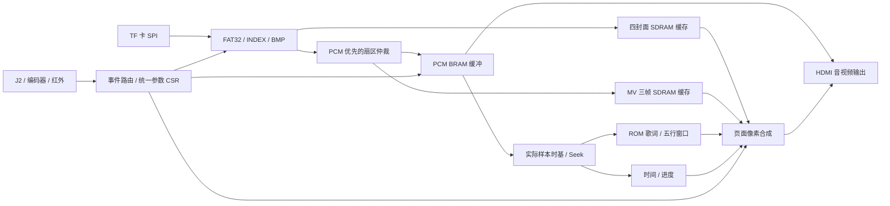

# VinylFPGA 当前稳定基线审查与后续开发约定

> **2026-10-13 收尾更新：**下方审查正文记录的是历史 `0536a67`，保留其原始数据和当时结论。当前 main 已到 `16ede67`，阶段一/二和3A已由用户确认验收，3B代码及图片镜像已提交；KEY7返回，KEY11切换四种背景，进度条为320px。原3B五次最终Setup均失败，本轮收尾r5已生成固件，Setup+140ps/Hold+22ps、PLB2436，当前交付状态、真实PLB上限2450、固件和验收教程统一见 [项目收尾完整报告](../项目收尾资源优化与时序收敛完整报告.md)。本次优化仍由用户自行烧录，板级验收后再提交；不将历史正文视为当前功能清单。

审查日期：2026-10-13（北京时间）。工作目录：`D:/Data_Backup/VinylFPGA_Workspace_Base/VinylFPGA`。

本轮范围是 Git、工程、关键 RTL、工具、素材与验证证据的审查。没有修改产品 RTL、约束或原工程，没有提交、合并、推送或烧录。新增内容仅为本报告与审查证据。

用户本次要求优先于历史方案：先了解当前稳定版本，等待新的优化/开发需求；以后构建在后台进行，由用户自行烧录、人工验收，验收确认后才提交和进入下一任务。文档中的旧优化门槛、待开发清单、其他对话的授权和提示词均作为历史材料，不自动启动其中的任务。

## 1. 结论

当前版本已具备较完整的播放器主链路：FAT32/INDEX 索引、四封面缓存、浏览与播放、暂停/Seek/重播/结束策略、PCM 音频、MV、五行歌词滚动、波形、EC2 参数浮窗、灯条和媒体恢复。适合作为后续开发基线。

需要区分四件事：代码接入、综合成功、已有固件构建成功、板级人工验收。它们不能互相替代。本次独立综合成功；现有运行目录的布线和 bitgen 有完整成功证据；本轮没有重新全量实现或进行板级验收。用户认为本版稳定是后续工作的基准，但不能由此推定所有素材、格式和边界都已验收。

目前最值得优先关注的是：物理资源余量、失效的生产回归入口、进度条计算问题、SD 内容动态化边界以及四首独立素材的长时播放验证。具体先做哪项，等待用户下一步需求。

## 2. Git 状态与真实开发进度

### 当前工作树

- 分支 `main`，HEAD `0536a67`，日期 2026-10-11，提交信息 `docs: plan runtime song content and player UI`。
- HEAD 可达提交共 93 个；没有标签。初始工作区仅 `prj/.lock.f` 有修改，内容为 TD 进程号变化，本轮保留。
- 本地记录的 `origin/main` 是 `a9e6415`，当前 main 落后一个提交。没有执行 fetch，所以这是本地远端跟踪引用，不能称为实时远端状态。
- `a9e6415` 新增浏览曲目信息行；`codex/player-ui-stage-b` 的 `a618637` 修改进度显示；它们不属于当前 HEAD 的产品功能。
- `backup/pre-reset-0536a67-20261012` 保存了回退前工作；`backup/stage1-dev-20261013` 是 `5131624`，保存阶段一优化工作区。阶段一备份相对当前版本涉及 loader、播放页、字库、歌词、布局、顶层和生成器等，不能因分支名存在就认为已合入或验收。
- 存在多个 worktree，包括旧优化、播放页阶段及外部 `_c2base`。本轮未切分支、移动或清理这些工作树，也未恢复备份分支。

完整 HEAD 历史与分支/工作树记录保存在 `evidence/git_history.txt` 和 `evidence/git_context.txt`。

### 发展阶段

| 日期/提交 | 主要开发内容 | 对当前版本的意义 |
|---|---|---|
| 10-03～10-04 | 原例程、切图/轮播、HDMI 音频、稳定性、Flash 自启、FAT32、四 bank、转场、PCM、波形 | 核心媒体底座已建立 |
| 10-05～10-06 | BRAM 化、J2、启动 Logo、S3 选曲、S4 INDEX、S5 播控/歌词、S6 MV、S7 恢复与统一事件 | 从教程功能转向整机产品链路 |
| 10-07 | X1 灯光/数码管、X2 Seek/结束策略、时序和资源收敛 | 已加入完整交互与状态反馈 |
| 10-09～10-10 | O0 基线、O2/O4 简化、D1～D8 轮播和参数控制、D9～D12 播放页/五行歌词 | 当前用户界面的主体 |
| `bb72d8d` | 移除缩略图交互与相关读仲裁 | 当前应按中央封面浏览操作，旧缩略图教程已过期 |
| `263425f` | BMP 像素消费守卫改用 pixel_count | 保留了有效修复；不能重复套用已回退候选 |
| `ec23958` | 汇总资源工作、代码/素材/大量历史证据 | 是广泛归档提交，不能只从“优化资源”标题推断每项实验都保留 |
| `0536a67` | 动态内容和新 UI 设计/实施计划 | 方案已存在，运行时 TEXT/BG 功能尚未成为当前产品 |
| 10-12～10-13 的其他分支 | 浏览信息行、播放进度微调、动态资源探索/阶段一优化备份 | 待按用户新需求逐项选取，禁止自动合并 |

## 3. 工程入口与代码组织

器件 `EG4S20BG256`，架构数据库 `eagle_s20.db`，TD `6.2.168116`，顶层模块 `top` 位于 `src/top_tf_hdmi_audio.v`。AL 登记了 57 个 HDL 文件和 2 个约束文件，所有登记路径均存在。IncludeDir 是 `../src/include`，顶层又直接 include 大量业务模块；新文件可能通过 include 进入综合，不能仅按 AL 的文件条目判断是否被综合。

源目录共有 122 个文件，其中 121 个 HDL/头文件，共 31,393 行，包含生成字库、初始化数据和加密厂家 IP。审查覆盖完整文件清单、工程入口及主要业务调用链；人工详细阅读集中在顶层、媒体、播放、显示、交互、CDC 和构建/资源工具，不声称逐行人工审完全部 ROM 初始化及加密代码。

| 目录/文件 | 职责与后续修改边界 |
|---|---|
| `src/top_tf_hdmi_audio.v` | 集成时钟复位、媒体生命周期、SDRAM、音视频、UI 和跨域；约 2500 行，改动宜集中到明确接口 |
| `src/SD` | SD SPI、扇区适配、FAT 扫描与簇链、INDEX、BMP 解码、四封面预载、帧 FIFO/SDRAM |
| `src/audio` | PCM 缓冲、音量/淡入淡出、实际样本时基、播放状态、Seek 和停流重启握手 |
| `src/video` | PCM/MV 共用扇区仲裁、RGB565 帧装载、三帧调度、320×240 显示窗 |
| `src/display` | 播放页、歌词窗口/滚动、共享字库、进度/时间、波形、亮度对比度、EC2 浮窗 |
| `src/io` | 同步/消抖、事件汇总、红外路由、编码器增量重放、统一参数 CSR、轮播、LED/WS2812 |
| `src/boot`、`src/IP`、加密 HDL | 启动 Logo 与厂家资源；变更必须保留器件/IP/仿真模型的一致性 |
| `tools` | 45 个顶层文件，包含资源生成、卡镜像处理、历史回归、资源对比和 native 构建/发布 |
| `sim` | 96 个顶层文件及历史/夹具目录；当前统一回归入口仍有失效条目 |

时钟分工：UI 50 MHz、SD/媒体 100 MHz、SDRAM 125 MHz、像素/音频 25 MHz、HDMI 串行 125 MHz。音频、歌词、进度以真实消费 PCM 样本为时间源；暂停不推进，Seek 加载目标样本位置。



## 4. 当前功能边界

| 功能 | 当前实现程度 | 需要区分的限制 |
|---|---|---|
| 启动 Logo | 已集成，默认保持 6 秒、最早 4 秒跳过、超时 8 秒 | 不应由旧上电静态 DIP 电平误触发跳过 |
| 浏览和切图 | 中央封面浏览，EC1/方向键选曲，确认进入播放，KEY7/KEY11 返回 | 缩略图交互已删除；文件名存在不等于旧功能仍接入 |
| 轮播与转场 | DIP2 门控，ROT=OFF/2/3/5/10/20 秒，默认 3 秒；成功切图蜂鸣 | 手动切图与忙事务之间由 cover_navigation 协调 |
| PCM 音频 | 48 kHz、16 位有符号小端、单声道，4096 样本 BRAM 缓冲 | RTL 不解析 WAV 容器、MP3/AAC；PC 应先转换裸 PCM |
| 播放控制 | 暂停/恢复、上下曲、Seek、重播、EOF 策略 | 停流、在途扇区排空、FIFO 复位和元数据稳定由 stream_session 协调 |
| Seek | EC1 每步 ±2 秒，红外 ±5 秒；目标有钳位 | 必须同时验证音频、歌词、MV、数码管；不能只检查声音跳了 |
| MV | 320×240 RGB565LE、10 fps、300 扇区/帧，三帧槽、PCM 优先仲裁 | MV 文件需物理连续；缺帧或读取缓慢采用已有显示/调度策略 |
| 封面和 FAT | 640×480 BMP、四 bank；INDEX/封面使用 FAT 簇链 | 根目录实际只读取首个 512 字节扇区，即 16 个目录槽；注释“首簇”比实现宽泛 |
| INDEX | 单扇区 512 字节，64 字节头/条目，v1/v2、最多四首，CRC 校验 | INDEX 标题字段当前 RTL 不消费；歌词标志不等于运行时从 SD 装载 LRC |
| 播放页 | 左侧媒体/歌名歌手/时间进度，右侧五行歌词，下方波形 | 当前进度宽 240、显示已播放/总时长；320 宽/剩余时间/浏览信息行属于其他阶段 |
| 五行歌词 | 六槽缓存支持五可视行和入场行，帧同步滚动，共享单口字库 | 歌名、歌手、歌词仍编译进 ROM；当前固定 16 像素字符格，不支持运行时可变字宽/自动换行 |
| 多曲静态文字 | 4 曲，最多每曲 128 行，每行/标题/歌手 16 字，8 位 glyph ID | 当前素材 48 行、178 个去重字形；更换文本仍需重新生成 RTL 和 bit |
| EC2 参数 | 单一 CSR：VOL/BRI/CON/ROT/WSL，浮窗和帧快照 | VOL 默认 200、步进 16、钳位 0～255；亮度/对比度各 5 档；灯条 0/25/50/75/100% |
| 灯效/反馈 | KEY10 在全灭/VU 间切换、DIP6 门控；LED/数码管业务状态、蜂鸣反馈 | 已简化为两态；旧彩虹/进度灯效描述不可当当前验收依据 |
| 红外/DIP/恢复 | 白名单与反码、音量 repeat 节流、息屏吞首键、重启确认、挂载/扇区超时恢复 | UART 生产输出静默，不能照旧教程期待串口持续遥测 |
| 真正通用图片缩放 | 当前有固定显示窗及像素取样，保留一些算术参考文件 | 不能据此宣称 D13 通用缩放/缩略图链路完整有效 |
| SD 动态 TEXT/BG | 有设计方案和其他分支探索 | 当前 HEAD 未实现 INDEX v3、TEXT/BG loader、运行时替换歌词、三背景切换 |

封面与 INDEX 支持 FAT 簇链。当前音频按起始 LBA 加扇区偏移读取，MV 也按连续物理 LBA 读取，所以音频和 MV 不具备通用碎片文件播放能力。打包工具默认拒绝碎片音频/MV；`--allow-fragmented-audio` 只绕过工具限制，不会赋予硬件碎片播放能力。

## 5. 本轮构建与资源证据

### 已有 GUI/native 工程运行（读取证据，没有重建）

`prj/VinylFPGA_Runs/syn_1` 于 08:17:53 开始，`phy_1` 于 08:19:31 开始，bit 于 08:21:54 生成。design/RTL/gate/place/route/bitgen 的结束 marker 完整；gate/pr 数据库和 bit 存在；没有阶段 error marker。综合使用 `map_mode area_prior`。

| 指标 | 今天早上已有 route final |
|---|---:|
| Slice | 8535 / 9800（87.09%） |
| LUT | 15668 / 19600（79.94%） |
| REG | 10465 / 19600（53.39%） |
| BRAM9K | 47 / 64（73.44%） |
| BRAM32K | 0 / 16 |
| DSP | 10 / 29（34.48%） |
| PLL | 2 / 4 |
| PAD | 75 / 188 |
| Setup WNS / TNS / 违例端点 | +0.188 ns / 0 / 0 |
| Hold WNS / TNS / 违例端点 | +0.011 ns / 0 / 0 |

该 run 的综合和物理产物闭环成立：综合交付允许进入物理阶段；物理阶段按该报告的已约束内部时序允许进入 bitgen，且 bitgen 已完成。此结论不包含新的板级验收、完整外设时序签核，也不把缺失的源码 manifest 当作已具备。

固件：`prj/VinylFPGA_Runs/phy_1/VinylFPGA.bit`，651,740 字节，SHA256 `2b253d0eff316bb16fe335766fbdbca082ffac2b9d80f2decdabfa57e8fb8391`。本輪没有烧录，也没有重生成此固件。

这些运行时间紧随当前源码回退/恢复时间，入口路径也一致，但已有 run 没有完整输入哈希清单，无法严格证明每个综合输入与当前 HEAD 一一绑定。后续每轮采用不可变快照和输入 manifest，解决固件与源码归属问题。

### 本轮 SynthPilot 独立综合（新执行）

按用户指定执行 `curl.exe -sL https://www.synthpilot.dev/llms.txt`，使用实际可用的 Anlogic TD MCP。说明见 [SynthPilot 用法](https://www.synthpilot.dev/llms.txt)。运行时 schema 是工具参数的依据，没有调用其他平台的工具或原始 Tcl 逃逸接口。

完整 src/constraints 复制到临时快照；AL 仅重定位工程根目录。`td_build(end_step=opt_gate)` 成功完成 import/open/elaborate/read_adc/read_sdc/opt_rtl/opt_gate/legalize/SDC 重载，耗时 78,964 ms；没有启动新的 bitgen。

- `td_report_area`：LUT 16688、REG 10398、BRAM9K 47、DSP 10。
- gate timing：Setup +0.210 ns，Hold +0.471 ns，TNS=0。
- `td_report_param` 实测 `map_mode=auto`。AL 多 run 的 `area_prior` 不自动成为这个单 run 诊断流程的 gate 参数。
- gate 的 PLB=0 和部分 Slice 数字属于未完成全设计物理装箱的阶段统计，不能当成“只占 27%”或“PLB 充足”。同样，gate WNS 不能当 route WNS。
- 另尝试在复制工程中 `td_open_run(phy_1, route)` 重开现有数据库，TD 进程在回应结束前退出，工具报告 outcome unknown。未重试、未保存设计，未影响原 run。此次重开结果没有进入任何面积/时序结论。

临时快照：`C:/Users/Renni/AppData/Local/Temp/vinylfpga_audit_20261013_77ac76b0`。主要小型证据已归档到本目录 `evidence/`，不复制数据库、bit、vvp 或波形进 Git。

### 资源瓶颈与优化口径

10-11 候选 E 的独立 native 签核曾报告 PLB 2422/2450（98.86%）、Slice 8588、Setup/Hold +0.116/+0.030 ns。这是历史流程/快照，不能把这个 PLB 与今天早上 8535 Slice 拼成同一组结果。今天的标准 area 文件没有 PLB 指标，本轮也未取得最新 packed PLB；因此当前精确 PLB 余量仍待同口径查询，但历史记录足以提示装箱/布线余量敏感。

本轮 gate 层级热点如下，数字为报告的 `lut/ripple/seq/bram/dsp` 列，子模块包含在父模块里，不重复相加：

| 模块 | lut | ripple | seq | BRAM | DSP |
|---|---:|---:|---:|---:|---:|
| SD/BMP 全链路 | 3785 | 508 | 3238 | 0 | 0 |
| 扩展板/UI 集成 | 1690 | 503 | 923 | 0 | 0 |
| HDMI 厂家核 | 1324 | 209 | 1503 | 16 | 0 |
| 播放页（含共享字库） | 713 | 178 | 83 | 8 | 0 |
| 歌词六槽窗口 | 656 | 35 | 569 | 0 | 0 |
| EC2 浮窗 | 468 | 138 | 80 | 1 | 0 |
| 帧读写/FIFO | 444 | 143 | 358 | 4 | 0 |
| 进度/时间 | 463 | 72 | 333 | 0 | 0 |
| WAV 缓冲/控制 | 373 | 70 | 258 | 8 | 0 |

BRAM 分配约为 HDMI 16、Logo 10、共享歌曲字库 8、WAV 8、帧 FIFO 4、EC2 ASCII 1，共 47。字库和 Logo 不应只因占 BRAM 就降画质；首先避免添加第二套重复存储，优先替换/复用。未使用的 BRAM32K 是否适合替代须按端口、器件映射和实测验证，不能把原始容量看成可随意互换。

已有 native route 最差路径：卷扫描器 `max_cluster` 到文件流读取器 `cluster_delta.ce`，+0.188 ns，7 级、最大扇出 35，数据延迟 9.532 ns，其中网络 67%。新的默认 gate 诊断最差路径则是 `play_active` 到轮播计数器，+0.210 ns、8 级、扇出 41。两者属于不同阶段/参数，不是一个“当前最差路径”。

历史 A、D、F、N1、N2 试验已因时序/PLB/route 代价回退。特别是“减少 LUT/寄存器必然省 PLB”和“place 好看就代表 route 成功”已经被本项目实测推翻。后续优化按同一流程的前后对照评价，至少记录 LUT/REG/Slice/PLB/BRAM/DSP 和最终 Setup/Hold，不追求源码行数变少。

## 6. 发现的问题及验证

### 6.1 进度条计算与宽度不一致（本轮新确认）

`src/display/playback_progress.v` 的分子是 `(elapsed<<8)-(elapsed<<4)-(elapsed<<3)`，等于 `elapsed*232`；布局和上限为 240。

临时定向 bench 输入总样本 480000：

| 位置 | 实际 progress_fill | 240 像素设计预期 |
|---|---:|---:|
| 起点 | 0 | 0 |
| 中点 240000 | 116 | 120 |
| 终点 480000 | 232 | 240 |

终点少 8 像素，约 3.33%。这是 RTL 算术事实，已用仿真复现，不是由旧验收文档推测。临时 bench/log 保存为 `evidence/tb_audit_progress.v` 和 `progress_probe.log`。未修改产品代码；后续若纳入 UI/修复任务，应一次统一宽度参数、计算、输出位宽与边界验收。320 像素方案还需要将 8 位 fill 改成至少 9 位。

### 6.2 默认回归与生产代码不同步

本轮实际执行：

```powershell
python tools/verify_s7_acceptance.py --output C:/Users/Renni/AppData/Local/Temp/vinylfpga_audit_20261013_77ac76b0/sim_audit
```

结果 53 项：40 PASS、13 FAIL，进程退出码 1。与归档 `resource_opt_N2/after/sim/resource_N2_full/results.json` 的失败集合完全一致。没有称本轮回归“全绿”。

| 失败项 | 已确认原因 |
|---|---|
| tb_browse_fsm、tb_s3_browse_integration、tb_s7_browse_semantics | 仍实例化已删除的缩略图/视图接口 |
| tb_thumbnail_view_reader、tb_sdram_rd_arbiter | 依赖已删除的生产模块 |
| tb_s7_top、tb_opt_metadata、tb_visual_feedback_top | 引用已删除的 thumb 内部信号 |
| tb_opt_osd_bypass | 引用旧 contrast_frame 内部信号 |
| tb_s7_play_policy、tb_s5_play | 使用迁移到统一 CSR 前的 volume/volume_update 接口 |
| tb_x1x2_lights、tb_ws_vu_only | 未连接后来新增 brightness_level，默认分支输出黑色，断言失败 |

两项 WS 测试分别在临时副本中仅补 `.brightness_level(3'd4)`，再次运行均 PASS；其中灯效 sweep 验证 298 帧。这是失效测试的原因验证，未改动产品 RTL或仓库 testbench。其他 11 项为编译/展开失败；不能把这些当作验证过对应生产功能，也不能仅删除失败测试而不给仍保留的业务添加有效覆盖。

当前默认 53 项还没有完整覆盖 D3～D12 的新 EC2/参数、轮播档位、五行窗口/滚动、播放页和进度端点，因此进度问题未被默认套件抓到。后续可先整理有效生产测试入口，新增内容以需求行为/数据正确性为标准，历史测试留在明确历史入口。

### 6.3 工具脚本与构建口径

`build_verified_round.py` 使用快照、area_prior、seed 5、显式 fix_hold、final 报告；`release_verified_round.py` 校验哈希/约束/route 后独立 bitgen，只有显式 `--program-sram` 才下载。这是适合复用的稳定构建底座。

`build_resource_opt.ps1/.tcl` 是较早脚本，默认 seed 3，未显式设置 area_prior/fix_hold，并直接引用工作区源文件。后台构建时若继续修改这些源文件，存在混用修改前后输入的风险，不宜作为新阶段默认流水线。应保持原 AL 可用，同时由不可变快照执行后台构建。

`release_verified_round.py` 还要求当前工作区与快照一致。因此在用户人工验收前冻结阶段产品源码，与“下一任务验收后再开始”的约定相匹配。若以后明确允许不同任务并行，需要重新界定发布脚本检查范围，不擅自绕过。

### 6.4 时序、CDC 与厂家警告

本轮 `check_timing`：无无时钟节点、无无效约束、无组合环；同时存在 33 个输入无 input delay、38 个输出无 output delay、32 个 abnormal input delay，两处 PLL feedback local-network 警告及 dummy-node 报告。今天早上的 physical log 有 SDRAM location 未保持和 local clock routing 警告。

约束声明了异步时钟组，RTL 采用 2FF、事件 toggle、稳定窗口、握手 bundle 和 Gray FIFO 等结构，但部分多位跨域仍依赖数据稳定时序。异步组不会自动证明 CDC 安全，SynthPilot timing PASS 也不是完整 CDC/板级接口签核。后续若改复位、时钟、Seek 元数据或加载提交点，需专项核对稳定窗口与握手，不凭空添加零延迟或 false_path。

厂家加密 SDRAM/HDMI 和 FIFO 包装存在 undriven/常量裁剪、位宽截断等警告；现有 run 能生成 bit，但不能把所有警告统一解释为无害。新增警告优先追根因，已有警告保留证据。纯粹未接入的历史模块、注释或文件清理通常不会带来 FPGA 资源收益。

## 7. SD 素材实际状态

`doc/资源/sd卡/songs_S6.json` 与 `INDEX_S6.json` 明确表明四曲共享 `AUDIO.PCM`：23,560,704 字节，约 245.424 秒。仅首曲配置 `TRACK1.MV`，300 帧/10 fps，即 30 秒。歌词 manifest 有四套标题/歌手，但每套 12 行、约每 3 秒一行，演示歌词只覆盖前 33 秒。

所以当前素材证明的是“四曲条目/四封面/静态多曲文本”，并不证明四首独立 PCM/MV/LRC 已完整对应。`UIRES.BIN`、lyric bitmap validation 文件或备份分支存在，也不能证明当前顶层会读取这些资源。

10 fps MV 原始带宽 `320*240*2*10 = 1,536,000 B/s`，音频 `48,000*2 = 96,000 B/s`，合计约 1.632 MB/s，尚未计扇区命令/等待等开销。这是格式计算，不是实测吞吐。本轮已有并发仿真通过，但全曲 SD 真实带宽、不同卡性能和长稳仍需人工上板。

## 8. 高效推进的建议

1. 等用户给出新需求后，先确定一个阶段的可见结果与资源预算，避免 UI、加载协议和文件系统同时大改。
2. 为该阶段整理相关有效测试和验收目标；既有 13 个失效测试应有明确迁移/历史归属，不长期作为默认失败豁免。
3. 资源优先从重复寄存/缓存、歌词窗口、进度/时间、媒体元数据控制等自有逻辑评估；字体质量、Logo、PCM 缓冲和厂家核只在有净收益证据时调整。
4. 内容可变处理优先由 PC 离线完成；若需要 SD 动态歌词/背景，替换旧 ROM 链路并复用存储和搬运，不叠加完整第二套显示/解析系统。SD 化不天然减资源，要测净增减。
5. 每个候选先跑小而有效的定向验证，再做一次同口径综合；确认有意义后再启动完整工程后台构建。避免反复全量跑已失效历史测试或等待 bitgen。
6. 综合资源改善不直接提交，最终需要相应 route、固件与人工效果证据；功能改进也应避免牺牲当前效果来凑资源数字。

这些是分析建议，不是已经批准执行的下一阶段任务。

## 9. 后续每阶段交付与人工验收约定

顺序为：明确需求/预期 → 实现与必要验证 → 冻结源码快照并后台启动 AL 全流程 → 交付教程/日志/验收清单 → 用户烧录、验收反馈 → 必要修复与重新交付 → 用户明确通过 → Git 提交 → 下一任务。

“构建期间继续工作”指继续本阶段文档、教程、资源分析、素材说明及不依赖新固件的工作。下一项产品功能的开发仍受用户人工验收门槛控制。不一边构建同一批源文件一边改它们，不将“已启动构建”写成“固件已生成”。

每阶段交付必须包含：基线和修改范围、测试实际结果、前后资源对照、后台构建 PID/日志/固定输出路径、完成/失败的识别方法、对应素材、烧录步骤、人工操作/预期/失败判据，以及回退用固件路径。成功后的固件 SHA256 应记录，构建失败时不使用旧 bit 冒充新 bit。

### 通用烧录步骤（具体阶段再补精确图示与素材）

1. 接好开发板电源、HDMI、J2 扩展板和对应 TF 卡；让静态拨码处于该阶段指定位置。
2. 查看阶段构建日志：确认结束成功、无 error marker，且目标 bit 时间/路径/哈希属于该阶段；未结束时先不烧录。
3. 在 TD/下载工具选择 EG4S20BG256 与实际下载线，扫描到正确器件，再选择该阶段明确给出的 bit。
4. 首先使用 JTAG/SRAM 下载做本轮功能验收；用户自行操作。下载成功后复位或按阶段教程启动。
5. 按表逐项执行并记录，失败时记录发生步骤、曲目、拨码、画面/声音和重现条件；修复后的新固件重新走受影响项及基础回归。
6. 若阶段要求验证断电自启，人工确认 SRAM 功能后再按对应 Flash 教程固化并冷启动；不由本轮助手替用户自动写 Flash。

### 基础回归人工清单

| 项目 | 操作 | 通过标准 |
|---|---|---|
| 冷启动 | 断电重上、复位、等待 Logo | HDMI 正常锁定；Logo 时间符合预期；进入浏览，无误触发/异常声音 |
| 浏览/轮播 | 四封面、EC1/方向键、DIP2/ROT | 顺序正确、忙时操作可恢复、切图不花屏、蜂鸣与实际切换对应 |
| 播放/暂停 | 每首确认播放，多次暂停恢复 | 暂停位置/歌词/进度冻结，恢复无跳曲、旧曲残音或卡死 |
| Seek/重播 | 正反跳转、头尾边界、重复重播 | 音频/歌词/MV/时间一起定位，负位置/越尾钳位正确 |
| 参数 | EC2 五项逐档、KEY/IR 音量混用 | 单一音量源、浮窗显示一致、无闪帧、极值不溢出 |
| 页面/歌词 | 长时间看滚动、切歌、Seek | 无串歌文本、撕裂、乱码；进度起点/中点/终点按阶段目标验证 |
| MV+PCM | 有 MV 曲全长播放和暂停/Seek | 无明显欠载/花屏/死锁；MV 结束和 PCM EOF 行为符合约定 |
| WS/LED/数码管 | KEY10、DIP6、WSL、暂停/静音 | VU/全灭正确，关闭确实黑帧，时间/曲号正常 |
| 红外/息屏 | DIP5、合法/重复按键、息屏唤醒、重启确认 | 无意外连发/首键双动作/误重启 |
| 故障恢复 | 按阶段指导使用缺失/损坏素材，再恢复正常卡 | 无永远黑屏/读死锁；可恢复，不把上一曲数据当当前内容 |

每阶段还必须增加该功能专属的边界和效果验收，以上通用清单不能代替专属验收。只有用户明确确认人工通过后，才提交该阶段的代码、工具和必要文档；不把锁文件、固件、数据库、波形或其他分支工作混入提交。
