# 第8课 OSD字幕叠加

> **本节课解决赛题哪点**：扩展要求第1点——图层叠加与字幕效果：在图片播放时叠加动态文字，探索多图层混合与平滑滚动。这是扩展要求中最基础、最容易出效果的一项，建议优先实现。

---

## 一、官方例程的OSD能力与局限

### 1.1 官方例程有什么

官方例程`lab_ex_4`的视频链路中，**没有专门的OSD叠加模块**。视频数据从SDRAM读出后，直接经过video_delay延迟对齐，然后送到HDMI发射器输出。屏幕上只有BMP图片，没有任何文字叠加。

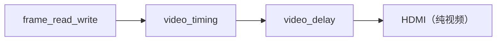

官方例程能显示图片，但屏幕上没有任何状态信息。你不知道当前是第几张图片、是自动还是手动轮播、有没有错误。出了问题只能靠猜。

### 1.2 官方例程的3个局限


> **Note：** ①官方例程没有OSD叠加模块，视频数据直接输出，屏幕上只有BMP图片；②没有状态显示，不知道当前是第几张图片、自动还是手动、有没有错误，调试全靠猜；③没有多图层混合能力，只能显示一层图片，不能叠加文字、图标等多层内容。

---

## 二、OSD叠加的核心原理

### 2.1 像素级替换原理

OSD（On-Screen Display，屏幕显示）的核心原理很简单：**在视频数据流中，判断当前像素是否在OSD区域内，如果是，用OSD颜色替换原始像素；否则透传原始像素**。

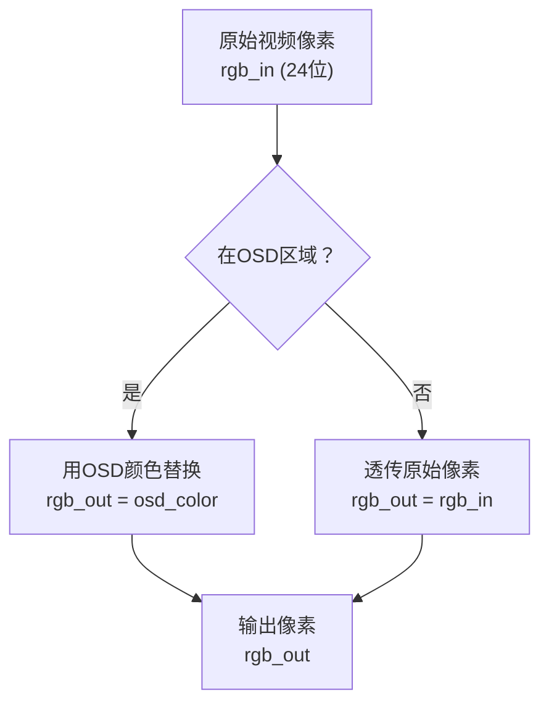

**关键信号**：
- `pixel_x` / `pixel_y`：当前像素的坐标（由视频时序模块提供）
- `OSD_X` / `OSD_Y`：OSD区域的左上角坐标（参数配置） 
- `osd_hit`：当前像素是否在OSD区域内（组合逻辑判断）
- `rgb_in` / `rgb_out`：输入/输出像素

**坐标判断逻辑**：
```verilog
osd_hit = (pixel_x >= OSD_X && pixel_x < OSD_X + OSD_WIDTH &&
           pixel_y >= OSD_Y && pixel_y < OSD_Y + OSD_HEIGHT);
```

这就是最基础的OSD叠加原理。一个矩形区域，用纯色替换原始像素。但这样只能显示一个色块，不能显示文字。要显示文字，需要字体渲染。

### 2.2 点阵字体渲染原理

要在OSD区域显示文字，需要用**点阵字体**。每个字符用一个像素矩阵表示，矩阵中1表示前景色（文字），0表示背景色（透明或背景色）。

**5×7点阵字体**：每个字符用5列×7行的点阵表示，加上字符间距，实际占用8×8像素。

**图2.2a 字符"1"的5×7点阵：**

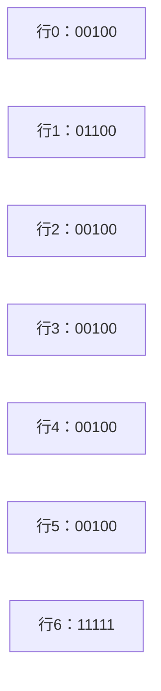

**图2.2b 字体渲染流程：**

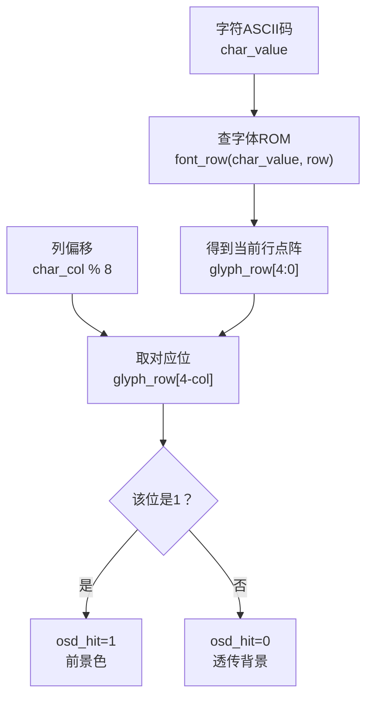

**字体ROM实现**：完赛工程用一个`font_row`函数实现字体ROM，输入字符值和行号，输出该行的5位点阵。支持的字符包括0-9、A、E、F。以下是完整代码（来自 `status_osd_overlay.v` 第42~63行）：

```verilog
function [4:0] font_row;
    input [3:0] value;   // 字符值（0-F）
    input [2:0] row;     // 行号（0-6）
    begin
        case (value)
            // 字符"0"：外框，内部空
            4'h0: case(row)
                0:font_row=5'b11111; 1:font_row=5'b10001;
                2:font_row=5'b10001; 3:font_row=5'b10001;
                4:font_row=5'b10001; 5:font_row=5'b10001;
                default:font_row=5'b11111;
            endcase
            // 字符"1"：右侧竖线+顶部斜
            4'h1: case(row)
                0:font_row=5'b00100; 1:font_row=5'b01100;
                2:font_row=5'b00100; 3:font_row=5'b00100;
                4:font_row=5'b00100; 5:font_row=5'b00100;
                default:font_row=5'b11111;
            endcase
            // 字符"2"
            4'h2: case(row)
                0:font_row=5'b11111; 1:font_row=5'b00001;
                2:font_row=5'b00001; 3:font_row=5'b11111;
                4:font_row=5'b10000; 5:font_row=5'b10000;
                default:font_row=5'b11111;
            endcase
            // 字符"3"
            4'h3: case(row)
                0:font_row=5'b11111; 1:font_row=5'b00001;
                2:font_row=5'b00001; 3:font_row=5'b11111;
                4:font_row=5'b00001; 5:font_row=5'b00001;
                default:font_row=5'b11111;
            endcase
            // 字符"4"
            4'h4: case(row)
                0:font_row=5'b10001; 1:font_row=5'b10001;
                2:font_row=5'b10001; 3:font_row=5'b11111;
                4:font_row=5'b00001; 5:font_row=5'b00001;
                default:font_row=5'b00001;
            endcase
            // 字符"5"
            4'h5: case(row)
                0:font_row=5'b11111; 1:font_row=5'b10000;
                2:font_row=5'b10000; 3:font_row=5'b11111;
                4:font_row=5'b00001; 5:font_row=5'b00001;
                default:font_row=5'b11111;
            endcase
            // 字符"6"
            4'h6: case(row)
                0:font_row=5'b11111; 1:font_row=5'b10000;
                2:font_row=5'b10000; 3:font_row=5'b11111;
                4:font_row=5'b10001; 5:font_row=5'b10001;
                default:font_row=5'b11111;
            endcase
            // 字符"7"
            4'h7: case(row)
                0:font_row=5'b11111; 1:font_row=5'b00001;
                2:font_row=5'b00010; 3:font_row=5'b00100;
                4:font_row=5'b01000; 5:font_row=5'b01000;
                default:font_row=5'b01000;
            endcase
            // 字符"8"
            4'h8: case(row)
                0:font_row=5'b11111; 1:font_row=5'b10001;
                2:font_row=5'b10001; 3:font_row=5'b11111;
                4:font_row=5'b10001; 5:font_row=5'b10001;
                default:font_row=5'b11111;
            endcase
            // 字符"9"
            4'h9: case(row)
                0:font_row=5'b11111; 1:font_row=5'b10001;
                2:font_row=5'b10001; 3:font_row=5'b11111;
                4:font_row=5'b00001; 5:font_row=5'b00001;
                default:font_row=5'b11111;
            endcase
            // 字符"A"（Auto自动模式）
            4'ha: case(row)
                0:font_row=5'b01110; 1:font_row=5'b10001;
                2:font_row=5'b10001; 3:font_row=5'b11111;
                4:font_row=5'b10001; 5:font_row=5'b10001;
                default:font_row=5'b10001;
            endcase
            // 字符"E"（手动模式）
            4'he: case(row)
                0:font_row=5'b11111; 1:font_row=5'b10000;
                2:font_row=5'b10000; 3:font_row=5'b11110;
                4:font_row=5'b10000; 5:font_row=5'b10000;
                default:font_row=5'b11111;
            endcase
            // 字符"F"（错误码十六进制用）
            4'hf: case(row)
                0:font_row=5'b11111; 1:font_row=5'b10000;
                2:font_row=5'b10000; 3:font_row=5'b11110;
                4:font_row=5'b10000; 5:font_row=5'b10000;
                default:font_row=5'b10000;
            endcase
            default: font_row = 5'b00000;  // 不支持的字符不显示
        endcase
    end
endfunction
```

**点阵编码规则**：每行5位，`5'b11111`表示5个像素全亮，`5'b10001`表示左右两端亮中间暗。位`[4]`对应最左边的像素，位`[0]`对应最右边。第6行（default）通常是底线`5'b11111`，第7行留空作为行间距。

**字符渲染组合逻辑**（来自 `status_osd_overlay.v` 第65~88行）：这是OSD的核心，纯组合逻辑，每个像素时钟都在计算：

```verilog
always @* begin
    osd_hit = 1'b0;
    char_value = 4'h0;
    char_row = pixel_y - OSD_Y;       // 当前像素在字符内的行号（0-7）
    char_col = pixel_x - OSD_X;       // 当前像素在OSD区域内的列号（0-31）
    glyph_row = 5'b00000;

    // 判断当前像素是否在OSD区域内（32×8）
    if (pixel_x >= OSD_X && pixel_x < OSD_X + 32 &&
        pixel_y >= OSD_Y && pixel_y < OSD_Y + 8) begin

        // 根据列号/8确定是第几个字符（0-3）
        case ((pixel_x - OSD_X) / 8)
            0: char_value = {2'b00, index_q} + 1'b1;  // 字符0：图片编号1-4
            1: char_value = auto_q ? 4'ha : 4'he;      // 字符1：A(自动)/E(手动)
            2: char_value = error_q[7:4];              // 字符2：错误码高4位
            3: char_value = error_q[3:0];              // 字符3：错误码低4位
            default: char_value = 4'h0;
        endcase

        // 查字体ROM，得到当前行的5位点阵
        glyph_row = font_row(char_value, char_row);

        // 列号%8 < 5：字符的5个有效列（后3列是间距）
        // char_row < 7：只显示7行（第8行是行间距）
        if ((pixel_x - OSD_X) % 8 < 5 && char_row < 7)
            // glyph_row[4 - 列偏移]：取当前列对应的点阵位
            osd_hit = glyph_row[4 - ((pixel_x - OSD_X) % 8)];
    end

    out_de = in_de;
    out_rgb = in_rgb;
    // OSD像素替换颜色：无错误黄色，有错误红色
    if (in_de && osd_hit)
        out_rgb = error_q == 0 ? 12'hff0 : 12'hf44;
end
```

**逐行讲解**：
1. `char_row = pixel_y - OSD_Y`：当前像素距离OSD顶部多少行，就是字符的行号（0~7）。
2. `char_col = pixel_x - OSD_X`：当前像素距离OSD左边多少列（0~31）。
3. `(pixel_x - OSD_X) / 8`：整数除法，每8像素一个字符，结果0~3，确定当前是第几个字符。
4. `(pixel_x - OSD_X) % 8`：取模运算，得到字符内的列偏移（0~7）。0~4是字符点阵，5~7是字符间距。
5. `glyph_row[4 - 列偏移]`：列偏移0取最高位（最左像素），列偏移4取最低位（最右像素）。
6. 颜色选择：`error_q==0`时黄色`12'hff0`（R=F,G=F,B=0），有错误时红色`12'hf44`。

**字符布局**：4个字符横向排列，每个字符8×8像素，OSD区域总共32×8像素。

| 字符位置 | X范围 | 内容 |
|---------|-------|------|
| 第1个字符 | OSD_X+0 ~ OSD_X+7 | 图片编号（1-4） |
| 第2个字符 | OSD_X+8 ~ OSD_X+15 | 自动(A)/手动(E) |
| 第3个字符 | OSD_X+16 ~ OSD_X+23 | 错误码高4位 |
| 第4个字符 | OSD_X+24 ~ OSD_X+31 | 错误码低4位 |

### 2.3 帧边界锁存（避免撕裂）

OSD显示的状态（图片编号、自动/手动、错误码）可能在一帧内发生变化。如果在一帧中间变化，上半帧显示旧状态，下半帧显示新状态，就会出现**撕裂**。

**解决方法**：在`frame_start`（帧开始，vsync上升沿）时锁存状态，一帧内使用锁存后的状态，下一帧再更新。

**wire frame_start = vs_q && !vsync;**

**vs_q是vsync打一拍，当前vsync为高、上一拍vsync为低，就是下降沿（注意vsync是低有效，同步脉冲期间拉低，所以vs_q=1、当前vsync=0这个时刻是同步脉冲开始，正好标记新一帧）**

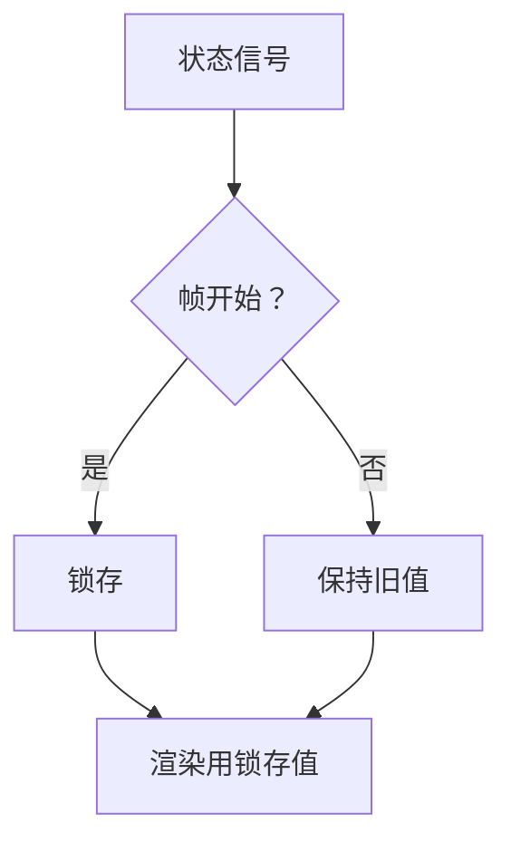

```verilog
always @(posedge clk or negedge rst_n) begin
    if (!rst_n) begin
        index_q <= 2'd0;
        auto_q <= 1'b0;
        error_q <= 8'd0;
    end else if (frame_start) begin
        index_q <= active_index;
        auto_q <= auto_enabled;
        error_q <= error_code;
    end
end
```

这样，一帧内OSD显示的状态是固定的，不会出现撕裂。状态变化会在下一帧生效，人眼看到的是平滑的状态切换。

**跨时钟域字幕帧提交**（`subtitle_frame_commit.v`，51行）：如果字幕文本来自另一个时钟域（比如UART接收在控制时钟域，OSD渲染在像素时钟域），还需要跨时钟域提交。完赛工程用toggle+2FF同步+帧边界提交三步完成：

```verilog
module subtitle_frame_commit (
    input  wire         src_clk,        // 源时钟（控制域）
    input  wire         src_rst_n,
    input  wire         src_commit,     // 源域提交脉冲
    input  wire [95:0]  src_text,       // 源域文本（最多16个字符×6位）
    input  wire [5:0]   src_length,     // 文本长度
    input  wire         src_enable,     // 字幕使能
    input  wire         dst_clk,        // 目标时钟（像素域）
    input  wire         dst_rst_n,
    input  wire         frame_start,    // 帧开始（只在帧边界更新）
    output reg  [95:0]  dst_text,       // 目标域文本
    output reg  [5:0]   dst_length,
    output reg          dst_enable
);
    reg commit_toggle;   // 源域：提交时翻转
    reg commit_sync1;    // 目标域：2FF第一级
    reg commit_sync2;    // 目标域：2FF第二级
    reg commit_seen;     // 目标域：已处理的toggle值
    reg dst_initialized; // 目标域：首次初始化标志

    //第一步： 源域：收到提交脉冲就翻转toggle
    always @(posedge src_clk or negedge src_rst_n) begin
        if (!src_rst_n)
            commit_toggle <= 1'b0;
        else if (src_commit)
            commit_toggle <= ~commit_toggle;//收到提交就翻转
    end

    // 第二步：目标域：2FF同步 + 帧边界提交
    always @(posedge dst_clk or negedge dst_rst_n) begin
        if (!dst_rst_n) begin
            commit_sync1 <= 0;
            commit_sync2 <= 0;
            commit_seen <= 0;
            dst_initialized <= 0;
            dst_text <= 0;
            dst_length <= 0;
            dst_enable <= 0;
        end else begin
            // 2FF同步toggle信号
            commit_sync1 <= commit_toggle;
            commit_sync2 <= commit_sync1;
            
            // 第三步：只在帧开始时更新文本（帧边界提交，避免撕裂）
            if (frame_start && (!dst_initialized || commit_sync2 != commit_seen)) begin
                dst_text <= src_text;           //96位文本
                dst_length <= src_length;       //长度
                dst_enable <= src_enable;
                commit_seen <= commit_sync2;
                dst_initialized <= 1'b1;
            end
        end
    end
endmodule
```

**关键点**：
1. `commit_toggle`在源域翻转，不是脉冲而是电平翻转，跨时钟域不会丢。
2. `commit_sync1/2`是两级触发器同步，防止亚稳态。
3. `commit_sync2 != commit_seen`检测是否有新的提交（toggle值变了）。
4. 文本数据只在`frame_start`时更新，保证一帧内字幕不变，不会撕裂。
5. `dst_initialized`保证上电后第一帧就有初始文本，不用等第一次提交。

### 2.4 多图层混合（Alpha混合原理）

基础OSD是"像素级替换"——要么显示OSD，要么显示背景，二选一。但扩展要求提到"多图层混合"，这就需要**Alpha混合**。

**Alpha混合原理**：每个像素有一个Alpha值（0-255，0表示完全透明，255表示完全不透明），最终颜色是前景色和背景色按Alpha值加权混合。

```
最终颜色 = 前景色 × Alpha/255 + 背景色 × (1 - Alpha/255)
```

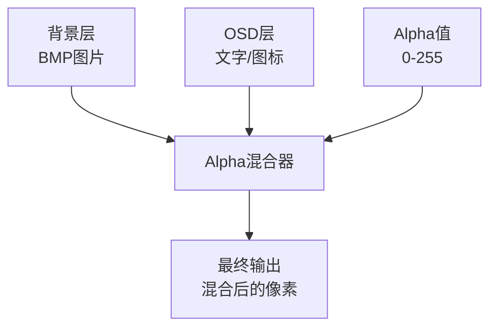

**多层叠加顺序**：从底层到顶层依次混合。比如背景层→OSD层→光标层，先混合背景和OSD，再混合结果和光标。

**FPGA实现**：Alpha混合需要乘法器，24位RGB×8位Alpha，每个通道一个乘法器，共3个乘法器。EG4S20有足够的乘法器资源（DSP块），实现Alpha混合没有问题。如果乘法器不够，也可以用移位近似（比如Alpha=128就是右移1位，Alpha=64就是右移2位）。但效果不如精确乘法

**完赛工程的做法**：当前OSD用的是"像素级替换"（osd_hit时替换，否则透传），没有用Alpha混合。但架构上预留了Alpha混合的扩展空间——如果要实现半透明OSD，只需要把`rgb_out = osd_color`改成`rgb_out = alpha_blend(rgb_in, osd_color, alpha)`即可。

### 2.5 动态文字与平滑滚动

扩展要求提到"动态文字"和平滑滚动"。动态文字就是OSD显示的内容会随时间变化（比如时间戳、滚动字幕）。平滑滚动就是文字从右往左移动，像新闻字幕一样。

**滚动字幕实现原理**：

1. 维护一个滚动偏移量`scroll_offset`，每帧递增
2. 渲染文字时，X坐标减去`scroll_offset`
3. 当文字完全滚出屏幕时，重置`scroll_offset`

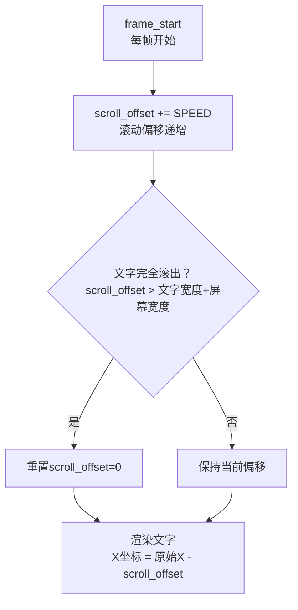

**滚动速度控制**：SPEED参数控制滚动速度，比如每帧移动1像素，60fps的话就是60像素/秒。可以通过参数调整。

**完赛工程的做法**：当前OSD是静态的4个字符状态显示，没有实现滚动字幕。但滚动字幕的实现很简单，只需要加一个scroll_offset计数器，渲染时X坐标减去偏移量即可。如果要实现，可以参考上面的原理。

---

## 三、从官方到完赛的过渡思路

### 3.1 整体架构对比

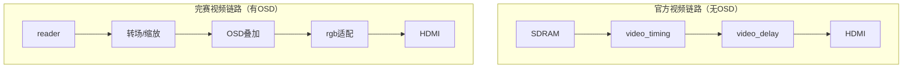

**核心差异**：
1. **新增OSD叠加模块**：完赛工程在视频链路中插入了`osd_overlay_24`模块，负责状态文字叠加
2. **状态信息输入**：osd_overlay_24接收active_index（当前图片编号）、auto_enabled（自动/手动）、error_code（错误码），渲染成4个字符的状态条
3. **像素Y坐标重建**：osd_overlay_24内部用line_y计数器从vsync/de信号重建pixel_y，不需要视频时序模块额外输出Y坐标
4. **12位→24位颜色扩展**：内部status_osd_overlay用12位颜色（节省资源），osd_overlay_24扩展为24位输出

### 3.2 osd_overlay_24 模块详解

完赛工程的OSD叠加顶层模块是`osd_overlay_24.v`（约75行），是24位RGB的封装。

**端口分类**：

| 信号 | 方向 | 说明 |
|------|------|------|
| clk / rst_n | 输入 | 时钟/复位（像素时钟域） |
| vsync / de | 输入 | 视频同步信号（用于重建Y坐标和帧开始） |
| rgb_in / rgb_out | 输入/输出 | 输入/输出24位RGB像素 |
| pixel_x | 输入 | 当前像素X坐标（10位） |
| active_index | 输入 | 当前图片编号（2位，0-3） |
| auto_enabled | 输入 | 自动轮播使能（1位） |
| error_code | 输入 | 错误码（8位） |
| de_out / osd_active | 输出 | 输出DE/OSD激活标志 |

**内部结构**：

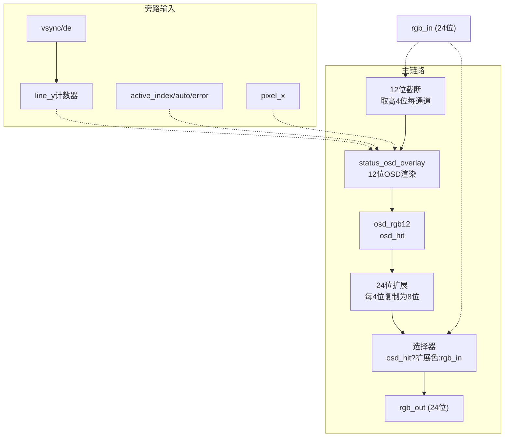

**关键设计决策**：
1. **Y坐标重建**：内部用line_y计数器，vsync低电平时清零，de下降沿时递增。这样不需要视频时序模块额外输出pixel_y，减少接口信号
2. **12位内部颜色**：status_osd_overlay用12位颜色（RGB各4位），节省资源。osd_overlay_24把12位扩展为24位（每个4位通道复制为8位，比如4'hF→8'hFF）
3. **纯组合逻辑输出**：osd_overlay_24的rgb_out是组合逻辑，没有流水线延迟，视频时序对齐不受影响

**完整代码**（`osd_overlay_24.v`，75行）：

```verilog
`timescale 1ns/1ps

// 24位RGB封装器，内部调用12位status_osd_overlay
module osd_overlay_24 #(
    parameter integer OSD_X = 8,   // OSD区域左上角X坐标
    parameter integer OSD_Y = 8    // OSD区域左上角Y坐标
) (
    input  wire        clk,
    input  wire        rst_n,
    input  wire        vsync,       // 场同步（低有效）
    input  wire        de,          // 数据使能
    input  wire [23:0] rgb_in,      // 输入24位RGB
    input  wire [9:0]  pixel_x,     // 当前像素X坐标
    input  wire [1:0]  active_index,// 当前图片编号（0-3）
    input  wire        auto_enabled,// 自动轮播使能
    input  wire [7:0]  error_code,  // 错误码
    output wire [23:0] rgb_out,     // 输出24位RGB
    output wire        de_out,
    output wire        osd_active   // OSD像素标志
);
    // ---- Y坐标重建：从vsync/de信号恢复pixel_y ----
    reg [11:0] line_y;   // 当前行号
    reg de_q;            // de打一拍，用于检测下降沿
    reg vs_q;            // vsync打一拍，用于检测下降沿（帧开始）
    wire frame_start = vs_q && !vsync;  // vsync下降沿=帧开始

    always @(posedge clk or negedge rst_n) begin
        if (!rst_n) begin
            line_y <= 12'd0;
            de_q <= 1'b0;
            vs_q <= 1'b1;
        end else begin
            de_q <= de;
            vs_q <= vsync;
            // vsync低电平时行计数器清零（场消隐期间）
            if (!vsync)
                line_y <= 12'd0;
            // de下降沿=一行有效像素结束，行号+1
            else if (de_q && !de)
                line_y <= line_y + 1'b1;
        end
    end

    // ---- 例化12位OSD核心 ----
    wire [11:0] osd_rgb12;
    wire osd_hit;

    status_osd_overlay #(
        .OSD_X(OSD_X),
        .OSD_Y(OSD_Y)
    ) u_osd (
        .clk(clk), .rst_n(rst_n),
        .frame_start(frame_start),
        .active_index(active_index), .auto_enabled(auto_enabled),
        .error_code(error_code),
        .in_de(de),
        // 24位截断为12位：每通道取高4位
        .in_rgb({rgb_in[23:20], rgb_in[15:12], rgb_in[7:4]}),
        .pixel_x({2'b00, pixel_x}),
        .pixel_y(line_y),
        .out_rgb(osd_rgb12),
        .out_de(),
        .osd_pixel(osd_hit)
    );

    // ---- 12位OSD颜色扩展为24位 ----
    // 非OSD像素透传原始24位值；OSD像素把12位高亮色扩展为24位
    // 扩展方法：每个4位通道复制两份，如4'hF→8'hFF，4'h4→8'h44
    assign rgb_out = osd_hit ?
        {osd_rgb12[11:8], osd_rgb12[11:8],   // R高4位复制
         osd_rgb12[7:4],  osd_rgb12[7:4],    // G高4位复制
         osd_rgb12[3:0],  osd_rgb12[3:0]}    // B高4位复制
        : rgb_in;
    assign de_out = de;
    assign osd_active = osd_hit;
endmodule
```

**代码要点**：
- 第25~45行是Y坐标重建逻辑。视频时序模块只输出了`pixel_x`（X坐标），没有输出Y坐标。这里用`line_y`计数器从vsync/de信号恢复：vsync低电平期间清零，每行de结束（下降沿）时加1。
- 第58行把24位RGB截断为12位：`{rgb_in[23:20], rgb_in[15:12], rgb_in[7:4]}`，每通道取高4位。
- 第69~72行把12位OSD颜色扩展回24位：每个4位 nibble 复制两份。比如黄色`12'hff0`扩展后是`24'hFFFF00`，红色`12'hf44`扩展后是`24'hFF4444`。

### 3.3 status_osd_overlay 模块详解

实际的OSD渲染模块是`status_osd_overlay.v`（约91行），负责渲染4个字符的状态条。

**渲染内容**：

| 字符位置 | 内容 | 字符值 |
|---------|------|--------|
| 第1个 | 图片编号（1-4） | index_q + 1 |
| 第2个 | 自动(A)/手动(E) | auto_q ? A : E |
| 第3个 | 错误码高4位 | error_q[7:4] |
| 第4个 | 错误码低4位 | error_q[3:0] |

**颜色规则**：
- 无错误（error_q==0）：绿色（12'hff0）
- 有错误（error_q!=0）：红色（12'hf44）

**OSD区域**：32×8像素（4个字符×8像素宽，1行×8像素高），默认位置(8,8)。

**字体**：5×7点阵字体，支持0-9、A、E、F。每个字符实际占用5像素宽+3像素间距=8像素，7像素高+1像素间距=8像素。

**帧边界锁存**：frame_start时锁存active_index/auto_enabled/error_code到index_q/auto_q/error_q，一帧内使用锁存值，避免撕裂。

**完整代码**（`status_osd_overlay.v`，91行）：

```verilog
`timescale 1ns/1ps

module status_osd_overlay #(
    parameter integer OSD_X = 8,
    parameter integer OSD_Y = 8
) (
    input  wire        clk,
    input  wire        rst_n,
    input  wire        frame_start,   // 帧开始（锁存状态）
    input  wire [1:0]  active_index,  // 当前图片编号
    input  wire        auto_enabled,  // 自动/手动
    input  wire [7:0]  error_code,    // 错误码
    input  wire        in_de,
    input  wire [11:0] in_rgb,        // 输入12位RGB
    input  wire [11:0] pixel_x,
    input  wire [11:0] pixel_y,
    output reg  [11:0] out_rgb,       // 输出12位RGB
    output reg         out_de,
    output wire        osd_pixel      // OSD像素标志
);
    // ---- 帧边界锁存寄存器 ----
    reg [1:0] index_q;    // 锁存的图片编号
    reg auto_q;           // 锁存的自动/手动
    reg [7:0] error_q;    // 锁存的错误码

    always @(posedge clk or negedge rst_n) begin
        if (!rst_n) begin
            index_q <= 2'd0;
            auto_q <= 1'b0;
            error_q <= 8'd0;
        end else if (frame_start) begin
            // 只在帧开始时更新，一帧内保持不变
            index_q <= active_index;
            auto_q <= auto_enabled;
            error_q <= error_code;
        end
    end

    // ---- 字体ROM函数（完整点阵见2.2节） ----
    // function [4:0] font_row; ... endfunction
    // （代码见2.2节完整font_row函数，此处不再重复）

    // ---- 像素渲染组合逻辑 ----
    reg osd_hit;
    reg [3:0] char_value;
    reg [2:0] char_row;
    reg [2:0] char_col;
    reg [4:0] glyph_row;

    always @* begin
        osd_hit = 1'b0;
        char_value = 4'h0;
        char_row = pixel_y - OSD_Y;
        char_col = pixel_x - OSD_X;
        glyph_row = 5'b00000;

        // OSD区域：32像素宽×8像素高
        if (pixel_x >= OSD_X && pixel_x < OSD_X + 32 &&
            pixel_y >= OSD_Y && pixel_y < OSD_Y + 8) begin

            // 4个字符，每个8像素宽
            case ((pixel_x - OSD_X) / 8)
                0: char_value = {2'b00, index_q} + 1'b1; // 图片编号1-4
                1: char_value = auto_q ? 4'ha : 4'he;     // A自动/E手动
                2: char_value = error_q[7:4];             // 错误码高半字节
                3: char_value = error_q[3:0];             // 错误码低半字节
                default: char_value = 4'h0;
            endcase

            glyph_row = font_row(char_value, char_row);

            // 前5列是字模，后3列是间距；只显示7行
            if ((pixel_x - OSD_X) % 8 < 5 && char_row < 7)
                osd_hit = glyph_row[4 - ((pixel_x - OSD_X) % 8)];
        end

        out_de = in_de;
        out_rgb = in_rgb;
        // 正常状态黄色，错误状态红色
        if (in_de && osd_hit)
            out_rgb = error_q == 0 ? 12'hff0 : 12'hf44;
    end

    assign osd_pixel = osd_hit && in_de;
endmodule
```

> **注意**：上面代码中 `font_row` 函数的完整实现见2.2节（约80行点阵数据），此处为节省篇幅用注释代替。实际工程中函数必须写在模块内部、`always`块之前。

---

## 四、完整代码与改动位置

### 4.1 新增/修改文件

| 文件 | 行数 | 说明 |
|------|------|------|
| `rtl/display/osd_overlay_24.v` | ~75 | OSD叠加顶层（24位RGB封装） |
| `rtl/display/status_osd_overlay.v` | ~91 | 状态OSD渲染（12位，5×7点阵字体） |
| `rtl/display/promax_text_overlay.v` | ~120 | 文本叠加（扩展用，支持更多字符） |
| `rtl/display/timestamp_osd.v` | ~80 | 时间戳OSD（扩展用，动态文字） |

### 4.2 顶层改动位置

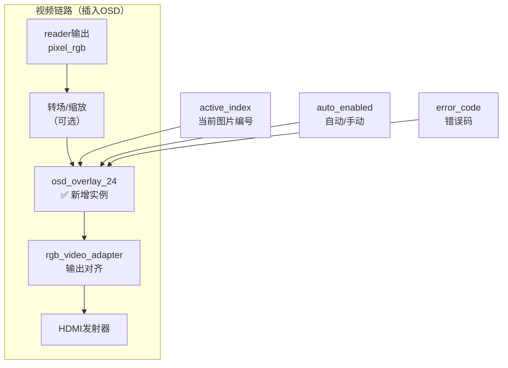

> **Note：** ①在视频链路中插入osd_overlay_24实例，位置在转场/缩放之后、rgb_video_adapter之前；②连接active_index、auto_enabled、error_code三个状态信号到osd_overlay_24；③视频时序信号（vsync/de/pixel_x）从视频时序模块连接过来；④输出rgb_out接到rgb_video_adapter的输入。改动量很小，主要就是加一个实例，连几根线。

**顶层例化代码**：

```verilog
//---- OSD状态叠加（第8课新增）----
wire [23:0] osd_rgb_out;
wire        osd_de_out;
wire        osd_active;

osd_overlay_24 #(
    .OSD_X(8),    // OSD左上角X=8
    .OSD_Y(8)     // OSD左上角Y=8
) u_osd_overlay (
    .clk          (pixel_clk),        // 像素时钟25MHz
    .rst_n        (rst_n_25m),        // 像素域复位
    .vsync        (pixel_vsync),      // 场同步
    .de           (pixel_de),         // 数据使能
    .rgb_in       (pre_osd_rgb),      // 转场/缩放后的24位RGB
    .pixel_x      (pixel_x),          // X坐标（来自视频时序）
    .active_index (active_index),     // 当前图片编号0-3
    .auto_enabled (auto_play_en),     // 自动轮播使能
    .error_code   (error_code),       // 错误码（0=正常）
    .rgb_out      (osd_rgb_out),      // 叠加OSD后的RGB
    .de_out       (osd_de_out),
    .osd_active   (osd_active)
);

// osd_rgb_out 接到下游 rgb_video_adapter 或 HDMI 发射器
```

**信号来源说明**：

| 信号 | 来源模块 | 说明 |
|------|---------|------|
| pixel_clk / pixel_vsync / pixel_de / pixel_x | video_timing_data | 视频时序模块生成 |
| pre_osd_rgb | 转场模块输出或reader输出 | OSD之前的视频像素 |
| active_index | media_player_control | 当前显示的图片编号 |
| auto_play_en | media_player_control | 自动轮播是否开启 |
| error_code | media_recovery_fsm | 错误码，0表示正常 |
| osd_rgb_out | → rgb_video_adapter → HDMI | 最终输出 |

---

## 五、从官方例程到完赛工程的演进路径

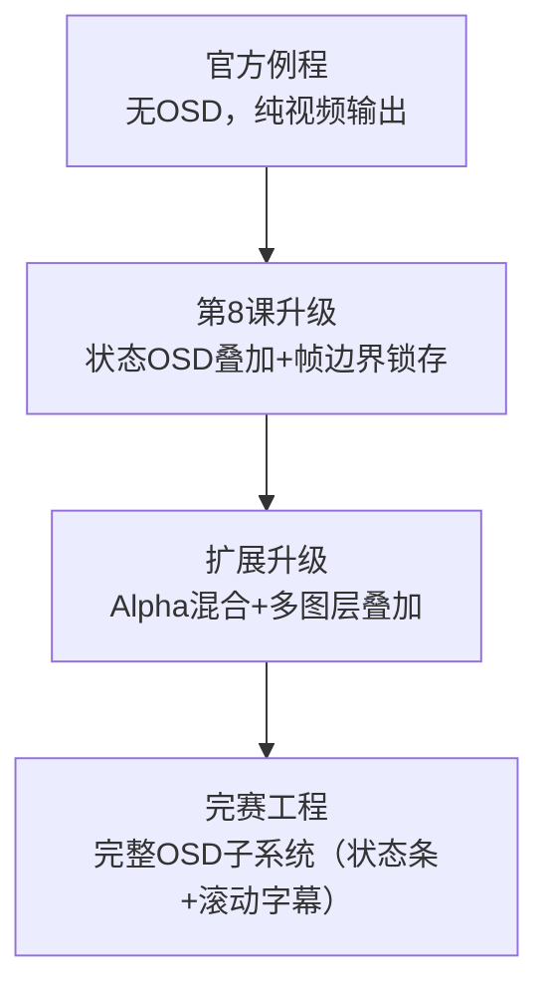

> **Note：** 第8课升级=从无OSD到状态OSD叠加，核心是像素级替换+5×7点阵字体+帧边界锁存；扩展升级=Alpha混合+多图层叠加；完赛工程=完整OSD子系统。


---

## 六、常见问题与调试技巧

### Q1：OSD不显示

**排查步骤**：
1. 检查osd_overlay_24的rst_n是否为1（复位是否释放）
2. 检查pixel_x是否在正确范围内（0-639），pixel_y是否正确重建
3. 检查OSD区域参数OSD_X/OSD_Y是否在屏幕内（默认8,8）
4. 用ILA抓osd_hit信号，看是否有高电平脉冲
5. 检查rgb_out是否在osd_hit时变为OSD颜色（绿色或红色）
6. 检查HDMI发射器的输入是否接的是rgb_out而不是rgb_in

### Q2：OSD显示乱码

**可能原因**：
1. 字体ROM的行号或列索引计算错误
2. pixel_x或pixel_y坐标错误，导致字符位置偏移
3. char_value计算错误，显示了错误的字符

**解决方法**：
1. 用ILA抓char_value，确认每个字符位置显示的字符值正确
2. 用ILA抓glyph_row，确认字体点阵输出正确
3. 检查(pixel_x-OSD_X)%8的计算，确认列偏移正确
4. 参考完赛工程的status_osd_overlay，不要自己写字体渲染，容易出错

### Q3：OSD闪烁或撕裂

**可能原因**：
1. 没有帧边界锁存，一帧内状态变化导致撕裂
2. OSD区域在帧中间更新，导致上半帧旧状态下半帧新状态

**解决方法**：
1. 确保frame_start信号正确生成（vsync上升沿）
2. 确保状态信号在frame_start时锁存，一帧内使用锁存值
3. 用ILA抓index_q/auto_q/error_q，确认它们只在frame_start时变化

### Q4：OSD颜色不对

**可能原因**：
1. 12位→24位颜色扩展错误
2. OSD颜色参数设置错误
3. RGB通道顺序错误（RGB vs BGR）

**解决方法**：
1. 检查osd_overlay_24的颜色扩展逻辑，确保每个4位通道复制为8位
2. 检查status_osd_overlay的OSD颜色参数，无错误时12'hff0（绿色），有错误时12'hf44（红色）
3. 确认HDMI发射器的RGB通道顺序，有些HDMI发射器是BGR顺序

---

**本节课配套代码文件**：
- `rtl/display/osd_overlay_24.v`（OSD叠加顶层，~75行）
- `rtl/display/status_osd_overlay.v`（状态OSD渲染，~91行）
- `rtl/display/promax_text_overlay.v`（文本叠加，扩展用，~120行）
- `rtl/display/timestamp_osd.v`（时间戳OSD，扩展用，~80行）
