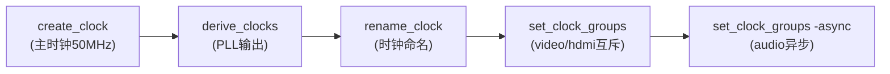
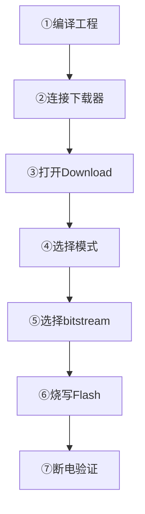
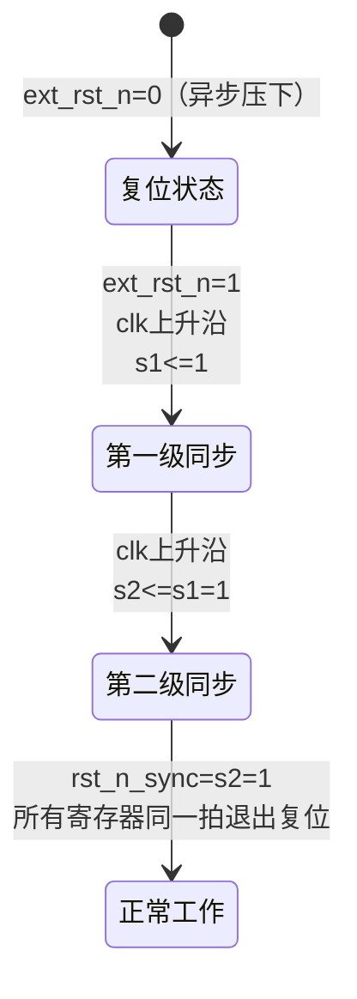
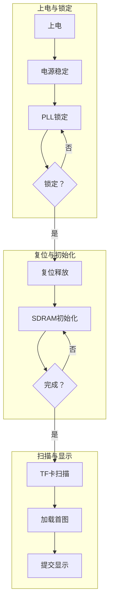
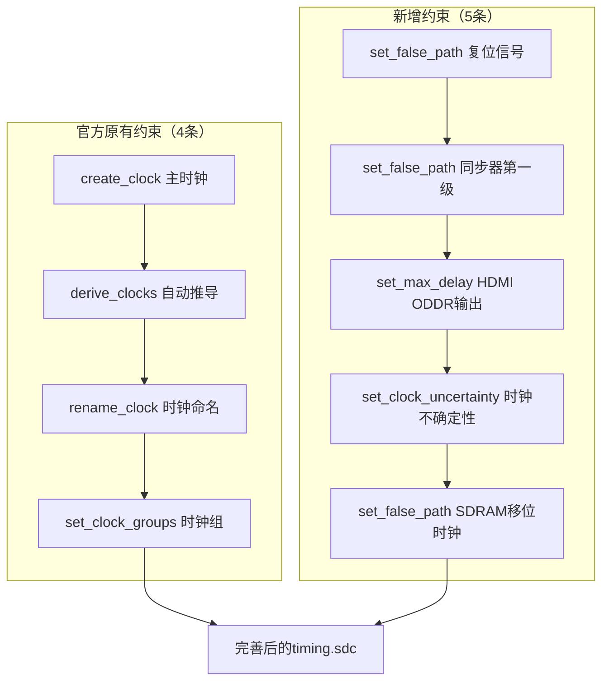
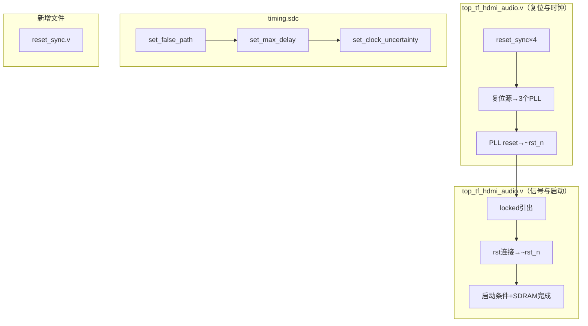
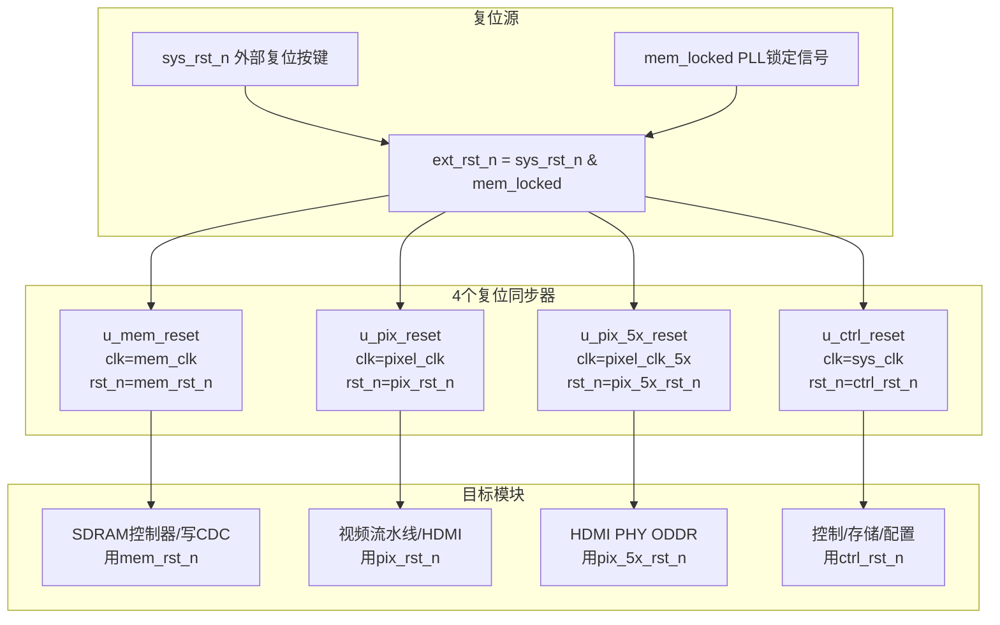
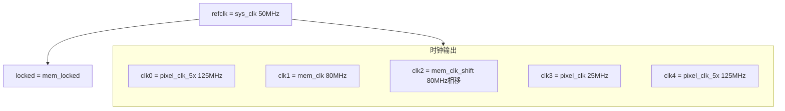
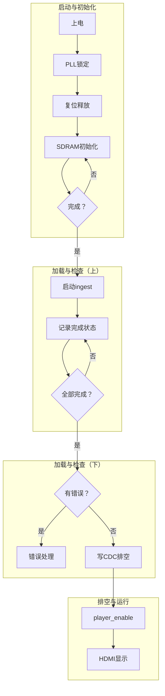
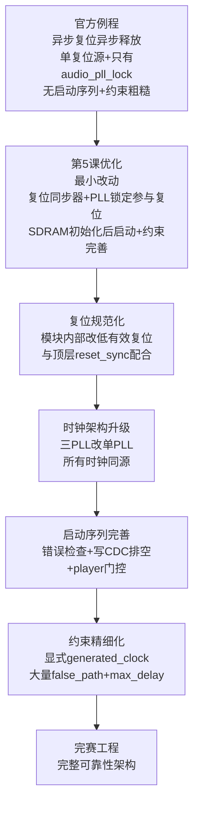

# 第5课 Flash固化与上电自启

---

## 本课对应赛题说明

**本节课在整个赛题中的位置：基础要求④的"Flash固化+上电自启动"部分，以及整体可靠性提升**

| 赛题要求 | 类型 | 本节课覆盖程度 |
|---|---|---|
| 基础要求①：TF卡BMP读取+SDRAM帧缓存+HDMI显示 | 基础 | ✅ 已实现，本节课增强其可靠性 |
| 基础要求②：按键手动切换+自动轮播模式 | 基础 | ✅ 第2课已优化，本节课不改动 |
| 基础要求③：HDMI音频输出+音视频同步 | 基础 | ✅ 官方例程已实现，本节课不改动 |
| 基础要求④：Flash固化+上电自启动+系统稳定 | 基础 | ✅ 第4课讲了系统稳定，本节课讲Flash固化+上电自启动+可靠性升级 |
| 扩展要求1~5 | 扩展 | ❌ 本节课不涉及 |

**本节课的定位：**
- 这是基础完赛线的最后一课，学完这节课基础分就拿满了
- 主要改顶层`top_tf_hdmi_audio.v`的复位结构，完善时序约束文件`timing.sdc`，以及掌握Flash固化操作和长稳测试方法
- 官方例程功能上能跑，但复位设计有隐患（异步释放可能亚稳态、PLL没锁定就开始工作、SDRAM没初始化完就开始读写），时序约束不够精细，Flash固化操作不熟悉
- 本节课做4个可靠性优化：复位同步器、PLL锁定参与复位+上电启动序列、时序约束完善、Flash固化与长稳测试
- 学完这节课，你的工程能稳定固化到Flash里，上电自启动，长时间运行不崩溃，基础分拿满

**学完本节课你将掌握：**
1. 官方例程的复位结构和6个复位隐患
2. 异步复位同步释放的原理和实现（reset_sync模块）
3. PLL锁定信号参与复位的方法，以及有序的上电启动序列
4. 时序约束的完善方法（set_false_path、set_max_delay、set_clock_uncertainty）
5. 安路TD的Flash固化完整操作步骤和验证方法
6. 长稳测试的方法和常见问题排查
7. 从官方简易复位到完赛工程完整可靠性架构的演进思路

---

## 一、官方例程的复位、约束与固化现状

### 1.1 官方复位结构深度拆解

官方例程顶层`top_tf_hdmi_audio.v`的复位非常简单，只有一行：

```verilog
// 统一复位：TF 图像链路 + HDMI 音频链路
wire rst_all;
assign rst_all = ~rst_n | ~audio_pll_lock;
```

**复位信号的来源：**
- `rst_n`：外部复位按键，低有效（按下=0，松开=1）
- `audio_pll_lock`：音频PLL的锁定信号，高有效（锁定=1，未锁定=0）
- `rst_all`：内部统一复位，高有效（复位=1，正常工作=0）

**复位逻辑：** 按下复位按键，或者音频PLL没锁定，`rst_all`就为1，整个系统复位。

**复位的连接方式：** 所有子模块的`rst`端口都接`rst_all`，而且都是**异步复位**——敏感列表里写`posedge clk or posedge rst_all`，复位信号一有效就立刻复位，不等时钟沿。

```verilog
// 典型的异步复位写法（官方例程所有模块都是这样）
always @(posedge sd_card_clk or posedge rst_all) begin
    if (rst_all) begin
        // 复位：所有寄存器清零
    end else begin
        // 正常工作
    end
end
```

### 1.2 官方复位的6个隐患

把官方复位结构彻底搞懂之后，我们能发现6个隐患：


> **Note：** 时序相关：①②；PLL相关：③④；启动相关：⑤⑥。

**逐个说明：**

1. **异步复位异步释放（最严重）**：官方例程的复位是`posedge rst_all`异步复位，复位释放（rst_all从1变0）也是异步的——复位释放的瞬间可能正好落在时钟沿附近，导致寄存器的恢复时间（recovery time）不满足，产生亚稳态。亚稳态的寄存器输出可能在0和1之间振荡，导致系统行为不可预测。正确的做法是"异步复位，同步释放"——复位按下时立刻生效（异步），复位释放时经过两级触发器同步（同步释放）。

2. **所有时钟域共用一个复位**：官方例程有4个时钟域——`sd_card_clk`(100MHz)、`ext_mem_clk`(100MHz)、`video_clk`(25MHz)、`audio_mclk`(12.288MHz)，但所有模块都用同一个`rst_all`复位信号。不同时钟域的复位释放时间不同步，可能导致跨时钟域的接口在复位释放瞬间出现异常（比如一个域已经退出复位开始发数据，另一个域还在复位状态，数据丢失）。正确的做法是每个时钟域都有自己的复位同步器。

3. **只有audio_pll_lock参与复位**：`rst_all = ~rst_n | ~audio_pll_lock`，只有音频PLL的锁定信号参与了复位。但系统里还有`sys_pll`（产生sd_card_clk和ext_mem_clk）和`video_pll`（产生video_clk和hdmi_5x_clk），这两个PLL的锁定信号没有参与复位。也就是说，sys_pll和video_pll还没锁定（时钟还不稳定）的时候，系统就已经退出复位开始工作了，这时候时钟频率可能不对，导致SDRAM读写错误、HDMI显示异常。

4. **PLL的reset都接1'b0**：官方例程里三个PLL的`reset`端口都接了`1'b0`，也就是说PLL永远不会被复位。如果PLL因为某种原因失锁了（比如电源抖动），它不会自动重新锁定，系统就一直工作在不稳定的时钟下。正确的做法是把复位信号接到PLL的reset端口，系统复位时PLL也复位，然后重新锁定。

5. **没有上电复位延时（POR）**：官方例程没有上电复位延时——电源一上来，复位按键一松开，系统就立刻开始工作。但实际上电源上电需要几毫秒到几十毫秒才能稳定，PLL锁定也需要几十微秒到几毫秒。没有上电延时的话，系统可能在电源还没稳定的时候就开始工作，导致初始化失败。虽然`audio_pll_lock`参与了复位，相当于等音频PLL锁定后才释放复位，但sys_pll和video_pll没参与，所以还是有隐患。

6. **SDRAM初始化完成没参与启动控制**：官方例程里SDRAM控制器有`Sdr_init_done`信号，表示SDRAM初始化完成。但这个信号只在SDRAM控制器内部使用，没有参与系统启动控制——也就是说，SDRAM还没初始化完的时候，sd_card_bmp模块就可能开始发起写请求了，导致写数据丢失。正确的做法是等SDRAM初始化完成后，才允许启动扫描和加载。

这6个隐患，就是本节课要解决的。本节课共4个优化：**3个必做**（优化一复位同步器、优化二PLL锁定参与复位+上电启动序列、优化四Flash固化与长稳测试），**1个选做**（优化三时序约束完善）。对应关系：优化一解决隐患1和2，优化二解决隐患3、4、5、6，优化三完善时序约束，优化四解决Flash固化和长稳验证。

### 1.3 官方时序约束现状

官方例程有时序约束文件`timing.sdc`，内容包括：



**官方约束的优点：**
- 主时钟约束正确（50MHz，period=20ns）
- 用derive_clocks自动推导PLL输出时钟，不需要手动计算每个PLL输出的频率
- 给关键时钟命名了，方便看时序报告
- video_clk和hdmi_5x_clk设为exclusive（因为是同源PLL的不同输出，不会同时做发射和捕获）
- audio_mclk和其他时钟设为asynchronous（因为是独立PLL，频率不相关）

**官方约束的不足：**
1. **没有set_false_path**：复位信号、跨时钟域同步器的第一级触发器、HDMI的ODDR输出路径等，都应该设为false_path，否则时序报告会报大量伪违例
2. **没有set_max_delay**：跨时钟域的Gray码指针路径、SPI接口路径等，应该设max_delay约束，防止综合器把路径优化得太慢
3. **没有set_clock_uncertainty**：没有设置时钟不确定性（抖动+偏斜），默认值可能太大或太小
4. **没有Input/Output delay**：外部接口（SD卡SPI、HDMI、按键等）没有输入输出延迟约束
5. **derive_clocks的局限**：自动推导的时钟可能跟实际PLL输出有差异，而且如果PLL实例路径变了，时钟名就不对了

对于竞赛来说，官方的约束基本够用（因为时钟频率不高，25MHz~100MHz，时序很容易满足），但完善约束可以让时序报告更干净，避免伪违例干扰判断，也能提高系统的可靠性。

### 1.4 官方Flash固化方式

安路EG4S20的Flash固化是通过安路TD（Tang Dynasty）软件的Download功能完成的：



**关键概念：**

- **SRAM模式**：把bitstream下载到FPGA的SRAM配置存储器里，断电后丢失，下次上电需要重新下载。适合调试阶段。
- **Flash模式**：把bitstream烧写到外部SPI Flash（W25Q64）里，断电后保留，下次上电自动从Flash加载配置。适合最终交付和竞赛现场。
- **上电自启动**：Flash固化后，上电时FPGA自动从Flash读取bitstream并配置，不需要下载器。这个过程需要几十毫秒到几百毫秒。

官方例程没有专门的Flash固化教程，需要自己摸索TD软件的操作。本节课会给出详细的操作步骤和常见问题排查。

---

## 二、4个可靠性优化的实现思路

### 2.1 优化一（必做）：复位同步器——异步复位同步释放

**需求**：把官方的异步复位异步释放，改成异步复位同步释放，消除复位释放瞬间的亚稳态风险。

**原理：**
- **异步复位**：复位信号一有效（按下），立刻把所有寄存器清零，不等时钟沿——这样断电瞬间、复位按键按下时，系统能立刻复位，不会因为等时钟沿而延迟
- **同步释放**：复位信号释放（松开）时，经过两级触发器，在本时钟域的时钟沿上同步释放——这样所有寄存器在同一拍退出复位，消除恢复时间竞争，避免亚稳态



**实现：新增reset_sync模块**

```verilog
module reset_sync (
    input  wire clk,         // 本时钟域
    input  wire ext_rst_n,   // 外部异步低有效复位
    output wire rst_n_sync   // 本域使用的复位：异步压下、同步释放
);

    (* async_reg = "true" *) reg s1, s2;

    always @(posedge clk or negedge ext_rst_n) begin
        if (!ext_rst_n) begin
            s1 <= 1'b0;
            s2 <= 1'b0;
        end else begin
            s1 <= 1'b1;
            s2 <= s1;
        end
    end

    assign rst_n_sync = s2;

endmodule
```

**关键设计点：**
- `(* async_reg = "true" *)`：告诉综合器这两个寄存器是异步寄存器，不要优化掉，也不要在它们之间插入组合逻辑
- `negedge ext_rst_n`：复位信号低有效，下降沿触发异步复位——复位一按下（ext_rst_n从1变0），立刻把s1和s2清零，不等时钟沿
- 两级触发器：第一级s1采样外部复位释放，第二级s2同步输出，确保复位释放经过两个时钟周期才生效，消除亚稳态
- 每个时钟域配一个reset_sync实例：sd_card_clk域一个、ext_mem_clk域一个、video_clk域一个、audio_mclk域一个

**复位释放时序详解：**

复位按下时（ext_rst_n=0）：s1=0，s2=0，rst_n_sync=0，系统复位。

复位释放时（ext_rst_n从0变1）：

| 时钟沿 | s1 | s2 | rst_n_sync | 说明 |
|---|---|---|---|---|
| 释放前 | 0 | 0 | 0 | 系统复位状态 |
| 第1个上升沿 | 1 | 0 | 0 | s1采样到ext_rst_n=1，s2还是旧值0 |
| 第2个上升沿 | 1 | 1 | 1 | s2采样到s1=1，复位释放，系统退出复位 |

关键点：复位释放后，**经过2个时钟周期**rst_n_sync才从0变1。这2个周期的延迟就是同步释放的代价——换来了所有寄存器在同一拍（第2个上升沿之后）退出复位，消除了恢复时间竞争和亚稳态风险。第一级s1可能因为复位释放和时钟沿离得太近而进入亚稳态，但亚稳态持续不到一个周期，到第2个上升沿时s1已经稳定，s2采样到的就是稳定值。

**在顶层的使用方法：**

```verilog
// 外部复位+PLL锁定作为复位源
wire ext_rst_n = rst_n & sys_pll_lock & video_pll_lock & audio_pll_lock;

// 每个时钟域一个复位同步器
reset_sync u_sdcard_reset (
    .clk(sd_card_clk), .ext_rst_n(ext_rst_n), .rst_n_sync(sdcard_rst_n)
);
reset_sync u_mem_reset (
    .clk(ext_mem_clk), .ext_rst_n(ext_rst_n), .rst_n_sync(mem_rst_n)
);
reset_sync u_video_reset (
    .clk(video_clk), .ext_rst_n(ext_rst_n), .rst_n_sync(video_rst_n)
);
reset_sync u_audio_reset (
    .clk(audio_mclk), .ext_rst_n(ext_rst_n), .rst_n_sync(audio_rst_n)
);

// 子模块的复位端口接对应时钟域的同步复位（注意官方是高有效rst，要取反）
sd_card_bmp sd_card_bmp_m0(
    .clk(sd_card_clk),
    .rst(~sdcard_rst_n),   // 官方模块是高有效复位，取反
    // ... 其他端口不变 ...
);
```

> **注意**：官方例程的所有子模块都是高有效复位（`rst`，`posedge rst`），而reset_sync输出的是低有效复位（`rst_n_sync`），所以连接的时候要取反：`.rst(~sdcard_rst_n)`。如果以后把所有模块都改成低有效复位，就不用取反了，但本节课为了最小改动，保持官方模块的高有效复位不变，只在顶层取反。

### 2.2 优化二（必做）：PLL锁定参与复位+有序上电启动序列

**需求**：所有PLL的锁定信号都参与复位，PLL也能被复位，并且等SDRAM初始化完成后才启动业务逻辑。

**实现分三步：**

**第一步：把复位信号接到PLL的reset端口**

官方例程三个PLL的reset都接了`1'b0`，改成接复位信号：

```verilog
sys_pll sys_pll_m0(
    .refclk     (clk),
    .clk0_out   (sd_card_clk),
    .clk1_out   (ext_mem_clk),
    .clk2_out   (ext_mem_clk_sft),
    .reset      (~rst_n)    // 改成：外部复位按键按下时复位PLL
);

video_pll video_pll_m0(
    .refclk     (clk),
    .clk0_out   (video_clk),
    .clk1_out   (hdmi_5x_clk),
    .reset      (~rst_n)    // 改成：外部复位按键按下时复位PLL
);

PLL_HDMI_AUDIO u_audio_pll(
    .refclk     (clk),
    .reset      (~rst_n),    // 改成：外部复位按键按下时复位PLL
    .extlock    (audio_pll_lock),
    .clk0_out   (),
    .clk1_out   (),
    .clk2_out   (audio_mclk)
);
```

> **注意**：sys_pll和video_pll的locked信号可能没有引出端口（官方例程里没用到），如果PLL IP没有locked输出端口，需要在IP配置里打开locked输出，或者用PLL的status寄存器判断。如果实在拿不到locked信号，可以只用audio_pll_lock（官方已经有了），但最好三个PLL的locked都用上。

**第二步：所有PLL的locked都参与复位源**

```verilog
// 复位源：外部复位按键 + 三个PLL都锁定
// 任何一个PLL没锁定，系统就保持复位
wire ext_rst_n = rst_n & sys_pll_lock & video_pll_lock & audio_pll_lock;
```

这样，上电后必须等三个PLL都锁定了，复位同步器才会开始同步释放，系统才会退出复位。PLL锁定通常需要几十微秒到几毫秒，这段时间足够电源稳定了，所以不需要额外的上电延时（POR）计数器。

**第三步：SDRAM初始化完成后才启动业务**

官方例程里，sd_card_bmp模块在复位释放后就立刻开始扫描TF卡，但这时候SDRAM可能还没初始化完。改进的做法是：在sd_card_bmp里增加一个启动使能信号，等SDRAM初始化完成后才允许启动扫描。

最小改动方案：在sd_card_bmp内部的上电扫描逻辑里增加`Sdr_init_done`条件（如下），或者把`Sdr_init_done`接到sd_card_bmp的一个使能端口。

```verilog
// 在sd_card_bmp里，把原来的上电自动扫描逻辑改成：
// 等SDRAM初始化完成后才启动扫描
if (!scan_kicked && bmp_ready && Sdr_init_done) begin
    // 原来的扫描启动逻辑
    scan_start_pulse <= 1'b1;
    scan_kicked <= 1'b1;
    // ... 其他初始化 ...
end
```

> **注意**：`Sdr_init_done`是SDRAM控制器的输出信号，在ext_mem_clk域。sd_card_bmp在sd_card_clk域，虽然两个时钟都是100MHz（同源PLL的不同输出），但严格来说应该做跨时钟域同步。最小改动方案可以直接接（因为是同源时钟，频率相同，相位差固定），但严谨的做法是用sync_2ff同步一下。

**附：sync_2ff同步器模块代码（严谨方案用）**

如果追求严谨，可以新增一个sync_2ff模块，把Sdr_init_done从ext_mem_clk域同步到sd_card_clk域：

```verilog
module sync_2ff #(
    parameter RESET_VAL = 1'b0
)(
    input  wire clk,       // 目的时钟域（sd_card_clk）
    input  wire rst_n,     // 目的域低有效复位
    input  wire async_in,  // 异步输入（Sdr_init_done，来自ext_mem_clk域）
    output wire sync_out   // 同步后的输出
);

    (* async_reg = "true" *) reg s1, s2;

    always @(posedge clk or negedge rst_n) begin
        if (!rst_n) begin
            s1 <= RESET_VAL;
            s2 <= RESET_VAL;
        end else begin
            s1 <= async_in;
            s2 <= s1;
        end
    end

    assign sync_out = s2;

endmodule
```

在顶层实例化：
```verilog
sync_2ff u_sdram_init_sync (
    .clk(sd_card_clk),
    .rst_n(sdcard_rst_n),
    .async_in(Sdr_init_done),
    .sync_out(Sdr_init_done_sd)
);
```
然后sd_card_bmp里用`Sdr_init_done_sd`代替`Sdr_init_done`。最小改动方案可以不加这个同步器，直接接`Sdr_init_done`。

**上电启动序列总结：**



### 2.3 优化三（选做）：时序约束完善

**需求**：在官方timing.sdc基础上，增加set_false_path、set_max_delay、set_clock_uncertainty等约束，让时序报告更干净。

> **选做说明**：官方的约束对于25MHz~100MHz的时钟频率来说基本够用，时序很容易满足。完善约束主要是让时序报告更干净，避免伪违例干扰判断。时间充裕再做，不做也不影响完赛。

**需要增加的约束：**

**1. 复位信号设为false_path**

复位信号是异步的，不需要做时序分析：
```tcl
set_false_path -from [get_ports {rst_n}]
```

**2. 跨时钟域同步器的第一级触发器设为false_path**

所有sync_2ff和reset_sync里的第一级触发器（s1），都是异步采样，不需要时序分析：
```tcl
set_false_path -to [get_regs -hier {*/s1}]
```

**3. HDMI的ODDR输出路径设max_delay**

HDMI的TMDS数据是用ODDR（双倍数据率）输出的，输出路径需要约束最大延迟：
```tcl
set_max_delay -from [get_clocks {hdmi_5x_clk}] \
    -to [get_ports {HDMI_CLK_P HDMI_D0_P HDMI_D1_P HDMI_D2_P}] \
    8.000 -datapath_only
```

**4. 设置时钟不确定性**

设置保持时间的不确定性（抖动+偏斜），默认值0.1ns可能太大，改成0.05ns：
```tcl
set_clock_uncertainty -hold 0.050 \
    [get_clocks {clk sd_card_clk ext_mem_clk video_clk hdmi_5x_clk audio_mclk}]
```

**5. SDRAM的移位时钟路径设为false_path**

SDRAM控制器用了一个移位时钟（ext_mem_clk_sft）来采样数据，这个路径是硬IP的I/O窗口，不需要做fabric时序分析：
```tcl
set_false_path -from [get_clocks {ext_mem_clk}] -to [get_clocks {ext_mem_clk_sft}]
set_false_path -from [get_clocks {ext_mem_clk_sft}] -to [get_clocks {ext_mem_clk}]
```

**完善后的约束文件结构：**



**表格替代方案（如果Mermaid渲染仍不理想，可用此表格）：**

| 类别 | 约束命令 | 说明 |
|------|---------|------|
| 官方原有 | `create_clock` | 定义主时钟周期 |
| 官方原有 | `derive_clocks` | 自动推导PLL输出时钟 |
| 官方原有 | `rename_clock` | 重命名时钟便于引用 |
| 官方原有 | `set_clock_groups` | 设置互斥时钟组 |
| 新增 | `set_false_path` | 复位信号设为伪路径 |
| 新增 | `set_false_path` | 同步器第一级设为伪路径 |
| 新增 | `set_max_delay` | HDMI ODDR输出最大延迟 |
| 新增 | `set_clock_uncertainty` | 时钟不确定性 |
| 新增 | `set_false_path` | SDRAM移位时钟设为伪路径 |

### 2.4 优化四（必做）：Flash固化与长稳测试

**需求**：掌握安路TD的Flash固化完整操作步骤，以及长稳测试方法，确保工程能稳定固化、上电自启动、长时间运行不崩溃。

**Flash固化操作步骤（安路TD）：**

> 注：以下步骤基于安路TD 5.x/6.x版本，不同版本的界面布局和菜单名称可能略有差异，以实际软件为准。核心流程一致：编译→连接下载器→选设备→选Flash模式→选bitstream→烧写→断电验证。

1. **编译工程**：点击工具栏的"Run"按钮（或者按F9），等待综合、布局布线、生成bitstream完成。确认没有Error，Warning可以忽略。

2. **连接下载器**：把安路下载器（USB Blaster兼容）插到电脑USB口，另一端JTAG排线插到开发板的JTAG接口。给开发板上电。

3. **打开Download界面**：点击菜单栏的"Tools"→"Download"，或者点击工具栏的下载图标。

4. **选择设备**：在Download界面里，点击"Hardware Setup"选择下载器（通常是"USB-Blaster"）。然后点击"Auto Detect"自动检测FPGA器件，应该能检测到EG4S20。

5. **选择操作模式**：在器件列表里，右键点击EG4S20，选择"Edit"，然后在"Programming File"里选择编译生成的bitstream文件（通常在`project_name/project_name_runs/syn_1/`目录下，后缀是`.bit`）。

6. **选择Flash型号**：在"External Flash"里选择Flash型号（开发板上的Flash通常是W25Q64，选择对应的型号）。如果不确定型号，可以看开发板原理图或者丝印。

7. **烧写Flash**：勾选"Program/Configure"和"Verify"，然后点击"Start"开始烧写。烧写过程需要几十秒到几分钟，进度条走完后显示"Success"。

8. **断电重启验证**：烧写完成后，关闭开发板电源，拔掉下载器，然后重新上电。这时候FPGA应该自动从Flash加载配置，HDMI显示器应该显示图片。如果显示正常，说明固化成功。

**常见固化问题排查：**

| 问题 | 可能原因 | 解决方法 |
|---|---|---|
| Auto Detect检测不到器件 | 下载器没插好/驱动没装/开发板没上电 | 检查USB连接、安装驱动、给开发板上电 |
| 烧写失败，提示Flash ID错误 | Flash型号选错了 | 查看开发板原理图，选择正确的Flash型号 |
| 烧写成功但上电不启动 | Flash里的bitstream损坏/启动模式设置不对 | 重新烧写，检查开发板的启动模式跳线（应该设为SPI Flash启动） |
| 上电后HDMI没显示 | 固化的bitstream不对/TF卡没插好 | 确认烧写的是正确的bitstream，插好TF卡 |
| 上电后显示花屏 | SDRAM初始化没完成就开始读写/时序约束有问题 | 检查优化二的启动序列，完善时序约束 |

**长稳测试方法：**

1. **自动轮播长稳测试**：把模式设为自动轮播，轮播周期设为最短（比如1秒），然后让系统连续运行30分钟到1小时。观察：
   - 图片切换是否正常，有没有卡死
   - 有没有花屏、黑屏
   - 数码管显示的图片编号是否正常
   - 用手摸FPGA和SDRAM芯片，温度是否正常（不烫手）

2. **按键压力测试**：快速连续按"下一张"按键100次，观察每次切换是否正常，有没有漏切、错切、卡死。

3. **TF卡热插拔测试**：系统运行中拔掉TF卡，观察系统是否卡死（应该报错并保持当前显示，第4课的错误恢复机制），然后插回TF卡，按按键重新扫描，观察是否恢复正常。

4. **断电重启测试**：连续断电重启10次，每次都观察上电后是否正常启动、正常显示。如果有一次启动失败，说明启动序列有问题。

5. **温漂测试**：系统连续运行1小时后，观察显示是否正常，有没有因为温度升高导致时序违例而花屏。

**长稳测试通过标准：**
- 30分钟自动轮播无卡死、无花屏
- 100次按键压力测试无漏切、无错切
- 10次断电重启全部正常启动
- 连续运行1小时温度正常（不烫手）

### 2.5 改动位置示意图



> **Note：** ①reset_sync模块实例×4（sdcard/mem/video/audio时钟域）；②ext_rst_n = rst_n & 三个PLL_lock；③PLL的reset从1'b0改成~rst_n；④引出sys_pll_lock/video_pll_lock；⑤子模块.rst(~对应域的rst_n)；⑥sd_card_bmp等SDRAM初始化完成才扫描。

### 2.6 完整修改代码

本节汇总所有必做修改的完整代码，标注插入位置，方便直接复制使用。选做修改（sync_2ff同步器、时序约束）标注为"选做"。

#### 2.6.1 新增文件：reset_sync.v

**位置**：在工程的src目录下新建`reset_sync.v`文件，添加到工程。

```verilog
`timescale 1ns / 1ps
// 复位同步器：异步复位，同步释放
// 每个时钟域实例化一个
module reset_sync (
    input  wire clk,         // 本时钟域时钟
    input  wire ext_rst_n,   // 外部异步低有效复位
    output wire rst_n_sync   // 本域同步释放的低有效复位
);

    (* async_reg = "true" *) reg s1, s2;

    always @(posedge clk or negedge ext_rst_n) begin
        if (!ext_rst_n) begin
            s1 <= 1'b0;
            s2 <= 1'b0;
        end else begin
            s1 <= 1'b1;
            s2 <= s1;
        end
    end

    assign rst_n_sync = s2;

endmodule
```

#### 2.6.2 新增文件：sync_2ff.v（选做，严谨方案用）

**位置**：在工程的src目录下新建`sync_2ff.v`文件，添加到工程。最小改动方案可以不加这个文件。

```verilog
`timescale 1ns / 1ps
// 单比特两级触发器同步器
// 用于跨时钟域的慢变电平信号同步
module sync_2ff #(
    parameter RESET_VAL = 1'b0
)(
    input  wire clk,       // 目的时钟域
    input  wire rst_n,     // 目的域低有效复位
    input  wire async_in,  // 异步输入（源域电平）
    output wire sync_out   // 同步后的输出
);

    (* async_reg = "true" *) reg s1, s2;

    always @(posedge clk or negedge rst_n) begin
        if (!rst_n) begin
            s1 <= RESET_VAL;
            s2 <= RESET_VAL;
        end else begin
            s1 <= async_in;
            s2 <= s1;
        end
    end

    assign sync_out = s2;

endmodule
```

#### 2.6.3 修改文件：top_tf_hdmi_audio.v

**修改点1：复位源+4个reset_sync实例**

**插入位置**：在顶层文件的wire声明区域（原来`wire rst_all;`的位置附近），替换原来的`wire rst_all; assign rst_all = ...;`。

```verilog
//=== 修改：复位源 + 4个复位同步器 ===
// 复位源：外部复位按键 + 三个PLL都锁定（如果sys_pll/video_pll没有locked输出，就只用rst_n & audio_pll_lock）
wire ext_rst_n = rst_n & sys_pll_lock & video_pll_lock & audio_pll_lock;

// 每个时钟域一个复位同步器
reset_sync u_sdcard_reset (
    .clk        (sd_card_clk),
    .ext_rst_n  (ext_rst_n),
    .rst_n_sync (sdcard_rst_n)
);

reset_sync u_mem_reset (
    .clk        (ext_mem_clk),
    .ext_rst_n  (ext_rst_n),
    .rst_n_sync (mem_rst_n)
);

reset_sync u_video_reset (
    .clk        (video_clk),
    .ext_rst_n  (ext_rst_n),
    .rst_n_sync (video_rst_n)
);

reset_sync u_audio_reset (
    .clk        (audio_mclk),
    .ext_rst_n  (ext_rst_n),
    .rst_n_sync (audio_rst_n)
);
//=== 修改结束 ===
```

**修改点2：PLL的reset端口 + locked信号引出**

**插入位置**：找到三个PLL的实例化代码，修改reset端口，并确认locked输出端口已连接。

```verilog
//=== 修改：sys_pll的reset从1'b0改成~rst_n，确认locked输出 ===
sys_pll sys_pll_m0(
    .refclk     (clk),
    .clk0_out   (sd_card_clk),
    .clk1_out   (ext_mem_clk),
    .clk2_out   (ext_mem_clk_sft),
    .reset      (~rst_n),        // 修改：原来接1'b0
    .locked     (sys_pll_lock)   // 新增：如果IP没有locked输出端口，需要在IP配置里打开
);

//=== 修改：video_pll的reset从1'b0改成~rst_n，确认locked输出 ===
video_pll video_pll_m0(
    .refclk     (clk),
    .clk0_out   (video_clk),
    .clk1_out   (hdmi_5x_clk),
    .reset      (~rst_n),         // 修改：原来接1'b0
    .locked     (video_pll_lock)  // 新增：如果IP没有locked输出端口，需要在IP配置里打开
);

//=== 修改：PLL_HDMI_AUDIO的reset从1'b0改成~rst_n ===
PLL_HDMI_AUDIO u_audio_pll(
    .refclk     (clk),
    .reset      (~rst_n),          // 修改：原来接1'b0
    .extlock    (audio_pll_lock),  // 官方已有
    .clk0_out   (),
    .clk1_out   (),
    .clk2_out   (audio_mclk)
);
//=== 修改结束 ===
```

> 注意：如果sys_pll或video_pll的IP配置里没有locked输出端口，需要在安路TD的IP配置界面里打开locked输出，重新生成IP。如果实在打不开，就把复位源改成`wire ext_rst_n = rst_n & audio_pll_lock;`，但要知道这是有局限的。

**修改点3：子模块复位端口连接**

**插入位置**：找到每个子模块的实例化代码，把原来的`.rst(rst_all)`改成对应时钟域的`.rst(~xxx_rst_n)`。以下以sd_card_bmp为例，其他模块（SDRAM控制器、HDMI发射器、音频模块等）按同样方法修改，注意每个模块用对应时钟域的复位信号。

```verilog
//=== 修改：sd_card_bmp的复位端口 ===
sd_card_bmp sd_card_bmp_m0(
    .clk        (sd_card_clk),
    .rst        (~sdcard_rst_n),   // 修改：原来接rst_all，现在接sdcard_rst_n取反（官方模块是高有效复位）
    // ... 其他端口保持不变 ...
);

// 其他模块按同样方法修改：
// SDRAM控制器：.rst(~mem_rst_n)      （时钟域ext_mem_clk）
// HDMI相关模块：.rst(~video_rst_n)    （时钟域video_clk）
// 音频模块：.rst(~audio_rst_n)         （时钟域audio_mclk）
//=== 修改结束 ===
```

> 重要：必须把**所有**子模块的`.rst(rst_all)`都改掉，不能漏掉。改完后搜索`rst_all`，确认没有遗漏的引用。

**修改点4（选做）：Sdr_init_done跨时钟域同步**

**插入位置**：在reset_sync实例后面，添加sync_2ff实例。

```verilog
//=== 选做：Sdr_init_done从ext_mem_clk域同步到sd_card_clk域 ===
sync_2ff u_sdram_init_sync (
    .clk        (sd_card_clk),
    .rst_n      (sdcard_rst_n),
    .async_in   (Sdr_init_done),
    .sync_out   (Sdr_init_done_sd)
);
//=== 选做结束 ===
```
如果加了这个同步器，sd_card_bmp里用`Sdr_init_done_sd`；如果没加，直接用`Sdr_init_done`（最小改动方案）。

#### 2.6.4 修改文件：sd_card_bmp.v

**修改点：上电自动扫描逻辑增加SDRAM初始化完成条件**

**插入位置**：找到sd_card_bmp里上电自动扫描的逻辑（通常在always块里，条件是`!scan_kicked && bmp_ready`），增加`Sdr_init_done`条件。

```verilog
//=== 修改：上电自动扫描增加SDRAM初始化完成条件 ===
// 原来的代码（大概是这样，具体信号名以你的工程为准）：
// if (!scan_kicked && bmp_ready) begin
//     scan_start_pulse <= 1'b1;
//     scan_kicked <= 1'b1;
//     // ... 其他初始化 ...
// end

// 修改后（加了Sdr_init_done条件）：
if (!scan_kicked && bmp_ready && Sdr_init_done) begin
    // 如果加了sync_2ff同步器，这里用Sdr_init_done_sd
    // if (!scan_kicked && bmp_ready && Sdr_init_done_sd) begin
    scan_start_pulse <= 1'b1;
    scan_kicked <= 1'b1;
    // ... 其他初始化保持不变 ...
end
//=== 修改结束 ===
```

> 注意：具体的信号名（scan_kicked、bmp_ready、scan_start_pulse）以你的sd_card_bmp.v实际代码为准。核心修改就是在启动扫描的条件里加一个`&& Sdr_init_done`。

#### 2.6.5 修改文件：timing.sdc（选做）

**插入位置**：在timing.sdc文件末尾追加以下约束。

```tcl
#=== 新增：时序约束完善（选做）===

# 1. 复位信号设为false_path（异步信号，不做时序分析）
set_false_path -from [get_ports {rst_n}]

# 2. 同步器第一级触发器设为false_path（异步采样）
set_false_path -to [get_regs -hier {*/s1}]

# 3. HDMI ODDR输出路径设max_delay
set_max_delay -from [get_clocks {hdmi_5x_clk}] \
    -to [get_ports {HDMI_CLK_P HDMI_D0_P HDMI_D1_P HDMI_D2_P}] \
    8.000 -datapath_only

# 4. 时钟不确定性（保持时间，默认0.1ns可能太大导致伪违例）
set_clock_uncertainty -hold 0.050 \
    [get_clocks {clk sd_card_clk ext_mem_clk video_clk hdmi_5x_clk audio_mclk}]

# 5. SDRAM移位时钟路径设为false_path（硬IP的I/O窗口）
set_false_path -from [get_clocks {ext_mem_clk}] -to [get_clocks {ext_mem_clk_sft}]
set_false_path -from [get_clocks {ext_mem_clk_sft}] -to [get_clocks {ext_mem_clk}]

#=== 新增结束 ===
```

> 注意：端口名（HDMI_CLK_P等）、时钟名（hdmi_5x_clk等）以你的工程实际命名为准。如果derive_clocks自动推导的时钟名跟上面不一致，需要改成实际的时钟名。

### 2.7 4个优化的改动量汇总

| 优化项 | 类型 | 主要改动文件 | 新增/修改 | 改动量 |
|---|---|---|---|---|
| 1. 复位同步器 | 必做 | top_tf_hdmi_audio.v + 新增reset_sync.v | 新增1个模块+4个实例+复位源修改 | 约50行 |
| 2. PLL锁定参与复位+启动序列 | 必做 | top_tf_hdmi_audio.v + sd_card_bmp.v | PLL reset修改+locked引出+启动逻辑修改 | 约20行 |
| 3. 时序约束完善 | 选做 | timing.sdc | 新增false_path/max_delay/uncertainty | 约15行 |
| 4. Flash固化与长稳测试 | 必做 | 无代码改动，操作流程 | TD软件操作+测试方法 | 无代码改动 |

**必做3项改动量明细：**

| 项目 | 类型 | 行数 | 说明 |
|---|---|---|---|
| 新增reset_sync.v | 新增文件 | ~30行 | 复位同步器模块 |
| top_tf_hdmi_audio.v：复位源+4个reset_sync实例 | 新增 | ~35行 | wire声明+4个模块实例化 |
| top_tf_hdmi_audio.v：3个PLL的reset端口修改 | 修改 | ~3行 | 每个PLL改1行（1'b0→~rst_n）+ locked引出 |
| top_tf_hdmi_audio.v：子模块rst端口连接 | 修改 | ~10行 | 每个子模块改1行（rst_all→~xxx_rst_n），约10个模块 |
| sd_card_bmp.v：启动逻辑加Sdr_init_done条件 | 修改 | ~1行 | if条件加&& Sdr_init_done |
| **必做合计** | | **新增~65行，修改~14行** | 新增1个文件，修改2个文件 |

选做项（时间充裕再做）：
- 新增sync_2ff.v：~30行
- top_tf_hdmi_audio.v加sync_2ff实例：~8行
- timing.sdc新增约束：~15行

### 2.8 验证方法与测试用例

改完代码后，用以下测试用例验证每个优化是否生效：

| 编号 | 测试用例 | 操作方法 | 预期结果 | 验证的优化 |
|---|---|---|---|---|
| 1 | 正常启动 | 上电，观察HDMI显示 | 正常显示图片，无花屏 | 所有优化不破坏原有功能 |
| 2 | 复位按键测试 | 系统运行中按复位按键，松开 | 按下时系统复位（画面消失），松开后系统重新启动，正常显示 | 优化一（复位同步器） |
| 3 | 连续复位测试 | 快速连续按复位按键10次 | 每次都能正常复位并重新启动，无异常 | 优化一（复位同步释放） |
| 4 | PLL未锁定复位 | 上电后立即观察（前几毫秒） | PLL锁定前系统保持复位，锁定后才启动 | 优化二（PLL锁定参与复位） |
| 5 | SDRAM初始化等待 | 上电后用示波器/逻辑分析仪观察 | SDRAM初始化完成后才开始TF卡扫描 | 优化二（启动序列） |
| 6 | 断电重启测试 | 连续断电重启10次 | 每次都正常启动，无一次启动失败 | 优化一+优化二 |
| 7 | Flash固化验证 | 按2.4节步骤固化到Flash，断电重启 | 上电自动从Flash加载，正常显示 | 优化四（Flash固化） |
| 8 | 30分钟长稳测试 | 自动轮播模式连续运行30分钟 | 无卡死、无花屏、无异常 | 优化四（长稳测试） |
| 9 | 按键压力测试 | 快速连续按"下一张"100次 | 每次都正常切换，无漏切错切 | 优化四（长稳测试） |
| 10 | 时序报告检查 | 编译后看Timing Analyzer报告 | 没有真正的时序违例（伪违例已被false_path切掉） | 优化三（时序约束） |

**验证注意事项：**
- 测试用例2（复位按键）是最重要的——如果复位释放有亚稳态，可能出现复位松开后系统不启动、或者启动异常的情况。复位同步器能解决这个问题。
- 测试用例6（断电重启）能验证启动序列是否可靠——如果SDRAM没初始化完就开始读写，可能偶尔出现启动花屏。
- 测试用例8（30分钟长稳）是最终的可靠性验证——能连续跑30分钟不出问题，竞赛现场就基本不会出问题了。

---


### 2.9 PLL配置与时钟域划分（从官方三PLL到完赛单PLL）

官方例程有**三个PLL**（sys_pll/video_pll/audio_pll），完赛工程把三PLL合并成**单PLL**（sys_pll_promax_40），所有时钟同源。本节先讲官方三PLL架构，完赛单PLL架构在3.1节详细讲。

**三个PLL**：
| PLL | 输入 | 输出 | 用途 |
|-----|------|------|------|
| sys_pll | 50MHz晶振 | 100MHz | 系统主控/SD卡/SDRAM控制 |
| video_pll | 50MHz晶振 | 25MHz | 视频像素时钟（640×480@60Hz） |
| audio_pll | 50MHz晶振 | 12.288MHz | 音频时钟（48kHz×256） |

**四个时钟域**：

1. **sys_clk域（100MHz）**：主控状态机、SD卡SPI、SDRAM控制、UART
2. **mem_clk域（100MHz）**：SDRAM读写接口、loader/reader的写侧
3. **pix_clk域（25MHz）**：视频时序、OSD渲染、转场、显示输出
4. **aud_clk域（12.288MHz）**：音频采样、I2S、WAV播放

**PLL配置要点**：
1. **PLL的reset端口**：官方例程接1'b0（永远不复位），完赛工程改成`~rst_n`（系统复位时PLL也复位）
2. **PLL的locked信号**：三个PLL的locked都引出，作为复位释放的条件（三个都锁定才释放复位）
3. **时钟域之间的信号交互**：必须用2FF同步器或异步FIFO，不能直接跨域
4. **PLL输出时钟命名**：用SDC的`rename_clock`给每个PLL输出命名，方便时序分析

**复位源公式**：
```verilog
assign ext_rst_n = rst_n & sys_pll_lock & video_pll_lock & audio_pll_lock;
```
只有外部复位释放 **且** 三个PLL都锁定，系统才真正退出复位。

### 2.10 SDC时序约束语法逐行讲解

完赛工程的SDC约束文件有5条核心约束，每条都有明确的作用：

```sdc
# 1. 创建主时钟：50MHz晶振，周期20ns
create_clock -name clk_50m -period 20 [get_ports clk]

# 2. 自动推导PLL输出时钟：工具会自动识别PLL的输出时钟
derive_clocks -period_transition

# 3. 给PLL输出时钟重命名：方便时序报告和约束引用
# 注意：下面的PLL实例路径是示例，实际路径以安路TD综合后的层次名为准
# 可以用TD的Netlist Viewer查看PLL输出的实际路径，然后替换
rename_clock -name {<sys_pll实际路径>|clk[0]} sys_clk_100m
rename_clock -name {<video_pll实际路径>|clk[0]} pix_clk_25m
rename_clock -name {<audio_pll实际路径>|clk[0]} aud_clk_12m

# 注意：hdmi_5x_clk 是 video_pll 的另一个输出（clk[1]），由 derive_clocks 自动推导
# 4. 设置互斥时钟组：video和hdmi_5x不会同时工作，不需要分析它们之间的路径
set_clock_groups -exclusive -group [get_clocks pix_clk_25m] -group [get_clocks hdmi_5x_clk]

# 5. 设置异步时钟组：音频时钟和视频时钟没有相位关系，不需要分析跨域路径
set_clock_groups -asynchronous -group [get_clocks aud_clk_12m] -group [get_clocks {sys_clk_100m pix_clk_25m}]
```

**每条约束的作用**：
1. **create_clock**：告诉工具输入时钟的频率，是所有时序分析的基础
2. **derive_clocks**：自动推导PLL内部生成的时钟，不需要手动指定每个PLL输出
3. **rename_clock**：给PLL输出时钟起个好记的名字，时序报告里能看懂
4. **set_clock_groups -exclusive**：互斥时钟组，两个时钟不会同时工作，工具不会分析它们之间的路径（减少误报）
5. **set_clock_groups -asynchronous**：异步时钟组，两个时钟没有固定相位关系，工具不会分析跨域路径（跨域路径需要自己用2FF/FIFO处理）

**为什么SDC约束很重要？**
1. **没有约束=没有时序保证**：工具不知道时钟频率，不会检查建立/保持时间
2. **误报很多**：不设置时钟组，工具会分析所有时钟之间的路径，包括不可能的路径
3. **影响布局布线**：有时序约束，工具才会努力满足时序；没有约束，工具随便布线
4. **答辩加分项**：能讲清楚SDC约束，说明你懂时序分析

### 2.11 配置持久化（player_config_persistence）

完赛工程支持**运行时参数保存到Flash**，断电后不丢失。这是官方例程完全没有的功能。

**保存哪些参数？**
- `period_ms`：自动轮播周期（默认5000ms，范围1000~60000ms）
- `volume`：音量（默认255，范围0~255）
- `mode`：播放模式（默认0，手动/自动）

**工作原理**：

1. **上电时**：从Flash读取保存的配置，应用到系统
2. **运行时**：用户调节参数（音量/周期/模式），立即生效但不保存
3. **保存时**：按KEY2+KEY3长按3秒触发save_event，把当前参数写入Flash
4. **双槽备份**：Flash里有两个配置槽（SLOT0=0x7fe000, SLOT1=0x7ff000），交替写入，避免写一半断电导致配置损坏

**状态机**：

- ST_PREFLIGHT：上电预检，读取Flash JEDEC ID确认芯片存在
- ST_LOAD：从Flash读取配置，校验有效性
- ST_LOAD_APPLY：应用配置到系统
- ST_READY：就绪，等待保存请求
- ST_ERASE：擦除Flash扇区
- ST_PROGRAM：写入新配置
- ST_VERIFY：校验写入结果

**关键参数**：
```verilog
parameter SLOT0_ADDRESS = 24'h7fe000;  // 配置槽0地址
parameter SLOT1_ADDRESS = 24'h7ff000;  // 配置槽1地址
parameter ERASE_TIMEOUT_CYCLES = 250000000;   // 擦除超时5秒
parameter PROGRAM_TIMEOUT_CYCLES = 5000000;    // 写入超时100ms
```

**为什么要做配置持久化？**
1. **用户体验**：调好的音量/轮播周期断电后不丢失，不用每次重新调
2. **答辩亮点**：展示系统有完整的存储层次（SDRAM运行时+Flash持久化）
3. **工程化思维**：体现"产品级"思维，不是只跑通功能
4. **实现不难**：W25Q64 Flash的SPI接口很简单，只需要读/写/擦除三个命令

---

## 三、从官方到完赛工程：可靠性架构的演进

我们刚才做的3个必做优化（+1个选做），是在官方基础上做最小改动。那完赛工程的可靠性架构是什么样的？它比我们的最小改动强在哪里？

### 3.1 完赛工程的复位架构

完赛工程用了**单PLL+4个复位同步器**的架构：

**图3.1a 复位架构：**



**图3.1b 单PLL配置（sys_pll_promax_40）：**



**完赛工程复位架构的特点：**
1. **单PLL**：所有时钟都由一个PLL产生（sys_pll_promax_40），只有一个locked信号（mem_locked），不需要多个PLL的locked做与运算。这比官方的三PLL架构更简洁、更可靠——单PLL的所有输出时钟是同源的，相位关系固定，跨时钟域同步更简单。
2. **4个复位同步器**：每个时钟域（mem_clk/pixel_clk/pixel_clk_5x/sys_clk）都有一个独立的reset_sync实例，复位在每个域同步释放。
3. **低有效复位**：完赛工程所有模块都用低有效复位（`rst_n`，`negedge rst_n`），跟reset_sync的输出一致，不需要取反。这比官方的高有效复位更规范——低有效复位是业界标准做法，抗干扰能力更强（复位线通常有上拉电阻，干扰脉冲是负脉冲，低有效复位能正确响应）。
4. **PLL的reset接~sys_rst_n**：外部复位按键按下时，PLL也复位，然后重新锁定。

### 3.2 完赛工程的启动序列

完赛工程的启动序列比我们的最小改动更严谨：



**完赛工程启动序列的关键设计：**
1. **SDRAM初始化完成后才启动ingest**：跟我们的最小改动一样，但完赛工程用了`sdram_init_done_sys`（跨时钟域同步后的信号），更严谨。
2. **ingest完成后检查错误**：所有4张图加载完成后，检查有没有错误（ingest_error_stage/ingest_error_code）、image_complete是否全1。如果有错误，设置storage_error，LED显示错误码，不启动播放器。
3. **等写CDC排空**：ingest完成后，等31个周期让写CDC（跨时钟域FIFO）排空，确保所有数据都写到SDRAM里了，才启动播放器。这避免了播放器读的时候数据还没写完。
4. **player_enable门控**：播放器有一个使能信号player_enable，只有启动序列完成后才置1。播放器没使能的时候，HDMI显示黑屏（或测试图），不会显示半加载的坏图。

这个启动序列比我们的最小改动完善得多——有错误检查、有排空等待、有播放器门控，确保启动后显示的一定是完整正确的图片。

### 3.3 完赛工程的时序约束

完赛工程的时序约束比官方精细得多，包括：

1. **显式create_generated_clock**：不用derive_clocks自动推导，而是显式创建每个PLL输出的generated_clock，指定multiply_by/divide_by/phase，更精确。
2. **大量set_false_path**：复位信号、所有同步器第一级（s1）、所有跨时钟域同步器（request_sync1/ack_sync1/index_sync1等）、SDRAM移位时钟路径、pixel→sys跨域路径等，都设了false_path。
3. **set_max_delay约束关键路径**：跨时钟域Gray码指针路径设max_delay（25ns/40ns），HDMI ODDR输出路径设max_delay（8ns）。
4. **set_clock_uncertainty**：保持时间不确定性设为0.05ns（比默认0.1ns小），避免默认值太大导致伪违例。

官方约束文件约84行（含大量注释和空行），完赛工程约束文件约60行（有效约束更密集，注释更精简）。完赛工程的约束更精细，时序报告更干净，几乎没有伪违例。

### 3.4 从官方到完赛的可靠性演进路径



**演进的核心思路：**
1. 先在官方基础上做最小改动（第5课），解决最严重的问题（复位亚稳态、PLL未锁定就工作、SDRAM没初始化就读写）
2. 然后把复位规范化——所有模块改低有效复位，每个时钟域独立reset_sync
3. 再升级时钟架构——三PLL改单PLL，所有时钟同源，跨时钟域同步更简单
4. 然后完善启动序列——加错误检查、写CDC排空、播放器门控
5. 最后精细化约束——显式generated_clock，大量false_path和max_delay

每一步都保证上板能跑，每一步都只改一部分。这跟第2、3课的演进思路是一样的——渐进式演进，先拿满基础分，再一步步冲高分。

---

## 四、可靠性设计的核心原则

这节课我们做了3个必做优化（+1个选做），背后有几条核心原则，以后做任何可靠性设计都应该遵循：

### 4.1 异步复位同步释放原则

**复位按下要快，复位释放要稳。**
- 复位按下（异步）：复位信号一有效就立刻把所有寄存器清零，不等时钟沿——断电瞬间、复位按键按下时，系统要立刻复位，不能等
- 复位释放（同步）：复位信号释放时，经过两级触发器在本时钟域同步释放——所有寄存器在同一拍退出复位，消除恢复时间竞争，避免亚稳态
- 每个时钟域配一个复位同步器，不要跨域共用复位信号

### 4.2 PLL锁定后再工作原则

**时钟不稳定的时候，系统不要工作。**
- 所有PLL的locked信号都要参与复位源——任何一个PLL没锁定，系统就保持复位
- PLL的reset端口要接系统复位——系统复位时PLL也复位，然后重新锁定
- PLL锁定通常需要几十微秒到几毫秒，这段时间足够电源稳定，所以不需要额外的POR计数器

### 4.3 有序启动原则

**系统启动要有明确的顺序，不能一拥而上。**
- 复位释放→PLL锁定→SDRAM初始化→存储扫描加载→播放器使能，一步一步来
- 每一步完成后才开始下一步，避免上游没准备好下游就开始工作
- 关键节点要有完成信号（Sdr_init_done、ingest_done、image_complete），用这些信号控制启动序列
- 启动过程中如果有错误，要能检测到并报错，不要带病启动

### 4.4 长稳验证原则

**可靠性不是设计出来的，是测出来的。**
- 代码写完、编译通过、上板能跑，只是第一步，不是终点
- 必须做长稳测试——自动轮播30分钟、按键压力测试100次、断电重启10次
- 长稳测试通过了，才能说系统可靠
- 竞赛现场什么情况都可能发生（温度高、电源波动、TF卡接触不良），长稳测试能模拟这些情况，提前发现问题

### 4.5 时序约束干净原则

**时序报告要干净，伪违例要切掉。**
- 异步信号（复位、跨时钟域同步器第一级）要设false_path，不要让它们出现在时序报告里
- 关键路径要设max_delay，防止综合器把路径优化得太慢
- 时钟不确定性要合理设置，不要用默认值（默认值可能太大导致伪违例）
- 时序报告干净了，真正的时序违例才能一眼看出来，不会被伪违例淹没

