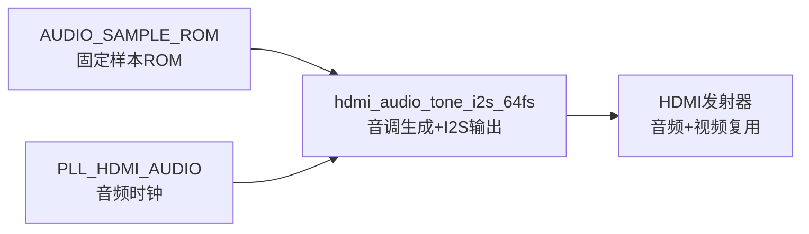
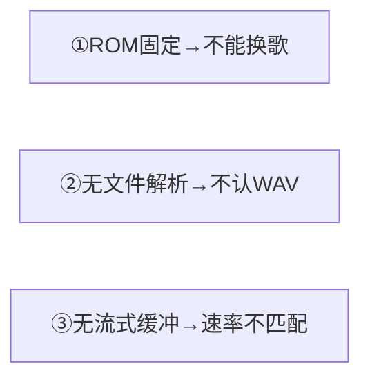
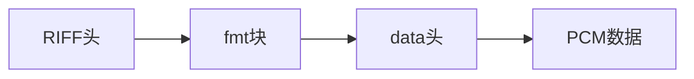
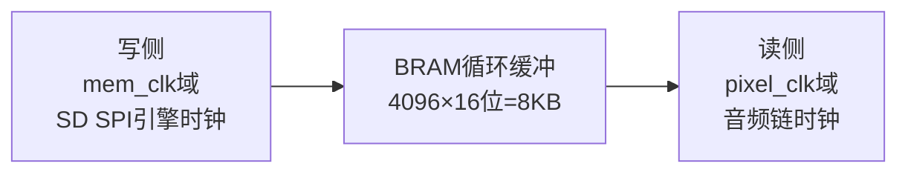
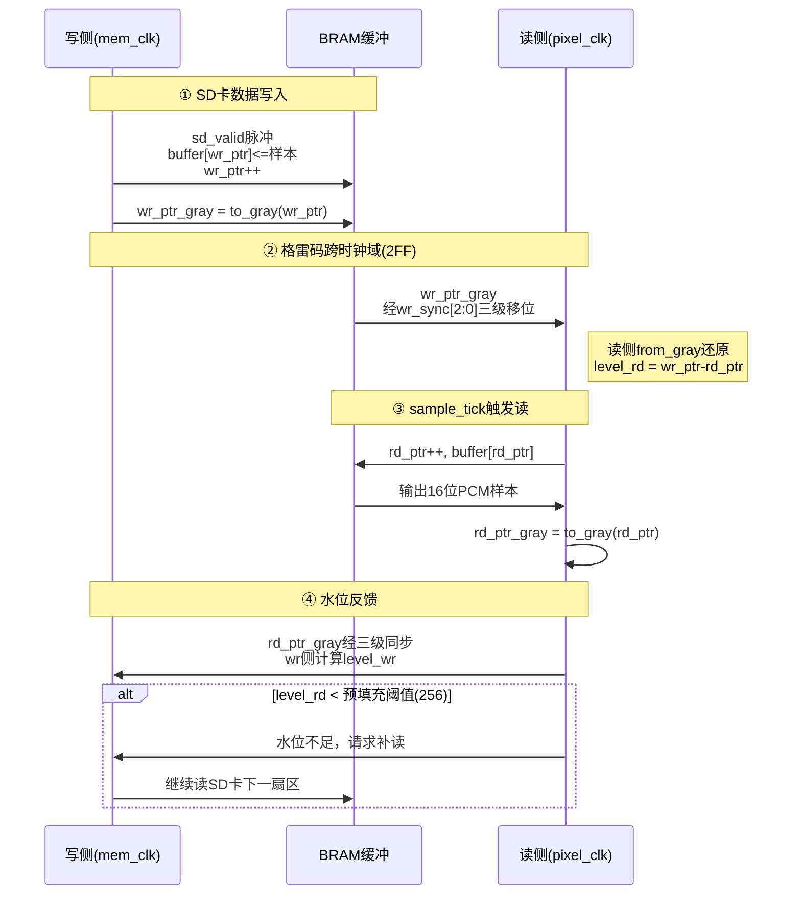
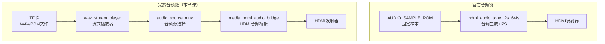
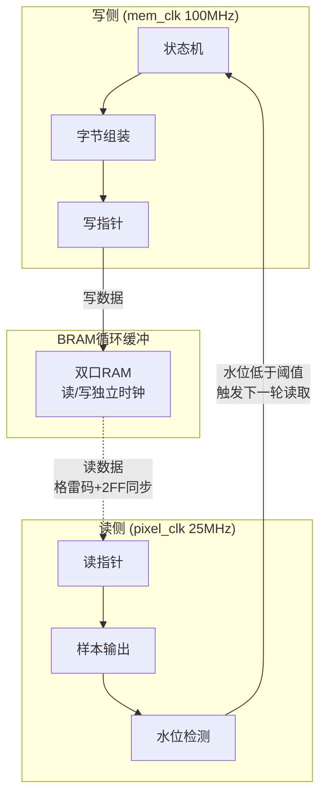
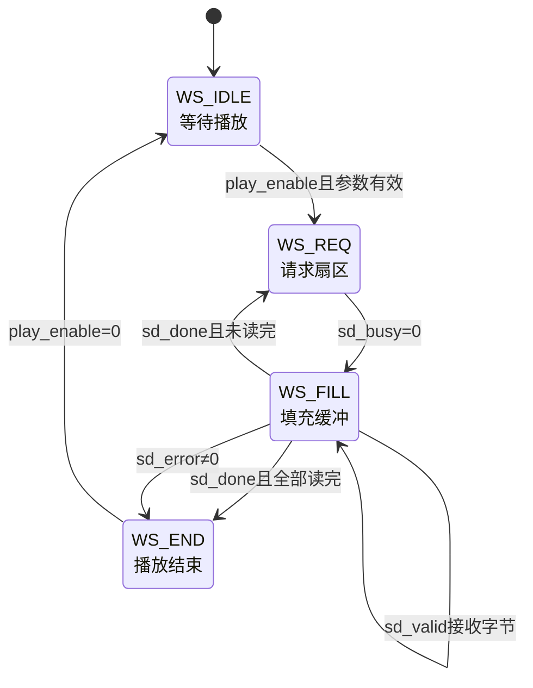
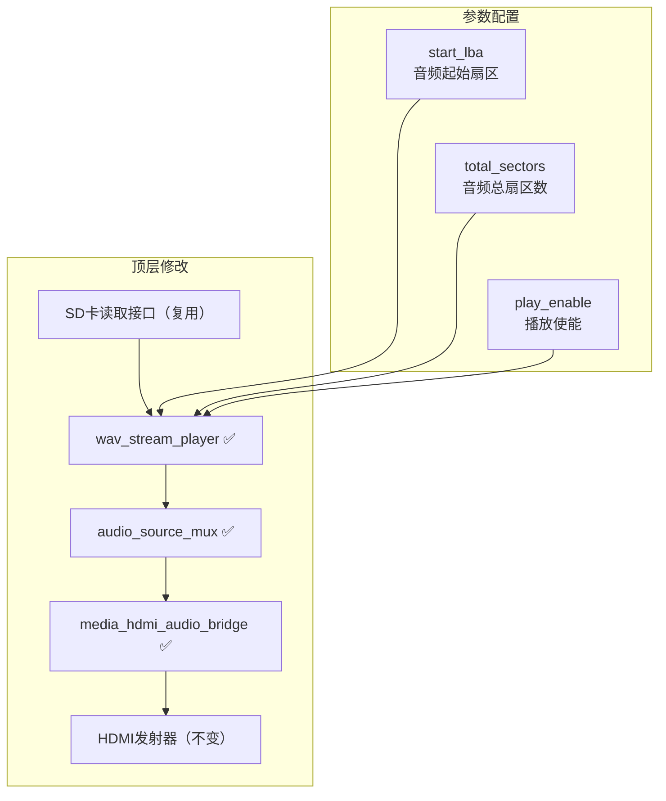
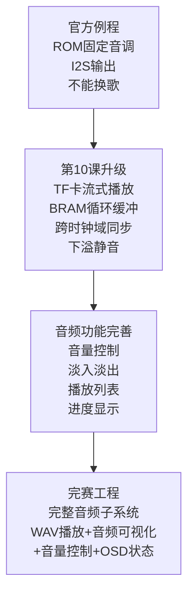

# 第10课 WAV音频播放

> **本节课解决赛题哪点**：拓展要求——音频播放功能。从官方例程的"ROM固定音调"升级到"TF卡流式播放WAV文件"，让你的媒体播放器真正能播放音乐。

---

## 一、官方例程的音频基础与局限

### 1.1 官方例程有什么音频能力

官方例程的`lab_ex5_i2s`目录提供了音频基础能力，核心模块有三个：



- **AUDIO_SAMPLE_ROM.v**：预存的音频样本ROM，里面是固定的正弦波或方波数据
- **hdmi_audio_tone_i2s_64fs.v**：音调生成器，从ROM读样本，通过I2S接口输出到HDMI
- **PLL_HDMI_AUDIO.v**：音频专用PLL，产生I2S所需的时钟（通常12.288MHz，对应48kHz采样率×256fs）

### 1.2 官方例程的3个严重局限



> **Note：** ①音频数据存在片内ROM里，编译时就固定了，不能从TF卡加载任意WAV文件；②不认识WAV文件格式，不知道文件头、采样率、位深、数据长度，只能读原始PCM样本；③没有流式缓冲机制，TF卡读取速率（~1.2MB/s突发）和音频消费速率（96KB/s at 48kHz 16-bit mono）不匹配，直接读会卡顿或爆音。

---

## 二、WAV音频播放的核心概念

WAV是最基础的音频文件格式，结构非常简单：



> **图例：**
> - RIFF头："RIFF"标识 + 文件大小 + "WAVE"标识
> - fmt块："fmt "标识 + 块大小 + 音频格式(1=PCM) + 声道数 + 采样率 + 字节率 + 块对齐 + 位深
> - data块头："data"标识 + 数据长度
> - PCM数据：原始音频样本，小端序，16位有符号

**完赛工程的简化处理**：不做完整的WAV头解析，而是用PC工具（`tools/make_audio_corpus.py`）把WAV转换成"原始16位有符号小端序PCM，48kHz单声道"格式，直接写到TF卡。FPGA只需要知道起始LBA和总扇区数，就能流式读取。

### 2.2 速率不匹配问题

这是音频流式播放最核心的难点：

| 方向 | 速率 | 说明 |
|------|------|------|
| TF卡读取 | ~1.2 MB/s 突发 | 读一个扇区512字节很快，但有命令开销 |
| 音频消费 | 96 KB/s 恒定 | 48kHz × 16bit × 1ch = 96000 B/s |

**比例约12.5:1**——TF卡读得快，音频消费得慢。如果直接读，会出现：

- 读太快：数据溢出，丢样本
- 读太慢：数据不够，爆音/卡顿

**解决方案**：在中间加一个**BRAM循环缓冲**，TF卡读满缓冲就暂停，音频消费到一定水位就触发下一次读取。

### 2.3 跨时钟域问题

音频播放涉及两个时钟域：



- **写侧**：工作在`mem_clk`（SD SPI引擎时钟，通常100MHz），从TF卡读字节，组装成16位样本，写入BRAM
- **读侧**：工作在`pixel_clk`（视频/音频链时钟，通常25MHz或27MHz），在`sample_tick`（~48kHz脉冲）时从BRAM读样本输出

**跨时钟域同步**：读写指针用**格雷码+2FF同步**，这是FPGA跨时钟域的标准做法。

**跨时钟域时序图**：



> **时序说明**：写侧mem_clk(100MHz)接收SD卡数据写入BRAM，读侧pixel_clk(25MHz)在sample_tick(48kHz)时读取样本。读写指针通过格雷码+2FF跨时钟域同步，读侧水位低于阈值时触发下一轮SD卡读取。

---


### 2.4 音量控制（sync_fade_gain）

完赛工程的音量控制有两个层次：**用户音量调节**和**转场同步淡入淡出**。

**用户音量调节**：
- 音量范围0..255，默认255（最大）
- 按KEY4单击循环5档音量：0→64→128→192→255→0
- 音量值持久化保存到Flash，断电不丢失
- 实现方式：PCM样本 × 音量 / 255（乘法器）

**转场同步淡入淡出（sync_fade_gain模块）**：
这是完赛工程的一个亮点：**图片淡入淡出时，音量也跟着淡入淡出**，实现音画同步转场。

```verilog
module sync_fade_gain #(
    parameter integer SYNC_STAGES = 2
) (
    input  wire       pix_clk,
    input  wire       pix_rst_n,
    input  wire       frame_start,
    input  wire [7:0] alpha_pix,
    input  wire       fade_active,

    input  wire       aud_clk,
    input  wire       aud_rst_n,
    output reg  [7:0] gain_aud
);
    // 像素侧：帧边界锁存alpha（准静态，2FF安全）
    reg [7:0] alpha_latch;
    reg       fade_latch;
    always @(posedge pix_clk or negedge pix_rst_n) begin
        if (!pix_rst_n) begin
            alpha_latch <= 8'd255;
            fade_latch  <= 1'b0;
        end else if (frame_start) begin
            alpha_latch <= alpha_pix;
            fade_latch  <= fade_active;
        end
    end

    // 音频侧：2FF同步，跟踪alpha变化
    reg [7:0] sync1, sync2;
    reg       fsync1, fsync2;
    reg [7:0] seen_alpha;
    reg       seen_fade;

    always @(posedge aud_clk or negedge aud_rst_n) begin
        if (!aud_rst_n) begin
            sync1 <= 8'd255; sync2 <= 8'd255;
            fsync1 <= 1'b0; fsync2 <= 1'b0;
            seen_alpha <= 8'd255; seen_fade <= 1'b0;
            gain_aud <= 8'd255;
        end else begin
            sync1 <= alpha_latch;
            sync2 <= sync1;
            fsync1 <= fade_latch;
            fsync2 <= fsync1;

            if (sync2 != seen_alpha) begin
                // alpha变了：采用新值
                seen_alpha <= sync2;
                gain_aud <= sync2;
            end else if (!fsync2 && seen_fade) begin
                // 转场结束（fade_active拉低）：恢复最大音量
                seen_fade <= 1'b0;
                if (gain_aud != 8'd255)
                    gain_aud <= 8'd255;
            end else if (fsync2) begin
                // 转场进行中：跟踪alpha
                seen_fade <= 1'b1;
                gain_aud <= sync2;
            end
        end
    end
endmodule
```

**工作原理**：
1. 视频转场模块（video_fade_transition）产生8位alpha值（0=全黑，255=全亮）
2. 在帧边界（frame_start）锁存alpha值，避免一帧内alpha变化导致音频爆音
3. 锁存的alpha通过2FF同步器从像素域（25MHz）跨到音频域（12.288MHz）
4. 音频侧用同步后的alpha作为增益：转场时gain=alpha，空闲时gain=255
5. 最终音量 = 用户音量 × 转场增益 / 255

**为什么要帧边界锁存？**
- alpha值每帧变化一次（淡出时每帧减1），如果不锁存，音频侧会看到alpha在一帧内跳变
- 帧边界锁存保证一帧内alpha是稳定的，音频增益不会突变
- 这是"准静态信号跨时钟域"的标准做法：变化慢的信号在源端锁存，然后2FF同步

### 2.5 音频源切换实现

完赛工程有三种音源：测试音、WAV播放、媒体音调（琶音），通过`audio_source_mux`模块切换。

完整模块代码（`rtl/audio/audio_source_mux.v`，43行）：

```verilog
module audio_source_mux (
    input  wire               clk,
    input  wire               rst_n,
    // 源A：WAV流
    input  wire               wav_valid,
    output wire               wav_ready,
    input  wire signed [15:0] wav_left,
    input  wire signed [15:0] wav_right,
    input  wire               wav_active,
    // 源B：琶音合成（pcm_media_tone）
    input  wire               arp_valid,
    output wire               arp_ready,
    input  wire signed [15:0] arp_left,
    input  wire signed [15:0] arp_right,
    // 强制琶音（拨码开关）
    input  wire               force_arpeggio,
    // 输出到m06_pcm_contract_adapter
    output wire               out_valid,
    input  wire               out_ready,
    output wire signed [15:0] out_left,
    output wire signed [15:0] out_right
);
    wire use_wav = wav_active && !force_arpeggio;

    assign out_valid = use_wav ? wav_valid : arp_valid;
    assign out_left  = use_wav ? wav_left  : arp_left;
    assign out_right = use_wav ? wav_right : arp_right;

    assign wav_ready = use_wav ? out_ready : 1'b0;
    assign arp_ready = use_wav ? 1'b0      : out_ready;
endmodule
```

逐行讲：

**use_wav**是组合逻辑：WAV正在播放（wav_active=1）且没被强制切到琶音（!force_arpeggio），就用WAV。

**数据通路**全是assign三目运算符，纯组合：out_valid/out_left/out_right在wav和arp之间选。没有寄存器，延迟为0。

**ready路由是关键**：ready只给被选中的音源。选中WAV时，arp_ready恒为0——琶音模块看到下游不ready，它的内部valid/ready握手不会推进，数据不会丢。反过来选中琶音时，wav_ready恒为0，wav_stream_player的sample_valid一直保持但下游不收，不会溢出（wav_stream_player自己有BRAM缓冲）。这样切换音源时两边都不丢数据。

- 测试音只在调试时用，通过拨码开关选择

**切换时的爆音处理**：
1. 音源切换在sample边界进行（valid/ready握手的间隙）
2. 切换前后都有淡入淡出（sync_fade_gain），不会突然从静音变最大音量
3. WAV播放结束时（wav_active拉低）自动切回琶音，过渡自然

**三种音源的优先级**：
1. WAV播放（最高优先级）：有WAV文件且正在播放时用WAV
2. 媒体音调（默认）：没有WAV播放时，根据当前图片播放对应的琶音
3. 测试音（调试用）：拨码开关强制选择，用于验证HDMI音频链路

---

## 三、从官方到完赛的过渡思路

### 3.1 整体架构：在HDMI音频链前插入流式播放器



**核心替换**：用`wav_stream_player`替换`AUDIO_SAMPLE_ROM`，从"固定ROM样本"升级到"TF卡流式播放"。HDMI音频输出链路（I2S/音频包封装）保持不变。

### 3.2 wav_stream_player 模块详解

这是本节课的核心模块，完整代码见完赛工程`rtl/audio/wav_stream_player.v`（约234行）。

**端口分类**：

| 类别 | 信号 | 方向 | 说明 |
|------|------|------|------|
| 写侧(mem_clk) | wr_clk / wr_rst_n | 输入 | 写时钟/复位 |
| | play_enable | 输入 | 播放使能（电平） |
| | start_lba[31:0] | 输入 | 音频数据起始扇区 |
| | total_sectors[31:0] | 输入 | 音频数据总扇区数 |
| | sd_req / sd_lba[31:0] | 输出 | 请求读扇区/扇区号 |
| | sd_busy / sd_valid / sd_byte[7:0] | 输入 | SD卡状态/有效字节/字节数据 |
| | sd_byte_index[8:0] / sd_done / sd_error[7:0] | 输入 | 字节索引/完成/错误 |
| 读侧(pixel_clk) | rd_clk / rd_rst_n | 输入 | 读时钟/复位 |
| | sample_tick | 输入 | ~48kHz采样脉冲 |
| | sample_out[15:0] / sample_valid | 输出 | 16位PCM样本/有效 |
| | sample_ready | 输入 | 下游就绪（通常恒1） |
| 状态 | sample_counter[31:0] | 输出 | 已消费样本数（OSD用） |
| | stream_active / stream_end / buffer_low | 输出 | 播放中/播放结束/缓冲低 |

**内部结构**：



**写侧状态机（5状态）**：



> **图例：** WS_IDLE等待播放使能；WS_REQ等待SD卡不忙时发起读请求；WS_FILL接收字节并组装成16位样本写入BRAM，每收到一个完整扇区判断是否继续；WS_END播放结束，等待play_enable拉低后回到IDLE。注意localparam还声明了WS_DONE=3，是**保留未用**状态（代码里`WS_DONE: wstate <= WS_REQ`直接跳回），不参与正常流程，所以状态图里没画，但状态编码占了3，WS_END=4——这也是读侧用`wstate_sync2==3'd4`判断"播放结束"的原因。

**格雷码函数和指针同步**（第66~94行）：
```verilog
reg [15:0] buffer [0:(1<<ADDR_WIDTH)-1];  // 4096×16位 BRAM
reg [ADDR_WIDTH-1:0] wr_ptr;
reg [ADDR_WIDTH-1:0] rd_ptr;

// 二进制转格雷码
function [ADDR_WIDTH-1:0] to_gray;
    input [ADDR_WIDTH-1:0] b;
    begin
        to_gray = b ^ (b >> 1);
    end
endfunction

// 格雷码转二进制
function [ADDR_WIDTH-1:0] from_gray;
    input [ADDR_WIDTH-1:0] g;
    reg [ADDR_WIDTH-1:0] b;
    integer i;
    begin
        b[ADDR_WIDTH-1] = g[ADDR_WIDTH-1];
        for (i = ADDR_WIDTH-2; i >= 0; i = i - 1)
            b[i] = b[i+1] ^ g[i];
        from_gray = b;
    end
endfunction
```
to_gray就是`b ^ (b>>1)`，一位异或一位。from_gray是反向展开：最高位直接取，每一位等于前一位和当前格雷码位异或。为什么用格雷码跨时钟域？因为格雷码相邻值只差1位，跨时钟域时即使采样到"中间态"也只会差1，不会出现wr_ptr从7跳到8时采成0的灾难性错误。

**水位计算**（第97~99行）：
```verilog
wire [ADDR_WIDTH:0] level_wr = {1'b0, wr_ptr} - {1'b0, rd_ptr_in_wr};
wire [ADDR_WIDTH:0] level_rd = {1'b0, wr_ptr_in_rd} - {1'b0, rd_ptr};
```
level_rd是读侧看到的"已写入但未消费"的样本数。读侧水位低于一个扇区（256样本）时判断为下溢。

**字节组装（小端序）**：TF卡字节流是LSB先到，所以第一次收到的存lo_byte，第二次收到的拼成{sd_byte, lo_byte}——sd_byte是高字节，lo_byte是低字节。

```verilog
if (!lo_pending) begin
    lo_byte    <= sd_byte;      // 先收到低字节
    lo_pending <= 1'b1;
end else begin
    buffer[wr_ptr] <= {sd_byte, lo_byte};  // 后收到高字节，组成16位
    wr_ptr         <= wr_ptr + 1'b1;
    lo_pending     <= 1'b0;
end
```

**完整写侧状态机**（第119~190行），5个状态：

```verilog
case (wstate)
WS_IDLE: begin
    if (play_enable && start_lba != 32'd0 && total_sectors != 32'd0) begin
        cur_lba      <= start_lba;
        sectors_read <= 32'd0;
        wr_ptr       <= {ADDR_WIDTH{1'b0}};
        lo_pending   <= 1'b0;
        wstate       <= WS_REQ;
    end
end
WS_REQ: begin
    if (!sd_busy) begin
        sd_lba <= cur_lba;
        wstate <= WS_FILL;
    end
end
WS_FILL: begin
    if (sd_valid) begin
        if (!lo_pending) begin
            lo_byte    <= sd_byte;
            lo_pending <= 1'b1;
        end else begin
            buffer[wr_ptr] <= {sd_byte, lo_byte};
            wr_ptr         <= wr_ptr + 1'b1;
            lo_pending     <= 1'b0;
        end
    end
    if (sd_done) begin
        if (sd_error != 8'd0) begin
            wstate <= WS_END;           // 读取出错：停止流
        end else begin
            sectors_read <= sectors_read + 1'b1;
            cur_lba      <= cur_lba + 1'b1;
            if (sectors_read + 1'b1 >= total_sectors)
                wstate <= WS_END;       // 全部读完
            else
                wstate <= WS_REQ;       // 读下一个扇区
        end
    end
end
WS_DONE: wstate <= WS_REQ;  // 保留未用（预留状态）
WS_END: begin
    if (!play_enable)
        wstate <= WS_IDLE;              // 等播放停止
end
default: wstate <= WS_IDLE;
endcase
```

读这个状态机抓三个点：WS_REQ只在sd_busy=0时发起读请求，避免和SD卡引擎冲突；WS_FILL里字节组装和扇区完成判断是并列的（同一个always块里两个if），sd_valid时组装字节，sd_done时判断是否继续；WS_END是终态，只有play_enable拉低才回IDLE，不会自动重播。

**读侧逻辑**：
```verilog
sample_valid <= 1'b0;   // 默认拉低，下面满足条件再断言

if (sample_tick && sample_ready) begin
    if (level_rd >= SAMPLES_PER_SECTOR || (wstate_sync2 == 3'd4 && level_rd > 0)) begin
        // 缓冲足够（或播放已结束但还有残余样本）：正常播放
        sample_out    <= buffer[rd_ptr];
        rd_ptr        <= rd_ptr + 1'b1;
        sample_valid  <= 1'b1;
        sample_counter <= sample_counter + 1'b1;
    end else begin
        // 预填充或下溢：输出静音，但不消费读指针
        sample_out   <= 16'sd0;
        sample_valid <= 1'b1;   // valid仍然断言，下游不停顿
    end
end

// 停止播放时清零读指针和样本计数
if (!play_enable) begin
    rd_ptr         <= {ADDR_WIDTH{1'b0}};
    sample_counter <= 32'd0;
end
```

注意第二个播放条件`wstate_sync2 == 3'd4 && level_rd > 0`：写侧状态机的状态也通过两级同步（wstate_sync1/2）打到读侧，WS_END的编码是3'd4。当整段音频已经读完（写侧进入WS_END），但BRAM里还剩没播完的样本时，这个条件让读侧**把残余样本排空**，而不是立刻静音——否则一首歌的最后一小段会被切掉。只有残余也播空（level_rd==0）后，才进入下溢静音。

**关键设计决策**：
1. **下溢时输出静音而不是拉低valid**：这样下游HDMI音频链永远不会停顿，避免爆音
2. **预填充阈值256样本**：开始播放前先等缓冲里有至少256样本（一个扇区），避免一开始就下溢
3. **格雷码同步**：读写指针跨时钟域用格雷码+2FF，避免亚稳态
4. **缓冲大小8KB**：4096×16位，约42ms音频（48kHz），足够吸收TF卡读取抖动

---

## 四、完整代码与改动位置（约15分钟）

### 4.1 新增文件

| 文件 | 行数 | 说明 |
|------|------|------|
| `rtl/audio/wav_stream_player.v` | ~234 | 核心：WAV流式播放器 |
| `rtl/audio/audio_source_mux.v` | ~43 | 音频源多路选择器（WAV流 / 琶音二选一） |
| `rtl/integration/media_hdmi_audio_bridge.v` | ~89 | HDMI音频桥接（PCM→I2S→HDMI音频包） |

### 4.2 顶层改动位置



> **Note：** ①新增wav_stream_player实例，连接到已有的SD卡扇区读取接口（复用第5课的FAT32文件系统或直接物理扇区读取）；②新增audio_source_mux选择音频源（WAV播放/测试音调/静音）；③新增media_hdmi_audio_bridge把PCM样本转换成HDMI音频包格式；④HDMI发射器保持不变；⑤参数start_lba和total_sectors由文件系统解析WAV文件后给出，play_enable由播放控制逻辑给出。

### 4.3 音频文件准备

完赛工程不做完整的WAV头解析，而是用PC工具预处理：

```bash
# 工具路径：tools/make_audio_corpus.py
# 功能：把任意WAV转换成 16位有符号小端序PCM, 48kHz, 单声道
python tools/make_audio_corpus.py input.wav output.pcm
```

然后把output.pcm写到TF卡，记录起始扇区和总扇区数，传给wav_stream_player。

---

## 五、从官方例程到完赛工程的演进路径



> **Note：** 第10课升级=从ROM固定音调到TF卡流式播放WAV，核心是BRAM循环缓冲+跨时钟域同步+下溢静音；完赛工程=完整音频子系统，包含WAV播放、音频可视化（第11课）、音量控制、OSD状态显示。


---

## 六、常见问题与调试技巧

### Q1：没有声音输出

**排查步骤**：
1. 检查play_enable是否为1
2. 检查start_lba和total_sectors是否正确（用十六进制工具看TF卡数据）
3. 检查sample_tick是否有脉冲（用ILA抓信号）
4. 检查sample_valid是否为1
5. 检查下游HDMI音频链是否正常（先用测试音调验证）

### Q2：声音卡顿/爆音

**可能原因**：

1. 缓冲太小，下溢频繁→增大ADDR_WIDTH
2. 预填充阈值太小，一开始就下溢→增大阈值
3. TF卡读取太慢，跟不上消费速率→检查SD卡SPI时钟频率
4. 跨时钟域同步有问题，指针计算错误→检查格雷码同步逻辑

### Q3：声音失真/噪声

**可能原因**：

1. 字节序搞反了（应该是小端序，低字节先到）
2. 位深不匹配（文件是24位，模块按16位处理）
3. 采样率不匹配（文件是44.1kHz，sample_tick是48kHz）
4. 音量过大导致溢出（16位有符号范围是-32768~32767）

---

**本节课配套代码文件**：
- `rtl/audio/wav_stream_player.v`（核心，~234行）
- `rtl/audio/audio_source_mux.v`（音频源选择，~43行）
- `rtl/integration/media_hdmi_audio_bridge.v`（HDMI音频桥接，~89行）
- `tools/make_audio_corpus.py`（WAV转PCM工具）
