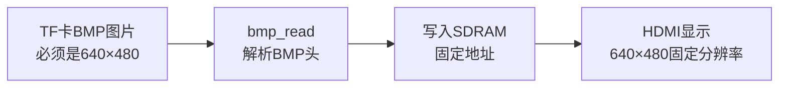
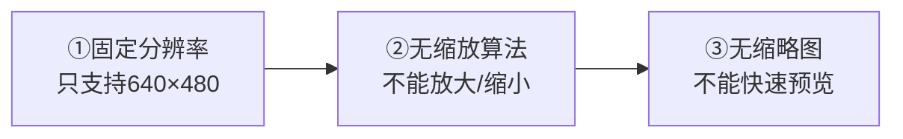
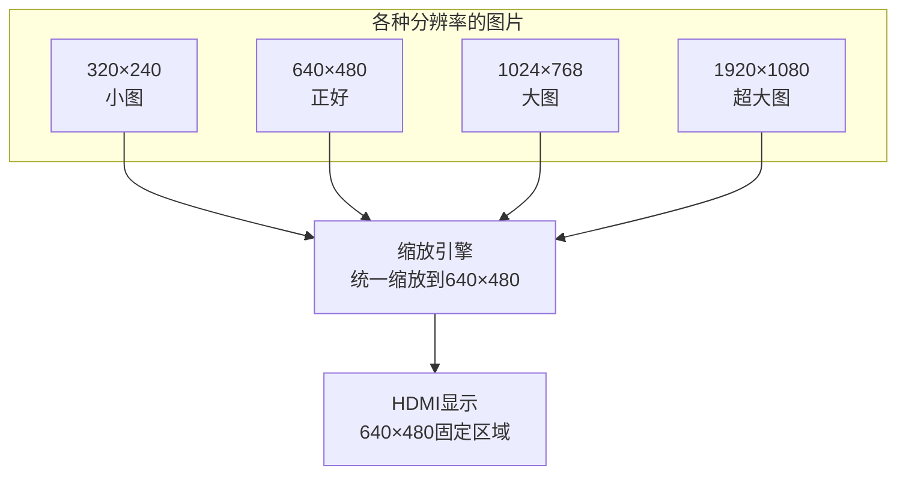
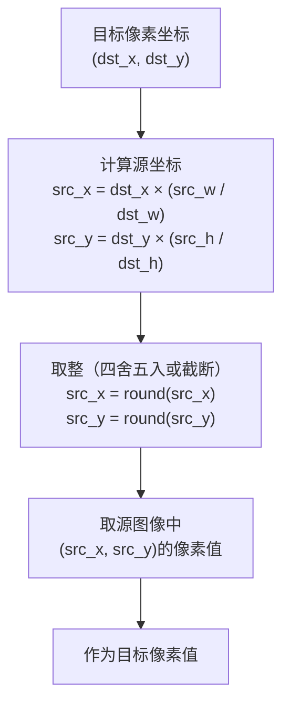
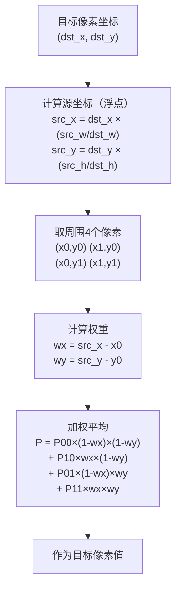
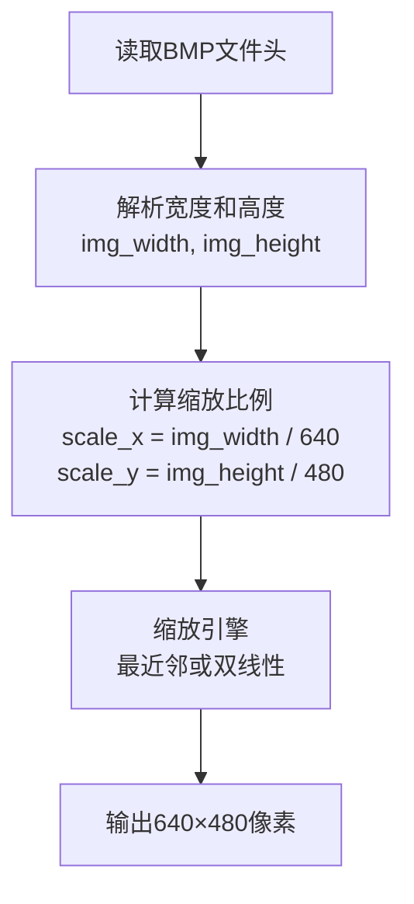
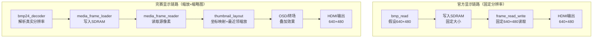
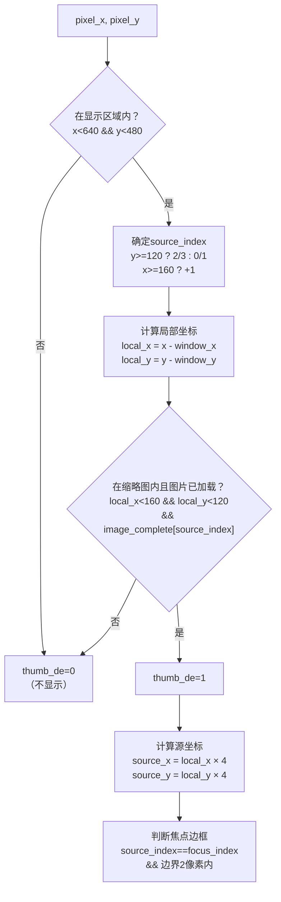
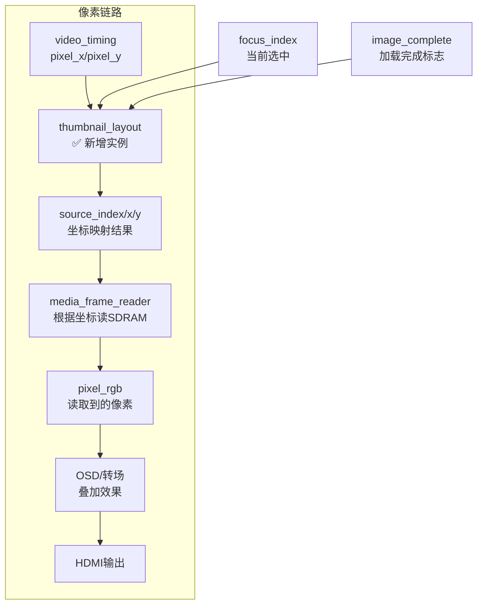
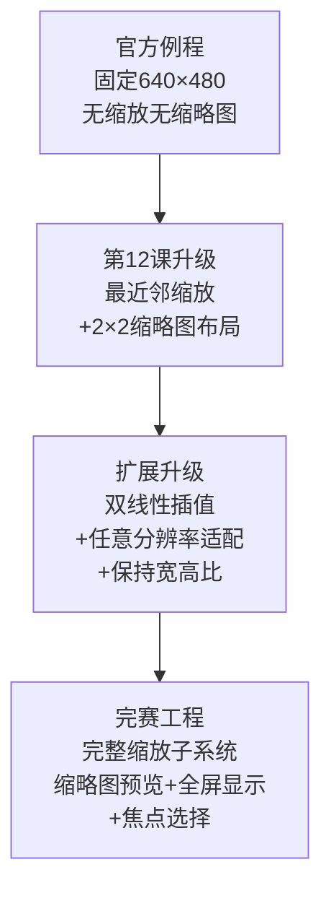

# 第12课 图片缩放与缩略图

> **本节课解决赛题哪点**：扩展要求第3点——图片缩放适配：支持不同分辨率图片并优化缩放质量。这是扩展要求中实用性最强的一项，支持任意分辨率的BMP图片，不再局限于640×480。

---

## 一、官方例程的缩放能力与局限

### 1.1 官方例程有什么

官方例程`lab_ex_4`**只支持固定分辨率的BMP图片**——必须是640×480、24位RGB、非压缩BMP。如果图片不是这个分辨率，要么显示异常（拉伸/压缩/错位），要么直接不显示。



官方例程的BMP解析模块（bmp_read）在解析BMP头时，会读取图片的宽度和高度，但实际上并没有用这些信息来做缩放——它假设图片就是640×480，直接按固定大小写入SDRAM。如果图片不是这个分辨率，写入的数据就会和显示的分辨率不匹配，导致显示异常。

### 1.2 官方例程的3个局限



> **Note：** ①官方例程只支持640×480固定分辨率的BMP图片，其他分辨率的图片要么显示异常要么不显示；②没有任何缩放算法，不能放大或缩小图片，图片是多大就显示多大（但显示区域固定640×480，所以不匹配就异常）；③没有缩略图功能，不能快速预览所有图片，只能一张一张切换查看。

---

## 二、图片缩放的核心原理

### 2.1 为什么需要缩放

图片的分辨率是多种多样的——有640×480、800×600、1024×768、1920×1080，也有320×240、160×120等小图。而我们的显示区域是固定的640×480。如果图片分辨率和显示区域不匹配，就需要缩放。



**缩放的两种情况**：
- **缩小**：图片分辨率大于显示区域（如1024×768→640×480），需要丢弃一些像素
- **放大**：图片分辨率小于显示区域（如320×240→640×480），需要插值生成一些像素

### 2.2 最近邻插值原理

最近邻插值（Nearest Neighbor）是最简单的缩放算法。原理很简单：**对于目标图像中的每个像素，找到源图像中距离最近的那个像素，直接取它的值**。



**公式**：
```
src_x = dst_x × (src_width / dst_width)
src_y = dst_y × (src_height / dst_height)
```
然后对src_x和src_y取整（四舍五入或直接截断），取源图像中对应位置的像素值。

**缩小示例**（640×480→160×120，4:1缩小）：

```
src_x = dst_x × (640 / 160) = dst_x × 4
src_y = dst_y × (480 / 120) = dst_y × 4
```
目标(0,0)→源(0,0)，目标(1,0)→源(4,0)，目标(2,0)→源(8,0)...每4个源像素取1个，丢弃中间的3个。

**放大示例**（160×120→640×480，4:1放大）：

```
src_x = dst_x × (160 / 640) = dst_x / 4
src_y = dst_y × (120 / 480) = dst_y / 4
```
目标(0,0)→源(0,0)，目标(1,0)→源(0.25)→取整源(0,0)，目标(2,0)→源(0.5)→取整源(1,0)...每个源像素被复制4次，填充中间的3个目标像素。

**优点**：算法简单，计算量小，不需要乘法器（如果缩放比例是2的幂，可以用移位实现），速度快。
**缺点**：放大时会有明显的锯齿和方块感（因为是直接复制像素），缩小时可能丢失细节（因为是直接丢弃像素）。

### 2.3 双线性插值原理

双线性插值（Bilinear Interpolation）是比最近邻更高级的缩放算法。原理是：**对于目标图像中的每个像素，找到源图像中周围的4个像素，根据距离加权平均，得到目标像素值**。



**4个像素的位置**：
- (x0, y0)：左上角，x0=floor(src_x), y0=floor(src_y)
- (x1, y0)：右上角，x1=x0+1
- (x0, y1)：左下角，y1=y0+1
- (x1, y1)：右下角

**权重**：
- wx = src_x - x0（0到1之间，表示在x方向上距离左边的比例）
- wy = src_y - y0（0到1之间，表示在y方向上距离上边的比例）

**加权平均公式**：
```
P = P00×(1-wx)×(1-wy) + P10×wx×(1-wy) + P01×(1-wx)×wy + P11×wx×wy
```

**直观理解**：距离越近的像素权重越大，距离越远的像素权重越小。4个像素的权重加起来等于1。

**优点**：放大时画面平滑，没有锯齿和方块感，缩小时保留更多细节。
**缺点**：计算量大，需要多个乘法器（每个通道至少4个乘法+3个加法），速度比最近邻慢。

**FPGA实现考虑**：双线性插值需要浮点运算，但FPGA没有浮点单元，需要用定点数实现。通常把权重放大256倍（用8位定点数），运算完后再右移8位。比如wx=0.5表示为128，(1-wx)=0.5表示为128。这样所有运算都是整数运算，FPGA可以高效实现。

**SDRAM带宽考虑：**双线性插值需要同时读取4个像素，SDRAM带宽是原来的4倍。640×480@60Hz的像素速率是18.432MHz，4倍就是73.7MHz，SDRAM的带宽（100MHz×32位=400MB/s）足够，但需要burst读取来提高效率

如果SDRAM带宽不够，可以折中：在缩略图模式（160×120）下用最近邻（因为缩略图小，锯齿不明显），在全屏模式下用双线性（全屏时锯齿明显）


### 2.4 不同分辨率图片适配

支持不同分辨率的图片，需要解决两个问题：**如何知道图片的分辨率**和**如何缩放**。

**如何知道图片的分辨率**：BMP文件头中包含了图片的宽度和高度信息。BMP文件头的结构：

- 偏移0-1：文件类型（"BM"）
- 偏移2-5：文件大小
- 偏移10-13：像素数据偏移
- 偏移18-21：图片宽度（像素）
- 偏移22-25：图片高度（像素）
- 偏移28-29：位深（通常24位）

在解析BMP头时，读取宽度和高度，保存到寄存器中，作为缩放的源分辨率参数。



**宽高比不匹配的处理**：如果图片的宽高比和640×480（4:3）不匹配，比如16:9的图片，直接拉伸会变形。有两种处理方式：

- **拉伸填充**：直接拉伸到640×480，画面变形但填满整个屏幕
- **保持宽高比**：按比例缩放，空白区域用黑色填充（letterbox），画面不变形但有黑边

完赛工程当前用的是拉伸填充（因为缩略图布局中假设图片都是640×480），如果要支持任意宽高比，可以扩展为保持宽高比模式。

保持宽高比的计算方法：取scale_x和scale_y中较大的那个（这样图片能完全显示在屏幕内），按这个比例缩放，然后水平居中或垂直居中。比如16:9的图片（1920×1080），scale_x=1920/640=3，scale_y=1080/480=2.25，取较大的scale_x=3，缩放后图片大小=640×360，上下各有(480-360)/2=60像素的黑边，垂直居中

### 2.5 缩略图布局原理

缩略图布局是缩放的一个典型应用——把4张图片缩小后排列在一个屏幕上，方便快速预览和选择。

**2×2布局坐标表**（640×480屏幕，每格160×120）：

|  | 左列（x: 0~159） | 右列（x: 160~319） |
|---|---|---|
| **上半屏（y: 0~119）** | 图片1，区域 (0,0)~(159,119) | 图片2，区域 (160,0)~(319,119) |
| **下半屏（y: 120~239）** | 图片3，区域 (0,120)~(159,239) | 图片4，区域 (160,120)~(319,239) |

> 读图方法：先看y落在哪半屏（y≥120是下排图片3/4，否则上排图片1/2），再看x落在哪列（x≥160是右列图片2/4，否则左列图片1/3），两步就能定位source_index。

**布局参数**：
- 屏幕分辨率：640×480
- 缩略图大小：160×120（每张图片缩小到1/4）
- 排列方式：2×2网格
- 每个缩略图位置：
  - 图片1：(0, 0) ~ (159, 119)
  - 图片2：(160, 0) ~ (319, 119)
  - 图片3：(0, 120) ~ (159, 239)
  - 图片4：(160, 120) ~ (319, 239)

**坐标映射**：对于屏幕上的每个像素(dst_x, dst_y)，需要确定：
1. **source_index**：这个像素属于哪张图片（0-3）
2. **local_x, local_y**：在缩略图内的局部坐标（0-159, 0-119）
3. **source_x, source_y**：在源图片中的坐标（local_x×4, local_y×4，因为4:1缩小）

**焦点边框**：当前选中的缩略图（focus_index）显示一个2像素宽的边框，方便用户知道当前选中的是哪张。

**image_complete判断**：只有加载完成的图片（image_complete对应位为1）才显示缩略图，未加载完成的显示黑色或占位符。

---

## 三、从官方到完赛的过渡思路

### 3.1 整体架构对比



**核心差异**：
1. **BMP解析真实分辨率**：完赛工程的bmp24_decoder解析BMP头中的真实宽度和高度，不再假设是640×480
2. **坐标映射模块**：新增thumbnail_layout模块，负责缩略图布局和缩放坐标映射
3. **最近邻缩放**：通过坐标映射实现最近邻缩放（source_x=local_x×4）
4. **缩略图预览**：支持2×2缩略图布局，快速预览4张图片

### 3.2 thumbnail_layout 模块详解

完赛工程的缩略图布局模块是`thumbnail_layout.v`（约48行），是整个课程中最精简的模块之一。

**端口分类**：

| 信号 | 方向 | 说明 |
|------|------|------|
| in_de | 输入 | 输入DE（数据有效） |
| pixel_x / pixel_y | 输入 | 当前像素坐标（12位） |
| focus_index | 输入 | 当前选中的缩略图索引（2位，0-3） |
| image_complete | 输入 | 图片加载完成标志（4位，每一位对应一张图片） |
| thumb_de | 输出 | 缩略图DE（当前像素是否在缩略图内且图片已加载） |
| source_index | 输出 | 源图片索引（2位，0-3） |
| source_x / source_y | 输出 | 源图片中的坐标（10位） |
| focus_border | 输出 | 是否在焦点边框上 |

**参数**：
- DISPLAY_WIDTH = 640：显示宽度
- DISPLAY_HEIGHT = 480：显示高度
- THUMB_WIDTH = 160：缩略图宽度
- THUMB_HEIGHT = 120：缩略图高度

**内部逻辑**（纯组合逻辑）：



下面带大家读完整代码，打开 `rtl/display/thumbnail_layout.v`，一共48行，全是组合逻辑。

**端口和参数**（第3~19行）：
```verilog
module thumbnail_layout #(
    parameter integer DISPLAY_WIDTH  = 640,
    parameter integer DISPLAY_HEIGHT = 480,
    parameter integer THUMB_WIDTH   = 160,
    parameter integer THUMB_HEIGHT  = 120
) (
    input  wire        in_de,
    input  wire [11:0] pixel_x,
    input  wire [11:0] pixel_y,
    input  wire [1:0]  focus_index,
    input  wire [3:0]  image_complete,
    output reg         thumb_de,
    output reg  [1:0]  source_index,
    output reg  [9:0]  source_x,
    output reg  [9:0]  source_y,
    output reg         focus_border
);
```
输入是屏幕坐标pixel_x/pixel_y，输出是源图片索引和源坐标。focus_index是当前选中的缩略图（2位，0~3），image_complete是4位向量，每一位对应一张图是否加载完成。

**核心组合逻辑**（第24~47行）：
```verilog
integer window_x;
    integer window_y;
    integer local_x;
    integer local_y;
    always @* begin
    thumb_de     = 1'b0;
    source_index = 2'd0;
    source_x     = 10'd0;
    source_y     = 10'd0;
    focus_border = 1'b0;

    if (in_de && pixel_x < DISPLAY_WIDTH && pixel_y < DISPLAY_HEIGHT) begin
        // 第一步：确定source_index（0~3）
        source_index = (pixel_y >= THUMB_HEIGHT) ? 2'd2 : 2'd0;
        if (pixel_x >= THUMB_WIDTH)
            source_index = source_index + 1'b1;

        // 第二步：计算当前缩略图窗口的左上角坐标
        window_x = (pixel_x >= THUMB_WIDTH) ? THUMB_WIDTH : 0;
        window_y = (pixel_y >= THUMB_HEIGHT) ? THUMB_HEIGHT : 0;

        // 第三步：局部坐标
        local_x = pixel_x - window_x;
        local_y = pixel_y - window_y;

        // 第四步：在缩略图内且图片已加载？
        if (local_x < THUMB_WIDTH && local_y < THUMB_HEIGHT &&
            image_complete[source_index]) begin
            thumb_de = 1'b1;
            // 最近邻缩放：4:1缩小
            source_x = local_x * (640 / THUMB_WIDTH);   // = local_x * 4     
            source_y = local_y * (480 / THUMB_HEIGHT);  // = local_y * 4
            // 焦点边框：2像素宽
            focus_border = source_index == focus_index &&
                           (local_x < 2 || local_y < 2 ||
                            local_x >= THUMB_WIDTH-2 || local_y >= THUMB_HEIGHT-2);
        end
    end
end
```

逐行讲关键：

**source_index怎么算的？** 先看y：`pixel_y >= 120` 说明在屏幕下半部分，基础索引是2（左下=2、右下=3）；否则在上半部分，基础索引是0（左上=0、右上=1）。再看x：`pixel_x >= 160` 说明在右半部分，索引加1。所以：左上(0~159,0~119)→0，右上(160~319,0~119)→1，左下(0~159,120~239)→2，右下(160~319,120~239)→3。注意320~639这半屏不显示缩略图（thumb_de=0），留空。

**window_x/window_y是什么？** 就是当前缩略图在屏幕上的左上角坐标。左列是0，右列是160；上行是0，下行是120。用它减去屏幕坐标就得到缩略图内的局部坐标local_x/local_y。

**source_x为什么乘4？** 因为缩略图是160×120，源图是640×480，正好4:1缩小。`640/THUMB_WIDTH = 640/160 = 4`，`480/THUMB_HEIGHT = 480/120 = 4`。local_x=0对应源图第0列，local_x=159对应源图第636列（159×4=636）。这就是最近邻插值——每个源像素被采样一次，中间像素直接丢弃。

**focus_border怎么画？** 先判断是不是当前选中的缩略图（source_index==focus_index），再判断是不是在缩略图最外圈2像素内：左边2列（local_x<2）、上边2行（local_y<2）、右边2列（local_x>=158）、下边2行（local_y>=118）。满足任一条件就输出边框。

**关键设计决策**：
1. **纯组合逻辑**：整个模块是纯组合逻辑（always @*），没有时序逻辑，没有延迟。这样坐标映射是即时的，不需要额外的流水线对齐。
2. **最近邻缩放**：source_x=local_x×(640/160)=local_x×4，source_y=local_y×(480/120)=local_y×4。这就是最近邻插值——直接取源图片中对应位置的像素，没有加权平均。
3. **只做坐标映射**：这个模块只输出source_index、source_x、source_y，不直接读SDRAM。实际的像素读取由media_frame_reader根据这些坐标完成。这样职责分离，thumbnail_layout只负责布局和缩放坐标，media_frame_reader负责存储读取。
4. **image_complete判断**：只有加载完成的图片才显示缩略图，未加载完成的显示黑色（thumb_de=0，上游会输出黑色）。

### 3.3 从最近邻扩展到双线性

thumbnail_layout当前用的是最近邻插值，如果要升级为双线性插值，需要做以下修改：

1. **输出浮点坐标**：不再输出取整后的source_x/source_y，而是输出定点数坐标（比如source_x_8q8，8位整数+8位小数）
2. **输出周围4个像素的坐标**：(x0,y0)、(x1,y0)、(x0,y1)、(x1,y1)
3. **输出权重**：wx、wy（8位定点数）
4. **media_frame_reader需要同时读取4个像素**：当前只读1个像素，双线性需要读4个，SDRAM带宽可能不够
5. **像素级加权平均**：在输出端加一个双线性插值模块，对4个像素加权平均

**SDRAM带宽考虑**：双线性插值需要同时读取4个像素，SDRAM带宽是原来的4倍。640×480@60Hz的像素速率是18.432MHz，4倍就是73.7MHz，SDRAM的带宽（100MHz×32位=400MB/s）足够，但需要burst读取来提高效率。

如果SDRAM带宽不够，可以折中：在缩略图模式（160×120）下用最近邻（因为缩略图小，锯齿不明显），在全屏模式下用双线性（全屏时锯齿明显）。

#### 3.3.1 双线性扩展练习（完赛未实现，选做）

> 完赛工程的thumbnail_layout.v只做最近邻坐标映射，**没有实现双线性**。下面给一个定点实现的脚手架，标注"选做"：权重用8位定点（0.5=128），运算完右移8位。R通道先按下面写，G/B三通道复制即可。

```verilog
// bilinear_8q8.v —— 双线性插值选做骨架（完赛工程未实现）
// 输入：4个相邻像素 p00/p10/p01/p11（左上/右上/左下/右下）
//       wx = (x的小数部分)<<8, wy = (y的小数部分)<<8  (0~255)
// 思路：先按行加权，再按列加权，每步乘16位再取高8位
// R通道示例（G/B 照抄换信号名）：
wire [8:0]  inv_wx       = 9'd256 - {1'b0, wx};                    // 256-wx，范围1~256
wire [8:0]  inv_wy       = 9'd256 - {1'b0, wy};
wire [15:0] row_top_r    = p00_r * inv_wx + p10_r * wx;            // 顶行: p00*(256-wx)+p10*wx，≤65280
wire [15:0] row_bottom_r = p01_r * inv_wx + p11_r * wx;            // 底行
wire [15:0] out_r_full   = row_top_r[15:8] * inv_wy + row_bottom_r[15:8] * wy;
wire [7:0]  out_r        = out_r_full[15:8];                       // 列加权后取高8位
```

要点：①先水平方向对p00/p10、p01/p11各加权一次（共2次乘法），再垂直方向对两行结果加权一次（2次乘法），每通道4个乘法器；②权重和为256，乘完取高8位就等于/256；③最难的不是加权，是media_frame_reader要能同时取到周围4个像素（带宽+地址对齐，见上文带宽分析）。上板验证：先把wx=0、wy=0，输出应等于p00（回归基准）；再wx=wy=128，输出应是4像素平均。

**两个综合陷阱（本骨架初版踩过，安路TD实测实锤后修正，别踩第二次）**：

1. **`8'd256` 不是256**——8位字面量装不下256，会静默截断成0（TD报`HDL-5007 literal value truncated`），权重补数全部算错。必须写`9'd256 - {1'b0, wx}`；
2. **行结果必须先取高8位再做列加权**——行加权结果最大255×256=65280，若不取`[15:8]`直接乘，乘积最大约1670万，16位线宽装不下被静默截断，输出全错。"每步乘16位再取高8位"说的就是这个。

---

## 四、完整代码与改动位置

### 4.1 新增/修改文件

| 文件 | 行数 | 说明 |
|------|------|------|
| `rtl/display/thumbnail_layout.v` | ~48 | 缩略图布局+最近邻缩放坐标映射 |
| `rtl/image/bmp24_decoder.v` | ~386 | BMP解码器（解析真实分辨率，第4/6课已建） |
| `rtl/memory/media_frame_reader.v` | ~370 | 帧读取器（根据source_index/x/y读取像素，第7课已建） |
| 控制层 | - | 增加缩略图模式/全屏模式切换 |

### 4.2 顶层改动位置



> **Note：** ①在视频时序和media_frame_reader之间插入thumbnail_layout实例，负责把屏幕坐标映射为源图片坐标（包含缩放和布局）；②连接focus_index和image_complete到thumbnail_layout；③thumbnail_layout输出source_index、source_x、source_y给media_frame_reader，reader根据这些坐标从SDRAM读取对应像素；④如果要切换全屏模式，bypass thumbnail_layout（直接把pixel_x/pixel_y作为source_x/source_y，source_index固定为当前图片）。

---

## 五、从官方例程到完赛工程的演进路径



> **Note：** 第12课升级=从固定分辨率到最近邻缩放+2×2缩略图布局，核心是坐标映射（thumbnail_layout）；扩展升级=双线性插值+任意分辨率适配+保持宽高比；完赛工程=完整缩放子系统。

###

---

## 六、常见问题与调试技巧

### Q1：缩略图显示错位或花屏

**排查步骤**：

1. 检查thumbnail_layout的参数（DISPLAY_WIDTH/HEIGHT、THUMB_WIDTH/HEIGHT）是否正确
2. 用ILA抓source_index，确认每个区域的source_index正确（左上0、右上1、左下2、右下3）
3. 用ILA抓source_x/source_y，确认坐标映射正确（local_x=0→source_x=0，local_x=1→source_x=4）
4. 检查media_frame_reader是否正确根据source_index/x/y读取像素
5. 检查image_complete信号，确认图片加载完成后才显示

### Q2：缩放后图片变形

**可能原因**：
1. 图片宽高比和640×480不匹配，直接拉伸导致变形
2. 缩放比例计算错误（scale_x和scale_y不一致）

**解决方法**：
1. 如果要保持宽高比，实现letterbox模式（按比例缩放，空白区域黑色填充）
2. 检查缩放比例计算，确保scale_x和scale_y正确（如果是拉伸模式，scale_x=img_width/640，scale_y=img_height/480）

### Q3：缩略图模式和全屏模式切换异常

**可能原因**：
1. 模式切换不在帧边界，导致撕裂
2. thumbnail_layout的bypass逻辑有问题

**解决方法**：
1. 确保模式切换在frame_start时生效，避免撕裂
2. 检查bypass逻辑：全屏模式下source_index固定为当前图片，source_x=pixel_x，source_y=pixel_y
3. 用ILA抓模式切换信号，确认切换时序正确

### Q4：焦点边框不显示或位置不对

**可能原因**：
1. focus_index信号没有正确连接
2. 边框判断条件错误（边界2像素的判断）

**解决方法**：
1. 用ILA抓focus_index，确认当前选中的缩略图索引正确
2. 检查focus_border的判断条件：source_index==focus_index && (local_x<2 || local_y<2 || local_x>=THUMB_WIDTH-2 || local_y>=THUMB_HEIGHT-2)
3. 确认边框宽度是2像素，位置在缩略图的最外圈

---

**本节课配套代码文件**：
- `rtl/display/thumbnail_layout.v`（缩略图布局+最近邻缩放，~48行）
- `rtl/image/bmp24_decoder.v`（BMP解码器，解析真实分辨率，~386行）
- `rtl/memory/media_frame_reader.v`（帧读取器，根据坐标读SDRAM，~370行）
