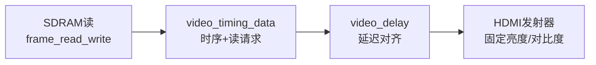
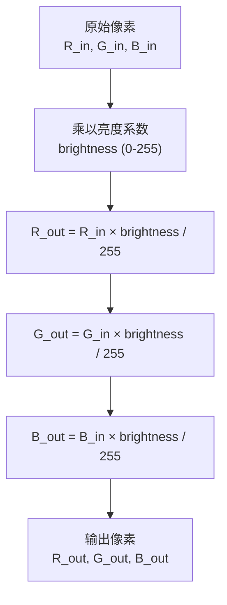
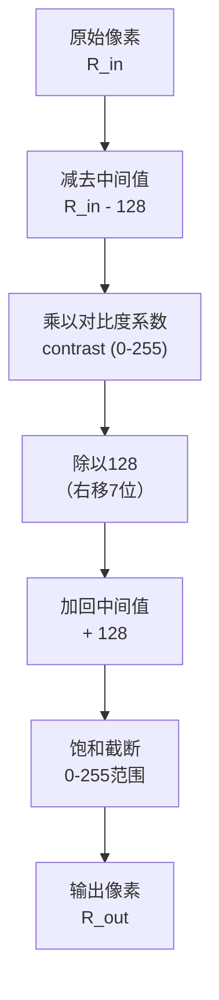
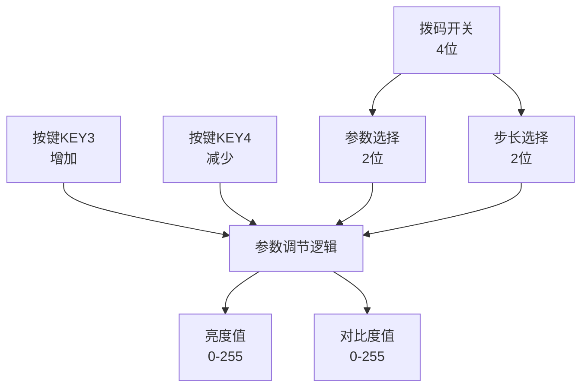
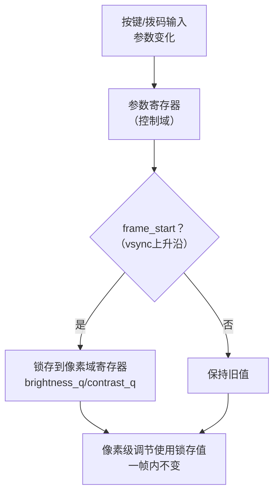
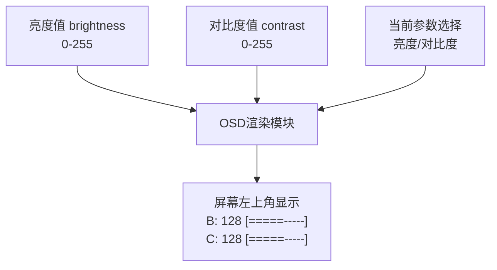
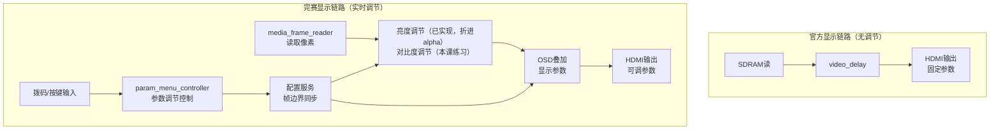
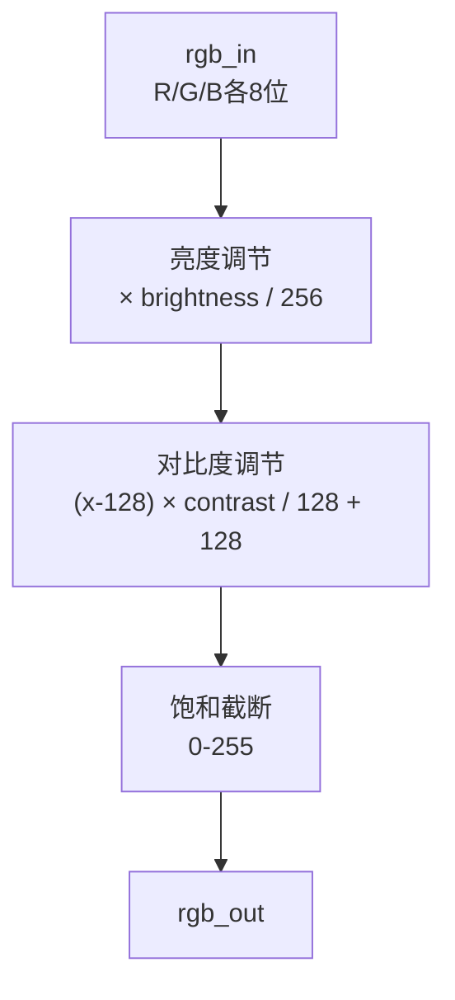
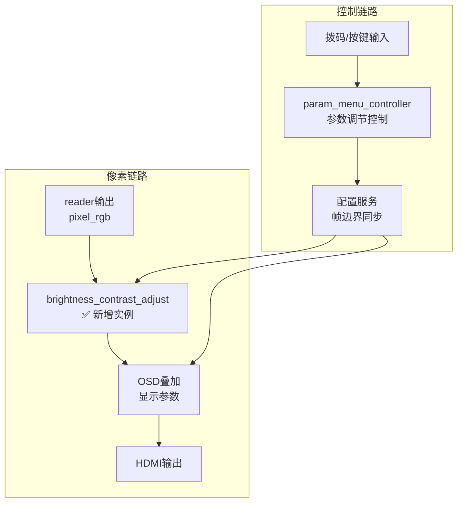

# 第13课 亮度对比度调节

> **本节课解决赛题哪点**：扩展要求第4点——实时调节与信息叠加：用按键或拨码调节亮度、对比度，并通过OSD显示参数。这是扩展要求中交互性最强的一项，用户可以实时调节画面效果，参数实时显示在屏幕上。

---

## 一、官方例程的调节能力与局限

### 1.1 官方例程有什么

官方例程`lab_ex_4`**没有任何画面参数调节功能**。图片从SDRAM读出后，直接经过video_delay延迟对齐，然后送到HDMI发射器输出。亮度、对比度、饱和度等参数都是固定的，用户不能调节。



官方例程的4个按键（KEY1-KEY4）只用于图片切换（KEY1下一张、KEY2自动/手动切换），没有用于亮度/对比度调节。4组拨码开关也没有使用。

### 1.2 官方例程的3个局限


> **Note：** ①官方例程没有亮度调节功能，画面亮度固定，用户不能根据环境光或个人喜好调节；②没有对比度调节功能，画面对比度固定，不能增强或减弱画面的层次感；③没有参数显示功能，即使有调节也不知道当前参数值是多少，用户体验差。

---

## 二、实时调节的核心原理

### 2.1 亮度调节原理

亮度调节的原理很简单：**每个像素的RGB值乘以一个亮度系数**。亮度系数大于1时画面变亮，小于1时画面变暗。



**公式**：
```
R_out = R_in × brightness / 255
G_out = G_in × brightness / 255
B_out = B_in × brightness / 255
```
其中brightness是亮度系数，范围0-255。brightness=255时，输出等于输入（正常亮度）；brightness=128时，输出是输入的一半（变暗）；brightness=0时，输出全黑。

**FPGA实现**：每个通道一个乘法器（8位×8位=16位，取高8位），共3个乘法器。用/256代替/255（右移8位），节省除法器。brightness=255时，255/256≈0.996，几乎是正常亮度，人眼看不出区别。

**亮度调节的效果**：

- brightness > 128：画面变亮，高光部分可能过曝（超过255被截断）
- brightness = 128：正常亮度
- brightness < 128：画面变暗，暗部细节可能丢失（低于0被截断）

**完赛工程的实际做法（重要，和教科书公式不一样）**：上面的 `R×brightness/256` 是教科书式的独立乘法，要3个乘法器一直工作。完赛工程为了省乘法器，把亮度**折进了转场alpha**——亮度调节和第9课的淡入淡出共用同一组乘法器。打开 `rtl/integration/media_video_pipeline.v` 第205~215行：

```verilog
// Session-level brightness folds into the transition alpha with
// one extra 8x8 multiply, so the steady display and the fade both
// scale together.
// (brightness+1)/256 keeps full brightness bit-exact (256/256)
wire [7:0] eff_alpha = ({8'd0, fade_alpha} * (brightness + 8'd1)) >> 8;
wire [15:0] fade_mul_r = {8'd0, selected_rgb[23:16]} * eff_alpha;
wire [15:0] fade_mul_g = {8'd0, selected_rgb[15:8]}  * eff_alpha;
wire [15:0] fade_mul_b = {8'd0, selected_rgb[7:0]}   * eff_alpha;
wire [23:0] alpha_rgb =
    {fade_mul_r[15:8], fade_mul_g[15:8], fade_mul_b[15:8]};
```

原理：稳定显示时转场系数 `fade_alpha=255`，于是 `eff_alpha = 255×(brightness+1)>>8 ≈ brightness+1`，再乘RGB取高8位，效果就是 `RGB×brightness/256`；转场时fade_alpha在0~255之间渐变，亮度和淡入淡出一起缩放，不用为亮度单独加乘法器。注意它用的是 `(brightness+1)` 而不是 `brightness`：brightness=255时 (255+1)/256=1，全亮逐位不失真；低档位和 brightness/255 的误差在0.4%以内，人眼不可察。

> **注意**：完赛工程**只实现了亮度，没有实现对比度**。亮度在media_video_pipeline里和转场合并实现，没有单独的brightness模块；对比度则完全没做，是本节课的扩展练习。
>
> eff_alpha = ({8'd0, fade_alpha} * (brightness + 8'd1)) >> 8;

### 2.2 对比度调节原理

> **本节课定位（先看清楚）**：对比度调节**完赛工程并没有实现**（整个完赛工程grep不到任何contrast信号），它是赛题扩展要求里留给你的动手练习。本节把原理和公式讲透，3.2节给端口齐全的代码脚手架，核心的饱和截断逻辑留作TODO让你自己填，参考答案在3.2节末尾。亮度调节完赛已实现（见2.1），对比度要你在亮度的基础上自己扩展。

对比度调节比亮度调节复杂一些。对比度是指画面中亮部和暗部的差异程度。对比度高，画面层次分明；对比度低，画面灰蒙蒙的。

**对比度调节的原理**：**以128（中间值）为中心，把像素值向两边拉伸或压缩**。



**公式**：
```
R_out = saturate((R_in - 128) × contrast / 128 + 128)
G_out = saturate((G_in - 128) × contrast / 128 + 128)
B_out = saturate((B_in - 128) × contrast / 128 + 128)
```
其中contrast是对比度系数，范围0-255。contrast=128时，输出等于输入（正常对比度）；contrast>128时，像素值向两边拉伸，对比度增强；contrast<128时，像素值向中间压缩，对比度减弱。

**saturate函数**：把值限制在0-255范围内，小于0的取0，大于255的取255。

**FPGA实现**：每个通道需要：1个减法器（减128）、1个乘法器（8位×8位）、1个右移7位、1个加法器（加128）、1个饱和截断逻辑。共3个乘法器（和亮度调节共用，可以分时复用）。

**对比度调节的效果**：
- contrast > 128：对比度增强，亮的更亮，暗的更暗，画面层次分明，但高光和暗部细节可能丢失
- contrast = 128：正常对比度
- contrast < 128：对比度减弱，画面灰蒙蒙的，所有像素都接近128（灰色）

### 2.3 亮度+对比度组合调节

实际使用中，亮度和对比度通常是组合调节的。可以先调亮度再调对比度，也可以先调对比度再调亮度。顺序不同，效果略有不同。

**组合公式**（先亮度后对比度）：
```
temp = R_in × brightness / 255
R_out = saturate((temp - 128) × contrast / 128 + 128)
```

**FPGA实现考虑**：如果亮度和对比度都用乘法器，可以级联（先亮度乘法，再对比度乘法），共6个乘法器。也可以合并成一个公式，用更少的乘法器，但计算更复杂。对于EG4S20来说，6个乘法器完全没问题。

### 2.4 拨码开关与按键输入

赛题要求"用按键或拨码调节亮度、对比度"。开发板上有4组按键和4组拨码开关，可以用来做参数调节。

**拨码开关方案**：

- 拨码1-2：选择调节参数（00=亮度，01=对比度，10=饱和度，11=复位）
- 拨码3-4：调节步长（00=1，01=4，10=16，11=32）
- 按键KEY3：增加参数
- 按键KEY4：减少参数

**按键方案**（完赛工程的做法）：

- KEY4短按：切换音量档位（5档循环）
- KEY4长按1秒后释放：切换轮播周期（4档循环）
- 可以扩展为：KEY4短按切换亮度，KEY4长按切换对比度，或者用组合键



**输入处理**：按键需要消抖（20ms消抖时间），拨码开关不需要消抖（是静态开关）。按键消抖可以用已有的key_press_debounce模块。

### 2.5 参数帧边界生效

调节亮度/对比度时，如果参数在一帧中间变化，就会出现上半帧旧参数、下半帧新参数的情况，导致画面跳变。所以参数必须在**帧边界**生效，和OSD、转场的帧边界锁存是一样的道理。



**实现方法**：参数在控制时钟域（100MHz）更新，通过2FF同步到像素时钟域（25MHz），然后在frame_start时锁存到像素域寄存器，一帧内使用锁存值。这样参数变化会在下一帧生效，不会出现画面跳变。

**完赛工程的做法**：param_menu_controller在控制域更新cfg_volume和cfg_period_ms，通过配置服务（config service）同步到各个模块，参数在帧边界生效。亮度/对比度调节可以沿用这个框架。

### 2.6 OSD参数显示

调节参数时，用户需要知道当前参数值是多少。这就需要在屏幕上显示当前的亮度/对比度值，这就是OSD参数显示。

**OSD参数显示的内容**：

- 当前调节的参数名称（亮度/对比度）
- 当前参数值（0-255，或者档位0-5）
- 可以用进度条的形式显示，更直观



**实现方法**：在status_osd_overlay的基础上扩展，增加亮度/对比度的显示。可以用数字显示（如"B:128"），也可以用进度条显示（如"[=====-----]"，等号表示当前值）。进度条更直观，用户一眼就能看出当前参数的大致位置。

**显示时机**：参数调节时显示，调节完成后几秒自动隐藏（避免遮挡画面），或者一直显示在屏幕角落（不影响观看）。

---

### 2.7 参数菜单控制器（param_menu_controller）

完赛工程的参数调节不只有亮度对比度，还有**音量和轮播周期**，通过KEY4按键菜单调节。

**KEY4按键的两种操作**：
- **单击（<1秒）**：循环调节音量，5档：0→64→128→192→255→0
- **长按（≥1秒后松开）**：循环调节轮播周期，4档：2秒→5秒→10秒→30秒→2秒

**完整代码**：打开 `rtl/io/param_menu_controller.v`（共163行，**case函数修复版**，与学员复刻版第13课文件夹同一文件）。这是完赛工程真实在用的模块，下面完整给出，重点看档位LUT、档位反查function和"消抖+按住计时+松开分支"的核心always。

```verilog
module param_menu_controller #(
    parameter integer CLKS_PER_MS = 50000,
    parameter integer DEBOUNCE_MS = 20,
    parameter integer LONG_HOLD_MS = 1000
) (
    input  wire        clk,
    input  wire        rst_n,
    input  wire        key4_n,
    input  wire        service_ready,
    input  wire [7:0]  live_volume,
    input  wire [31:0] live_period_ms,
    output reg         cfg_update_valid,
    output reg  [31:0] cfg_period_ms,
    output reg  [7:0]  cfg_volume,
    output reg         menu_event,
    output reg  [1:0]  menu_kind,   // 0 = volume step, 1 = period step
    output reg  [3:0]  menu_level   // new level index for reporting
);
    localparam integer VOLUME_STEPS = 5;
    localparam integer PERIOD_STEPS = 4;

    // 综合安全的LUT：安路TD不认initial块初始化的ROM数组（综合后无驱动，
    // HDL-5314），所以表用case函数表达，综合时内联成组合逻辑。
    function [7:0] volume_lut;
        input [3:0] level;
        begin
            case (level)
                4'd0:    volume_lut = 8'd0;
                4'd1:    volume_lut = 8'd64;
                4'd2:    volume_lut = 8'd128;
                4'd3:    volume_lut = 8'd192;
                default: volume_lut = 8'd255;
            endcase
        end
    endfunction

    function [31:0] period_lut;
        input [3:0] level;
        begin
            case (level)
                4'd0:    period_lut = 32'd2000;
                4'd1:    period_lut = 32'd5000;
                4'd2:    period_lut = 32'd10000;
                default: period_lut = 32'd30000;
            endcase
        end
    endfunction

    // 由当前音量值反查档位索引（0~4）
    function [3:0] volume_level;
        input [7:0] value;
        begin
            case (value)
                8'd0:   volume_level = 4'd0;
                8'd64:  volume_level = 4'd1;
                8'd128: volume_level = 4'd2;
                8'd192: volume_level = 4'd3;
                default: volume_level = 4'd4;
            endcase
        end
    endfunction

    // 由当前周期值反查档位索引（0~3）
    function [3:0] period_level;
        input [31:0] value;
        begin
            if (value < 32'd3500)       period_level = 4'd0;
            else if (value < 32'd7500)  period_level = 4'd1;
            else if (value < 32'd20000) period_level = 4'd2;
            else                        period_level = 4'd3;
        end
    endfunction

    // 消抖 + 按住时长测量（key4_n 低有效）
    reg [1:0]  sync;
    reg        raw_state;
    reg [19:0] debounce_count;
    reg        stable_state;
    reg [31:0] hold_count;
    reg        press_active;
    reg        long_marked;
    reg [3:0]  lvl_next;

    wire pressed_now  = (stable_state == 1'b0);
    wire hold_reached = (hold_count >= LONG_HOLD_MS * CLKS_PER_MS);

    always @(posedge clk or negedge rst_n) begin
        if (!rst_n) begin
            sync <= 2'b11;  raw_state <= 1'b1;
            debounce_count <= 20'd0;  stable_state <= 1'b1;
            hold_count <= 32'd0;  press_active <= 1'b0;  long_marked <= 1'b0;
            cfg_update_valid <= 1'b0;
            cfg_period_ms <= 32'd5000;  cfg_volume <= 8'd64;
            menu_event <= 1'b0;  menu_kind <= 2'd0;  menu_level <= 4'd0;
        end else begin
            cfg_update_valid <= 1'b0;
            menu_event <= 1'b0;

            // 两级同步 + 20ms 消抖
            sync <= {sync[0], key4_n};
            if (sync[1] != raw_state) begin
                if (debounce_count >= DEBOUNCE_MS * CLKS_PER_MS - 1) begin
                    raw_state <= sync[1];
                    stable_state <= sync[1];
                    debounce_count <= 20'd0;
                end else begin
                    debounce_count <= debounce_count + 1'b1;
                end
            end else begin
                debounce_count <= 20'd0;
            end

            if (!press_active) begin
                if (pressed_now) begin           // 检测到按下
                    press_active <= 1'b1;
                    hold_count <= 32'd0;
                    long_marked <= 1'b0;
                end
            end else begin
                if (!pressed_now) begin          // 松开：在这里区分单击/长按
                    press_active <= 1'b0;
                    if (service_ready) begin
                        cfg_period_ms <= live_period_ms;
                        cfg_volume    <= live_volume;
                        if (long_marked) begin   // 按住超过1秒 -> 调周期
                            lvl_next = period_level(live_period_ms);
                            lvl_next = (lvl_next == PERIOD_STEPS-1) ? 4'd0 : lvl_next + 1'b1;
                            menu_level  <= lvl_next;
                            cfg_period_ms <= period_lut(lvl_next);
                            menu_kind   <= 2'd1;
                        end else begin           // 1秒内松开 -> 调音量
                            lvl_next = volume_level(live_volume);
                            lvl_next = (lvl_next == VOLUME_STEPS-1) ? 4'd0 : lvl_next + 1'b1;
                            menu_level <= lvl_next;
                            cfg_volume <= volume_lut(lvl_next);
                            menu_kind  <= 2'd0;
                        end
                        menu_event <= 1'b1;
                        cfg_update_valid <= 1'b1;
                    end
                    hold_count <= 32'd0;
                end else begin                   // 仍按住：累加计时，到1秒打long_marked
                    if (hold_count < LONG_HOLD_MS * CLKS_PER_MS)
                        hold_count <= hold_count + 1'b1;
                    if (hold_reached)
                        long_marked <= 1'b1;
                end
            end
        end
    end
endmodule
```

读这段代码抓三个要点：①按键先过两级同步`sync`再做20ms消抖，和第2课消抖模块同一套思路；②长按不是"按住到1秒立刻触发"，而是按住期间只把`long_marked`置1，**等松开那一刻**才根据long_marked决定调周期还是调音量——这样单击和长按都在"松开沿"统一处理，不会重复触发；③档位用LUT存目标值、用`volume_level/period_level`反查当前档位，再`+1`并在末档回0，实现循环切换。

> **综合陷阱（本模块初版踩过，安路TD实测实锤）**：档位LUT如果用ROM数组加`initial`块初始化，行为级仿真一切正常，但安路TD综合后是无驱动网表（`HDL-5314`，volume_lut/period_lut整体悬空），上板后音量/周期档位全读0。改法就是上面清单里的case函数——这类问题只有真上综合工具才暴露，这也是本课程所有代码都要求过TD实测的原因。注意LUT调用从数组下标`volume_lut[lvl_next]`变成了函数调用`volume_lut(lvl_next)`。

**工作流程**：

1. KEY4按下，启动消抖（20ms）
2. 消抖后确认按下，开始计时
3. 如果1秒内松开 → 单击事件，循环音量档位
4. 如果按住超过1秒 → 长按事件，松开时循环周期档位
5. 输出cfg_update_valid+新的参数值，立即生效
6. 同时输出menu_event+menu_kind+menu_level，OSD显示当前调节的参数和档位

**为什么用单击/长按区分两种参数？**

1. **节省按键**：只有4个按键，KEY1/KEY2/KEY3用于图片切换和自动轮播，KEY4只能用来调参数
2. **操作直观**：单击调音量（常用），长按调周期（不常用），符合使用习惯
3. **有OSD反馈**：调节时OSD显示当前参数和档位，不会调错
4. **持久化保存**：调好的参数可以通过双键长按保存到Flash

**参数调节的完整链路**：
```
KEY4按键 → param_menu_controller（识别单击/长按） → cfg_update_valid+新参数
    → media_policy（应用到系统） → 音量/周期立即生效
    → OSD显示当前参数和档位（menu_event触发）
    → 双键长按保存到Flash（player_config_persistence）
```

---

## 三、从官方到完赛的过渡思路

### 3.1 整体架构对比



**核心差异**：
1. **新增亮度/对比度调节模块**：在像素链路中插入亮度/对比度调节模块，对每个像素做乘法和偏移
2. **参数调节控制**：用拨码开关或按键调节参数，param_menu_controller处理输入
3. **帧边界同步**：参数在帧边界生效，避免画面跳变
4. **OSD参数显示**：在屏幕上显示当前亮度/对比度值，用户知道调节到了多少

### 3.2 亮度/对比度调节模块设计

亮度/对比度调节模块是纯组合逻辑（或者加一级流水线寄存器），输入是原始像素和亮度/对比度参数，输出是调节后的像素。

**端口分类**：

| 信号 | 方向 | 说明 |
|------|------|------|
| clk / rst_n | 输入 | 时钟/复位（像素时钟域） |
| in_de | 输入 | 输入DE |
| rgb_in | 输入 | 输入24位RGB像素 |
| brightness | 输入 | 亮度值（0-255，帧边界锁存后） |
| contrast | 输入 | 对比度值（0-255，帧边界锁存后） |
| out_de | 输出 | 输出DE |
| rgb_out | 输出 | 输出24位RGB像素 |

**内部逻辑**：



**关键设计决策**：
1. **用/256和/128代替除法**：右移实现，节省除法器
2. **亮度和对比度级联**：先亮度后对比度，共6个乘法器（3个亮度+3个对比度）
3. **饱和截断**：确保输出在0-255范围内，不会溢出
4. **可选流水线寄存器**：如果时序紧张，可以加一级流水线寄存器，把亮度和对比度分成两拍

#### 3.2.1 练习脚手架（自己填核心逻辑）

> 下面这个 `brightness_contrast_adjust.v` 是**本节课的练习骨架，完赛工程里没有这个文件**（完赛把亮度折进了media_video_pipeline的alpha，见2.1）。端口、亮度通路、打拍寄存器都给你写好了，**只有对比度+饱和截断留了TODO**，请你对照2.2的公式自己补完。

```verilog
// brightness_contrast_adjust.v —— 第13课练习骨架（完赛工程未单独实现）
module brightness_contrast_adjust (
    input  wire        clk,
    input  wire        rst_n,
    input  wire        in_de,
    input  wire [23:0] rgb_in,
    input  wire [7:0]  brightness,   // 帧边界锁存后的亮度
    input  wire [7:0]  contrast,     // 帧边界锁存后的对比度
    output reg         out_de,
    output reg  [23:0] rgb_out
);
    // ---- 亮度通路（已给）：每通道 × brightness 后取高8位，即 /256 ----
    wire [15:0] mul_r = rgb_in[23:16] * brightness;
    wire [15:0] mul_g = rgb_in[15:8]  * brightness;
    wire [15:0] mul_b = rgb_in[7:0]   * brightness;
    wire [7:0] bright_r = mul_r[15:8];
    wire [7:0] bright_g = mul_g[15:8];
    wire [7:0] bright_b = mul_b[15:8];

    // ===== TODO(学员完成)：对比度 + 饱和截断 =====
    // 对 bright_r/g/b 分别做：
    //   center = x - 128;
    //   scaled = center * contrast / 128;   // /128 用算术右移7位 >>>7
    //   y      = scaled + 128;
    //   final  = saturate(y)  即 y<0 取0、y>255 取255，否则取y
    // 注意 center/scaled 是有符号数，请用 signed 声明并给足位宽防止溢出。
    // 下面三行是直通占位，补完后删掉直通、换成你的对比度结果：
    wire [7:0] final_r = bright_r;
    wire [7:0] final_g = bright_g;
    wire [7:0] final_b = bright_b;

    // 打一拍输出（流水线寄存器），DE 跟着打拍
    always @(posedge clk or negedge rst_n) begin
        if (!rst_n) begin
            out_de <= 1'b0;
            rgb_out <= 24'h000000;
        end else begin
            out_de <= in_de;
            rgb_out <= {final_r, final_g, final_b};
        end
    end
endmodule
```

#### 3.2.2 参考答案（自己写完再对）

R通道的对比度+饱和写法（G、B两通道照抄，把 `_r` 换掉即可）：

```verilog
wire signed [8:0]  ctr_r = $signed({1'b0, bright_r}) - 9'sd128;
wire signed [16:0] sc_r  = (ctr_r * $signed({1'b0, contrast})) >>> 7;
wire signed [9:0]  sum_r = sc_r + 10'sd128;
wire [7:0] final_r = (sum_r < 10'sd0)   ? 8'd0   :
                     (sum_r > 10'sd255) ? 8'd255 : sum_r[7:0];
```

要点：①`$signed({1'b0, bright_r})`把无符号8位转成有符号再减128；②乘法结果用算术右移`>>>7`实现/128，**不能用逻辑右移`>>`**，否则负数会出错；③最后两级三目就是saturate。

#### 3.2.3 上板验证（怎么知道写对了）

1. `brightness=255、contrast=128` 时，输出必须和输入**完全一致**（旁路），这是回归基准；
2. `contrast=0` 时整屏应变成中灰（所有像素趋向128）；`contrast=255` 时明暗对比明显拉强；
3. 用ILA抓 `rgb_in` 和 `rgb_out`，确认三通道位宽一致、饱和后没有出现256（应被截到255）；
4. 调亮度/对比度时画面**不能出现上下半帧分界线**——brightness/contrast必须在frame_start锁存后再用（见2.5）；
5. 编译后查资源报告：亮度3个+对比度3个，共6个8×8乘法器，确认没有意外综合出除法器。

#### 3.2.4 答辩自检（评委可能这样问）

- 为什么对比度要先减128、最后再加回128？（以中间灰为中心拉伸/压缩）
- `/128`为什么用`>>>7`而不是`>>7`？（对比度中间值是有符号负数，必须算术右移）
- contrast=128为什么等于不调节？（(x-128)×128/128+128=x）
- 参数为什么必须帧边界生效？一帧中间变会怎样？
- 完赛工程为什么没单独做这个模块，亮度是怎么省掉乘法器的？（答2.1的折进alpha）

### 3.3 完赛工程的参数调节框架

完赛工程已经有了参数调节框架（param_menu_controller），可以直接扩展用于亮度/对比度调节。

**param_menu_controller的功能**：

- KEY4短按：切换音量档位（5档：0、64、128、192、255）
- KEY4长按1秒后释放：切换轮播周期（4档：2000ms、5000ms、10000ms、30000ms）
- 消抖和长按检测
- 配置更新输出（cfg_update_valid、cfg_volume、cfg_period_ms）
- 菜单事件输出（menu_event、menu_kind、menu_level）

**扩展为亮度/对比度调节**：

- 可以增加KEY3用于亮度调节（短按增加亮度，长按减少亮度）
- KEY4用于对比度调节（短按增加对比度，长按减少对比度）
- 或者用拨码开关选择调节参数，按键调节数值
- cfg_update_valid时更新亮度/对比度值，通过配置服务同步到像素链路

**配置服务**：完赛工程有config目录（8个文件），实现了Flash配置持久化和运行时参数配置。亮度/对比度值可以通过配置服务同步到各个模块，并且可以保存到Flash，上电后恢复上次的设置。

---

## 四、完整代码与改动位置

### 4.1 新增/修改文件

| 文件 | 行数 | 说明 |
|------|------|------|
| `rtl/display/brightness_contrast_adjust.v` | ~80 | **练习骨架（完赛未实现）**：亮度已在media_video_pipeline折进alpha，本模块用于练习独立亮度+对比度，见3.2 |
| `rtl/io/param_menu_controller.v` | 145 | 参数菜单控制器（**完赛已实现**，本节课带读；负责音量/周期，亮度对比度为其扩展练习） |
| `rtl/display/status_osd_overlay.v` | ~91 | OSD叠加（扩展，增加亮度/对比度显示） |
| 配置服务 | - | 参数同步和持久化（复用已有框架） |

### 4.2 顶层改动位置



> **Note：** ①像素链路：在reader输出和OSD之间插入brightness_contrast_adjust实例，对每个像素做亮度/对比度调节；②控制链路：拨码/按键输入到param_menu_controller，处理用户输入，更新参数值，通过配置服务帧边界同步到像素链路；③OSD叠加：扩展status_osd_overlay，增加亮度/对比度值的显示；④参数在帧边界生效，避免调节过程中画面跳变。

---

## 五、从官方例程到完赛工程的演进路径


> **Note：** 第13课升级=从无调节到亮度/对比度调节+OSD参数显示，核心是像素级乘法调节+参数帧边界生效+OSD显示；扩展升级=饱和度/色相调节+预设模式+Flash持久化；完赛工程=完整参数调节子系统。


---

## 七、常见问题与调试技巧

### Q1：调节亮度时画面跳变

**可能原因**：

1. 参数不在帧边界生效，一帧中间变化导致跳变
2. 参数值瞬间跳变（比如从0直接跳到255），没有平滑过渡

**解决方法**：

1. 确保参数在frame_start时锁存，一帧内使用锁存值
2. 如果需要平滑过渡，可以让参数值每帧递增/递减1，而不是瞬间跳变
3. 用ILA抓brightness/contrast信号，确认它们只在frame_start时变化

### Q2：亮度调节后颜色偏色

**可能原因**：
1. RGB三个通道的乘法不一致（某个通道的乘法器有问题）
2. 饱和截断逻辑有问题（某个通道没有正确截断）

**解决方法**：
1. 用ILA抓rgb_in和rgb_out，对比三个通道的输出是否正确
2. 检查乘法器的位宽和截断位置（8位×8位=16位，取高8位）
3. 检查饱和截断逻辑，确保输出在0-255范围内

### Q3：对比度调节后画面太亮或太暗

**可能原因**：
1. 对比度公式中的中间值不对（应该是128，不是127或其他值）
2. 对比度系数的缩放不对（应该是/128，不是/256）

**解决方法**：

1. 检查对比度公式：R_out = (R_in - 128) × contrast / 128 + 128
2. 确认contrast=128时输出等于输入（正常对比度）
3. 用ILA抓中间结果，确认减法、乘法、加法都正确

### Q4：OSD参数显示不更新

**可能原因**：
1. 参数值没有正确同步到OSD模块
2. OSD模块的帧边界锁存有问题
3. OSD显示的是旧的参数值

**解决方法**：
1. 用ILA抓OSD模块的参数输入，确认参数值在变化
2. 检查OSD模块的帧边界锁存逻辑，确认参数在frame_start时更新
3. 检查OSD渲染逻辑，确认显示的是最新的参数值

---

**本节课配套代码文件**：
- `rtl/display/brightness_contrast_adjust.v`（**练习骨架，完赛未实现**，~80行，对比度核心逻辑自己填，见3.2）
- `rtl/io/param_menu_controller.v`（参数菜单控制器，145行，**完赛已实现**，见2.7完整代码）
- `rtl/display/status_osd_overlay.v`（OSD叠加，~91行，需扩展显示参数）
