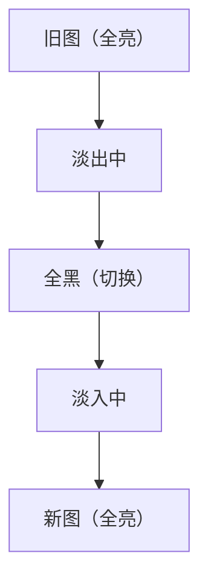
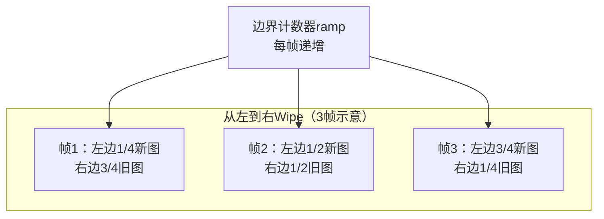
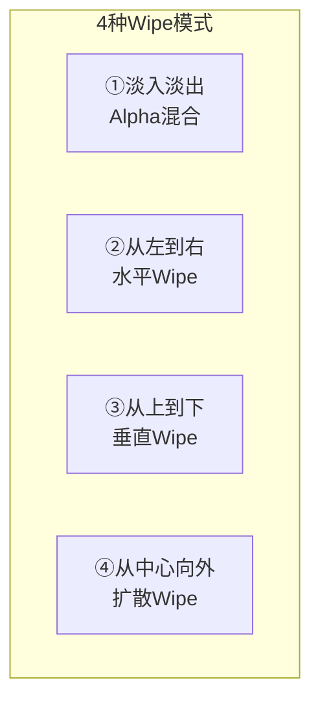
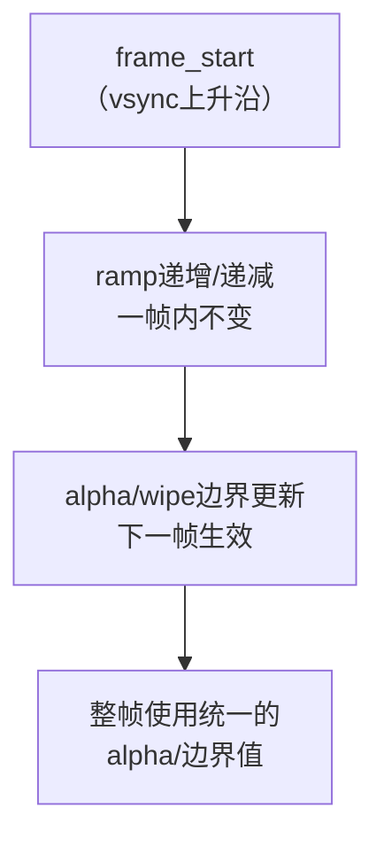
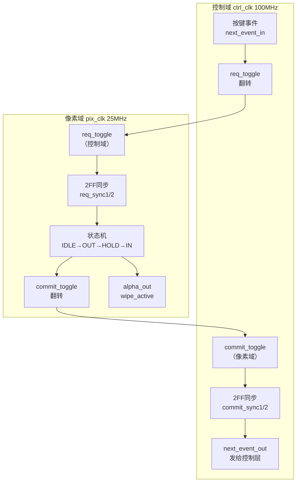
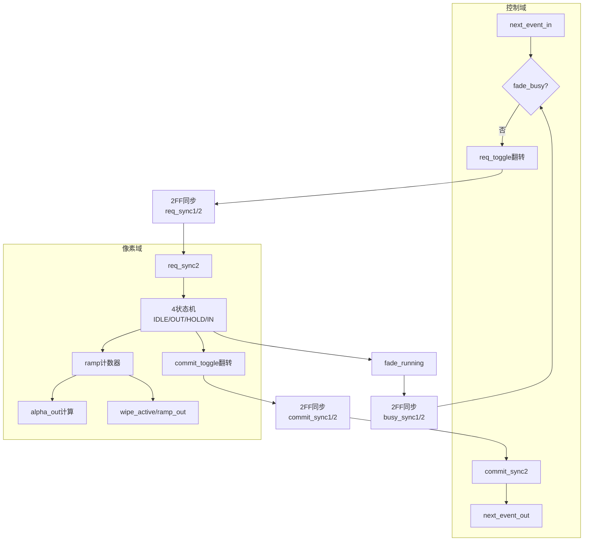
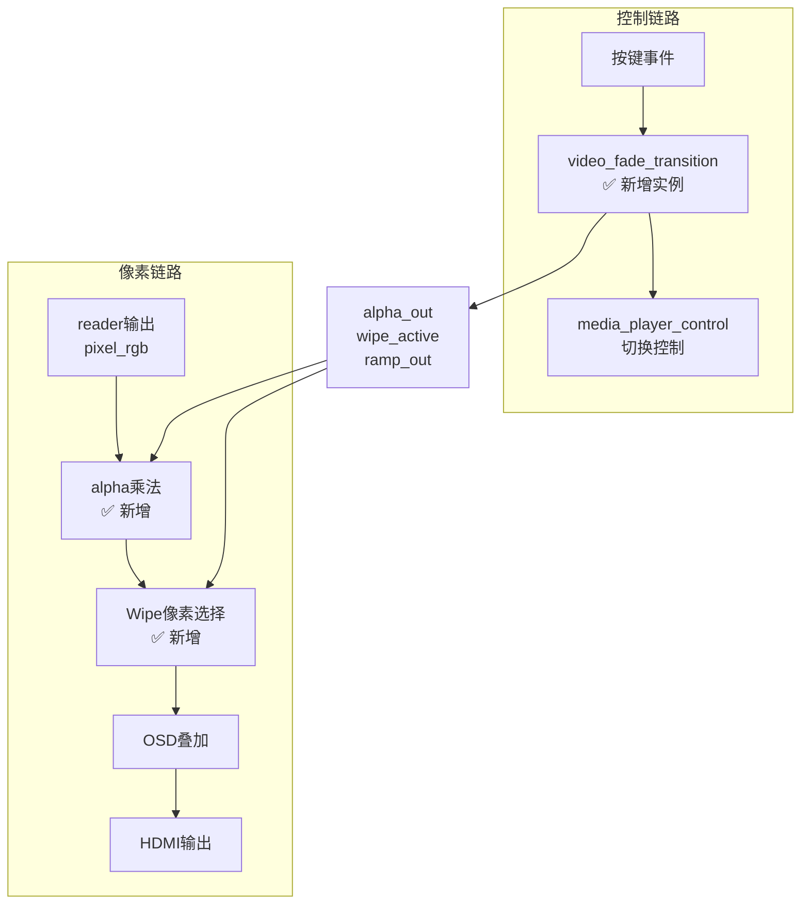
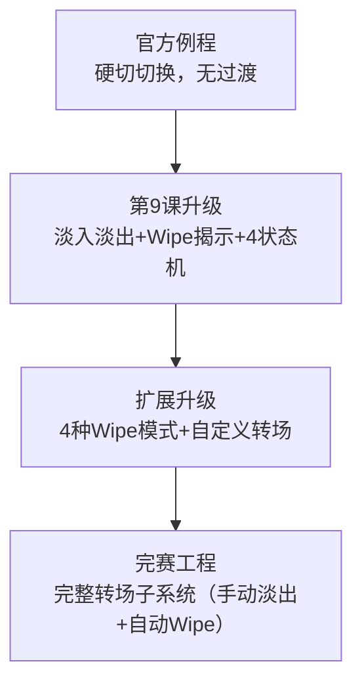

# 第9课 图片转场特效

> **本节课解决赛题哪点**：扩展要求第2点——图片切换与转场特效：加入淡入淡出、滑动等过渡，保证切换连续。这是扩展要求中演示效果最明显的一项，评委一眼就能看出你的系统比硬切高级。
>
> 这节课学会什么：理解淡入淡出原理（Alpha混合+4状态机）、理解Wipe揭示模式（像素级坐标比较）、了解4种揭示模式、理解帧边界提交避免撕裂、理解跨时钟域同步、实现手动淡入淡出+自动Wipe揭示。扩展要求的第2点就拿下了

---

## 一、官方例程的转场能力与局限

### 1.1 官方例程有什么

官方例程`lab_ex_4`的图片切换是**硬切**——按下按键后，下一帧直接切换到新图片，没有任何过渡效果。


硬切的实现很简单：双缓冲切换，写完新图片后翻转toggle位，下一帧显示缓冲区就变成了新图片。没有任何过渡，瞬间从旧图片跳到新图片。

### 1.2 官方例程的3个局限


> **Note：** ①官方例程是硬切切换，按下按键后下一帧直接切换到新图片，没有任何过渡效果；②硬切体验差，视觉上很突兀，尤其是两张差异大的图片切换时，感觉像"闪"了一下；③硬切如果切换时机不对（不在帧边界），会出现撕裂——上半帧旧图片，下半帧新图片。虽然官方例程用了双缓冲，但toggle翻转如果不在帧边界，还是可能撕裂。

---

## 二、转场特效的核心原理

### 2.1 淡入淡出原理（Alpha混合）

淡入淡出是最基础的转场特效。原理很简单：**切换时，先把旧图片逐渐变暗到全黑（淡出），然后在全黑时切换到新图片，再把新图片逐渐变亮（淡入）**。



**Alpha混合公式**：
```
最终颜色 = 图片颜色 × alpha / 255
```
alpha=255时，图片完全显示；alpha=0时，全黑（图片颜色×0=0）。

**为什么要经过全黑？** 因为双缓冲架构下，一次只能显示一张图片。如果要实现两张图片的交叉淡入淡出（旧图淡出的同时新图淡入），需要同时读取两张图片，SDRAM带宽不够。所以完赛工程用的是"淡出到黑→切换→从黑淡入"的方式，只需要一张图片的带宽，效果也很好。

**淡入淡出的4状态机**：

| 状态 | 说明 | alpha变化 |
|------|------|----------|
| S_IDLE | 空闲，正常显示 | alpha=255 |
| S_OUT | 淡出中 | alpha从255递减到0 |
| S_HOLD | 全黑保持，切换图片 | alpha=0 |
| S_IN | 淡入中 | alpha从0递增到255 |

状态转移：
- IDLE → OUT：收到切换请求（next_event）
- OUT → HOLD：淡出完成（ramp==0），同时发起切换（commit_toggle翻转）
- HOLD → IN：收到切换完成（index_commit）
- IN → IDLE：淡入完成（ramp>=FADE_FRAMES-1）

**ramp计数器与alpha计算**（来自 `video_fade_transition.v` 第46~86行）：

```verilog
// STEP = 256/FADE_FRAMES，保证ramp从0到FADE_FRAMES时alpha正好覆盖0~255
// 例如FADE_FRAMES=16时，STEP=16，每帧alpha变化16
//第一步，算步长step
localparam integer STEP = 256 / FADE_FRAMES;
// ramp需要表示0~FADE_FRAMES（含未对齐的FADE_FRAMES值），位宽多1
localparam integer CNT_W = (FADE_FRAMES <= 2) ? 2 : $clog2(FADE_FRAMES + 1);

reg [CNT_W-1:0] ramp;  // 转场进度计数器

//第二步，ramp×step得到alpha
// alpha = ramp × STEP，取低8位
wire [CNT_W+8:0] ramp_alpha  = ramp * STEP;
wire [7:0]       ramp_alpha8 = ramp_alpha[7:0];

// alpha_out组合逻辑：
// IDLE状态：全亮alpha=255
// S_HOLD全黑：alpha=0
// Wipe淡入：alpha=255（Wipe不用alpha，用像素选择）
// ramp==FADE_FRAMES（请求在帧中间到达）：当前帧仍全亮，下一帧才开始
// 其他：ramp×STEP

//第三步，按状态选alpha
assign alpha_out = ((state == S_IDLE) ||
                    ((state == S_IN) && wipe_mode)) ? 8'd255 :
                    (state == S_HOLD)  ? 8'd0   :
                    (ramp == FADE_FRAMES) ? 8'd255 : ramp_alpha8;
```

**ramp在4个状态中的变化方向**：

| 状态 | ramp初值 | 每帧动作 | alpha效果 |
|------|---------|---------|----------|
| S_IDLE | — | 不变化 | 255（全亮） |
| S_OUT | FADE_FRAMES | ramp减1 | 255→0（淡出） |
| S_HOLD | 0 | 等待index_commit | 0（全黑） |
| S_IN | 0 | ramp加1 | 0→255（淡入） |

**为什么ramp初值在S_OUT是FADE_FRAMES而不是FADE_FRAMES-1？** 因为切换请求可能在一帧中间到达，如果立刻开始淡出，当前帧就会半亮半暗（撕裂）。所以ramp先设为FADE_FRAMES，此时`alpha_out=255`（当前帧保持全亮），等到下一个`frame_start`才开始递减，保证淡出从下一帧的第一行开始。

### 2.2 Wipe揭示模式原理

淡入淡出是经过全黑的过渡，还有一种转场方式叫**Wipe（揭示）**——新图片从某个方向逐渐"擦"出来，覆盖旧图片，不需要经过全黑。



**Wipe原理**：维护一个边界计数器`ramp`，每帧递增。对于每个像素，判断它的X坐标是否在边界内。如果在边界内，显示新图片；如果在边界外，显示旧图片。随着ramp递增，边界从左往右移动，新图片就逐渐"擦"出来了。

**像素级判断逻辑**（从左到右Wipe）：
```verilog
// boundary = ramp * (640 / FADE_FRAMES)
// pixel_x < boundary ? 新图片 : 旧图片
```

**为什么自动轮播用Wipe而不是淡入淡出？** 因为自动轮播的切换是media_player_control内部发起的，video_fade_transition无法预知，旧图片已经被切换走了。这时候如果用淡入淡出，就只能从黑淡入新图片（因为旧图已经没了）。而用Wipe揭示，可以直接从旧图（已经是新图了？不对，让我重新理解）。

实际上，完赛工程的设计是：手动切换用淡入淡出（因为可以预知切换时机，先淡出再切换），自动轮播用Wipe揭示（因为切换是内部发起的，切换发生后用Wipe揭示新图）。

### 2.3 4种揭示模式

Wipe揭示可以有多种方向，完赛工程预留了4种模式的扩展空间：



| 模式 | 原理 | 像素判断条件 |
|------|------|------------|
| ①淡入淡出 | Alpha混合，经过全黑 | 最终色=图片色×alpha/255 |
| ②从左到右 | 边界从左往右移动 | pixel_x < boundary ? 新 : 旧 |
| ③从上到下 | 边界从上往下移动 | pixel_y < boundary ? 新 : 旧 |
| ④从中心向外 | 圆形边界从中心向外扩散 | 距离中心 < radius ? 新 : 旧 |

**完赛工程当前实现**：模式①（淡入淡出）用于手动切换，模式②（从左到右Wipe）用于自动轮播。模式③和④预留了扩展空间（transition_kind信号），如果要实现，只需要在像素级判断逻辑中增加对应的条件即可。

### 2.4 帧边界提交（避免撕裂）

转场特效必须在**帧边界**更新状态，否则会出现撕裂。这个机制和OSD的帧边界锁存是一样的。



**为什么要在帧边界更新？** 因为一帧有640×480=307200个像素，如果在一帧中间更新alpha或wipe边界，那么上半帧用旧的alpha，下半帧用新的alpha，就会出现一条明显的分界线——撕裂。在帧边界更新，整帧使用统一的alpha/边界值，就不会撕裂。

**完赛工程的实现**：ramp寄存器只在frame_start时递增/递减，其他时候保持不变。alpha_out和wipe边界都是基于ramp计算的，所以一帧内是统一的。

### 2.5 跨时钟域同步

转场控制涉及两个时钟域：
- **控制时钟域**（ctrl_clk，100MHz）：处理按键事件、切换请求
- **像素时钟域**（pix_clk，25MHz）：处理帧时序、alpha计算、像素渲染

两个时钟域频率不同，需要**跨时钟域同步**。



**同步机制**：
1. **切换请求**：控制域的next_event_in触发req_toggle翻转，通过2级触发器（req_sync1/2）同步到像素域，像素域检测到req_sync2变化就知道有切换请求。
2. **切换确认**：像素域在S_HOLD状态翻转commit_toggle，通过2级触发器（commit_sync1/2）同步到控制域，控制域检测到commit_sync2变化就输出next_event_out给media_player_control，发起实际的图片切换。
3. **忙标志**：像素域的fade_running通过2级触发器（busy_sync1/2）同步到控制域，控制域在fade_busy时忽略新的切换请求（避免转场过程中再次切换）。

**为什么用toggle（翻转）而不是脉冲？** 因为脉冲在跨时钟域时可能丢失（如果脉冲宽度小于目标时钟周期），而toggle是电平翻转，只要保持足够长时间就一定能被同步到。这是跨时钟域通信的标准做法。

**跨时钟域同步完整代码**（来自 `video_fade_transition.v` 第57~60行、第88~100行、第155~180行）：

模块内部有三组跨时钟域信号，全部用toggle+2FF：

```verilog
// ---- 共享寄存器（两个always块都要用）----
reg req_toggle;              // 控制域→像素域：切换请求
reg ack_seen;                // 控制域：已处理的commit值
reg commit_sync1, commit_sync2; // 控制域：commit的2FF
reg busy_sync1, busy_sync2;     // 控制域：busy的2FF

// ---- 像素域寄存器 ----
reg req_sync1, req_sync2, req_seen; // 像素域：req的2FF+已处理值
reg commit_toggle;                   // 像素域→控制域：切换确认
```

**路径1：切换请求（控制域→像素域）**

```verilog
// 控制域always块（ctrl_clk）：
// fade_busy时忽略新请求，防止转场中再次触发

//第一组，切换请求（控制域→像素域）**。控制域收到按键就翻转req_toggle
if (next_event_in && !busy_sync2)
    req_toggle <= ~req_toggle;   // 翻转toggle

// 像素域always块（pix_clk）：
req_sync1 <= req_toggle;        // 2FF第一级
req_sync2 <= req_sync1;         // 2FF第二级
// 检测toggle变化：
if (req_sync2 != req_seen) begin
    req_seen <= req_sync2;      // 记录已处理值
    if (player_active) begin
        state <= S_OUT;          // 进入淡出
        ramp <= FADE_FRAMES[CNT_W-1:0];
    end
end
```

**路径2：切换确认（像素域→控制域）**

```verilog
// 像素域：淡出完成（ramp==0）时翻转commit_toggle
S_OUT: begin
    if (frame_start) begin
 //**第二组，切换确认（像素域→控制域）**。淡出到全黑时翻转commit_toggle
        if (ramp == 0) begin
            state <= S_HOLD;
            commit_toggle <= ~commit_toggle;  // 翻转确认
        end else
            ramp <= ramp - 1'b1;
    end
end

// 控制域：2FF同步commit_toggle
commit_sync1 <= commit_toggle;
commit_sync2 <= commit_sync1;
// 检测到变化就输出next_event_out（脉冲）
assign next_event_out = (commit_sync2 != ack_seen);
// 处理完后更新ack_seen
if (commit_sync2 != ack_seen)
    ack_seen <= commit_sync2;
```

**路径3：忙标志（像素域→控制域）**

```verilog
// 像素域：fade_running=状态机不在IDLE

//第三组 忙标志（像素域→控制域）
wire fade_running = (state != S_IDLE);

// 控制域：2FF同步
busy_sync1 <= fade_running;
busy_sync2 <= busy_sync1;
assign fade_busy = busy_sync2;
// fade_busy=1时，控制域忽略新的next_event_in
```

**三组信号总结**：

| 信号 | 方向 | 同步方式 | 作用 |
|------|------|---------|------|
| req_toggle | 控制→像素 | 2FF（req_sync1/2） | 通知像素域开始淡出 |
| commit_toggle | 像素→控制 | 2FF（commit_sync1/2） | 淡出完成，通知控制域切换图片 |
| fade_running | 像素→控制 | 2FF（busy_sync1/2） | 转场忙，控制域屏蔽新请求 |

---

## 三、从官方到完赛的过渡思路

### 3.1 整体架构对比


**核心差异**：
1. **新增转场控制模块**：完赛工程新增了video_fade_transition模块，拦截切换请求，先做淡出再发起切换
2. **切换控制独立**：media_player_control独立管理图片切换，不再和sd_card_bmp耦合
3. **帧边界提交**：切换在帧边界生效，彻底杜绝撕裂
4. **Alpha乘法+Wipe像素选择**：像素级实现淡入淡出和Wipe揭示效果

### 3.2 video_fade_transition 模块详解

完赛工程的转场控制模块是`video_fade_transition.v`（约183行），是转场特效的核心。

**端口分类**：

| 信号 | 方向 | 时钟域 | 说明 |
|------|------|--------|------|
| ctrl_clk / ctrl_rst_n | 输入 | 控制域 | 控制时钟/复位 |
| next_event_in / next_event_out | 输入/输出 | 控制域 | 切换请求输入/输出 |
| fade_busy | 输出 | 控制域 | 转场忙标志 |
| pix_clk / pix_rst_n | 输入 | 像素域 | 像素时钟/复位 |
| player_active | 输入 | 像素域 | 播放器激活 |
| frame_start | 输入 | 像素域 | 帧开始 |
| index_commit | 输入 | 像素域 | 索引提交（切换完成） |
| active_index | 输入 | 像素域 | 当前图片索引 |
| alpha_out | 输出 | 像素域 | Alpha值（0-255） |
| fade_active | 输出 | 像素域 | 转场激活 |
| wipe_active | 输出 | 像素域 | Wipe激活 |
| ramp_out | 输出 | 像素域 | Wipe边界计数器 |
| transition_kind | 输出 | 像素域 | 转场类型 |

**关键参数**：
- `FADE_FRAMES`：淡入淡出的帧数。0表示旁路（不启用转场，直接透传），非0时256必须能被FADE_FRAMES整除（这样ramp×STEP正好覆盖0-255）。比如FADE_FRAMES=16，STEP=16，每帧alpha变化16，16帧完成淡入淡出。

**内部结构**：



**4状态机详解**：

| 状态 | 进入条件 | 动作 | 退出条件 |
|------|---------|------|---------|
| S_IDLE | 复位/淡入完成 | alpha=255，正常显示 | 收到切换请求→S_OUT；自动轮播index_commit→S_IN（Wipe模式） |
| S_OUT | IDLE收到切换请求 | ramp从FADE_FRAMES递减，alpha从255递减到0 | ramp==0→S_HOLD，同时commit_toggle翻转 |
| S_HOLD | OUT淡出完成 | alpha=0，全黑，等待切换完成 | index_commit→S_IN |
| S_IN | HOLD收到index_commit，或IDLE收到自动轮播index_commit | ramp从0递增，alpha从0递增到255（淡入淡出模式）；或wipe_active=1（Wipe模式） | ramp>=FADE_FRAMES-1→S_IDLE |

**手动切换 vs 自动轮播**：
- **手动切换**：IDLE→OUT（淡出）→HOLD（全黑切换）→IN（淡入）→IDLE。完整的淡入淡出，经过全黑。
- **自动轮播**：IDLE收到index_commit（media_player_control内部切换了）→IN（Wipe模式，从左到右揭示新图）→IDLE。因为切换已经发生了，不需要淡出，直接用Wipe揭示新图。

**完整代码**（`video_fade_transition.v`，183行）：

```verilog
`timescale 1ns/1ps

// 转场控制器：手动切换走 淡出→全黑→淡入；
// 自动轮播切换后走 Wipe从左到右揭示。
// FADE_FRAMES=0时整体旁路，next_event直通，alpha恒为255。
module video_fade_transition #(
    parameter integer FADE_FRAMES = 0   // 淡入淡出帧数，0=旁路
) (
    // 控制域接口
    input  wire       ctrl_clk,
    input  wire       ctrl_rst_n,
    input  wire       next_event_in,    // 切换请求输入
    output wire       next_event_out,   // 全黑时输出给控制层
    output wire       fade_busy,        // 转场忙
    // 像素域接口
    input  wire       pix_clk,
    input  wire       pix_rst_n,
    input  wire       player_active,
    input  wire       frame_start,      // 帧开始
    input  wire       index_commit,     // 图片索引已切换
    input  wire [1:0] active_index,
    output wire [7:0] alpha_out,        // Alpha值0-255
    output wire       fade_active,      // 转场进行中
    output wire       wipe_active,      // Wipe揭示中
    output wire [4:0] ramp_out,         // Wipe边界计数
    output wire [1:0] transition_kind   // 转场类型
);
    generate
        if (FADE_FRAMES == 0) begin : g_bypass
            // 旁路模式：不启用转场
            assign next_event_out  = next_event_in;
            assign fade_busy       = 1'b0;
            assign alpha_out       = 8'd255;
            assign fade_active     = 1'b0;
            assign wipe_active     = 1'b0;
            assign ramp_out        = 5'd0;
            assign transition_kind = 2'd0;
        end else begin : g_fade
            localparam integer STEP = 256 / FADE_FRAMES;
            localparam integer CNT_W = (FADE_FRAMES <= 2) ? 2
                                      : $clog2(FADE_FRAMES + 1);

            localparam [1:0] S_IDLE = 2'd0;
            localparam [1:0] S_OUT  = 2'd1;
            localparam [1:0] S_HOLD = 2'd2;
            localparam [1:0] S_IN   = 2'd3;

            // 跨时钟域共享寄存器
            reg req_toggle;
            reg ack_seen;
            reg commit_sync1, commit_sync2;
            reg busy_sync1, busy_sync2;

            // 像素域寄存器
            reg [1:0] state;
            reg [CNT_W-1:0] ramp;
            reg req_sync1, req_sync2, req_seen;
            reg commit_toggle;
            reg wipe_mode;
            reg [1:0] wipe_kind;

            wire fade_running = (state != S_IDLE);
            assign fade_active = fade_running;
            assign ramp_out = {{(5-CNT_W){1'b0}}, ramp};
            assign wipe_active = (state == S_IN) && wipe_mode;
            assign transition_kind = wipe_kind;

            // alpha计算
            wire [CNT_W+8:0] ramp_alpha = ramp * STEP;
            wire [7:0] ramp_alpha8 = ramp_alpha[7:0];
            assign alpha_out = ((state == S_IDLE) ||
                                ((state == S_IN) && wipe_mode)) ? 8'd255 :
                                (state == S_HOLD) ? 8'd0 :
                                (ramp == FADE_FRAMES) ? 8'd255
                                                      : ramp_alpha8;

            // ========== 像素域状态机 ==========
            always @(posedge pix_clk or negedge pix_rst_n) begin
                if (!pix_rst_n) begin
                    state <= S_IDLE;
                    ramp <= {CNT_W{1'b0}};
                    req_sync1 <= 1'b0; req_sync2 <= 1'b0; req_seen <= 1'b0;
                    commit_toggle <= 1'b0;
                    wipe_mode <= 1'b0; wipe_kind <= 2'd0;
                end else begin
                    req_sync1 <= req_toggle;
                    req_sync2 <= req_sync1;

                    case (state)
                    S_IDLE: begin
                        if (req_sync2 != req_seen) begin
                            // 手动切换请求
                            req_seen <= req_sync2;
                            if (player_active) begin
                                state <= S_OUT;
                                ramp <= FADE_FRAMES[CNT_W-1:0];
                            end
                        end else if (index_commit && player_active) begin
                            // 自动轮播：切换已发生，用Wipe揭示新图
                            state <= S_IN;
                            ramp <= {CNT_W{1'b0}};
                            wipe_mode <= 1'b1;
                            wipe_kind <= active_index;
                        end
                    end

                    S_OUT: begin
                        if (frame_start) begin
                            if (ramp == 0) begin
                                // 淡出完成→全黑，发切换确认
                                state <= S_HOLD;
                                commit_toggle <= ~commit_toggle;
                            end else begin
                                ramp <= ramp - 1'b1;
                            end
                        end
                        if (req_sync2 != req_seen)
                            req_seen <= req_sync2;
                    end

                    S_HOLD: begin
                        // 全黑等待控制层切换完成
                        if (index_commit) begin
                            state <= S_IN;
                            ramp <= {CNT_W{1'b0}};
                            wipe_mode <= 1'b0;
                        end
                    end

                    S_IN: begin
                        if (req_sync2 != req_seen)
                            req_seen <= req_sync2;
                        if (frame_start) begin
                            if (ramp >= FADE_FRAMES - 1)
                                state <= S_IDLE;       // 淡入完成
                            else
                                ramp <= ramp + 1'b1;
                        end
                    end
                    endcase
                end
            end

            // ========== 控制域握手 ==========
            assign fade_busy = busy_sync2;
            assign next_event_out = (commit_sync2 != ack_seen);

            always @(posedge ctrl_clk or negedge ctrl_rst_n) begin
                if (!ctrl_rst_n) begin
                    req_toggle <= 1'b0;
                    ack_seen <= 1'b0;
                    commit_sync1 <= 1'b0; commit_sync2 <= 1'b0;
                    busy_sync1 <= 1'b0; busy_sync2 <= 1'b0;
                end else begin
                    busy_sync1 <= fade_running;
                    busy_sync2 <= busy_sync1;
                    commit_sync1 <= commit_toggle;
                    commit_sync2 <= commit_sync1;
                    // 转场忙时丢弃新请求
                    if (next_event_in && !busy_sync2)
                        req_toggle <= ~req_toggle;
                    if (commit_sync2 != ack_seen)
                        ack_seen <= commit_sync2;
                end
            end
        end
    endgenerate
endmodule
```

**代码导读**：

1. 第36~43行是旁路分支（FADE_FRAMES=0），保持和官方例程完全一致的行为，方便回归测试。
2. 第102~151行是像素域4状态机，所有ramp变化都在`frame_start`时发生，保证帧边界更新。
3. 第104~109行处理手动切换（req_sync2变化），第110~118行处理自动轮播（index_commit脉冲）。
4. 第124行在淡出到全黑时翻转commit_toggle，通知控制域切换图片。
5. 第159~180行是控制域逻辑，负责接收请求、同步commit和busy信号。

### 3.3 像素级转场实现

video_fade_transition输出alpha_out和wipe_active/ramp_out，实际的像素级转场在视频链路中实现。

**Alpha乘法**（淡入淡出模式）：
```verilog
// rgb_out = rgb_in * alpha_out / 255
assign rgb_out = {
    rgb_in[23:16] * alpha_out / 256,  // R
    rgb_in[15:8]  * alpha_out / 256,  // G
    rgb_in[7:0]   * alpha_out / 256   // B
};
```
注意：用/256代替/255，因为除以256可以用右移8位实现，不需要除法器。alpha=255时，255/256≈0.996，几乎是全亮，人眼看不出区别。

**Wipe像素选择**（Wipe模式）：
```verilog
// boundary = ramp_out * (640 / FADE_FRAMES)
// pixel_x < boundary ? 新图片 : 旧图片
wire [9:0] boundary = ramp_out * (640 / FADE_FRAMES);
assign show_new = (pixel_x < boundary);
assign rgb_out = show_new ? new_rgb : old_rgb;
```

**完赛工程的做法**：当前Alpha乘法是用assign组合逻辑实现的（3个乘法器），Wipe像素选择在video_fade_transition外部实现。如果要增加更多Wipe模式（从上到下、从中心向外），只需要修改像素级判断逻辑即可，video_fade_transition的状态机不用改。

**frame_blend.v 完整代码**（43行，可选的独立帧混合模块）：

```verilog
`timescale 1ns/1ps

// 两帧Alpha混合模块：rgb_out = rgb_a×(255-alpha)/255 + rgb_b×alpha/255
// alpha每帧递增ALPHA_STEP，直到255，effect_active自动清零
module frame_blend #(
    parameter integer ALPHA_STEP = 32   // 每帧alpha增量（255/32≈8帧完成）
) (
    input  wire        clk,
    input  wire        rst_n,
    input  wire        start_effect,  // 启动混合
    input  wire        frame_start,   // 帧边界
    input  wire [11:0] rgb_a,         // 画面A（旧帧，12位）
    input  wire [11:0] rgb_b,         // 画面B（新帧，12位）
    output reg  [11:0] rgb_out,       // 混合输出
    output reg  [7:0]  alpha,         // 当前alpha
    output reg         effect_active  // 混合进行中
);
    integer mix_r, mix_g, mix_b;

    // alpha时序逻辑：只在帧边界更新
    always @(posedge clk or negedge rst_n) begin
        if (!rst_n) begin
            alpha <= 8'd0;
            effect_active <= 1'b0;
        end else begin
            if (start_effect) begin
                alpha <= 8'd0;
                effect_active <= 1'b1;
            end else if (frame_start && effect_active) begin
                if (alpha + ALPHA_STEP >= 255) begin
                    alpha <= 8'd255;
                    effect_active <= 1'b0;   // 混合完成
                end else begin
                    alpha <= alpha + ALPHA_STEP;
                end
            end
        end
    end

    // 像素混合组合逻辑：每通道独立加权
    // +127是四舍五入，/255可以近似为/256（右移8位）
    always @* begin
        mix_r = (rgb_a[11:8] * (255-alpha) + rgb_b[11:8] * alpha + 127) / 255;
        mix_g = (rgb_a[7:4]  * (255-alpha) + rgb_b[7:4]  * alpha + 127) / 255;
        mix_b = (rgb_a[3:0]  * (255-alpha) + rgb_b[3:0]  * alpha + 127) / 255;
        rgb_out = {mix_r[3:0], mix_g[3:0], mix_b[3:0]};
    end
endmodule
```

**注意**：`frame_blend`是一个通用的两帧交叉淡入淡出模块，需要同时读取两路视频（rgb_a和rgb_b）。在单读端口SDRAM架构下带宽不够，所以完赛工程的主链路用的是`video_fade_transition`（淡出到黑→切换→淡入），只需要一路视频。`frame_blend`适合双读端口或双SDRAM的高级架构，作为扩展参考。

**Wipe像素选择参考代码**（在视频链路顶层实现）：

```verilog
// Wipe边界：ramp_out从0到FADE_FRAMES-1，每帧+1
// boundary = ramp_out × (640/FADE_FRAMES)
// 例如FADE_FRAMES=16时，每帧边界右移40像素，16帧扫完640
wire [9:0] wipe_boundary = ramp_out * (640 / FADE_FRAMES);
wire show_new_frame = wipe_active && (pixel_x < wipe_boundary);

// Wipe模式：边界左侧显示新帧，右侧显示旧帧
// 淡入淡出模式：整帧乘以alpha
assign final_rgb = wipe_active ?
                   (show_new_frame ? new_frame_rgb : old_frame_rgb) :
                   fade_rgb_after_alpha;
```

---

## 四、完整代码与改动位置（约8分钟）

### 4.1 新增/修改文件

| 文件 | 行数 | 说明 |
|------|------|------|
| `rtl/display/video_fade_transition.v` | ~183 | 转场控制（4状态机+跨时钟域同步） |
| `rtl/display/frame_blend.v` | ~50 | 帧混合（Alpha乘法，可选） |
| 视频链路顶层 | - | 插入alpha乘法和Wipe像素选择逻辑 |

### 4.2 顶层改动位置



> **Note：** ①控制链路：在按键事件和media_player_control之间插入video_fade_transition，拦截切换请求，先做淡出再发起切换；②像素链路：在reader输出和OSD之间插入alpha乘法和Wipe像素选择，实现转场效果；③连接alpha_out、wipe_active、ramp_out从video_fade_transition到像素链路的转场逻辑；④FADE_FRAMES参数设置为非0值（如16）启用转场，0则旁路。

**控制域例化代码**：

```verilog
//---- 转场控制器（第9课新增）----
wire        fade_next_event;   // 转场模块输出的切换请求
wire        fade_busy;
wire [7:0]  fade_alpha;
wire        fade_active;
wire        wipe_active;
wire [4:0]  wipe_ramp;
wire [1:0]  transition_kind;

video_fade_transition #(
    .FADE_FRAMES(16)    // 16帧完成淡入淡出（约0.27秒@60fps）
) u_fade_transition (
    // 控制域（100MHz）
    .ctrl_clk       (sd_card_clk),
    .ctrl_rst_n     (rst_n_100m),
    .next_event_in  (key_next_press),   // 按键"下一张"
    .next_event_out (fade_next_event),  // → media_player_control
    .fade_busy      (fade_busy),
    // 像素域（25MHz）
    .pix_clk        (pixel_clk),
    .pix_rst_n      (rst_n_25m),
    .player_active  (player_active),
    .frame_start    (frame_start),
    .index_commit   (index_commit),     // 来自控制层
    .active_index   (active_index),
    .alpha_out      (fade_alpha),
    .fade_active    (fade_active),
    .wipe_active    (wipe_active),
    .ramp_out       (wipe_ramp),
    .transition_kind(transition_kind)
);

// fade_next_event 接到 media_player_control 的切换请求输入
// （替代原来的 key_next_press 直连）
```

**像素域Alpha乘法代码**（插在reader输出和OSD之间）：

```verilog
//---- Alpha淡入淡出乘法 ----
// 用/256（右移8位）代替/255，省除法器
wire [23:0] reader_rgb;       // reader输出的原始像素
reg  [23:0] faded_rgb;

always @(posedge pixel_clk) begin
    // 每通道8位 × alpha[7:0]，结果取高8位
    faded_rgb[23:16] <= (reader_rgb[23:16] * fade_alpha) >> 8;
    faded_rgb[15:8]  <= (reader_rgb[15:8]  * fade_alpha) >> 8;
    faded_rgb[7:0]   <= (reader_rgb[7:0]   * fade_alpha) >> 8;
end

//---- Wipe像素选择 ----
wire [9:0] wipe_boundary = wipe_ramp * (640 / 16);  // 每帧40像素
wire show_new = wipe_active && (pixel_x < wipe_boundary);

// Wipe时边界左新右旧；非Wipe时用alpha乘法结果
wire [23:0] transition_rgb = wipe_active ?
    (show_new ? reader_rgb : old_frame_rgb) :
    faded_rgb;

// transition_rgb 接到下游 osd_overlay_24
```

**参数选择建议**：

| FADE_FRAMES | STEP | 60fps下时长 | 效果 |
|-------------|------|------------|------|
| 8 | 32 | 0.13秒 | 快速切换，干脆 |
| 16 | 16 | 0.27秒 | 推荐，平滑自然 |
| 32 | 8 | 0.53秒 | 缓慢优雅 |
| 0 | — | 0 | 旁路，硬切 |

---

## 五、从官方例程到完赛工程的演进路径



> **Note：** 第9课升级=从硬切到淡入淡出+Wipe揭示，核心是4状态机+Alpha混合+帧边界提交+跨时钟域同步；扩展升级=增加更多Wipe模式（从上到下、从中心向外等）；完赛工程=完整转场子系统。

---

## 七、常见问题与调试技巧

### Q1：转场不生效（还是硬切）

**排查步骤**：

1. 检查FADE_FRAMES参数是否为非0值（0表示旁路，直接透传）
2. 检查video_fade_transition的next_event_in是否接了按键事件
3. 检查next_event_out是否接到了media_player_control的切换输入
4. 用ILA抓alpha_out，看切换时alpha是否从255递减到0再递增到255
5. 检查像素链路中是否插入了alpha乘法（很多人加了video_fade_transition但忘了加alpha乘法）
6. 检查frame_start信号是否正确（vsync上升沿）

### Q2：转场时出现撕裂

**可能原因**：
1. alpha或wipe边界不在帧边界更新，一帧内变化导致撕裂
2. 图片切换不在帧边界提交

**解决方法**：
1. 确保ramp寄存器只在frame_start时递增/递减，其他时候保持不变
2. 确保图片切换（index_commit）在帧边界生效
3. 用ILA抓alpha_out，确认一帧内alpha是稳定的，不是变化的

### Q3：转场时画面闪烁

**可能原因**：
1. alpha乘法的计算有组合逻辑冒险
2. 像素链路的延迟不对齐

**解决方法**：
1. 给alpha乘法加一级流水线寄存器，避免组合逻辑冒险
2. 检查视频链路各模块的延迟，确保对齐
3. 用ILA抓rgb_out，看是否有异常的尖峰

### Q4：自动轮播时没有Wipe效果

**可能原因**：
1. wipe_active信号没有正确输出
2. 像素链路中没有实现Wipe像素选择逻辑
3. index_commit信号没有正确连接

**解决方法**：
1. 用ILA抓wipe_active，看自动轮播切换时是否为1
2. 检查像素链路中是否有Wipe像素选择逻辑（pixel_x < boundary ? 新图 : 旧图）
3. 检查index_commit是否从media_player_control正确连接到video_fade_transition

---

**本节课配套代码文件**：
- `rtl/display/video_fade_transition.v`（转场控制，~183行）
- `rtl/display/frame_blend.v`（帧混合，Alpha乘法，~50行）
