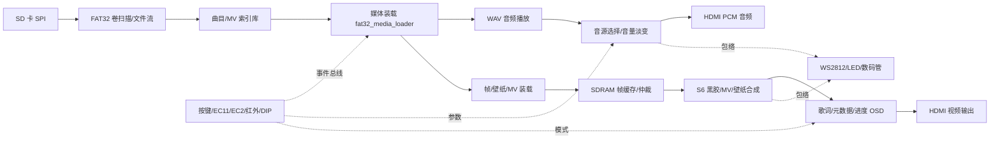

# VinylFPGA 项目开发进度全面分析报告

- 分析对象：`D:\Data_Backup\VinylFPGA_Workspace_Base\VinylFPGA`
- 分析时间：2026-10-08（PDT）
- 分析方式：通读项目内 9 份阶段文档 + 实际勘察目录/源码 + 核对综合（gate）、布局（place）、布线（route）报告 + Git 历史与工作区状态
- 结论口径：全文严格区分 **【已确认事实】**（有文件/报告/命令输出佐证）与 **【推测】**（基于证据的推断，尚未被直接验证）

---

## 一、项目整体概况

### 1.1 项目定位

**【已确认事实】** VinylFPGA 是一个以 FPGA 为核心的**数字黑胶唱片风格媒体播放器**（SD 卡 + HDMI 音视频 + 旋转编码器/按键/红外 + WS2812 灯效 + 数码管）。它在一套教学工程（"第几讲"）基础上持续演进，最终目标是完整的"选曲 → 播放 → 歌词/背景/黑胶动画 → 调参 → 状态反馈"闭环产品。

- 远程仓库：`https://github.com/kloms-fame/VinylFPGA_Base.git`
- 开发节奏：2026-10-03 起约 5 天高强度迭代，采用"阶段（S/X/O/C/U/R）+ 验收（acceptance/signoff）"的推进方式。

### 1.2 技术栈

**【已确认事实】**

| 类别 | 选型 |
|---|---|
| 目标器件 | 安路（Anlogic）**EG4S20BG256**（EG4 系列，BGA256） |
| 器件容量 | 19,600 LUT、9,800 Slice、64×BRAM9K + 16×BRAM32K、29 DSP |
| 设计语言 | Verilog（Verilog-2005），部分加密 IP 为 `.enc.v` |
| FPGA 工具链 | 安路 TD `6.2.168116`（`TD_6.2.1_Engineer_6.2.168.116`） |
| 仿真工具 | Icarus Verilog（`D:\iverilog`，iverilog + vvp） |
| 脚本/自动化 | PowerShell（5 个 `.ps1`）、Python（38 个 `.py`）、Tcl（14 个 `.tcl`） |
| 资产打包 | Python（歌词、UIRES、MV、黑胶壁纸等资源生成/打包/校验） |

### 1.3 目录结构

**【已确认事实】** 顶层目录：

```
VinylFPGA/
├── src/            RTL 源码（127 个 .v/.vh），按功能分子目录
├── constraints/    pin.adc（管脚）、timing.sdc（时序约束）
├── prj/            TD 工程 VinylFPGA.al + 大量归档/实验运行目录与位流
├── sim/            测试台（sim 根目录 89 个活跃 tb，含归档共 192 个）+ results.json
├── tools/          自动化脚本（38 py / 14 tcl / 5 ps1）
├── tf_card_stage/  TF 卡资产暂存（AUDIO.PCM、PIC1–4.BMP、Copy-ToTfCard.ps1）
├── doc/、docs/     开发资料、阶段方案、验收/签核文档
└── .git/           Git 仓库
```

`src/` 子目录及文件数：

| 子目录 | 数量 | 职责 |
|---|---|---|
| `src/`（根） | 11 | 顶层 `top_tf_hdmi_audio.v`、HDMI 物理层包装、复位/同步、RGB↔AXIS 等 |
| `src/SD/` | 28 | SD 卡 SPI、FAT32、媒体装载、曲目索引、SDRAM、壁纸/歌词装载、数码管 |
| `src/io/` | 25 | 拓展板集成、事件总线、按键/编码器/红外、参数 CSR、WS2812、蜂鸣器、LED |
| `src/display/` | 24 | 歌词 OSD、进度、缩略图、亮对比度、转场、黑胶渲染、壁纸控制 |
| `src/audio/` | 13 | WAV 播放、播放/Seek 控制、音源选择、音量淡变、48k 时基 |
| `src/video/` | 4 | S6 视频层、MV 播放、扇区复用、帧调度 |
| `src/boot/` | 2 | 开机 Logo 层 + Logo ROM |
| `src/IP/` | 6 | PLL、SDRAM、异步 FIFO（部分未使用） |
| `src/include/`、`hdmi1.4b.../` | — | 全局宏/布局 `.vh`、加密 SDRAM/HDMI IP |

### 1.4 主要构建 / 运行入口

**【已确认事实】**

| 用途 | 入口 |
|---|---|
| GUI 综合/布局布线 | `prj/VinylFPGA.al`（顶层模块 = `top`，`map_mode=area_prior`），产物在 `prj/VinylFPGA_Runs/` |
| Gate（网表）导出 | `tools/c3_gate_export.tcl`（`open_project → elaborate -top top → optimize → export_db`） |
| 全流程（含 place） | `tools/c3_build_full.tcl` / `c3_place_probe.tcl`，PowerShell 包装 `c3_build_full.ps1` 等 |
| **回归仿真（核心入口）** | `tools/verify_core_acceptance.py`：默认 **14 个**测试，调用 iverilog/vvp，输出 `results.json` |
| 下载/烧录 | `tools/download_c2_corelink_20261008.tcl`、`download_*.tcl`、`program_flash_s2_boot.tcl` |
| TF 卡制作 | `tf_card_stage/Copy-ToTfCard.ps1` |
| 资源生成 | `tools/gen_lrc_assets_v2.py`、`pack_ui_assets.py`、`mv_pack.py`、`vinyl_packer.py`、`gen_boot_logo.py` |

### 1.5 一个关键架构机制（解释了多处疑点）

**【已确认事实】** 顶层 `src/top_tf_hdmi_audio.v` 第 9–75 行用 **`` `include `` 文本包含**的方式，把几乎全部子模块 `.v` 直接并入顶层编译单元；每个子模块文件都带**模块级包含保护**（如 `` `ifndef LRC_FIVE_LINE_OSD_V ``）。

- 开发者在注释中明确说明：这是为了在 `.al` 工程文件列表条目缺失/路径失效时，避免子模块被当成 black box；独立 `.v` 文件保留给 lint 与 iverilog 单模块仿真。
- 日志佐证：`gate_export.log` 中出现 `HDL-1007: analyze included file ../../../src/io/param_csr.v in top_tf_hdmi_audio.v(22)`。
- **直接影响**：这解释了为什么 `.al` 显式清单被裁剪后，综合仍能得到**完整**网表（详见 §5 对"裁剪固件"风险的修正）。

---

## 二、模块开发进度

判定方法：在**全源码树**中检索每个模块是否被例化（`模块名 实例名 (` 或 `` `include ``），并结合归档 `place.area` 中的实际层级核对。

### 2.1 模块状态总表

图例：✅ 已完成并在硬件链路中例化；🚧 有完整代码但**未接入**（草稿/未例化）；⚪ 未开始或仅骨架；♻️ 遗留/死代码（未例化）。

| 模块 | 状态 | 职责 | 判断依据 |
|---|---|---|---|
| **top_tf_hdmi_audio** | ✅ | 系统顶层，时钟/复位/全链路集成 | 存在，约 137 KB、3000+ 行，46 次提交改动 |
| reset_sync / startup_pulse / sync_2ff | ✅ | 复位同步、启动脉冲、双 FF 同步 | 在顶层例化 |
| sys_pll / video_pll（IP） | ✅ | 系统/视频时钟 PLL | 顶层例化，日志含 EG_PHY_PLL 参数 |
| **sd_card_bmp** | ✅ | SD 卡媒体主控（图片/音频） | 顶层例化，24 次改动；place.area 中 `sd_card_bmp_m0` 体量最大 |
| sd_card_top → sd_card_sec_read_write、spi_master | ✅ | SD SPI 物理层/扇区读写 | 例化链完整 |
| **fat32_media_loader** | ✅ | FAT32 媒体装载核心 | 顶层例化，58 KB，19 次改动 |
| fat32_volume_scanner | ✅ | 卷/根目录扫描（已做启动减负） | 例化，最新提交即针对它 |
| fat32_file_streamer | ✅ | 文件连续扇区流读取 | 在 fat32_media_loader 中例化 |
| song_index_db | ✅ | 多曲目/MV 索引数据库 | 例化，15.6 KB，多次回归覆盖 |
| sd_sector_adapter | ✅ | 扇区适配/超时释放 | 在 fat32_media_loader 中例化 |
| frame_read_write | ✅ | SDRAM 帧读写 | 顶层例化 |
| frame_fifo_read / frame_fifo_write | ✅ | 帧读写 FIFO | place.area 中 `frame_fifo_read_m0/write_m0`（在 frame_read_write 内） |
| sdram_rd_arbiter | ✅ | SDRAM 读仲裁 | 顶层例化 |
| video_timing_data（→ color_bar）、video_delay | ✅ | 视频时序/彩条/延迟 | 顶层例化 |
| hdmi_phy_warpper、hdmi_1_4b_transmitter_core_wrapper | ✅ | HDMI 物理层/发送核（加密 IP） | 顶层例化 |
| **wav_stream_player** | ✅ | WAV 音频流播放 | 例化，14.6 KB，7 次改动 |
| **audio_source_mux** | ✅ | WAV/琶音音源选择 | **在顶层例化且连接真实音源**（见 §5.2 对旧报告的修正） |
| pcm_media_tone、hdmi_pcm_source_bridge、pcm_tap | ✅ | 媒体琶音、HDMI PCM 桥、包络抽取 | 顶层例化 |
| play_ctrl、seek_controller、timebase_48k、stream_session | ✅ | 播放控制、三级流水 Seek、48k 时基、流会话 | 随顶层 `` `include `` 例化，X2 回归覆盖 |
| **expansion_integration** | ✅ | 拓展板集成中枢 | 顶层例化，29.6 KB，16 次改动 |
| expansion_io_hub（→ encoder_monitor） | ✅ | 拓展板 IO 汇聚/编码器监听 | 例化 |
| **param_csr / param_knob_fsm / param_snapshot_bridge** | ✅ | C1 参数寄存器/EC2 旋钮 FSM/快照 CDC | 在 expansion_integration 内例化，C1 回归通过 |
| health_monitor | ✅ | 被动遥测/STAT/ERR | 在 expansion_integration 内例化 |
| key_dip_monitor、ui_event_bus、ui_command_router | ✅ | 按键/DIP、事件总线、命令路由 | 例化 |
| ir_nec_decoder、quadrature_decoder、sync_bit、debounce_bank/tick | ✅ | 红外、正交解码、同步位、消抖 | 例化 |
| buzzer_feedback、led_business_driver | ✅ | 蜂鸣器、业务 LED | 例化 |
| ws2812_driver / ws2812_effects / ws2812_progress | ✅ | WS2812 驱动/律动与进度 | 例化 |
| browse_fsm、cover_navigation、thumbnail_controller | ✅ | 浏览状态机、封面导航、缩略图控制 | 例化 |
| boot_layer（→ boot_logo_rom） | ✅ | 开机 Logo/动画 | 顶层例化（Logo ROM 约 266 KB） |
| **s6_video_layer** | ✅ | S6 视频层（黑胶/MV 合成） | 顶层例化 |
| mv_frame_scheduler、vinyl_renderer | ✅ | MV 帧调度、黑胶渲染 | 在 s6_video_layer 内例化 |
| mv_stream_player、mv_sector_mux | ✅ | MV 播放、扇区复用 | 随顶层例化 |
| **lrc_five_line_osd（→ lyric_timeline）** | ✅ | **U2 五行歌词层（静态/滚动）** | 顶层例化，19.5 KB，回归通过（117s） |
| lrc_cache、lyric_loader | ✅ | 字形缓存、歌词装载 | 顶层例化 |
| song_meta_osd、playback_progress、progress_bar | ✅ | 歌名歌手、播放进度图层/进度条 | 顶层例化（U1 已接入） |
| ui_asset_loader、wallpaper_loader、wallpaper_ctrl | ✅ | UIRES 装载、壁纸装载/双缓冲/轮播控制 | 顶层例化，C3 回归通过 |
| media_supervisor、media_probe | ✅ | 挂载/扇区超时监督、媒体探测 | 顶层例化 |
| promax_audio_waveform | ✅ | 音频波形/彩虹流动 | 顶层例化 |
| thumbnail_view_reader、thumbnail_layout | ✅ | 缩略图读取/布局 | 例化 |
| seg_business_mux、seg_scan | ✅ | 数码管业务复用/扫描 | 顶层例化 |
| brightness_contrast_adjust | ✅ | 亮度/对比度调节 | 例化 |
| video_fade_transition、video_transition_apply | ✅ | 视频转场 | 例化 |
| **playback_line_reader** | 🚧 | C4 播放行合成器（背景/MV 行请求） | 文件完整（13 KB，含包含保护），**全树 0 例化** |
| **playback_line_buffers** | 🚧 | C4 双 640×16 行缓存 | 文件完整（2.7 KB），**0 例化** |
| **playback_view_ctrl** | 🚧 | C4 播放视图控制 | 文件完整（3 KB），**0 例化** |
| lrc_osd（→ lrc_font_rom、lrc_lines_rom） | ♻️ | 旧版单行歌词 OSD | 已被 lrc_five_line_osd 取代，**0 例化** |
| lrc_renderer | ♻️ | 旧歌词渲染器 | 0 例化 |
| video_source_test、bmp_read | ♻️ | 早期测试源/BMP 读取 | 0 例化 |
| frame_blend、bilinear_8q8 | ♻️ | 帧混合、双线性缩放 | 0 例化（bilinear 含 1 处 TODO） |
| debounce_filter、ax_debounce、seg_decoder | ♻️ | 旧消抖/旧数码管译码 | 0 例化 |
| afifo_16_32_256、afifo_32_16_256 | ♻️ | 异步 FIFO（教学遗留） | 0 例化 |
| PLL_HDMI_AUDIO、hdmi_audio_tone_i2s_64fs、I2S_receiver | ♻️ | 未用音频 PLL/测试音/I2S 接收 | 0 例化 |

### 2.2 进度小结

**【已确认事实】**

- **主链路（时钟/复位 → SD/FAT32 → 媒体装载 → 音频/视频 → HDMI → 交互 → 状态反馈）已全部打通并有模块级回归**。
- **C1（参数/EC2）、C2（歌词资产/UIRES）、C3（壁纸双缓冲）、U1（静态元数据/进度）、U2（五行歌词）的 RTL 均已存在并通过定向仿真**。
- **C4（播放行合成）停留在"完整草稿但未例化"阶段**：3 个文件写得较完整，但顶层未接入，因此不进入硬件。
- 有约 **20 个遗留/死代码文件**未被例化（旧歌词、教学 IP、早期工具模块）。

---

## 三、功能清单（已实现功能）

下表列出已在 RTL 中实现并接入的功能，说明作用、使用方式与在整体流程中的位置。

### 3.1 启动与浏览

| 功能 | 作用 | 使用方式 | 流程位置 |
|---|---|---|---|
| 上电复位/时钟就绪 | 复位同步、PLL 锁定后释放 | 自动 | 最前端（启动） |
| 开机 Logo/动画 | boot_layer + Logo ROM 显示开机画面 | 自动，可被按键跳过 | 启动后、主界面前 |
| 主界面选歌/自动轮播 | browse_fsm 控制封面轮播 | 自动轮播 + 按键/编码器 | 浏览态 |
| 缩略图网格选择 | thumbnail_controller/view_reader/layout 呈现多封面 | 编码器移动光标、按键进入 | 浏览态 |
| KEY07/KEY11 快捷导航 | 主界面/播放态直达选曲、返回主界面 | 板载/扩展按键 | 跨态导航 |

### 3.2 媒体装载与索引

| 功能 | 作用 | 使用方式 | 流程位置 |
|---|---|---|---|
| SD SPI 驱动 | 底层扇区读写 | 自动 | 物理层 |
| FAT32 卷扫描/文件流 | 扫描根目录、连续扇区流式读取 | 自动（已做启动减负） | 媒体装载 |
| 多曲目/MV 索引库 | song_index_db 解析歌曲与 MV 元数据 | 自动 | 装载→浏览 |
| 媒体故障恢复 | media_supervisor/probe：挂载/扇区超时、SD 复位代次、错误码 OSD | 自动 | 贯穿播放，容错 |
| 四 bank 帧缓存 + SDRAM 仲裁 | frame_read_write、sdram_rd_arbiter 管理帧缓存 | 自动 | 视频后端 |

### 3.3 播放与音频

| 功能 | 作用 | 使用方式 | 流程位置 |
|---|---|---|---|
| WAV 音频流播放 | wav_stream_player 解码并送 PCM | 进入播放态自动 | 播放核心 |
| 播放控制 | play_ctrl：播放/暂停/停止/结束重播 | 按键/EC11 | 播放核心 |
| 三级流水 Seek | seek_controller：快进/快退、跳转 | EC11 旋转/长按或按键 | 播放核心 |
| 音源选择 | audio_source_mux：WAV 优先于媒体琶音 | 自动 | 音频混音前 |
| 音量/静音/淡变 | pcm_volume_fade、sync_fade_gain、audio_volume | 参数调节/转场 | 音频链 |
| HDMI PCM 输出 | hdmi_pcm_source/audio_bridge 送 HDMI 音频 | 自动 | 音频输出 |
| 交互音效 | 操作蜂鸣/提示音（buzzer + pcm blip） | 自动 | 交互反馈 |

### 3.4 视频与播放态视觉

| 功能 | 作用 | 使用方式 | 流程位置 |
|---|---|---|---|
| S6 黑胶视频层 | s6_video_layer 合成黑胶/MV | 播放态自动 | 播放态显示 |
| MV 播放/帧调度 | mv_stream_player、mv_frame_scheduler、mv_sector_mux | 播放态自动 | 播放态显示 |
| 黑胶渲染 | vinyl_renderer 绘制黑胶纹理/旋转 | 播放态自动 | 播放态显示 |
| 播放背景壁纸（C3） | wallpaper_loader/ctrl：双缓冲、轮播、切曲安全收尾 | 播放态自动/可切换 | 播放态背景 |
| 歌名/歌手 + 播放进度（U1） | song_meta_osd、playback_progress、progress_bar | 播放态自动 | 播放态 OSD |
| 五行歌词（U2） | lrc_five_line_osd：静态/滚动五行，当前行放大 | KEY06 切换 关/静态/滚动 | 播放态 OSD |
| 歌词装载/时轴 | lyric_loader、lyric_timeline、lrc_cache | 自动 | 播放态 OSD 数据 |
| 亮度/对比度 | brightness_contrast_adjust | 参数调节 | 显示后处理 |
| 视频转场 | video_fade_transition、video_transition_apply | 切曲自动 | 显示切换 |
| 音频波形/彩虹流动 | promax_audio_waveform | 播放态自动 | 叠加显示 |

### 3.5 状态反馈与调参

| 功能 | 作用 | 使用方式 | 流程位置 |
|---|---|---|---|
| WS2812 灯效 | ws2812_driver/effects/progress：律动、进度、充电效果 | 播放态自动 | 外部灯效 |
| 业务 LED | led_business_driver 指示状态 | 自动 | 状态反馈 |
| 数码管 | seg_business_mux、seg_scan：业务化复用显示 | 自动 | 状态反馈 |
| C1 参数 CSR + EC2 旋钮 | param_csr、param_knob_fsm：VOL/BRI/CON 等参数调节 | EC2 旋转/按压，快照 CDC | 调参 |
| 健康遥测 | health_monitor：STAT/ERR 串口输出 | 自动/串口观察 | 诊断 |
| 红外/DIP 控制 | ir_nec_decoder、key_dip_monitor（白名单/反码/节流） | 红外遥控/DIP 开关 | 备用输入 |

### 3.6 核心数据管线（Mermaid）



---

## 四、Git 提交分析

### 4.1 总体统计（已确认事实）

- **提交总数：93**
- **时间跨度**：2026-10-03 19:26（`初始化工程文件`）→ 2026-10-08 15:01（`refactor: reduce fat32 volume scanner boot parsing cost`），约 **4.8 天**。
- 当前分支 `main`，HEAD = `428b777`，相对 `origin/main` **领先 34 个提交（未推送）**。
- 分支：
  - `main`（*，428b777）
  - `codex/r0-closeout-20261008`（同为 428b777）
  - `opt/slice-lut-20261007`（bd5c7c1）
  - `backup/pre-linearize-20261004`（d6b6f02）
- 无 stash。

### 4.2 按阶段归纳提交主题

| 阶段（时间） | 代表提交 | 演进内容 |
|---|---|---|
| 基线（10-03） | 初始化工程、按键切换/自动轮播 | 教学工程起点、最基础交互 |
| 媒体/显示（10-04） | FAT32 升级、四 bank 帧缓存、OSD、转场、WAV、HDMI 音频、Flash 自启、稳定性 | 打通"卡→帧缓存→HDMI"与音频基础 |
| 扩展/选曲（10-05） | J2 拓展板、开机 Logo、主界面选歌、缩略图、亮对比度、WAV 缓冲减负、交互音效 | 拓展板集成与浏览选曲闭环 |
| S4–S7（10-06） | S4 索引、S5 音频/歌词、S6 黑胶、S0–S5 验收；S7 健康监测/媒体恢复/统一事件/红外/DIP；资源优化 M0–M12；KEY07/11；MV/黑胶模式 | 功能大爆发 + 第一轮系统资源优化与容错 |
| X/O（10-07） | X0R IO 审计、X1 状态反馈、X2 三级流水 Seek 与时序收敛；Slice/LUT 优化与 O8 发布；彩虹流动/VU/精确进度；C1 参数/EC2；C2 歌词资产/UIRES；C3 壁纸 | 时序攻坚 + 调参与歌词/壁纸数据核心 |
| U/R0（10-08） | U1 静态元数据/进度、U2 五行歌词；C3 背景双缓冲；R0 可复现签核、清单裁剪、扫描器减负 | 播放态 UI 完善 + 工程化签核尝试 |

### 4.3 高频改动区域（已确认事实）

| 次数 | 文件 |
|---|---|
| 46 | `src/top_tf_hdmi_audio.v`（顶层，集成中心） |
| 30 | `prj/VinylFPGA.al`（工程清单反复调整） |
| 24 | `src/SD/sd_card_bmp.v` |
| 20 | `prj/gate.qor` |
| 19 | `src/SD/fat32_media_loader.v` |
| 17 | `.gitignore` |
| 16 | `prj/place.qor`、`prj/route.qor`、`src/io/expansion_integration.v` |
| 13 | `sim/tb_sd_card_bmp_fourbank.v` |
| 10 | `src/io/ui_event_bridge.v` |

**解读**：改动高度集中在**顶层集成**与 **SD/媒体装载**，说明主要工作量在"把各子系统接进顶层并收敛"，工程清单 `.al` 也被反复增删（与 §1.5 的 `` `include `` 兜底机制相呼应）。

### 4.4 尚未合入 / 未提交的工作（已确认事实）

工作区有 **13 个已跟踪文件被修改**，以及若干未跟踪文件：

- 已修改（节选）：`prj/VinylFPGA.al`、`prj/gate.qor`、`src/SD/fat32_media_loader.v`、`src/io/quadrature_decoder.v`、`tools/c3_build_full.ps1/.tcl`、`tools/c3_gate_export.tcl`、`tools/verify_core_acceptance.py`、`tools/collect_build_metrics.py`、`tools/check_stage_resource_budget.py`、`sim/test_build_metrics.py`、`doc/stage-S0-summary.md` 等。
- 未跟踪：`sim/tb_r0_sector_arbitration.v`（新测试，已被 `verify_core_acceptance.py` 纳入默认 14 项）、`sim/r0_opt_full_run.txt`、`prj/r0_manifest_check_ps51/`、`.vs/`，以及新的方案/优化文档。
- **34 个本地提交尚未推送到 `origin/main`**。

---

## 五、完成度评估与后续建议

### 5.1 资源与时序的真实状态（关键，修正旧报告口径）

旧报告（含 `R0-signoff.md`）给出"LUT 17110 / 占用 18% / 布线 WNS +0.531ns / 已放行"的结论。经核对**实际报告文件**，该结论**得不到产物佐证**，真实情况如下：

**【已确认事实】**

1. **Gate（网表）阶段**（多份构建）：
   - LUT 约 **12,441 / 12,565 / 13,568**；寄存器约 11,802–12,037；BRAM **58**；DSP **17**。
   - Gate 阶段 Setup WNS 均为负（约 **−1.0 ~ −2.2 ns**），尚不具备放行条件。
2. **Place（布局）阶段**：
   - 归档 `seed5/probe_high`：Slice **9,727 = 99.26%**（Setup +0.108ns，但 Hold −0.011ns）。
   - 当前 U2 配置被 TD **在 place 阶段拒绝**：错误 **`PHY-9009`，MSlice `5223 > 4900`**，因此**没有 route/timing/bitgen**（见 `acceptance_summary.md`）。
3. **Route（布线）阶段**：
   - `prj/route.qor`（13:46）：Slice **99.80%**，Setup **−1.156ns**，73 个违例端点。
   - `prj/VinylFPGA_Runs/phy_1/route.qor`（**16:25，最新一次完整构建**）：Slice **97.33%**，Setup **−4.013ns、TNS −1027ns、708 个违例端点**，Hold 6 端点违例。
4. **硬块占用**：BRAM **58/64 = 90.62%**，DSP 17/29 = 58.62%。
5. **位流**：
   - 最新一次完整构建虽在 16:25 生成了 `VinylFPGA.bit`（641,264 B），但**时序严重未收敛，不应视为可用版本**。
   - **最后一个被确认可用的位流是 `VinylFPGA_C2_corelink_20261008.bit`（10-08 03:27）**，它早于 U2 五行歌词工作，**不能证明当前网表已固化**。

**【已确认事实】关于"18% 占用"**：`18.07%` 是 **gate 阶段的 Slice 百分比（打包前的局部/中间指标）**，并非最终占用；进入 place/route 后实际为 **97–99%**。"LUT 17110"这一数字在任何 gate/route 报告中均未出现（实际 gate LUT 为 12.4k–13.6k）。

**【推测】** 设计在 LUT 名义值上看似有余量（约 64–69%），但 **Slice 级布放与 BRAM 已近耗尽、布线拥塞严重**；这意味着继续按计划叠加 C4/D/E 逻辑，很可能在 place/route 阶段失败，**瓶颈是布放/布线与 BRAM，而不是 LUT 名义值**。

### 5.2 对旧报告两处结论的修正

**【已确认事实 + 推断】**

1. **"裁剪 `.al` 会得到缺 30+ 模块的裁剪固件"——不成立（误报）**。
   - 已确认：顶层用 `` `include `` 文本包含全部子模块（§1.5），归档 `gate_export.log` 也显示这些文件被 `analyze included`。
   - 已确认：用被裁剪的清单构建，`place.area` 中仍能看到 `u_param_csr`、`u_ui_asset_loader`、`scheduler(mv_frame_scheduler)` 等全部模块。
   - 结论：**清单显式条目被裁剪不会改变最终网表完整性**；旧报告的"缺模块→裁剪固件"风险可排除（但 `` `include `` 机制带来了"新增模块必须同时加入 include 块并写包含保护"的维护耦合）。
2. **`audio_source_mux` 不是死代码**。
   - 已确认：它在顶层被例化并连接真实 WAV/琶音音源与 HDMI 桥，负责"WAV 优先、ready 只回给选中源"。
   - 它在层级面积中显示 0 LUT，是因为纯组合选择逻辑被**吸收进相邻逻辑**，并非未使用。旧报告将其列入死代码属误判。

### 5.3 整体完成度判断

**【已确认事实 + 推测】**

- **RTL 功能实现层面（推测）**：对照最终路线图，主链路 + C1/C2/C3 + U1/U2 已完成，C4 有草稿，D/E 未开始——**功能实现约 70–75%**。
- **硬件可交付层面（已确认事实）**：当前 HEAD（含未提交改动）**无法在 place/route 收敛，没有等价于当前功能的可用位流**；最后可用位流停留在 C2_corelink（不含 U2）。
- **综合判断（推测）：整体完成度约 65%**，且"完成"必须以"一次时序通过、可复现、可烧录的当前网表"为准——目前这一门槛尚未达到。

### 5.4 风险与阻塞点

**【已确认事实】**

1. **硬件收敛阻塞（最高）**：U2 配置 place 被拒（PHY-9009，MSlice 5223>4900）；最新 route Setup −4.0ns/708 端点。当前无可用位流。
2. **器件近容量**：Slice 97–99%、BRAM 90.6%，后续 C4/D/E 的物理余量极小。
3. **版本/备份风险**：34 个提交未推送；13 个文件改动 + 关键新测试/文档未提交，存在丢失与"代码≠文档"风险。
4. **验收可信度缺口**：`R0-signoff.md` 的指标与实际报告不一致，存在"文档宣称放行、产物并未放行"的治理问题。
5. **验证层级偏单元**：回归以模块级为主；唯一顶层测试 `tb_s7_top` 使用 `vendor_control_stubs.v` 替身，并非时序真实的全集成验证。
6. **工程整洁度**：约 20 个死代码文件；仓库根目录散落大量 `td_*.log`、`_*.v/.vvp` 临时文件。
7. **少量待办**：`progress_bar.v` 2 处、`bilinear_8q8.v` 1 处 TODO（HDMI 加密核内 9 处为 IP 内部）。

### 5.5 下一步开发建议（按优先级）

**P0 — 让当前功能在硬件上真正收敛**

1. **资源压缩以消除 PHY-9009**：把 MSlice 从 5223 压到 4900 以下。重点压缩 U2 五行歌词（字形/行缓存）、壁纸双缓冲、MV/黑胶合成；复用已有 glyph/缓存，削减控制集数量。
2. **BRAM 与布线减负**：在 58 块 BRAM（90.6%）上继续做 banked/复用，降低拥塞；针对 route 报告的最差路径（当前集中在 song_index_db→audio_cluster）做打拍/切路径。
3. **取得一次可复现的"时序通过位流"**：以 `verify_core_acceptance.py` 14 项全绿 + 一次 place/route Setup WNS>0、Hold=0 为放行门槛，纠正 R0-signoff 的口径后再签核。
4. **版本卫生**：把已验证的改动（含 `tb_r0_sector_arbitration.v`）整理提交；确认后将 34 个本地提交推送到 `origin/main`。

**P1 — 在有余量后完成 C4 与增强验证**

5. **接入 C4**：复用已写好的 `playback_line_reader / playback_line_buffers / playback_view_ctrl`，在 place 余量恢复后例化并补回归。
6. **补顶层集成测试**：减少对 stubs 的依赖，增加跨时钟、含真实 SD/SDRAM 行为的顶层场景（切曲、Seek、故障恢复）。
7. **清理**：删除/归档约 20 个死代码文件与根目录临时日志（先确认无 `` `include `` 引用）。

**P2 — 路线图后续（D/E）**

8. 在硬件余量允许的前提下，再推进设置菜单、EQ/音效、屏保、更多灯效等 D/E 阶段功能；每阶段都以"时序通过位流 + 回归全绿"为交付门槛，避免功能堆叠而无法落地。

---

## 六、结论：事实与推测的边界

### 6.1 代码/产物中已确认的事实

- 器件 EG4S20BG256；127 个 `.v/.vh`；sim 根 89 个活跃测试台（含归档 192）；工具链 TD 6.2 + Icarus。
- 顶层通过 `` `include `` 文本包含全部子模块（含包含保护），因此裁剪 `.al` 显式清单**不影响网表完整性**；`audio_source_mux` 为**在用**模块。
- 主链路及 C1/C2/C3、U1/U2 的 RTL 均存在并通过定向仿真；C4 三个文件为**完整但未例化的草稿**；约 20 个文件为未例化遗留代码。
- Git 共 **93** 提交（10-03→10-08），main 领先远程 **34**；当前 13 文件已改、新测试/文档未提交。
- 当前 U2 配置 **place 被拒（PHY-9009，MSlice 5223>4900）**；最新完整 route（16:25）**Setup −4.013ns/708 端点、Slice 97.33%**；BRAM 90.62%。
- **当前功能没有可烧录的等价位流**；最后可用位流为 `C2_corelink`（03:27，不含 U2）。

### 6.2 属于推测（尚未被直接验证）

- 功能实现约 70–75%、整体完成度约 65%（完成度口径取决于"最终交付"定义）。
- 真正瓶颈是 Slice 布放/布线与 BRAM 而非 LUT 名义值（由多份 place/route 报告强支持，但仍建议以一次干净构建最终确认）。
- C4 草稿可在资源压缩后较顺利接入（代码结构看似匹配 frame_read_write 读通道，但未做集成验证）。
- `R0-signoff.md` 的"17110 LUT / 18% / +0.531 / 已放行"应为误记或引用了过期/误解析报告（现有产物无法复现该结论）。

---

*本报告基于 2026-10-08 工作区实际状态；若后续完成资源压缩并生成时序通过位流，应以新的 gate/place/route 报告与位流校验结果更新结论。*
