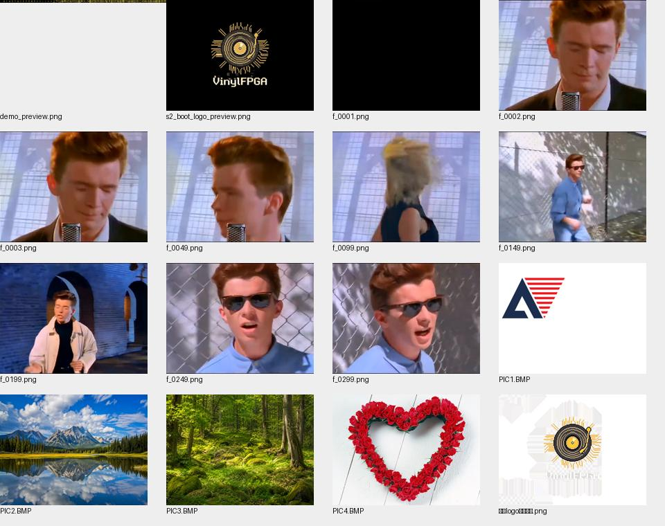

# 全量文件阅读与证据索引

范围：新增本次分析资料前的doc484文件；主要项目源/脚本/约束249文件；含doc参考RTL等共418文本扫描条目。本文给出逐文件来源、处理方法与用途，完整哈希见JSON附件。

## 1. PDF/PPT逐份核查

| 文件 | 全部页/张数 | 提取证据 | 核心结论 |
|---|---:|---|---|
| [doc/refs/fpgahw-bbe167-HX4S20开发板手册-HDL版2410.pdf](<../../doc/refs/fpgahw-bbe167-HX4S20开发板手册-HDL版2410.pdf>) | 23 | [全文提取](evidence/documents/document_0.txt) | 板卡硬件/接口与存储资源依据。 |
| [doc/赛题一相关资料/FPGA创新设计赛道安路赛项（完赛系列）/第一讲：赛题介绍和赛题解读/2026年FPGA竞赛完赛指南（选题一）.pdf](<../../doc/赛题一相关资料/FPGA创新设计赛道安路赛项（完赛系列）/第一讲：赛题介绍和赛题解读/2026年FPGA竞赛完赛指南（选题一）.pdf>) | 10 | [全文提取](evidence/documents/document_1.txt) | 培训要求/实现路线；与官方文字优先级区分。 |
| [doc/赛题一相关资料/FPGA创新设计赛道安路赛项（完赛系列）/第一讲：赛题介绍和赛题解读/赛题解析一_选题一.pptx](<../../doc/赛题一相关资料/FPGA创新设计赛道安路赛项（完赛系列）/第一讲：赛题介绍和赛题解读/赛题解析一_选题一.pptx>) | 24 | [全文提取](evidence/documents/document_2.txt) | 培训要求/实现路线；与官方文字优先级区分。 |
| [doc/赛题一相关资料/全国大学生嵌入式芯片与系统设计竞赛'2026FPGA赛道选题指南-安路科技 (1).pdf](<../../doc/赛题一相关资料/全国大学生嵌入式芯片与系统设计竞赛'2026FPGA赛道选题指南-安路科技 (1).pdf>) | 35 | [全文提取](evidence/documents/document_3.txt) | 官方赛题主依据，重点PDF14/15页。 |
| [doc/赛题一相关资料/赛题解析一.pptx](<../../doc/赛题一相关资料/赛题解析一.pptx>) | 24 | [全文提取](evidence/documents/document_4.txt) | 培训要求/实现路线；与官方文字优先级区分。 |

## 2. 25份Markdown逐份分析

| 文件 | 结论/用途 |
|---|---|
| [doc/优化方案/仅供参考资料内容.md](<../../doc/优化方案/仅供参考资料内容.md>) | 历史资源/模块描述与当前有差异；波形柱数、WS DSP、共享消抖、FAT范围等已纠正。 |
| [doc/开发方案/EC11-B 风格 EC2 浮窗调参.md](<../../doc/开发方案/EC11-B 风格 EC2 浮窗调参.md>) | 产品三态可采纳；样例需修FSM优先级、原子CDC、方向、字体相对坐标、ROT计数宽度。 |
| [doc/开发方案/J2扩展板引脚按键映射标定.md](<../../doc/开发方案/J2扩展板引脚按键映射标定.md>) | 输入方向、键号、DIP和IR标定依据，须继续对照ADC及事件路由。 |
| [doc/开发方案/播放态开发方案.md](<../../doc/开发方案/播放态开发方案.md>) | 可采纳布局方向；拒绝单拍可变除法/五行共用文本/5bit位移/128字节INDEX直接替换。 |
| [doc/开发方案/第1课_从官方例程到完赛工程_架构认知与FPGA思维框架.md](<../../doc/开发方案/第1课_从官方例程到完赛工程_架构认知与FPGA思维框架.md>) | 工程分层/验证证据参考；文中的完整模块不是当前全部已有实现。 |
| [doc/资源/sd卡/测试验收.md](<../../doc/资源/sd卡/测试验收.md>) | S4历史手册；当前UART静默/诊断页删除，需用本轮的新候选验收表。 |
| [doc/赛题一相关资料/FPGA创新设计赛道安路赛项（完赛系列）/第七讲：FAT32文件系统升级/第6课_FAT32文件系统升级.md](<../../doc/赛题一相关资料/FPGA创新设计赛道安路赛项（完赛系列）/第七讲：FAT32文件系统升级/第6课_FAT32文件系统升级.md>) | MBR/BPB/目录/FAT链参考；当前实现受限，PCM/MV连续合同需单独说明。 |
| [doc/赛题一相关资料/FPGA创新设计赛道安路赛项（完赛系列）/第三讲：按键切换与自动轮播/第2课_按键切换与自动轮播.md](<../../doc/赛题一相关资料/FPGA创新设计赛道安路赛项（完赛系列）/第三讲：按键切换与自动轮播/第2课_按键切换与自动轮播.md>) | 轮播策略原理参考；当前生产路径已演进，必须重新接定时事件。 |
| [doc/赛题一相关资料/FPGA创新设计赛道安路赛项（完赛系列）/第九讲：OSD字幕叠加/第9课_OSD字幕叠加/_说明.md](<../../doc/赛题一相关资料/FPGA创新设计赛道安路赛项（完赛系列）/第九讲：OSD字幕叠加/第9课_OSD字幕叠加/_说明.md>) | 课程配套说明：涉及的参考模块不自动加入当前工程；依赖/接口需与生产版本核对。 |
| [doc/赛题一相关资料/FPGA创新设计赛道安路赛项（完赛系列）/第九讲：OSD字幕叠加/第9课_OSD字幕叠加.md](<../../doc/赛题一相关资料/FPGA创新设计赛道安路赛项（完赛系列）/第九讲：OSD字幕叠加/第9课_OSD字幕叠加.md>) | 像素替换/字体/帧快照参考；当前单行编译时歌词，不是通用字幕系统。 |
| [doc/赛题一相关资料/FPGA创新设计赛道安路赛项（完赛系列）/第二讲：官方例程架构与FPGA快速完赛设计思维/第1课_从官方例程到完赛工程_架构认知与FPGA思维框架.md](<../../doc/赛题一相关资料/FPGA创新设计赛道安路赛项（完赛系列）/第二讲：官方例程架构与FPGA快速完赛设计思维/第1课_从官方例程到完赛工程_架构认知与FPGA思维框架.md>) | 工程分层/验证证据参考；文中的完整模块不是当前全部已有实现。 |
| [doc/赛题一相关资料/FPGA创新设计赛道安路赛项（完赛系列）/第五讲：系统稳定性/第4课_系统稳定性增强.md](<../../doc/赛题一相关资料/FPGA创新设计赛道安路赛项（完赛系列）/第五讲：系统稳定性/第4课_系统稳定性增强.md>) | BMP校验、超时、完整像素/错误恢复；保留此类逻辑，不当作无关功能删除。 |
| [doc/赛题一相关资料/FPGA创新设计赛道安路赛项（完赛系列）/第八讲：四bank帧缓存架构/第8课_四bank帧缓存架构.md](<../../doc/赛题一相关资料/FPGA创新设计赛道安路赛项（完赛系列）/第八讲：四bank帧缓存架构/第8课_四bank帧缓存架构.md>) | 地址单位、FIFO、Bank提交参考；当前封面四Bank+MV三Bank内存图见主报告。 |
| [doc/赛题一相关资料/FPGA创新设计赛道安路赛项（完赛系列）/第六讲：Flash固化与上电自启/第5课_Flash固化与上电自启.md](<../../doc/赛题一相关资料/FPGA创新设计赛道安路赛项（完赛系列）/第六讲：Flash固化与上电自启/第5课_Flash固化与上电自启.md>) | 自启与复位步骤参考；历史脚本/bit不证明新增候选冷启动成功。 |
| [doc/赛题一相关资料/FPGA创新设计赛道安路赛项（完赛系列）/第十一讲：WAV音频播放/第10课_WAV音频播放/_说明.md](<../../doc/赛题一相关资料/FPGA创新设计赛道安路赛项（完赛系列）/第十一讲：WAV音频播放/第10课_WAV音频播放/_说明.md>) | 课程配套说明：涉及的参考模块不自动加入当前工程；依赖/接口需与生产版本核对。 |
| [doc/赛题一相关资料/FPGA创新设计赛道安路赛项（完赛系列）/第十一讲：WAV音频播放/第10课_WAV音频播放.md](<../../doc/赛题一相关资料/FPGA创新设计赛道安路赛项（完赛系列）/第十一讲：WAV音频播放/第10课_WAV音频播放.md>) | FIFO/消费/下溢/ready参考；实际FPGA数据为16bit48k单声道原始PCM。 |
| [doc/赛题一相关资料/FPGA创新设计赛道安路赛项（完赛系列）/第十三讲：图片缩放与缩略图/第12课_图片缩放与缩略图.md](<../../doc/赛题一相关资料/FPGA创新设计赛道安路赛项（完赛系列）/第十三讲：图片缩放与缩略图/第12课_图片缩放与缩略图.md>) | 固定比例缩略与不同输入分辨率须区分；当前loader要求640x480。 |
| [doc/赛题一相关资料/FPGA创新设计赛道安路赛项（完赛系列）/第十二讲：音频波形可视化/第11课_音频波形可视化.md](<../../doc/赛题一相关资料/FPGA创新设计赛道安路赛项（完赛系列）/第十二讲：音频波形可视化/第11课_音频波形可视化.md>) | 32柱幅值显示；不同于FFT，已可覆盖波形扩展。 |
| [doc/赛题一相关资料/FPGA创新设计赛道安路赛项（完赛系列）/第十五讲：缩略图交互选择/第14课_缩略图交互选择.md](<../../doc/赛题一相关资料/FPGA创新设计赛道安路赛项（完赛系列）/第十五讲：缩略图交互选择/第14课_缩略图交互选择.md>) | 焦点/确认/帧切换参考；删除前需替代选图和真实缩放证据。 |
| [doc/赛题一相关资料/FPGA创新设计赛道安路赛项（完赛系列）/第十六讲：产品包装与应用场景思路/第17课_应用场景设计方法论.md](<../../doc/赛题一相关资料/FPGA创新设计赛道安路赛项（完赛系列）/第十六讲：产品包装与应用场景思路/第17课_应用场景设计方法论.md>) | 场景叙事参考；建议坚持纯FPGA媒体播放器，不额外扩张设备功能。 |
| [doc/赛题一相关资料/FPGA创新设计赛道安路赛项（完赛系列）/第十六讲：产品包装与应用场景思路/第17课_附录_严选场景详解.md](<../../doc/赛题一相关资料/FPGA创新设计赛道安路赛项（完赛系列）/第十六讲：产品包装与应用场景思路/第17课_附录_严选场景详解.md>) | 不同场景可选择扩展；用户全部五扩展目标单独保留，不必开发所有场景。 |
| [doc/赛题一相关资料/FPGA创新设计赛道安路赛项（完赛系列）/第十四讲：亮度对比度调节/第13课_亮度对比度调节.md](<../../doc/赛题一相关资料/FPGA创新设计赛道安路赛项（完赛系列）/第十四讲：亮度对比度调节/第13课_亮度对比度调节.md>) | 公式/档位/OSD参考；当前255/128旁路，动态启用须重新测乘法资源。 |
| [doc/赛题一相关资料/FPGA创新设计赛道安路赛项（完赛系列）/第十讲：图片转场特效/第十课_图片转场特效/_说明.md](<../../doc/赛题一相关资料/FPGA创新设计赛道安路赛项（完赛系列）/第十讲：图片转场特效/第十课_图片转场特效/_说明.md>) | 课程配套说明：涉及的参考模块不自动加入当前工程；依赖/接口需与生产版本核对。 |
| [doc/赛题一相关资料/FPGA创新设计赛道安路赛项（完赛系列）/第十讲：图片转场特效/第十课_图片转场特效.md](<../../doc/赛题一相关资料/FPGA创新设计赛道安路赛项（完赛系列）/第十讲：图片转场特效/第十课_图片转场特效.md>) | 黑底淡出淡入/Wipe；双读交叉混合可选，勿把未例化frame_blend计资源。 |
| [doc/赛题一相关资料/FPGA创新设计赛道安路赛项（完赛系列）/第四讲：HDMI音频输出基础/第3课_HDMI音频输出基础.md](<../../doc/赛题一相关资料/FPGA创新设计赛道安路赛项（完赛系列）/第四讲：HDMI音频输出基础/第3课_HDMI音频输出基础.md>) | 音频/ACR原理参考；当前音频复用video_clk，不采用独立旧音频PLL。 |

## 3. 全部主要项目源/脚本/约束

生产层级“出现”只证明映射层级保留；“未出现”可能是自动排除、常量裁剪或内联，不能据此直接删源文件。模块存在/静态例化不是新增功能完成证明。

| 文件 | 行数 | 定义模块 / 本轮映射观察 | 用途 |
|---|---:|---|---|
| [src/audio/audio_source_mux.v](<../../src/audio/audio_source_mux.v>) | 35 | audio_source_mux；未单列/未保留，需结合顶层引用 | PCM/播控/Seek/时基与会话 |
| [src/audio/hdmi_pcm_audio_bridge.v](<../../src/audio/hdmi_pcm_audio_bridge.v>) | 71 | hdmi_pcm_audio_bridge；未单列/未保留，需结合顶层引用 | PCM/播控/Seek/时基与会话 |
| [src/audio/hdmi_pcm_source_bridge.v](<../../src/audio/hdmi_pcm_source_bridge.v>) | 38 | hdmi_pcm_source_bridge；未单列/未保留，需结合顶层引用 | PCM/播控/Seek/时基与会话 |
| [src/audio/m06_pcm_contract_adapter.v](<../../src/audio/m06_pcm_contract_adapter.v>) | 49 | m06_pcm_contract_adapter；未单列/未保留，需结合顶层引用 | PCM/播控/Seek/时基与会话 |
| [src/audio/pcm_media_tone.v](<../../src/audio/pcm_media_tone.v>) | 176 | pcm_media_tone；映射层级出现：pcm_media_tone | PCM/播控/Seek/时基与会话 |
| [src/audio/pcm_tap.v](<../../src/audio/pcm_tap.v>) | 69 | pcm_tap；映射层级出现：pcm_tap | PCM/播控/Seek/时基与会话 |
| [src/audio/pcm_volume_fade.v](<../../src/audio/pcm_volume_fade.v>) | 39 | pcm_volume_fade；映射层级出现：pcm_volume_fade | PCM/播控/Seek/时基与会话 |
| [src/audio/play_ctrl.v](<../../src/audio/play_ctrl.v>) | 174 | play_ctrl；映射层级出现：play_ctrl | PCM/播控/Seek/时基与会话 |
| [src/audio/seek_controller.v](<../../src/audio/seek_controller.v>) | 181 | seek_controller；映射层级出现：seek_controller | PCM/播控/Seek/时基与会话 |
| [src/audio/stream_session.v](<../../src/audio/stream_session.v>) | 26 | stream_session；映射层级出现：stream_session | PCM/播控/Seek/时基与会话 |
| [src/audio/sync_fade_gain.v](<../../src/audio/sync_fade_gain.v>) | 66 | sync_fade_gain；映射层级出现：sync_fade_gain | PCM/播控/Seek/时基与会话 |
| [src/audio/timebase_48k.v](<../../src/audio/timebase_48k.v>) | 70 | timebase_48k；映射层级出现：timebase_48k | PCM/播控/Seek/时基与会话 |
| [src/audio/wav_stream_player.v](<../../src/audio/wav_stream_player.v>) | 343 | wav_stream_player；映射层级出现：wav_stream_player | PCM/播控/Seek/时基与会话 |
| [src/audio_arc_calculate.v](<../../src/audio_arc_calculate.v>) | 70 | audio_arc_calculate；映射层级出现：audio_arc_calculate | 顶层、时钟/复位或HDMI接口 |
| [src/boot/boot_layer.v](<../../src/boot/boot_layer.v>) | 201 | boot_layer；映射层级出现：boot_layer | Boot/Logo资源 |
| [src/boot/boot_logo_rom.v](<../../src/boot/boot_logo_rom.v>) | 718 | boot_logo_rom；映射层级出现：boot_logo_rom | Boot/Logo资源 |
| [src/display/bilinear_8q8.v](<../../src/display/bilinear_8q8.v>) | 42 | bilinear_8q8；未单列/未保留，需结合顶层引用 | 字体/图层/像素与取像 |
| [src/display/brightness_contrast_adjust.v](<../../src/display/brightness_contrast_adjust.v>) | 65 | brightness_contrast_adjust；映射层级出现：brightness_contrast_adjust | 字体/图层/像素与取像 |
| [src/display/frame_blend.v](<../../src/display/frame_blend.v>) | 50 | frame_blend；未单列/未保留，需结合顶层引用 | 字体/图层/像素与取像 |
| [src/display/lrc_font_rom.v](<../../src/display/lrc_font_rom.v>) | 1041 | lrc_font_rom；映射层级出现：lrc_font_rom | 字体/图层/像素与取像 |
| [src/display/lrc_lines_rom.v](<../../src/display/lrc_lines_rom.v>) | 155 | lrc_lines_rom；未单列/未保留，需结合顶层引用 | 字体/图层/像素与取像 |
| [src/display/lrc_osd.v](<../../src/display/lrc_osd.v>) | 189 | lrc_osd；映射层级出现：lrc_osd | 字体/图层/像素与取像 |
| [src/display/promax_audio_waveform.v](<../../src/display/promax_audio_waveform.v>) | 225 | promax_audio_waveform；映射层级出现：promax_audio_waveform | 字体/图层/像素与取像 |
| [src/display/seg_business_mux.v](<../../src/display/seg_business_mux.v>) | 63 | seg_business_mux；映射层级出现：seg_business_mux | 字体/图层/像素与取像 |
| [src/display/thumbnail_layout.v](<../../src/display/thumbnail_layout.v>) | 57 | thumbnail_layout；映射层级出现：thumbnail_layout | 字体/图层/像素与取像 |
| [src/display/thumbnail_view_reader.v](<../../src/display/thumbnail_view_reader.v>) | 525 | thumbnail_view_reader；映射层级出现：thumbnail_view_reader | 字体/图层/像素与取像 |
| [src/display/video_fade_transition.v](<../../src/display/video_fade_transition.v>) | 93 | video_fade_transition；映射层级出现：video_fade_transition | 字体/图层/像素与取像 |
| [src/display/video_transition_apply.v](<../../src/display/video_transition_apply.v>) | 50 | video_transition_apply；映射层级出现：video_transition_apply | 字体/图层/像素与取像 |
| [src/display/vinyl_renderer.v](<../../src/display/vinyl_renderer.v>) | 82 | vinyl_renderer；映射层级出现：vinyl_renderer | 字体/图层/像素与取像 |
| [src/hdmi1.4b_transmitter_core/hdmi_1_4b_transmitter_core_wrapper.enc.v](<../../src/hdmi1.4b_transmitter_core/hdmi_1_4b_transmitter_core_wrapper.enc.v>) | 5041 | hdmi_1_4b_transmitter_core_wrapper；映射层级出现：hdmi_1_4b_transmitter_core_wrapper | 加密IP：包装/接口与构建证据核验，内部不可见 |
| [src/hdmi_audio_tone_i2s_64fs.v](<../../src/hdmi_audio_tone_i2s_64fs.v>) | 103 | hdmi_audio_tone_i2s_64fs；未单列/未保留，需结合顶层引用 | 顶层、时钟/复位或HDMI接口 |
| [src/hdmi_phy_warpper.v](<../../src/hdmi_phy_warpper.v>) | 124 | hdmi_phy_wrapper；映射层级出现：hdmi_phy_wrapper | 顶层、时钟/复位或HDMI接口 |
| [src/I2S_receiver.v](<../../src/I2S_receiver.v>) | 150 | I2S_receiver；未单列/未保留，需结合顶层引用 | 顶层、时钟/复位或HDMI接口 |
| [src/include/boot_logo_geom.vh](<../../src/include/boot_logo_geom.vh>) | 25 | — | 参数/数据合同或包含文件 |
| [src/include/exp_event_defs.vh](<../../src/include/exp_event_defs.vh>) | 33 | — | 参数/数据合同或包含文件 |
| [src/include/global_def.v](<../../src/include/global_def.v>) | 13 | — | 参数/数据合同或包含文件 |
| [src/include/lrc_geom.vh](<../../src/include/lrc_geom.vh>) | 12 | — | 参数/数据合同或包含文件 |
| [src/include/sdr_as_ram.enc.v](<../../src/include/sdr_as_ram.enc.v>) | 152 | sdr_as_ram；映射层级出现：sdr_as_ram | 加密IP：包装/接口与构建证据核验，内部不可见 |
| [src/include/sdr_init_ref.enc.v](<../../src/include/sdr_init_ref.enc.v>) | 247 | sdr_init_ref；映射层级出现：sdr_init_ref | 加密IP：包装/接口与构建证据核验，内部不可见 |
| [src/include/sdr_wrrd.enc.v](<../../src/include/sdr_wrrd.enc.v>) | 255 | — | 加密IP：包装/接口与构建证据核验，内部不可见 |
| [src/include/song_index_defs.vh](<../../src/include/song_index_defs.vh>) | 68 | — | 参数/数据合同或包含文件 |
| [src/io/browse_fsm.v](<../../src/io/browse_fsm.v>) | 133 | browse_fsm；映射层级出现：browse_fsm | J2输入/事件/反馈执行器 |
| [src/io/buzzer_feedback.v](<../../src/io/buzzer_feedback.v>) | 135 | buzzer_feedback；映射层级出现：buzzer_feedback | J2输入/事件/反馈执行器 |
| [src/io/cover_navigation.v](<../../src/io/cover_navigation.v>) | 48 | cover_navigation；映射层级出现：cover_navigation | J2输入/事件/反馈执行器 |
| [src/io/debounce_bank.v](<../../src/io/debounce_bank.v>) | 76 | debounce_bank；映射层级出现：debounce_bank | J2输入/事件/反馈执行器 |
| [src/io/debounce_filter.v](<../../src/io/debounce_filter.v>) | 49 | debounce_filter；未单列/未保留，需结合顶层引用 | J2输入/事件/反馈执行器 |
| [src/io/debounce_tick.v](<../../src/io/debounce_tick.v>) | 25 | debounce_tick；映射层级出现：debounce_tick | J2输入/事件/反馈执行器 |
| [src/io/encoder_monitor.v](<../../src/io/encoder_monitor.v>) | 79 | encoder_monitor；映射层级出现：encoder_monitor | J2输入/事件/反馈执行器 |
| [src/io/expansion_integration.v](<../../src/io/expansion_integration.v>) | 433 | expansion_integration；映射层级出现：expansion_integration | J2输入/事件/反馈执行器 |
| [src/io/expansion_io_hub.v](<../../src/io/expansion_io_hub.v>) | 151 | expansion_io_hub；映射层级出现：expansion_io_hub | J2输入/事件/反馈执行器 |
| [src/io/health_monitor.v](<../../src/io/health_monitor.v>) | 30 | health_monitor；映射层级出现：health_monitor | J2输入/事件/反馈执行器 |
| [src/io/ir_nec_decoder.v](<../../src/io/ir_nec_decoder.v>) | 206 | ir_nec_decoder；映射层级出现：ir_nec_decoder | J2输入/事件/反馈执行器 |
| [src/io/key_dip_monitor.v](<../../src/io/key_dip_monitor.v>) | 81 | key_dip_monitor；映射层级出现：key_dip_monitor | J2输入/事件/反馈执行器 |
| [src/io/led_business_driver.v](<../../src/io/led_business_driver.v>) | 83 | led_business_driver；映射层级出现：led_business_driver | J2输入/事件/反馈执行器 |
| [src/io/quadrature_decoder.v](<../../src/io/quadrature_decoder.v>) | 98 | quadrature_decoder；映射层级出现：quadrature_decoder | J2输入/事件/反馈执行器 |
| [src/io/sync_bit.v](<../../src/io/sync_bit.v>) | 28 | sync_bit；未单列/未保留，需结合顶层引用 | J2输入/事件/反馈执行器 |
| [src/io/thumbnail_controller.v](<../../src/io/thumbnail_controller.v>) | 73 | thumbnail_controller；未单列/未保留，需结合顶层引用 | J2输入/事件/反馈执行器 |
| [src/io/ui_command_router.v](<../../src/io/ui_command_router.v>) | 337 | ui_command_router；映射层级出现：ui_command_router | J2输入/事件/反馈执行器 |
| [src/io/ui_event_bridge.v](<../../src/io/ui_event_bridge.v>) | 167 | ui_event_bridge；映射层级出现：ui_event_bridge | J2输入/事件/反馈执行器 |
| [src/io/ui_event_bus.v](<../../src/io/ui_event_bus.v>) | 269 | ui_event_bus；映射层级出现：ui_event_bus | J2输入/事件/反馈执行器 |
| [src/io/ws2812_driver.v](<../../src/io/ws2812_driver.v>) | 165 | ws2812_driver；映射层级出现：ws2812_driver | J2输入/事件/反馈执行器 |
| [src/io/ws2812_effects.v](<../../src/io/ws2812_effects.v>) | 194 | ws2812_effects；映射层级出现：ws2812_effects | J2输入/事件/反馈执行器 |
| [src/io/ws2812_progress.v](<../../src/io/ws2812_progress.v>) | 66 | ws2812_progress；映射层级出现：ws2812_progress | J2输入/事件/反馈执行器 |
| [src/IP/afifo_16_32_256.v](<../../src/IP/afifo_16_32_256.v>) | 852 | wfifo_32_32_512, fifo_cross_domain_addr_process_al_wfifo_32_32_512, ram_infer_wfifo_32_32_512；映射层级出现：wfifo_32_32_512,fifo_cross_domain_addr_process_al_wfifo_32_32_512,ram_infer_wfifo_32_32_512 | 器件原语/TD生成包装 |
| [src/IP/afifo_32_16_256.v](<../../src/IP/afifo_32_16_256.v>) | 852 | rfifo_32_32_512, fifo_cross_domain_addr_process_al_rfifo_32_32_512, ram_infer_rfifo_32_32_512；映射层级出现：rfifo_32_32_512,fifo_cross_domain_addr_process_al_rfifo_32_32_512,ram_infer_rfifo_32_32_512 | 器件原语/TD生成包装 |
| [src/IP/PLL_HDMI_AUDIO.v](<../../src/IP/PLL_HDMI_AUDIO.v>) | 97 | PLL_HDMI_AUDIO；未单列/未保留，需结合顶层引用 | 器件原语/TD生成包装 |
| [src/IP/sdram.v](<../../src/IP/sdram.v>) | 58 | sdram_phy；未单列/未保留，需结合顶层引用 | 器件原语/TD生成包装 |
| [src/IP/sys_pll.v](<../../src/IP/sys_pll.v>) | 97 | sys_pll；映射层级出现：sys_pll | 器件原语/TD生成包装 |
| [src/IP/video_pll.v](<../../src/IP/video_pll.v>) | 90 | video_pll；映射层级出现：video_pll | 器件原语/TD生成包装 |
| [src/lane_lvds_10_1.v](<../../src/lane_lvds_10_1.v>) | 157 | lane_lvds_10_1；映射层级出现：lane_lvds_10_1 | 顶层、时钟/复位或HDMI接口 |
| [src/reset_sync.v](<../../src/reset_sync.v>) | 32 | reset_sync；映射层级出现：reset_sync | 顶层、时钟/复位或HDMI接口 |
| [src/SD/ax_debounce.v](<../../src/SD/ax_debounce.v>) | 86 | ax_debounce；未单列/未保留，需结合顶层引用 | SD/FAT/BMP/SDRAM/扫描数据链 |
| [src/SD/bmp_read.v](<../../src/SD/bmp_read.v>) | 439 | bmp_read；未单列/未保留，需结合顶层引用 | SD/FAT/BMP/SDRAM/扫描数据链 |
| [src/SD/color_bar.v](<../../src/SD/color_bar.v>) | 327 | color_bar；映射层级出现：color_bar | SD/FAT/BMP/SDRAM/扫描数据链 |
| [src/SD/fat32_file_streamer.v](<../../src/SD/fat32_file_streamer.v>) | 275 | fat32_file_streamer；映射层级出现：fat32_file_streamer | SD/FAT/BMP/SDRAM/扫描数据链 |
| [src/SD/fat32_media_loader.v](<../../src/SD/fat32_media_loader.v>) | 907 | fat32_media_loader；映射层级出现：fat32_media_loader | SD/FAT/BMP/SDRAM/扫描数据链 |
| [src/SD/fat32_volume_scanner.v](<../../src/SD/fat32_volume_scanner.v>) | 420 | fat32_volume_scanner；映射层级出现：fat32_volume_scanner | SD/FAT/BMP/SDRAM/扫描数据链 |
| [src/SD/frame_fifo_read.v](<../../src/SD/frame_fifo_read.v>) | 303 | frame_fifo_read；映射层级出现：frame_fifo_read | SD/FAT/BMP/SDRAM/扫描数据链 |
| [src/SD/frame_fifo_write.v](<../../src/SD/frame_fifo_write.v>) | 307 | frame_fifo_write；映射层级出现：frame_fifo_write | SD/FAT/BMP/SDRAM/扫描数据链 |
| [src/SD/frame_read_write.v](<../../src/SD/frame_read_write.v>) | 201 | frame_read_write；映射层级出现：frame_read_write | SD/FAT/BMP/SDRAM/扫描数据链 |
| [src/SD/media_probe.v](<../../src/SD/media_probe.v>) | 63 | media_probe；映射层级出现：media_probe | SD/FAT/BMP/SDRAM/扫描数据链 |
| [src/SD/media_supervisor.v](<../../src/SD/media_supervisor.v>) | 161 | media_supervisor；映射层级出现：media_supervisor | SD/FAT/BMP/SDRAM/扫描数据链 |
| [src/SD/sd_card_bmp.v](<../../src/SD/sd_card_bmp.v>) | 612 | sd_card_bmp；映射层级出现：sd_card_bmp | SD/FAT/BMP/SDRAM/扫描数据链 |
| [src/SD/sd_card_cmd.v](<../../src/SD/sd_card_cmd.v>) | 353 | sd_card_cmd；映射层级出现：sd_card_cmd | SD/FAT/BMP/SDRAM/扫描数据链 |
| [src/SD/sd_card_sec_read_write.v](<../../src/SD/sd_card_sec_read_write.v>) | 255 | sd_card_sec_read_write；映射层级出现：sd_card_sec_read_write | SD/FAT/BMP/SDRAM/扫描数据链 |
| [src/SD/sd_card_top.v](<../../src/SD/sd_card_top.v>) | 127 | sd_card_top；映射层级出现：sd_card_top | SD/FAT/BMP/SDRAM/扫描数据链 |
| [src/SD/sd_sector_adapter.v](<../../src/SD/sd_sector_adapter.v>) | 90 | sd_sector_adapter；映射层级出现：sd_sector_adapter | SD/FAT/BMP/SDRAM/扫描数据链 |
| [src/SD/sdram.v](<../../src/SD/sdram.v>) | 109 | sdram；映射层级出现：sdram | SD/FAT/BMP/SDRAM/扫描数据链 |
| [src/SD/sdram_rd_arbiter.v](<../../src/SD/sdram_rd_arbiter.v>) | 114 | sdram_rd_arbiter；映射层级出现：sdram_rd_arbiter | SD/FAT/BMP/SDRAM/扫描数据链 |
| [src/SD/seg_decoder.v](<../../src/SD/seg_decoder.v>) | 30 | seg_decoder；未单列/未保留，需结合顶层引用 | SD/FAT/BMP/SDRAM/扫描数据链 |
| [src/SD/seg_scan.v](<../../src/SD/seg_scan.v>) | 36 | seg_scan；映射层级出现：seg_scan | SD/FAT/BMP/SDRAM/扫描数据链 |
| [src/SD/song_index_db.v](<../../src/SD/song_index_db.v>) | 328 | song_index_db；映射层级出现：song_index_db | SD/FAT/BMP/SDRAM/扫描数据链 |
| [src/SD/spi_master.v](<../../src/SD/spi_master.v>) | 137 | spi_master；映射层级出现：spi_master | SD/FAT/BMP/SDRAM/扫描数据链 |
| [src/SD/video_define.v](<../../src/SD/video_define.v>) | 1 | — | SD/FAT/BMP/SDRAM/扫描数据链 |
| [src/SD/video_delay.v](<../../src/SD/video_delay.v>) | 52 | video_delay；映射层级出现：video_delay | SD/FAT/BMP/SDRAM/扫描数据链 |
| [src/SD/video_timing_data.v](<../../src/SD/video_timing_data.v>) | 84 | video_timing_data；映射层级出现：video_timing_data | SD/FAT/BMP/SDRAM/扫描数据链 |
| [src/startup_pulse.v](<../../src/startup_pulse.v>) | 35 | startup_pulse；映射层级出现：startup_pulse | 顶层、时钟/复位或HDMI接口 |
| [src/sync_2ff.v](<../../src/sync_2ff.v>) | 34 | sync_2ff；映射层级出现：sync_2ff | 顶层、时钟/复位或HDMI接口 |
| [src/top_tf_hdmi_audio.v](<../../src/top_tf_hdmi_audio.v>) | 2403 | top；映射层级出现：top | 顶层、时钟/复位或HDMI接口 |
| [src/video/mv_frame_scheduler.v](<../../src/video/mv_frame_scheduler.v>) | 119 | mv_frame_scheduler；映射层级出现：mv_frame_scheduler | MV/黑胶调度和媒体图层 |
| [src/video/mv_sector_mux.v](<../../src/video/mv_sector_mux.v>) | 43 | mv_sector_mux；映射层级出现：mv_sector_mux | MV/黑胶调度和媒体图层 |
| [src/video/mv_stream_player.v](<../../src/video/mv_stream_player.v>) | 107 | mv_stream_player；映射层级出现：mv_stream_player | MV/黑胶调度和媒体图层 |
| [src/video/s6_video_layer.v](<../../src/video/s6_video_layer.v>) | 110 | s6_video_layer；映射层级出现：s6_video_layer | MV/黑胶调度和媒体图层 |
| [src/video_rgb_to_axis_640x480.v](<../../src/video_rgb_to_axis_640x480.v>) | 67 | video_rgb_to_axis_640x480；映射层级出现：video_rgb_to_axis_640x480 | 顶层、时钟/复位或HDMI接口 |
| [src/video_source_test.v](<../../src/video_source_test.v>) | 121 | video_source_test；未单列/未保留，需结合顶层引用 | 顶层、时钟/复位或HDMI接口 |
| [sim/integration/tb_top_control.v](<../../sim/integration/tb_top_control.v>) | 112 | tb_top_control | RTL验证/旧版本等价参考/仿真夹具 |
| [sim/integration/vendor_control_stubs.v](<../../sim/integration/vendor_control_stubs.v>) | 226 | sys_pll, video_pll, wfifo_32_32_512, rfifo_32_32_512, hdmi_phy_wrapper, hdmi_1_4b_transmitter_core_wrapper, sdr_as_ram, EG_PHY_SDRAM_2M_32；映射层级出现：sys_pll,video_pll,wfifo_32_32_512,rfifo_32_32_512,hdmi_phy_wrapper,hdmi_1_4b_transmitter_core_wrapper,sdr_as_ram | RTL验证/旧版本等价参考/仿真夹具 |
| [sim/legacy/buzzer_feedback_r4.v](<../../sim/legacy/buzzer_feedback_r4.v>) | 136 | buzzer_feedback_r4 | RTL验证/旧版本等价参考/仿真夹具 |
| [sim/legacy/exp_baud_tick.v](<../../sim/legacy/exp_baud_tick.v>) | 33 | exp_baud_tick | RTL验证/旧版本等价参考/仿真夹具 |
| [sim/legacy/exp_echo_reporter.v](<../../sim/legacy/exp_echo_reporter.v>) | 565 | exp_echo_reporter | RTL验证/旧版本等价参考/仿真夹具 |
| [sim/legacy/exp_uart_tx.v](<../../sim/legacy/exp_uart_tx.v>) | 65 | exp_uart_tx | RTL验证/旧版本等价参考/仿真夹具 |
| [sim/legacy/ir_nec_decoder_r4.v](<../../sim/legacy/ir_nec_decoder_r4.v>) | 189 | ir_nec_decoder_r4 | RTL验证/旧版本等价参考/仿真夹具 |
| [sim/legacy/key_press_debounce.v](<../../sim/legacy/key_press_debounce.v>) | 48 | key_press_debounce | RTL验证/旧版本等价参考/仿真夹具 |
| [sim/legacy/key_press_hold.v](<../../sim/legacy/key_press_hold.v>) | 89 | key_press_hold | RTL验证/旧版本等价参考/仿真夹具 |
| [sim/legacy/lrc_font_rom_o0.v](<../../sim/legacy/lrc_font_rom_o0.v>) | 974 | lrc_font_rom_o0 | RTL验证/旧版本等价参考/仿真夹具 |
| [sim/legacy/lrc_osd_o0.v](<../../sim/legacy/lrc_osd_o0.v>) | 174 | lrc_osd_o0 | RTL验证/旧版本等价参考/仿真夹具 |
| [sim/legacy/osd_overlay_24.v](<../../sim/legacy/osd_overlay_24.v>) | 82 | osd_overlay_24 | RTL验证/旧版本等价参考/仿真夹具 |
| [sim/legacy/param_menu_controller.v](<../../sim/legacy/param_menu_controller.v>) | 303 | param_menu_controller | RTL验证/旧版本等价参考/仿真夹具 |
| [sim/legacy/README.md](<../../sim/legacy/README.md>) | 11 | — | RTL验证/旧版本等价参考/仿真夹具 |
| [sim/legacy/status_osd_overlay.v](<../../sim/legacy/status_osd_overlay.v>) | 156 | status_osd_overlay | RTL验证/旧版本等价参考/仿真夹具 |
| [sim/legacy/tb_echo_telemetry.v](<../../sim/legacy/tb_echo_telemetry.v>) | 161 | tb_echo_telemetry | RTL验证/旧版本等价参考/仿真夹具 |
| [sim/legacy/tb_expansion_s1.v](<../../sim/legacy/tb_expansion_s1.v>) | 372 | tb_expansion_s1 | RTL验证/旧版本等价参考/仿真夹具 |
| [sim/legacy/tb_health_monitor.v](<../../sim/legacy/tb_health_monitor.v>) | 188 | tb_health_monitor | RTL验证/旧版本等价参考/仿真夹具 |
| [sim/legacy/tb_osd_overlay.v](<../../sim/legacy/tb_osd_overlay.v>) | 181 | tb_osd_overlay | RTL验证/旧版本等价参考/仿真夹具 |
| [sim/legacy/tb_param_menu_controller.v](<../../sim/legacy/tb_param_menu_controller.v>) | 170 | tb_param_menu_controller | RTL验证/旧版本等价参考/仿真夹具 |
| [sim/legacy/ws2812_driver_o4.v](<../../sim/legacy/ws2812_driver_o4.v>) | 152 | ws2812_driver_o4 | RTL验证/旧版本等价参考/仿真夹具 |
| [sim/legacy/ws2812_effects_o4.v](<../../sim/legacy/ws2812_effects_o4.v>) | 161 | ws2812_effects_o4 | RTL验证/旧版本等价参考/仿真夹具 |
| [sim/s6_20261006/mv_expected.vh](<../../sim/s6_20261006/mv_expected.vh>) | 1 | — | RTL验证/旧版本等价参考/仿真夹具 |
| [sim/s7_acceptance_fix/tb_s7_wav_wrap.v](<../../sim/s7_acceptance_fix/tb_s7_wav_wrap.v>) | 233 | tb_s7_wav_wrap | RTL验证/旧版本等价参考/仿真夹具 |
| [sim/song_index_db_p1.v](<../../sim/song_index_db_p1.v>) | 332 | song_index_db_p1 | RTL验证/旧版本等价参考/仿真夹具 |
| [sim/tb_bilinear_8q8.v](<../../sim/tb_bilinear_8q8.v>) | 90 | tb_bilinear_8q8 | RTL验证/旧版本等价参考/仿真夹具 |
| [sim/tb_bmp_read_stability.v](<../../sim/tb_bmp_read_stability.v>) | 479 | tb_bmp_read_stability | RTL验证/旧版本等价参考/仿真夹具 |
| [sim/tb_boot_s2.v](<../../sim/tb_boot_s2.v>) | 213 | tb_boot_s2 | RTL验证/旧版本等价参考/仿真夹具 |
| [sim/tb_boot_window.v](<../../sim/tb_boot_window.v>) | 27 | tb_boot_window | RTL验证/旧版本等价参考/仿真夹具 |
| [sim/tb_brightness_contrast_adjust.v](<../../sim/tb_brightness_contrast_adjust.v>) | 96 | tb_brightness_contrast_adjust | RTL验证/旧版本等价参考/仿真夹具 |
| [sim/tb_browse_fsm.v](<../../sim/tb_browse_fsm.v>) | 267 | tb_browse_fsm | RTL验证/旧版本等价参考/仿真夹具 |
| [sim/tb_debounce_bank.v](<../../sim/tb_debounce_bank.v>) | 172 | debounce_case, tb_debounce_bank | RTL验证/旧版本等价参考/仿真夹具 |
| [sim/tb_debounce_monitors.v](<../../sim/tb_debounce_monitors.v>) | 84 | tb_debounce_monitors | RTL验证/旧版本等价参考/仿真夹具 |
| [sim/tb_expansion_s1.v](<../../sim/tb_expansion_s1.v>) | 3 | tb_expansion_s1 | RTL验证/旧版本等价参考/仿真夹具 |
| [sim/tb_fat32_file_streamer.v](<../../sim/tb_fat32_file_streamer.v>) | 124 | tb_fat32_file_streamer | RTL验证/旧版本等价参考/仿真夹具 |
| [sim/tb_fat32_index_loader.v](<../../sim/tb_fat32_index_loader.v>) | 303 | tb_fat32_index_loader | RTL验证/旧版本等价参考/仿真夹具 |
| [sim/tb_fat32_media_loader.v](<../../sim/tb_fat32_media_loader.v>) | 329 | tb_fat32_media_loader | RTL验证/旧版本等价参考/仿真夹具 |
| [sim/tb_fat32_volume_scanner.v](<../../sim/tb_fat32_volume_scanner.v>) | 188 | tb_fat32_volume_scanner | RTL验证/旧版本等价参考/仿真夹具 |
| [sim/tb_frame_fifo_read_gap.v](<../../sim/tb_frame_fifo_read_gap.v>) | 132 | tb_frame_fifo_read_gap | RTL验证/旧版本等价参考/仿真夹具 |
| [sim/tb_frame_fifo_read_pace.v](<../../sim/tb_frame_fifo_read_pace.v>) | 225 | tb_frame_fifo_read_pace | RTL验证/旧版本等价参考/仿真夹具 |
| [sim/tb_frame_fifo_write.v](<../../sim/tb_frame_fifo_write.v>) | 108 | tb_frame_fifo_write | RTL验证/旧版本等价参考/仿真夹具 |
| [sim/tb_hdmi_pcm_audio_bridge.v](<../../sim/tb_hdmi_pcm_audio_bridge.v>) | 115 | tb_hdmi_pcm_audio_bridge | RTL验证/旧版本等价参考/仿真夹具 |
| [sim/tb_health_monitor.v](<../../sim/tb_health_monitor.v>) | 21 | tb_health_monitor | RTL验证/旧版本等价参考/仿真夹具 |
| [sim/tb_io_startup_dip.v](<../../sim/tb_io_startup_dip.v>) | 32 | tb_io_startup_dip | RTL验证/旧版本等价参考/仿真夹具 |
| [sim/tb_led_business_driver.v](<../../sim/tb_led_business_driver.v>) | 127 | tb_led_business_driver | RTL验证/旧版本等价参考/仿真夹具 |
| [sim/tb_lrc_font_sync.v](<../../sim/tb_lrc_font_sync.v>) | 35 | tb_lrc_font_sync | RTL验证/旧版本等价参考/仿真夹具 |
| [sim/tb_lrc_osd_equiv.v](<../../sim/tb_lrc_osd_equiv.v>) | 65 | tb_lrc_osd_equiv | RTL验证/旧版本等价参考/仿真夹具 |
| [sim/tb_media_supervisor.v](<../../sim/tb_media_supervisor.v>) | 117 | tb_media_supervisor | RTL验证/旧版本等价参考/仿真夹具 |
| [sim/tb_mv_audio_shared.v](<../../sim/tb_mv_audio_shared.v>) | 70 | tb_mv_audio_shared | RTL验证/旧版本等价参考/仿真夹具 |
| [sim/tb_mv_bandwidth.v](<../../sim/tb_mv_bandwidth.v>) | 32 | tb_mv_bandwidth | RTL验证/旧版本等价参考/仿真夹具 |
| [sim/tb_mv_frame_scheduler.v](<../../sim/tb_mv_frame_scheduler.v>) | 64 | tb_mv_frame_scheduler | RTL验证/旧版本等价参考/仿真夹具 |
| [sim/tb_mv_index.v](<../../sim/tb_mv_index.v>) | 32 | tb_mv_index | RTL验证/旧版本等价参考/仿真夹具 |
| [sim/tb_mv_linear_write.v](<../../sim/tb_mv_linear_write.v>) | 29 | tb_mv_linear_write | RTL验证/旧版本等价参考/仿真夹具 |
| [sim/tb_mv_sector_mux.v](<../../sim/tb_mv_sector_mux.v>) | 32 | tb_mv_sector_mux | RTL验证/旧版本等价参考/仿真夹具 |
| [sim/tb_mv_stream_player.v](<../../sim/tb_mv_stream_player.v>) | 46 | tb_mv_stream_player | RTL验证/旧版本等价参考/仿真夹具 |
| [sim/tb_opt_metadata.v](<../../sim/tb_opt_metadata.v>) | 68 | tb_opt_metadata | RTL验证/旧版本等价参考/仿真夹具 |
| [sim/tb_opt_no_uart.v](<../../sim/tb_opt_no_uart.v>) | 48 | tb_opt_no_uart | RTL验证/旧版本等价参考/仿真夹具 |
| [sim/tb_opt_osd_bypass.v](<../../sim/tb_opt_osd_bypass.v>) | 26 | tb_opt_osd_bypass | RTL验证/旧版本等价参考/仿真夹具 |
| [sim/tb_p1_equiv.v](<../../sim/tb_p1_equiv.v>) | 165 | tb_p1_equiv | RTL验证/旧版本等价参考/仿真夹具 |
| [sim/tb_promax_audio_waveform.v](<../../sim/tb_promax_audio_waveform.v>) | 105 | tb_promax_audio_waveform | RTL验证/旧版本等价参考/仿真夹具 |
| [sim/tb_s2_boot_guard.v](<../../sim/tb_s2_boot_guard.v>) | 108 | tb_s2_boot_guard | RTL验证/旧版本等价参考/仿真夹具 |
| [sim/tb_s3_browse_integration.v](<../../sim/tb_s3_browse_integration.v>) | 250 | tb_s3_browse_integration | RTL验证/旧版本等价参考/仿真夹具 |
| [sim/tb_s5_play.v](<../../sim/tb_s5_play.v>) | 215 | tb_s5_play | RTL验证/旧版本等价参考/仿真夹具 |
| [sim/tb_s6_video_layer.v](<../../sim/tb_s6_video_layer.v>) | 51 | tb_s6_video_layer | RTL验证/旧版本等价参考/仿真夹具 |
| [sim/tb_s7_browse_semantics.v](<../../sim/tb_s7_browse_semantics.v>) | 76 | tb_s7_browse_semantics | RTL验证/旧版本等价参考/仿真夹具 |
| [sim/tb_s7_encoder.v](<../../sim/tb_s7_encoder.v>) | 22 | tb_s7_encoder | RTL验证/旧版本等价参考/仿真夹具 |
| [sim/tb_s7_ir_encoder.v](<../../sim/tb_s7_ir_encoder.v>) | 36 | tb_s7_ir_encoder | RTL验证/旧版本等价参考/仿真夹具 |
| [sim/tb_s7_media_lifecycle.v](<../../sim/tb_s7_media_lifecycle.v>) | 279 | tb_s7_media_lifecycle | RTL验证/旧版本等价参考/仿真夹具 |
| [sim/tb_s7_play_policy.v](<../../sim/tb_s7_play_policy.v>) | 37 | tb_s7_play_policy | RTL验证/旧版本等价参考/仿真夹具 |
| [sim/tb_s7_probe.v](<../../sim/tb_s7_probe.v>) | 24 | tb_s7_probe | RTL验证/旧版本等价参考/仿真夹具 |
| [sim/tb_s7_probe_mux.v](<../../sim/tb_s7_probe_mux.v>) | 45 | tb_s7_probe_mux | RTL验证/旧版本等价参考/仿真夹具 |
| [sim/tb_s7_recovery_clear.v](<../../sim/tb_s7_recovery_clear.v>) | 19 | tb_s7_recovery_clear | RTL验证/旧版本等价参考/仿真夹具 |
| [sim/tb_s7_session.v](<../../sim/tb_s7_session.v>) | 20 | tb_s7_session | RTL验证/旧版本等价参考/仿真夹具 |
| [sim/tb_s7_switch.v](<../../sim/tb_s7_switch.v>) | 55 | tb_s7_switch | RTL验证/旧版本等价参考/仿真夹具 |
| [sim/tb_s7_top.v](<../../sim/tb_s7_top.v>) | 88 | tb_s7_top | RTL验证/旧版本等价参考/仿真夹具 |
| [sim/tb_s7_wav_restart.v](<../../sim/tb_s7_wav_restart.v>) | 57 | tb_s7_wav_restart | RTL验证/旧版本等价参考/仿真夹具 |
| [sim/tb_sd_card_bmp_fourbank.v](<../../sim/tb_sd_card_bmp_fourbank.v>) | 468 | tb_sd_card_bmp_fourbank, fat32_media_loader, sd_card_top；映射层级出现：fat32_media_loader,sd_card_top | RTL验证/旧版本等价参考/仿真夹具 |
| [sim/tb_sd_sector_adapter.v](<../../sim/tb_sd_sector_adapter.v>) | 75 | tb_sd_sector_adapter | RTL验证/旧版本等价参考/仿真夹具 |
| [sim/tb_sd_sector_adapter_timeout.v](<../../sim/tb_sd_sector_adapter_timeout.v>) | 90 | tb_sd_sector_adapter_timeout | RTL验证/旧版本等价参考/仿真夹具 |
| [sim/tb_sdram_rd_arbiter.v](<../../sim/tb_sdram_rd_arbiter.v>) | 211 | tb_sdram_rd_arbiter | RTL验证/旧版本等价参考/仿真夹具 |
| [sim/tb_seg_business_mux.v](<../../sim/tb_seg_business_mux.v>) | 220 | tb_seg_business_mux | RTL验证/旧版本等价参考/仿真夹具 |
| [sim/tb_song_index_db.v](<../../sim/tb_song_index_db.v>) | 181 | tb_song_index_db | RTL验证/旧版本等价参考/仿真夹具 |
| [sim/tb_thumbnail_controller.v](<../../sim/tb_thumbnail_controller.v>) | 163 | tb_thumbnail_controller | RTL验证/旧版本等价参考/仿真夹具 |
| [sim/tb_thumbnail_layout.v](<../../sim/tb_thumbnail_layout.v>) | 163 | tb_thumbnail_layout | RTL验证/旧版本等价参考/仿真夹具 |
| [sim/tb_thumbnail_layout_equiv.v](<../../sim/tb_thumbnail_layout_equiv.v>) | 121 | tb_thumbnail_layout_equiv | RTL验证/旧版本等价参考/仿真夹具 |
| [sim/tb_thumbnail_view_reader.v](<../../sim/tb_thumbnail_view_reader.v>) | 500 | tb_thumbnail_view_reader, rfifo_32_32_512；映射层级出现：rfifo_32_32_512 | RTL验证/旧版本等价参考/仿真夹具 |
| [sim/tb_video_fade_transition.v](<../../sim/tb_video_fade_transition.v>) | 307 | tb_video_fade_transition | RTL验证/旧版本等价参考/仿真夹具 |
| [sim/tb_vinyl_renderer.v](<../../sim/tb_vinyl_renderer.v>) | 109 | tb_vinyl_renderer | RTL验证/旧版本等价参考/仿真夹具 |
| [sim/tb_visual_feedback_top.v](<../../sim/tb_visual_feedback_top.v>) | 51 | tb_visual_feedback_top | RTL验证/旧版本等价参考/仿真夹具 |
| [sim/tb_wav_stream_player.v](<../../sim/tb_wav_stream_player.v>) | 190 | tb_wav_stream_player | RTL验证/旧版本等价参考/仿真夹具 |
| [sim/tb_wav_stream_player_flow.v](<../../sim/tb_wav_stream_player_flow.v>) | 233 | tb_wav_stream_player_flow | RTL验证/旧版本等价参考/仿真夹具 |
| [sim/tb_wav_underrun.v](<../../sim/tb_wav_underrun.v>) | 165 | tb_wav_underrun | RTL验证/旧版本等价参考/仿真夹具 |
| [sim/tb_ws2812_context_equiv.v](<../../sim/tb_ws2812_context_equiv.v>) | 76 | tb_ws2812_context_equiv | RTL验证/旧版本等价参考/仿真夹具 |
| [sim/tb_ws2812_driver_equiv.v](<../../sim/tb_ws2812_driver_equiv.v>) | 54 | tb_ws2812_driver_equiv | RTL验证/旧版本等价参考/仿真夹具 |
| [sim/tb_ws2812_progress.v](<../../sim/tb_ws2812_progress.v>) | 46 | tb_ws2812_progress | RTL验证/旧版本等价参考/仿真夹具 |
| [sim/tb_ws2812_x1.v](<../../sim/tb_ws2812_x1.v>) | 170 | tb_ws2812_x1 | RTL验证/旧版本等价参考/仿真夹具 |
| [sim/tb_x1x2_display.v](<../../sim/tb_x1x2_display.v>) | 29 | tb_x1x2_display | RTL验证/旧版本等价参考/仿真夹具 |
| [sim/tb_x1x2_input_repair.v](<../../sim/tb_x1x2_input_repair.v>) | 25 | tb_x1x2_input_repair | RTL验证/旧版本等价参考/仿真夹具 |
| [sim/tb_x1x2_lights.v](<../../sim/tb_x1x2_lights.v>) | 130 | tb_x1x2_lights | RTL验证/旧版本等价参考/仿真夹具 |
| [sim/tb_x1x2_mv_hold.v](<../../sim/tb_x1x2_mv_hold.v>) | 55 | tb_x1x2_mv_hold | RTL验证/旧版本等价参考/仿真夹具 |
| [sim/tb_x1x2_timebase.v](<../../sim/tb_x1x2_timebase.v>) | 25 | tb_x1x2_timebase | RTL验证/旧版本等价参考/仿真夹具 |
| [sim/tb_x2_seek.v](<../../sim/tb_x2_seek.v>) | 129 | tb_x2_seek | RTL验证/旧版本等价参考/仿真夹具 |
| [sim/tb_x2_seek_wav.v](<../../sim/tb_x2_seek_wav.v>) | 155 | tb_x2_seek_wav | RTL验证/旧版本等价参考/仿真夹具 |
| [tools/archive_o8_round.py](<../../tools/archive_o8_round.py>) | 78 | — | 构建、资产、验收或下载脚本（按用途阅读） |
| [tools/archive_resource_rounds.py](<../../tools/archive_resource_rounds.py>) | 53 | — | 构建、资产、验收或下载脚本（按用途阅读） |
| [tools/archive_slice_lut_20261007.py](<../../tools/archive_slice_lut_20261007.py>) | 74 | — | 构建、资产、验收或下载脚本（按用途阅读） |
| [tools/build_resource_opt.ps1](<../../tools/build_resource_opt.ps1>) | 33 | — | 构建、资产、验收或下载脚本（按用途阅读） |
| [tools/build_resource_opt.tcl](<../../tools/build_resource_opt.tcl>) | 48 | — | 构建、资产、验收或下载脚本（按用途阅读） |
| [tools/build_verified_round.py](<../../tools/build_verified_round.py>) | 68 | — | 构建、资产、验收或下载脚本（按用途阅读） |
| [tools/check_streamer_transactions.py](<../../tools/check_streamer_transactions.py>) | 64 | tb_cluster_offset_pipeline | 构建、资产、验收或下载脚本（按用途阅读） |
| [tools/download_fix1315_seed3.tcl](<../../tools/download_fix1315_seed3.tcl>) | 20 | — | 构建、资产、验收或下载脚本（按用途阅读） |
| [tools/download_lecture14.tcl](<../../tools/download_lecture14.tcl>) | 19 | — | 构建、资产、验收或下载脚本（按用途阅读） |
| [tools/download_lecture15.tcl](<../../tools/download_lecture15.tcl>) | 19 | — | 构建、资产、验收或下载脚本（按用途阅读） |
| [tools/download_lecture15_fix1314.tcl](<../../tools/download_lecture15_fix1314.tcl>) | 20 | — | 构建、资产、验收或下载脚本（按用途阅读） |
| [tools/download_resource_opt.tcl](<../../tools/download_resource_opt.tcl>) | 16 | — | 构建、资产、验收或下载脚本（按用途阅读） |
| [tools/download_s2_boot.tcl](<../../tools/download_s2_boot.tcl>) | 16 | — | 构建、资产、验收或下载脚本（按用途阅读） |
| [tools/gen_boot_logo.py](<../../tools/gen_boot_logo.py>) | 364 | — | 构建、资产、验收或下载脚本（按用途阅读） |
| [tools/gen_lrc_assets.py](<../../tools/gen_lrc_assets.py>) | 247 | — | 构建、资产、验收或下载脚本（按用途阅读） |
| [tools/mv_pack.py](<../../tools/mv_pack.py>) | 37 | — | 构建、资产、验收或下载脚本（按用途阅读） |
| [tools/observe_s703_board.py](<../../tools/observe_s703_board.py>) | 94 | — | 构建、资产、验收或下载脚本（按用途阅读） |
| [tools/program_flash_s2_boot.tcl](<../../tools/program_flash_s2_boot.tcl>) | 51 | — | 构建、资产、验收或下载脚本（按用途阅读） |
| [tools/release_verified_round.py](<../../tools/release_verified_round.py>) | 76 | — | 构建、资产、验收或下载脚本（按用途阅读） |
| [tools/report_s703_resources.py](<../../tools/report_s703_resources.py>) | 87 | — | 构建、资产、验收或下载脚本（按用途阅读） |
| [tools/resource_opt_round.py](<../../tools/resource_opt_round.py>) | 27 | — | 构建、资产、验收或下载脚本（按用途阅读） |
| [tools/test_s6_assets.py](<../../tools/test_s6_assets.py>) | 44 | — | 构建、资产、验收或下载脚本（按用途阅读） |
| [tools/test_vinyl_packer.py](<../../tools/test_vinyl_packer.py>) | 357 | — | 构建、资产、验收或下载脚本（按用途阅读） |
| [tools/verify_counter_opt.py](<../../tools/verify_counter_opt.py>) | 256 | tb_pcm_volume_fade_opt_equiv | 构建、资产、验收或下载脚本（按用途阅读） |
| [tools/verify_counter_r5.py](<../../tools/verify_counter_r5.py>) | 194 | tb, tb | 构建、资产、验收或下载脚本（按用途阅读） |
| [tools/verify_lrc_assets_repro.py](<../../tools/verify_lrc_assets_repro.py>) | 43 | — | 构建、资产、验收或下载脚本（按用途阅读） |
| [tools/verify_resource_opt.py](<../../tools/verify_resource_opt.py>) | 190 | — | 构建、资产、验收或下载脚本（按用途阅读） |
| [tools/verify_s0_s5_fixes.py](<../../tools/verify_s0_s5_fixes.py>) | 25 | — | 构建、资产、验收或下载脚本（按用途阅读） |
| [tools/verify_s6.py](<../../tools/verify_s6.py>) | 17 | — | 构建、资产、验收或下载脚本（按用途阅读） |
| [tools/verify_s703_arithmetic.py](<../../tools/verify_s703_arithmetic.py>) | 51 | — | 构建、资产、验收或下载脚本（按用途阅读） |
| [tools/verify_s703_controls.py](<../../tools/verify_s703_controls.py>) | 88 | — | 构建、资产、验收或下载脚本（按用途阅读） |
| [tools/verify_s703_debounce.py](<../../tools/verify_s703_debounce.py>) | 58 | — | 构建、资产、验收或下载脚本（按用途阅读） |
| [tools/verify_s703_equivalence.py](<../../tools/verify_s703_equivalence.py>) | 107 | — | 构建、资产、验收或下载脚本（按用途阅读） |
| [tools/verify_s703_logo.py](<../../tools/verify_s703_logo.py>) | 41 | tb_logo_equivalence | 构建、资产、验收或下载脚本（按用途阅读） |
| [tools/verify_s7_acceptance.py](<../../tools/verify_s7_acceptance.py>) | 42 | — | 构建、资产、验收或下载脚本（按用途阅读） |
| [tools/verify_visual_feedback.py](<../../tools/verify_visual_feedback.py>) | 45 | — | 构建、资产、验收或下载脚本（按用途阅读） |
| [tools/verify_ws2812_context.py](<../../tools/verify_ws2812_context.py>) | 47 | — | 构建、资产、验收或下载脚本（按用途阅读） |
| [tools/verify_x1x2_repair.py](<../../tools/verify_x1x2_repair.py>) | 30 | — | 构建、资产、验收或下载脚本（按用途阅读） |
| [tools/vinyl_packer.py](<../../tools/vinyl_packer.py>) | 719 | — | 构建、资产、验收或下载脚本（按用途阅读） |
| [constraints/pin.adc](<../../constraints/pin.adc>) | 114 | — | 引脚/时序约束 |
| [constraints/timing.sdc](<../../constraints/timing.sdc>) | 122 | — | 引脚/时序约束 |

额外源说明`src/_IP核需在TD中生成.txt`也已全文读取，包含在418项文本扫描清单。
.al是工程控制文件，另列本轮原生与MCP入口副本和参数报告。

## 4. 全部doc文件登记

以下逐文件表包含参考RTL、所有媒体和其他辅助文件。PNG/BMP全部解码，二进制镜像回读结果另见card_readback；不把二进制哈希说成算法逐行审查。

| 文件 | 字节数 | 查看方式 | SHA-256前16位 |
|---|---:|---|---|
| [doc/hw/config.json](<../../doc/hw/config.json>) | 165385 | 全文读取/结构核对；脚本只读未执行操作 | `dc5d3c2e8df9e4ea` |
| [doc/refs/fpgahw-bbe167-HX4S20开发板手册-HDL版2410.pdf](<../../doc/refs/fpgahw-bbe167-HX4S20开发板手册-HDL版2410.pdf>) | 2423520 | 全部页/幻灯片提取；关键赛题页渲染 | `e6d066fdc4332596` |
| [doc/优化方案/仅供参考资料内容.md](<../../doc/优化方案/仅供参考资料内容.md>) | 20212 | 全文读取/结构核对；脚本只读未执行操作 | `f046c3119f5603d5` |
| [doc/优化方案/回归赛题删减无用功能.txt](<../../doc/优化方案/回归赛题删减无用功能.txt>) | 2881 | 全文读取/结构核对；脚本只读未执行操作 | `65252796fe706e39` |
| [doc/开发方案/EC11-B 风格 EC2 浮窗调参.md](<../../doc/开发方案/EC11-B 风格 EC2 浮窗调参.md>) | 46453 | 全文读取/结构核对；脚本只读未执行操作 | `4c429eb116f7cdfa` |
| [doc/开发方案/J2扩展板引脚按键映射标定.md](<../../doc/开发方案/J2扩展板引脚按键映射标定.md>) | 17821 | 全文读取/结构核对；脚本只读未执行操作 | `56d9dc62fdf55a1f` |
| [doc/开发方案/播放态开发方案.md](<../../doc/开发方案/播放态开发方案.md>) | 25527 | 全文读取/结构核对；脚本只读未执行操作 | `d57732d792f8d2fe` |
| [doc/开发方案/第1课_从官方例程到完赛工程_架构认知与FPGA思维框架.md](<../../doc/开发方案/第1课_从官方例程到完赛工程_架构认知与FPGA思维框架.md>) | 26635 | 全文读取/结构核对；脚本只读未执行操作 | `045286523bba9972` |
| [doc/资源/lyrics/demo.lrc](<../../doc/资源/lyrics/demo.lrc>) | 284 | 全文读取/结构核对；脚本只读未执行操作 | `a9019113eda6a08f` |
| [doc/资源/lyrics/demo_preview.png](<../../doc/资源/lyrics/demo_preview.png>) | 2342 | 图像解码 960×16 RGB | `cb1d6cc91c03f65c` |
| [doc/资源/s2_boot_logo_preview.png](<../../doc/资源/s2_boot_logo_preview.png>) | 18678 | 图像解码 640×480 RGB | `43361eab788d8860` |
| [doc/资源/sd卡/AUDIO.PCM](<../../doc/资源/sd卡/AUDIO.PCM>) | 23560704 | 资产读取/长度与头部/格式信息/哈希 | `bf2e41ca37f3903c` |
| [doc/资源/sd卡/card.img](<../../doc/资源/sd卡/card.img>) | 27700736 | 完整哈希+FAT32根目录/INDEX回读 | `a7103f4072a90b59` |
| [doc/资源/sd卡/card_A.img](<../../doc/资源/sd卡/card_A.img>) | 27700736 | 完整哈希+FAT32根目录/INDEX回读 | `a7103f4072a90b59` |
| [doc/资源/sd卡/card_A_broken.img](<../../doc/资源/sd卡/card_A_broken.img>) | 27700736 | 完整哈希+FAT32根目录/INDEX回读 | `b0af54a893503e84` |
| [doc/资源/sd卡/card_B_broken.img](<../../doc/资源/sd卡/card_B_broken.img>) | 27700736 | 完整哈希+FAT32根目录/INDEX回读 | `8154ab8bacdd90cb` |
| [doc/资源/sd卡/card_S5.img](<../../doc/资源/sd卡/card_S5.img>) | 27700736 | 完整哈希+FAT32根目录/INDEX回读 | `3683e44b5eebc2a9` |
| [doc/资源/sd卡/card_S6.img](<../../doc/资源/sd卡/card_S6.img>) | 74509824 | 完整哈希+FAT32根目录/INDEX回读 | `a8be9d182a9b206a` |
| [doc/资源/sd卡/card_SONG.img](<../../doc/资源/sd卡/card_SONG.img>) | 27700736 | 完整哈希+FAT32根目录/INDEX回读 | `4d136e0c0eb4f5d6` |
| [doc/资源/sd卡/frames_s6/f_0001.png](<../../doc/资源/sd卡/frames_s6/f_0001.png>) | 914 | 图像解码 320×240 RGB | `98654d4a8fd4b9aa` |
| [doc/资源/sd卡/frames_s6/f_0002.png](<../../doc/资源/sd卡/frames_s6/f_0002.png>) | 83950 | 图像解码 320×240 RGB | `1e0cbe5d6d2ea0c4` |
| [doc/资源/sd卡/frames_s6/f_0003.png](<../../doc/资源/sd卡/frames_s6/f_0003.png>) | 80891 | 图像解码 320×240 RGB | `af745f75c873e190` |
| [doc/资源/sd卡/frames_s6/f_0004.png](<../../doc/资源/sd卡/frames_s6/f_0004.png>) | 86481 | 图像解码 320×240 RGB | `7264fb9b4fc9e13a` |
| [doc/资源/sd卡/frames_s6/f_0005.png](<../../doc/资源/sd卡/frames_s6/f_0005.png>) | 85208 | 图像解码 320×240 RGB | `9b60271663ce676d` |
| [doc/资源/sd卡/frames_s6/f_0006.png](<../../doc/资源/sd卡/frames_s6/f_0006.png>) | 85382 | 图像解码 320×240 RGB | `72aac227d65234a9` |
| [doc/资源/sd卡/frames_s6/f_0007.png](<../../doc/资源/sd卡/frames_s6/f_0007.png>) | 85301 | 图像解码 320×240 RGB | `ad6d7712b987f1f9` |
| [doc/资源/sd卡/frames_s6/f_0008.png](<../../doc/资源/sd卡/frames_s6/f_0008.png>) | 78156 | 图像解码 320×240 RGB | `3f7020946716b337` |
| [doc/资源/sd卡/frames_s6/f_0009.png](<../../doc/资源/sd卡/frames_s6/f_0009.png>) | 80588 | 图像解码 320×240 RGB | `7c1db51ce73414b3` |
| [doc/资源/sd卡/frames_s6/f_0010.png](<../../doc/资源/sd卡/frames_s6/f_0010.png>) | 79278 | 图像解码 320×240 RGB | `ae47cc1b20981534` |
| [doc/资源/sd卡/frames_s6/f_0011.png](<../../doc/资源/sd卡/frames_s6/f_0011.png>) | 48332 | 图像解码 320×240 RGB | `7e83679f0a2cd07f` |
| [doc/资源/sd卡/frames_s6/f_0012.png](<../../doc/资源/sd卡/frames_s6/f_0012.png>) | 51026 | 图像解码 320×240 RGB | `8c5664637a0f81c5` |
| [doc/资源/sd卡/frames_s6/f_0013.png](<../../doc/资源/sd卡/frames_s6/f_0013.png>) | 49855 | 图像解码 320×240 RGB | `1739a72bc280c8da` |
| [doc/资源/sd卡/frames_s6/f_0014.png](<../../doc/资源/sd卡/frames_s6/f_0014.png>) | 53569 | 图像解码 320×240 RGB | `ad0a164913523d68` |
| [doc/资源/sd卡/frames_s6/f_0015.png](<../../doc/资源/sd卡/frames_s6/f_0015.png>) | 48014 | 图像解码 320×240 RGB | `c4008d660954833a` |
| [doc/资源/sd卡/frames_s6/f_0016.png](<../../doc/资源/sd卡/frames_s6/f_0016.png>) | 51239 | 图像解码 320×240 RGB | `4448643cfe8163a1` |
| [doc/资源/sd卡/frames_s6/f_0017.png](<../../doc/资源/sd卡/frames_s6/f_0017.png>) | 52901 | 图像解码 320×240 RGB | `a86ab5096e22da74` |
| [doc/资源/sd卡/frames_s6/f_0018.png](<../../doc/资源/sd卡/frames_s6/f_0018.png>) | 52736 | 图像解码 320×240 RGB | `345d091d6f946167` |
| [doc/资源/sd卡/frames_s6/f_0019.png](<../../doc/资源/sd卡/frames_s6/f_0019.png>) | 52140 | 图像解码 320×240 RGB | `5b33ce750379e5f1` |
| [doc/资源/sd卡/frames_s6/f_0020.png](<../../doc/资源/sd卡/frames_s6/f_0020.png>) | 55758 | 图像解码 320×240 RGB | `6e661a16cb9beff8` |
| [doc/资源/sd卡/frames_s6/f_0021.png](<../../doc/资源/sd卡/frames_s6/f_0021.png>) | 40466 | 图像解码 320×240 RGB | `91dfc06ce81da0c3` |
| [doc/资源/sd卡/frames_s6/f_0022.png](<../../doc/资源/sd卡/frames_s6/f_0022.png>) | 41001 | 图像解码 320×240 RGB | `c245220a5451343c` |
| [doc/资源/sd卡/frames_s6/f_0023.png](<../../doc/资源/sd卡/frames_s6/f_0023.png>) | 45497 | 图像解码 320×240 RGB | `d75f7b7a4816d4b1` |
| [doc/资源/sd卡/frames_s6/f_0024.png](<../../doc/资源/sd卡/frames_s6/f_0024.png>) | 37108 | 图像解码 320×240 RGB | `73b479d48f38e7c5` |
| [doc/资源/sd卡/frames_s6/f_0025.png](<../../doc/资源/sd卡/frames_s6/f_0025.png>) | 31313 | 图像解码 320×240 RGB | `24559cb88baffc89` |
| [doc/资源/sd卡/frames_s6/f_0026.png](<../../doc/资源/sd卡/frames_s6/f_0026.png>) | 87591 | 图像解码 320×240 RGB | `37d806539c242ad7` |
| [doc/资源/sd卡/frames_s6/f_0027.png](<../../doc/资源/sd卡/frames_s6/f_0027.png>) | 88143 | 图像解码 320×240 RGB | `0eb208530d0b8a67` |
| [doc/资源/sd卡/frames_s6/f_0028.png](<../../doc/资源/sd卡/frames_s6/f_0028.png>) | 87355 | 图像解码 320×240 RGB | `e3faea92cb22bd2d` |
| [doc/资源/sd卡/frames_s6/f_0029.png](<../../doc/资源/sd卡/frames_s6/f_0029.png>) | 87828 | 图像解码 320×240 RGB | `ffe36e357baabc9d` |
| [doc/资源/sd卡/frames_s6/f_0030.png](<../../doc/资源/sd卡/frames_s6/f_0030.png>) | 88944 | 图像解码 320×240 RGB | `960698995452f3b2` |
| [doc/资源/sd卡/frames_s6/f_0031.png](<../../doc/资源/sd卡/frames_s6/f_0031.png>) | 89286 | 图像解码 320×240 RGB | `cc42eb06dcac13a2` |
| [doc/资源/sd卡/frames_s6/f_0032.png](<../../doc/资源/sd卡/frames_s6/f_0032.png>) | 87762 | 图像解码 320×240 RGB | `a8c36e568647111f` |
| [doc/资源/sd卡/frames_s6/f_0033.png](<../../doc/资源/sd卡/frames_s6/f_0033.png>) | 92395 | 图像解码 320×240 RGB | `8ff172d7b6121e30` |
| [doc/资源/sd卡/frames_s6/f_0034.png](<../../doc/资源/sd卡/frames_s6/f_0034.png>) | 93274 | 图像解码 320×240 RGB | `ced90d9a78d7b3a3` |
| [doc/资源/sd卡/frames_s6/f_0035.png](<../../doc/资源/sd卡/frames_s6/f_0035.png>) | 94094 | 图像解码 320×240 RGB | `299af2961049a9ae` |
| [doc/资源/sd卡/frames_s6/f_0036.png](<../../doc/资源/sd卡/frames_s6/f_0036.png>) | 93756 | 图像解码 320×240 RGB | `65f16b9d2709cef5` |
| [doc/资源/sd卡/frames_s6/f_0037.png](<../../doc/资源/sd卡/frames_s6/f_0037.png>) | 91672 | 图像解码 320×240 RGB | `7a51f5e66d4a865b` |
| [doc/资源/sd卡/frames_s6/f_0038.png](<../../doc/资源/sd卡/frames_s6/f_0038.png>) | 91504 | 图像解码 320×240 RGB | `cc71824ca807c374` |
| [doc/资源/sd卡/frames_s6/f_0039.png](<../../doc/资源/sd卡/frames_s6/f_0039.png>) | 91948 | 图像解码 320×240 RGB | `940a624bd8c71d47` |
| [doc/资源/sd卡/frames_s6/f_0040.png](<../../doc/资源/sd卡/frames_s6/f_0040.png>) | 92282 | 图像解码 320×240 RGB | `332f2ffb623bc6b8` |
| [doc/资源/sd卡/frames_s6/f_0041.png](<../../doc/资源/sd卡/frames_s6/f_0041.png>) | 92323 | 图像解码 320×240 RGB | `9bd1da31e5305dfa` |
| [doc/资源/sd卡/frames_s6/f_0042.png](<../../doc/资源/sd卡/frames_s6/f_0042.png>) | 82506 | 图像解码 320×240 RGB | `8bc7ef43f2d8ac61` |
| [doc/资源/sd卡/frames_s6/f_0043.png](<../../doc/资源/sd卡/frames_s6/f_0043.png>) | 82990 | 图像解码 320×240 RGB | `4c663f334a11d457` |
| [doc/资源/sd卡/frames_s6/f_0044.png](<../../doc/资源/sd卡/frames_s6/f_0044.png>) | 83627 | 图像解码 320×240 RGB | `4387a46021092dfb` |
| [doc/资源/sd卡/frames_s6/f_0045.png](<../../doc/资源/sd卡/frames_s6/f_0045.png>) | 85609 | 图像解码 320×240 RGB | `163628133f3c0dcd` |
| [doc/资源/sd卡/frames_s6/f_0046.png](<../../doc/资源/sd卡/frames_s6/f_0046.png>) | 86061 | 图像解码 320×240 RGB | `6ac19ba04708ed67` |
| [doc/资源/sd卡/frames_s6/f_0047.png](<../../doc/资源/sd卡/frames_s6/f_0047.png>) | 86661 | 图像解码 320×240 RGB | `071dae2e02802f92` |
| [doc/资源/sd卡/frames_s6/f_0048.png](<../../doc/资源/sd卡/frames_s6/f_0048.png>) | 84866 | 图像解码 320×240 RGB | `f3218a71d00e046a` |
| [doc/资源/sd卡/frames_s6/f_0049.png](<../../doc/资源/sd卡/frames_s6/f_0049.png>) | 84679 | 图像解码 320×240 RGB | `47cbdafc4b99c859` |
| [doc/资源/sd卡/frames_s6/f_0050.png](<../../doc/资源/sd卡/frames_s6/f_0050.png>) | 83820 | 图像解码 320×240 RGB | `4568ba7cb0b8a99d` |
| [doc/资源/sd卡/frames_s6/f_0051.png](<../../doc/资源/sd卡/frames_s6/f_0051.png>) | 83047 | 图像解码 320×240 RGB | `24a09aed1520a29a` |
| [doc/资源/sd卡/frames_s6/f_0052.png](<../../doc/资源/sd卡/frames_s6/f_0052.png>) | 83502 | 图像解码 320×240 RGB | `a69018fb2927bad2` |
| [doc/资源/sd卡/frames_s6/f_0053.png](<../../doc/资源/sd卡/frames_s6/f_0053.png>) | 83507 | 图像解码 320×240 RGB | `eac24972f41d9ba7` |
| [doc/资源/sd卡/frames_s6/f_0054.png](<../../doc/资源/sd卡/frames_s6/f_0054.png>) | 84093 | 图像解码 320×240 RGB | `ffe835f7c716ff05` |
| [doc/资源/sd卡/frames_s6/f_0055.png](<../../doc/资源/sd卡/frames_s6/f_0055.png>) | 84062 | 图像解码 320×240 RGB | `e9c011bb98a72466` |
| [doc/资源/sd卡/frames_s6/f_0056.png](<../../doc/资源/sd卡/frames_s6/f_0056.png>) | 86847 | 图像解码 320×240 RGB | `5ab26764b3bc2c14` |
| [doc/资源/sd卡/frames_s6/f_0057.png](<../../doc/资源/sd卡/frames_s6/f_0057.png>) | 86754 | 图像解码 320×240 RGB | `7416fda2cb001332` |
| [doc/资源/sd卡/frames_s6/f_0058.png](<../../doc/资源/sd卡/frames_s6/f_0058.png>) | 85765 | 图像解码 320×240 RGB | `656c89f2ba7c434c` |
| [doc/资源/sd卡/frames_s6/f_0059.png](<../../doc/资源/sd卡/frames_s6/f_0059.png>) | 88799 | 图像解码 320×240 RGB | `ee045b45d32233b4` |
| [doc/资源/sd卡/frames_s6/f_0060.png](<../../doc/资源/sd卡/frames_s6/f_0060.png>) | 89716 | 图像解码 320×240 RGB | `4c7cf4138962f94a` |
| [doc/资源/sd卡/frames_s6/f_0061.png](<../../doc/资源/sd卡/frames_s6/f_0061.png>) | 91326 | 图像解码 320×240 RGB | `abc0ebe4af8a859f` |
| [doc/资源/sd卡/frames_s6/f_0062.png](<../../doc/资源/sd卡/frames_s6/f_0062.png>) | 91816 | 图像解码 320×240 RGB | `1ba40015336e2d34` |
| [doc/资源/sd卡/frames_s6/f_0063.png](<../../doc/资源/sd卡/frames_s6/f_0063.png>) | 91497 | 图像解码 320×240 RGB | `edb1bb8ca40cff9c` |
| [doc/资源/sd卡/frames_s6/f_0064.png](<../../doc/资源/sd卡/frames_s6/f_0064.png>) | 91485 | 图像解码 320×240 RGB | `7c105948be25b32f` |
| [doc/资源/sd卡/frames_s6/f_0065.png](<../../doc/资源/sd卡/frames_s6/f_0065.png>) | 88933 | 图像解码 320×240 RGB | `e0b548474884f178` |
| [doc/资源/sd卡/frames_s6/f_0066.png](<../../doc/资源/sd卡/frames_s6/f_0066.png>) | 89486 | 图像解码 320×240 RGB | `1a41bf22b1c02d7f` |
| [doc/资源/sd卡/frames_s6/f_0067.png](<../../doc/资源/sd卡/frames_s6/f_0067.png>) | 88804 | 图像解码 320×240 RGB | `984e8a0414f7cb7b` |
| [doc/资源/sd卡/frames_s6/f_0068.png](<../../doc/资源/sd卡/frames_s6/f_0068.png>) | 91086 | 图像解码 320×240 RGB | `6c69bdee8f3ad0cf` |
| [doc/资源/sd卡/frames_s6/f_0069.png](<../../doc/资源/sd卡/frames_s6/f_0069.png>) | 91495 | 图像解码 320×240 RGB | `e3796c0772a0bcb0` |
| [doc/资源/sd卡/frames_s6/f_0070.png](<../../doc/资源/sd卡/frames_s6/f_0070.png>) | 90592 | 图像解码 320×240 RGB | `037b348b63a8eb69` |
| [doc/资源/sd卡/frames_s6/f_0071.png](<../../doc/资源/sd卡/frames_s6/f_0071.png>) | 91558 | 图像解码 320×240 RGB | `fe05fc0415b37464` |
| [doc/资源/sd卡/frames_s6/f_0072.png](<../../doc/资源/sd卡/frames_s6/f_0072.png>) | 91936 | 图像解码 320×240 RGB | `ed529c2e5c2e6b11` |
| [doc/资源/sd卡/frames_s6/f_0073.png](<../../doc/资源/sd卡/frames_s6/f_0073.png>) | 93687 | 图像解码 320×240 RGB | `e968b736d39c71d3` |
| [doc/资源/sd卡/frames_s6/f_0074.png](<../../doc/资源/sd卡/frames_s6/f_0074.png>) | 95333 | 图像解码 320×240 RGB | `41816fed8b102860` |
| [doc/资源/sd卡/frames_s6/f_0075.png](<../../doc/资源/sd卡/frames_s6/f_0075.png>) | 91099 | 图像解码 320×240 RGB | `75ef86fd4a632cbd` |
| [doc/资源/sd卡/frames_s6/f_0076.png](<../../doc/资源/sd卡/frames_s6/f_0076.png>) | 80656 | 图像解码 320×240 RGB | `082e5769c159bf45` |
| [doc/资源/sd卡/frames_s6/f_0077.png](<../../doc/资源/sd卡/frames_s6/f_0077.png>) | 80515 | 图像解码 320×240 RGB | `80213b8af996640b` |
| [doc/资源/sd卡/frames_s6/f_0078.png](<../../doc/资源/sd卡/frames_s6/f_0078.png>) | 81648 | 图像解码 320×240 RGB | `1e519c75587e0755` |
| [doc/资源/sd卡/frames_s6/f_0079.png](<../../doc/资源/sd卡/frames_s6/f_0079.png>) | 80498 | 图像解码 320×240 RGB | `a88afd59ff21b84d` |
| [doc/资源/sd卡/frames_s6/f_0080.png](<../../doc/资源/sd卡/frames_s6/f_0080.png>) | 76743 | 图像解码 320×240 RGB | `fd0a82760dce0278` |
| [doc/资源/sd卡/frames_s6/f_0081.png](<../../doc/资源/sd卡/frames_s6/f_0081.png>) | 95242 | 图像解码 320×240 RGB | `c3e7044ac4a473dc` |
| [doc/资源/sd卡/frames_s6/f_0082.png](<../../doc/资源/sd卡/frames_s6/f_0082.png>) | 92867 | 图像解码 320×240 RGB | `2c7adee8b55249b2` |
| [doc/资源/sd卡/frames_s6/f_0083.png](<../../doc/资源/sd卡/frames_s6/f_0083.png>) | 90538 | 图像解码 320×240 RGB | `009afb69978e58d3` |
| [doc/资源/sd卡/frames_s6/f_0084.png](<../../doc/资源/sd卡/frames_s6/f_0084.png>) | 90225 | 图像解码 320×240 RGB | `e65b5af2b42ba6c2` |
| [doc/资源/sd卡/frames_s6/f_0085.png](<../../doc/资源/sd卡/frames_s6/f_0085.png>) | 91242 | 图像解码 320×240 RGB | `207597f43c59032d` |
| [doc/资源/sd卡/frames_s6/f_0086.png](<../../doc/资源/sd卡/frames_s6/f_0086.png>) | 95796 | 图像解码 320×240 RGB | `7388ca89d5353e8a` |
| [doc/资源/sd卡/frames_s6/f_0087.png](<../../doc/资源/sd卡/frames_s6/f_0087.png>) | 98757 | 图像解码 320×240 RGB | `ad772b835b525572` |
| [doc/资源/sd卡/frames_s6/f_0088.png](<../../doc/资源/sd卡/frames_s6/f_0088.png>) | 95167 | 图像解码 320×240 RGB | `dbf0994d9b55f9b8` |
| [doc/资源/sd卡/frames_s6/f_0089.png](<../../doc/资源/sd卡/frames_s6/f_0089.png>) | 102135 | 图像解码 320×240 RGB | `8abb7c48f7879d39` |
| [doc/资源/sd卡/frames_s6/f_0090.png](<../../doc/资源/sd卡/frames_s6/f_0090.png>) | 103514 | 图像解码 320×240 RGB | `c846a2fde0d2509e` |
| [doc/资源/sd卡/frames_s6/f_0091.png](<../../doc/资源/sd卡/frames_s6/f_0091.png>) | 99684 | 图像解码 320×240 RGB | `21823ce4d218c337` |
| [doc/资源/sd卡/frames_s6/f_0092.png](<../../doc/资源/sd卡/frames_s6/f_0092.png>) | 98854 | 图像解码 320×240 RGB | `81d85ce5bbc6a2f8` |
| [doc/资源/sd卡/frames_s6/f_0093.png](<../../doc/资源/sd卡/frames_s6/f_0093.png>) | 101558 | 图像解码 320×240 RGB | `e512b52d7cb64c98` |
| [doc/资源/sd卡/frames_s6/f_0094.png](<../../doc/资源/sd卡/frames_s6/f_0094.png>) | 100325 | 图像解码 320×240 RGB | `f07541b305c3c022` |
| [doc/资源/sd卡/frames_s6/f_0095.png](<../../doc/资源/sd卡/frames_s6/f_0095.png>) | 96636 | 图像解码 320×240 RGB | `e5acddaa14fe4df1` |
| [doc/资源/sd卡/frames_s6/f_0096.png](<../../doc/资源/sd卡/frames_s6/f_0096.png>) | 66461 | 图像解码 320×240 RGB | `83ed0e99273a2df6` |
| [doc/资源/sd卡/frames_s6/f_0097.png](<../../doc/资源/sd卡/frames_s6/f_0097.png>) | 70251 | 图像解码 320×240 RGB | `d1d379c7ea5343a6` |
| [doc/资源/sd卡/frames_s6/f_0098.png](<../../doc/资源/sd卡/frames_s6/f_0098.png>) | 75451 | 图像解码 320×240 RGB | `61586736f2f37e1f` |
| [doc/资源/sd卡/frames_s6/f_0099.png](<../../doc/资源/sd卡/frames_s6/f_0099.png>) | 77868 | 图像解码 320×240 RGB | `6f051de24d2d3604` |
| [doc/资源/sd卡/frames_s6/f_0100.png](<../../doc/资源/sd卡/frames_s6/f_0100.png>) | 79923 | 图像解码 320×240 RGB | `85797a8df2c18ee9` |
| [doc/资源/sd卡/frames_s6/f_0101.png](<../../doc/资源/sd卡/frames_s6/f_0101.png>) | 80482 | 图像解码 320×240 RGB | `cb64156393ba03d8` |
| [doc/资源/sd卡/frames_s6/f_0102.png](<../../doc/资源/sd卡/frames_s6/f_0102.png>) | 80484 | 图像解码 320×240 RGB | `7a18f75e9a202c16` |
| [doc/资源/sd卡/frames_s6/f_0103.png](<../../doc/资源/sd卡/frames_s6/f_0103.png>) | 79718 | 图像解码 320×240 RGB | `22211ba13e8ddd13` |
| [doc/资源/sd卡/frames_s6/f_0104.png](<../../doc/资源/sd卡/frames_s6/f_0104.png>) | 78262 | 图像解码 320×240 RGB | `6225827c00f708b3` |
| [doc/资源/sd卡/frames_s6/f_0105.png](<../../doc/资源/sd卡/frames_s6/f_0105.png>) | 73773 | 图像解码 320×240 RGB | `9ea644b42ee027d2` |
| [doc/资源/sd卡/frames_s6/f_0106.png](<../../doc/资源/sd卡/frames_s6/f_0106.png>) | 85960 | 图像解码 320×240 RGB | `6ce115e4125045b6` |
| [doc/资源/sd卡/frames_s6/f_0107.png](<../../doc/资源/sd卡/frames_s6/f_0107.png>) | 86334 | 图像解码 320×240 RGB | `f5f14f9d3f8c53ba` |
| [doc/资源/sd卡/frames_s6/f_0108.png](<../../doc/资源/sd卡/frames_s6/f_0108.png>) | 86375 | 图像解码 320×240 RGB | `0e950c621262054e` |
| [doc/资源/sd卡/frames_s6/f_0109.png](<../../doc/资源/sd卡/frames_s6/f_0109.png>) | 87448 | 图像解码 320×240 RGB | `ea5efcd09bcb4f12` |
| [doc/资源/sd卡/frames_s6/f_0110.png](<../../doc/资源/sd卡/frames_s6/f_0110.png>) | 88268 | 图像解码 320×240 RGB | `5eaf67fcdadd992f` |
| [doc/资源/sd卡/frames_s6/f_0111.png](<../../doc/资源/sd卡/frames_s6/f_0111.png>) | 88555 | 图像解码 320×240 RGB | `d0d9e9eecc16f46c` |
| [doc/资源/sd卡/frames_s6/f_0112.png](<../../doc/资源/sd卡/frames_s6/f_0112.png>) | 89411 | 图像解码 320×240 RGB | `724ace580c343651` |
| [doc/资源/sd卡/frames_s6/f_0113.png](<../../doc/资源/sd卡/frames_s6/f_0113.png>) | 89790 | 图像解码 320×240 RGB | `dccc99dfe1bf3131` |
| [doc/资源/sd卡/frames_s6/f_0114.png](<../../doc/资源/sd卡/frames_s6/f_0114.png>) | 113175 | 图像解码 320×240 RGB | `c8169f62fad6a01d` |
| [doc/资源/sd卡/frames_s6/f_0115.png](<../../doc/资源/sd卡/frames_s6/f_0115.png>) | 110356 | 图像解码 320×240 RGB | `7529840fe818c84e` |
| [doc/资源/sd卡/frames_s6/f_0116.png](<../../doc/资源/sd卡/frames_s6/f_0116.png>) | 111194 | 图像解码 320×240 RGB | `5068b518c8edfbc6` |
| [doc/资源/sd卡/frames_s6/f_0117.png](<../../doc/资源/sd卡/frames_s6/f_0117.png>) | 111760 | 图像解码 320×240 RGB | `0feed5c0e69004c5` |
| [doc/资源/sd卡/frames_s6/f_0118.png](<../../doc/资源/sd卡/frames_s6/f_0118.png>) | 111133 | 图像解码 320×240 RGB | `d61596a29ecc79e1` |
| [doc/资源/sd卡/frames_s6/f_0119.png](<../../doc/资源/sd卡/frames_s6/f_0119.png>) | 110539 | 图像解码 320×240 RGB | `13708312c6cd567b` |
| [doc/资源/sd卡/frames_s6/f_0120.png](<../../doc/资源/sd卡/frames_s6/f_0120.png>) | 108000 | 图像解码 320×240 RGB | `ab6e1918c8756ff5` |
| [doc/资源/sd卡/frames_s6/f_0121.png](<../../doc/资源/sd卡/frames_s6/f_0121.png>) | 113526 | 图像解码 320×240 RGB | `870e8782f88cd7ae` |
| [doc/资源/sd卡/frames_s6/f_0122.png](<../../doc/资源/sd卡/frames_s6/f_0122.png>) | 82272 | 图像解码 320×240 RGB | `544bed062b92126a` |
| [doc/资源/sd卡/frames_s6/f_0123.png](<../../doc/资源/sd卡/frames_s6/f_0123.png>) | 85766 | 图像解码 320×240 RGB | `88ee6a0508e2b141` |
| [doc/资源/sd卡/frames_s6/f_0124.png](<../../doc/资源/sd卡/frames_s6/f_0124.png>) | 87653 | 图像解码 320×240 RGB | `18aea070fe4e9dda` |
| [doc/资源/sd卡/frames_s6/f_0125.png](<../../doc/资源/sd卡/frames_s6/f_0125.png>) | 90308 | 图像解码 320×240 RGB | `cfc57cb7e75dd5dc` |
| [doc/资源/sd卡/frames_s6/f_0126.png](<../../doc/资源/sd卡/frames_s6/f_0126.png>) | 90752 | 图像解码 320×240 RGB | `00372371a6d721f8` |
| [doc/资源/sd卡/frames_s6/f_0127.png](<../../doc/资源/sd卡/frames_s6/f_0127.png>) | 90319 | 图像解码 320×240 RGB | `31c1ba844b948f43` |
| [doc/资源/sd卡/frames_s6/f_0128.png](<../../doc/资源/sd卡/frames_s6/f_0128.png>) | 88558 | 图像解码 320×240 RGB | `e5946bf6a4053536` |
| [doc/资源/sd卡/frames_s6/f_0129.png](<../../doc/资源/sd卡/frames_s6/f_0129.png>) | 90275 | 图像解码 320×240 RGB | `d3d752d42149dfb7` |
| [doc/资源/sd卡/frames_s6/f_0130.png](<../../doc/资源/sd卡/frames_s6/f_0130.png>) | 87359 | 图像解码 320×240 RGB | `48465f0a1b23030c` |
| [doc/资源/sd卡/frames_s6/f_0131.png](<../../doc/资源/sd卡/frames_s6/f_0131.png>) | 90934 | 图像解码 320×240 RGB | `370a0043d45e729f` |
| [doc/资源/sd卡/frames_s6/f_0132.png](<../../doc/资源/sd卡/frames_s6/f_0132.png>) | 94139 | 图像解码 320×240 RGB | `1d021c3df943c923` |
| [doc/资源/sd卡/frames_s6/f_0133.png](<../../doc/资源/sd卡/frames_s6/f_0133.png>) | 91988 | 图像解码 320×240 RGB | `481633fbc149d9de` |
| [doc/资源/sd卡/frames_s6/f_0134.png](<../../doc/资源/sd卡/frames_s6/f_0134.png>) | 93033 | 图像解码 320×240 RGB | `f46b5a3cf61a60cc` |
| [doc/资源/sd卡/frames_s6/f_0135.png](<../../doc/资源/sd卡/frames_s6/f_0135.png>) | 92878 | 图像解码 320×240 RGB | `0c7ed07913b226b1` |
| [doc/资源/sd卡/frames_s6/f_0136.png](<../../doc/资源/sd卡/frames_s6/f_0136.png>) | 93568 | 图像解码 320×240 RGB | `3d63254ca1b203e1` |
| [doc/资源/sd卡/frames_s6/f_0137.png](<../../doc/资源/sd卡/frames_s6/f_0137.png>) | 96630 | 图像解码 320×240 RGB | `6ed7e38670294edb` |
| [doc/资源/sd卡/frames_s6/f_0138.png](<../../doc/资源/sd卡/frames_s6/f_0138.png>) | 95232 | 图像解码 320×240 RGB | `07d9536a6c8b3a80` |
| [doc/资源/sd卡/frames_s6/f_0139.png](<../../doc/资源/sd卡/frames_s6/f_0139.png>) | 95695 | 图像解码 320×240 RGB | `faccd650278448ad` |
| [doc/资源/sd卡/frames_s6/f_0140.png](<../../doc/资源/sd卡/frames_s6/f_0140.png>) | 98676 | 图像解码 320×240 RGB | `b63fb7b974473ab1` |
| [doc/资源/sd卡/frames_s6/f_0141.png](<../../doc/资源/sd卡/frames_s6/f_0141.png>) | 99655 | 图像解码 320×240 RGB | `342d5122d5f5d9b7` |
| [doc/资源/sd卡/frames_s6/f_0142.png](<../../doc/资源/sd卡/frames_s6/f_0142.png>) | 96206 | 图像解码 320×240 RGB | `eac2ca9c3791b35d` |
| [doc/资源/sd卡/frames_s6/f_0143.png](<../../doc/资源/sd卡/frames_s6/f_0143.png>) | 94816 | 图像解码 320×240 RGB | `1731019fee60d2ca` |
| [doc/资源/sd卡/frames_s6/f_0144.png](<../../doc/资源/sd卡/frames_s6/f_0144.png>) | 98631 | 图像解码 320×240 RGB | `6609165712886f56` |
| [doc/资源/sd卡/frames_s6/f_0145.png](<../../doc/资源/sd卡/frames_s6/f_0145.png>) | 99999 | 图像解码 320×240 RGB | `18cf16191340e865` |
| [doc/资源/sd卡/frames_s6/f_0146.png](<../../doc/资源/sd卡/frames_s6/f_0146.png>) | 104598 | 图像解码 320×240 RGB | `45e90c345f932b78` |
| [doc/资源/sd卡/frames_s6/f_0147.png](<../../doc/资源/sd卡/frames_s6/f_0147.png>) | 104988 | 图像解码 320×240 RGB | `5afd0d7837affa20` |
| [doc/资源/sd卡/frames_s6/f_0148.png](<../../doc/资源/sd卡/frames_s6/f_0148.png>) | 101802 | 图像解码 320×240 RGB | `0500388d9ad10e41` |
| [doc/资源/sd卡/frames_s6/f_0149.png](<../../doc/资源/sd卡/frames_s6/f_0149.png>) | 101985 | 图像解码 320×240 RGB | `4ed6fd49a31ea8f0` |
| [doc/资源/sd卡/frames_s6/f_0150.png](<../../doc/资源/sd卡/frames_s6/f_0150.png>) | 105871 | 图像解码 320×240 RGB | `972c63d643ff8d74` |
| [doc/资源/sd卡/frames_s6/f_0151.png](<../../doc/资源/sd卡/frames_s6/f_0151.png>) | 114975 | 图像解码 320×240 RGB | `58b1262cf47de7e3` |
| [doc/资源/sd卡/frames_s6/f_0152.png](<../../doc/资源/sd卡/frames_s6/f_0152.png>) | 109481 | 图像解码 320×240 RGB | `8238285eaa5e0584` |
| [doc/资源/sd卡/frames_s6/f_0153.png](<../../doc/资源/sd卡/frames_s6/f_0153.png>) | 110541 | 图像解码 320×240 RGB | `92ab4514a5319f15` |
| [doc/资源/sd卡/frames_s6/f_0154.png](<../../doc/资源/sd卡/frames_s6/f_0154.png>) | 105767 | 图像解码 320×240 RGB | `bbcb73fdcc39feeb` |
| [doc/资源/sd卡/frames_s6/f_0155.png](<../../doc/资源/sd卡/frames_s6/f_0155.png>) | 113012 | 图像解码 320×240 RGB | `7c6226528f304c06` |
| [doc/资源/sd卡/frames_s6/f_0156.png](<../../doc/资源/sd卡/frames_s6/f_0156.png>) | 112817 | 图像解码 320×240 RGB | `d42d99ae5d5799da` |
| [doc/资源/sd卡/frames_s6/f_0157.png](<../../doc/资源/sd卡/frames_s6/f_0157.png>) | 113346 | 图像解码 320×240 RGB | `706ba74d7c1a76a1` |
| [doc/资源/sd卡/frames_s6/f_0158.png](<../../doc/资源/sd卡/frames_s6/f_0158.png>) | 115396 | 图像解码 320×240 RGB | `0f466cc4ee080675` |
| [doc/资源/sd卡/frames_s6/f_0159.png](<../../doc/资源/sd卡/frames_s6/f_0159.png>) | 115006 | 图像解码 320×240 RGB | `824e5b1d239882d7` |
| [doc/资源/sd卡/frames_s6/f_0160.png](<../../doc/资源/sd卡/frames_s6/f_0160.png>) | 116071 | 图像解码 320×240 RGB | `0193a6abdb6140c0` |
| [doc/资源/sd卡/frames_s6/f_0161.png](<../../doc/资源/sd卡/frames_s6/f_0161.png>) | 116745 | 图像解码 320×240 RGB | `35cbcbb448942532` |
| [doc/资源/sd卡/frames_s6/f_0162.png](<../../doc/资源/sd卡/frames_s6/f_0162.png>) | 117147 | 图像解码 320×240 RGB | `5d1b37b9f7340a27` |
| [doc/资源/sd卡/frames_s6/f_0163.png](<../../doc/资源/sd卡/frames_s6/f_0163.png>) | 117062 | 图像解码 320×240 RGB | `e2b8c3edba46a711` |
| [doc/资源/sd卡/frames_s6/f_0164.png](<../../doc/资源/sd卡/frames_s6/f_0164.png>) | 113961 | 图像解码 320×240 RGB | `c5410ab03a7e7a12` |
| [doc/资源/sd卡/frames_s6/f_0165.png](<../../doc/资源/sd卡/frames_s6/f_0165.png>) | 112081 | 图像解码 320×240 RGB | `9101ede62e8a0b11` |
| [doc/资源/sd卡/frames_s6/f_0166.png](<../../doc/资源/sd卡/frames_s6/f_0166.png>) | 113585 | 图像解码 320×240 RGB | `3481f7e2c85d1470` |
| [doc/资源/sd卡/frames_s6/f_0167.png](<../../doc/资源/sd卡/frames_s6/f_0167.png>) | 114627 | 图像解码 320×240 RGB | `45021ff9619f89d6` |
| [doc/资源/sd卡/frames_s6/f_0168.png](<../../doc/资源/sd卡/frames_s6/f_0168.png>) | 113475 | 图像解码 320×240 RGB | `62782a7a783e3913` |
| [doc/资源/sd卡/frames_s6/f_0169.png](<../../doc/资源/sd卡/frames_s6/f_0169.png>) | 115842 | 图像解码 320×240 RGB | `4f75f1ac4b7cfa3e` |
| [doc/资源/sd卡/frames_s6/f_0170.png](<../../doc/资源/sd卡/frames_s6/f_0170.png>) | 115157 | 图像解码 320×240 RGB | `f343e68cf3f2b6f5` |
| [doc/资源/sd卡/frames_s6/f_0171.png](<../../doc/资源/sd卡/frames_s6/f_0171.png>) | 116716 | 图像解码 320×240 RGB | `aac691cf6a24589f` |
| [doc/资源/sd卡/frames_s6/f_0172.png](<../../doc/资源/sd卡/frames_s6/f_0172.png>) | 113541 | 图像解码 320×240 RGB | `3eb5d2cbbfc51ce2` |
| [doc/资源/sd卡/frames_s6/f_0173.png](<../../doc/资源/sd卡/frames_s6/f_0173.png>) | 112285 | 图像解码 320×240 RGB | `61121e2ff61b907f` |
| [doc/资源/sd卡/frames_s6/f_0174.png](<../../doc/资源/sd卡/frames_s6/f_0174.png>) | 108139 | 图像解码 320×240 RGB | `52be851ca4f838b7` |
| [doc/资源/sd卡/frames_s6/f_0175.png](<../../doc/资源/sd卡/frames_s6/f_0175.png>) | 88750 | 图像解码 320×240 RGB | `4cdff41a85edd78f` |
| [doc/资源/sd卡/frames_s6/f_0176.png](<../../doc/资源/sd卡/frames_s6/f_0176.png>) | 112154 | 图像解码 320×240 RGB | `28022df8afe3f967` |
| [doc/资源/sd卡/frames_s6/f_0177.png](<../../doc/资源/sd卡/frames_s6/f_0177.png>) | 112373 | 图像解码 320×240 RGB | `c3181b91385b3d96` |
| [doc/资源/sd卡/frames_s6/f_0178.png](<../../doc/资源/sd卡/frames_s6/f_0178.png>) | 115088 | 图像解码 320×240 RGB | `c2fbb695b25df668` |
| [doc/资源/sd卡/frames_s6/f_0179.png](<../../doc/资源/sd卡/frames_s6/f_0179.png>) | 108167 | 图像解码 320×240 RGB | `45dae85426c4f4f6` |
| [doc/资源/sd卡/frames_s6/f_0180.png](<../../doc/资源/sd卡/frames_s6/f_0180.png>) | 106262 | 图像解码 320×240 RGB | `a351f457d8fb941f` |
| [doc/资源/sd卡/frames_s6/f_0181.png](<../../doc/资源/sd卡/frames_s6/f_0181.png>) | 113658 | 图像解码 320×240 RGB | `f596fdf851516d87` |
| [doc/资源/sd卡/frames_s6/f_0182.png](<../../doc/资源/sd卡/frames_s6/f_0182.png>) | 123096 | 图像解码 320×240 RGB | `3d35c0711000ab74` |
| [doc/资源/sd卡/frames_s6/f_0183.png](<../../doc/资源/sd卡/frames_s6/f_0183.png>) | 127265 | 图像解码 320×240 RGB | `8ddbdaa2aecd6a4e` |
| [doc/资源/sd卡/frames_s6/f_0184.png](<../../doc/资源/sd卡/frames_s6/f_0184.png>) | 87879 | 图像解码 320×240 RGB | `aaa79db9e57e9082` |
| [doc/资源/sd卡/frames_s6/f_0185.png](<../../doc/资源/sd卡/frames_s6/f_0185.png>) | 94746 | 图像解码 320×240 RGB | `29a102576b0136b5` |
| [doc/资源/sd卡/frames_s6/f_0186.png](<../../doc/资源/sd卡/frames_s6/f_0186.png>) | 95728 | 图像解码 320×240 RGB | `2aa79d41d7452f4b` |
| [doc/资源/sd卡/frames_s6/f_0187.png](<../../doc/资源/sd卡/frames_s6/f_0187.png>) | 94282 | 图像解码 320×240 RGB | `54498c47cc3a57a1` |
| [doc/资源/sd卡/frames_s6/f_0188.png](<../../doc/资源/sd卡/frames_s6/f_0188.png>) | 95768 | 图像解码 320×240 RGB | `5af381e7923f728b` |
| [doc/资源/sd卡/frames_s6/f_0189.png](<../../doc/资源/sd卡/frames_s6/f_0189.png>) | 95572 | 图像解码 320×240 RGB | `d546cdd80037e55e` |
| [doc/资源/sd卡/frames_s6/f_0190.png](<../../doc/资源/sd卡/frames_s6/f_0190.png>) | 98087 | 图像解码 320×240 RGB | `4799c1031abe9b7a` |
| [doc/资源/sd卡/frames_s6/f_0191.png](<../../doc/资源/sd卡/frames_s6/f_0191.png>) | 97240 | 图像解码 320×240 RGB | `c9a845bf3af3e756` |
| [doc/资源/sd卡/frames_s6/f_0192.png](<../../doc/资源/sd卡/frames_s6/f_0192.png>) | 92353 | 图像解码 320×240 RGB | `53014a3a065ed9d8` |
| [doc/资源/sd卡/frames_s6/f_0193.png](<../../doc/资源/sd卡/frames_s6/f_0193.png>) | 95165 | 图像解码 320×240 RGB | `3c046c528b7cfdfd` |
| [doc/资源/sd卡/frames_s6/f_0194.png](<../../doc/资源/sd卡/frames_s6/f_0194.png>) | 97032 | 图像解码 320×240 RGB | `9b2b5401022237ff` |
| [doc/资源/sd卡/frames_s6/f_0195.png](<../../doc/资源/sd卡/frames_s6/f_0195.png>) | 95762 | 图像解码 320×240 RGB | `1ce89e98a1d2dd81` |
| [doc/资源/sd卡/frames_s6/f_0196.png](<../../doc/资源/sd卡/frames_s6/f_0196.png>) | 94786 | 图像解码 320×240 RGB | `7f8a9a6897fd9f59` |
| [doc/资源/sd卡/frames_s6/f_0197.png](<../../doc/资源/sd卡/frames_s6/f_0197.png>) | 91781 | 图像解码 320×240 RGB | `4c8af8939b181406` |
| [doc/资源/sd卡/frames_s6/f_0198.png](<../../doc/资源/sd卡/frames_s6/f_0198.png>) | 92001 | 图像解码 320×240 RGB | `5859c1d86f10a55d` |
| [doc/资源/sd卡/frames_s6/f_0199.png](<../../doc/资源/sd卡/frames_s6/f_0199.png>) | 96265 | 图像解码 320×240 RGB | `7c3c0361e033533a` |
| [doc/资源/sd卡/frames_s6/f_0200.png](<../../doc/资源/sd卡/frames_s6/f_0200.png>) | 95142 | 图像解码 320×240 RGB | `ba95b3c7fdf3e17a` |
| [doc/资源/sd卡/frames_s6/f_0201.png](<../../doc/资源/sd卡/frames_s6/f_0201.png>) | 95534 | 图像解码 320×240 RGB | `b9d58961c41f5a70` |
| [doc/资源/sd卡/frames_s6/f_0202.png](<../../doc/资源/sd卡/frames_s6/f_0202.png>) | 99218 | 图像解码 320×240 RGB | `b0c0e1ae59e241f9` |
| [doc/资源/sd卡/frames_s6/f_0203.png](<../../doc/资源/sd卡/frames_s6/f_0203.png>) | 100830 | 图像解码 320×240 RGB | `6463355e719d3b3d` |
| [doc/资源/sd卡/frames_s6/f_0204.png](<../../doc/资源/sd卡/frames_s6/f_0204.png>) | 97266 | 图像解码 320×240 RGB | `b472fcaa1d88038f` |
| [doc/资源/sd卡/frames_s6/f_0205.png](<../../doc/资源/sd卡/frames_s6/f_0205.png>) | 95769 | 图像解码 320×240 RGB | `5dc268c19ace5d2c` |
| [doc/资源/sd卡/frames_s6/f_0206.png](<../../doc/资源/sd卡/frames_s6/f_0206.png>) | 97988 | 图像解码 320×240 RGB | `d56455b44af83384` |
| [doc/资源/sd卡/frames_s6/f_0207.png](<../../doc/资源/sd卡/frames_s6/f_0207.png>) | 96962 | 图像解码 320×240 RGB | `9a9d1ec183496e10` |
| [doc/资源/sd卡/frames_s6/f_0208.png](<../../doc/资源/sd卡/frames_s6/f_0208.png>) | 99155 | 图像解码 320×240 RGB | `0149aa62213f133a` |
| [doc/资源/sd卡/frames_s6/f_0209.png](<../../doc/资源/sd卡/frames_s6/f_0209.png>) | 96862 | 图像解码 320×240 RGB | `a467351fbb92a15b` |
| [doc/资源/sd卡/frames_s6/f_0210.png](<../../doc/资源/sd卡/frames_s6/f_0210.png>) | 95261 | 图像解码 320×240 RGB | `cbddf0337d3ad6e9` |
| [doc/资源/sd卡/frames_s6/f_0211.png](<../../doc/资源/sd卡/frames_s6/f_0211.png>) | 92133 | 图像解码 320×240 RGB | `cfedfacc9567b99b` |
| [doc/资源/sd卡/frames_s6/f_0212.png](<../../doc/资源/sd卡/frames_s6/f_0212.png>) | 85762 | 图像解码 320×240 RGB | `53446cc9a8e8c665` |
| [doc/资源/sd卡/frames_s6/f_0213.png](<../../doc/资源/sd卡/frames_s6/f_0213.png>) | 90930 | 图像解码 320×240 RGB | `b8cb08343092adea` |
| [doc/资源/sd卡/frames_s6/f_0214.png](<../../doc/资源/sd卡/frames_s6/f_0214.png>) | 89890 | 图像解码 320×240 RGB | `d2497fee3d2bb41e` |
| [doc/资源/sd卡/frames_s6/f_0215.png](<../../doc/资源/sd卡/frames_s6/f_0215.png>) | 93721 | 图像解码 320×240 RGB | `a8fca9987822d049` |
| [doc/资源/sd卡/frames_s6/f_0216.png](<../../doc/资源/sd卡/frames_s6/f_0216.png>) | 95170 | 图像解码 320×240 RGB | `81705a77a2c2cf61` |
| [doc/资源/sd卡/frames_s6/f_0217.png](<../../doc/资源/sd卡/frames_s6/f_0217.png>) | 92472 | 图像解码 320×240 RGB | `d2f3a412478b61eb` |
| [doc/资源/sd卡/frames_s6/f_0218.png](<../../doc/资源/sd卡/frames_s6/f_0218.png>) | 92634 | 图像解码 320×240 RGB | `b8ea20b4c548537a` |
| [doc/资源/sd卡/frames_s6/f_0219.png](<../../doc/资源/sd卡/frames_s6/f_0219.png>) | 87539 | 图像解码 320×240 RGB | `c1f4838980cebd9b` |
| [doc/资源/sd卡/frames_s6/f_0220.png](<../../doc/资源/sd卡/frames_s6/f_0220.png>) | 87563 | 图像解码 320×240 RGB | `7fbf105d5190f8f1` |
| [doc/资源/sd卡/frames_s6/f_0221.png](<../../doc/资源/sd卡/frames_s6/f_0221.png>) | 89036 | 图像解码 320×240 RGB | `eec32db5db66bd95` |
| [doc/资源/sd卡/frames_s6/f_0222.png](<../../doc/资源/sd卡/frames_s6/f_0222.png>) | 87832 | 图像解码 320×240 RGB | `e625f28c72fc23fc` |
| [doc/资源/sd卡/frames_s6/f_0223.png](<../../doc/资源/sd卡/frames_s6/f_0223.png>) | 89818 | 图像解码 320×240 RGB | `87fc631698291e36` |
| [doc/资源/sd卡/frames_s6/f_0224.png](<../../doc/资源/sd卡/frames_s6/f_0224.png>) | 91213 | 图像解码 320×240 RGB | `15489b76c9437076` |
| [doc/资源/sd卡/frames_s6/f_0225.png](<../../doc/资源/sd卡/frames_s6/f_0225.png>) | 90259 | 图像解码 320×240 RGB | `0b1406f7668647ec` |
| [doc/资源/sd卡/frames_s6/f_0226.png](<../../doc/资源/sd卡/frames_s6/f_0226.png>) | 92414 | 图像解码 320×240 RGB | `066df1d63c6d2294` |
| [doc/资源/sd卡/frames_s6/f_0227.png](<../../doc/资源/sd卡/frames_s6/f_0227.png>) | 91138 | 图像解码 320×240 RGB | `52230350d0b6e3d0` |
| [doc/资源/sd卡/frames_s6/f_0228.png](<../../doc/资源/sd卡/frames_s6/f_0228.png>) | 90698 | 图像解码 320×240 RGB | `9e1a45fbe4102c63` |
| [doc/资源/sd卡/frames_s6/f_0229.png](<../../doc/资源/sd卡/frames_s6/f_0229.png>) | 89291 | 图像解码 320×240 RGB | `ff663d2f45e14b45` |
| [doc/资源/sd卡/frames_s6/f_0230.png](<../../doc/资源/sd卡/frames_s6/f_0230.png>) | 88048 | 图像解码 320×240 RGB | `9157d2d38f6b158d` |
| [doc/资源/sd卡/frames_s6/f_0231.png](<../../doc/资源/sd卡/frames_s6/f_0231.png>) | 89653 | 图像解码 320×240 RGB | `03975fac3e577842` |
| [doc/资源/sd卡/frames_s6/f_0232.png](<../../doc/资源/sd卡/frames_s6/f_0232.png>) | 86742 | 图像解码 320×240 RGB | `7e2d76634c5e07eb` |
| [doc/资源/sd卡/frames_s6/f_0233.png](<../../doc/资源/sd卡/frames_s6/f_0233.png>) | 90531 | 图像解码 320×240 RGB | `44f983f7c65a74e1` |
| [doc/资源/sd卡/frames_s6/f_0234.png](<../../doc/资源/sd卡/frames_s6/f_0234.png>) | 91971 | 图像解码 320×240 RGB | `ccd1aae413f595ee` |
| [doc/资源/sd卡/frames_s6/f_0235.png](<../../doc/资源/sd卡/frames_s6/f_0235.png>) | 90534 | 图像解码 320×240 RGB | `37d0ad6a17668903` |
| [doc/资源/sd卡/frames_s6/f_0236.png](<../../doc/资源/sd卡/frames_s6/f_0236.png>) | 94109 | 图像解码 320×240 RGB | `3059b3bb4f7c3c0e` |
| [doc/资源/sd卡/frames_s6/f_0237.png](<../../doc/资源/sd卡/frames_s6/f_0237.png>) | 94161 | 图像解码 320×240 RGB | `97879660ea8b8512` |
| [doc/资源/sd卡/frames_s6/f_0238.png](<../../doc/资源/sd卡/frames_s6/f_0238.png>) | 95705 | 图像解码 320×240 RGB | `99cad303e25b8552` |
| [doc/资源/sd卡/frames_s6/f_0239.png](<../../doc/资源/sd卡/frames_s6/f_0239.png>) | 93989 | 图像解码 320×240 RGB | `9e8710c830d9777c` |
| [doc/资源/sd卡/frames_s6/f_0240.png](<../../doc/资源/sd卡/frames_s6/f_0240.png>) | 88940 | 图像解码 320×240 RGB | `830cab75d3ab1268` |
| [doc/资源/sd卡/frames_s6/f_0241.png](<../../doc/资源/sd卡/frames_s6/f_0241.png>) | 91832 | 图像解码 320×240 RGB | `42ecf75f892698a5` |
| [doc/资源/sd卡/frames_s6/f_0242.png](<../../doc/资源/sd卡/frames_s6/f_0242.png>) | 92873 | 图像解码 320×240 RGB | `9fb9ca807100bbe2` |
| [doc/资源/sd卡/frames_s6/f_0243.png](<../../doc/资源/sd卡/frames_s6/f_0243.png>) | 92773 | 图像解码 320×240 RGB | `33fdbd0b90b453aa` |
| [doc/资源/sd卡/frames_s6/f_0244.png](<../../doc/资源/sd卡/frames_s6/f_0244.png>) | 94718 | 图像解码 320×240 RGB | `7b435d908758d1c3` |
| [doc/资源/sd卡/frames_s6/f_0245.png](<../../doc/资源/sd卡/frames_s6/f_0245.png>) | 90881 | 图像解码 320×240 RGB | `b8e1fe154c6f548d` |
| [doc/资源/sd卡/frames_s6/f_0246.png](<../../doc/资源/sd卡/frames_s6/f_0246.png>) | 91720 | 图像解码 320×240 RGB | `a6f862a4561e03f5` |
| [doc/资源/sd卡/frames_s6/f_0247.png](<../../doc/资源/sd卡/frames_s6/f_0247.png>) | 103748 | 图像解码 320×240 RGB | `3eb5ba1c85880762` |
| [doc/资源/sd卡/frames_s6/f_0248.png](<../../doc/资源/sd卡/frames_s6/f_0248.png>) | 101115 | 图像解码 320×240 RGB | `1549c1eb11c63242` |
| [doc/资源/sd卡/frames_s6/f_0249.png](<../../doc/资源/sd卡/frames_s6/f_0249.png>) | 99472 | 图像解码 320×240 RGB | `100719144510ae03` |
| [doc/资源/sd卡/frames_s6/f_0250.png](<../../doc/资源/sd卡/frames_s6/f_0250.png>) | 99128 | 图像解码 320×240 RGB | `d830819b5a984143` |
| [doc/资源/sd卡/frames_s6/f_0251.png](<../../doc/资源/sd卡/frames_s6/f_0251.png>) | 94531 | 图像解码 320×240 RGB | `7cab9afa9b07a6b0` |
| [doc/资源/sd卡/frames_s6/f_0252.png](<../../doc/资源/sd卡/frames_s6/f_0252.png>) | 93681 | 图像解码 320×240 RGB | `2613871fe2f03396` |
| [doc/资源/sd卡/frames_s6/f_0253.png](<../../doc/资源/sd卡/frames_s6/f_0253.png>) | 97042 | 图像解码 320×240 RGB | `5b60f5c5b75a11e0` |
| [doc/资源/sd卡/frames_s6/f_0254.png](<../../doc/资源/sd卡/frames_s6/f_0254.png>) | 99467 | 图像解码 320×240 RGB | `507c0d62da9f1254` |
| [doc/资源/sd卡/frames_s6/f_0255.png](<../../doc/资源/sd卡/frames_s6/f_0255.png>) | 101878 | 图像解码 320×240 RGB | `fffa914166bbafc0` |
| [doc/资源/sd卡/frames_s6/f_0256.png](<../../doc/资源/sd卡/frames_s6/f_0256.png>) | 100266 | 图像解码 320×240 RGB | `94bb02617176263c` |
| [doc/资源/sd卡/frames_s6/f_0257.png](<../../doc/资源/sd卡/frames_s6/f_0257.png>) | 104767 | 图像解码 320×240 RGB | `9cc8c5ce42f3f432` |
| [doc/资源/sd卡/frames_s6/f_0258.png](<../../doc/资源/sd卡/frames_s6/f_0258.png>) | 105209 | 图像解码 320×240 RGB | `b7ae4ea32f1916c3` |
| [doc/资源/sd卡/frames_s6/f_0259.png](<../../doc/资源/sd卡/frames_s6/f_0259.png>) | 106252 | 图像解码 320×240 RGB | `792698094fb12dd0` |
| [doc/资源/sd卡/frames_s6/f_0260.png](<../../doc/资源/sd卡/frames_s6/f_0260.png>) | 104483 | 图像解码 320×240 RGB | `61ea84f3fbf83ace` |
| [doc/资源/sd卡/frames_s6/f_0261.png](<../../doc/资源/sd卡/frames_s6/f_0261.png>) | 105831 | 图像解码 320×240 RGB | `c1fd178d19834395` |
| [doc/资源/sd卡/frames_s6/f_0262.png](<../../doc/资源/sd卡/frames_s6/f_0262.png>) | 103685 | 图像解码 320×240 RGB | `d499fa479fc483ee` |
| [doc/资源/sd卡/frames_s6/f_0263.png](<../../doc/资源/sd卡/frames_s6/f_0263.png>) | 102226 | 图像解码 320×240 RGB | `647e8e92bf0122e9` |
| [doc/资源/sd卡/frames_s6/f_0264.png](<../../doc/资源/sd卡/frames_s6/f_0264.png>) | 97584 | 图像解码 320×240 RGB | `573d62c29ee0984f` |
| [doc/资源/sd卡/frames_s6/f_0265.png](<../../doc/资源/sd卡/frames_s6/f_0265.png>) | 101232 | 图像解码 320×240 RGB | `fc0280195bb0e165` |
| [doc/资源/sd卡/frames_s6/f_0266.png](<../../doc/资源/sd卡/frames_s6/f_0266.png>) | 99127 | 图像解码 320×240 RGB | `0506bc367467a1ae` |
| [doc/资源/sd卡/frames_s6/f_0267.png](<../../doc/资源/sd卡/frames_s6/f_0267.png>) | 98812 | 图像解码 320×240 RGB | `6bfed61dedaad8aa` |
| [doc/资源/sd卡/frames_s6/f_0268.png](<../../doc/资源/sd卡/frames_s6/f_0268.png>) | 95035 | 图像解码 320×240 RGB | `17f771ff814189a8` |
| [doc/资源/sd卡/frames_s6/f_0269.png](<../../doc/资源/sd卡/frames_s6/f_0269.png>) | 96454 | 图像解码 320×240 RGB | `20c8d5960c428d30` |
| [doc/资源/sd卡/frames_s6/f_0270.png](<../../doc/资源/sd卡/frames_s6/f_0270.png>) | 97571 | 图像解码 320×240 RGB | `cae316e21bae426d` |
| [doc/资源/sd卡/frames_s6/f_0271.png](<../../doc/资源/sd卡/frames_s6/f_0271.png>) | 92213 | 图像解码 320×240 RGB | `2cd0a656bde4da59` |
| [doc/资源/sd卡/frames_s6/f_0272.png](<../../doc/资源/sd卡/frames_s6/f_0272.png>) | 97171 | 图像解码 320×240 RGB | `9f87d527b203cc79` |
| [doc/资源/sd卡/frames_s6/f_0273.png](<../../doc/资源/sd卡/frames_s6/f_0273.png>) | 97622 | 图像解码 320×240 RGB | `1f07c8b6f9743b41` |
| [doc/资源/sd卡/frames_s6/f_0274.png](<../../doc/资源/sd卡/frames_s6/f_0274.png>) | 97658 | 图像解码 320×240 RGB | `5dd6131d432ce59f` |
| [doc/资源/sd卡/frames_s6/f_0275.png](<../../doc/资源/sd卡/frames_s6/f_0275.png>) | 101011 | 图像解码 320×240 RGB | `8d1aafc4d93bfd17` |
| [doc/资源/sd卡/frames_s6/f_0276.png](<../../doc/资源/sd卡/frames_s6/f_0276.png>) | 100867 | 图像解码 320×240 RGB | `670a1a392d0a0581` |
| [doc/资源/sd卡/frames_s6/f_0277.png](<../../doc/资源/sd卡/frames_s6/f_0277.png>) | 104437 | 图像解码 320×240 RGB | `faaacdf332033e6c` |
| [doc/资源/sd卡/frames_s6/f_0278.png](<../../doc/资源/sd卡/frames_s6/f_0278.png>) | 106942 | 图像解码 320×240 RGB | `ae7a4e412439b7cf` |
| [doc/资源/sd卡/frames_s6/f_0279.png](<../../doc/资源/sd卡/frames_s6/f_0279.png>) | 98828 | 图像解码 320×240 RGB | `37b92ff193618eaa` |
| [doc/资源/sd卡/frames_s6/f_0280.png](<../../doc/资源/sd卡/frames_s6/f_0280.png>) | 94720 | 图像解码 320×240 RGB | `409ac504975bbe39` |
| [doc/资源/sd卡/frames_s6/f_0281.png](<../../doc/资源/sd卡/frames_s6/f_0281.png>) | 100201 | 图像解码 320×240 RGB | `2acf5afd10e829c8` |
| [doc/资源/sd卡/frames_s6/f_0282.png](<../../doc/资源/sd卡/frames_s6/f_0282.png>) | 103023 | 图像解码 320×240 RGB | `41b6397e103272ee` |
| [doc/资源/sd卡/frames_s6/f_0283.png](<../../doc/资源/sd卡/frames_s6/f_0283.png>) | 103356 | 图像解码 320×240 RGB | `933b799edc9f4c9e` |
| [doc/资源/sd卡/frames_s6/f_0284.png](<../../doc/资源/sd卡/frames_s6/f_0284.png>) | 106770 | 图像解码 320×240 RGB | `6a2f12d8443d64eb` |
| [doc/资源/sd卡/frames_s6/f_0285.png](<../../doc/资源/sd卡/frames_s6/f_0285.png>) | 105130 | 图像解码 320×240 RGB | `1ab76e3ca1d2cd88` |
| [doc/资源/sd卡/frames_s6/f_0286.png](<../../doc/资源/sd卡/frames_s6/f_0286.png>) | 102553 | 图像解码 320×240 RGB | `f8608c4ccaeaa08e` |
| [doc/资源/sd卡/frames_s6/f_0287.png](<../../doc/资源/sd卡/frames_s6/f_0287.png>) | 99799 | 图像解码 320×240 RGB | `af30205e3c29baa1` |
| [doc/资源/sd卡/frames_s6/f_0288.png](<../../doc/资源/sd卡/frames_s6/f_0288.png>) | 91577 | 图像解码 320×240 RGB | `0c5db7ee1920fbdf` |
| [doc/资源/sd卡/frames_s6/f_0289.png](<../../doc/资源/sd卡/frames_s6/f_0289.png>) | 93056 | 图像解码 320×240 RGB | `b240f879c61dfd45` |
| [doc/资源/sd卡/frames_s6/f_0290.png](<../../doc/资源/sd卡/frames_s6/f_0290.png>) | 88610 | 图像解码 320×240 RGB | `1fd05c33741058ca` |
| [doc/资源/sd卡/frames_s6/f_0291.png](<../../doc/资源/sd卡/frames_s6/f_0291.png>) | 93074 | 图像解码 320×240 RGB | `a4bfc23fc7566b91` |
| [doc/资源/sd卡/frames_s6/f_0292.png](<../../doc/资源/sd卡/frames_s6/f_0292.png>) | 93826 | 图像解码 320×240 RGB | `2b7f1880e8f79609` |
| [doc/资源/sd卡/frames_s6/f_0293.png](<../../doc/资源/sd卡/frames_s6/f_0293.png>) | 95259 | 图像解码 320×240 RGB | `96bc684d5908a7b3` |
| [doc/资源/sd卡/frames_s6/f_0294.png](<../../doc/资源/sd卡/frames_s6/f_0294.png>) | 94869 | 图像解码 320×240 RGB | `0152bcf9000d7d5f` |
| [doc/资源/sd卡/frames_s6/f_0295.png](<../../doc/资源/sd卡/frames_s6/f_0295.png>) | 92881 | 图像解码 320×240 RGB | `834cf96ae40279ff` |
| [doc/资源/sd卡/frames_s6/f_0296.png](<../../doc/资源/sd卡/frames_s6/f_0296.png>) | 93703 | 图像解码 320×240 RGB | `00d1d6172b1f4c78` |
| [doc/资源/sd卡/frames_s6/f_0297.png](<../../doc/资源/sd卡/frames_s6/f_0297.png>) | 94043 | 图像解码 320×240 RGB | `47c9017ea3d5e839` |
| [doc/资源/sd卡/frames_s6/f_0298.png](<../../doc/资源/sd卡/frames_s6/f_0298.png>) | 94026 | 图像解码 320×240 RGB | `780d3a8828467a42` |
| [doc/资源/sd卡/frames_s6/f_0299.png](<../../doc/资源/sd卡/frames_s6/f_0299.png>) | 95839 | 图像解码 320×240 RGB | `d5feb11ad0778037` |
| [doc/资源/sd卡/frames_s6/f_0300.png](<../../doc/资源/sd卡/frames_s6/f_0300.png>) | 94605 | 图像解码 320×240 RGB | `5c74791d0cf6ba41` |
| [doc/资源/sd卡/INDEX.json](<../../doc/资源/sd卡/INDEX.json>) | 2480 | 全文读取/结构核对；脚本只读未执行操作 | `58f2923c14fc93d5` |
| [doc/资源/sd卡/INDEX_A.json](<../../doc/资源/sd卡/INDEX_A.json>) | 2480 | 全文读取/结构核对；脚本只读未执行操作 | `58f2923c14fc93d5` |
| [doc/资源/sd卡/INDEX_B.json](<../../doc/资源/sd卡/INDEX_B.json>) | 2484 | 全文读取/结构核对；脚本只读未执行操作 | `5afe27b10dcfb262` |
| [doc/资源/sd卡/INDEX_S5.json](<../../doc/资源/sd卡/INDEX_S5.json>) | 3584 | 全文读取/结构核对；脚本只读未执行操作 | `1bd6cbac01df43c1` |
| [doc/资源/sd卡/INDEX_S6.json](<../../doc/资源/sd卡/INDEX_S6.json>) | 3950 | 全文读取/结构核对；脚本只读未执行操作 | `4aa89513a1595b26` |
| [doc/资源/sd卡/PIC1.BMP](<../../doc/资源/sd卡/PIC1.BMP>) | 921654 | 图像解码 640×480 RGB | `f9938325dcf16100` |
| [doc/资源/sd卡/PIC2.BMP](<../../doc/资源/sd卡/PIC2.BMP>) | 921654 | 图像解码 640×480 RGB | `958c09c75d9c1c32` |
| [doc/资源/sd卡/PIC3.BMP](<../../doc/资源/sd卡/PIC3.BMP>) | 921654 | 图像解码 640×480 RGB | `e84c4a500b919251` |
| [doc/资源/sd卡/PIC4.BMP](<../../doc/资源/sd卡/PIC4.BMP>) | 921654 | 图像解码 640×480 RGB | `78c9692b7c47af62` |
| [doc/资源/sd卡/rick.mp4](<../../doc/资源/sd卡/rick.mp4>) | 11190181 | 资产读取/长度与头部/格式信息/哈希 | `c693295686c6edad` |
| [doc/资源/sd卡/songs_B.json](<../../doc/资源/sd卡/songs_B.json>) | 331 | 全文读取/结构核对；脚本只读未执行操作 | `3f7f66d42c52a8f1` |
| [doc/资源/sd卡/songs_S5.json](<../../doc/资源/sd卡/songs_S5.json>) | 414 | 全文读取/结构核对；脚本只读未执行操作 | `dc7b42295f81ca9f` |
| [doc/资源/sd卡/songs_S6.json](<../../doc/资源/sd卡/songs_S6.json>) | 444 | 全文读取/结构核对；脚本只读未执行操作 | `129bbc0ac3b8d3e3` |
| [doc/资源/sd卡/TRACK1.MV](<../../doc/资源/sd卡/TRACK1.MV>) | 46080000 | 资产读取/长度与头部/格式信息/哈希 | `491644a183a76e3b` |
| [doc/资源/sd卡/TRACK1.MV.json](<../../doc/资源/sd卡/TRACK1.MV.json>) | 296 | 全文读取/结构核对；脚本只读未执行操作 | `370b5e32dc239bc5` |
| [doc/资源/sd卡/UIRES.BIN](<../../doc/资源/sd卡/UIRES.BIN>) | 9896960 | 资产读取/长度与头部/格式信息/哈希 | `96fbd93b6586a447` |
| [doc/资源/sd卡/write_card.bat](<../../doc/资源/sd卡/write_card.bat>) | 261 | 全文读取/结构核对；脚本只读未执行操作 | `69d36d8851d1ee98` |
| [doc/资源/sd卡/write_card.ps1](<../../doc/资源/sd卡/write_card.ps1>) | 3796 | 全文读取/结构核对；脚本只读未执行操作 | `4353c607ced9ea65` |
| [doc/资源/sd卡/测试验收.md](<../../doc/资源/sd卡/测试验收.md>) | 6234 | 全文读取/结构核对；脚本只读未执行操作 | `2e753193204bc73d` |
| [doc/资源/开机logo透明背景.png](<../../doc/资源/开机logo透明背景.png>) | 159970 | 图像解码 640×480 RGBA | `650b3236141606c0` |
| [doc/赛题一相关资料/FPGA创新设计赛道安路赛项（完赛系列）/第一讲：赛题介绍和赛题解读/2026年FPGA竞赛完赛指南（选题一）.pdf](<../../doc/赛题一相关资料/FPGA创新设计赛道安路赛项（完赛系列）/第一讲：赛题介绍和赛题解读/2026年FPGA竞赛完赛指南（选题一）.pdf>) | 1243517 | 全部页/幻灯片提取；关键赛题页渲染 | `83e8e76e7e58a560` |
| [doc/赛题一相关资料/FPGA创新设计赛道安路赛项（完赛系列）/第一讲：赛题介绍和赛题解读/赛题解析一_选题一.pptx](<../../doc/赛题一相关资料/FPGA创新设计赛道安路赛项（完赛系列）/第一讲：赛题介绍和赛题解读/赛题解析一_选题一.pptx>) | 3857566 | 全部页/幻灯片提取；关键赛题页渲染 | `240f22cc02cec6c3` |
| [doc/赛题一相关资料/FPGA创新设计赛道安路赛项（完赛系列）/第七讲：FAT32文件系统升级/第6课_FAT32文件系统/fat32_file_streamer.v](<../../doc/赛题一相关资料/FPGA创新设计赛道安路赛项（完赛系列）/第七讲：FAT32文件系统升级/第6课_FAT32文件系统/fat32_file_streamer.v>) | 8593 | 参考RTL全文/模块/缓存/算术扫描 | `4c6a91390d85caf2` |
| [doc/赛题一相关资料/FPGA创新设计赛道安路赛项（完赛系列）/第七讲：FAT32文件系统升级/第6课_FAT32文件系统/fat32_volume_scanner.v](<../../doc/赛题一相关资料/FPGA创新设计赛道安路赛项（完赛系列）/第七讲：FAT32文件系统升级/第6课_FAT32文件系统/fat32_volume_scanner.v>) | 16539 | 参考RTL全文/模块/缓存/算术扫描 | `a538b7acde4ba756` |
| [doc/赛题一相关资料/FPGA创新设计赛道安路赛项（完赛系列）/第七讲：FAT32文件系统升级/第6课_FAT32文件系统/media_frame_loader.v](<../../doc/赛题一相关资料/FPGA创新设计赛道安路赛项（完赛系列）/第七讲：FAT32文件系统升级/第6课_FAT32文件系统/media_frame_loader.v>) | 8679 | 参考RTL全文/模块/缓存/算术扫描 | `d11b442a765081f9` |
| [doc/赛题一相关资料/FPGA创新设计赛道安路赛项（完赛系列）/第七讲：FAT32文件系统升级/第6课_FAT32文件系统/media_ingest_frontend.v](<../../doc/赛题一相关资料/FPGA创新设计赛道安路赛项（完赛系列）/第七讲：FAT32文件系统升级/第6课_FAT32文件系统/media_ingest_frontend.v>) | 3518 | 参考RTL全文/模块/缓存/算术扫描 | `3e11e7d41e442000` |
| [doc/赛题一相关资料/FPGA创新设计赛道安路赛项（完赛系列）/第七讲：FAT32文件系统升级/第6课_FAT32文件系统/media_ingest_pipeline.v](<../../doc/赛题一相关资料/FPGA创新设计赛道安路赛项（完赛系列）/第七讲：FAT32文件系统升级/第6课_FAT32文件系统/media_ingest_pipeline.v>) | 9669 | 参考RTL全文/模块/缓存/算术扫描 | `1acfa3520ae878f6` |
| [doc/赛题一相关资料/FPGA创新设计赛道安路赛项（完赛系列）/第七讲：FAT32文件系统升级/第6课_FAT32文件系统/media_storage_ingest_top.v](<../../doc/赛题一相关资料/FPGA创新设计赛道安路赛项（完赛系列）/第七讲：FAT32文件系统升级/第6课_FAT32文件系统/media_storage_ingest_top.v>) | 6010 | 参考RTL全文/模块/缓存/算术扫描 | `26c0585f4ab637ab` |
| [doc/赛题一相关资料/FPGA创新设计赛道安路赛项（完赛系列）/第七讲：FAT32文件系统升级/第6课_FAT32文件系统/sd_media_service.v](<../../doc/赛题一相关资料/FPGA创新设计赛道安路赛项（完赛系列）/第七讲：FAT32文件系统升级/第6课_FAT32文件系统/sd_media_service.v>) | 3035 | 参考RTL全文/模块/缓存/算术扫描 | `4aff86edf8c00e02` |
| [doc/赛题一相关资料/FPGA创新设计赛道安路赛项（完赛系列）/第七讲：FAT32文件系统升级/第6课_FAT32文件系统/sd_sector_replay_buffer.v](<../../doc/赛题一相关资料/FPGA创新设计赛道安路赛项（完赛系列）/第七讲：FAT32文件系统升级/第6课_FAT32文件系统/sd_sector_replay_buffer.v>) | 4230 | 参考RTL全文/模块/缓存/算术扫描 | `0944caa2706c614f` |
| [doc/赛题一相关资料/FPGA创新设计赛道安路赛项（完赛系列）/第七讲：FAT32文件系统升级/第6课_FAT32文件系统/sd_spi_byte_engine.v](<../../doc/赛题一相关资料/FPGA创新设计赛道安路赛项（完赛系列）/第七讲：FAT32文件系统升级/第6课_FAT32文件系统/sd_spi_byte_engine.v>) | 3079 | 参考RTL全文/模块/缓存/算术扫描 | `0ff2a1f17f3b3955` |
| [doc/赛题一相关资料/FPGA创新设计赛道安路赛项（完赛系列）/第七讲：FAT32文件系统升级/第6课_FAT32文件系统/sd_spi_command.v](<../../doc/赛题一相关资料/FPGA创新设计赛道安路赛项（完赛系列）/第七讲：FAT32文件系统升级/第6课_FAT32文件系统/sd_spi_command.v>) | 7250 | 参考RTL全文/模块/缓存/算术扫描 | `0c82828a34b6d313` |
| [doc/赛题一相关资料/FPGA创新设计赛道安路赛项（完赛系列）/第七讲：FAT32文件系统升级/第6课_FAT32文件系统/sd_spi_init.v](<../../doc/赛题一相关资料/FPGA创新设计赛道安路赛项（完赛系列）/第七讲：FAT32文件系统升级/第6课_FAT32文件系统/sd_spi_init.v>) | 12392 | 参考RTL全文/模块/缓存/算术扫描 | `b4f9b8e1b2523c86` |
| [doc/赛题一相关资料/FPGA创新设计赛道安路赛项（完赛系列）/第七讲：FAT32文件系统升级/第6课_FAT32文件系统/sd_spi_sector_reader.v](<../../doc/赛题一相关资料/FPGA创新设计赛道安路赛项（完赛系列）/第七讲：FAT32文件系统升级/第6课_FAT32文件系统/sd_spi_sector_reader.v>) | 10117 | 参考RTL全文/模块/缓存/算术扫描 | `fd59a14bf6a2a66d` |
| [doc/赛题一相关资料/FPGA创新设计赛道安路赛项（完赛系列）/第七讲：FAT32文件系统升级/第6课_FAT32文件系统升级.md](<../../doc/赛题一相关资料/FPGA创新设计赛道安路赛项（完赛系列）/第七讲：FAT32文件系统升级/第6课_FAT32文件系统升级.md>) | 62329 | 全文读取/结构核对；脚本只读未执行操作 | `e9542b6d68d1f116` |
| [doc/赛题一相关资料/FPGA创新设计赛道安路赛项（完赛系列）/第三讲：按键切换与自动轮播/第2课_按键与轮播/_修改起点_官方原版/sd_card_bmp.v](<../../doc/赛题一相关资料/FPGA创新设计赛道安路赛项（完赛系列）/第三讲：按键切换与自动轮播/第2课_按键与轮播/_修改起点_官方原版/sd_card_bmp.v>) | 14969 | 参考RTL全文/模块/缓存/算术扫描 | `5319465074e1eb7d` |
| [doc/赛题一相关资料/FPGA创新设计赛道安路赛项（完赛系列）/第三讲：按键切换与自动轮播/第2课_按键与轮播/dual_key_chord_router.v](<../../doc/赛题一相关资料/FPGA创新设计赛道安路赛项（完赛系列）/第三讲：按键切换与自动轮播/第2课_按键与轮播/dual_key_chord_router.v>) | 4346 | 参考RTL全文/模块/缓存/算术扫描 | `5929e4faca074f16` |
| [doc/赛题一相关资料/FPGA创新设计赛道安路赛项（完赛系列）/第三讲：按键切换与自动轮播/第2课_按键与轮播/dual_key_long_hold_guard.v](<../../doc/赛题一相关资料/FPGA创新设计赛道安路赛项（完赛系列）/第三讲：按键切换与自动轮播/第2课_按键与轮播/dual_key_long_hold_guard.v>) | 2720 | 参考RTL全文/模块/缓存/算术扫描 | `a5ff1257019a32ae` |
| [doc/赛题一相关资料/FPGA创新设计赛道安路赛项（完赛系列）/第三讲：按键切换与自动轮播/第2课_按键与轮播/fast_boot_gate.v](<../../doc/赛题一相关资料/FPGA创新设计赛道安路赛项（完赛系列）/第三讲：按键切换与自动轮播/第2课_按键与轮播/fast_boot_gate.v>) | 1692 | 参考RTL全文/模块/缓存/算术扫描 | `e049bfff4837de88` |
| [doc/赛题一相关资料/FPGA创新设计赛道安路赛项（完赛系列）/第三讲：按键切换与自动轮播/第2课_按键与轮播/media_policy.v](<../../doc/赛题一相关资料/FPGA创新设计赛道安路赛项（完赛系列）/第三讲：按键切换与自动轮播/第2课_按键与轮播/media_policy.v>) | 1127 | 参考RTL全文/模块/缓存/算术扫描 | `e4c123c107353178` |
| [doc/赛题一相关资料/FPGA创新设计赛道安路赛项（完赛系列）/第三讲：按键切换与自动轮播/第2课_按键与轮播/seg7_panel.v](<../../doc/赛题一相关资料/FPGA创新设计赛道安路赛项（完赛系列）/第三讲：按键切换与自动轮播/第2课_按键与轮播/seg7_panel.v>) | 7612 | 参考RTL全文/模块/缓存/算术扫描 | `7a884b7a2b755528` |
| [doc/赛题一相关资料/FPGA创新设计赛道安路赛项（完赛系列）/第三讲：按键切换与自动轮播/第2课_按键切换与自动轮播.md](<../../doc/赛题一相关资料/FPGA创新设计赛道安路赛项（完赛系列）/第三讲：按键切换与自动轮播/第2课_按键切换与自动轮播.md>) | 72329 | 全文读取/结构核对；脚本只读未执行操作 | `2b5a5909a2fa7501` |
| [doc/赛题一相关资料/FPGA创新设计赛道安路赛项（完赛系列）/第九讲：OSD字幕叠加/第9课_OSD字幕叠加/_说明.md](<../../doc/赛题一相关资料/FPGA创新设计赛道安路赛项（完赛系列）/第九讲：OSD字幕叠加/第9课_OSD字幕叠加/_说明.md>) | 1158 | 全文读取/结构核对；脚本只读未执行操作 | `fc5640e7a9f354c5` |
| [doc/赛题一相关资料/FPGA创新设计赛道安路赛项（完赛系列）/第九讲：OSD字幕叠加/第9课_OSD字幕叠加/osd_overlay_24.v](<../../doc/赛题一相关资料/FPGA创新设计赛道安路赛项（完赛系列）/第九讲：OSD字幕叠加/第9课_OSD字幕叠加/osd_overlay_24.v>) | 2390 | 参考RTL全文/模块/缓存/算术扫描 | `6cb07216b732a263` |
| [doc/赛题一相关资料/FPGA创新设计赛道安路赛项（完赛系列）/第九讲：OSD字幕叠加/第9课_OSD字幕叠加/promax_text_overlay.v](<../../doc/赛题一相关资料/FPGA创新设计赛道安路赛项（完赛系列）/第九讲：OSD字幕叠加/第9课_OSD字幕叠加/promax_text_overlay.v>) | 21034 | 参考RTL全文/模块/缓存/算术扫描 | `b563c45bf09f001f` |
| [doc/赛题一相关资料/FPGA创新设计赛道安路赛项（完赛系列）/第九讲：OSD字幕叠加/第9课_OSD字幕叠加/status_osd_overlay.v](<../../doc/赛题一相关资料/FPGA创新设计赛道安路赛项（完赛系列）/第九讲：OSD字幕叠加/第9课_OSD字幕叠加/status_osd_overlay.v>) | 4685 | 参考RTL全文/模块/缓存/算术扫描 | `7f63fe8e7326b948` |
| [doc/赛题一相关资料/FPGA创新设计赛道安路赛项（完赛系列）/第九讲：OSD字幕叠加/第9课_OSD字幕叠加/subtitle_frame_commit.v](<../../doc/赛题一相关资料/FPGA创新设计赛道安路赛项（完赛系列）/第九讲：OSD字幕叠加/第9课_OSD字幕叠加/subtitle_frame_commit.v>) | 1533 | 参考RTL全文/模块/缓存/算术扫描 | `4049c911722c6838` |
| [doc/赛题一相关资料/FPGA创新设计赛道安路赛项（完赛系列）/第九讲：OSD字幕叠加/第9课_OSD字幕叠加/subtitle_uart_controller.v](<../../doc/赛题一相关资料/FPGA创新设计赛道安路赛项（完赛系列）/第九讲：OSD字幕叠加/第9课_OSD字幕叠加/subtitle_uart_controller.v>) | 12424 | 参考RTL全文/模块/缓存/算术扫描 | `ffa3291bfec618d0` |
| [doc/赛题一相关资料/FPGA创新设计赛道安路赛项（完赛系列）/第九讲：OSD字幕叠加/第9课_OSD字幕叠加/timestamp_osd.v](<../../doc/赛题一相关资料/FPGA创新设计赛道安路赛项（完赛系列）/第九讲：OSD字幕叠加/第9课_OSD字幕叠加/timestamp_osd.v>) | 8015 | 参考RTL全文/模块/缓存/算术扫描 | `95db44c2e0c27c7b` |
| [doc/赛题一相关资料/FPGA创新设计赛道安路赛项（完赛系列）/第九讲：OSD字幕叠加/第9课_OSD字幕叠加.md](<../../doc/赛题一相关资料/FPGA创新设计赛道安路赛项（完赛系列）/第九讲：OSD字幕叠加/第9课_OSD字幕叠加.md>) | 35143 | 全文读取/结构核对；脚本只读未执行操作 | `bbf61d4b76fcb718` |
| [doc/赛题一相关资料/FPGA创新设计赛道安路赛项（完赛系列）/第二讲：官方例程架构与FPGA快速完赛设计思维/第1课_从官方例程到完赛工程_架构认知与FPGA思维框架.md](<../../doc/赛题一相关资料/FPGA创新设计赛道安路赛项（完赛系列）/第二讲：官方例程架构与FPGA快速完赛设计思维/第1课_从官方例程到完赛工程_架构认知与FPGA思维框架.md>) | 26635 | 全文读取/结构核对；脚本只读未执行操作 | `045286523bba9972` |
| [doc/赛题一相关资料/FPGA创新设计赛道安路赛项（完赛系列）/第二讲：官方例程架构与FPGA快速完赛设计思维/第1课_官方例程/_IP核需在TD中生成.txt](<../../doc/赛题一相关资料/FPGA创新设计赛道安路赛项（完赛系列）/第二讲：官方例程架构与FPGA快速完赛设计思维/第1课_官方例程/_IP核需在TD中生成.txt>) | 2462 | 全文读取/结构核对；脚本只读未执行操作 | `4ea30bb1d05bc61c` |
| [doc/赛题一相关资料/FPGA创新设计赛道安路赛项（完赛系列）/第二讲：官方例程架构与FPGA快速完赛设计思维/第1课_官方例程/audio_arc_calculate.v](<../../doc/赛题一相关资料/FPGA创新设计赛道安路赛项（完赛系列）/第二讲：官方例程架构与FPGA快速完赛设计思维/第1课_官方例程/audio_arc_calculate.v>) | 1702 | 参考RTL全文/模块/缓存/算术扫描 | `552d8d86afd23766` |
| [doc/赛题一相关资料/FPGA创新设计赛道安路赛项（完赛系列）/第二讲：官方例程架构与FPGA快速完赛设计思维/第1课_官方例程/hdmi1.4b_transmitter_core/hdmi_1_4b_transmitter_core_wrapper.enc.v](<../../doc/赛题一相关资料/FPGA创新设计赛道安路赛项（完赛系列）/第二讲：官方例程架构与FPGA快速完赛设计思维/第1课_官方例程/hdmi1.4b_transmitter_core/hdmi_1_4b_transmitter_core_wrapper.enc.v>) | 328975 | 参考RTL全文/模块/缓存/算术扫描 | `867e0b0bdd874bc3` |
| [doc/赛题一相关资料/FPGA创新设计赛道安路赛项（完赛系列）/第二讲：官方例程架构与FPGA快速完赛设计思维/第1课_官方例程/hdmi_audio_tone_i2s_64fs.v](<../../doc/赛题一相关资料/FPGA创新设计赛道安路赛项（完赛系列）/第二讲：官方例程架构与FPGA快速完赛设计思维/第1课_官方例程/hdmi_audio_tone_i2s_64fs.v>) | 3589 | 参考RTL全文/模块/缓存/算术扫描 | `729cb1635091b763` |
| [doc/赛题一相关资料/FPGA创新设计赛道安路赛项（完赛系列）/第二讲：官方例程架构与FPGA快速完赛设计思维/第1课_官方例程/hdmi_phy_warpper.v](<../../doc/赛题一相关资料/FPGA创新设计赛道安路赛项（完赛系列）/第二讲：官方例程架构与FPGA快速完赛设计思维/第1课_官方例程/hdmi_phy_warpper.v>) | 4017 | 参考RTL全文/模块/缓存/算术扫描 | `416b082b0987001b` |
| [doc/赛题一相关资料/FPGA创新设计赛道安路赛项（完赛系列）/第二讲：官方例程架构与FPGA快速完赛设计思维/第1课_官方例程/I2S_receiver.v](<../../doc/赛题一相关资料/FPGA创新设计赛道安路赛项（完赛系列）/第二讲：官方例程架构与FPGA快速完赛设计思维/第1课_官方例程/I2S_receiver.v>) | 4205 | 参考RTL全文/模块/缓存/算术扫描 | `08904598b42c2e1a` |
| [doc/赛题一相关资料/FPGA创新设计赛道安路赛项（完赛系列）/第二讲：官方例程架构与FPGA快速完赛设计思维/第1课_官方例程/include/global_def.v](<../../doc/赛题一相关资料/FPGA创新设计赛道安路赛项（完赛系列）/第二讲：官方例程架构与FPGA快速完赛设计思维/第1课_官方例程/include/global_def.v>) | 373 | 参考RTL全文/模块/缓存/算术扫描 | `04f854d7fe2f7816` |
| [doc/赛题一相关资料/FPGA创新设计赛道安路赛项（完赛系列）/第二讲：官方例程架构与FPGA快速完赛设计思维/第1课_官方例程/include/sdr_as_ram.enc.v](<../../doc/赛题一相关资料/FPGA创新设计赛道安路赛项（完赛系列）/第二讲：官方例程架构与FPGA快速完赛设计思维/第1课_官方例程/include/sdr_as_ram.enc.v>) | 7538 | 参考RTL全文/模块/缓存/算术扫描 | `767dbdfbd83d4222` |
| [doc/赛题一相关资料/FPGA创新设计赛道安路赛项（完赛系列）/第二讲：官方例程架构与FPGA快速完赛设计思维/第1课_官方例程/include/sdr_init_ref.enc.v](<../../doc/赛题一相关资料/FPGA创新设计赛道安路赛项（完赛系列）/第二讲：官方例程架构与FPGA快速完赛设计思维/第1课_官方例程/include/sdr_init_ref.enc.v>) | 9059 | 参考RTL全文/模块/缓存/算术扫描 | `6da5945f4af79361` |
| [doc/赛题一相关资料/FPGA创新设计赛道安路赛项（完赛系列）/第二讲：官方例程架构与FPGA快速完赛设计思维/第1课_官方例程/include/sdr_wrrd.enc.v](<../../doc/赛题一相关资料/FPGA创新设计赛道安路赛项（完赛系列）/第二讲：官方例程架构与FPGA快速完赛设计思维/第1课_官方例程/include/sdr_wrrd.enc.v>) | 15637 | 参考RTL全文/模块/缓存/算术扫描 | `c7d7fe07d75f66aa` |
| [doc/赛题一相关资料/FPGA创新设计赛道安路赛项（完赛系列）/第二讲：官方例程架构与FPGA快速完赛设计思维/第1课_官方例程/IP/afifo_16_32_256.v](<../../doc/赛题一相关资料/FPGA创新设计赛道安路赛项（完赛系列）/第二讲：官方例程架构与FPGA快速完赛设计思维/第1课_官方例程/IP/afifo_16_32_256.v>) | 34123 | 参考RTL全文/模块/缓存/算术扫描 | `3d29b06655482184` |
| [doc/赛题一相关资料/FPGA创新设计赛道安路赛项（完赛系列）/第二讲：官方例程架构与FPGA快速完赛设计思维/第1课_官方例程/IP/afifo_32_16_256.v](<../../doc/赛题一相关资料/FPGA创新设计赛道安路赛项（完赛系列）/第二讲：官方例程架构与FPGA快速完赛设计思维/第1课_官方例程/IP/afifo_32_16_256.v>) | 34123 | 参考RTL全文/模块/缓存/算术扫描 | `7c3ee41f30be75ae` |
| [doc/赛题一相关资料/FPGA创新设计赛道安路赛项（完赛系列）/第二讲：官方例程架构与FPGA快速完赛设计思维/第1课_官方例程/IP/PLL_HDMI_AUDIO.v](<../../doc/赛题一相关资料/FPGA创新设计赛道安路赛项（完赛系列）/第二讲：官方例程架构与FPGA快速完赛设计思维/第1课_官方例程/IP/PLL_HDMI_AUDIO.v>) | 2757 | 参考RTL全文/模块/缓存/算术扫描 | `1e174c1dc4edbce9` |
| [doc/赛题一相关资料/FPGA创新设计赛道安路赛项（完赛系列）/第二讲：官方例程架构与FPGA快速完赛设计思维/第1课_官方例程/IP/sdram.v](<../../doc/赛题一相关资料/FPGA创新设计赛道安路赛项（完赛系列）/第二讲：官方例程架构与FPGA快速完赛设计思维/第1课_官方例程/IP/sdram.v>) | 1108 | 参考RTL全文/模块/缓存/算术扫描 | `1487e8583bbf52fe` |
| [doc/赛题一相关资料/FPGA创新设计赛道安路赛项（完赛系列）/第二讲：官方例程架构与FPGA快速完赛设计思维/第1课_官方例程/IP/sys_pll.v](<../../doc/赛题一相关资料/FPGA创新设计赛道安路赛项（完赛系列）/第二讲：官方例程架构与FPGA快速完赛设计思维/第1课_官方例程/IP/sys_pll.v>) | 2493 | 参考RTL全文/模块/缓存/算术扫描 | `ea4ed09b2ff026b7` |
| [doc/赛题一相关资料/FPGA创新设计赛道安路赛项（完赛系列）/第二讲：官方例程架构与FPGA快速完赛设计思维/第1课_官方例程/IP/video_pll.v](<../../doc/赛题一相关资料/FPGA创新设计赛道安路赛项（完赛系列）/第二讲：官方例程架构与FPGA快速完赛设计思维/第1课_官方例程/IP/video_pll.v>) | 2315 | 参考RTL全文/模块/缓存/算术扫描 | `d5a2b3d3d0618d19` |
| [doc/赛题一相关资料/FPGA创新设计赛道安路赛项（完赛系列）/第二讲：官方例程架构与FPGA快速完赛设计思维/第1课_官方例程/lane_lvds_10_1.v](<../../doc/赛题一相关资料/FPGA创新设计赛道安路赛项（完赛系列）/第二讲：官方例程架构与FPGA快速完赛设计思维/第1课_官方例程/lane_lvds_10_1.v>) | 4421 | 参考RTL全文/模块/缓存/算术扫描 | `de9529321354f048` |
| [doc/赛题一相关资料/FPGA创新设计赛道安路赛项（完赛系列）/第二讲：官方例程架构与FPGA快速完赛设计思维/第1课_官方例程/SD/ax_debounce.v](<../../doc/赛题一相关资料/FPGA创新设计赛道安路赛项（完赛系列）/第二讲：官方例程架构与FPGA快速完赛设计思维/第1课_官方例程/SD/ax_debounce.v>) | 2201 | 参考RTL全文/模块/缓存/算术扫描 | `93aa6dd38051250c` |
| [doc/赛题一相关资料/FPGA创新设计赛道安路赛项（完赛系列）/第二讲：官方例程架构与FPGA快速完赛设计思维/第1课_官方例程/SD/bmp_read.v](<../../doc/赛题一相关资料/FPGA创新设计赛道安路赛项（完赛系列）/第二讲：官方例程架构与FPGA快速完赛设计思维/第1课_官方例程/SD/bmp_read.v>) | 11339 | 参考RTL全文/模块/缓存/算术扫描 | `8b81edee7e1ac61e` |
| [doc/赛题一相关资料/FPGA创新设计赛道安路赛项（完赛系列）/第二讲：官方例程架构与FPGA快速完赛设计思维/第1课_官方例程/SD/color_bar.v](<../../doc/赛题一相关资料/FPGA创新设计赛道安路赛项（完赛系列）/第二讲：官方例程架构与FPGA快速完赛设计思维/第1课_官方例程/SD/color_bar.v>) | 9141 | 参考RTL全文/模块/缓存/算术扫描 | `afe1f56714ec58d2` |
| [doc/赛题一相关资料/FPGA创新设计赛道安路赛项（完赛系列）/第二讲：官方例程架构与FPGA快速完赛设计思维/第1课_官方例程/SD/frame_fifo_read.v](<../../doc/赛题一相关资料/FPGA创新设计赛道安路赛项（完赛系列）/第二讲：官方例程架构与FPGA快速完赛设计思维/第1课_官方例程/SD/frame_fifo_read.v>) | 10172 | 参考RTL全文/模块/缓存/算术扫描 | `5952075b213ec638` |
| [doc/赛题一相关资料/FPGA创新设计赛道安路赛项（完赛系列）/第二讲：官方例程架构与FPGA快速完赛设计思维/第1课_官方例程/SD/frame_fifo_write.v](<../../doc/赛题一相关资料/FPGA创新设计赛道安路赛项（完赛系列）/第二讲：官方例程架构与FPGA快速完赛设计思维/第1课_官方例程/SD/frame_fifo_write.v>) | 11551 | 参考RTL全文/模块/缓存/算术扫描 | `ef0f46443b6f79eb` |
| [doc/赛题一相关资料/FPGA创新设计赛道安路赛项（完赛系列）/第二讲：官方例程架构与FPGA快速完赛设计思维/第1课_官方例程/SD/frame_read_write.v](<../../doc/赛题一相关资料/FPGA创新设计赛道安路赛项（完赛系列）/第二讲：官方例程架构与FPGA快速完赛设计思维/第1课_官方例程/SD/frame_read_write.v>) | 11057 | 参考RTL全文/模块/缓存/算术扫描 | `f9d7d04d81a8c8a3` |
| [doc/赛题一相关资料/FPGA创新设计赛道安路赛项（完赛系列）/第二讲：官方例程架构与FPGA快速完赛设计思维/第1课_官方例程/SD/sd_card_bmp.v](<../../doc/赛题一相关资料/FPGA创新设计赛道安路赛项（完赛系列）/第二讲：官方例程架构与FPGA快速完赛设计思维/第1课_官方例程/SD/sd_card_bmp.v>) | 14969 | 参考RTL全文/模块/缓存/算术扫描 | `5319465074e1eb7d` |
| [doc/赛题一相关资料/FPGA创新设计赛道安路赛项（完赛系列）/第二讲：官方例程架构与FPGA快速完赛设计思维/第1课_官方例程/SD/sd_card_cmd.v](<../../doc/赛题一相关资料/FPGA创新设计赛道安路赛项（完赛系列）/第二讲：官方例程架构与FPGA快速完赛设计思维/第1课_官方例程/SD/sd_card_cmd.v>) | 8550 | 参考RTL全文/模块/缓存/算术扫描 | `a1a50502afd4e8b2` |
| [doc/赛题一相关资料/FPGA创新设计赛道安路赛项（完赛系列）/第二讲：官方例程架构与FPGA快速完赛设计思维/第1课_官方例程/SD/sd_card_sec_read_write.v](<../../doc/赛题一相关资料/FPGA创新设计赛道安路赛项（完赛系列）/第二讲：官方例程架构与FPGA快速完赛设计思维/第1课_官方例程/SD/sd_card_sec_read_write.v>) | 5620 | 参考RTL全文/模块/缓存/算术扫描 | `c245c07e3b005680` |
| [doc/赛题一相关资料/FPGA创新设计赛道安路赛项（完赛系列）/第二讲：官方例程架构与FPGA快速完赛设计思维/第1课_官方例程/SD/sd_card_top.v](<../../doc/赛题一相关资料/FPGA创新设计赛道安路赛项（完赛系列）/第二讲：官方例程架构与FPGA快速完赛设计思维/第1课_官方例程/SD/sd_card_top.v>) | 7277 | 参考RTL全文/模块/缓存/算术扫描 | `d5031b5b809a8df0` |
| [doc/赛题一相关资料/FPGA创新设计赛道安路赛项（完赛系列）/第二讲：官方例程架构与FPGA快速完赛设计思维/第1课_官方例程/SD/sdram.v](<../../doc/赛题一相关资料/FPGA创新设计赛道安路赛项（完赛系列）/第二讲：官方例程架构与FPGA快速完赛设计思维/第1课_官方例程/SD/sdram.v>) | 2412 | 参考RTL全文/模块/缓存/算术扫描 | `2d985c2477384e67` |
| [doc/赛题一相关资料/FPGA创新设计赛道安路赛项（完赛系列）/第二讲：官方例程架构与FPGA快速完赛设计思维/第1课_官方例程/SD/seg_decoder.v](<../../doc/赛题一相关资料/FPGA创新设计赛道安路赛项（完赛系列）/第二讲：官方例程架构与FPGA快速完赛设计思维/第1课_官方例程/SD/seg_decoder.v>) | 766 | 参考RTL全文/模块/缓存/算术扫描 | `4592b6e4d2e9e8b7` |
| [doc/赛题一相关资料/FPGA创新设计赛道安路赛项（完赛系列）/第二讲：官方例程架构与FPGA快速完赛设计思维/第1课_官方例程/SD/seg_scan.v](<../../doc/赛题一相关资料/FPGA创新设计赛道安路赛项（完赛系列）/第二讲：官方例程架构与FPGA快速完赛设计思维/第1课_官方例程/SD/seg_scan.v>) | 1847 | 参考RTL全文/模块/缓存/算术扫描 | `08759c329c33cdb7` |
| [doc/赛题一相关资料/FPGA创新设计赛道安路赛项（完赛系列）/第二讲：官方例程架构与FPGA快速完赛设计思维/第1课_官方例程/SD/spi_master.v](<../../doc/赛题一相关资料/FPGA创新设计赛道安路赛项（完赛系列）/第二讲：官方例程架构与FPGA快速完赛设计思维/第1课_官方例程/SD/spi_master.v>) | 3655 | 参考RTL全文/模块/缓存/算术扫描 | `37f7a21144fa5cca` |
| [doc/赛题一相关资料/FPGA创新设计赛道安路赛项（完赛系列）/第二讲：官方例程架构与FPGA快速完赛设计思维/第1课_官方例程/SD/video_define.v](<../../doc/赛题一相关资料/FPGA创新设计赛道安路赛项（完赛系列）/第二讲：官方例程架构与FPGA快速完赛设计思维/第1课_官方例程/SD/video_define.v>) | 21 | 参考RTL全文/模块/缓存/算术扫描 | `77748966850a8f5a` |
| [doc/赛题一相关资料/FPGA创新设计赛道安路赛项（完赛系列）/第二讲：官方例程架构与FPGA快速完赛设计思维/第1课_官方例程/SD/video_delay.v](<../../doc/赛题一相关资料/FPGA创新设计赛道安路赛项（完赛系列）/第二讲：官方例程架构与FPGA快速完赛设计思维/第1课_官方例程/SD/video_delay.v>) | 1595 | 参考RTL全文/模块/缓存/算术扫描 | `f47c4b63f8baa6d8` |
| [doc/赛题一相关资料/FPGA创新设计赛道安路赛项（完赛系列）/第二讲：官方例程架构与FPGA快速完赛设计思维/第1课_官方例程/SD/video_timing_data.v](<../../doc/赛题一相关资料/FPGA创新设计赛道安路赛项（完赛系列）/第二讲：官方例程架构与FPGA快速完赛设计思维/第1课_官方例程/SD/video_timing_data.v>) | 2432 | 参考RTL全文/模块/缓存/算术扫描 | `c6f75501e98dd599` |
| [doc/赛题一相关资料/FPGA创新设计赛道安路赛项（完赛系列）/第二讲：官方例程架构与FPGA快速完赛设计思维/第1课_官方例程/startup_pulse.v](<../../doc/赛题一相关资料/FPGA创新设计赛道安路赛项（完赛系列）/第二讲：官方例程架构与FPGA快速完赛设计思维/第1课_官方例程/startup_pulse.v>) | 713 | 参考RTL全文/模块/缓存/算术扫描 | `396e1e56febb8028` |
| [doc/赛题一相关资料/FPGA创新设计赛道安路赛项（完赛系列）/第二讲：官方例程架构与FPGA快速完赛设计思维/第1课_官方例程/top_tf_hdmi_audio.v](<../../doc/赛题一相关资料/FPGA创新设计赛道安路赛项（完赛系列）/第二讲：官方例程架构与FPGA快速完赛设计思维/第1课_官方例程/top_tf_hdmi_audio.v>) | 12329 | 参考RTL全文/模块/缓存/算术扫描 | `9dd5befa87d128be` |
| [doc/赛题一相关资料/FPGA创新设计赛道安路赛项（完赛系列）/第二讲：官方例程架构与FPGA快速完赛设计思维/第1课_官方例程/video_rgb_to_axis_640x480.v](<../../doc/赛题一相关资料/FPGA创新设计赛道安路赛项（完赛系列）/第二讲：官方例程架构与FPGA快速完赛设计思维/第1课_官方例程/video_rgb_to_axis_640x480.v>) | 1749 | 参考RTL全文/模块/缓存/算术扫描 | `1c8fc26c789f8722` |
| [doc/赛题一相关资料/FPGA创新设计赛道安路赛项（完赛系列）/第二讲：官方例程架构与FPGA快速完赛设计思维/第1课_官方例程/video_source_test.v](<../../doc/赛题一相关资料/FPGA创新设计赛道安路赛项（完赛系列）/第二讲：官方例程架构与FPGA快速完赛设计思维/第1课_官方例程/video_source_test.v>) | 2983 | 参考RTL全文/模块/缓存/算术扫描 | `39cc05c9684a594d` |
| [doc/赛题一相关资料/FPGA创新设计赛道安路赛项（完赛系列）/第五讲：系统稳定性/第4课_系统稳定性/bmp24_decoder.v](<../../doc/赛题一相关资料/FPGA创新设计赛道安路赛项（完赛系列）/第五讲：系统稳定性/第4课_系统稳定性/bmp24_decoder.v>) | 15021 | 参考RTL全文/模块/缓存/算术扫描 | `06b246de39d973f4` |
| [doc/赛题一相关资料/FPGA创新设计赛道安路赛项（完赛系列）/第五讲：系统稳定性/第4课_系统稳定性/config_flash_journal.v](<../../doc/赛题一相关资料/FPGA创新设计赛道安路赛项（完赛系列）/第五讲：系统稳定性/第4课_系统稳定性/config_flash_journal.v>) | 11278 | 参考RTL全文/模块/缓存/算术扫描 | `255b668c3c1e3feb` |
| [doc/赛题一相关资料/FPGA创新设计赛道安路赛项（完赛系列）/第五讲：系统稳定性/第4课_系统稳定性/config_journal.v](<../../doc/赛题一相关资料/FPGA创新设计赛道安路赛项（完赛系列）/第五讲：系统稳定性/第4课_系统稳定性/config_journal.v>) | 6229 | 参考RTL全文/模块/缓存/算术扫描 | `3cdfdac1b35d726e` |
| [doc/赛题一相关资料/FPGA创新设计赛道安路赛项（完赛系列）/第五讲：系统稳定性/第4课_系统稳定性/fast_boot_gate.v](<../../doc/赛题一相关资料/FPGA创新设计赛道安路赛项（完赛系列）/第五讲：系统稳定性/第4课_系统稳定性/fast_boot_gate.v>) | 1692 | 参考RTL全文/模块/缓存/算术扫描 | `e049bfff4837de88` |
| [doc/赛题一相关资料/FPGA创新设计赛道安路赛项（完赛系列）/第五讲：系统稳定性/第4课_系统稳定性/media_recovery_fsm.v](<../../doc/赛题一相关资料/FPGA创新设计赛道安路赛项（完赛系列）/第五讲：系统稳定性/第4课_系统稳定性/media_recovery_fsm.v>) | 1998 | 参考RTL全文/模块/缓存/算术扫描 | `b959ae8cec711eb0` |
| [doc/赛题一相关资料/FPGA创新设计赛道安路赛项（完赛系列）/第五讲：系统稳定性/第4课_系统稳定性/player_config_persistence.v](<../../doc/赛题一相关资料/FPGA创新设计赛道安路赛项（完赛系列）/第五讲：系统稳定性/第4课_系统稳定性/player_config_persistence.v>) | 13290 | 参考RTL全文/模块/缓存/算术扫描 | `f6fcdb6b1c1c0d43` |
| [doc/赛题一相关资料/FPGA创新设计赛道安路赛项（完赛系列）/第五讲：系统稳定性/第4课_系统稳定性/spi_byte_engine.v](<../../doc/赛题一相关资料/FPGA创新设计赛道安路赛项（完赛系列）/第五讲：系统稳定性/第4课_系统稳定性/spi_byte_engine.v>) | 3247 | 参考RTL全文/模块/缓存/算术扫描 | `7f4eb1fa86e01610` |
| [doc/赛题一相关资料/FPGA创新设计赛道安路赛项（完赛系列）/第五讲：系统稳定性/第4课_系统稳定性/status_osd_overlay.v](<../../doc/赛题一相关资料/FPGA创新设计赛道安路赛项（完赛系列）/第五讲：系统稳定性/第4课_系统稳定性/status_osd_overlay.v>) | 4685 | 参考RTL全文/模块/缓存/算术扫描 | `7f63fe8e7326b948` |
| [doc/赛题一相关资料/FPGA创新设计赛道安路赛项（完赛系列）/第五讲：系统稳定性/第4课_系统稳定性/uart_rx_byte.v](<../../doc/赛题一相关资料/FPGA创新设计赛道安路赛项（完赛系列）/第五讲：系统稳定性/第4课_系统稳定性/uart_rx_byte.v>) | 2736 | 参考RTL全文/模块/缓存/算术扫描 | `0f8099c8052a9152` |
| [doc/赛题一相关资料/FPGA创新设计赛道安路赛项（完赛系列）/第五讲：系统稳定性/第4课_系统稳定性/uart_status_reporter.v](<../../doc/赛题一相关资料/FPGA创新设计赛道安路赛项（完赛系列）/第五讲：系统稳定性/第4课_系统稳定性/uart_status_reporter.v>) | 9885 | 参考RTL全文/模块/缓存/算术扫描 | `cd21292d820b3cd9` |
| [doc/赛题一相关资料/FPGA创新设计赛道安路赛项（完赛系列）/第五讲：系统稳定性/第4课_系统稳定性/uart_tx_byte.v](<../../doc/赛题一相关资料/FPGA创新设计赛道安路赛项（完赛系列）/第五讲：系统稳定性/第4课_系统稳定性/uart_tx_byte.v>) | 1638 | 参考RTL全文/模块/缓存/算术扫描 | `d95e41077380e99f` |
| [doc/赛题一相关资料/FPGA创新设计赛道安路赛项（完赛系列）/第五讲：系统稳定性/第4课_系统稳定性/w25q64_preflight_reader.v](<../../doc/赛题一相关资料/FPGA创新设计赛道安路赛项（完赛系列）/第五讲：系统稳定性/第4课_系统稳定性/w25q64_preflight_reader.v>) | 9591 | 参考RTL全文/模块/缓存/算术扫描 | `42268808045584d4` |
| [doc/赛题一相关资料/FPGA创新设计赛道安路赛项（完赛系列）/第五讲：系统稳定性/第4课_系统稳定性/w25q64_record_store.v](<../../doc/赛题一相关资料/FPGA创新设计赛道安路赛项（完赛系列）/第五讲：系统稳定性/第4课_系统稳定性/w25q64_record_store.v>) | 20432 | 参考RTL全文/模块/缓存/算术扫描 | `93f95bd98962e360` |
| [doc/赛题一相关资料/FPGA创新设计赛道安路赛项（完赛系列）/第五讲：系统稳定性/第4课_系统稳定性增强.md](<../../doc/赛题一相关资料/FPGA创新设计赛道安路赛项（完赛系列）/第五讲：系统稳定性/第4课_系统稳定性增强.md>) | 38268 | 全文读取/结构核对；脚本只读未执行操作 | `e2ed0ab2d5ee51d3` |
| [doc/赛题一相关资料/FPGA创新设计赛道安路赛项（完赛系列）/第八讲：四bank帧缓存架构/第8课_四bank帧缓存/_IP核需在TD中生成.txt](<../../doc/赛题一相关资料/FPGA创新设计赛道安路赛项（完赛系列）/第八讲：四bank帧缓存架构/第8课_四bank帧缓存/_IP核需在TD中生成.txt>) | 1119 | 全文读取/结构核对；脚本只读未执行操作 | `fc7d213fad69d3ba` |
| [doc/赛题一相关资料/FPGA创新设计赛道安路赛项（完赛系列）/第八讲：四bank帧缓存架构/第8课_四bank帧缓存/afifo_32_16_256.v](<../../doc/赛题一相关资料/FPGA创新设计赛道安路赛项（完赛系列）/第八讲：四bank帧缓存架构/第8课_四bank帧缓存/afifo_32_16_256.v>) | 34490 | 参考RTL全文/模块/缓存/算术扫描 | `0d87651f9c9fd542` |
| [doc/赛题一相关资料/FPGA创新设计赛道安路赛项（完赛系列）/第八讲：四bank帧缓存架构/第8课_四bank帧缓存/fifo_prefetch_2.v](<../../doc/赛题一相关资料/FPGA创新设计赛道安路赛项（完赛系列）/第八讲：四bank帧缓存架构/第8课_四bank帧缓存/fifo_prefetch_2.v>) | 2299 | 参考RTL全文/模块/缓存/算术扫描 | `c5c088f4e195f1c1` |
| [doc/赛题一相关资料/FPGA创新设计赛道安路赛项（完赛系列）/第八讲：四bank帧缓存架构/第8课_四bank帧缓存/media_frame_loader.v](<../../doc/赛题一相关资料/FPGA创新设计赛道安路赛项（完赛系列）/第八讲：四bank帧缓存架构/第8课_四bank帧缓存/media_frame_loader.v>) | 8679 | 参考RTL全文/模块/缓存/算术扫描 | `d11b442a765081f9` |
| [doc/赛题一相关资料/FPGA创新设计赛道安路赛项（完赛系列）/第八讲：四bank帧缓存架构/第8课_四bank帧缓存/media_frame_reader.v](<../../doc/赛题一相关资料/FPGA创新设计赛道安路赛项（完赛系列）/第八讲：四bank帧缓存架构/第8课_四bank帧缓存/media_frame_reader.v>) | 14897 | 参考RTL全文/模块/缓存/算术扫描 | `336d00a6a570b486` |
| [doc/赛题一相关资料/FPGA创新设计赛道安路赛项（完赛系列）/第八讲：四bank帧缓存架构/第8课_四bank帧缓存/media_player_control.v](<../../doc/赛题一相关资料/FPGA创新设计赛道安路赛项（完赛系列）/第八讲：四bank帧缓存架构/第8课_四bank帧缓存/media_player_control.v>) | 5409 | 参考RTL全文/模块/缓存/算术扫描 | `ed13672b02506b2d` |
| [doc/赛题一相关资料/FPGA创新设计赛道安路赛项（完赛系列）/第八讲：四bank帧缓存架构/第8课_四bank帧缓存/media_sdram_write_cdc.v](<../../doc/赛题一相关资料/FPGA创新设计赛道安路赛项（完赛系列）/第八讲：四bank帧缓存架构/第8课_四bank帧缓存/media_sdram_write_cdc.v>) | 7941 | 参考RTL全文/模块/缓存/算术扫描 | `65a25f2c45196098` |
| [doc/赛题一相关资料/FPGA创新设计赛道安路赛项（完赛系列）/第八讲：四bank帧缓存架构/第8课_四bank帧缓存/media_video_pipeline.v](<../../doc/赛题一相关资料/FPGA创新设计赛道安路赛项（完赛系列）/第八讲：四bank帧缓存架构/第8课_四bank帧缓存/media_video_pipeline.v>) | 10392 | 参考RTL全文/模块/缓存/算术扫描 | `443635696ca2c148` |
| [doc/赛题一相关资料/FPGA创新设计赛道安路赛项（完赛系列）/第八讲：四bank帧缓存架构/第8课_四bank帧缓存/rgb_video_adapter.v](<../../doc/赛题一相关资料/FPGA创新设计赛道安路赛项（完赛系列）/第八讲：四bank帧缓存架构/第8课_四bank帧缓存/rgb_video_adapter.v>) | 2684 | 参考RTL全文/模块/缓存/算术扫描 | `edcca4a11291e590` |
| [doc/赛题一相关资料/FPGA创新设计赛道安路赛项（完赛系列）/第八讲：四bank帧缓存架构/第8课_四bank帧缓存/video_fade_transition.v](<../../doc/赛题一相关资料/FPGA创新设计赛道安路赛项（完赛系列）/第八讲：四bank帧缓存架构/第8课_四bank帧缓存/video_fade_transition.v>) | 7994 | 参考RTL全文/模块/缓存/算术扫描 | `2408e5cabe59232a` |
| [doc/赛题一相关资料/FPGA创新设计赛道安路赛项（完赛系列）/第八讲：四bank帧缓存架构/第8课_四bank帧缓存/video_timing_ctrl.v](<../../doc/赛题一相关资料/FPGA创新设计赛道安路赛项（完赛系列）/第八讲：四bank帧缓存架构/第8课_四bank帧缓存/video_timing_ctrl.v>) | 3080 | 参考RTL全文/模块/缓存/算术扫描 | `102ebea7ad166cb4` |
| [doc/赛题一相关资料/FPGA创新设计赛道安路赛项（完赛系列）/第八讲：四bank帧缓存架构/第8课_四bank帧缓存架构.md](<../../doc/赛题一相关资料/FPGA创新设计赛道安路赛项（完赛系列）/第八讲：四bank帧缓存架构/第8课_四bank帧缓存架构.md>) | 74304 | 全文读取/结构核对；脚本只读未执行操作 | `30e75bb7119e3062` |
| [doc/赛题一相关资料/FPGA创新设计赛道安路赛项（完赛系列）/第六讲：Flash固化与上电自启/第5课_Flash固化与上电自启.md](<../../doc/赛题一相关资料/FPGA创新设计赛道安路赛项（完赛系列）/第六讲：Flash固化与上电自启/第5课_Flash固化与上电自启.md>) | 55997 | 全文读取/结构核对；脚本只读未执行操作 | `8937572fb060fa93` |
| [doc/赛题一相关资料/FPGA创新设计赛道安路赛项（完赛系列）/第六讲：Flash固化与上电自启/第5课_Flash固化与复位/_IP核需在TD中生成.txt](<../../doc/赛题一相关资料/FPGA创新设计赛道安路赛项（完赛系列）/第六讲：Flash固化与上电自启/第5课_Flash固化与复位/_IP核需在TD中生成.txt>) | 1263 | 全文读取/结构核对；脚本只读未执行操作 | `7aa0a1e7e243d676` |
| [doc/赛题一相关资料/FPGA创新设计赛道安路赛项（完赛系列）/第六讲：Flash固化与上电自启/第5课_Flash固化与复位/global_def_125.v](<../../doc/赛题一相关资料/FPGA创新设计赛道安路赛项（完赛系列）/第六讲：Flash固化与上电自启/第5课_Flash固化与复位/global_def_125.v>) | 373 | 参考RTL全文/模块/缓存/算术扫描 | `04f854d7fe2f7816` |
| [doc/赛题一相关资料/FPGA创新设计赛道安路赛项（完赛系列）/第六讲：Flash固化与上电自启/第5课_Flash固化与复位/media_player_promax_top.sdc](<../../doc/赛题一相关资料/FPGA创新设计赛道安路赛项（完赛系列）/第六讲：Flash固化与上电自启/第5课_Flash固化与复位/media_player_promax_top.sdc>) | 4327 | 全文读取/结构核对；脚本只读未执行操作 | `abf0f61da5bca01f` |
| [doc/赛题一相关资料/FPGA创新设计赛道安路赛项（完赛系列）/第六讲：Flash固化与上电自启/第5课_Flash固化与复位/reset_sync.v](<../../doc/赛题一相关资料/FPGA创新设计赛道安路赛项（完赛系列）/第六讲：Flash固化与上电自启/第5课_Flash固化与复位/reset_sync.v>) | 1350 | 参考RTL全文/模块/缓存/算术扫描 | `422024379917ce78` |
| [doc/赛题一相关资料/FPGA创新设计赛道安路赛项（完赛系列）/第六讲：Flash固化与上电自启/第5课_Flash固化与复位/sync_2ff.v](<../../doc/赛题一相关资料/FPGA创新设计赛道安路赛项（完赛系列）/第六讲：Flash固化与上电自启/第5课_Flash固化与复位/sync_2ff.v>) | 1486 | 参考RTL全文/模块/缓存/算术扫描 | `691a3ea359a4ac44` |
| [doc/赛题一相关资料/FPGA创新设计赛道安路赛项（完赛系列）/第六讲：Flash固化与上电自启/第5课_Flash固化与复位/sys_pll_promax_40.v](<../../doc/赛题一相关资料/FPGA创新设计赛道安路赛项（完赛系列）/第六讲：Flash固化与上电自启/第5课_Flash固化与复位/sys_pll_promax_40.v>) | 2148 | 参考RTL全文/模块/缓存/算术扫描 | `66b07acad5f77c90` |
| [doc/赛题一相关资料/FPGA创新设计赛道安路赛项（完赛系列）/第十一讲：WAV音频播放/第10课_WAV音频播放/_说明.md](<../../doc/赛题一相关资料/FPGA创新设计赛道安路赛项（完赛系列）/第十一讲：WAV音频播放/第10课_WAV音频播放/_说明.md>) | 1154 | 全文读取/结构核对；脚本只读未执行操作 | `41c9a155fcd51469` |
| [doc/赛题一相关资料/FPGA创新设计赛道安路赛项（完赛系列）/第十一讲：WAV音频播放/第10课_WAV音频播放/audio_source_mux.v](<../../doc/赛题一相关资料/FPGA创新设计赛道安路赛项（完赛系列）/第十一讲：WAV音频播放/第10课_WAV音频播放/audio_source_mux.v>) | 1655 | 参考RTL全文/模块/缓存/算术扫描 | `4e755bdeb8f2e131` |
| [doc/赛题一相关资料/FPGA创新设计赛道安路赛项（完赛系列）/第十一讲：WAV音频播放/第10课_WAV音频播放/media_hdmi_audio_bridge.v](<../../doc/赛题一相关资料/FPGA创新设计赛道安路赛项（完赛系列）/第十一讲：WAV音频播放/第10课_WAV音频播放/media_hdmi_audio_bridge.v>) | 3357 | 参考RTL全文/模块/缓存/算术扫描 | `e41086b1d12ab455` |
| [doc/赛题一相关资料/FPGA创新设计赛道安路赛项（完赛系列）/第十一讲：WAV音频播放/第10课_WAV音频播放/pcm_content_mux.v](<../../doc/赛题一相关资料/FPGA创新设计赛道安路赛项（完赛系列）/第十一讲：WAV音频播放/第10课_WAV音频播放/pcm_content_mux.v>) | 856 | 参考RTL全文/模块/缓存/算术扫描 | `0935d932acf9a4c5` |
| [doc/赛题一相关资料/FPGA创新设计赛道安路赛项（完赛系列）/第十一讲：WAV音频播放/第10课_WAV音频播放/sync_fade_gain.v](<../../doc/赛题一相关资料/FPGA创新设计赛道安路赛项（完赛系列）/第十一讲：WAV音频播放/第10课_WAV音频播放/sync_fade_gain.v>) | 2808 | 参考RTL全文/模块/缓存/算术扫描 | `400429304f46d3ce` |
| [doc/赛题一相关资料/FPGA创新设计赛道安路赛项（完赛系列）/第十一讲：WAV音频播放/第10课_WAV音频播放/wav_stream_player.v](<../../doc/赛题一相关资料/FPGA创新设计赛道安路赛项（完赛系列）/第十一讲：WAV音频播放/第10课_WAV音频播放/wav_stream_player.v>) | 9842 | 参考RTL全文/模块/缓存/算术扫描 | `1947200d4aad410b` |
| [doc/赛题一相关资料/FPGA创新设计赛道安路赛项（完赛系列）/第十一讲：WAV音频播放/第10课_WAV音频播放.md](<../../doc/赛题一相关资料/FPGA创新设计赛道安路赛项（完赛系列）/第十一讲：WAV音频播放/第10课_WAV音频播放.md>) | 24145 | 全文读取/结构核对；脚本只读未执行操作 | `71f198287fdde2b6` |
| [doc/赛题一相关资料/FPGA创新设计赛道安路赛项（完赛系列）/第十三讲：图片缩放与缩略图/第12课_图片缩放与缩略图/bilinear_8q8.v](<../../doc/赛题一相关资料/FPGA创新设计赛道安路赛项（完赛系列）/第十三讲：图片缩放与缩略图/第12课_图片缩放与缩略图/bilinear_8q8.v>) | 2052 | 参考RTL全文/模块/缓存/算术扫描 | `89230ad6e5531b6d` |
| [doc/赛题一相关资料/FPGA创新设计赛道安路赛项（完赛系列）/第十三讲：图片缩放与缩略图/第12课_图片缩放与缩略图/thumbnail_layout.v](<../../doc/赛题一相关资料/FPGA创新设计赛道安路赛项（完赛系列）/第十三讲：图片缩放与缩略图/第12课_图片缩放与缩略图/thumbnail_layout.v>) | 1776 | 参考RTL全文/模块/缓存/算术扫描 | `b06c547502ff8f47` |
| [doc/赛题一相关资料/FPGA创新设计赛道安路赛项（完赛系列）/第十三讲：图片缩放与缩略图/第12课_图片缩放与缩略图.md](<../../doc/赛题一相关资料/FPGA创新设计赛道安路赛项（完赛系列）/第十三讲：图片缩放与缩略图/第12课_图片缩放与缩略图.md>) | 25832 | 全文读取/结构核对；脚本只读未执行操作 | `4830cfed7d41939d` |
| [doc/赛题一相关资料/FPGA创新设计赛道安路赛项（完赛系列）/第十二讲：音频波形可视化/第11课_音频波形可视化/promax_audio_waveform.v](<../../doc/赛题一相关资料/FPGA创新设计赛道安路赛项（完赛系列）/第十二讲：音频波形可视化/第11课_音频波形可视化/promax_audio_waveform.v>) | 4913 | 参考RTL全文/模块/缓存/算术扫描 | `9c0a9b0043808e33` |
| [doc/赛题一相关资料/FPGA创新设计赛道安路赛项（完赛系列）/第十二讲：音频波形可视化/第11课_音频波形可视化.md](<../../doc/赛题一相关资料/FPGA创新设计赛道安路赛项（完赛系列）/第十二讲：音频波形可视化/第11课_音频波形可视化.md>) | 21965 | 全文读取/结构核对；脚本只读未执行操作 | `cc9c573be89d6c33` |
| [doc/赛题一相关资料/FPGA创新设计赛道安路赛项（完赛系列）/第十五讲：缩略图交互选择/第14课_缩略图交互选择/media_player_control.v](<../../doc/赛题一相关资料/FPGA创新设计赛道安路赛项（完赛系列）/第十五讲：缩略图交互选择/第14课_缩略图交互选择/media_player_control.v>) | 5409 | 参考RTL全文/模块/缓存/算术扫描 | `ed13672b02506b2d` |
| [doc/赛题一相关资料/FPGA创新设计赛道安路赛项（完赛系列）/第十五讲：缩略图交互选择/第14课_缩略图交互选择/media_policy.v](<../../doc/赛题一相关资料/FPGA创新设计赛道安路赛项（完赛系列）/第十五讲：缩略图交互选择/第14课_缩略图交互选择/media_policy.v>) | 1127 | 参考RTL全文/模块/缓存/算术扫描 | `e4c123c107353178` |
| [doc/赛题一相关资料/FPGA创新设计赛道安路赛项（完赛系列）/第十五讲：缩略图交互选择/第14课_缩略图交互选择/thumbnail_controller.v](<../../doc/赛题一相关资料/FPGA创新设计赛道安路赛项（完赛系列）/第十五讲：缩略图交互选择/第14课_缩略图交互选择/thumbnail_controller.v>) | 1632 | 参考RTL全文/模块/缓存/算术扫描 | `12af6bf5b01276e9` |
| [doc/赛题一相关资料/FPGA创新设计赛道安路赛项（完赛系列）/第十五讲：缩略图交互选择/第14课_缩略图交互选择/thumbnail_layout.v](<../../doc/赛题一相关资料/FPGA创新设计赛道安路赛项（完赛系列）/第十五讲：缩略图交互选择/第14课_缩略图交互选择/thumbnail_layout.v>) | 1776 | 参考RTL全文/模块/缓存/算术扫描 | `b06c547502ff8f47` |
| [doc/赛题一相关资料/FPGA创新设计赛道安路赛项（完赛系列）/第十五讲：缩略图交互选择/第14课_缩略图交互选择.md](<../../doc/赛题一相关资料/FPGA创新设计赛道安路赛项（完赛系列）/第十五讲：缩略图交互选择/第14课_缩略图交互选择.md>) | 28717 | 全文读取/结构核对；脚本只读未执行操作 | `a335862353354da0` |
| [doc/赛题一相关资料/FPGA创新设计赛道安路赛项（完赛系列）/第十六讲：产品包装与应用场景思路/第17课_应用场景设计方法论.md](<../../doc/赛题一相关资料/FPGA创新设计赛道安路赛项（完赛系列）/第十六讲：产品包装与应用场景思路/第17课_应用场景设计方法论.md>) | 21000 | 全文读取/结构核对；脚本只读未执行操作 | `121ab13d35b82f12` |
| [doc/赛题一相关资料/FPGA创新设计赛道安路赛项（完赛系列）/第十六讲：产品包装与应用场景思路/第17课_附录_严选场景详解.md](<../../doc/赛题一相关资料/FPGA创新设计赛道安路赛项（完赛系列）/第十六讲：产品包装与应用场景思路/第17课_附录_严选场景详解.md>) | 15709 | 全文读取/结构核对；脚本只读未执行操作 | `5c1384d75885bb42` |
| [doc/赛题一相关资料/FPGA创新设计赛道安路赛项（完赛系列）/第十四讲：亮度对比度调节/第13课_亮度对比度调节/brightness_contrast_adjust.v](<../../doc/赛题一相关资料/FPGA创新设计赛道安路赛项（完赛系列）/第十四讲：亮度对比度调节/第13课_亮度对比度调节/brightness_contrast_adjust.v>) | 1762 | 参考RTL全文/模块/缓存/算术扫描 | `77b4bc58ff3039ad` |
| [doc/赛题一相关资料/FPGA创新设计赛道安路赛项（完赛系列）/第十四讲：亮度对比度调节/第13课_亮度对比度调节/param_menu_controller.v](<../../doc/赛题一相关资料/FPGA创新设计赛道安路赛项（完赛系列）/第十四讲：亮度对比度调节/第13课_亮度对比度调节/param_menu_controller.v>) | 5968 | 参考RTL全文/模块/缓存/算术扫描 | `68844b5e5824ad85` |
| [doc/赛题一相关资料/FPGA创新设计赛道安路赛项（完赛系列）/第十四讲：亮度对比度调节/第13课_亮度对比度调节.md](<../../doc/赛题一相关资料/FPGA创新设计赛道安路赛项（完赛系列）/第十四讲：亮度对比度调节/第13课_亮度对比度调节.md>) | 32339 | 全文读取/结构核对；脚本只读未执行操作 | `b068a48c5f17fed6` |
| [doc/赛题一相关资料/FPGA创新设计赛道安路赛项（完赛系列）/第十讲：图片转场特效/第十课_图片转场特效/_说明.md](<../../doc/赛题一相关资料/FPGA创新设计赛道安路赛项（完赛系列）/第十讲：图片转场特效/第十课_图片转场特效/_说明.md>) | 836 | 全文读取/结构核对；脚本只读未执行操作 | `961be8c167e7b160` |
| [doc/赛题一相关资料/FPGA创新设计赛道安路赛项（完赛系列）/第十讲：图片转场特效/第十课_图片转场特效/frame_blend.v](<../../doc/赛题一相关资料/FPGA创新设计赛道安路赛项（完赛系列）/第十讲：图片转场特效/第十课_图片转场特效/frame_blend.v>) | 1357 | 参考RTL全文/模块/缓存/算术扫描 | `dd5a9ca0ca2faadd` |
| [doc/赛题一相关资料/FPGA创新设计赛道安路赛项（完赛系列）/第十讲：图片转场特效/第十课_图片转场特效/video_fade_transition.v](<../../doc/赛题一相关资料/FPGA创新设计赛道安路赛项（完赛系列）/第十讲：图片转场特效/第十课_图片转场特效/video_fade_transition.v>) | 7994 | 参考RTL全文/模块/缓存/算术扫描 | `2408e5cabe59232a` |
| [doc/赛题一相关资料/FPGA创新设计赛道安路赛项（完赛系列）/第十讲：图片转场特效/第十课_图片转场特效.md](<../../doc/赛题一相关资料/FPGA创新设计赛道安路赛项（完赛系列）/第十讲：图片转场特效/第十课_图片转场特效.md>) | 36529 | 全文读取/结构核对；脚本只读未执行操作 | `076e20ef17084db0` |
| [doc/赛题一相关资料/FPGA创新设计赛道安路赛项（完赛系列）/第四讲：HDMI音频输出基础/第3课_HDMI音频基础/hdmi_audio_acr_packetizer.v](<../../doc/赛题一相关资料/FPGA创新设计赛道安路赛项（完赛系列）/第四讲：HDMI音频输出基础/第3课_HDMI音频基础/hdmi_audio_acr_packetizer.v>) | 2198 | 参考RTL全文/模块/缓存/算术扫描 | `ad881027db5aafcb` |
| [doc/赛题一相关资料/FPGA创新设计赛道安路赛项（完赛系列）/第四讲：HDMI音频输出基础/第3课_HDMI音频基础/hdmi_audio_infoframe_packetizer.v](<../../doc/赛题一相关资料/FPGA创新设计赛道安路赛项（完赛系列）/第四讲：HDMI音频输出基础/第3课_HDMI音频基础/hdmi_audio_infoframe_packetizer.v>) | 1584 | 参考RTL全文/模块/缓存/算术扫描 | `ac4af542aa190d43` |
| [doc/赛题一相关资料/FPGA创新设计赛道安路赛项（完赛系列）/第四讲：HDMI音频输出基础/第3课_HDMI音频基础/hdmi_audio_packet_scheduler.v](<../../doc/赛题一相关资料/FPGA创新设计赛道安路赛项（完赛系列）/第四讲：HDMI音频输出基础/第3课_HDMI音频基础/hdmi_audio_packet_scheduler.v>) | 3500 | 参考RTL全文/模块/缓存/算术扫描 | `216d8ee51aac51c1` |
| [doc/赛题一相关资料/FPGA创新设计赛道安路赛项（完赛系列）/第四讲：HDMI音频输出基础/第3课_HDMI音频基础/hdmi_audio_sample_packetizer.v](<../../doc/赛题一相关资料/FPGA创新设计赛道安路赛项（完赛系列）/第四讲：HDMI音频输出基础/第3课_HDMI音频基础/hdmi_audio_sample_packetizer.v>) | 5456 | 参考RTL全文/模块/缓存/算术扫描 | `85177298bb0463d2` |
| [doc/赛题一相关资料/FPGA创新设计赛道安路赛项（完赛系列）/第四讲：HDMI音频输出基础/第3课_HDMI音频基础/hdmi_audio_symbol_core.v](<../../doc/赛题一相关资料/FPGA创新设计赛道安路赛项（完赛系列）/第四讲：HDMI音频输出基础/第3课_HDMI音频基础/hdmi_audio_symbol_core.v>) | 6517 | 参考RTL全文/模块/缓存/算术扫描 | `ef05ef0aa8770255` |
| [doc/赛题一相关资料/FPGA创新设计赛道安路赛项（完赛系列）/第四讲：HDMI音频输出基础/第3课_HDMI音频基础/hdmi_bch8.v](<../../doc/赛题一相关资料/FPGA创新设计赛道安路赛项（完赛系列）/第四讲：HDMI音频输出基础/第3课_HDMI音频基础/hdmi_bch8.v>) | 931 | 参考RTL全文/模块/缓存/算术扫描 | `b8b73dba7fddce6e` |
| [doc/赛题一相关资料/FPGA创新设计赛道安路赛项（完赛系列）/第四讲：HDMI音频输出基础/第3课_HDMI音频基础/hdmi_data_island_mapper.v](<../../doc/赛题一相关资料/FPGA创新设计赛道安路赛项（完赛系列）/第四讲：HDMI音频输出基础/第3课_HDMI音频基础/hdmi_data_island_mapper.v>) | 1648 | 参考RTL全文/模块/缓存/算术扫描 | `711eca917fbcb9aa` |
| [doc/赛题一相关资料/FPGA创新设计赛道安路赛项（完赛系列）/第四讲：HDMI音频输出基础/第3课_HDMI音频基础/hdmi_data_island_scheduler.v](<../../doc/赛题一相关资料/FPGA创新设计赛道安路赛项（完赛系列）/第四讲：HDMI音频输出基础/第3课_HDMI音频基础/hdmi_data_island_scheduler.v>) | 6275 | 参考RTL全文/模块/缓存/算术扫描 | `3cbc82d784ee52c9` |
| [doc/赛题一相关资料/FPGA创新设计赛道安路赛项（完赛系列）/第四讲：HDMI音频输出基础/第3课_HDMI音频基础/hdmi_terc4_encoder.v](<../../doc/赛题一相关资料/FPGA创新设计赛道安路赛项（完赛系列）/第四讲：HDMI音频输出基础/第3课_HDMI音频基础/hdmi_terc4_encoder.v>) | 873 | 参考RTL全文/模块/缓存/算术扫描 | `03879709456f4857` |
| [doc/赛题一相关资料/FPGA创新设计赛道安路赛项（完赛系列）/第四讲：HDMI音频输出基础/第3课_HDMI音频基础/hdmi_tmds_channel_encoder.v](<../../doc/赛题一相关资料/FPGA创新设计赛道安路赛项（完赛系列）/第四讲：HDMI音频输出基础/第3课_HDMI音频基础/hdmi_tmds_channel_encoder.v>) | 4085 | 参考RTL全文/模块/缓存/算术扫描 | `a2a8d1422f82f3cf` |
| [doc/赛题一相关资料/FPGA创新设计赛道安路赛项（完赛系列）/第四讲：HDMI音频输出基础/第3课_HDMI音频基础/m06_pcm_contract_adapter.v](<../../doc/赛题一相关资料/FPGA创新设计赛道安路赛项（完赛系列）/第四讲：HDMI音频输出基础/第3课_HDMI音频基础/m06_pcm_contract_adapter.v>) | 1770 | 参考RTL全文/模块/缓存/算术扫描 | `33e0a6ea7f764809` |
| [doc/赛题一相关资料/FPGA创新设计赛道安路赛项（完赛系列）/第四讲：HDMI音频输出基础/第3课_HDMI音频基础/media_hdmi_audio_bridge.v](<../../doc/赛题一相关资料/FPGA创新设计赛道安路赛项（完赛系列）/第四讲：HDMI音频输出基础/第3课_HDMI音频基础/media_hdmi_audio_bridge.v>) | 3357 | 参考RTL全文/模块/缓存/算术扫描 | `e41086b1d12ab455` |
| [doc/赛题一相关资料/FPGA创新设计赛道安路赛项（完赛系列）/第四讲：HDMI音频输出基础/第3课_HDMI音频基础/pcm_media_tone.v](<../../doc/赛题一相关资料/FPGA创新设计赛道安路赛项（完赛系列）/第四讲：HDMI音频输出基础/第3课_HDMI音频基础/pcm_media_tone.v>) | 7312 | 参考RTL全文/模块/缓存/算术扫描 | `e709e9331f323a87` |
| [doc/赛题一相关资料/FPGA创新设计赛道安路赛项（完赛系列）/第四讲：HDMI音频输出基础/第3课_HDMI音频基础/pcm_test_tone.v](<../../doc/赛题一相关资料/FPGA创新设计赛道安路赛项（完赛系列）/第四讲：HDMI音频输出基础/第3课_HDMI音频基础/pcm_test_tone.v>) | 2541 | 参考RTL全文/模块/缓存/算术扫描 | `eaf6fe15573bd490` |
| [doc/赛题一相关资料/FPGA创新设计赛道安路赛项（完赛系列）/第四讲：HDMI音频输出基础/第3课_HDMI音频输出基础.md](<../../doc/赛题一相关资料/FPGA创新设计赛道安路赛项（完赛系列）/第四讲：HDMI音频输出基础/第3课_HDMI音频输出基础.md>) | 26340 | 全文读取/结构核对；脚本只读未执行操作 | `9e8bf01858e8b0d7` |
| [doc/赛题一相关资料/全国大学生嵌入式芯片与系统设计竞赛'2026FPGA赛道选题指南-安路科技 (1).pdf](<../../doc/赛题一相关资料/全国大学生嵌入式芯片与系统设计竞赛'2026FPGA赛道选题指南-安路科技 (1).pdf>) | 1159270 | 全部页/幻灯片提取；关键赛题页渲染 | `d24fc67c995ec836` |
| [doc/赛题一相关资料/赛题解析一.pptx](<../../doc/赛题一相关资料/赛题解析一.pptx>) | 4183818 | 全部页/幻灯片提取；关键赛题页渲染 | `4dbd1aabe8ecae23` |

## 5. 历史证据索引

保存三份ref下相关文档/指标；原始路径→归档文件见各index.json；没有恢复或合并其RTL。

- [cb12d8d证据索引](evidence/history/cb12d8d/index.json)
- [第一轮扩展/优化证据索引](evidence/history/opt_slice-lut-20261007/index.json)
- [第二轮扩展证据索引](evidence/history/codex_current-dev-20261009/index.json)
- [Git所有分支提交历史](evidence/git_history.txt)
- [reflog两次回退](evidence/git_reflog.txt)

## 6. 二进制与媒体说明

307幅图像均可解码，尺寸集合为320×240、640×480、960×16。联系表仅用于观察素材类别，不是用户缺失的UI参考图。

AUDIO.PCM按16bit单声道48k计算约245.424秒；TRACK1.MV为300帧320×240RGB565，10fps约30秒。UIRES.BIN约9.9MB是旧扩展资产，当前稳定源码没有其发现/装载客户端。

写卡脚本硬编码E盘的原始设备入口，本轮未执行。当前分析目录没有产生写卡/下载副作用。
