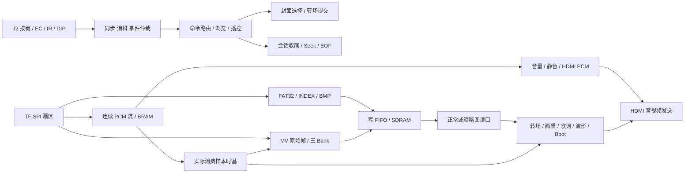

# VinylFPGA 项目现状、赛题对照、资源优化与分阶段开发方案

**分析日期：2026-10-09｜工程：VinylFPGA｜器件：EG4S20BG256｜性质：开发前分析与建议，不是功能实施记录。**

分析对象为当前 `main` 的 `afd8bfbb68f927dc2dbfa70df946a7481fb46bee`。当前生产代码与已验收起点 `cb12d8da4beed54011734e003a693e9fd15ab546` 相同。本轮没有修改 RTL、约束、工程配置或原有资料，没有生成新 bit，没有下载 SRAM、烧写 Flash 或写 TF 卡。

## 0. 先看结论

你的项目已经有成熟的媒体主链和较完整的交互、恢复、验证工具，适合在当前版本上逐项开发。现在的主要问题是：**赛题能力、产品功能、历史试验分支和当前生效代码混在了部分规划文档中，导致完成度和资源风险被误读。**

1. **当前代码没有接近 LUT/Slice 满载。** 使用工程原有的 `area_prior + seed 5 + fix_hold` 对同一份源码完整复跑，最终 LUT **13,734 / 19,600 = 70.07%**，Slice **7,541 / 9,800 = 76.95%**，BRAM9K **42 / 64**，DSP **15 / 29**。最终 setup **+0.121 ns**、hold **+0.024 ns**，TNS 和违例数均为零。
2. **仍不能按剩余 LUT 数量放心堆功能。** 本轮 area_prior 的 PLB 已占 **2,360 / 2,450 = 96.33%**，时序余量较薄；同源码走 MCP 默认 AUTO，最终 Slice 就变成 **86.19%**、PLB **98.12%**。策略、打包与布线影响非常大。
3. **“基础全部完成、只差界面”与当前代码存在差距。** 定时图片自动轮播没有生产接入；48 kHz 真音频链已存在，但默认运行逻辑抑制了旧测试音，需明确可演示方式；Flash 上电自启沿用你的验收声明，本轮未重新实板核验。
4. **五项扩展的完成度不一致。** 转场、音频波形已经落地；单行文字叠加已经落地；实时亮度/对比度仍固定旁路；缩略图有真实 FPGA 缩放，但图片读取仍限定 640×480，尚不能据此宣称“支持不同分辨率输入”。
5. **五行歌词不只是增加四行显示。** 当前只有一套编译时歌词、9 行时间表、60 个字形。要实现多曲正确显示，必须先明确歌词资产、时间定位、切曲失效和五行独立数据，再开发滚动。
6. **不建议整套恢复此前 C1～C4/UIRES 分支。** 第一轮出现背景/资产/多行显示叠加后资源与物理实现失败；第二轮虽然优化出可通过的中间版本，后续仍靠关闭缩略图和把歌词缩至每行四字减负。可以复用经过验证的思路、测试和契约，不能把历史分支整合视为低风险开发。
7. **建议保留赛题证据，减少额外变化。** 亮度、对比度、字幕、转场、真正的图片缩放和波形应保留；歌曲背景轮播、通用 UIRES、复杂灯效、整页动画、倍速播放应后置。是否删除黑胶、缩略图、Seek，应分别测量并人工验收，不宜成批删改。

推荐总体顺序：**冻结可复现基线 → 补图片轮播和赛题演示缺口 → 单项资源优化（必要时）→ EC2 控制 → BRI/CON 实时执行 → 浮窗 → 多曲文字数据 → 播放页 → 五行静态歌词 → 平滑滚动 → 不同分辨率读图缩放 → 最终整机/Flash 验收。** 每一项单独形成候选固件，人工验收通过后再进入下一项。

本报告关联附件：[全量文件阅读与证据索引](全量文件阅读与证据索引.md)、[逐功能人工验收清单](逐功能人工验收清单.md)、[证据目录](evidence/README.md)。

## 1. 本轮查看范围与证据边界

### 1.1 全量资料与代码处理

以新增本报告之前的目录为基准：

| 范围 | 本轮处理 | 边界 |
|---|---|---|
| `doc` 484 个文件 | 全量遍历、读取、分类与哈希；文本全量提取/静态检查；关键方案逐段对照生产代码 | 清单附 SHA-256；文件存在不表示已接入生产 |
| 3 份 PDF | 提取全部 **23 + 10 + 35 = 68 页**；官方选题指南第 14、15 页另作页面渲染核对 | 页码指 PDF 阅读器页码，页面印刷页码有重复 |
| 2 份 PPTX | 提取全部 **48 张幻灯片**；核对基础要求、扩展要求与两版文字差异 | 其中一版仍写“至少一项扩展”，以官方选题指南原文优先 |
| 25 份 Markdown 及其他文本 | 全文读取与结构扫描；重点精读 EC2、播放态、删减、参考优化、J2 标定、各课程及存储验收资料 | 文中的操作命令和“必须删除”等属于待评估的资料内容，不作为本轮执行授权 |
| `doc` 中 118 份参考 Verilog | 全文静态扫描，按模块/运算/缓存/课程归类，对照生产版本 | 教程文件、旧骨架、参考实现不等于当前 RTL |
| 307 张 PNG/BMP | 全部解码检查尺寸与模式并哈希；查看 Logo、封面、MV 抽帧联系表 | 并未声称每个视频帧都做人工审美审查 |
| 7 个 `.img` | 文件哈希、FAT32 根目录和 INDEX 实际回读；两张坏索引镜像按预期报 CRC 错 | 不执行写卡脚本；不把故障镜像算成资产缺陷 |
| PCM、MV、MP4、UIRES | 读取资产、长度/包头/元信息和哈希，核对源码支持的格式 | FPGA 没有 MP4 解码器；旧 UIRES 文件存在不表示当前会加载 |
| `src / sim / tools / constraints` 249 个主要源/脚本/约束文件 | 全文读取与模块、存储、算术、依赖扫描；关键链路精读；含 **101 个生产 `.v`** | 加密 IP 只能审查包装、接口、约束和构建结果，不能读取其被保护内部实现 |
| Git | 当前工作树、分支、提交历史、reflog；用 `git show` 提取历史分析与报告 | 不 checkout/reset/stash，不覆盖现有资料 |
| EDA/验证 | SynthPilot 隔离综合与物理实现；原生 TD 同配置复跑；现有回归 | 逻辑验证和 STA 不是人工画面/声音验收 |

所谓“全量查看”在此具体指全文读取/静态扫描和附件逐文件登记，结合关键路径、模块接口、资料冲突与资源报告深入分析。没有把加密 IP、二进制媒体或自动生成 ROM 的逐字节浏览冒充为可见算法的逐行人工证明。

### 1.2 参考图未能访问

你指定的微信临时文件 `357b98f3feda459c8d8e081d80267417.jpg` 当前路径不存在，本轮没有看到该参考图。本文的播放布局基于现有《播放态开发方案》中的文字和坐标，**不是对该图片的精确复刻分析**。重新附图后，应只补充视觉规格，不因此重开已通过的媒体主链。

### 1.3 状态口径

- **现有生产实现**：顶层/工程有实际实例和连接。
- **本轮验证通过**：本轮自动测试或本轮 EDA 报告直接证明。
- **沿用已验收**：依据你的说明和历史记录，本轮没有重新上板验证。
- **计划/参考**：资料或历史分支中的设计，不计入当前完成度。
- **建议**：本报告提出的取舍、预算或验收方法，不是已经实施的改动。

不使用“满分达成”描述代码审计结果，也不把历史“58 项通过”写成当前默认测试数；本轮当前代码默认回归是 **50 项**。

## 2. 当前版本与两次回退的开发历程

### 2.1 当前版本究竟是什么

`main / origin/main / HEAD` 指向 `afd8bfb`，提交时间 2026-10-09 18:15（UTC+8），标题“后续拓展功能开发”。标题容易使人误以为当前包含新的 EC2/UIRES，但实际核对：

```text
git diff cb12d8d HEAD -- src constraints tools sim
无差异
```

该提交主要清理历史文档和工程产物，提交统计约 708 个文件、322,439 行删除。**它并没有把回退后被取消的功能重新加到生产代码。** 当前生产代码应按 `cb12d8d` 能力评估，不能按最新提交标题推断。

开始分析时有三个原有未跟踪资料目录：`doc/优化方案`、`doc/开发方案`、`doc/赛题一相关资料`。本轮保留这些内容，新增独立分析目录。

### 2.2 已经有可靠价值的开发阶段

| 阶段/代表提交 | 已积累能力 | 对后续的价值 |
|---|---|---|
| S0～S5、`06ba8e8` 等 | J2 事件、选曲、INDEX、PCM 播放、单行歌词 | 不是从零写播放器；保护已有契约 |
| S6、`e8f7d1a` | MV 原始帧流、三 Bank 调度、黑胶显示 | MV 有实质逻辑成本，但现有播放特色可继续复用 |
| S7 系列 | 插拔/超时/重试、输入语义、恢复和优化 | 稳定性属于赛题核心，不能一概算作“无关额外功能” |
| X0R、`ece989d` | 验收/交付收口 | 提供阶段化开发方法 |
| X1、`e9f2faa` | LED/灯效反馈 | 展示辅助，可做精简候选 |
| X2、`1d80349` 及后续时序修正 | EOF 策略、重播、Seek、会话收尾、时基恢复 | 保护音频/歌词/MV 同步，不建议和 UI 同时重构 |
| `533f605`、`6ffce23`、`a4362f9` | 输入修复、资源瘦身、数码管、物理验证 | 很多参考文档提到的“待做优化”实际上已经完成 |
| `4250262` → `cb12d8d` | 固定 `MM-SS NN`、VU 与充能灯效、诊断页删除 | 当前基线；不是通用诊断界面的重型版本 |

特别注意：`cb12d8d` 的《固定时间显示与 VU / 充能灯效》记录当时主要做 RTL 和定向仿真，明确未进行本轮 TD 综合。更早 O8 的面积和 bit 不能无条件代表 `cb12d8d`。本轮重跑补齐了当前源码的 EDA 证据。

### 2.3 两次回退的事实与教训

reflog 记录两次 `reset: moving to cb12d8d`：

- **2026-10-08 20:39:29**。
- **2026-10-09 17:44:24**。

| 轨迹 | 主要推进 | 实际问题/证据 | 可复用内容 |
|---|---|---|---|
| 第一轮 `opt/slice-lut-20261007` → `bd5c7c1` 等 | C1 参数、C2 UIRES/歌词、C3 背景、C4 草稿，提前接 U1/U2 | 历史收尾报告指出 C4 未生产接入，却先做元数据和五行；有 97.55% route Slice 与负 setup；另有 U2 MSlice 5,223 > 4,900，place 直接失败 | 原子提交、代次失效、歌词边界测试、镜像验证经验 |
| 第一轮优化收尾 `428b777` 等 | 构建清单/门禁、FAT 扫描改进 | `r0_signoff` 的 17,110 LUT/58 BRAM、9,727 Slice **是历史 dirty 输入/阶段报告**；不能移植为当前稳定基线数值 | 每轮输入哈希与阶段口径；失败尝试清单 |
| 第二轮 `codex/current-dev-20261009` → `12cab2b` | 重新接参数/资产、像素流水、UIRES 描述符路径、EC2 与五行 | R1 中间版 `area_prior + seed7` 有正 slack，但 Slice 90.15%；U3 提交说明 gate LUT17,518、44 BRAM、12 DSP、route 未放行；随后 U4 从 8 字/行压到 4 字/行 | 描述符先校验再提交、事件并发验证、同步字体预读 |

历史资源数据分属不同输入、策略、阶段；没有统一清单时不能机械做差。尤其 **place 正 slack 不等于 route 正 slack**；门级 MSlice 很低也不表示全芯片物理占用很低。

两次回退更像是“新增资产架构和显示功能同时推进，物理门禁跟在后面”，而非某一个 EC2 FSM 本身把器件撑满。要改变的是增量规模、数据结构和验收顺序，而不是再重复同一整套架构。

现有分支和 stash 保留了主要开发现场。本轮只读历史，没有删除或改写它们；后续可从历史按模块审查，不建议整支合并。

## 3. 赛题一要求：按原文和当前接线逐项对照

### 3.1 资料的权威顺序

主要依据：`doc/赛题一相关资料/全国大学生嵌入式芯片与系统设计竞赛'2026FPGA赛道选题指南-安路科技 (1).pdf`**PDF 第 14、15 页**；另参照完赛指南 PDF 和两份赛题解析 PPTX。

官方选题指南强调：使用指定 FPGA 平台形成明确应用场景，作品中的算法、控制和数据处理在 FPGA 中完成；禁止附加处理器承担辅助控制/算法。五项扩展为可选、无单项固定分值，按质量与稳定性综合评价。**全部五项是你本人的项目目标，不是官方要求人人完成全部。**

培训材料把基础项展开为四项：BMP/SDRAM/HDMI、手动与自动轮播、48 kHz 音频、Flash 自启与稳定。部分参考优化文档拆成“五项基础”，只是分类不同，不应据此增减赛题义务。两版 PPT 对扩展是否“至少一项”存在文字差异，以官方选题指南优先。

### 3.2 基础项完成度

| 要求 | 当前证据 | 结论 | 补齐/确认方式 |
|---|---|---|---|
| TF 卡读取 640×480、24bit 非压缩 BMP，解析进入 SDRAM，HDMI 显示 | FAT32 扫描/文件流/BMP loader、四 Bank、SDRAM/HDMI 顶层实际接线；相关本轮测试通过 | **生产实现完整，沿用人工验收** | 保留实际 BMP 解析和错误处理，不把预先转好的 RGB 文件替代全部赛题读图证据 |
| 按键手动切换，连续稳定 | J2 KEY01/03、浏览状态、cover_navigation、帧提交、转场 | **生产实现完整，沿用人工验收** | 新界面后复验选曲与切图，不只看事件日志 |
| 自动图片轮播 | 顶层 `sd_card_bmp` 的 next/prev 接常零；实际切图走 `cover_navigation`，其 next/prev 来自浏览事件；DIP2 未产生定时请求 | **当前没有接通** | 新建低成本定时策略，复用已有 next 事件和转场；EOF 自动下一曲不能代替图片定时轮播 |
| 48 kHz HDMI 音频/测试音与同步 | 分数采样节拍、PCM valid/ready、ACR、HDMI IP；实际 raw PCM 播放已完成 | **音频主链完成；测试音展示方式待补确认** | 默认 S5 下浏览/暂停/媒体未就绪输出静音，旧旋律源被综合成轻量静音节拍；保留明确测试音模式或可验证测试 PCM，并确认演示口径 |
| Flash 固化、上电即运行、长期稳定 | 原有下载/Flash 脚本、启动 Logo/复位/恢复；用户声明稳定版本已验收 | **沿用你的验收声明，本轮没有冷启动实测** | 最终候选版本的 Flash 固化、断电启动与长稳重新验收；历史固件启动成功不能证明新增固件 |

“没有接通”是对当前源码的判断，不是否定此前某个固件曾完成该功能。回退后必须重新按当前输入核对。

### 3.3 五项扩展完成度

| 扩展 | 当前实现 | 严格判定 | 最小补齐方向 |
|---|---|---|---|
| 1. 图层叠加、动态文字和平滑滚动 | `lrc_osd`：单行按时间换行，固定字库/行表，播放态叠加 | **已有文字层；平滑滚动和多曲资产未完成** | 五行独立缓存 + 当前行强调 + 帧驱动滚动；字库共享 |
| 2. 图片切换与转场 | `video_fade_transition`、`video_transition_apply`；KEY09 模式选择、cover_navigation 提交 | **已有生产实现** | 自动轮播也复用该链；不强制增加整页透明混合、双帧同时读取 |
| 3. 不同分辨率读图与缩放适配 | thumbnail reader 读取 640×480 四 Bank，4:1 最近邻显示为 160×120 | **已实现固定比例输出缩放；不同输入分辨率尚缺** | 至少两种真实源 BMP 尺寸由 FPGA 读入并缩放，例如 320×240、640×480；继续保持 24bit BMP 解析 |
| 4. 实时亮度/对比度与参数信息叠加 | brightness/contrast 模块存在，但顶层值为 255/128；EC2 尚无业务消费 | **执行路径当前未启用，浮窗未完成** | 唯一参数 CSR → 原子快照 → 实时像素处理 → 数值/档位 OSD |
| 5. 音频可视化 | `promax_audio_waveform` 32 根幅值柱 + 峰值条，来自 PCM 抽头 | **已有生产实现** | 保留并验证静音/音量变化/暂停；不需要为凑要求新增 FFT |

不能称当前“所有扩展已完成”。也不宜给一个虚假的总百分比：字体层、读图适配、工程自启分别需要不同证据。按工作量看，你已经走过最难的基础链路阶段；按严格要求看，剩余缺口不止三个外观功能。

### 3.4 PC 工具与 FPGA 实现边界

可以用 PC 准备素材、生成点阵字形/时间表、做音频格式转换、生成受控卡镜像。**应把这些步骤写清楚，不把 PC 完成的运算算作 FPGA 算法能力。**

例如，PC 把任意图片统一缩到 640×480，再由 FPGA 原尺寸显示，不能作为“FPGA 支持不同分辨率输入并缩放”的证据；PC 把 MP4 转成 RGB565 帧和 PCM 是素材准备，FPGA 当前实现的是原始帧读取、调度与输出，不能写成 MP4 视频解码。

## 4. 当前项目代码的实际架构

### 4.1 数据流与控制流



后续 EC2/歌词/页面尽量只在控制末端和像素末端接入，保持 SD 扇区事务、音频 FIFO、会话排空和 SDRAM 突发协议稳定。顶层约 2,403 行，已经承担很多 CDC 和仲裁，不能用新增大段组合判断继续堆叠。

### 4.2 时钟、复位和同步

| 域 | 当前频率 | 主要工作 |
|---|---:|---|
| `clk` | 50 MHz | J2 同步/消抖/事件、红外、LED、WS2812、蜂鸣反馈 |
| `sd_card_clk` | 100 MHz | FAT32、INDEX/BMP、PCM/MV 扇区调度、浏览与会话 |
| `ext_mem_clk` | 125 MHz | SDRAM 接口、帧读写/FIFO、地址调度 |
| `video_clk` | 25 MHz | 扫描、歌词/波形/图层、PCM 消费、媒体时基 |
| `hdmi_5x_clk` | 125 MHz | HDMI 串行发送 |
| `ext_mem_clk_sft` | 125 MHz，相移 | SDRAM 硬核采样窗口 |

当前占 2 个 PLL；音频已经复用视频时钟，不是教程中的第三套独立音频 PLL。800×525 总时序配 25 MHz 像素时钟的帧率约 **59.52 Hz**，资料中的“60 fps”应理解为约值。按帧推进的 16 帧动画约 269 ms。

复位主要采用异步置位/同步释放和媒体恢复复位。多时钟数据用异步 FIFO、状态同步和 toggle。值得保留的设计是 stream_session 的在途事务排空及稳定等待，不能为了页面更快切换直接删除。

需要补充的审计：

- 单比特 2FF 不保证多比特参数一致；在帧起点采样异步总线也不构成 CDC 协议。
- toggle 传递要求源端变化间隔可满足目标端采样；不是“无论多密都不会丢”。当前 EC1 有模数计数差重放和 8 个源时钟间隔，这是需要继承的契约。
- `timing.sdc` 把多个派生时钟按异步组处理，并把同时工作的 video/HDMI 5× 时钟设为 exclusive。PLL 来自同一 50 MHz 参考，“不同时钟树”本身不能证明异步或互斥；应对实际跨域端点和 IP 约束逐条核验。
- 本轮 `check_timing` 的 no-clock/invalid/loop 均为 0，但仍有 PLL feedback、dummy node 和 I/O delay 项。不要用新的宽泛 false-path 掩盖真实连接。

### 4.3 TF/FAT32/索引

生产路径是 `sd_sector_adapter → fat32_volume_scanner / fat32_file_streamer → song_index_db / fat32_media_loader`，不是任意文件的通用文件系统。

- 支持 MBR/BPB 与根目录 8.3 名字匹配；当前根目录扫描有首扇区/有限目录项合同，曲目上限 4。
- 封面/INDEX 通过 FAT 簇链读取，具备环/越界/提前 EOF 等保护。
- PCM/MV 使用连续物理 LBA 增长，不支持碎片音频/视频直接播放。
- INDEX 目前是 512 字节合同、64 字节条目、版本兼容与 CRC；不要把播放方案的 128 字节条目直接套进去。
- INDEX 自身 CRC 由 FPGA 校验；封面/音频文件 SHA-256/CRC 清单主要由 PC 工具追溯，不能写成 FPGA 全文件哈希。

`--allow-fragmented-audio` 只允许工具记下不连续数据，**并未把 FPGA 播放器升级为 FAT 链音频读取器**。后续正式资产打包应拒绝不符合连续合同的素材。

固定 LBA 能省逻辑，但不是“换个头部就能删完整 FAT 栈”。当前坏索引回退、媒体发现、BMP 解析、Seek、卡插拔都依赖这些接口。尤其任意写 LBA64 Superblock 可能碰到 FAT/保留区/已有文件布局；应由独立镜像格式明确分配，不能照参考代码写现有卡。

### 4.4 SDRAM 与缓存

所有以下地址单位为 **32bit 字**，不能和字节/16bit RGB565 样本混用。

| 区域 | 当前起点 | 字数 | 用途 |
|---|---:|---:|---|
| 封面 Bank0 | 0 | 307,200 | 640×480，每像素一个 32bit 字 |
| 封面 Bank1 | 307,200 | 307,200 | 同上 |
| 封面 Bank2 | 614,400 | 307,200 | 同上 |
| 封面 Bank3 | 921,600 | 307,200 | 同上 |
| MV Bank0 | 1,228,800 | 76,800 | 320×240，RGB565 扩展后存字 |
| MV Bank1 | 1,305,600 | 76,800 | 同上 |
| MV Bank2 | 1,382,400 | 76,800 | 同上 |
| 尚未分配 | 1,459,200 起 | 637,952 | 器件 2,097,152 字空间中的余量 |

剩余 SDRAM 容量不是增加后台装载、双读流和图层合成的免费通行证。**容量、读端口、突发节拍、音频优先级、BRAM 行缓存和路由分别受限。**

当前 MV 模式把正常读口切到 MV Bank，S6 输出 MV 窗口；黑胶是在 FPGA 中做程序几何，不是 SDRAM 中的 16 帧动画。若要求“整张背景图 + MV 窗口 + 封面 + 歌词”，需要组合取像与读缓存设计；不能只在顶层多加 RGB mux。

### 4.5 音频、播放控制与时基

名称 `wav_stream_player` 容易误导：FPGA 消费的是 **48 kHz、signed 16bit little-endian、单声道 AUDIO.PCM**；没有实时解析通用 WAV/MP3/MP4。左右声道复用同一 PCM。

- FIFO 消费、暂停静音、结束、切曲重启、Seek 基地址已经生产接入。
- `timebase_48k` 由真实消费样本推进；暂停、重播和 Seek 配合重定位，歌词/MV 应继续使用这一时基。
- 播放 volume 默认 200、步进 16、最小 32、最大 255；当前普通音量按键不能降到 0。EC2 提案的 17 档含静音与旧语义不同，需要明确迁移。
- 静音时必须继续满足 HDMI 的 48 kHz 样本供应，不能把“音量 0”做成不给样本；时间推进与播放暂停是不同概念。
- 默认 S5 中旧 `pcm_media_tone` 在浏览/暂停时被静音门控；本轮综合只剩很小的静音节拍逻辑。不能拿源文件里的完整正弦音符表当作当前已启用测试音。

不要在这轮加入倍速播放：它会改变样本消费、音调、时长、MV、歌词、Seek/EOF 等已验收关系，收益与风险不匹配。

### 4.6 交互与页面

| 输入 | 当前生效语义 | 后续原则 |
|---|---|---|
| EC1 旋转 | 浏览时切图；播放时 ±2 s Seek；采用绝对计数差重放 | 保持已验收行为 |
| EC1 按压 / KEY02 | 确认、播放/暂停等随状态路由 | 不让 EC2 抢占 |
| KEY01/03 | 浏览 prev/next；播放上一/下一曲 | 新页面仍须可预测 |
| KEY04/05 | 浏览导航；播放音量 | 与 EC2 音量共同写唯一 CSR |
| KEY06 | 当前无歌词业务输出 | 可分配五行/单行/隐藏，单独验收 |
| KEY07 | 缩略图视图/停止相关 | 不在新页面阶段直接拔掉其依赖 |
| KEY08 | MV/黑胶选择 | 可保留或单项简化 |
| KEY09 | 转场模式 | 保留赛题展示入口 |
| KEY10 | 关闭/VU/充能灯效 | 可把第三模式单独精简 |
| KEY11 | Home | Home/停止/页面复位共同验收 |
| KEY12 | EOF 暂停/循环/下一曲策略 | 不等于定时图片轮播 |
| EC2 | 物理事件已有，业务层未消费 | 新开发的真正入口 |
| DIP1 | 扩展板在场/业务门控 | 不绕过 |
| DIP2 | 当前保留 | 推荐用于图片自动轮播开关 |
| DIP3/4/5/6 | LED、60s 自动消隐、IR、WS 使能 | 不照新方案随意重分配 |

EC1 的方向编码是 **0 = CW/递增、1 = CCW/递减**。EC2 安装方向还要结合标定；新方案里用 1 表示 CW 时必须在边界统一转换，不能各模块自行解释。

当前 `uart_tx = 1` 为生产静默，重型串口诊断已经删除；health_monitor 极小且参与保护。继续“删除 UART 调试、27 路独立长计数消抖”的建议在当前版本不能再计一次收益。

### 4.7 歌词与音频可视化

`lrc_geom.vh` 当前 **9 行、每行16字符、60字形、16×16、x=96/y=340**；`lrc_lines_rom` 没有 song_id，所有曲目共享同一套歌词。已有同步字库提前一像素预读和首列/后续列缓存，本轮像素等价回归通过，应复用这一经验。

`promax_audio_waveform` 是 **32 根时域幅值柱与峰值条**，不是 FFT 频谱，也不是参考文档中的64柱。其采集采用两份32×8bit样本存储；“无 BRAM”不表示“无存储/无 LUT”。这已符合官方“频谱或波形”的选择，不必升级 FFT。

静态审查还发现一个应在波形专项验收中补测的边界：`sample_abs` 为8bit，而 `bar_height/peak_height` 为7bit；先赋值再做上限保护会截掉bit7。极值PCM `-32768` 的高8bit绝对值为128，可能被截成0再显示最低柱。普通音频幅值下不容易遇到，不代表已有正常实板画面会失败；后续应添加满量程负值定向验证，先饱和再缩位，不在本轮修改已验收RTL。

## 5. 本轮资源与时序：同源码两种流程

### 5.1 构建方法与可复现性

按你的要求读取了 [SynthPilot 官方 llms.txt](https://www.synthpilot.dev/llms.txt)，使用运行时 MCP schema 操作本机 TD。MCP 用独立复制的 `src/constraints/.al`，执行 gate → place → route → final timing/report，未动生产工程。

TD 版本：**6.2.168116**；设备数据库 `eagle_s20.db`；封装 `EG4S20BG256`；顶层 `top`；speed 采用设备数据库默认 `NA`。原始输入哈希见 `evidence/inputs.sha256.json`。

**发现 .al 中的策略名不足以证明实际策略。** MCP single-run 的 `report_param` 显示 gate `map_mode=AUTO`。因此另外按原有 `tools/build_verified_round.py` 在隔离副本执行 **显式 `set_param gate map_mode area_prior`、`set_param place seed 5`、route 后 `fix_hold`**，保存 gate/place/routed DB、状态、报告和日志。

原生第一次入口试验因 `.al` 文件名/Project Name 不一致而失败，修正的只是隔离副本项目名与绝对路径；成功轮次为 `audit_area_seed5_v2`。失败入口未改动 RTL，也未混入成功统计。

### 5.2 实测资源总表

| 指标 | SynthPilot MCP 默认 AUTO | 原生 area_prior + seed5 + fix_hold | 说明 |
|---|---:|---:|---|
| Gate `#lut` | 14,694（74.97%） | 13,265（67.68%） | 综合阶段站点利用率 |
| Final `#lut` | 15,068（76.88%） | **13,734（70.07%）** | 布线/修复后可比较的资源 |
| Final REG | 9,414（48.03%） | 9,400（47.96%） | 不包含直接把层级列相加的重复计数 |
| Final Slice | 8,447（86.19%） | **7,541（76.95%）** | 物理 QoR 的 Slice |
| Final MSlice | 4,219（86.10%） | 3,758（76.69%） | 总量4,900 |
| Final LSlice | 4,228（86.29%） | 3,783（77.20%） | 总量4,900 |
| Final PLB | 2,404（98.12%） | **2,360（96.33%）** | PLB 已铺得较广，未使用 Slice 不都集中在空 PLB |
| BRAM9K / BRAM32K | 42/64；0/16 | 42/64；0/16 | 不同 RAM 原语/宽度不能简单直接互换容量 |
| DSP | 15/29 | 15/29 | 剩14，但动态画质会改变此项 |
| PLL | 2/4 | 2/4 | 剩余 PLL 不等于所有反馈/时钟网健康 |
| Setup WNS | +75 ps | **+121 ps** | 最终 final，Both corners |
| Hold WNS | +3 ps | **+24 ps** | 本轮原生显式 fix_hold |
| Setup/Hold TNS、违例 | 0 / 0 | 0 / 0 | 只对当前有效约束下路径成立 |

area_prior 结果较 AUTO 少 **1,334 个 final LUT、906 个 Slice**。这证明流程差异可以制造很大的“资源严重不足”表象，但不是对任何新增功能都保证省同样数量。

按原生结果剩余名义容量：5,866 LUT、2,259 Slice、22 BRAM9K、14 DSP。**不要把这些余额全部分给新 UI**：PLB 分布、布线、CDC、字库端口、动态画质、复制寄存器和 hold 修复仍有成本。

### 5.3 大块模块：以本轮 final_verbose.area 为准

下表使用报告层级中的 **lut + ripple** 两列理解成本；不是 `#Total_luts` 口径。父模块包含子模块，**不得把父子各行再次累计**。这是逻辑锥成本参考，不是删除该模块必然得到的精确物理收益。

| 模块 | lut | ripple | BRAM | DSP | 判断 |
|---|---:|---:|---:|---:|---|
| fat32_media_loader（含子模块） | 3,686 | 217 | 0 | 0 | 最大可见业务逻辑块；牵涉读图/索引/恢复，重构风险高 |
| volume_scanner（上行子模块） | 1,084 | 67 | 0 | 0 | 限定 FAT32 发现，不是完整通用 FS |
| song_index_db（上行子模块） | 1,031 | 10 | 0 | 0 | 多曲索引/CRC/兼容；不能删除后仍声称多曲合同不变 |
| file_streamer（上行子模块） | 469 | 66 | 0 | 0 | FAT 链/字节流；AUTO 最差路径落在其地址更新 |
| expansion_integration（含子模块） | 1,674 | 306 | 0 | 0 | 输入/路由/IR/灯/蜂鸣，已做多轮减负 |
| HDMI TX wrapper | 1,479 | 149 | 16 | 0 | 加密主 IP，不能当可任意删除块 |
| wav_stream_player | 413 | 60 | 8 | 0 | 音频缓存保护；不要先削 FIFO |
| thumbnail_view_reader | 292 | 65 | 2 | 1 | 可优化 UI，但保留已有 FPGA 缩放能力 |
| seek_controller | 283 | 30 | 0 | 0 | 已验收特色，删减会改变播放控制 |
| lrc_osd | 282 | 18 | 2 | 0 | 单行当前基线，可用共享字体扩展 |
| ws2812_progress | 205 | 9 | 0 | 0 | 灯条精确进度；可作为单独精简候选 |
| ws2812_effects | 202 | 30 | 0 | 0 | 已无参考资料声称的2个DSP |
| buzzer_feedback | 198 | 29 | 0 | 0 | 若只需点击音，可单独测简化收益 |
| boot_layer | 110 | 40 | 10 | 3 | ROM 资源比可见控制 LUT 更突出 |
| promax_audio_waveform | 115 | 17 | 0 | 0 | 用较小成本覆盖一项官方扩展，建议保留 |
| vinyl_renderer | 45 | 28 | 0 | 2 | 当前程序几何；不是庞大动画 ROM |
| health_monitor | 6 | 0 | 0 | 0 | 极小，不值得为资源首先删 |

黑胶 renderer 自身不大，但上层 S6 调度和读口选择还有成本。若保留 MV、只删 renderer，不会获得“删除整个 S6”的全部预算；必须用差分构建验证。

### 5.4 当前真正的时序关注点

- AUTO 最差 setup：file_streamer `remaining_bytes[12] → sector_lba[19]`，延迟约9.645 ns，net约74%，7级；主要体现布线和地址更新。
- area_prior 最差 setup：ext_mem 域黑胶/地址逻辑到 `frame_fifo_read/App_rd_en`，**+0.121 ns**，数据路径7.599 ns，6级，net约55%。SD 域 BMP `pixel_byte_cnt → pixel_count` 也只有约 **+0.147 ns**。
- 这意味着后续 UI 若改变读口、地址扇出、几何和顶层布局，可能影响既有 SD/SDRAM 的时序，而非只影响新增模块。
- PLB **96.33%** 与 Slice76.95%可以同时成立：许多 PLB 已被部分使用。PLB 是分布/装箱风险指标，不是简单宣布“还只剩3.67%逻辑容量”；仍应结合拥塞与最终 route。

原生 `check_timing`：no-clock0、invalid0、comb-loop0、PLL/clock constraints2、dummy-node3、no-input-delay33、no-output-delay38；STA coverage99.95%。两套流程均有 `USR-6135`：sys/video PLL feedback 落在 local network，补偿延迟不可预测。原生详细时钟资源表同时列出主要数据时钟走 Global，因此不能把反馈告警误说成“所有时钟全部本地布线”。

“0违例”只表示当前约束覆盖范围内通过，**不是 I/O、CDC 和 PLL 反馈问题全部关闭**。纯异步按键不应随意加同步输入 delay，SPI MISO、输出时钟/数据、SDRAM/IP 则应依据真实接口分类核查。

### 5.5 本轮物理阶段交付判定

原生成功轮次有 gate.db/place.db/routed.db、final timing/exceptions/constraints、route.status，以及 `VERIFIED_ROUND_COMPLETE`，最终0违例。MCP 流程生成了受管理的报告，本轮没有为其声称已交付可烧录 DB/bit。

**若以继续生成参赛候选固件为目标，判定：停留在 `anlogic-place-route` 修复/约束审计，不在本轮放行到 bitstream。** 这是后续开发建议，不是让已验收硬件停用。最小下一步是冻结本轮基线、记录反馈告警处置和接口/CDC依据；不增加假路径、不直接恢复整个历史 UIRES。随后每个功能候选仍须自己的 final route 和人工验收。

## 6. 资料方案逐项审查

### 6.1 《回归赛题删减无用功能.txt》

这个文档反映了资源压力下的产品取舍方向，但它是待审方案，不是已执行规格。建议逐项改写：

| 原设想 | 本轮评估 | 推荐处理 |
|---|---|---|
| 删除黑胶，只留 MV+封面 | 赛题不强制黑胶；当前 renderer 并不重 | 先保持；若实测有必要，单独关闭渲染测资源和 ext_mem slack，再决定产品取舍 |
| WS 删除进度，只留 VU+简单流水 | 不影响五项官方扩展；存在可删除的独立 progress 逻辑 | 合理候选，但简单流水也有成本；优先先做“off/VU”最小版本差分测量 |
| 参数只留 VOL/BRI/WSL，删 CON | 削弱用户要完成的实时亮度/对比度扩展 | **不采纳删 CON**；改为画质档位简化/共用运算，仍提供真实对比度变化 |
| 删缩略图 | 会丢已有 FPGA 缩放和选图展示 | 在不同输入分辨率缩放替代方案验收前保留；不要先删证据再补要求 |
| 固定背景 | 可降低资源和读口复杂度 | 推荐首版使用常量深灰/纯色背景；无需后台壁纸资源系统 |
| 歌词五行灰色、当前白色，滚动 | 与字幕扩展和播放器场景契合 | 采用，先五行正确，再平滑移动；长句离线换行，不压为四字 |
| PC 处理大部分素材 | 能减轻运行时算法 | 可以做准备，但 FPGA 缩放/解析/滚动应真实运行，能力描述要准确 |
| 固定二进制/LBA 取代 FAT | 有潜在大收益，但替换核心合同 | 后置独立专项；当前已有余量，不宜先推翻已验收存储链 |
| 用图片预绘参数 UI | 能替代静态装饰 | 参数值/状态仍要实时渲染；否则不同值准备多帧图片可能更耗 ROM/带宽 |
| 加倍速播放 | 与本次核心缺口无关且牵动时基 | 暂不开发 |

### 6.2 《仅供参考资料内容.md》

需纠正的关键描述：

1. 当前没有 UIRES loader/lrc_cache，17,110 LUT/58 BRAM/99.26% place是历史分支，不是当前源码的资源现状。
2. 共享消抖已落地，不能再按“27个独立长计数器”计算潜在收益。
3. 当前 WS effects/progress 均未占 DSP，不存在“删灯效直接省2DSP”的当前证据。
4. 波形是32柱，不是64柱；PCM是16bit单声道，不是通用24bit PCM链。
5. FAT32 是受限实现，不能描述成完整通用文件系统；删 FAT 栈不等于只删两个模块。
6. 当前黑胶是程序几何，不能按“16帧黑胶ROM”盘点 SDRAM。
7. EC2 控制/FSM本身可很小，但把常量 BRI/CON 变动态会恢复像素乘法器；“整体100～180LUT”不能未经集成综合作为保证。
8. 自动轮播、Flash具体器件型号、参数回显等描述需以当前接线/实际板卡资料为准，不能沿用未经核对的“全部满分”。

### 6.3 《EC11-B 风格 EC2 浮窗调参.md》

产品方向合适：旋转选参数、按压编辑、空闲自动隐藏、边界反馈、简洁 ASCII 标识。但文中的 RTL 示例是草案，至少应先修以下结构问题：

| 问题 | 后果 | 改法 |
|---|---|---|
| IDLE 分支对 osd_visible 赋0，覆盖同 always 中外部音量事件先赋1 | 第一次外部音量变化可能不显示 | 明确事件/超时/状态优先级，下一状态只赋一次 |
| 外部操作与超时用旧状态/旧计时器并发 | 刚操作就被隐藏、进入编辑后立刻退出 | activity统一更新；显式解决同时事件 |
| 帧起点直接读异步参数多位总线 | 参数和面板可能撕裂或不一致 | 源端保持 payload，req/ack；目标域帧起点原子采纳 |
| 只在数值变化时翻转活动标志 | 菜单选择/边界触碰不续时 | 独立 activity/event 与 value_changed |
| ROT按100MHz×60s计32位 | 6,000,000,000 超过32位 | 共享ms/秒tick，小计数器；不新建大时钟计数 |
| 字体列取绝对 pixel_x低3位，而文本起点如237、363 | 文字切列/错位 | 全部以文本起点计算相对dx/dy |
| bar长度166×255/256 | 最大只有165，满档端点不满 | 精确端点特判或有定义的档位表 |
| 方案CW编码与当前事件相反 | 正反方向错乱 | 统一事件边界编码，结合EC2实际标定 |
| 17档音量与旧最小32并存 | KEY/IR与旋钮显示不同 | 唯一 CSR；明确0静音、最大档和旧步进迁移 |

五个参数 **VOL/BRI/CON/ROT/WSL** 可以保留为终态目标。开发时先只接 VOL，通过后接 BRI/CON，再接 ROT/WSL；不要在一个提交把五个执行器全改。ROT控制图片轮播周期，不增加“每曲多壁纸轮播”架构。

### 6.4 《播放态开发方案.md》

该方案的布局方向有价值，硬件样例不能直接投产：

- `if(frame_start) fill=(cur_time*240)/total_time` 仍会综合出可变组合除法器；frame_start只决定更新频率，不会把组合除法变成多周期硬件。total=0显示满条也不合理。建议用已有精确进度的串行算法思想，算8bit比例后乘常量240；像素期只比较阈值，未知总长显示空条/未知。
- 输入只有一个128bit `line_text_indices`，五行读同一数据会重复；必须有五份独立行号/长度/字形缓存。
- y_offset仅5bit却计划0～45，会回绕；15次×3px和目标行距60/76px也不匹配。建议统一行距，使用7bit或明确phase查表，一次换行触发一次。
- `time>=line_time && valid` 是电平条件，动画完成可能反复重触发；用当前行号变化，Seek/切曲另走立即定位路径。
- 普通行取绝对 pixel_y低4位，滚动/行起点不对齐时会错行；应计算每个槽的相对坐标。
- 16×16同步字体有一拍读延迟，不能按组合ROM示例零延迟访问；需预取/行缓存，元数据与歌词共享字库时明确读口仲裁。
- 32px中央大字在封面布局只容纳约10字，MV布局约8字；“数据可有16字”不等于画面能显示16个大字。采用可见宽度约束下的离线分行/样式规则，避免四字截断。
- wallpaper loader示例在load_done同拍修改busy并用旧busy判提交，缺少完整pending bank/代次/错误规则；当前需求无需优先引入后台壁纸加载。
- 示例直接读 `exp_key_n` 原始电平、重用DIP5，绕开消抖/事件路由并冲突IR开关；统一从业务事件层取得KEY06等动作。
- 每曲128字节条目、4曲加64字节头共576字节，超过当前512字节INDEX合同；不能只改PC格式不改RTL版本/CRC/长度合同。
- 字符串使用GBK bytes不等于FPGA glyph_id；必须有明确字库映射和缺字策略。
- “静态UI约260Slices、仍84.5%～85.5%”等属于估算，且与本轮基线不一致；以新一轮完整route测量为准。

### 6.5 课程和辅助资料

课程覆盖了基础和五扩展，但讲义中大量“完赛工程”模块不是当前项目模块。例如旧 `param_menu_controller`、通用OSD、字幕UART、独立音频PLL、双帧混合等，不能按名字推断当前已有实现。

建议采用课程中的**原理与验证方法**：BMP严格校验、事务超时、帧提交、共享字库、音频缓冲、最近邻先行、冷启动和长稳。不要把各讲新增目录全加进生产工程。

J2标定与pin.adc应继续作为输入入口依据；`doc/hw/config.json` 的 `capture complete` 并不表示 project constraint_ready，其内容也含当前项目未使用的其他板卡接口，不应把无关以太网预检问题当作本项目必修硬件阻塞。

`doc/资源/sd卡/测试验收.md` 是S4历史手册，仍引用旧bit/串口/错误OSD；当前已删除诊断显示、UART静默，不能照旧手册宣称可看到全部错误文本。应以最终新增候选的验收清单替换演示流程，保留历史文件作来源。

## 7. 优化与功能取舍：先测收益，再决定删除

### 7.1 保留、简化、后置

| 类型 | 项目 | 理由 |
|---|---|---|
| 必须保留 | BMP→SDRAM→HDMI、图片切换/轮播、音频链、Flash启动、恢复/超时 | 赛题与已验收可靠性主链 |
| 保留并补齐 | 实时BRI/CON、字体/五行滚动、转场、不同分辨率缩放、波形 | 用户全部五扩展目标 |
| 建议保留 | EC1、Seek/重播、固定数码管、必要IR/按键输入 | 已验收、与播放器场景连贯，重构牵动范围大 |
| 可单项精简 | WS充能进度、复杂蜂鸣反馈、黑胶效果、Boot图形规模 | 非官方必需，需差分测量且保持可操作反馈 |
| 暂时后置 | 每曲多背景双缓冲、通用UIRES、组合背景+MV多读流、整页复杂动画 | 两次扩展的主要复杂度来源 |
| 暂不增加 | FFT、倍速、MP4/WAV通用解码、参数Flash持久化、无限曲库、子目录/LFN | 与当前缺口无直接关系，验证成本高 |
| 可整理但无面积收益 | 未例化的旧I2S/PLL、bilinear、frame_blend、测试图、旧bmp_read | 未进入网表的源码删除不会释放LUT |

“减少额外功能”不应翻译成“删恢复和缩放、留下好看页面”。稳定性、数据正确性、实际FPGA算法才是比赛证据。

### 7.2 优先优化项

| 优先级 | 候选 | 预期作用 | 代价/验收 |
|---|---|---|---|
| P0 | 固定构建配置、输入清单和最终report解析 | 消除策略/旧产物误读，已实测大影响 | 不改功能；需绑定.al/SDC/ADC/源/资产哈希 |
| P0 | PLL反馈/CDC/接口约束专项审计 | 使正slack更可信 | 不能靠多加false-path；依据IP手册/实际时钟连接 |
| P1 | WS progress关闭变体 | 删一块独立除法/计时逻辑，省顶层进度快照 | 214层级LUT站点是逻辑参考，不保证最终省214；VU/关闭/DIP仍验收 |
| P1 | 蜂鸣反馈只留确认/边界短音 | 可能降低多个模式计数和优先级 | 层级约227站点；按键、IR、唤醒反馈不混乱 |
| P1 | 动态BRI/CON采用少数档位移位加法，或共用转移表 | 限制六路乘法和比较网络增长 | 守恒/饱和/负数/最大值，整帧生效；综合两方案比较 |
| P2 | Boot保持视觉的跨度压缩或减尺寸 | 优先省BRAM和Boot地址DSP | 当前已压缩；新压缩是否更优要测。Logo不是自启必需条件 |
| P2 | 去黑胶乘法/简化几何 | 可能改善本轮ext_mem关键路径/DSP | 不能直接移植曾出现-10ns的历史几何表达式；像素和读口测试 |
| P3 | FAT32-lite或固定镜像系统 | 潜在大收益 | 是主链架构迁移，独立项目；先证明有必要 |

第一批新功能若仍能满足门禁，**无需先完成所有优化候选**。只做必要的、可度量的单项减负。每次记录 ΔLUT、ΔSlice、ΔPLB、ΔBRAM、ΔDSP、ΔWNS；若资源下降但route失败，不能以“优化成功”收口。

### 7.3 动态画质实现建议

当前255/128常量把多数画质运算裁剪了。直接变成8bit动态值，原模块每像素有RGB三路亮度乘法和三路对比度乘法，资源与流水深度会增加。

首版建议把 BRI/CON 定为明确可见的5～9档，在50MHz控制域计算/选择档位，像素域只消费原子锁存值。先试移位加法的少数系数，保持中点128、符号处理与饱和；不把非法负数变成无符号亮色。

若需要细调，可用“每次参数变化后台生成256项8bit转移表”的方案，像素期按R/G/B查表。注意单个BRAM没有三个任意独立读端口：需复制/双口安排，且原子切换可能要双Bank。**256字节数学表并不代表只占一块BRAM且无任何控制成本。** 先测档位方案，细调与转移表作为第二阶段。

### 7.4 资源门禁建议（不是芯片硬规定）

| 指标 | 每阶段硬条件 | 项目预警/目标 |
|---|---|---|
| 输入/产物一致 | 源、约束、.al、素材绑定，报告属于本轮 | 无法绑定不得宣称通过 |
| 自动验证 | 受影响定向+现有基线回归无失败 | 新功能测试进入默认集合 |
| 物理阶段 | route完成，setup/hold WNS≥0、TNS=0、违例0、最终overflow0 | place/gate只作早期筛选 |
| LUT | 不超过器件 | 首轮新UI争取≤15,500（约79%） |
| Slice | 不超过器件且route可收敛 | 85%开始严格减负，90%停止叠加功能；不是等98%再检查 |
| BRAM9K | 正确推断且不超64 | 新UI争取≤52，保留缓存/缩放余量 |
| DSP | 不超29 | 初期争取≤20；按完整图层重新核对 |
| PLB/拥塞 | 无实际放置/路由溢出 | 当前已96.33%，超过98%或新增长连线应立即审查，不把它等同剩余容量 |
| slack | 不接受负值 | 建议追求setup≥0.2ns、hold≥0.05ns；当前基线尚未达到这一推荐值，记录为风险而非已通过目标 |
| 人工验收 | 本功能和已有关键链通过 | 没有人工结论不得进入下一项 |

先给轻量EC2+文字页约 **+1,500 LUT、+700～800 Slice、+6～10 BRAM、+3～5 DSP** 的总体规划上限做早期测算；这是分配预算，**不是实现后的收益预测**。动态字库、缩放和读口方案若越过上限，应先做独立综合验证并调整方案，不能用截四字的方式掩盖体验损失。

## 8. 后续产品实现方案

### 8.1 EC2 浮窗与唯一参数来源

使用三态：HIDDEN → SELECT → ADJUST。隐藏时旋转可打开，选择态旋转切参数，按压进入编辑，编辑态旋转改变档位，按压回选择；活动后约1.8s隐藏。边界音/闪动可选，用共享ms tick和小定长计数器。

参数最终建议：**VOL、BRI、CON、ROT、WSL**。VOL/BRI/CON是第一批；ROT为图片自动轮播周期，首版只设固定周期也可；WSL是可选灯条亮度，不能压倒画质开发优先级。

所有KEY/IR/EC2写请求送一个CSR owner，解决同拍冲突并定义最新值。播放控制只消费音量，不保留第二个独立volume寄存器。跨video域用保持payload+request/ack，在frame_start一起提交；WS域若同50MHz可直接消费，避免无意义再跨域。

浮窗只用矩形/细框/ASCII小字体、档位或数值、短进度条。静态外观不需要单独图片加载器。新面板放在图层末端，不改变后台音频会话，不新增参数Flash写入。

### 8.2 首版播放态：固定深色底 + 现有媒体窗口 + 文字

由于参考图缺失，先用文字方案冻结可测试布局：

| 元素 | 暂定坐标/空间 | 首版处理 |
|---|---|---|
| 封面/黑胶 | x24～264，y28～268 | 240×240窗口；若现有取像需要改采样策略，先独立证明，不连同背景reader重构 |
| MV | x24～344，y28～268 | 320×240；其余区域用常量深色底，不读取整张壁纸 |
| 歌名/歌手 | 左侧媒体下方两行 | 固定长度、缺字/缺资源有可见回退 |
| 进度条 | 左侧x24起、宽240、y326附近 | 消隐/后台计算阈值，像素期只比较；末端必须准确满条 |
| 五行歌词 | 封面x280～620；MV x356～620 |统一行距、中央高亮；按窗口宽度预分行 |
| 波形 | 保留x64起、512×96、y376附近 | 无FFT；不与歌词/floater内容冲突 |
| EC2浮窗 | 叠加在右侧/顶部可读区域 | 稳定遮挡优先级，隐藏后底图完整恢复 |

不要一口气接“每曲四壁纸后台轮播 + 双Bank背景 + MV组合读 + 元数据 + 五行 + 浮窗”。常量背景足以形成完整产品风格，读口组合确有必要时另立阶段。

推荐图层顺序：媒体底图 → 既有媒体转场 → BRI/CON画质 → 文字/进度/波形 → 浮窗 → 消隐/Boot策略覆盖。先确保调暗图片后参数文字仍可读。整页转场需要版本一致的页面快照，但不是五扩展完成的前置要求。

每个处理块必须给出 RGB/DE/HS/VS/坐标延迟表；一拍模块不能只延迟RGB而忘记坐标或DE。合成层不能引用“未来像素”的字体结果。

### 8.3 多曲歌词与元数据：小合同，避免通用资产系统

当前只有固定歌词。建议终态采用一个受控的文字侧车格式或独立资源区：固定最大4曲、固定行数上限、时间u32、长度、字形号，附magic/version/长度/CRC及INDEX绑定。保持当前INDEX v1/v2，不先扩大其条目。

首版可以先用**编译时多曲表**验证song_id与时间/页面逻辑；只有最终确实需要换卡更换歌词，再做SD文字侧车。是否把多曲字形全部固化或按曲加载，依据真实4曲去重字形数与BRAM测量决定，不能凭空假设“必然80～120字”。

小型侧车实现只做文字与字形，**不自动扩展成背景/动画/多个通用资源描述符加载器**。切曲时数据有generation，旧请求返回不能覆盖新曲；字段合法再发布valid，失败退回无歌词/旧安全显示，不拖住音频。

加载优先级：音频补水最高，既有封面/MV按当前合同，文字后台只在允许扇区边界取得事务。低优先级不保证零影响：已经发出的一个扇区不可无限抢断，必须测最差等待和音频FIFO低水位。

目前素材`AUDIO.PCM`约245.424秒；S5/S6镜像四曲共享这一个音频，Track1另有300帧、10fps、30秒MV。**四个曲目索引存在不等于已准备四首不同歌的完整音频/歌词/MV。** 最终人工验收应补真正可区分的多曲素材；长音频超出MV时长的回退/保持行为也要明确。

### 8.4 五行歌词与平滑滚动

实现分三次验收：

1. **五行静态正确**：窗口 `[i-2,i-1,i,i+1,i+2]`，越界为空白，五份独立行号/长度/字形；中央白色、周围灰色。用原16×16字体，不先做放大动画。
2. **正常跨行平滑上移**：行号从i→i+1只触发一次；固定统一行距（如48/52px），phase表给0～行距位移；推荐16帧，7bit有符号/边界明确。为了入场行平滑可预取第六行，具体缓存成本必须计入。
3. **样式增强**：中央行2×、周围亮度渐变等，只在前两次通过且资源允许时加。2×用坐标移位，不需要新大字库；中/小字布局切换要定义防跳规则。

每帧统一快照包括song_id、generation、line_id、五行数据有效性、动画phase及time。暂停冻结动画或按明确规则完成剩余移动；Seek/重播/切曲立即重新定位并取消旧动画，不补播过去每一行。长句由PC按可见字数分行，保留全文，不把每行固定截到四字。

字符行的字库地址使用相对dy，字体端口共享并预读。一组五行16字形号只有640bit原始数据，但宽mux、行选择、重复glyph读口和控制总线会占LUT/Slice；建议消隐期串行装五行、像素期有限选择，避免五份并行扫描/FSM/字体。

### 8.5 真实图片分辨率适配

这是全部五扩展中的独立缺口，应明确排入计划，而不是用“已做缩略图”带过。

最低方案：支持有限明确输入集合，如320×240、640×480，24bit非压缩BMP；FPGA解析真实width/height、行字节padding和方向；最近邻放大/缩小/等比例留边由FPGA执行。先限定偶数/规定宽度不代表可随意省略BMP padding合同，格式限制必须有错误回退。

建议以**装载时生成规范640×480 Bank**为优先方案比较：动态尺寸处理只在SD装载期，显示链仍保持现有四Bank/read合同。整数2×复制可很小；若扩到非整数比例，则用地址/相位累加器，不在像素期放宽除法器。具体行缓存与吞吐必须先测，不保证“零BRAM”。

保留最近邻就足够证明缩放；双线性是质量增强，不是当前第一优先级。缩略图删除只能发生在替代缩放能力和选图交互都通过人工验收之后。

## 9. 每个功能开发一次、人工验收一次的执行路线

所有阶段使用独立候选分支/轮次目录；只有人工通过才能更新accepted标记。以下是**建议执行顺序，本轮没有开始这些功能实现**。

| 阶段 | 单一交付 | 自动验证重点 | 人工验收重点 | 失败退回 |
|---|---|---|---|---|
| A0 | 基线冻结/构建清单/告警分类 | 本轮50项、资产、自洽哈希、final报告 | 确认板上现用bit、卡镜像、关键交互与当前画面 | 不改已验收版本 |
| A1 | 定时图片自动轮播 | 开关/计时/忙状态/手动打断/帧提交 | 至少100次轮播、暂停/退出、无撕裂 | A0 |
| A2 | 48k测试音演示入口（若当前展示不足） | 节拍/静音/源切换/ACR | 测试音与真实PCM均可听、切换无爆音 | A1 |
| O1可选 | 仅精简WS第三模式或蜂鸣中的一项 | 帧协议/关闭/事件反馈、资源差分 | 原有操作仍有反馈，VU不退化 | 最近accepted |
| B1 | EC2只接VOL +唯一CSR | 快速旋转/反转/边界/KEY+IR并发/CDC | 隐藏时能调音量、静音和最大档、无误Seek | 最近accepted |
| B2 | 接BRI一个执行器 | RGB边界、帧锁存、默认旁路、资源 | 实际图像变亮暗、不花屏、音频正常 | B1 |
| B3 | 接CON一个执行器 | 有符号/饱和/中性恒等、完整route | 暗部亮部变化可辨、灰阶不反色 | B2 |
| B4 | EC2浮窗 | FSM优先级、首事件可见、超时、像素字库 | 选项/编辑清晰、同步回显、隐藏恢复 | B3 |
| B5 | ROT/WSL（分别验收） | 定时溢出、执行器合同 | 轮播周期真变；灯亮度真变；不抢DIP | B4 |
| C1 | 多曲元数据/歌词数据（先不滚动） | 绑定/CRC/代次/缺文件/Seek定位 | 各曲名字和歌词对应、不出现旧新混合 | 最近accepted |
| C2 | 静态播放布局/进度条 | RGB/DE/坐标延迟、进度端点、读口切换 | 封面/MV/名字/进度/波形完整可读 | C1 |
| D1 | 五行静态窗口 | 五行独立、首尾/空/长句/切曲 | 五行文字正确、中央强调、无四字截断 | C2 |
| D2 | 五行平滑滚动 | 一次触发、phase宽度、Pause/Seek/重播 | 连续上移无跳回/重复、暂停与跳转明确 | D1 |
| D3可选 | 中央2×与灰度样式 | 同步ROM端口/字边界/布局 | 中央字完整、MV模式仍容纳 | D2 |
| E1 | 两种真实输入分辨率BMP适配 | headers/padding/方向/缩放像素/错误 | 两尺寸同镜像由FPGA处理，画面位置正确 | 最近accepted |
| F1 | 全部要求最终证据/Flash固化 | 全回归、finalroute、bit/source/asset绑定 | 冷启动、长稳、插拔、多sink、逐赛题演示 | 最近accepted |

如果多曲侧车影响扇区路径，就把“数据格式/PC验证”“FPGA后台加载”“页面消费”拆成三个可人工观察的阶段；不以“代码写完”替代实际整机验证。每阶段耗时取决于失败现象，不承诺若干天全部完成。

### 9.1 单次开发闭环

```text
锁定 accepted commit + bit/hash + TF镜像
    → 写清本功能输入、输出、时序、最小视觉规格
    → 保存参考波形/边界样例
    → 小范围RTL改动与定向验证
    → 当前默认回归
    → 独立gate → place → route → final（同策略/同约束）
    → 通过固件生成与输入一致性检查
    → SRAM候选功能验收
    → 人工结论记录为通过/失败/待补
    → 通过才更新 accepted；否则保持上一验收固件
```

“参考波形”用于实现前把输入节拍、timeout、切曲/seek/滚动的预期时序保存下来，避免需求技能交接后直接大批写RTL。可先用Python生成信号参考，再由RTL仿真核对；不在当前分析轮实施新功能。

### 9.2 Git 与交付管理

- 新阶段从最后人工通过的commit开始，如`codex/a1-slideshow`、`codex/b1-ec2-volume`；不把main当实验堆积区。
- 每个阶段一个明确问题、一组受影响模块、一张验收单；控制层和像素层尽量分提交/分候选。
- `accepted-*` 标记只对应实际人工通过，不以仿真或JTAG下载成功自动标记。
- 大型失败/成功DB、bit和完整帧日志按独立证据目录保存，Git保留脚本、manifest、摘要与产物哈希；避免一次清理数百报告文件后又用工作目录中的散落报告推断当前状态。
- 失败可以继续在候选分支修；不要反复reset唯一主线来管理功能状态。失败报告保留在各轮目录，成功报告也绑定输入。
- 记录源哈希、.al/SDC/ADC、TD版本、map_mode、seed、final资源/时序、bit哈希、镜像/INDEX/文字资产哈希、人工结果。
- 改定向测试时说明规格变化，例如VOL最小32→0；不得仅删失败断言使回归变绿。
- 每一阶段完整物理实现，不靠一个通过seed的旧bit验收新源码。先固定seed5；资源/时序有问题时才有限比较seed7等，并记录同输入。
- Flash放在最终集成候选或明确自启阶段，不把每次SRAM验收都扩成固化/持久化改动。

## 10. 本轮实际验证结果与交付

| 验证 | 本轮结果 | 证据 |
|---|---|---|
| 当前默认 RTL 回归 | **50 / 50 PASS，退出0** | `evidence/regression/results.json` 与对应log |
| PC packer 现有自测 | **24 / 24 PASS，退出0** | `evidence/test_vinyl_packer.py.log` |
| S6资产与负例验证 | **PASS，退出0** | `evidence/test_s6_assets.py.log` |
| 歌词资产重复生成/冻结字形一致 | **PASS，退出0** | `evidence/verify_lrc_assets_repro.log` |
| 7个现有镜像回读 | 5个INDEX合法，2个坏INDEX按设计CRC失败 | `evidence/card_readback.json` |
| SynthPilot MCP | gate/place/route/final报告完成 | `evidence/mcp_auto/` |
| TD area_prior seed5 | **完整物理实现结束，final setup/hold0违例，退出0** | `evidence/native_area_seed5/` |
| 用户原有源码/约束 | 与隔离输入哈希一致，未更改 | `evidence/inputs.sha256.json` |
| 板上画面/声音/Flash | **本轮未测** | 沿用用户声明，后续按验收表补新候选证据 |

回归覆盖真实控制与像素逻辑，包括：媒体插拔/重试、快速EC1事件、IR策略、SD超时、FAT/INDEX、FIFO流量/下溢、MV调度/音频优先、SDRAM读口交接、单行字体完整帧等价、Seek/重播/EOF、固定数码管、WS协议/进度。部分顶层仿真用vendor控制stub，不能证明加密IP硬件行为/最终物理CDC/HDMI sink兼容。

报告附件包括原文提取、完整文件清单、媒体/镜像索引、Git记录、两套构建报告、输入指纹、历史证据索引和人工验收表。大型routed.db保留在隔离分析工作目录，证据README记录路径和哈希，不往项目doc复制几十MB数据库。

本轮最重要的下一步是 **A0基线冻结与真实赛题缺口确认，然后先补自动图片轮播**。当前有足够名义资源支持有节制的EC2和五行开发，但应沿着小合同、共享字体、常量背景、每项人工验收的路线推进，避免再次先叠通用资产系统再追物理收敛。
