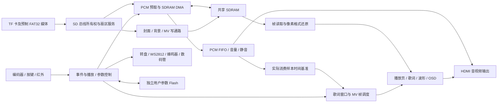

# VinylFPGA 项目详细分析

分析日期：2026-10-29。对象：当前工作区，Git HEAD `df358a6`，包括尚未提交的背景双缓存修改。

本次工作为代码与证据分析，没有修改 RTL、约束、工程参数，没有启动新的 TD 构建或烧录设备。读取时主工程已有另一轮物理实现正在运行。本报告区分当前代码、历史构建、历史人工验收和本次实际执行的检查，不以其中一项代替其他项。

## 1. 总体判断

VinylFPGA 是基于 EG4S20BG256 的唱片主题本地音视频交互原型。它已经形成从媒体制作、TF/FAT32 读取、SDRAM 缓存、PCM 播放、MV 调度、HDMI 图层合成到实体控制、灯效、参数保存和错误恢复的完整工程链路。

项目当前最有价值的成果是多个实时数据通路的协作，以及对共享 SD 总线、共享 SDRAM、媒体会话和显示帧边界的处理。音频、歌词与 MV 采用统一的实际播放位置，实体交互与屏幕反馈形成了可演示的产品体验。

现阶段的主要限制是资源及布线余量、固定媒体格式和曲库、版本证据分散。适合定位为完成度较高的固定内容多媒体原型与 FPGA 系统工程作品；若面向通用消费者，则需要进一步解决换曲库、格式兼容和长期稳定性验证。

## 2. 版本状态：必须分开看

| 对象 | 已有证据 | 当前可得结论 |
| --- | --- | --- |
| README 中的 10 月 23 日版本 | 六帧缓存、当时的时序与候选描述 | 属于历史版本介绍，不能描述当前全部实现 |
| 10 月 29 日 font32 稳定版 | 完整构建、setup +0.148 ns、hold +0.030 ns；收尾记录和清单记录用户人工验收通过 | 可作为当前修改的稳定回退基线；本次没有重新上板验证 |
| 当前双艺术背景缓存源码 | 相比旧候选有 8 个源码文件变化；当前源码与 r2 构建快照的 142 个输入哈希完全一致 | 当前工作区和该轮构建的输入身份一致 |
| 当前 r2 物理实现 | 已完成布局；读取时仍在布线，无最终 route/bitgen 完成证据 | 不具备最终时序或新固件放行结论 |

旧 `closeout_candidate_20261029.json` 的 `board_acceptance` 已为 `passed`，但仍列出 SDRAM 位置、时钟本地布线和资源目标三个待处理事项。文档存在时间先后的状态差异：早期交付记录写“待实板”，后续《收尾验收记录》已经记载用户验收通过。应优先采用后续明确指向具体版本的记录。

本次实际运行旧候选校验器，因 `src/top_tf_hdmi_audio.v` 哈希变化而拒绝当前源码，这是预期的版本隔离行为，不代表旧候选文件损坏。当前修改应生成自己的发布清单，不能直接更改旧清单的哈希。

主要证据：`doc/开发方案/收尾验收记录_20261029.md`、`doc/开发方案/closeout_candidate_20261029.json`、`.codex_tmp/background_switch_20261029/build_inputs_r2/inputs.sha256.json`。

## 3. 工程规模与结构

本次扫描 `src` 中有 133 个 `.v` 文件、42,186 行文本；其中包含生成 ROM、IP 和加密文件，不能等同于手写逻辑行数。顶层为 2,996 行；`sim` 递归发现 189 个 `tb*.v`，包括历史版本和生成测试台，不能等同于 189 项独立有效测试；`tools` 有 78 个 Python 脚本。

| 目录 | 职责 | 分析 |
| --- | --- | --- |
| `src/SD` | SD 命令、FAT32、媒体索引、封面和帧缓存控制 | 同时包含存储与部分显示基础设施，历史整合痕迹较明显 |
| `src/audio` | 会话、seek、SDRAM 预取、PCM、音量与输出适配 | 实时性和连续播放的核心 |
| `src/video` | MV、背景缓存、共享 writer 和帧选择 | 共享资源协调最集中的区域 |
| `src/display` | 播放页、歌词、字库、进度、波形、参数 OSD | 产品视觉层，已具有多模块复用 |
| `src/io` | 输入同步、去抖、事件、控制、反馈、Flash | 将物理输入和媒体业务分开 |
| `src/IP`、HDMI 与 include 加密模块 | PLL、FIFO、SDRAM、HDMI 等 | 交付依赖厂商 IP、模型和工具版本 |
| `tools`、`sim` | 媒体准备、构建、回归、等价验证、交付校验 | 验证基础较丰富，但运行入口和结果位置较分散 |
| `doc`、`docs` | 产品、设计、计划与历史记录 | 证据充足，缺少持续更新的唯一当前版本入口 |

## 4. 音频架构：最值得保留的设计

### 4.1 大容量预取与低水位控制

实际路径为 SD 扇区服务 → `audio_prefetch_sdram` → `audio_sdram_dma` → SDRAM 音频环 → `wav_stream_player` 的 PCM FIFO → 音量/静音/混音适配 → HDMI 音频输入。

生产默认参数为预填充 960 扇区、高水位 1008 扇区、低水位 960 扇区。音频格式为 48 kHz、16 bit、单声道，因此消费速率为 96,000 B/s。由代码参数计算：960 扇区对应 5.120 秒内容，1008 扇区对应 5.376 秒内容。这是缓存内容长度，不是已经测得的任意卡停顿容忍值；真实可承受停顿取决于当时占用、在途事务与仲裁。

PCM 借用 SDRAM 低 8 位，在地址 0..524287 上保存 512 KiB 内容；图形使用高 24 位，依靠字节掩码互相隔离。这减少了额外帧存储空间需求，也是必须保持严格验证的关键契约。

音频低水位限制 MV/背景读卡，CMD17 待处理请求在总线所有权竞争中优先。音频连续性有明确的资源保障结构，比仅在末级 FIFO 欠载后再补救更合理。

代价是首次播放、切歌和 seek 的重新预缓冲成本。体验优化应区分首次启动、同曲 seek 和切歌，不宜通过统一降低预填充换取表面的低延迟。

### 4.2 以实际消费位置驱动视觉

顶层 `timebase_48k` 接入 `wav_sample_consumed`，歌词、进度和 MV 时间围绕实际播放消费推进。暂停冻结消费与时间，seek 加载目标位置，切歌回到零。

这个设计可以避免存储暂时供数不足时，屏幕时间按理想采样节拍继续跑而声音落后的问题。数据链路还会产生独立的 48 kHz 输出节拍；应区分“采样节拍”和“媒体时间推进依据”，不能只根据模块注释判断。

### 4.3 会话重启与定位

`seek_controller` 负责目标计算、边界钳位和连续操作的目标累加；`stream_session` 负责停发、等待存储事务和读端排空、等待元数据稳定，再启动下一代会话。模块分工清楚。

当前 seek 的音频扇区位置为目标样本除以 256，扇区内位置为低 8 位；MV 用目标样本除以 4800 对应 10 fps 帧号。现有串行定位器及调度失效处理避免在计算中途发布错误帧。

这也解释了为什么“数码管已跳到目标”不能代替检查实际首个 PCM 样本和 MV 首帧。本次定位检查覆盖了时间、目标帧、正反向定位的 LBA、扇区内偏移及首个 PCM 样本，但模拟扇区响应不能替代整条真实卡与 SDRAM 路径。

## 5. 视频、MV 与背景

### 5.1 当前 MV 是三缓冲

当前顶层定义三个 320×240 MV 地址槽，`mv_frame_scheduler` 区分正在显示、已经完成待显示、正在写入三个角色，只在帧边界提交显示帧。它按音频时间跳过过期帧，使慢卡情况下优先恢复同步。

README 仍以 10 月 23 日六帧紧凑缓存为最新说明，已经与当前三缓冲代码不一致。项目介绍、资源数据和答辩说明应以最终冻结版本为准。

MV 是 320×240 RGB565、10 fps 的逐帧原始数据，代码和打包器未体现 MP4/H.264 解码链路。每帧 153,600 字节，即 300 扇区；视频净读量 1,536,000 B/s，加上音频为 1,632,000 B/s。该数值由格式计算，不包含命令、token、CRC、空隙、重试和其他媒体读取。

SD 控制域为 100 MHz，默认高频 SPI 分频参数 0，代码给出的时钟关系对应约 25 MHz SPI，理论线速 3.125 MB/s。净媒体需求约占该理论上限的 52.2%，并不意味着还有同等可用余量：字节间隔、命令开销和卡的长尾延迟都会降低有效服务能力。

因此，有界 8 扇区 CMD18、两个扇区暂存 bank、明确总线 owner、块边界停止和错误后复位恢复，都是直接服务于连续播放的重要设计。它们的作用应结合最坏服务间隔评估，不能只看平均吞吐。

### 5.2 新增双艺术背景缓存的方向合理

旧实现的两张静态艺术图共用整帧槽，模式切换要读 1200 扇区，所以发生灰色回退等待。当前修改将两张 RGB565 图放入同一 32 位 word 的高、低 16 位，各自维护 ready，并在读侧还原 RGB888。

这保留了输入图的 RGB565 信息和 640×480 分辨率，预热完成后切换只需帧提交，不再为每次模式切换重新读完整图。静态图 ready 与专辑替换 epoch 分开，也避免切歌时不必要地使静态背景失效。

复杂度集中在字节掩码、写尾保持、读突发格式锁存和 CDC。当前修改覆盖了这些环节，且已有真实 FIFO/加密 SDRAM 控制器的历史定向验证记录。本次重新执行显示回归，不代表重跑了全部厂商模型实验。

仍需保留的体验边界：刚上电或恢复后要首次预热；专辑背景仍是单槽，换歌后仍需加载；损坏或未完成图像应该回退。不能将“预热后静态图切换快”扩写为“任何情况下四种背景都零等待”。

### 5.3 SDRAM 地址与容量

| 数据 | 32 位 word 地址 | 格式或共享方式 |
| --- | --- | --- |
| 四张封面 | 0..1228799 | 每像素高 24 位 RGB888 |
| 音频环 | 0..524287 | 与前述封面区域的低 8 位共享，写掩码 `1110` |
| 三张 MV 帧 | 1228800..1459199 | 各 76800 words |
| 当前专辑背景 | 1459200..1766399 | 高 24 位，掩码 `0001` |
| 静态艺术一 | 1766400..2073599 | 高 16 位，掩码 `0011` |
| 静态艺术二 | 1766400..2073599 | 低 16 位，掩码 `1100` |

掩码 1 表示保护对应字节。21 位 word 地址可寻址 2,097,152 words；最高使用位置之后仅余 23,552 words，即 94,208 字节。这里是当前 RTL 地址空间计算，未据此额外推断板上 SDRAM 型号或全部物理容量。

后续扩展完整图像或视频帧，应先重审地址布局与缓存格式，不能直接在最高地址后追加。

## 6. 时钟、复位与 CDC

| 时钟 | 代码频率 | 主要职责 |
| --- | --- | --- |
| `clk` | 50 MHz | 实体输入、参数、反馈和 Flash |
| `sd_card_clk` | 100 MHz | SD/FAT32、媒体控制、预取生产者 |
| `ext_mem_clk` | 125 MHz | SDRAM 读写控制和 DMA |
| `ext_mem_clk_sft` | 125 MHz、移相 180° | SDRAM 硬 IP 采样窗口 |
| `video_clk` | 25 MHz | 像素、音频消费、歌词及 MV 时间 |
| `hdmi_5x_clk` | 125 MHz | HDMI 串行发送 |

已有多种合适的跨域结构：单比特同步、事件 toggle、异步 FIFO、`cdc_bundle_latest` 原子传输慢变元数据、各域复位同步释放。bundle 模块还处理目标域复位后的重新发布，说明设计已经考虑生命周期而非只考虑正常稳态。

需要后续专项审查的项目是约束覆盖范围：`timing.sdc` 将 UI、SD、内存、视频域整体声明为异步组。这会切断组间普通 STA 检查，故必须逐条证明 crossing 的结构和稳定窗口。PLL 来源或“时钟树不同”的注释本身不足以证明所有跨域都安全。

尤其应核对直接使用数据稳定窗口的 seek 目标、writer 地址/掩码、req/ack 周期、媒体独立复位后的旧事务，以及 `*/s1` 宽泛 false-path 的实际匹配集合。这里列出的是审查重点，本次没有证明存在具体亚稳态故障，也没有执行完整 CDC signoff。

SD MISO 和 HDMI 接口的输入/输出延迟模型仍有明确缺口，SDRAM 移相域还存在专门 false path。应以板级时序和厂商接口窗口补全证据，不能为了报告好看填入虚构延迟。

## 7. 资源与实现风险

| 指标 | font32 稳定版 | 当前 r2 已完成布局 |
| --- | --- | --- |
| Slice | 9382/9800，95.73% | 9556/9800，97.51% |
| 9K BRAM | 63/64 | 63/64 |
| 32K BRAM | 3/16 | 3/16 |
| DSP | 10/29 | 10/29 |
| setup WNS | 最终 route +0.148 ns | 尚无最终 route 结果 |
| hold WNS | 最终 route +0.030 ns | 尚无最终 route 结果 |

当前布局面积报告 LUT 为 18,580/19,600，REG 为 12,228/19,600。修改记录的综合 LUT 为 18,214，属于不同阶段的统计，不应混用。布局 QoR 存在 hold 负值，后续 route/fix_hold 可能修复，也可能引入其他取舍；布局结果不能用于最终放行。

当前 Slice 比稳定版增加 174，器件剩余 244 Slice。REG、DSP 与 32K BRAM 仍有余量，但 Slice、9K BRAM 和布线资源更紧。资源优化应从实际稀缺资源出发：优先评估小 ROM/暂存能否迁入 32K BRAM，维持原接口和读延迟，再验证综合映射及最终布局布线。

旧背景修复首轮最终 route 为 setup −0.424 ns；随后对 FAT32 签名比较做了逐拍等价优化，当前 r2 正在实现。因此，功能局部修改引发无关路径违例已经有实际案例。固定 seed 只能提高比较一致性，不能保证修改后一定收敛。

稳定版保留两项关键警告：`PHY-7002` 为 SDRAM 初始位置未被遵守、工具移动实例；`PHY-5079` 为 SDRAM 移相时钟使用本地布线。历史实板验收支持特定版本、特定使用条件下运行正常，但不自动关闭这两项工程审查事项。

## 8. 交互与产品边界

交互结构是“同步/去抖 → 事件 → 浏览或播放控制 → 参数 CSR → 显示/音频/反馈”。相较于多个输入各自写音量寄存器，共享参数所有权和意图桥更容易保持一致。

独立用户 W25Q64 参数 Flash 与启动配置 Flash 在顶层职责上分开，自动保存会等待参数稳定，保存完成后才给成功反馈。这有利于避免误把操作事件当成持久化完成。

唱针控制转盘和唱片灯效，音频播放另有控制；息屏仅修改像素输出，继续保留 HDMI 音频节拍。这些行为构成清楚的产品体验，但不等同于唱针直接拾音，也不构成已测量的整机低功耗结论。

当前媒体边界包括四首预置演示曲、固定规格封面与 MV、裸单声道 PCM、根目录首扇区前 16 项、PCM/MV 物理连续、标题与歌词的编译期 ROM。封面支持 FAT 簇链不代表音频也支持碎片。更换曲库需要联动媒体、索引、字库/歌词和固件，适合固定主题，尚不便于普通用户自由添加歌曲。

波形显示来自 PCM 幅度/包络，没有据此发现 FFT 频谱实现；已有双线性模块文件也不能证明当前产品路径支持任意比例或任意输入分辨率缩放。

## 9. 本次检查与发现

新回归证据位于 `.codex_tmp/project_analysis_20261029/`，旧证据未覆盖。

| 本次实际执行 | 结果 | 边界 |
| --- | --- | --- |
| `verify_seek_integration.py` | 通过 | 3 s、6 s、切歌归零、正反向 PCM 落点；模拟扇区响应 |
| `verify_mv_owner.py` | 11/11 通过 | SD owner、授权等待、超时、错误恢复；字节级卡模型 |
| `verify_stage4.py` | 21/21 通过 | 显示、背景、共享 writer、帧缓存与 MV 边界 |
| `verify_lyric_focus.py` | 8/8 通过 | 含实际顶层控制结构；部分厂商模块使用仿真替身 |
| `verify_fat_signature_equiv.py` | 通过 | 对 `df358a6` 的输出逐拍等价、512 签名边界、错误优先级 |
| GUI 校验器、候选校验器及封面契约单元测试 | 19/19 通过 | 测试校验器与契约逻辑，不是重新构建实物设计 |
| `run_audio_cache_regression.py` | 32/32 通过 | 含 960/1008 生产预填充、919 扇区零新读卡储备、环回、RGB 字节隔离和 EOF |
| 当前 GUI 构建产物校验 | 未放行 | 缺少 `.multiSeed.end.f` 等最终产物，构建仍在进行 |
| 旧候选清单校验当前源码 | 按预期拒绝 | 当前 8 个源码文件已变化，不应沿用旧 bit 身份 |

### 9.1 确认发现：构建脚本测试夹具过期

`tools/test_closeout_build_script.py` 的 `setUp` 只写入 seed 片段；当前 `run_closeout_project.tcl` 已增加七项持久化参数前置校验，还读取 `route.qor`。直接运行原四项测试得到 1 个 failure、1 个 error，另两项仅因更早的异常而满足 `assertRaises`，没有实际触达其声称覆盖的时序/bitgen 检查。

本次依照 `systematic-debugging` 的先定位再验证流程，仅在测试进程的临时夹具中补入七项参数和零违例 route QoR，四项随即全部通过。没有修改仓库测试文件。这支持“测试夹具未跟进脚本契约”的根因判断，不是生产脚本构建功能失效的证据。

建议更新夹具，并对异常消息和阶段副作用作断言，防止错误分支因无关的前置异常而误报通过。历史文档中的“4/4”不能替代当前原测试重新执行的结果。

### 9.2 确认发现：测试执行入口不统一

从仓库根目录以 `python -m unittest tools.test_verify_gui_runs ...` 运行部分测试时，裸模块导入无法解析。将 `tools` 加入该测试进程的 `sys.path` 后相关 19 项通过。这是入口/导入约定问题，不是这些校验器本身失败。后续宜给出一个正式支持的根目录测试入口。

### 9.3 确认发现：当前说明与代码状态分散

README 停在 10 月 23 日，当前已加入后续仲裁、定位、字库和双背景修改；早晚两份收尾记录的人工验收状态不同；当前源码与旧候选哈希不一致。这些差异各有正常开发原因，但在交付和演示时容易引用错版本，应建立当前版本索引。

## 10. 建议的工作顺序

1. **先完成当前版本闭环。** 等待已有 TD 构建结束，核对最终 route setup/hold、违例端点、阶段标记、bit、选中结果与源码快照。失败则保留稳定回退版本；通过后另建候选身份。
2. **对同一候选做实板回归。** 冷启动、静态图预热后循环切换至少 20 次、切歌、暂停/恢复、快速正反向 seek、首尾定位、MV 与背景同时使用；记录串口错误、欠载和可见拼帧/灰闪。不同卡和长时间测试需要单独记录条件。
3. **修复验证基础设施。** 同步构建脚本夹具，断言错误原因，提供统一 smoke/full 测试入口；把当前源码、媒体、工程策略和板上固件哈希写入同一发布索引。
4. **冻结后再优化资源。** 针对 9K BRAM 和 Slice 建立分模块资源账，优先进行不改变行为与延迟的存储迁移或重复逻辑合并；每轮同时看资源和 route timing，不以 LUT 减少推导时序变好。
5. **再做结构整理。** 在行为保持、回归可运行的前提下，将约 3000 行顶层按时钟/复位、媒体服务、音频、显示、UI/参数分层；把地址、格式和跨域契约集中说明。临近演示时不宜大范围重构。
6. **产品化方向优先做曲库更新。** 若继续面向用户，先设计可更新歌词/标题及媒体格式的版本化契约和 PC 制作工具，再评估更多编码格式；增加界面效果不是当前最关键的产品缺口。

最终定位建议：强调“FPGA 中的媒体实时协作、可见的实体交互和固定主题离线体验”。项目已有足够丰富的功能，当前最有价值的后续工作是让同一固件版本的行为、时序、媒体和实板证据保持一致。
