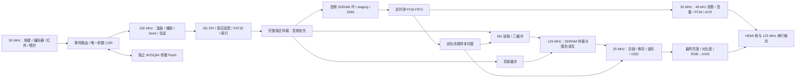

# VinylFPGA 项目详细分析

分析日期：2026-10-21（Asia/Shanghai）  
工作区：`D:\Data_Backup\VinylFPGA_Workspace_Base\VinylFPGA`  
源码基线：`f60e260d1154bb604637d6854c17aca539a91926`

> **2026-10-21后续封版状态更新：** 用户已确认交付版本固定和最终验收完成，后续只整理交付材料与演示视频。当前 `best_result`、`phy_1`、`seed_6` 的bit一致，SHA-256为 `5e41a3882d0fde4c00f46ac1e31ad8107dd763b1a2ec176da83b8ed05bae0b62`；现有验证器带输入快照核对通过（`snapshot_checked=true`，139项输入一致）。下文先前的待验收/输入绑定缺口保留为分析当时的记录，不再作为继续开发安排。最新交付与拍摄入口见[封版多机位视频包](../../../doc/产品项目输出/演示视频_封版多机位版_20261021/00_从这里开始.md)。

## 1. Overview：项目定位与总体判断

VinylFPGA 是运行在安路 EG4S20BG256 上的硬件媒体播放器：TF 卡提供媒体，SDRAM 提供音视频缓存，HDMI 同时输出画面和音频，扩展板与母板完成选曲、播放、暂停、定位、参数调节和状态反馈。唱针、电机、双灯带和唱片界面构成了产品交互。

当前代码的主要价值在于：用多个时钟域中的状态机、缓存、事务握手和仲裁器，协调不稳定的 SD 卡服务与连续的音视频输出。播放体验建立在这些系统机制之上。

**总体判断：系统功能已经集成，已有相当扎实的定向验证；下一阶段应优先完成版本交付一致性和真实板卡验收，同时保护资源与时序余量。** 本轮未发现被已执行回归复现的新增功能阻断问题，但发现了发布目录固件与当前 GUI 选中固件不一致、资源紧张、约束覆盖边界和若干维护性问题。

必须区分三个事实层级：

| 层级 | 本次能确认的内容 | 不能由此推出的结论 |
| --- | --- | --- |
| 当前源码 | 结构、连接、格式限制、已运行仿真行为 | 任意 TF 卡、显示器及物理板卡均稳定 |
| 已有 TD 产物 | 当前选中 seed 6 的原生报告、完成标记和选中副本通过验证 | 本轮重新完成了综合、布局布线或对所有 CDC 做了物理证明 |
| 发布素材 | 镜像 SHA-256 与清单一致，索引/封面/音频/MV 数字回读通过 | 实体卡已经写入、固件已经烧录、听音与歌词同步已验收 |

## 2. 工程入口、目录与规模

实际工程入口是 [VinylFPGA.al](D:/Data_Backup/VinylFPGA_Workspace_Base/VinylFPGA/prj/VinylFPGA.al)，顶层模块名为 `top`，定义在 [top_tf_hdmi_audio.v](D:/Data_Backup/VinylFPGA_Workspace_Base/VinylFPGA/src/top_tf_hdmi_audio.v)。工程使用 TD 6.2.168116，器件为 EG4S20BG256。

本轮统计 `src` 共 **137 个文件、41,192 行**，其中顶层 **2,902 行**。统计包含生成 ROM、厂家包装及加密内容，不能把全部行数理解成手写业务 RTL。`.al` 显式引用 59 个源文件/约束文件，所引用路径均存在。许多业务模块由顶层 `include` 引入，因此不能只看 `.al` 的文件数量判断是否缺少模块。

| 目录 | 文件数 | 行数 | 主要职责 |
| --- | ---: | ---: | --- |
| `src` 根目录 | 13 | 3,920 | 系统集成、复位、CDC、HDMI PHY、RGB→AXIS |
| `src/SD` | 24 | 6,118 | SPI/SD、扇区适配、FAT32、索引、封面与共享帧 FIFO |
| `src/audio` | 17 | 1,937 | SDRAM 预取、DMA、PCM FIFO、播放会话、Seek、HDMI PCM |
| `src/video` | 9 | 867 | SD 仲裁、MV 三缓冲、背景加载与共享写入 |
| `src/display` | 23 | 15,300 | 页面、歌词、字库、进度、波形、亮度/对比度、转场 |
| `src/io` | 32 | 4,176 | 输入同步、消抖、NEC、事件路由、参数、Flash、执行器 |
| `src/boot` | 2 | 926 | 开机 Logo 与启动显示 |
| `src/IP` | 6 | 2,046 | PLL、FIFO、SDRAM 相关厂家包装 |
| `src/include` | 10 | 861 | 事件、索引、布局与几何常量、SDRAM 文件 |
| HDMI 加密核目录 | 1 | 5,041 | 官方 HDMI 发送核 |

`sim` 保存了大量单模块、集成与历史对比试验，`tools` 保存媒体构建、回归、构建归档与发布校验入口，`constraints` 保存 ADC/SDC。`doc` 同时包含开发记录、竞赛材料、教程和媒体；`docs/superpowers` 保存部分设计与计划。

本次开始前已有两处工作区差异：`prj/.lock.f` 被删除、`prj/out/back_annotation.adc` 被修改；本次保留它们。源码与约束的分析前后哈希一致。

## 3. Visual Diagrams：主数据流与依赖



主依赖可按三层阅读；以下为源码实例关系，厂家加密内部不计入源码审查：

```text
top
├─ sd_card_bmp
│  ├─ fat32_media_loader
│  │  ├─ fat32_volume_scanner / fat32_file_streamer
│  │  └─ song_index_db / sd_sector_adapter
│  └─ sd_card_top → sd_card_cmd / sd_card_sec_read_write / spi_master
├─ audio_prefetch_sdram → audio_prefetch_stage / audio_sdram_dma
├─ wav_stream_player → 双时钟 PCM RAM、Gray 指针与水位控制
├─ frame_read_write → frame_fifo_read / frame_fifo_write / 读写异步 FIFO
├─ s6_video_layer → mv_frame_scheduler
├─ playback_page → playback_background / lrc_five_osd / song_font_rom
├─ expansion_integration
│  ├─ expansion_io_hub → 同步 / 消抖 / 编码器 / 红外
│  ├─ ui_event_bus / ui_command_router / health_monitor
│  └─ 蜂鸣器 / LED / WS2812 / 唱针与电机反馈
└─ ui_param_persistence → w25q64_param_store → nvm_spi_transaction
```

完整明文模块关系保存在本轮 `analysis_evidence.json` 中；该关系由去注释后的静态解析得到，并非综合展开网表，条件编译和优化后的实际存活资源应以 TD 层次报告为准。

## 4. Implementation Details：存储与媒体契约

### 4.1 PC 工具与 FPGA 共同构成媒体系统

[vinyl_packer.py](D:/Data_Backup/VinylFPGA_Workspace_Base/VinylFPGA/tools/vinyl_packer.py) 负责文件布局、索引生成、CRC 与回读。RTL 负责挂载、索引解析和媒体读取。大量格式工作在 PC 端提前完成，这使硬件能在有限资源内实现完整体验。

当前生产链的实际限制：

| 对象 | 当前实现与限制 | 影响 |
| --- | --- | --- |
| 文件系统 | 支持的 FAT32 子集；识别直接引导卷或 MBR；根目录只扫描首扇区 16 项 | 普通复制新增文件可能越过硬件可见范围；不能当完整文件系统使用 |
| 曲目 | 当前最多 4 首；索引负责媒体位置/长度/能力 | 扩展曲数涉及多处位宽、元数据和素材生成 |
| 音频 | 48 kHz、16-bit signed、单声道、little-endian 裸 PCM | `wav_stream_player` 不解析任意 WAV 文件头，也不解码 MP3/AAC |
| 音频布局 | 生产读取按连续 LBA 前进 | 碎片音频不属于当前可靠支持范围 |
| 封面 | 640×480、24-bit BMP，像素偏移固定 54 字节 | 外部 BMP 应先转换；扩展头部偏移会被拒绝 |
| MV | 320×240、RGB565LE、10 fps、每帧 153,600 字节/300 扇区、连续布局 | 不含通用视频压缩解码；帧率与几何改变会影响调度和缓存 |
| 歌词/标题/字体 | 当前显示消费编译进固件的 `song_text_rom` / `song_font_rom` | SD 上存在歌词文件或能力位，不等同于运行时可显示任意新歌词 |

因此，**更换歌曲时要把卡镜像、索引、歌词/字库 ROM 和固件当作一套版本管理**。仅替换卡上的音乐文件，不能保证歌词、标题、时长和能力映射正确。

FAT 文件流与生产连续音频路径也要分别理解：文件流支持跨簇与碎片链，并不表示 PCM/MV 的连续扇区路径自动获得同样能力。

### 4.2 当前媒体资产状态

当前人工校准歌词的 ROM 显示行数为 **128 / 72 / 22 / 61，共 283 行**。本轮两次清洁生成一致，且与仓库 ROM 一致，LYR2 CRC、字形 ID 和时间戳逐项回读通过。早期记录中的 281 行和第二曲 70 行，不能继续用作当前版本事实。

当前几何限制为每曲最多 128 行、每行最多 16 个字形。第一曲已经达到行数上限。ROM 的时间字段为 18-bit 毫秒，表达上限为 262,143 ms；超过约 4 分 22 秒的歌词时间戳需要调整编码或切分策略。曲目时长本身和歌词时间字段不是同一个位宽，不能混为同一限制。

发布镜像大小为 **1,610,612,736 字节（1,536 MiB）**。整文件 SHA-256 实测与清单一致：

```text
3bf36c259d093b9f85fd538892e11c74275b1e68111ed366b8c77e58cd654654
```

本轮 `vinyl_packer verify --width 640 --height 480` 对索引、四曲封面/音频 CRC 及四支 MV 的位置、长度、连续性与数据读取做了数字检查。MV SHA-256 由校验器计算输出；整个镜像与发布清单一致的额外哈希核对，才把这些数据绑定到发布版本。

## 5. 音频链路：优先保障连续消费

主要入口：[audio_prefetch_sdram.v](D:/Data_Backup/VinylFPGA_Workspace_Base/VinylFPGA/src/audio/audio_prefetch_sdram.v)、[audio_sdram_dma.v](D:/Data_Backup/VinylFPGA_Workspace_Base/VinylFPGA/src/audio/audio_sdram_dma.v)、[wav_stream_player.v](D:/Data_Backup/VinylFPGA_Workspace_Base/VinylFPGA/src/audio/wav_stream_player.v)。

数据流是：SD 原始扇区 → staging RAM → SDRAM 环 → staging 读回 → PCM FIFO → 音量/转场增益 → HDMI PCM。单声道样本复制到左右声道输出。

音频 SDRAM 环有 1,024 个扇区槽，默认预填与低水位均为 960 扇区，高水位为 1,008 扇区。按当前格式：

```text
消费速率 = 48,000 × 2 = 96,000 B/s
960 扇区储备 = 960 × 512 / 96,000 = 5.12 s
完整环容量 = 1,024 × 512 = 512 KiB，约 5.46 s 音频
PCM FIFO 名义容量 = 4,096 × 16 bit = 8 KiB，约 85.3 ms 音频
```

预填的是 5.12 秒音频数据，并非上电或切歌固定等待 5.12 秒；填充时间取决于实际读卡服务。

关键工程处理是合理的：

- 只有完整的 512 字节扇区通过字节序号/数量检查，并且 DMA 写入完成，才提交环条目，避免半扇区成为可播放数据。
- 当前顶层明确把 `audio_urgent` 固定为 1，并在低储备时阻止 MV/背景获取新扇区。模块中虽然保留 15:1 配额逻辑，生产实例采用的是音频优先策略。
- Seek、切歌和停止先撤销播放，再等待在途 SD/DMA/读侧事务排空。已经发给 SDRAM 的命令不能通过清空状态机撤回；晚到读数据要隔离。
- DMA 报错后仍保留已发事务的所有权与排空逻辑，保护后续图形数据不被旧音频返回污染。若底层永远不返回，协调复位才是安全恢复边界。
- 初始预取、暂停和浏览期间维持 48 kHz 零样本及 ACR 节奏，减少 HDMI 音频流中断。
- 歌词、进度与 MV 使用实际消费的 `wav_sample_consumed` 推进。缓存等待时不会出现屏上时间继续走、音频尚未消费的分离。

这套结构能吸收有限长度的慢卡窗口，无法用有限缓存补偿持续低于消费需求的服务。应观察最长停顿窗口和储备最低值，而不只看平均读速。

## 6. 视频、SDRAM 地址与显示流水线

### 6.1 地址范围与字节平面

21-bit SDRAM 用户地址对应 2,097,152 个 32-bit 字。当前布局如下，区间均为**字地址，右端不含**：

| 用途 | 地址区间 | 长度 |
| --- | --- | ---: |
| 四个 640×480 封面槽 | `[0, 1228800)` | 4 × 307,200 字 |
| MV bank 0 | `[1228800, 1305600)` | 76,800 字 |
| MV bank 1 | `[1305600, 1382400)` | 76,800 字 |
| MV bank 2 | `[1382400, 1459200)` | 76,800 字 |
| SONG 背景槽 | `[1459200, 1766400)` | 307,200 字 |
| ART 背景槽 | `[1766400, 2073600)` | 307,200 字 |
| 图形地址尾部剩余 | `[2073600, 2097152)` | 23,552 字 |

图形覆盖的字地址范围占 **98.88%**。这不是 SDRAM 所有字节都占用 98.88%：图形像素存储使用高三个字节，音频 DMA 使用低字节，其中音频环使用低字节的前 524,288 个地址。

图形路径设置 `PRESERVE_LOW_BYTE=1`，写 mask 为 `0001`；音频 DMA 写 mask 为 `1110`。两者保护不同字节平面。因此不能把低字节保护视作可删除的冗余逻辑，也不能在扩展图形缓存时直接覆盖整个 32-bit 字。

若后续要扩大 MV 或增加背景，应先重算地址和字节平面，再改 RTL/素材。直接增加第四个 MV bank 会侵入当前背景区。

### 6.2 MV 三缓冲和带宽

[mv_frame_scheduler.v](D:/Data_Backup/VinylFPGA_Workspace_Base/VinylFPGA/src/video/mv_frame_scheduler.v) 将 bank 分成正在显示、已完成待显示和正在写入三个角色。新画面在 `frame_start` 提交，未来帧不会提前显示，过期帧可以跳过，慢卡时保留已完成的当前画面。

请求 LBA 使用 `start_lba + frame × 300`，目标帧按实际音频毫秒时基每 100 ms 推进。这把 MV 关联到音频进度，避免分别计时的长期漂移。

媒体本身的持续数据需求可直接由格式计算：

```text
MV：320 × 240 × 2 × 10 = 1,536,000 B/s
PCM：48,000 × 2 = 96,000 B/s
合计：1,632,000 B/s，尚未计 SD 命令、令牌、CRC、卡等待和背景加载
```

SD 控制器的高速默认参数为 0，代码给出的 SPI 公式在 100 MHz 域对应名义 25 MHz，即理想线速 3.125 MB/s。字节状态机和卡协议降低有效服务率；上面的需求/线速比不能替代真实持续吞吐量测试。

三缓冲解决显示与写入冲突以及帧边界提交问题；面对慢卡时，音频优先策略允许画面保持或跳帧。这是当前实现的体验取舍。

### 6.3 最终像素与控制信号对齐

当前播放显示从共享 SDRAM 读出媒体，经过页面、歌词/进度、波形和 EC2 面板，再选择 Boot 或消隐，最后统一应用亮度/对比度，进入 RGB→AXIS 和 HDMI 核。

最新提交 `f60e260` 把校正放在最终合成像素处；`final_vs_q` 配合校正寄存级对齐 VS，DE 使用校正级输出。消隐采用单位校正，使黑色保持精确黑。该实现避免播放页、MV 与 OSD 各自采用不同的亮度路径。

这一点已由当前源码连接核对，校正模块 16,385 项算术/对齐检查通过；完整画面的色彩、显示器兼容性仍需实板视觉确认。

## 7. 交互、参数所有权与持久化

输入采用同步 → 消抖/解码 → 事件聚合 → 路由 → 业务命令的结构。`ui_command_router` 处理红外开关、消隐和唤醒等公共语义，播放和浏览模块消费净化后的事件，减少多个模块直接解释同一实体按键的歧义。

EC1 负责主要选曲/播放交互，播放中支持定位；EC2 负责参数面板和参数调整。工程保留了编码器绝对计数/基线和重放逻辑，用于处理忙窗口及唤醒首步吞掉后的计数一致性。仅用脉冲穿域会使这些行为更难保证。

`ui_param_csr` 是 VOL、BRI、CON、ROT、WSL 的唯一参数所有者。播放域的音量意图经异步 FIFO 返回 UI 域，与 EC2 请求仲裁；UI→视频参数用 bundled-data 握手，再在帧边界快照。参数源头和屏上显示由此保持一致。

[w25q64_param_store.v](D:/Data_Backup/VinylFPGA_Workspace_Base/VinylFPGA/src/io/w25q64_param_store.v) 访问独立的 U33 W25Q64 用户 Flash，预留两个 4 KiB 扇区 `0x7FE000 / 0x7FF000`。它与启动配置 Flash 的职责不同。

16 字节记录包含版本、序号、参数、CRC16 和提交标记。先写载荷并回读，最后独立写提交标记；旧的有效记录在新记录提交前保留。启动时检查版本、范围、CRC 与序号，用户在启动恢复期间进行操作时，操作优先于旧 Flash 值。自动保存默认等待参数稳定 5,000 ms，并抑制无变化的重复保存。

本轮 Flash 模型测试覆盖保存快照、保存中再编辑、掉电载荷、CRC 损坏、序号回卷、恢复默认、写使能拒绝、器件缺失和预先存在的 WIP。它证明模型下的事务行为，不提供真实 Flash 擦写寿命或电源跌落曲线的保证。

当前 `expansion_integration` 明确 `assign uart_tx = 1'b1`，串口回显已经退出生产路径。顶层端口旁的“115200 8N1 回显”以及部分 S1 历史注释需要更新，避免误导调试与答辩。

## 8. 时钟、复位与 CDC

| 时钟 | 频率 | 主要用途 |
| --- | ---: | --- |
| `clk` | 50 MHz | UI、Flash、执行器 |
| `sd_card_clk` | 100 MHz | SD、FAT32、播放控制、缓存生产侧 |
| `ext_mem_clk` | 125 MHz | SDRAM 用户接口、DMA、图形读写 |
| `ext_mem_clk_sft` | 125 MHz，移相 | SDRAM 厂家接口窗口 |
| `video_clk` | 25 MHz | 像素、PCM 消费、歌词与进度 |
| `hdmi_5x_clk` | 125 MHz | HDMI 串行输出 |

PLL 输出与原生 timing report 的时钟表相符。视频代码的 640×480 时序参数与 25 MHz 像素时钟共同决定实际帧频，报告中不应只写一个没有测量依据的固定“60.000 Hz”。

全局复位组合外部复位、两个 PLL lock 和软复位，再分别通过 `reset_sync` 在各域同步释放。软复位计数器使用外部复位，避免自身陷入复位。媒体故障还有独立 SD 子系统复位以及视频媒体复位，缓存和 DMA 则保留必要生命周期以排空旧事务。

CDC 方法按语义分开：单比特慢状态使用两级同步；稀疏事件使用 toggle/边沿恢复；音频与图形数据使用异步 FIFO；多位参数和元数据使用 `cdc_bundle_latest` 持有载荷并等待确认。该模块允许合并中间值，适合“最终参数”，不适合要求逐项交付的所有业务事件。

当前 [timing.sdc](D:/Data_Backup/VinylFPGA_Workspace_Base/VinylFPGA/constraints/timing.sdc) 对 UI、SD、内存、视频时钟组做了异步分组，保留 video/HDMI 串行时钟间的同步分析。**异步分组不会证明 CDC 正确，只会移除这些组间的常规同步时序检查。**

需要进一步补齐的物理证据包括：Gray 指针跨域的实际传播/位间约束、bundled-data 的载荷稳定窗口与最坏物理延迟、各类独立复位顺序以及同步链物理识别。SDC 中没有看到这些自定义跨域总线对应的独立 max-delay/skew 约束。现有功能仿真通过，不足以把该项表述为已经完成全设计 CDC 签核。

此外，SD MISO、Flash MISO 等板级 I/O 没有完整的外部延迟模型，文件也明确记录了缺少板级/器件数值。HDMI 端口的 8 ns `set_max_delay` 是部分数字约束，不等于完整的外部接收端时序与信号完整性验证。本轮未虚构数值补约束。

ADC 静态检查得到 86 项显式端口位置分配，无重复管脚号；该检查不包含差分负端自动分配、板级连接、电压和实际布线的全面审查。

## 9. 资源与原生物理时序

以下数字来自 **2026-10-20 18:27:07** 的当前 GUI seed 6 原生 routed report，而非早期开发记录。本轮读取并运行现有验证器核对这些产物，没有重新执行 TD 构建。

| 资源 | 使用/总量 | 占用 |
| --- | ---: | ---: |
| LUT | 17,835 / 19,600 | 90.99% |
| 寄存器 | 11,899 / 19,600 | 60.71% |
| Slice | 9,262 / 9,800 | 94.51% |
| 9K BRAM | 64 / 64 | 100.00% |
| 32K BRAM | 1 / 16 | 6.25% |
| DSP | 10 / 29 | 34.48% |
| PLL | 2 / 4 | 50.00% |

**9K BRAM 用满不等于所有类别的片上 RAM 都用满。** 尚有 32K 类资源可研究，但是否能迁移取决于器件资源类型、端口模式、推断/实例化能力和物理布局，不能直接按比特数相加后保证可以复用。

层次报告中的主要逻辑占用如下；LE 包含子实例，不应再叠加同一层次的子项，也不要与总表的 LUT 口径直接混算：

| 顶层实例 | 层次 LE | 说明 |
| --- | ---: | --- |
| `sd_card_bmp_m0` | 4,180 | 含 FAT32 loader、索引、扫描器、SD SPI |
| `u_expansion_integration` | 1,935 | 输入、路由、状态与执行器 |
| HDMI wrapper | 1,725 | 另有 16 个 BRAM 计数 |
| `u_lrc_window_controller` | 854 | 六槽歌词窗口与时间扫描 |
| `frame_read_write_m0` | 839 | 帧读写控制和 FIFO |
| `u_s6_video_layer` | 613 | MV 显示/调度 |
| `u_ui_param_persistence` | 598 | 参数事务与 SPI Flash |

这表明后续优化应优先评估 FAT/索引、输入路由和歌词窗口的结构；仅压缩很小的 DMA 或波形模块，很难解决整个器件的布局压力。ROM/字库重排则关系到 BRAM 使用。

原生最终时序：

| 指标 | 数值 |
| --- | ---: |
| Setup WNS | +0.220 ns |
| Setup TNS | 0 ns |
| Hold WNS | +0.024 ns |
| Hold TNS | 0 ns |
| STA coverage | 99.96% |
| 分析角 | Slow / Fast 两角 |

这些结果在当前约束下通过，但正裕量较小。coverage 99.96% 也不能解释成“99.96% 功能正确”或“所有板级接口已经约束”。

最差 setup 类路径在报告中实际是 **SD 域的 recovery 检查**，进入 `fat32_media_loader/load_size_reg[14].sr`；数据路径延迟 9.244 ns，其中网络延迟 8.607 ns，占约 94%，最大扇出 552。报告将发起寄存器命名为 `u_ui_event_bridge/enc_delivered_b[9]_syn_9`，但路径网络指向 `u_sdcard_reset/s2`。优化后的寄存器名不能直接当作业务因果，应结合网络与复位树分析。

当前瓶颈带有明显的高扇出复位网络与物理分布特征。优先研究复位分布和布局，比直接给普通算术加流水更贴近这份报告；任何修订都必须保持异步断言/同步释放及媒体恢复语义，并重新跑物理流程。

两类 critical warning 仍需记录：

- `PHY-7002`：`U3/sdram` 初始位置未被遵守。它是待解释的物理约束告警，不宜直接宣布“零告警签核”。
- `PHY-5079`：一个时钟使用 local routing。日志具体指向 `ext_mem_clk_sft → U3/u2_ram/SDRAM_CLK`，扇出 1；不是所有 fabric 时钟都在普通布线上。仍应结合厂家 SDRAM 接口窗口确认其可接受性。

## 10. Additional Insights：本轮发现与优先级

优先级用于安排后续工作；“已证实差异”“待补证据”和“扩展风险”不应混写为同一类 RTL 缺陷。

| 优先级 | 发现 | 证据与影响 | 后续动作 |
| --- | --- | --- | --- |
| P1 | 发布目录 bit 与当前 GUI bit 不同 | 两份完整 SHA-256 不同；发布快照之后仅顶层源码发生变化，最新提交修复全局亮度接入 | 明确发布基线，将经输入快照核对的最新固件与报告、镜像、清单一起归档 |
| P1 | 当前源码到最新 routed DB 的输入绑定缺少本轮证明 | `verify_gui_runs.py` 返回 `snapshot_checked=false`；旧人工歌词快照的 top 哈希不匹配当前 top | 找到对应输入快照，或在正式发布前以新快照重建；不能借用旧快照证明新版本 |
| P1 | 资源与时序余量紧张 | Slice 94.51%、9K BRAM 100%、Hold +0.024 ns；图形字地址尾部余量约 1.12% | 新增功能先做资源预算；先完成当前板级验收，再单项优化 |
| P1 | 实板验收状态缺口 | 现有发布记录明确保留未烧录/未写卡/未听音状态；本轮也未进行硬件操作 | 用匹配版本验收四曲全程、Seek、重启、掉电保存、慢卡、消隐和外设反馈 |
| P2 | I/O 与 CDC 的物理证据不完整 | SDC 异步分组和厂家边界有明确豁免；自定义 CDC 缺少独立物理总线约束证明 | 建立逐 crossing 的结构/复位/稳定窗口/例外清单，再补厂家适配的约束 |
| P2 | 位宽告警仍存在 | 新鲜顶层仿真显示 FIFO used-word 9→10 位扩展及 24/48→21 位地址截断 | 显式统一接口宽度与常量切片，覆盖满/空/最大地址；当前固定地址未越过 21-bit 上限，不能仅凭告警宣布发生错址 |
| P2 | 生产媒体校验入口可进一步收紧 | pack 保留 `--allow-fragmented-audio` 特例，而 PCM 按连续扇区读取；verify 对音频输出运行段但未强制只有一个运行段 | 正式发布 gate 明确拒绝碎片音频，并检查所有 ROM/索引/素材版本绑定 |
| P2 | 顶层集成集中、历史入口多 | 2,902 行顶层混合诊断、CDC、内存、显示和产品参数；`.al` 与 include 双重维护 | 先建立唯一构建/回归导航，再按稳定边界渐进提取子系统，保持时序与外部接口 |
| P3 | 注释和文档存在旧事实 | UART 实际固定高；旧材料存在 281 行歌词和旧 WNS；若干 S1 注释仍说不接业务 | 加入当前事实表与日期/提交号，旧记录注明适用版本 |

发布固件哈希对照：

```text
当前 GUI seed 6：
c7def3bfcf14bf8664e5006257b90052d12a7be13ed5a05c4eea38aa38997088

release_20261020_manual_lyrics_4songs_4mvs_fullbleed 内固件：
26baebd9fcf9a051bd91b204fda325e40bf92f29985a21afce10a454ec3fe82e
```

两份文件各自可能对应有效的历史版本；哈希不同本身不证明旧固件已损坏，也不证明新固件与镜像不兼容。它证明“发布目录已包含当前亮度修复”这一说法不能成立，应先明确要交付的版本。

## 11. 本轮执行的验证及边界

本轮重新执行以下命令，退出码均为 0。四套主要 RTL 回归共有 73 条套件记录，其中部分用例跨套件重复；不能把它们当作 73 个互不重叠的功能，也不能据此推导覆盖率百分比。

| 验证 | 本轮结果 | 证据 |
| --- | --- | --- |
| `verify_finish_rtl.py` | 10/10 | `focused/results.json` |
| `verify_final_boundaries.py` | 10/10 | `boundaries/results.json` |
| `run_audio_cache_regression.py` | 32/32 | `audio/results.json` |
| `verify_stage4.py` | 21/21 | `visual/regression_summary.json` |
| Flash 参数模型 `tb_stage4_nvm` | PASS，含 9 组行为标记与最终完成标记 | `nvm.log` |
| `tb_cdc_bundle_latest` | PASS：原子载荷、合并、源/目的复位恢复 | `cdc.log` |
| `verify_brightness_contrast_steps.py` | PASS，16,385 项检查 | `brightness.log` |
| Python unittest 五个模块 | 52 tests，OK | 本轮终端输出；不是 RTL 覆盖率 |
| `verify_calibrated_lyrics.py` | PASS，283 行，重复生成与 ROM/LYR2 回读一致 | `lyrics/results.json` |
| `vinyl_packer.py verify` | PASS：四曲数字媒体检查 | `media_verify.log` |
| 整镜像 SHA-256 | 与发布清单一致 | `analysis_evidence.json` |
| `verify_gui_runs.py` | 完成标记、配置、原生时序和 GUI 副本一致；未传输入快照 | `gui_verified.json` |

证据根目录：[project_analysis_20261021](D:/Data_Backup/VinylFPGA_Workspace_Base/VinylFPGA/.codex_tmp/project_analysis_20261021)。汇总文件为 [analysis_evidence.json](D:/Data_Backup/VinylFPGA_Workspace_Base/VinylFPGA/.codex_tmp/project_analysis_20261021/analysis_evidence.json)。

本轮 Python 单测命令：

```powershell
python -m unittest tools.test_cover_contract tools.test_prepare_s3_lyrics tools.test_verify_gui_runs tools.test_safe_raw_writer tools.test_vinyl_packer
```

`test_safe_raw_writer` 的若干预期失败场景会打印 `status=FAILED`；本轮 unittest 最终结果为 52 tests / OK。测试使用测试夹具，没有进行实体卡写入。

这次未执行全工程 ModelSim 交叉仿真、门级仿真、完整静态 lint/形式验证、重新综合布局布线、板级电气测量或实板播放。顶层控制级仿真使用仓库中的厂家边界 stub；它能检查控制与连接，不能模拟真实 SDRAM/HDMI 硬 IP 的完整物理行为。加密 IP 的内部源码不在本轮可审查范围。

## 12. Next Steps：建议的收尾顺序

1. **先统一交付版本。** 明确使用亮度修复后的源码与固件，保存对应输入哈希、原生报告、bit、镜像和 release manifest。当前已通过的旧发布包应保留其历史身份。
2. **完成匹配版本的实板验收。** 四曲从头到尾播放，观察欠载/保持帧/歌词同步；重复 Seek、切歌、暂停、退出、软复位；分别测 FPGA 复位和整机断电恢复参数。记录板卡、卡型号、显示器、版本和实际结果。
3. **补物理边界证据。** 核实 SDRAM local clock 与位置告警，逐项审查 CDC、复位和外部 I/O 模型；约束值应有板级或器件依据。
4. **再做资源优化。** 先评估 9K/32K RAM 的合法映射、ROM/字库布局以及 FAT/索引的寄存开销。每项优化独立保留基线，运行等价/边界回归和物理流程；保持音频优先、缓存容量与事务排空语义。
5. **整理维护入口。** 增加根 README，明确当前工程、回归、素材生成、发布和写卡入口，标注历史脚本；再渐进拆分顶层。构建脚本有明确的本机 TD/Python 路径与 main 分支要求，迁移前应先参数化并记录依赖。

建议的代码阅读顺序是：顶层与时钟复位 → `stream_session/play_ctrl/seek_controller` → 音频缓存与 DMA → SD/FAT/索引 → SDRAM 与 MV 三缓冲 → 页面/歌词 → 事件与 Flash → 构建/发布工具。这样能先理解事务和数据所有权，再理解像素及界面细节。

## 13. Metadata：分析范围与可追溯性

- 入口：整个项目文件夹，重点覆盖当前顶层、核心媒体/显示/交互链路与配置、原生构建报告和发布资产。
- 深度：系统级与关键模块实现审查，主模块关系展开到约三层；并非逐行证明所有 137 个文件。
- 本轮新增：本分析文档，以及 `.codex_tmp/project_analysis_20261021` 内的只读分析脚本、仿真输出、生成对照和证据汇总。
- 未修改生产 RTL、约束、工程配置和发布固件；未提交 Git、未烧录、未写实体卡。
- 使用 `document-code`、FPGA 设计参考、CDC 分析与证据验证工作方法；FPGA 通用技能引用的 `validations.md/sharp_edges.md` 本机缺失，因此未将其未读取内容作为评审依据。
- 本机 ai-devkit memory 未安装可用包，`npx --no-install` 查询未成功；分析依据为实际工作区源码、已有记录、原生报告与本轮新鲜命令输出。
- 本文档是本轮分析的可保存结果；若后续修改源码/约束，应重新确认输入与报告绑定，再更新相关数值和结论。
